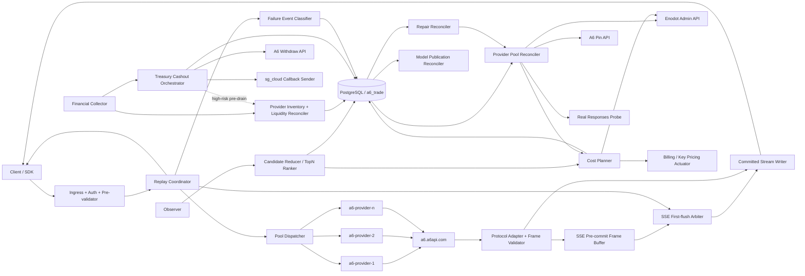
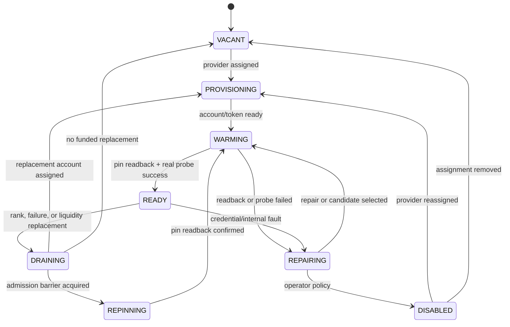
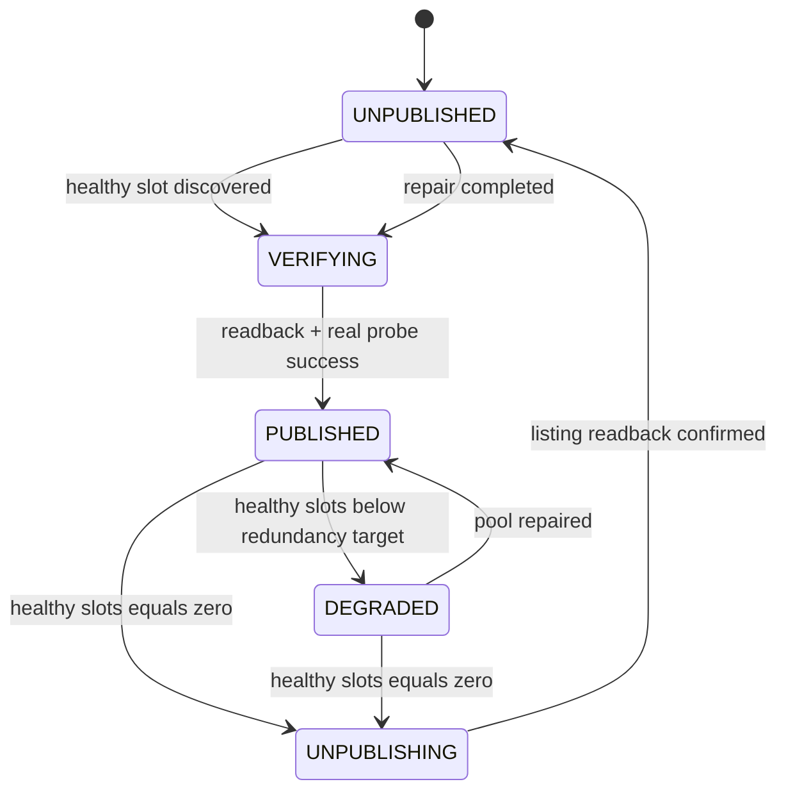
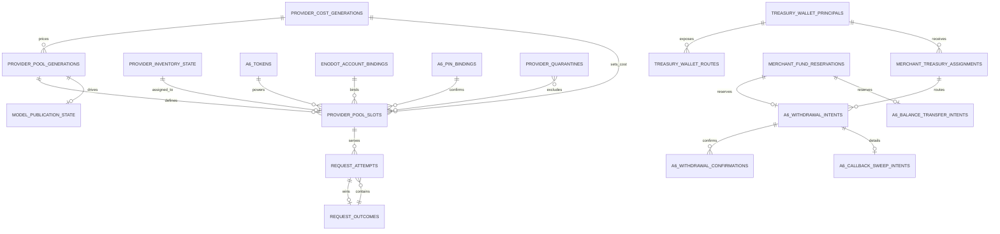
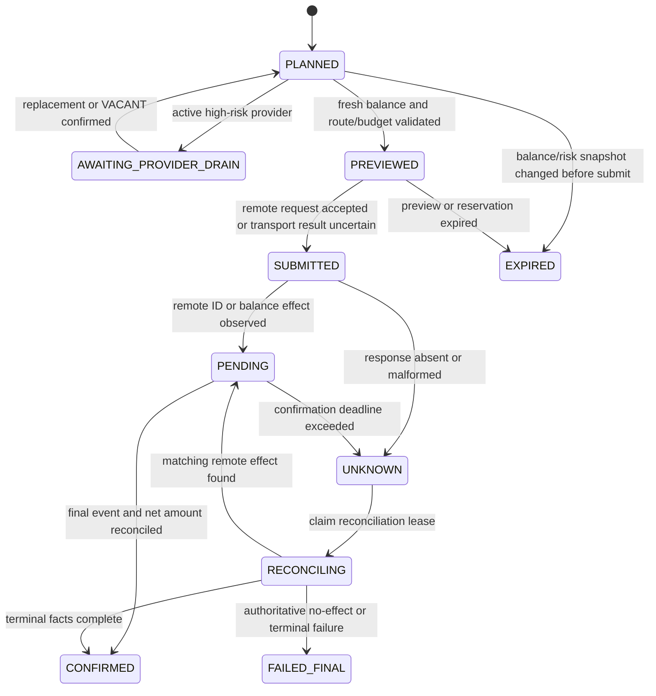
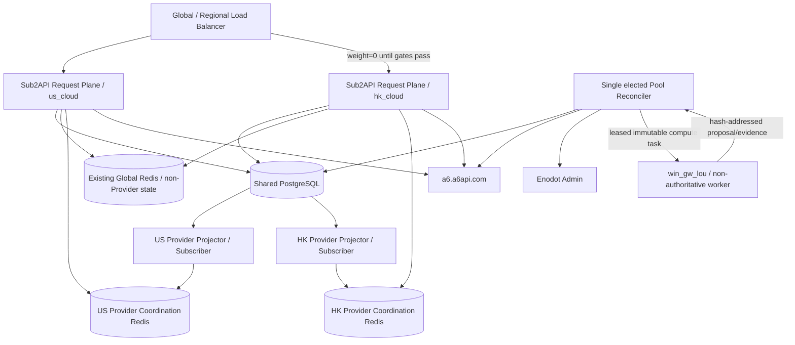

# A6 Provider TopN 池、非流式透明重放、SSE 延迟兜底首包与提交前恢复、模型可用性及风险均衡提现设计

- 状态：进行中；US v67 plan-only shadow、generation retention 与 Sub2API dispatch 最小只读授权已部署，
  HK 隔离请求面已发布 dependency-aware readiness 版本，完成 migration 193、maintenance recovery
  三场景 write smoke，并保留前版
  non-stream/SSE/client-cancel、prepared owner 及 ephemeral local-Redis lower-bound 20/20 durable ledger 基线；Trader
  Phase 7 failure/quarantine/repair/fast-block/publication 和 Go 请求面消费/pre-send barrier 的核心链路
  已完成本地实现与部分隔离验证，但生产 worker/projector/request-plane flags 仍关闭。仍需新版 shadow 连续 24 小时
  门禁、remote apply、US production 二进制/flag、publication SLO、正式灰度和区域协调架构验收
- 日期：2026-07-30；风险均衡提现补充：2026-08-01；本地链路落地：2026-08-02
- 适用范围：Sub2API 请求面、A6 Trader 控制面、Observer、Enodot Provider 账号池、Treasury 提现编排
- 首个模型：`gpt-5.6-sol`
- 设计版本：`a6-provider-topn-failover-v2`

## 当前实现状态（更新于 2026-08-02）

已落地并完成对应验证：

- 2026-08-02 本地实现 Provider Pin 的 canonical channel 失败连续阈值 `3`，但审阅发现现有实现把
  `routing_generation` 放进 streak key，会被无关 routing/cost generation 更新意外清零，尚不满足最终
  契约。目标 key 必须跟随当前 Pin assignment epoch：第 1/2 次上游责任失败只允许当前请求切热备，
  不摘流、不 repin；同一 epoch 的第 3 次连续上游责任失败才持久化 threshold reached、fast-block、
  原子 repin 和 `(model,channel_id)` Channel quarantine 并唤醒 repair。Pin assignment 没有 quarantine
  冷静期；`DRAINING/REPINNING/WARMING` 只是原子切换的内部阶段。只有同一 Pin 承接的真实用户请求完整
  成功才清零 streak；probe 成功和非上游责任终态均不清零，同一失败重放不重复累计。
  同时实现 Pin 更新后的逐 Listing `p2 >= 2*p1` 硬冷静、30-45 分钟下架、成本恢复提前释放，以及
  `offline update/readback -> resubmit`。生产 Seller pilot 的旧 `0.4` 理论 cap 已提高到 `10`，使 `4.x`
  成本先生成安全目标价再进入冷静状态机。对应 migration 为 `0051/0052`；本条尚待发布读回。

- Provider relay 固定 `https://a6.a6api.com`，按 `a6_user_id` 归因但不读取
  `proxy-map.json`；Sub2API Provider 账号使用 `proxy_id=null`。代理映射仅保留给 Trader
  Collector/Observer/Pin/Key reveal 等控制面。2026-07-28 13:07 UTC 已在 `us_cloud` 发布
  独立 relay release，现网 `8767` 已运行 direct unit；Sub2API 两个 request-plane 进程未重启。
- Sub2API Go 账号模型已增加 `IsA6ProviderAccount` 和统一 `UpstreamProxyURL` 边界；旧名称前缀
  `a6-provider-*` 与显式 `extra.a6_provider=true` 均会强制请求面使用空代理，且保留本地 relay
  `base_url`。所有账号出站代理读取点已统一经过该边界，完整 `internal/service` 回归通过；此 Go
  变更已通过 `linux/amd64` 无 CGO 构建并发布到 HK loopback shadow，US 正式 request-plane
  仍未切换。
- 2026-07-29 生产读回全部 17 个 `a6_provider=true` Provider account 均为
  `pool_mode=true`、`pool_mode_retry_count=0` 和空 retry status 集。15 个受管 account 同时保持本机 relay
  base URL、`proxy_id=null`；旧账号缺失的 `extra.a6_provider=true` 已按受管 merchant/token/binding 复合
  身份收敛，重复 dry-run 全部 `noop`。synthetic fixture `45910/45911` 仅补齐上述三个 pool-mode JSON 键，
  其余 credentials canonical hash 保持不变。当时 Provider inventory canonical 为 5 个，旧版资金资格投影为
  2 个；该计数使用了现已废弃的 `$1 user_balance` 门控，只作为生产历史事实，不作为现行资格结论。
- `trade_provider_pool_rank.py`：快照完整性、hash、新鲜度/quorum、自有渠道/故障隔离和严格
  价格排序；`trade_provider_cost.py`：Decimal 向上量化、retry reserve、protected floor 和
  三维 diff。
- `trade_provider_pool.py`、`trade_provider_pool_store.py` 与
  `trade_provider_pool_reconciler.py`：稳定槽位、READY/VACANT、generation CAS、PostgreSQL
  事务实现和可注入 remote adapter 的 saga 编排原语；`0026/0027` 已通过 migration runner 应用及
  真实数据库 fixture。`PostgresProviderActionLedger` 已复用 `trade_control_actions` 与 attempt 表，
  实现短事务 claim、并发 BUSY、completed 续跑、失败 attempt 和陈旧 claim 回收，并通过真实
  PostgreSQL round-trip。`trade_provider_pool_remote.py` 已实现 A6 panel pin、固定
  `a6.a6api.com` 直连 probe、Enodot account cost/priority/schedulable、Enodot group-user billing floor
  和 PostgreSQL pin-binding 的组合 adapter；所有 mutation 透传 action idempotency key 并即时读回，
  最终 strict readback 再核对完整激活证据。每个 READY account 的 Extra 已投影 canonical
  `routing_generation/cost_generation/slot_no/token_ref/channel_id/external_token/rank/cost_multiplier`
  及 source/cost hashes、key fingerprint 元数据；写入时保留无关 Extra、相同 typed subset 零写，PUT 后
  立即读回。`planned_cost_micros` 保留给请求 usage 估值，不用倍率冒充金额。所有 READY 元数据先完成，
  apply 先权威确认 request-plane shared pre-send lease、HTTP/SSE/WS 单付费发送预算 `1` 和 dispatch lease，
  再将所有 outgoing/incoming/desired account 逐个读回为 `schedulable=false`。完整配置读回和成本确认后，
  exclusive barrier 内依次激活 PostgreSQL、原子发布 Redis 并执行 canonical `GET` 精确读回，最后才逐槽位
  恢复 schedulable 并做第二次 strict readback。DB 激活、Redis 发布/读回或任一账号开放失败时，同一 barrier
  内把全部相关账号关回 false、CAS 恢复 parent active generation（bootstrap 则恢复 absent tombstone）并
  恢复 Redis 父代投影。远端写成功、
  ledger 完成前进程中断的续跑测试证明实际 PUT 次数仍为 1。激活事务在关闭旧槽位前锁定并核对完整
  routing/cost 行语义，包括父代、精确 cost 引用、来源/hash/config、TopN/standby 和成本计划；真实
  PostgreSQL 17 的确认后篡改负例保持 `applying/confirmed` 且零槽位写。生产 controller 命令、
  session/secret context、精确 billing scope 和分阶段确认串已随 v63 接线；绝对路径 read-only plan 已证明 `plan_write_count=0`、
  `remote_write_count=0`。apply timer 与 stage 仍关闭，真实远端 E2E 尚未执行。
  v64 在 membership/liquidity 变化时先对变更槽位的 outgoing/incoming Provider 执行 pre-drain，
  再进入 billing floor、cost、repin、probe、priority 和 schedulable；远端去重身份为
  `(account_id, token_id)`，ledger/audit target 仍保留 `(slot_no, account_id, token_id)`，覆盖同一
  身份跨槽位移动且不重复远端 drain 的边界。remote/reconciler/store/apply/shadow-controller 定向回归
  Provider 扩大回归 `440 passed`；全量 Python 回归 `1298 passed, 1 skipped`，Ruff、compileall、
  migration 镜像一致性和 `git diff --check` 均通过。Sub2API `go test ./...` 与
  `go test -tags=unit ./...` 全仓通过，`CGO_ENABLED=0 GOOS=linux GOARCH=amd64 go build ./cmd/server`
  通过；scheduler SWR、replay owner、durable request-ID/usage attribution，以及 A6 dispatch/fast-block/
  pre-send/WS passthrough 相关用例的 `-race` 定向验收通过。三包全量 race
  仍会被既有测试并行共享状态阻断：`usage_cleanup_service_test.go` 的 stub 计数器无同步，
  以及多个 parallel test 并发读写全局 `gin.SetMode()`；这两类不是 A6 写前屏障路径，
  但在清理前不把“全包 race”标记为通过。
- `trade_provider_pool_shadow.py` 与 `scripts/shadow_reconcile_a6_provider_pool.py`：默认只校验，
  显式 `--persist` 也只保存 routing/cost 的 `planned` generation。shadow 路径没有 remote adapter，
  不执行 pin、priority、rate、billing、schedulable 写入，也不进入 `applying/confirmed/active`。
- `trade_provider_pool_shadow_controller.py`：已接入单模型 PostgreSQL evidence adapter，在一个
  `REPEATABLE READ READ ONLY` 事务中读取最新 Observer scan/current signals、健康 quorum、Provider
  inventory、channel quarantine、active/planned generation 与当前槽位；经过快照完整性、新鲜度、
  inventory 资金时效、稳定槽位、TopN 和成本指纹校验后生成 plan-only bundle。相同 active 语义为
  `NOOP` 且零写，相同 planned 语义复用原 generation。systemd 单模型 30 秒 timer 已发布到
  `us_cloud`，运行期间始终保持 `activated=false`、`remote_write_count=0`；每个模型只保留一个
  `planned` routing/cost pair，新证据产生的旧计划会成对 supersede。
- 新计划写入前会在同一事务把被新证据取代的 `planned/planned` routing/cost pair 成对标记为
  `superseded/superseded`。`0029_provider_generation_archives.sql`、
  `trade_provider_pool_retention.py` 与 `scripts/cleanup_a6_provider_generations.py` 已实现 180 天历史
  归档清理：默认 dry-run，只处理过期且无 current/shared 引用的 superseded pair；归档、历史 slot、
  routing 和 cost 删除在同一事务完成，计数不一致则整体回滚。2026-07-28 18:37 UTC 已在
  `us_cloud` 应用 migration `0029` 并切换到独立 v53 release；每日 timer 已 enabled/active，首次
  dry-run 和 apply 均为零候选、零删除。generation 数量随 shadow 证据持续增长，retention 只按
  180 天与引用条件清理，不依赖固定代数。
- Observer scan migration `0030` 已在 `us_cloud` 应用并随 v54 release 启用：完整 canonical quote
  payload 与 `result_hash` 同步保存，shadow 读取时用 constant-time SHA-256 校验；2026-07-28
  19:04 UTC 新 scan（254 candidates）读回 hash 一致后才推进 generation，旧的无 payload scan 会被拒绝。
- 当前仓库 Observer systemd 契约为每 10 秒一轮、单轮窗口 8 秒；但 shadow/apply/repair 的 accepted
  freshness 仍为 120 秒。审阅确认目标收紧为 20 秒，并在 Channel quarantine 到期时触发 single-flight
  coalesced refresh；同时为 pin 写前和 generation 激活前增加 Observer scan/quote/semantic hash fence。
  这些消费者和 action fence 修正完成前，120 秒旧报价不得用于恢复 Channel 的候选资格或 repin。
- v55 release `20260728T1953Z-v55-provider-consistency` 已在 `us_cloud` 发布，migration `0031/0032`
  均已应用。routing/cost generation、slot routing/cost generation、
  inventory binding/token/account、READY slot binding/token/account、pin binding/model/token/channel 的
  组合身份均由复合 FK 约束；READY/VACANT binding/pin 状态和当前 READY account/token 唯一性也由
  CHECK/partial unique index 约束。现网新增 FK/CHECK 均已 `VALIDATE`。`model_publications` 已增加
  `state_version`、desired/action/confirmed/probe 时间戳及索引，为后续远端 action/readback/probe 收敛
  提供持久化 CAS 边界。
- v55 shadow 候选集合改为以已校验的 canonical `result_payload + result_hash` 为准，PostgreSQL 直接用
  `jsonb_array_elements` 展开当前 scan；current signal 只补充 supplier、延迟和 owned channel 事实，
  不再要求并发更新的 current projection 保持同一个 `scan_run_id`。supplier/channel/listing 使用各自
  typed anti-join，避免跨资源类型的数值 ID 碰撞；`last_success_at` 同时接受 Unix 秒、毫秒和 ISO
  时间。现网连续运行正常，最新读回为 237 个 snapshot candidates、零 remote write，计划复用时
  `plan_write_count=0`。
- v56 release `20260728T212815Z-v56-provider-read-api` 已于 2026-07-28 21:32 UTC 在 `us_cloud`
  发布，wheel SHA-256 为 `2e536375a790ccb8290347c93919063583f9a6e0ad8d32d60937909ea60964b6`。
  migration `0033/0034` 已应用，watermark 为 `0034`；`GET /internal/provider-pools/gpt-5.6-sol`
  已在正式 dashboard 返回 `200`、`no-store, private`。现网尚无 active generation，因此 routing/cost
  当前为 `null`，这与仅存在 planned shadow generation 的事实一致，不把 planned 代暴露为 active。
- `GET /internal/provider-inventory/{model}` 已在本地接入 `trade_dashboard.py` 与
  `PostgresTradeRepository.get_provider_inventory()`：单条有界 PostgreSQL statement 返回最多 500 个
  inventory 成员、binding readiness、资金资格和 current-slot assignment 一致性；dashboard 层严格
  白名单清洗，稳定返回 private/no-store 的 `200/404/503` 契约。定向回归已通过；本地 PostgreSQL 17
  空库已一次应用 36 个 migration 到 `0036`、重复应用零写，并真实执行该 read query。该 API 已随
  v65 发布到 `us_cloud`；正式 Dashboard 于 `2026-07-29T05:53:31Z` 返回 `200`、
  `Cache-Control: no-store, private`，读回 11 条当前/历史 inventory 记录，summary 为
  `funded_count=2`、`schedulable_count=0`、`assigned_count=0`。其中 `funded_count=2` 是旧版
  `$1 user_balance` 投影的历史读数；修正后的投影必须按“可提现至少一个划转单位 OR 真实 API 仍可用 OR
  API 证据未知但 `user_balance>0`”重算。
- Dashboard 的“受管渠道实时经营位置”集合已改为当前非退休 managed channel/listing binding；历史
  completed Seller price-band plan 只按相同 `managed_uid` 提供可选定价注解，不再造行。退休、tombstone、
  非 Seller、`正常API中转站` 和 `^e[a-z0-9]{9}$` 随机乱码渠道不进入实时列表；每个新审核通过的正常
  渠道由 auto-onboard 单独纳管。当前受管但下架的 Listing 继续保留并展示具体未经营原因，不计入实时
  价格档位的受管 Listing 数；“未经营”不再误称为请求已阻断。该改动当前仅完成本地回归，尚未发布。
- v64 release `20260729T043825Z-v64-provider-predrain` 的 wheel SHA-256 为
  `415442e1c1344d9490fb9e4cebb0143850b8f55a5094f08b753697c4299a7f1e`。release 除原有四个
  控制脚本外已补入 `scripts/reconcile_a6_provider_pool.py`；发布后生产只读 dry-run 返回
  `count=15`，15 个受管 Provider 全部 `action=noop`、`apply=false`、`proxy_id=null`。v64 的连续
  shadow 窗口在 `2026-07-29T05:34:37Z` 因 planner 误选正在运行的 Observer scan 而中断；根因是
  latest-scan SQL 未过滤 `status=completed`，不是 remote mutation。
- `us_cloud` 的 v65 release 曾于 `2026-07-29T05:50:36Z` 原子切换为
  `20260729T053928Z-v65-provider-dispatch`，wheel SHA-256 为
  `bac8eb0fd954cba9dd47d0b1e2a689736ff19874d58325690cf71a0908b3a273`。v65 使用独立新 venv，
  `pip` shebang 指向本 release，并显式安装 `redis=6.4.0`；Dashboard 已重启到 v65，正式端口返回
  `200`。shadow latest-scan 只选择 `status=completed AND completed_at IS NOT NULL`，发布后与正在
  运行的 Observer scan 重叠仍连续成功。`2026-07-29T05:51:25Z` 开始的窗口后来在
  `06:51:03Z` 因 `provider_snapshot_stale` 失效；根因是每轮 3 个 Observer 把多个高失败账号聚在
  同一轮，现已把 round size 提升到 4，仍要求至少 2 个成功 Observer。解除 shadow 对近乎连续
  Observer service 的 systemd ordering 后，timer 使用完成后 30 秒重新排程。
- 新排程暴露出 24 小时 realized-cost 聚合在并发负载下超过 60 秒、systemd 终止客户端后 PostgreSQL
  后端仍继续执行的第二个问题。migration `0038_provider_realized_cost_match_index.sql` 为精确
  Token/merchant/model/time-window 匹配增加 partial covering index；同一生产数据、同一只读 SQL 的
  `EXPLAIN ANALYZE` 从 `25.408s`、约 `101.9` 万 buffer 访问降至 `0.711s`、约 `4.56` 万 buffer
  访问，唯一匹配样本仍为 `7171`。PostgreSQL 17 全新空库首次应用 `0001..0038`、重复零写、自然
  `Index Only Scan` 与禁用索引后的等价结果均已验证。`us_cloud` 已从 v65b 派生不可变 release
  `20260729T074518Z-v65c-shadow-db-budget`，shadow script SHA-256 为
  `b34077483caf06d16f8b79a33348808dcd4c25ebb4ba6b42202dda19a2af9a3c`；连接增加独立
  `application_name`、5 秒 connect/lock budget、45 秒 statement timeout 和 50 秒 idle transaction
  timeout。首轮自动 timer observation 为 `2026-07-29T07:47:25.700346Z`。截至 `08:02:08Z` 的
  机器审计为 `22` 次 observation、窗口 `882.997s`、最大间隔 `58.481s`、零 service failure、
  `activated=false`、`remote_write_count=0`。后续旧窗口累计到专用文件 367 条，但这些记录只保存旧摘要，
  不含 typed `shadow_evidence` 和 `pool_size_evidence`，因此新版 auditor 必须把它们全部作废，不能沿用
  旧的墙钟时间。
- `us_cloud` 已在 v66 发布过程中应用 migration `0037..0040`，首次返回 4 个版本，管理员与
  运行账号重复执行均为零写，watermark 为 `0040`；`0040` 为 request-envelope 与 financial-snapshot
  的 evidence-based sizing 查询增加有界索引。随后原子切换到不可变 release
  `20260729T205850Z-v66-shadow-evidence`，wheel SHA-256 为
  `6ab74ebf9b8ebfd52262179312413cfa55d6be969450afe97f4154c20fd26278`。该版本逐条保存
  `a6-provider-shadow-evidence-v1` 和 `a6-provider-pool-size-evidence-v1`：typed TopN/standby 身份、
  owned overlap、canonical cost 输入/输出、coverage/protected floor、语义 hash，以及池深度输入/输出
  均由 auditor 重算。动态池默认 `all_funded` 严格只扩不缩；`evidence_based` 至少观察 14 天且每 72
  小时最多缩 1 槽。
- `us_cloud` 随后发布不可变 Trader release
  `/opt/a6-trader/releases/20260729T214602Z-v67-dispatch-read-grant`，wheel SHA-256 为
  `b95e09fe55149aba86e9c949da683d00ddcc93a960602e2b169414ce51dd4778`。migration
  `0041_sub2api_provider_dispatch_read_privileges.sql` 首次应用返回 `1`、重复应用返回 `0`，数据库文件
  checksum 为 `97dda6f45cc2d6a4fb86b3c75675a3bfa8d8d54677c8ec982206e8b0ff906f8e`；迁移只向实际存在的
  `sub2api_cm`/`sub2api` 角色授权，现场读回 `sub2api_cm` 为 `a6_trade USAGE=1`、dispatch lease 所需表
  `SELECT=8/8`、写权限 `0/8`，三个
  `pg_catalog` advisory-lock/hash 内置函数执行权限均为 `1`。该迁移只补 request-plane 最小读权限，
  不改变 shadow evidence 语义，也不重置 24 小时门禁起算点。
- 旧专用文件已按 SHA-256
  `9a810b05296f1d017173fb71c448ce4e608932c0ac770ade09930c681163e3af` 归档，新文件保持
  `0600 a6trader:a6trader`、加锁 append、`fsync` 和 7 天 logrotate。首条合格 observation 为
  `2026-07-29T21:02:56.806761Z`；截至 `2026-07-29T22:40:33.201872Z` 的独立审计为 `178` 条
  observation、窗口 `5856.395111s`、最大间隔 `34.673661s`，唯一错误为 `shadow_window_too_short`，且仍为零 service
  failure、全部 `activated=false`、`remote_write_count=0`。正式 24 小时门禁从该条重新累计，
  最早验收时间为 `2026-07-30T21:02:56.806761Z`（北京时间 `2026-07-31 05:02:56`）。shadow timer
  为 `enabled/active`；apply、dispatch、publication timer/path 和 failure-repair timer 均为
  `disabled/inactive`。
- `trade_provider_replay.py`：不可变请求信封、attempt/winner CAS、预算、非流式可靠 spool、现有 SSE
  terminal validator 和 HTTP 200 synthetic 收口。方案 A 仍复用 envelope、attempt ledger、winner CAS 与
  错误分类，但 SSE 目标态改为上游优先的 1-2 秒动态延迟首包竞争、小型 pre-commit frame buffer 和
  commit 后逐帧直通。`trade_model_publication.py`
  已实现 publication
  desired/observed CAS、每 model session advisory lock、`trade_control_actions` 幂等 action/attempt、A6
  listing 写后读、上架前 direct Responses probe，以及面向全部受管 seller listings 的 composite fanout；
  active listing 严格按 `status=2 AND availability=1 AND visibility=1` 判定。PostgreSQL discovery 从
  managed binding/current listing 发现 model 的完整 listing 集合，并从 active routing/cost generation 与
  READY slot 生成 publication decision；slot cost generation 和控制证据新鲜度都进入保守判定。
- `trade_channel_failure.py` 已在本地补齐 `failure-classifier-v1` 的纯函数契约：输出
  `user/client_transport/provider/platform_path/internal/unknown` owner、四类 channel responsibility、
  retry/fast-block、控制动作和 quarantine scope。明确 marketplace/channel 错误进入 Provider immediate
  repin，单次 timeout/5xx 进入 unknown fast-probe，CF 证据进入 endpoint path isolation，内部错误不投影
  为 channel 事实。`trade_publication_control.py` 不再直接信任请求面声明：它固定接受已知 upstream
  classifier 版本，将 failure code/status 交给 Trader canonical classifier 重分类，并严格核对声明 owner。
  migration `0037_provider_failure_control.sql` 将 canonical/declared 分类写入 attempt，扩展
  `provider_quarantines` 的 `active -> probing -> closed` 状态，并新增 PostgreSQL 权威的
  `provider_fast_block_outbox` 与 quarantine recovery claim。failure、槽位摘流、10m/30m/2h/6h
  quarantine、block outbox 和 `provider_failure` publication request 在同一事务提交；重复事件不增加
  failure count。审阅发现现有实现仍用 quarantine `failure_count` 推进退避档位，这会把历史用户失败误作
  长期处罚；目标契约改为只按同一 quarantine episode 内连续失败的 activation probe 推进，恢复关闭后立即
  归零。`trade_provider_fast_block.py` 使用包含 model/generation/slot/channel 的 Redis key、
  block TTL、显式 unblock 和单调 cursor，防止恢复后旧 block 重放复活；投影失败保持 durable failed
  状态并可有界重放。Bearer 内部 API 已增加两阶段 probe/recover，恢复必须携带 Observer quorum、pin
  readback 和真实 Responses probe 三项证据引用，随后才恢复 READY、关闭 quarantine、写 unblock outbox
  并排入 `request_source=repair` 的 publication request。Redis projector CLI 配置默认关闭，现有生产 unit
  未增加启用参数。真实 Redis 测试覆盖 block/unblock/陈旧重放/损坏修复；PostgreSQL 17 已从空库应用
  37 个 migration，并完成 failure、幂等 quarantine、`probing -> closed`、READY 恢复、block/unblock 和
  failure/repair publication round-trip。Sub2API 已在本地实现 fast-block key 消费、本机单调 deny map、
  request-start 过滤与每次发送前 fail-closed 复查；Provider failure 继续异步触发控制面 repin，不阻塞
  本请求切换冻结候选。生产 projector 与 Go request-plane flag 仍保持关闭。
- migration `0039_provider_failure_repair_requests.sql`、`trade_provider_failure_repair.py`、
  `scripts/repair_a6_provider_failures.py` 及 systemd worker/timer 已形成 durable repair hand-off 的本地实现。
  每个 model 的 lease 覆盖 plan/drain/probe/reconcile；worker 先处理请求面已冻结的失败 slot，再执行 remote drain 与精确
  false readback。`probe_then_repin` 的 quick probe 先于 planner：1..3 次探测中任一次成功就保留原
  pin/assignment，只有全部失败才进入 replacement reconciler、remote adapter、action ledger 和 strict
  readback。恢复成功在 PostgreSQL 单事务内完成 `active -> probing -> closed`、槽位 READY、unblock outbox
  和 repair request completed；worker 在 claim 前与完成后复用现有 `PostgresPublicationControl` 和 Redis
  projector 重放，首条投影失败即 fail-fast 交给下一次 timer tick。真实 PostgreSQL 17 + Redis 用例中
  已有 recovery worker 仍把 quarantine recovery 绑定到原 routing generation、原 slot 和原 `DRAINING`
  assignment；审阅确认目标契约改为到期 Channel 进入可选但待验证集合，并在以后被选中时复用普通 Pin
  activation action，原 assignment 不为 Channel 恢复保留。此耦合修正前不计为满足目标设计。
  首次投影失败，下一次 `2s` tick 成功，最终
  `attempt_count=2` 且 block key 已删除；组合回归 `54` 个、real-Redis fast-block `7` 个及 PostgreSQL 17
  round-trip `1` 个均通过。当前状态为“本地实现/未部署”。CLI 同时要求环境开关、`--apply` 和精确 apply
  policy 三重门禁。schema `0039` 与 unit 已随 v66 部署，但 timer 为 `disabled/inactive`、环境开关未启用，
  尚未执行生产 repair 或远端写。
- `trade_provider_dispatch.py`、`scripts/project_a6_provider_dispatch.py` 与默认关闭的 systemd unit 已在
  本地实现 PostgreSQL active bundle 严格读取、READY/VACANT 约束、canonical dispatch payload、Redis
  Lua generation CAS、同代权威修复、absent tombstone 和通知；真实 Redis integration 与定向回归已
  通过。该 projector 已随 v65 部署，但环境开关、service timer 均保持关闭；现网尚无 active bundle，
  未写 dispatch key。Sub2API 已在本地接入 Redis dispatch、miss/corrupt/stale 时 PostgreSQL 权威回源、
  请求开始冻结有限候选、同代 fast-block 与发送前 generation/assignment lease；生产消费开关仍关闭。
- activation 已增加跨控制面/请求面的共享 PostgreSQL 屏障：控制面
  `PostgresProviderActivationBarrier` 获取 exclusive session advisory lock
  `(0x41365052, hashtext(model))`，在锁内完成 `store.activate()` 和 Redis dispatch publication 后才释放；
  projector 失败使 apply 报错并保持 fail-closed。请求面在专用 `*sql.Conn` 上获取同 namespace 的 shared
  lock，持锁重读完整 PostgreSQL assignment；HTTP 每次真实 Transport `Do` 都重新获取，
  `httptrace.WroteHeaders` 后释放，错误路径由幂等 defer 释放；WebSocket 每个 `response.create` 在实际
  `WriteFrame` 前重新获取，并在该帧写调用返回后释放。Redis 旧值因此不能跨越 active generation commit
  授权旧 assignment。
- `scripts/reconcile_a6_model_publication.py`、对应 systemd service/timer 和
  `MODEL_PUBLICATION_RECONCILE_ENABLED` 默认关闭开关已部署到 v56。disabled 时不连接数据库或读取凭据，
  enabled dry-run 只生成 PostgreSQL 计划，enabled + apply 才执行远端 action。A6 panel client 使用各 merchant
  session/proxy 并通过 `Workflow.ensure_authenticated` 验证或重登；probe 使用单独 API key 和独立
  `A6ApiClient(origin=https://a6.a6api.com, proxy_url="")`，不读取 `proxy-map.json`。migration `0033`
  新增 `publication_scope` 与 `desired_cost_generation`，使 listing 集合、routing generation 或 cost
  generation 任一变化都会清除旧 probe evidence 并重新确认。migration 与 unit 文件已部署；timer 保持
  `disabled/inactive`，apply flag 未设置，生产机 disabled no-op 验证为零数据库/凭据/远端写。probe key
  已从完成流动性与身份门禁的 Provider session 经 user/token/fingerprint/secret-ref 校验后以 `0600` 装配；真实 A6
  listing E2E 仍待 active generation 成立后执行。
- Sub2API Go 请求面已在 feature flag 下接入不可变 canonical envelope、body SHA-256、逐请求 attempt、
  完整 attempt staging、内存阈值后 owner-only 落盘、SSE comment heartbeat 和 endpoint-specific
  terminal validator。`/v1/responses`、`/v1/chat/completions`、`/v1/messages`、`/v1/responses/compact`
  及 Responses WebSocket Upgrade 入口现有本地集成测试验证的是旧 full-spool 契约：A 的 partial output
  不透传，B 完整重放后成为唯一可见 winner。该证据保留为 durable ledger、错误分类和请求内换号的
  历史基线，不再作为方案 A 的流式验收结论。方案 A 尚需接入 endpoint-specific semantic commit detector、
  1-2 秒动态延迟 initial-comment arbiter、有界 pre-commit frame buffer、CAS 后 direct writer 和
  post-commit interruption adapter。Responses
  WebSocket 上游握手的 A6 pool fixed-merchant `402` 已补齐请求内换号：排除
  当前 account、尝试下一个冻结候选并上报 Trader pin failure；候选耗尽时走 maintenance 收口，原始 `402`
  和握手失败 frame 均不下发。定向回归覆盖换号成功、pin failure 和最终 maintenance，
  该实现已随 HK r4 shadow 发布；正式 replay/dispatch flags 仍关闭。新增 migration `186`/`187` 保存请求
  身份、attempt 状态、delivery 事实，并在启用
  durable coordination 时以 PostgreSQL 行锁事务执行跨实例 attempt 编号与 winner CAS；无 winner 的
  耗尽/取消请求也会收口为终态 outcome。
  migration `188` 和 Ops cleanup 已实现 durable replay retention：默认保留 90 天、每批 1000 条，
  使用 `FOR UPDATE SKIP LOCKED`，仅删除 winner/delivery/attempt 均完整闭合的过期终态链，并保留新终态、
  in-progress、开放 attempt 和未完成 winner delivery；attempt 由 FK cascade 在同一事务清理。feature
  flag 默认关闭；该 Go 版本已发布到 HK loopback shadow 并只对 synthetic fixture 开启，US
  正式 request-plane 仍保持关闭。
- migration `189` 与 request repository 已补齐 durable attribution：首个 attempt 原子冻结
  routing/cost generation，后续 generation drift fail-closed；每个 attempt 保存 slot/channel/token、
  Token SHA-256 fingerprint、planned/realized cost，winner CAS 推进 `winner_pending`，账务接口只接受
  已提交 winner。数据库 CHECK 强制 assignment all-or-none 及 realized cost/recorded-at 成对出现；
  PostgreSQL 17 首次/重复 migration、跨实例 winner CAS、loser billing 拒绝、generation drift、retention
  和半写负例均已通过。migration `190` 持久化请求开始时冻结的有限 candidate assignment 集合及 hash，
  后续 failover 只从该内存冻结集合获取并发 lease，不再重新枚举可变 membership；migration `191` 固化
  logical/transport/billing class 和 failed-attempt raw usage/cost observation 契约。Go usage billing adapter
  已在原账务事务内写 realized cost 与 winner billing，HTTP、SSE、Chat、Messages、compact 和 WebSocket
  均只把 durable winner identity 归因一次。相关开关默认关闭。
- `scripts/audit_a6_provider_replay_ledger.py` 已实现 strict failover manifest 的只读 PostgreSQL
  ledger 验收：在 `REPEATABLE READ READ ONLY` 事务中按 request ID 批量读取 outcome、attempt 和唯一
  usage billing fact，逐请求验证 A failed/B won、唯一 committed winner、logical/transport/delivery 成功
  终态、routing/cost attribution、prepared owner fencing、所有未派发候选 `abandoned`、failed-attempt
  usage/cost observation、winner cost 和终态 billing。报告只包含 request ID、计数与稳定错误码；DSN、
  Token、API key 和 fingerprint 均不进入 JSON。Python 定向测试与 PostgreSQL 17 migration `186-192`
  三候选真实 fixture/query round-trip 已通过；这仍是生产前证据，不代表现网 flag 或流量已启用。
- HK 当前隔离 Sub2API release 为
  `/opt/sub2api-hk/releases/20260730T000806Z-v159-readiness-r4`，ELF SHA-256 为
  `5b5807cdf057f77ad22a10b353a159dff1acfa73a2a3e1d3b0bacc49505aacee`。request plane 只监听
  `127.0.0.1:48769`，`/health` 与 `/healthz` 固定返回 JSON liveness `200`；`/ready` 与 `/readyz`
  返回 dependency-aware JSON，not-ready 时为 `503`、`Cache-Control: no-store`、`Retry-After: 2`，不再落入
  frontend HTML fallback。HK relay 保持为
  `/opt/a6-provider-relay-hk/releases/20260729T232339Z-v4-upstream-readiness-r3`，wheel SHA-256 为
  `e3d7c92eb5f817ddfb1a275ed3fabbd0191622bf3f69100b8445107a27aad8f5`；它只监听
  `127.0.0.1:8767`，固定 probe `https://a6.a6api.com/v1/models`，未带认证得到完整 `401` 时
  `/readyz` 返回 `200 {"status":"ready","checks":{"upstream":"ok"}}`。两个服务均未加入 LB，HK 权重保持
  `0`。共享 Sub2API 数据库已应用 migration
  `193_a6_provider_replay_recovery_delivery.sql`，checksum 为
  `b6c30a4f8d16dc8b1bed4be98e6d210dd69bbd8b100d0628c1b56178e9af2af2`；stale recovery index 已读回
  同时覆盖 `in_progress` 和 `maintenance_done/not_started/transport_status IS NULL` 两类未闭合 outcome。
- 最终 r4 约 `105s` 完成冷启动，稳定验收的 `/healthz` 为 `200 {"status":"ok"}`；`/readyz` 为
  预期的 `503`。同一快照中 PostgreSQL migration/权限/临时
  replay DML probe、Redis `PING` 与隔离 Lua probe、relay upstream probe 均为 `ok`；正式 replay flags
  仍未全部开启，Redis 中也没有 active dispatch projection，因此分别稳定暴露
  `feature_flags_disabled` 与 `dispatch_redis_projection_missing`。scheduler 首次 full rebuild 尚未成功时
  暴露 `scheduler_initializing`/`scheduler_rebuild_failed`，而不是用 liveness `200` 放行。发布前定向验证为：
  `go test ./internal/service -count=1`、`go test ./cmd/server`、
  `go test ./internal/repository ./internal/server/routes ./internal/config`、相关 readiness/scheduler 的定向
  `-race` 和 Linux amd64 build 全部通过；relay 定向回归为 `34 passed`。
- 旧进程的 scheduler startup full rebuild 在 `23:31:34Z`、`23:33:39Z`、`23:35:49Z` 和 `23:39:50Z`
  连续超时后，分别记录 `5s/10s/20s/30s` 恢复退避；`23:37:49Z` 的 periodic full rebuild 曾插入
  startup attempt 并占用同一 rebuild mutex。首次 startup rebuild 成功前跳过 periodic tick 的修复发布后，
  r3 的 `510s` watcher 与最终 r4 跨过 5 分钟 tick 的观察均为 `periodic_failures=0`，竞争修复已验证。
  startup rebuild 仍持续超时并退避，`/readyz` 仍暴露 `scheduler_rebuild_failed`，scheduler 尚未恢复。
- 最终 r4 从进程启动到监听共约 `105s`。`database connection pool
  configured` 日志发生在首次真实 PostgreSQL 操作之前；主要同步冷启动成本包括 migration advisory lock
  和约 237 个 migration checksum 的串行查询、Redis Pub/Sub 确认及后续服务预热，readiness 与首次
  scheduler rebuild 都在 goroutine 中启动，不阻塞监听。首次 60 秒 liveness 窗口因此产生一次自动回滚，
  放宽到 300 秒后同一 binary 正常发布；后续 HK 发布不得再用 60 秒无监听直接判定 binary 失败。
- m193 write smoke `20260729T221635Z-48126-hk-m193-smoke` 已通过，证据保存在 US
  `/var/lib/a6-trader/evidence/provider-replay/20260729T221635Z-48126-hk-m193-smoke/`。authoritative
  READY=0 场景只向客户端返回 HTTP `200` maintenance，fixture 零新增、`next_attempt_no=0`、
  `prepared_attempts_enabled=false`、attempt 数为 `0`；全候选失败场景的 fixture 路由精确为 `a,a`，
  两次请求 body hash 相同，account `45910/45911` 各形成一个 failed attempt，且无 winner、无 response
  committed，客户端仍只见 maintenance `200`。
- 同一 smoke 的 Phase-1 recovery 先构造真实
  `maintenance_done/not_started/transport_status=NULL/completed_at=NULL`，再由 m193 OpsCleanup 恢复为
  `maintenance_done/delivery_aborted/transport_status=NULL/completed_at set`；ops journal 和
  `ops_job_heartbeats` 均记录 `a6_provider_replay_recovered=1`。关键证据 SHA-256 为：
  `outcomes.jsonl=f9c2f4062a47f41073d65b05b70bb5f452f36946c13677ed9edd4d986768a73d`、
  `attempts.jsonl=1638abe557ed8a0ef810572da24b5d37382053ad44899d38a51ee980a421aaa9`、
  `ops-cleanup.journal=fc1d89d5429f3d4e64603eb407c5d3d1af0ebd8f226d71412f71f98cd6d4a0d3`。
- 前版 release `20260729T190705Z-v159-ledger-request-id` 与 schema 192 的 owner/request-ID、
  shared-ledger `1/1` 仍作为 provenance 明确的历史 baseline：该样本 A 到 B 为 `642.326 ms`、总时长
  `35.322 s`、HTTP `200`、唯一 B winner、A 零泄漏，v192 只读审计为 `audited_requests=1`、
  `passed_requests=1`、`failure_counts={}`。它不替代当前 m193 binary/schema/write smoke。
- 为单独测量跨区 Redis 热路径，前版 HK release 曾短时启动 ephemeral local Redis fixture，并从进程环境读回
  `REDIS_PORT=16380`；这不是生产 regional Redis，也不承担跨实例 generation 权威。20 条 accepted strict
  A 502 -> B 200 样本在 27 次正式尝试内完成，dispatch min/P50/P95/max 为
  `2.744/4.025/6.701/7.036 ms`，A partial leak 为 0；完整 HTTP 仍为 `9.059..10.876s`，说明共享
  PostgreSQL、durable ledger 和 fixture 生成时间仍主导端到端完成时间。临时开启 usage attribution 后，
  只读审计得到 `20/20` request、`40` attempts、`20` billing facts、`failure_counts={}`。
- 该隔离 lower-bound 的持久证据保存在 US
  `/var/lib/a6-trader/evidence/provider-replay/20260729T203458Z-hk-local-redis/`：
  `strict-a-to-b.tsv` SHA-256 为
  `69007dee4511b8f149b667b33e6a5937193a998cca778cdc5fffbb964caa3664`，`ledger-audit.json`
  SHA-256 为 `38e520e3a49fe571ec290cc04ced06aff0d7b6e10937505d6d463a072f902177`。
  实验后 local Redis 已 `disabled/inactive`。m193 smoke 收尾再次读回 HK 的 US state tunnel 为 active，并使用
  `REDIS_PORT=16379`，`usage_attribution=false`、`dispatch lease=false`，只保留原 synthetic replay
  drop-in；A/B fixture base URL 已恢复 `/a/v1`、`/b/v1`，临时 outcome/generation 均为 `0`，LB 权重继续
  为 `0`。这组数据证明移除跨区 Redis RTT 后的调度下界，
  不等价于 regional coordination 已落地，也不作为 LB 放行证据。
- US 两个正式 Sub2API 进程仍使用 7 月 28 日旧二进制，未注入 A6 replay/dispatch/fast-block 环境键；
  US shadow timer 保持 `enabled/active`，apply、dispatch 与 publication 保持 `inactive`。HK 的上述结果是
  loopback shadow 正确性证据，不代表正式灰度已经开始。
- Collector 遇到 `collector_session_invalid` 时已有一次 lazy relogin、持久化后身份/status 读回校验；
  特权进程原子覆盖 session 时保留原 uid/gid，避免 root 手工恢复后服务账号失去读权限。2026-07-28
  20:31 UTC 已刷新 merchant `9446/15222/16796` 三份 session，随后 Collector 实测
  `40 collected / 0 failed / 6 skipped`。该接线已随 v56 发布，21:32 UTC 后手工生产验收再次得到
  `40 collected / 0 failed / 6 skipped`；三份 session 仍为 `supplier_submitted`、`0600`、
  `a6trader:a6trader`，且 user/supplier identity 未变化。
- 2026-07-30 18:21 UTC 已发布 `v75-session-recovery`：新增统一的 session sidecar lock、业务入口
  按需身份校验/重登和 7-10 分钟周期刷新。生产显式使用 8 workers；网络阶段并发，merchant metadata
  仍由主线程串行写入。发布后的手工首轮与 persistent timer 补跑均得到
  `48 found / 42 refreshed / 42 supplier_active / 6 tombstoned / 0 failed`，两轮均为
  `cookie_valid=42 / relogged=0`，说明当时没有过期 Cookie，不把该结果误记为生产已触发重登。
  重登、错误账号拒绝、原文件不污染和单账号失败隔离已由回归覆盖。timer 当前
  `enabled/active`，session 文件保持 `0600`，48 个稳定 sidecar lock 已建立。同步后
  `merchant 13694` 为 `abandoned`，Yonghuming/恋人为 `supplier_submitted`；Dashboard 的受管位置
  API 返回完整 31 条，其中 1 条 active、30 条带明确阻断原因，不再只显示 live-only 交集。
- 新商户和新渠道自动纳管已由 `trade-auto-onboard-seller-channels` 与一分钟 systemd timer 接线：只从
  fresh、active、未退休 Seller inventory 发现目标，按 `(merchant_id, a6_channel_id)` 建稳定受管身份，
  自动补 `gpt-5.6-sol` 并 ensure Listing；单个失败不阻断后续目标。onboarding 与 seller pilot、retirement、
  channel growth 共用 `seller-control.lock`：onboarding 作为必须收敛的任务阻塞排队，Collector 与 pilot
  成功后都会通过 `OnSuccess` 立即排队，分钟 timer 仅作兜底；service 已 active 时 systemd 合并重复触发，
  不再因同秒或长任务持锁而把退出码 `75` 当作一次
  正常纳管周期；10 秒一次的 channel growth 仍使用 nonblocking lock，锁冲突后由下一周期重试。
  v63 生产 timer 为 `enabled/active`，最近执行 `success=true`、零失败；上述公平排队修正仅完成本地回归，
  尚未发布。

仍未完成、不能标记为生产完成的部分：

- Trader remote apply 的 canonical generation/slot/channel/token 元数据、写后读回和 activation 校验已在
  本地闭环；生产 apply 仍关闭，因此尚无真实 active generation 可用于账号投影 E2E。请求面目前从
  请求开始时的 Sub2API schedulable account view 冻结并持久化 candidate snapshot；长期分区策略仍待补齐。
  包含 `/responses/compact` 和旧 WebSocket semantic spool 的最新 Go 版本已发布到 HK loopback shadow，
  但 US 正式 request-plane 仍未启用 request envelope、winner CAS 或 reliable spool。
- shadow planner、planned supersede、migration `0029` 和 retention timer 已投入 plan-only 生产运行；
  仍需至少 24 小时 shadow 水位验收，且该路径不代表 remote apply 已开启。
- Redis dispatch projector 已部署但保持关闭；Sub2API 消费、PostgreSQL fallback、shared pre-send
  generation lease 已在本地接线，尚需生产发布/启用、active bundle E2E 与 dashboard 完整展示；
  Provider pool remote apply 已有生产入口与
  secret context，但 stage/apply 开关保持关闭，尚未执行真实远端写。publication A6 adapter 已有生产
  接线和 probe key，但尚未进行真实 listing E2E。HK 已进入 loopback 隔离验证，正式小流量灰度和
  负载均衡尚未开始。
- 真实成本/账单执行、资金替补、quarantine/fast-block 恢复和模型上下架仍需在测试账号上完成远端 E2E 后再
  打开 apply 开关。设计中的验收标准和 Phase 0-8 仍是上线门槛，不表示已经完成。
- `win_gw_lou` 目前只纳入为非权威、可失联的高性能计算 worker 目标设计，尚未接入任务分派。它不构成
  第三个请求区域或控制面，US/HK 不得把其在线状态纳入 request-plane readiness 或 publication 判定。
- Treasury 提款/转出链路已完成本地实现：`0049/0050/0053/0054` 落地共享资金 reservation、Provider reserve、
  wallet principal/route、withdrawal intent/confirmation、callback detail/三腿 ledger 和到期对账索引；版本化
  inventory 已校验 21 个 principal、61 条 USDT route。`A6ApiClient` 已提供 crypto preview/submit/list/status，
  `trade_cashout_orchestrator.py` 已实现动态 target、完整 eligible gross、风险/EV 与公平排序、Provider
  `AWAITING_PROVIDER_DRAIN` 期间抑制新 top-up、等待旧槽位完成 replacement/VACANT 后复用同一
  intent/reservation、单次远程提交和 crypto
  `SUBMITTED/PENDING/UNKNOWN/RECONCILING` 闭环。reconciler 优先按 withdrawal ID 查询，响应丢失时按
  account/gross/time 匹配，只在 terminal、gross/fee/net 和余额效果同时闭合后确认；任一事实单独出现时
  继续对账，明确终态零效果才释放 reservation。命令在新提交 apply 关闭时仍推进已有 crypto intent。
  callback 的 max-spend adapter 与
  三腿落账原语已有本地测试，生产 submitter、真实小额 canary、7 天 shadow、Dashboard 接线和全部资金
  apply 仍关闭。

当前 shadow bundle 契约见 `docs/a6-provider-shadow-bundle.example.json`。默认命令只解析、校验和
计算 diff；增加 `--persist` 后只写 PostgreSQL `planned` generation：

```bash
PYTHONPATH=. .venv/bin/python scripts/shadow_reconcile_a6_provider_pool.py \
  --bundle-file docs/a6-provider-shadow-bundle.example.json
```

从 PostgreSQL Observer/inventory 事实生成单模型 shadow plan：

```bash
PYTHONPATH=. .venv/bin/python scripts/shadow_reconcile_a6_provider_pool.py \
  --model gpt-5.6-sol --persist
```

该模式只持有 generation store 的 `plan` 能力；命令内没有 A6/Enodot client 或 remote reconciler，
不会进入 `applying`、`confirmed` 或 `active`。

## 持久化数据与语料（2026-08-01）

| 数据 | 持久化文件 | 契约 |
| --- | --- | --- |
| USDT 收款账户 | [`usdt_wallet_inventory.json`](../src/a6api_auto/data/usdt_wallet_inventory.json) | 原始 61 个 network+address 钱包；`0xd9cc...58ed` 的 BSC/ETH/POL 三只硬排除后，正式集合为 58 只 |
| Provider/callback sender Token 名 | [`token_name_corpus.json`](../src/a6api_auto/data/token_name_corpus.json) | 395 个大小写混合的 AI、模型、编程、Agent、推理与工具术语；从 exact entries 均匀随机抽取 |
| 商户、渠道与模型文案 | [`merchant_templates_split.xlsx`](../src/a6api_auto/data/merchant_templates_split.xlsx) | `商户资料` 1500 条：`supplier_name/supplier_description`；`渠道资料` 1500 条：`channel_name/channel_description/model_description` |

三个文件都是版本化输入，不从设计文档正文复制出第二份可漂移数据。钱包文件中的 `token_contract` 是
USDT 合约，`principals[].address` 才是收款地址；Token 语料不包含 merchant ID、邮箱、钱包、角色序号或
其他账号派生信息。

## 0. 结论先行

本设计把 A6 Provider 调度拆成四个彼此解耦、共享权威财务事实的闭环：

1. **请求面阶段化恢复**：当前 Provider A 出现渠道责任错误时，非流式请求或 SSE 首个语义事件提交前，
   本次请求立即使用完全相同的原始请求体切换到已经热备的 B/C，既不等待 Observer，也不等待 repin；
   SSE 提交后固定 winning attempt，不再跨 Provider 拼接，以上游流中断的稳定协议错误收口。
2. **控制面异步补池**：单次失败不切换 A；同一 Pin assignment epoch 只有连续第 3 次 canonical
   Provider/Channel 责任失败才启动 `pause-dispatch -> repin -> readback/probe -> activate` 原子 action，
   并让故障 Channel 退出同模型全部受控 Pin 的候选集合。assignment 不进入冷静等待，整个模型继续由其他
   READY Pin 接流。同一 Pin 的 user、platform、internal、unknown 不计数也不清零；只有同一 Pin 承接的
   真实用户请求完整成功才清零。probe 成功和其他 Pin 的 fallback 终态不影响 A 的 streak。
3. **流动性与成本同步收敛**：`user_balance` 数值不设调度硬线。只有真实请求或真实探测明确返回余额不足，
   才进入余额不足处理；可提现余额至少有一个 `quota_per_unit` 时优先整单位划转，低于一个划转单位时才把
   账号标记为 `UNFUNDED` 并替换 Provider。TopN、账号归属或报价任一变化都生成 cost generation，成本和
   客户计费底价读回确认后才激活新的 routing generation。
4. **风险均衡提现**：先为在役 Provider 预留补款资金，再对真正可外提余额计算普通 crypto 提现与
   callback sweep 的期望净值。普通提现最低 gross 为 `$50`、每笔固定手续费 `$3`；触发目标按风险和
   等待成本在 `$50` 以上动态选择，触发后提现当时完整的 `cashout_eligible`，不固定提交 `$50`。
   未达到门槛时使用动态 `p_star(T)` 比较约 `16.6667%` 费率的 callback；`11.35%` 只是在目标恰为
   `$50`、两通道成功率均为 1 且无额外成本时的 bootstrap 临界点。调度按提现覆盖率、风险敞口和最久
   未提现时间公平轮转，高风险在役账号先摘流并完成替补，再压低残留余额。

Provider 池使用稳定逻辑槽位：

```text
a6-provider-1
a6-provider-2
...
a6-provider-n
```

READY 槽位在任一时刻持有一个独立 Provider account 和 A6 Token，并统一设置：

```text
routing_mode = pool
pool_mode = true
pool_mode_retry_count = 0
pool_mode_retry_status_codes = []
    base_url = http://127.0.0.1:8767/a6-user/<A6_USER_ID>/v1
    relay_upstream = https://a6.a6api.com/v1
priority = desired_rank + 1
rate_multiplier = desired_slot_cost_multiplier
schedulable = true       # 仅 READY 槽位
```

`priority=1` 预留给通过经济门禁的外部 API、自有账号和 A6 盈利网关，不直接分配给 A6 TopN 槽位；
Top1 仍从 `priority=2` 开始。数值越小，调度优先级越高。槽位名称表示稳定路由
位置，不永久表示市场排名，也不永久绑定某个商户账号；市场排名由当前 `priority` 表达，Provider
账号资金耗尽时可由另一个已预热账号接替该槽位。集合相同、顺序变化时保留 channel/account 绑定，
只更新 priority 和成本 generation，无需交叉 repin。

现阶段采用密集冗余：受管且具备 Provider 能力的账号，只要“可提现至少一个 `quota_per_unit`”“最近
真实请求/probe 未返回余额不足”或“API 余额证据未知但 `user_balance>0`”任一成立，就进入 Provider 候选
inventory。完成 binding、必要补款和真实探测确认的账号参与 active 选择；active 槽位默认取
`min(funding_eligible_providers, 12)`，其余作为 WARM_STANDBY。积累至少 14 天并发、故障和资金续航
数据后，再按冗余公式逐个缩减，而不是一开始固定为 3 个。

错误对客户端的处理原则如下：

- 上游渠道错误：SSE 首个语义事件提交前隐藏失败 attempt 并重放下一 Provider；提交后保留已发送内容，
  使用稳定的协议错误事件收口。
- 已确认的用户请求错误：入口短路为协议兼容 HTTP 200，并返回明确、稳定的错误原因。
- 内部错误：先自动修复并切换下一槽位；健康槽位耗尽时下架模型，当前请求以 HTTP 200
  maintenance/done 收口。
- 客户端断开：仍执行 synthetic HTTP 200 done 的逻辑收口与写出动作，同时保存真实传输结果。

SSE 采用方案 A：入口完成本地校验后立即 dispatch 上游，同时为 relay 空 comment `:\n\n` 抽取并启动
每请求独立的 1-2 秒动态随机延迟。若首个 client-visible 上游语义事件先准备完成，则取消空 comment，
以 CAS 固定 winning attempt 后直接顺序写出上游前缀与首个语义事件；只有延迟先到期时才发送 HTTP 200
与空 comment，之后继续等待上游。提交前的 Provider、平台路径和可恢复内部错误可以修复或切换下一
Provider；提交后的错误不拼接另一份生成结果，而以 endpoint-specific SSE error 结束当前流。

`win_gw_lou` 只接收带租约的不可变纯计算任务并返回 hash-addressed proposal/evidence。权威快照读取、
结果接纳、generation CAS 和任何远端写仍由 US/HK 的选主控制面完成；worker 失联时任务在租约到期后
重派或由 US/HK 本地执行，现有请求、relay、publication 和 scheduler 不等待它。

## 1. 目标、范围与非目标

### 1.1 目标

- Observer 每次提交完整、有效的新快照后，确定性生成排除自有渠道的 TopN。
- 维持 N 个相互独立、可立即接管请求的目标 Provider 槽位；资金不足时显式 VACANT，不虚报 READY。
- TopN 顺序、集合、市场报价或 Provider 账号归属变化时，同步生成并确认成本定价。
- 受管且具备 Provider 能力的健康账号，在“可提现至少一个 `quota_per_unit`”“最近真实请求/probe
  未返回余额不足”或“API 余额证据未知但 `user_balance>0`”任一成立时进入 Provider 候选 inventory 并预建
  pool-mode binding。`user_balance=0` 只会关闭第三分支，不影响前两支。
- 真实请求或真实探测明确返回余额不足时优先执行自身可提现余额整单位划转；仅当可提现余额不足一个
  `quota_per_unit` 时标记 `UNFUNDED` 并替换账号。
- 在 Provider 补款保留金之后，对剩余可提现余额执行风险均衡的普通 crypto 提现或 callback sweep；
  高风险小额余额不因 `$50` 普通提现门槛长期积压。
- A 的原始错误不直接透传；非流式请求或 SSE 语义提交前可由 B/C 接管，SSE 提交后返回稳定流中断错误；
  只要 B/C 健康，模型持续上架。
- SSE 首个语义事件前的错误采用 attempt 重放语义；提交后的中途错误采用稳定 error event 收口。
- SSE relay 空 comment 使用每请求 1-2 秒动态随机延迟；上游首个可提交语义事件更快时取消该 comment，
  上游 dispatch 和真实事件直通不等待延迟结束。
- 用户错误、Provider 错误、平台路径错误、内部错误和客户端取消严格分责。
- pin 更新、priority 更新、模型上下架均支持读回确认、幂等重试和崩溃续跑。
- 多实例部署时只有一个控制器修改同一模型，多个请求实例共享同一代 Provider 状态。
- 每次路由、失败、重放、修复、上下架都具有可关联的结构化证据。

### 1.2 非目标

- 不保证两个 Provider 对同一请求生成逐字相同的内容。
- 不把最近 100 次可用率作为市场排名因子；该指标仅用于观测、告警和容量分析。
- 不让请求线程同步等待 Observer 扫描、pin 写入或槽位补充。
- 不由 Go `http.Transport` 的连接池状态表达 Provider 健康或 pin 状态。
- 不在本设计中硬编码 `45.61.235.131`；访问使用主机名和正确 TLS SNI，IP 只作为观测证据。
- 不把 `win_gw_lou` 变成第三个请求区、控制面或共享状态节点；它不承载 request/relay、PostgreSQL、
  Redis、publication reconciler 或 scheduler，也不因其离线降低 US/HK readiness。

## 2. 已验证的运行事实

### 2.1 在途请求与 pin 切换

2026-07-28 使用不承载 Sub2API 用户流量的 Observer Token 做了受控测试：

- A：channel `622`，`gpt-稳定分组`
- B：channel `627`，`k12低价`
- 3 条发往 A 的长 SSE 请求已收到 HTTP 200 响应头且仍 active 时切 pin 到 B
- pin 切换耗时：`340ms`
- 3 条旧请求全部继续由 A 完成，耗时分别为 `13.223s`、`14.281s`、`14.415s`
- A6 用户日志确认 3 条旧请求均为 `channel=622, route_type=pin`
- 切换后的新请求为 `channel=627`，HTTP 200
- 测试结束后原 pin 已恢复

结论：pin 是后续路由状态，不是 TCP/HTTP 连接开关。已经发送到 A 的 HTTP/1.1 请求或 HTTP/2
stream 继续在 A 上完成，新请求才读取新 pin。repin 流程无需关闭 Go Transport 的空闲连接，
也不应通过 `CloseIdleConnections` 影响同源的其他请求。

### 2.2 错误请求的显式重放

同一轮测试使用 cooling channel `1008` 作为 A：

- 原请求在 `914ms` 后返回 HTTP 503
- 错误码为 `fixed_merchant_unavailable`
- 切换到 B=`627` 后，使用完全相同请求体再次发起请求
- B 在 `10.259s` 后返回 HTTP 200
- 测试结束后原 pin 已恢复

结论：修改 pin 不会迁移已经失败的请求。Sub2API 必须保存原始请求信封，显式创建新的 attempt，
并把失败的 Provider 与 channel 加入本请求的排除集合。

### 2.3 入口主机与 Cloudflare

- `a6.a6api.com` 从始至终都直连源站 `45.61.235.131`，没有经过 Cloudflare，也没有发生切源。
- `api.a6api.com` 在 2026-07-29 仍解析到 Cloudflare 地址 `172.67.74.243`，并出现过带 `CF-Ray` 的
  403/1010；截至 2026-07-30 才切到同一源站 `45.61.235.131`。这是 `api.a6api.com` 自身的路径变化，不得表述为
  `a6.a6api.com` 也发生过切源。
- 内部入口契约不随 `api.a6api.com` 的变化而改变：Sub2API Provider、relay 和健康探测固定使用
  `https://a6.a6api.com/v1`。
- relay 对上游 origin 做严格校验，只接受 `https://a6.a6api.com`；不允许通过命令行或
  Provider pool reconcile 把内部请求切回 `api.a6api.com`、IP 或其他代理入口。

DNS 与证书仍需按主机名验证。若直连主机未来更换地址，系统跟随 DNS，不持久化 IP 作为路由真相。

### 2.4 现有短路能力

`sg_cloud` 的 Sub2API 已存在 `probe.short_circuit.matched` 规则命中后返回 HTTP 200 的路径。
新链路复用规则引擎和响应适配框架，但增加明确的 `user_request_error`、`provider_error`、
`internal_error` 和 `client_cancelled` 分类。未知错误默认归内部待查，不推断为用户责任。

### 2.5 us_cloud 最近 24 小时错误基线

以 `sub2api-callback-candidate-48768` 当时日志归并结果作为首轮回归覆盖基线：

| 类别 | 数量 | 设计中的归属 |
| --- | ---: | --- |
| 固定商家不可用 | 12 | Provider hard fault，重放并 repin |
| 历史 `api.a6api.com` Cloudflare 403/1010 | 6 | platform path，重放并隔离 endpoint/egress |
| 用户余额不足 | 47 | 无限额度配置下属于 internal drift |
| `no available accounts` | 229 | internal pool exhaustion，补池与 publication |
| 上游 5xx | 11 | 502×1、503×3、504×4、524×3 |
| stream terminal 缺失 | 10 | Provider stream fault；提交前重放，提交后中断收口 |
| `context canceled` | 35 | 依据 cancel cause 分责 |
| HTTP 499 | 3 | client transport 事实，逻辑 200 done |
| HTTP 401 | 43 | 区分入口 auth 与 Provider Key |
| HTTP 404 | 93 | 区分 edge scan 与 managed-seller 缺失 |

这些计数是设计输入和验收样本，不作为长期常量。上线后用结构化 `failure_owner/failure_code` 替代
日志文本归并，并检查同一 request 的多条日志，避免重复计数。

## 3. 设计原则与强约束

### 3.1 十条核心原则

1. **请求恢复与池修复解耦**：B 必须预先就绪；非流式请求或 SSE 语义提交前切 B 不依赖 repin 成功，
   SSE 提交后不再为当前请求切换 attempt。
2. **槽位、账号与排名解耦**：槽位是逻辑位置，当前账号/Token 可替换，排名通过 priority 表达。
3. **先摘流，后改变 pin**：repin 前先让槽位停止获取新请求，并建立发请求屏障。
4. **语义提交只有一次**：一个用户请求最多有一个 winning attempt；提交前失败 attempt 的协议前缀被
   丢弃，提交后保持该 winner 并禁止跨 attempt 拼接。
5. **失败按责任域处理**：channel、token、endpoint、egress、account 和 client transport 分别维护健康。
6. **所有写动作可确认**：写意图、执行、读回、探测、完成，任一步失败均可由下一轮恢复。
7. **路由与成本同代生效**：active routing generation 必须引用已确认的 cost generation。
8. **资金证据与调度资格分离**：`funding_eligible = transfer_capable OR api_balance_usable OR
   (api_balance_evidence=UNKNOWN AND user_balance>0)`。三个正向分支任一成立即可进入候选；只有“真实余额
   不足证据 + 可提现不足一个划转单位”同时成立时才硬阻断。binding、健康、必要补款和真实 probe 仍须在
   READY 前分别确认。
9. **先多后少**：首期保留密集 Provider 冗余，后期只依据观测数据逐个缩池。
10. **运行资金先保留、外提风险再最小化**：补款 intent、Provider 运行保留金和对外提现使用同一
    merchant 资金锁；普通提现与 callback 不争抢仍承担 READY/WARM_STANDBY 职责的资金。

### 3.2 系统不变量

对每个 `model`，以下条件始终成立：

```text
I1. 每个 READY 槽位恰好绑定一个独立 a6_token_id。
I2. 同一 routing_generation 内，两个 READY 槽位不指向同一 channel_id。
I3. schedulable=true 仅对应 slot_state=READY 且 pin 已读回确认。
I4. response_committed=true 之前，客户端只可能看到已到期的 relay 空 comment/heartbeat；空 comment
    也可能因上游语义事件先到而完全省略，上游协议前缀始终保留在 attempt 私有 pre-commit buffer。
I5. 首个 client-visible 语义事件通过 winner CAS 后才能写出；response_committed=true 之后不再创建新的
    上游 attempt，也不把其他 Provider 的生成结果接到当前流。
I6. 一个 request_id 最多存在一个 winning_attempt_id。
I7. Observer 的不完整、过期或乱序快照不推进 routing_generation。
I8. 所有控制写带 generation 和 idempotency_key。
I9. Provider 故障不会修改其他在途请求的连接；各请求独立完成或独立重放。
I10. 所有槽位失去服务能力时，模型 publication desired_state 立即变为 unpublished。
I11. 每个 active routing_generation 恰好绑定一个 pricing_state=active 的 cost_generation。
I12. READY 槽位的 observed_rate_multiplier 等于该 cost_generation 的 desired_slot_cost_multiplier。
I13. `funding_eligible = (withdrawable >= quota_per_unit) OR api_balance_usable OR
     (api_balance_evidence=UNKNOWN AND user_balance>0)`。其中 `api_balance_usable` 必须由最近真实请求或
     真实 probe 未返回余额不足来证明。只有真实请求或真实探测已明确返回余额不足，且最新权威
     `withdrawable < quota_per_unit` 时，Provider 才因流动性进入 `UNFUNDED` 并禁止调度。证据未知时，
     `user_balance>0` 可进入候选，`user_balance=0` 则必须依赖可划转分支；两者接流前都要完成真实 probe。
I14. VACANT 槽位没有 account/token、schedulable=false，并从池级成本计算的 active 集合中排除。
I15. 每个 SSE 请求只有一个 first_flush_owner。延迟 comment、上游首个语义事件、提前 synthetic 终态和
     客户端取消通过同一原子门竞争；任何输家都不再执行首刷。
I16. routing、Provider assignment 或价格输入变化时，cost plan 都会重算；数值相同也保存确认 hash。
I17. win_gw_lou 的结果永远只是 proposal/evidence；没有当前权威 lease epoch、输入 hash、算法版本和
     US/HK 控制面复核/CAS 的结果不能推进 generation。worker 失联不阻塞请求、上下架或区域 readiness。
I18. cashout_eligible_micros 不超过新鲜权威 withdrawable 减去 Provider 运行保留金和尚未反映到远端余额的
     本地资金 reservation；top-up 与 withdrawal 通过共享 `merchant_fund_reservations` 竞争唯一 active claim。
I19. 每个 merchant 同时最多存在一个会改变可提现余额的未终结 intent；结果为 unknown 时只对账，
     不用新的 idempotency key 盲目重提。
I20. delta_effective 是 `[0,0.5]` 的经营倍率，不是封控概率；提现决策使用独立估计的 p_block(T)，并保存
     风险模型版本、时间窗口和证据引用。
I21. callback sweep 只记作内部资金搬运；其 sender debit、手续费和 receiver credit 不进入外部收入、
     渠道成功率、Pin 最近成功、模型健康度或增长 callback 指标。
I22. 同一个 EVM 地址跨 BSC、Ethereum 和 Polygon 只对应一个 wallet principal；网络和 USDT 合约是
     principal 下的 route，不能作为三个独立资金主体重复分配。
```

## 4. 总体架构



### 4.1 请求面组件

| 组件 | 职责 |
| --- | --- |
| Ingress | 请求认证、大小限制、JSON/schema 校验、生成 `request_id` |
| Replay Coordinator | 保存不可变请求信封、管理 attempt、选择下一槽位、决定唯一提交 |
| Pool Dispatcher | 从当前 generation 的 READY 槽位按 priority 取账号，并发请求前再次校验租约 |
| Non-stream Response Buffer | 缓冲非流式完整 body，验证成功并取得 winner CAS 后一次提交 |
| SSE Protocol Adapter | 按完整 frame 解析事件，识别协议前缀、首个 client-visible 语义事件、error 和 terminal |
| SSE Pre-commit Frame Buffer | 只暂存首个语义事件前的协议前缀；失败时丢弃，CAS 成功后顺序写出 |
| SSE First-flush Arbiter | 让上游首个可提交语义事件与 1-2 秒延迟 comment、提前终态和取消原子竞争首刷权 |
| Committed Stream Writer | 首个语义事件提交后逐帧直通，执行背压、delivery timeout 和中断错误收口 |
| Protocol/Terminal Validator | 持续验证 response ID、事件顺序、terminal、usage 和 terminal 后事件 |
| Synthetic Response Adapter | 按 Responses/Chat Completions/WebSocket 协议生成 200 user-fault 或 done |

### 4.2 控制面组件

| 组件 | 职责 |
| --- | --- |
| Observer | 提交带完整性、时间戳和结果哈希的市场快照 |
| Candidate Reducer | 排除自有/不可用渠道，聚合价格、最近成功和延迟 |
| TopN Ranker | 生成确定性的有序 TopN 与候补集合 |
| Provider Inventory | 纳入幕后账号、维护 binding、资金资格和 WARM_STANDBY |
| Liquidity Reconciler | 用户额度不足时执行预览、转账、读回、摘流和账号替换 |
| Treasury Cashout Orchestrator | 计算运行保留金、封控风险和期望净值，公平调度普通提现与 callback sweep，并完成 unknown 对账 |
| Cost Planner | 为每个槽位和模型生成 cost generation、计费底价及过渡价格 |
| Pool Reconciler | 对比 generation，更新成本/priority 或执行摘流、repin、探测、恢复 |
| Failure Classifier | 判断责任主体、故障域、重放与 repin 策略 |
| Repair Reconciler | 修复 Key、账号池、endpoint、relay、DB/cache 等内部问题 |
| Publication Reconciler | 根据健康槽位数量和控制面新鲜度执行模型上下架 |

## 5. Observer 数据与 TopN 排名算法

### 5.1 快照接纳条件

Observer 是渠道是否进入候选、当前价格、模型能力和市场状态的唯一权威来源；activation probe 只验证被选中
assignment 的真实交付能力，不替代 Observer 的市场发现与定价判断。目标周期为每 10 秒一轮、单轮预算
8 秒，accepted snapshot 最大年龄为 20 秒。Channel quarantine 到期时额外触发一次 coalesced Observer
refresh；已有 scan 在运行时只登记下一轮立即执行，保持单 flight，不启动重叠扫描。

Observer 快照只有同时满足以下条件才参与 reconcile：

- `status=completed`
- 页码连续，服务端声明的候选数与持久化行数一致
- `result_hash` 校验通过
- `observed_at >= now - observer_freshness`
- 模型与配置版本匹配
- 同一模型的 `observed_at` 晚于当前 active generation
- 健康票数达到 `minimum_health_observers`

网络超时、分页中断、候选数异常的快照持久化为证据，但不生成新的 desired generation。

### 5.2 候选资格过滤

依次执行以下过滤：

1. 使用 `supplier_id`、`channel_id`、`listing_id` 反连接排除组织自有渠道。
2. 排除缺少价格、模型不匹配、能力不匹配或 listing 已关闭的渠道。
3. 排除 `cooling`、`unavailable` 以及 Channel quarantine `state=active` 的渠道。
4. `next_probe_at` 到达后 CAS `active -> probing` 并唤醒 Observer；此时只解除时间门槛，Channel 仍未进入
   候选集合。
5. `probing` Channel 只有在一份 `completed_at/observed_at >= next_probe_at`、年龄不超过 20 秒、完整且满足
   quorum 的 Observer 快照中明确为 available，并重新提供当前价格、模型能力和 listing 状态后，才进入
   “可选但待 activation 验证”候选集。Observer 过期、未知、不完整或明确 `cooling/unavailable` 均继续排除。
6. 排除已经分配给同一模型其他 READY 槽位、且本轮不在保留集合中的重复渠道。

自有渠道集合以数值 ID 为准，不依赖名称、描述或供应商展示名。

### 5.3 价格键

若 A6 对模型给出单一可比的 `final_multiplier`，直接使用它作为 `price_key`。若只有输入、输出、
缓存分项价格，则用上一完整业务窗口的 token 结构计算预计单位成本：

```text
price_key =
    input_price       * input_weight
  + output_price      * output_weight
  + cache_read_price  * cache_read_weight
  + cache_write_price * cache_write_weight
```

权重在一个 ranking generation 内冻结，使用 PostgreSQL `numeric` / Python `Decimal`，避免浮点排序
漂移。缺少历史流量时使用模型级默认权重。价格始终是第一排序键，不用延迟或成功率抵消价格差。
quarantine 恢复后的 Channel 只使用 Observer 恢复快照中的当前价格，隔离前价格和旧 rank 全部失效，并与
所有其他候选重新执行完整字典序排序。

### 5.4 排序键

合格渠道使用以下严格字典序：

```text
(
  price_key ASC,
  last_success_at DESC NULLS LAST,
  latency_ewma_ms ASC NULLS LAST,
  channel_id ASC
)
```

- `last_success_at` 合并真实业务成功和 Observer 真实探测成功，取最新时间。
- `latency_ewma_ms` 优先使用真实业务成功样本，探测样本仅在无业务样本时补充。
- 最近 100 次可用率继续计算并展示，但不进入上述 tuple。
- `channel_id` 是稳定兜底键，保证相同输入产生相同输出。

截至 2026-07-30 的 legacy pin 与 TopN 审计确认，两条代码路径的候选顺序均为
`price -> latest success -> latency -> channel_id`。现网 `a6-trader-pin.timer/service` 的
`--pin-price-weight 1 --pin-success-weight 0 --pin-latency-weight 0` 只影响排序不读取的 composite 值，
不改变上述 tuple，最近 100 次可用率也不参与排序。TopN canonical signal 已取真实业务成功与 Observer
成功中的较新者；延迟优先取真实业务样本，仅在缺失时回退 Observer。当前正式 pin 写仍由 legacy timer
路径执行，TopN remote apply 保持关闭，不能把这次排序审计表述为已经切换 TopN apply。

### 5.5 排名伪代码

```python
def rank_candidates(snapshot, owned_ids, quarantines, now, n, standby_count):
    require_complete_fresh_snapshot(snapshot, now)

    eligible = []
    for row in snapshot.channels:
        if is_owned(row, owned_ids):
            continue
        if not capability_matches(row):
            continue
        if row.health_state in {"cooling", "unavailable", "quarantined"}:
            continue
        quarantine = quarantine_for(row.channel_id, quarantines)
        if quarantine is not None and quarantine.state == "active":
            continue
        if (
            quarantine is not None
            and quarantine.state == "probing"
            and snapshot.observed_at < quarantine.next_probe_at
        ):
            continue
        if not observer_quorum_healthy(row):
            continue

        eligible.append(
            Candidate(
                channel_id=row.channel_id,
                price_key=effective_price(row),
                last_success_at=merged_last_success(row),
                latency_ewma_ms=merged_latency(row),
            )
        )

    ordered = sorted(
        eligible,
        key=lambda x: (
            x.price_key,
            desc_null_last(x.last_success_at),
            asc_null_last(x.latency_ewma_ms),
            x.channel_id,
        ),
    )
    return ordered[:n], ordered[n : n + standby_count]
```

### 5.6 候选不足

- 合格渠道 `>= N`：生成完整 TopN 和候补集。
- 合格渠道 `< N`：保留仍健康的 incumbent，空槽位保持 `REPAIRING`，并立即告警。
- 健康槽位至少 1 个：模型继续服务，状态为 `degraded`。
- 健康槽位为 0：立即触发模型下架和 repair storm suppression，避免多个控制器重复写。

### 5.7 成本输入指纹

每个 accepted Observer 快照除有序候选外，还必须输出 cost input：

```text
cost_input_hash = sha256(
  model + token_mix_version + exchange_rate_version
  + ordered(channel_id, normalized_final_multiplier, component_prices)
  + desired_provider_assignments + desired_ready_slot_nos
  + retry_reserve_window + normalized_retry_reserve_value
  + realized_cost_window + realized_cost_p95_value
  + margin + headroom + quantization_version
)
```

因此 `old_top == new_top` 只表示路由不变，不再等于整轮 NOOP。TopN 渠道相同但价格、汇率、token
结构、Provider account assignment 或 retry reserve 变化时，执行 `COST_ONLY` generation。报价超过
`quote_max_age` 时沿用上一份已确认成本中的较高值并告警，新的低价只有在新鲜读数确认后才生效。
报价的 `observed_at`、scan ID 和原始 hash 作为证据字段单独保存，不进入语义 hash；否则完全相同的
价格被 Observer 周期性刷新时也会产生无意义的成本换代。

每个 membership/repin action 仍必须携带 `expected_observer_scan_id`、目标 Channel 的
`expected_quote_hash` 和候选集合 semantic hash。执行 pin 远程写前及 generation 激活前各重读一次最新
accepted Observer snapshot：较新快照若改变目标 Channel 的价格、availability、能力或 listing 状态，立即
把旧 action 标记为 `superseded`，按新快照重新过滤、排名、计算成本和生成 action；较新快照的语义 hash
相同则允许继续。由此保证 activation probe 成功也不会绕过 Observer 的最新价格判断。

## 6. Provider 池槽位模型

### 6.1 稳定槽位配置

示例配置：

```yaml
provider_pool:
  model: gpt-5.6-sol
  size_mode: all_funded
  initial_max_active_slots: 12
  minimum_active_slots: 3
  priority_offset: 1
  base_url: http://127.0.0.1:8767/a6-user/<A6_USER_ID>/v1
  relay_upstream: https://a6.a6api.com/v1
  routing_mode: pool
  pool_mode: true
  pool_mode_retry_count: 0
  pool_mode_retry_status_codes: []
  slots:
    - slot_no: 1
      name: a6-provider-1
    - slot_no: 2
      name: a6-provider-2
    - slot_no: 3
      name: a6-provider-3
    - slot_no: n
      name: a6-provider-n
```

槽位本身不保存固定 secret。Provider assignment 为槽位分配当前 `merchant_id`、Enodot account 和
独立 Token，因为 A6 pin 按 `token_id + model` 保存。READY 槽位之间共享 Token 会让一次 repin
同时改变多个 Provider，破坏故障域隔离。

首期实现中每个 Enodot Provider account 只服务一个 model。`schedulable` 是 account 级开关；若跨模型
复用同一 account，一个模型摘流会连带影响另一个模型。扩展新模型时创建另一组独立槽位账号。

`pool_mode_retry_count=0` 且 `pool_mode_retry_status_codes=[]` 表示隐藏重放由 Replay Coordinator 统一管理，
避免 Provider 内部重试与外层重放叠加，导致 attempt 归因、次数和成本失真。

`routing_mode=pool` 是领域语义名；A6 Provider 面板与当前 Python binding 的实际写入/读回字段是
`pool_mode=true`。两者必须归一为同一枚举，任何读回不一致都阻止账号进入 READY。

### 6.2 槽位状态机



| 状态 | `schedulable` | 含义 |
| --- | --- | --- |
| `VACANT` | false | 逻辑槽位保留，当前没有完成流动性、身份和健康门禁的 Provider assignment |
| `PROVISIONING` | false | 创建或绑定账号/Token |
| `WARMING` | false | pin 已写入，等待读回与真实探测 |
| `READY` | true | 可接受新请求 |
| `DRAINING` | false | 已摘流，处理 pre-send lease |
| `REPINNING` | false | 正在改变 pin |
| `REPAIRING` | false | 自动修复凭据、路径、账号或候选 |
| `DISABLED` | false | 显式停用 |

`DRAINING -> REPINNING -> WARMING -> READY` 是一个受 dispatch fence 和 generation activation 保护的逻辑
原子 action，不是 Pin assignment 的暂停或冷静状态，也不附带 10 分钟等待。旧映射停止产生新发送后，
控制器立即切换、读回、探测并激活目标映射；其他 READY 槽位在此期间继续接流。Channel quarantine 是独立的
候选排除事实，不进入 `provider_pool_slots.slot_state`。

### 6.3 priority 契约迁移

当前实现存在以下 `1..2` 上限：

- `src/a6api_auto/trade_provider_binding.py` 的 `ProviderBindingRequest.priority`
- `src/a6api_auto/enodot_admin.py` 的 `update_scheduling()` 与 payload builder
- `a6_trade.enodot_account_bindings` 的 `enodot_binding_priority_range`

实现 TopN 前必须同步扩展：

1. Sub2API / Enodot 管理 API 请求校验与数据库列约束。
2. `a6_trade.enodot_account_bindings.desired_priority` 约束。
3. Python domain validation 与 CLI 参数校验。
4. 管理面板输入范围、排序展示和 API schema。
5. 单元测试、真实 PostgreSQL migration 测试和调度器行为测试。

目标范围为 `1..32767`，业务配置再约束 `priority=rank+priority_offset`。上线前用两个测试账号验证
“较小数值先调度”，该行为作为 release gate。

使用两阶段 priority 临时区间时，配置校验还需满足
`priority_offset + 2 * initial_max_active_slots <= 32767`；首期上限 12 远低于该边界。

### 6.4 Provider inventory 与幕后账号

Provider inventory 与 active slot 分开。以下账号都进入 inventory：

- 已退居幕后、归档或退出 Seller 定价带，仍具备受管 Provider 身份，并满足下述 OR 资格的账号。
- 保留 Seller/Observer duty，同时具备独立 Token、健康 session，并满足下述 OR 资格的账号。
- `withdrawable >= quota_per_unit` 的账号；即使当前真实 API 已返回余额不足，也可以先整单位划转再 probe。
- 最近真实请求或真实 probe 未返回余额不足的账号；即使 `withdrawable < quota_per_unit`，也可直接作为候选。
- API 余额可用性证据为 `UNKNOWN`，但最新 `user_balance>0` 的账号；先作为候选，接流前补做真实 probe。
- 曾因组合流动性硬阻断退出 active slot，后续任一资格分支重新成立的账号。

候选资格使用以下三值判定：

```text
transfer_capable   = fresh_withdrawable >= quota_per_unit
api_balance_usable = fresh_real_request_or_probe confirmed API dispatch without balance-insufficient
unknown_positive   = api_balance_evidence == UNKNOWN AND latest_user_balance > 0

funding_eligible = transfer_capable OR api_balance_usable OR unknown_positive
UNFUNDED          = balance_insufficient_observed AND NOT transfer_capable
UNKNOWN_CANDIDATE = unknown_positive AND NOT transfer_capable
UNKNOWN_EXCLUDED  = api_balance_evidence == UNKNOWN
                    AND latest_user_balance == 0
                    AND NOT transfer_capable
```

`UNKNOWN_CANDIDATE` 计入候选 inventory，可以进入待 probe 的 WARM_STANDBY，但不直接进入 READY。
`UNFUNDED` 与 `UNKNOWN_EXCLUDED` 只保留在恢复记录中继续对账；任一资格分支成立后再回到候选 inventory。

是否继续公开 Seller Listing 不作为 Provider 资格前提。账号职责至少包含 `provider`，Observer duty
可以并存；一个 Enodot Provider account 在 v2 中仍只服务一个 model。每个 inventory 成员幂等准备：

```text
merchant/session healthy
-> ensure provider duty
-> ensure independent A6 token/key
-> ensure Enodot account with pool_mode=true
-> schedulable=false
-> readback binding/account/token fingerprint
-> evaluate transfer_capable OR api_balance_usable OR unknown_positive
-> eligible: inventory_state=WARM_STANDBY or ASSIGNED
-> not eligible: UNKNOWN_EXCLUDED/UNFUNDED recovery record only
```

已有 `a6-provider-*` 账号保留原 account ID、名称和审计历史。逻辑 `slot_no` 通过 assignment 指向
account ID；替补接管槽位时无需复用旧 secret，也无需把新账号伪装成旧账号。

Provider 替补排序与市场 channel 排名分开：

```text
1. 已完成 binding + key readback 的 WARM_STANDBY
2. user_balance 续航时间降序
3. 可整单位划转的 withdrawable 降序
4. session / token / egress 健康
5. recent_provider_success_at 降序
6. merchant_id 升序
```

这里明确区分三个概念：

- **inventory 纳入条件**是 `transfer_capable OR api_balance_usable OR unknown_positive`，只决定账号是否进入
  受管候选名册，不代表已接流、已上架或已完成激活。
- **`funding_eligible`**就是同一个三分支 OR，不表示 `user_balance >= $1`；`user_balance>0` 只在 API 证据
  未知时作为候选兜底，已明确返回余额不足时不能覆盖该错误。
- **流动性合格替补**是满足该三分支 OR、尚未占槽的候选。`transfer_capable=true` 但 API 已报余额不足时，
  先补款再 probe；`api_balance_usable=true` 时即使可提现不足一个单位也可继续准备接替；
  `unknown_positive=true` 时先作为候选并补做真实 probe。三类都还必须完成 binding/session/Token/egress
  健康、成本、pin/priority 读回和真实 probe，才能成为 READY。

`user_balance` 续航可以参与替补之间的排序，但只作为同等健康候选的偏好，不是 inventory 纳入、
`funding_eligible` 或 schedulable 的阈值；`withdrawable` 只按上述 `transfer_capable` 分支参与资格判定。

#### 6.4.1 Provider 与 callback sender Token 命名

新账号作为 Provider 或向“小微商户”出账的 callback sender 时，Token 名统一由
`generate_anonymous_token_name()` 从
[`token_name_corpus.json`](../src/a6api_auto/data/token_name_corpus.json) 的 exact entries 中使用
`secrets.choice` 均匀抽取。语料覆盖 `gpt/Gpt/GPT`、`Codex`、`claude code`、`OpenAI`、`DeepSeek`、
`GLM`、`Kimi`、`API`、`LLM`、`agent`、`loop` 及扩展的模型、推理、Agent、编程和运行时术语；大小写是
语料本身的一部分，不再生成 `merchant-*` 或包含账号信息的名称。

命名流程为：

```text
load and validate versioned corpus
-> uniformly select one exact entry
-> compare with live Token names under the same A6 user
-> collision: resample, at most 32 attempts
-> create/rename remote Token
-> read back exact token ID + name
-> CAS session token_name and a6_trade.a6_tokens.token_name
```

不同 A6 user 之间允许出现同一通用名称；同一 user 内保持唯一。选中的名称不编码 `provider`、
`callback`、slot、merchant、supplier、wallet 或 model duty，实际职责只由受管 binding/role 表达。旧的 24 位
Crockford 随机名继续视为匿名合法值，避免已有会话被重复迁移；新建与后续迁移一律使用语料库名称。

2026-08-01 已完成现有账户迁移：62 个 session 中 8 个为 `user_id=0` 的注册草稿，54 个已注册账户全部
更换为语料 exact entry。验收重新读取 67 个远程 Token，54 个主 Token 的远程名称、session 和数据库
三方一致，`merchant-*` 数据库残留为 0，54 个 Key SHA-256 与迁移前完全相同。线上运行时已切换到
`20260731T193051Z-v97-token-name-corpus`；完整私有 journal、迁移前快照和验收结果保存在
`us_cloud:/var/lib/a6-trader/ops/token-name-migration-20260801/`。

### 6.5 用户额度补款、摘流与替补

`quota_per_unit` 是账号的 `$1` 换算单位，同时也是 A6 接受的最小整单位划转增量；它不是
`user_balance` 调度硬线。后台补款仍可保留独立的续航优化目标：

```text
refill_trigger  = 2 * quota_per_unit  # 主动补款优化触发点，不影响调度资格
refill_target   = 2 * quota_per_unit  # 补款与运行保留金目标，不影响调度资格
minimum_transfer = 1 * quota_per_unit # A6 最小整单位划转量
```

每轮使用短 TTL financial snapshot；任何资金动作前必须重新读取 A6 实时余额。流程如下：

1. 只观察到任意数值的 `user_balance`，包括 `0`，都不直接改变资格；系统用真实请求/probe 建立
   `api_balance_usable`，并用新鲜可提现余额建立 `transfer_capable`。
2. `api_balance_usable=true` 时，账号 `funding_eligible=true`；即使 `withdrawable < quota_per_unit`，也可继续
   请求。`user_balance < refill_trigger` 可以在后台进入 `REFILLING`，补款暂不可执行不触发摘流。
3. 真实请求或真实 probe 明确返回 `account_quota_insufficient` / `insufficient_quota` 后，请求面按已观察到的
   Provider 故障 fast block 当前账号，再读取 pending intent、实时 `user_balance` 和 `withdrawable`。
4. 存在未确认转账时只做余额效果对账，不重复提交相同 intent；恢复资格由后续真实 probe 成功确认，
   不以余额读回超过某个数值替代 probe。
5. 计算 `available_units = floor(withdrawable / quota_per_unit)`。
6. `available_units >= 1` 时，`transfer_capable=true`，因此即使 API 已报余额不足也保持
   `funding_eligible=true`；按整单位执行 Preview -> Intent -> Transfer -> readback，补到 `refill_target`
   是续航优化。该账号可作为待准备替补，但必须在划转读回和真实 probe 成功后才恢复或进入 READY。
7. 只有“真实余额不足证据仍有效”且 `available_units < 1` 同时成立时，才标记 `UNFUNDED`、
   `funding_eligible=false` 并保持摘流。
8. `available_units < 1` 且 `api_balance_usable=true` 时，保持 `funding_eligible=true`，记录
   `refill_deferred` 并继续服务。API 证据未知时，`user_balance>0` 的账号以 `UNKNOWN_CANDIDATE` 进入候选并
   先做真实 probe；`user_balance=0` 才进入 `UNKNOWN_EXCLUDED`。
9. 划转 Preview 禁用、执行失败或响应不明时，分别进入可归因的 `REPAIRING` / `TRANSFER_UNKNOWN`；如果已有
   余额不足证据，账号保持故障摘流并切其他 READY 槽位，但不得伪报为“低于 `$1`”。
10. 从 inventory 选择满足三分支 OR 的替补；若只满足 `transfer_capable`，先补款并 probe；若只满足
    `unknown_positive`，先 probe；确认可用后再接替同一逻辑 slot 和 channel rank。
11. 替补完成 Token/pin、`rate_multiplier`、priority、真实探测和 cost generation 读回后启动调度；没有替补
    时写入 `VACANT`，等待后续结算、修复或新账号出现。

`withdrawable` 同时是 Provider 补款来源和对外提现来源，因此两条控制链必须共享 merchant 级资金锁与
reservation ledger。Liquidity Reconciler 对在役账号先登记 pending transfer 和运行保留金；Treasury
Cashout Orchestrator 只能使用扣除这些 reservation 后的 `cashout_eligible_micros`。高风险账号需要压低
残留余额时，先把当前槽位置为 DRAINING 并完成替补；替补确认 READY 后释放旧账号运行保留金，再提交
提现。没有替补时可进入显式 VACANT/degraded，而不是让两个控制器并发消耗同一份余额。

转账响应丢失进入 `TRANSFER_UNKNOWN`。如果账号此前已有真实余额不足证据，则保持故障摘流并准备替补；
控制器只通过余额效果确认原 intent，不重复提交相同资金动作。没有余额不足证据时，不能仅因
`user_balance` 或 `withdrawable` 数值生成硬阻断；API 证据未知时按 `user_balance>0` 决定是否保留为
`UNKNOWN_CANDIDATE`，随后用真实 probe 收敛。

实现时复用 `trade_provider_topup.py` 已有的 Preview -> Intent -> Transfer -> readback 和 pending intent
对账，不另造转账链路；但要拆分当前笼统的 `awaiting_settlement`：三个资格分支任一成立时保持
`funding_eligible=true`；均不成立且已有真实余额不足证据时进入 `UNFUNDED`，证据未知且余额为 0 时进入
`UNKNOWN_EXCLUDED`。旧 `provider_user_balance_below_one_usd` 只是错误门控产生的伪事实，不得继续写入。

Provider 账号被替换时，已经发出的请求仍按在途请求规则处理：可继续的 attempt 独立完成；非流式失败或
SSE 语义提交前失败可以重放；SSE 提交后固定当前 attempt，若上游中断则发送稳定错误并结束流。旧账号
保留在恢复记录中，每轮 financial reconcile 继续检查；`transfer_capable` 或 `api_balance_usable` 再次成立后
回到候选 inventory 并进入 WARM_STANDBY，不自动抢回原槽位。

每个资金状态转换都触发成本重算：

```text
旧账号摘流 -> active cost set 排除旧账号 -> 确认 cost generation
替补预热   -> 写替补 slot cost/rate_multiplier -> 暂不计入 active set
替补 READY  -> active cost set 加入替补 -> 与 routing generation 同时激活
槽位 VACANT -> 只基于其余 READY 槽位重算池级成本与客户计费底价
```

### 6.6 首期密集池与后期缩池

首期使用 `size_mode=all_funded`：

```text
N_initial = min(funding_eligible_provider_count, initial_max_active_slots=12)
N_target_next = min(12, max(current_desired_size, funding_eligible_provider_count))
minimum_active_slots = 4
additional funded providers = WARM_STANDBY
```

`all_funded` 在首期只向上扩展 desired size，不因某个账号资金耗尽而缩小：原逻辑位置进入 VACANT，
等待替补。只有切到 `evidence_based` 且满足缩池保护条件，才允许显式降低 desired size。这样资金波动
不会被误当成容量决策，也不会让空缺从监控中消失。

观察期至少 14 天。之后才切换 `size_mode=evidence_based`：

```text
N_required = max(
  3,
  ceil(p99_concurrency / (safe_concurrency_per_slot * target_utilization)),
  p99_simultaneous_failed_slots + 2,
  providers_needed_for_24h_liquidity_runway
)
```

缩池每 72 小时最多减少一个 active slot。被缩减账号继续保留 Provider binding 和剩余额度，转为
WARM_STANDBY。每次扩池或缩池均创建 routing + cost generation，并验证故障接管、成本覆盖率与 SLO；
任一指标退化就停止下一次缩减。

## 7. TopN、成本与 Provider assignment reconcile

### 7.1 routing + cost generation bundle

正常换榜由 accepted Observer 快照生成下一代 bundle。确定性 Provider 故障使用当前 active 候补集
立即生成 `generation_source=failure_repair` 的 emergency bundle；额度修复或账号替补使用
`generation_source=liquidity_repair`；仅报价、汇率、token mix 或 retry reserve 变化时使用
`generation_source=cost_refresh`。所有来源都经过同一套计划、写后读和 CAS。

bundle 包含两个不可拆分的版本：

```text
routing_generation -> ordered TopN + slot/account/token/channel + priority + schedulable
cost_generation    -> slot cost + retry reserve + pool protected cost + customer billing floor
```

同一模型同时只有一个 reconciler 持有 PostgreSQL advisory lock。routing generation 状态为
`planned -> applying -> active | failed | superseded`；cost generation 状态为
`planned -> applying -> confirmed -> active | failed | superseded`。每个 active routing generation 必须
引用同一激活事务确认的 active cost generation。

网络调用期间不持有数据库事务。每个远程动作先写 `trade_control_actions`，完成后读回 observed state。
新 bundle 在 `applying` 时旧 bundle 继续服务；远程成本、pin、priority、资金资格和探测全部确认后，
才在短事务中同时换代 routing、cost 和 slot 历史。进程退出后按 idempotency key 从最后确认点续跑。

### 7.2 三维 diff 与动作类型

每轮同时比较：

```text
routing_diff    = compare(old_top, new_top)
assignment_diff = compare(old slot->provider account/token, desired assignment)
cost_diff       = compare(old_cost_input_hash, desired_cost_input_hash)
```

动作类型由三维 diff 决定：

| 动作类型 | 条件 | 远程路由写 | 成本动作 |
| --- | --- | --- | --- |
| `NOOP` | TopN 顺序、assignment、语义成本输入全部一致 | 0 | 0，仅更新快照水位 |
| `COST_ONLY` | 路由和 assignment 一致，仅成本输入变化 | 0 | 新 cost generation、槽位成本与计费读回 |
| `PRIORITY_AND_COST` | TopN 集合一致但顺序变化 | 只改 priority | 必建新 cost generation，即使数值相同 |
| `MEMBERSHIP_AND_COST` | TopN 成员变化 | 摘流、repin、priority | 必建新 cost generation |
| `LIQUIDITY_REPLACEMENT` | Provider assignment 因资金或账号健康变化 | 换 account/token，按需 repin | 排除旧账号、加入替补并重新定价 |

`old_top == new_top` 只排除了路由差异。只有 assignment 和 `cost_input_hash` 也相同才是 `NOOP`。
相反，只要 TopN 顺序或成员发生变化，就必须执行成本规划和确认；计算结果与上一代完全相同时，
Provider/Billing 远程写可以为 0，但仍保存新的 confirmed cost generation 及其输入、输出 hash。

集合一致仅换序时保留 channel 所在槽位与 Token，不交叉 repin。按 `new_top` rank 更新 priority：

```text
旧：slot-1 -> A priority=2，slot-2 -> B priority=3
新：B 为 Top1，A 为 Top2
写：slot-2 priority=2，slot-1 priority=3
```

若管理 API 缺少原子批量更新，先将参与槽位写到
`priority_offset + active_slot_count + slot_no` 临时区间并读回，再写正式 priority 并读回。

成员变化时保持交集 channel 所在槽位不变；被移除 channel 的槽位按 `slot_no` 排序，新 entrant 按
新 rank 依次分配。槽位先摘流并取得 admission barrier，再 repin、读回和真实探测。新 channel 不得
已被同一模型其他 READY 槽位占用，避免两个 Token 同时 pin 到一个备选 channel。

### 7.3 成本计算

每个目标槽位 `i` 先计算与 Observer 排名相同口径的渠道成本。存在 A6 `final_multiplier` 时直接使用；
否则用冻结的 token mix 将 input/output/cache 分项归一为基准倍率。汇率、平台费等版本化因子在相乘
后统一向上定点量化，禁止二进制浮点和向下舍入：

```text
K_i = ceil_to_step(normalized_channel_cost_i * exchange_factor * fee_factor)
desired_slot_cost_multiplier_i = K_i
observed_rate_multiplier_i == K_i                 # READY 必备 readback

K_route = max(K_i for i in desired READY set)
K_retry = p95(failed_attempt_cost / successful_equivalent_usage)
          over retry_reserve_window, normalized to the same multiplier unit
K_realized = p95(total_upstream_cost / successful_equivalent_usage)
             over realized_cost_window
K_pool = max(K_route + K_retry, K_realized)
billing_floor = ceil_to_step(K_pool * (1 + provider_buffer) * (1 + headroom))
```

`provider_buffer` 对应现有 cost generation 中的 `margin_bps` 字段，只是 Provider 计费底价的运行缓冲，
不是业务的最低 20% 利润定义。apply、failure-repair 和 publication 不得再独立断言
`margin_bps >= 2000`、`billing_floor >= 1.20 * K_pool`，也不得用一个历史窗口的聚合收入/成本决定整个
模型上下架。

最低 20% 只由 `docs/a6-trader-pricing-contract.md` 的 Seller 联合定价公式定义。令 `a` 为混合 Pin
按真实业务权重求出的平均成本，`d = 1 + delta_configured` 为 Enodot 实际乘数，`x` 为我方 Listing
相对于 `a` 的倍率，则在需要 `delta_configured > 0` 时：

```text
a * d * x = 1.44a
d * x = 1.44
x = 1.44 / d
P = a * x
```

把 `x` 用作我方相对倍率后，最终收益为 `1.44a`，相对实际拿货成本 `1.20a` 的成本加成率恰好为
`1.44 / 1.20 - 1 = 20%`。各 Listing 只按自己的 `P`、已读回 `d` 和当前加权成本 `a` 判断；一个
Listing 超线只下架该 Listing，所有价格区间都超线时才暂停模型。

`K_route` 使用最大 READY 槽位成本，而不是只看 Top1，因为一次请求可能落到任意 fallback。TopN 换序
会改变 dispatch/fallback 暴露顺序和实际成本分布，因此即使各 `K_i` 数值未变也要重算 `K_retry`、
`K_realized` 和计费底价。期望成本可另算 priority/流量权重加权均值用于经营分析，但不得代替上述
protected floor。

当前 binding 创建路径的 `rate_multiplier` 默认值不得直接进入 READY。若 provision API 只能先创建
`1.0`，账号必须保持 `schedulable=false`，随后写入本 cost generation 的目标倍率并读回；新 binding
payload 能直接携带目标倍率时也仍执行 readback。

新模型或样本不足时，`K_retry` 使用配置化 `bootstrap_retry_reserve`，`K_realized` 记为 unavailable，
不把缺样本解释为 0。达到 `minimum_cost_samples` 后才切换到 p95 实测值；切换本身触发 `COST_ONLY`。

槽位因资金不足被摘流或进入 `VACANT` 时从 desired READY set 排除；替补通过资金、成本、pin、priority
和探测确认后再加入。若 READY set 为空，模型立即下架，计费底价保留上一已确认值而不是降为 0。
缺失或过期报价只允许沿用 `max(last_confirmed_cost, conservative_fallback_cost)`；只有新鲜证据可降价。

### 7.4 单调安全的远程 saga

Enodot Provider account cost、pin/priority 和 Billing/Key 价格来自不同 API，不具备跨系统事务。
reconciler 按以下顺序执行，确保任何中间状态都不会以低于已知成本接流：

1. 构建 immutable routing plan 和 cost plan，保存输入/输出 hash，并验证 Provider 成本覆盖、量化方向和
   远端计费底价读回；Seller 的 20% 底线由逐 Listing 定价契约单独验证。
2. 在任何 store/remote mutation 前读取当前 request-plane runtime capability；pre-send lock namespace、
   HTTP/SSE lease、WS per-turn budget、dispatch lease 或 `paid_send_max_attempts=1` 任一不匹配即零写退出。
3. 将所有 current/desired 非 VACANT 远端账号去重后逐个设置并读回 `schedulable=false`。旧 ledger 中
   `set_schedulable=true` checkpoint 不得跳过本步骤。
4. 将客户侧过渡底价写为 `max(old_billing_floor, new_billing_floor)` 并读回；写每个目标槽位成本并读回。
5. 对 membership/assignment 变化执行摘流、pin/Token/account assignment、读回和真实探测。
6. 写正式 priority 和 canonical assignment metadata 并读回；确认每个 desired READY 槽位
   `funding_eligible=true`。该值必须由三分支 OR 得出；`user_balance>0` 只在 API 证据未知时参与候选资格。
   若账号只满足 `transfer_capable` 且已出现真实余额不足，pending transfer 必须完成余额效果对账并通过
   真实 probe 后才允许与 READY 并存；只满足 `unknown_positive` 时同样必须先 probe。
7. 在账号仍全部关闭时做第一次 strict remote readback，并将 cost generation 标记 `confirmed`。
8. 获取 exclusive activation barrier `(0x41365052, hashtext(model))`，等待已取得 shared pre-send lease
   的发送者写出；在 barrier 内用 PostgreSQL CAS 激活 routing + cost + slot history。
9. barrier 内以单 key 原子发布 Redis dispatch bundle，随即 `GET` 并逐字节核对 canonical payload、
   generation、state 与 digest；随后才逐个启用 desired READY account，并做第二次 strict readback。
10. 任一步失败时在 barrier 释放前关停全部相关账号、回滚 PostgreSQL active generation，并用失败代际
    CAS 恢复 Redis parent projection 或 absent tombstone。
11. 若最终 `new_billing_floor` 低于过渡底价，再降低客户价格并读回。

任一步失败时旧 active bundle 保持权威。已抬高的过渡底价可以暂时保留；未确认 entrant 保持摘流；
重试继续同一 action，而不是新建一组不可关联的价格或 pin 写入。

### 7.5 reconcile 伪代码

```python
def reconcile_pool(model, trigger):
    with advisory_lock(hash_model(model)):
        current = load_active_bundle(model)
        inventory = load_fresh_provider_inventory(model)
        desired = build_desired_routing_plan(
            current, trigger,
            assignments=plan_funded_assignments_or_vacant(inventory),
        )
        cost_plan = build_cost_plan(
            desired=desired,
            quotes=load_fresh_quotes_or_conservative_fallback(desired),
            retry_reserve=load_retry_reserve(model),
            realized_cost=load_realized_cost_p95(model),
        )
        diff = classify_diff(current, desired, cost_plan)

        if diff.kind == NOOP:
            record_noop_watermark(trigger)
            return NOOP

        bundle = create_routing_cost_bundle_cas(
            expected_routing_generation=current.routing_generation,
            expected_cost_generation=current.cost_generation,
            desired=desired,
            cost_plan=cost_plan,
            generation_source=source_for(trigger, diff),
        )

        stage_transition_billing_floor(
            max(current.billing_floor, cost_plan.billing_floor), bundle
        )
        stage_slot_costs_and_verify_readback(bundle)

        if diff.kind == LIQUIDITY_REPLACEMENT:
            drain_unfunded_assignments(bundle)
            apply_planned_assignment_or_vacant_with_pin_and_probe(bundle)

        if diff.kind == MEMBERSHIP_AND_COST:
            repin_changed_members_with_barrier_and_probe(bundle)

        if diff.kind in {PRIORITY_AND_COST, MEMBERSHIP_AND_COST,
                         LIQUIDITY_REPLACEMENT}:
            update_priorities_by_rank(bundle)
            verify_priorities(bundle)

        confirm_request_plane_runtime_capability_exact(model)
        disable_all_related_slots_and_verify(bundle)
        verify_ready_assignments_funded_and_probeable_while_disabled(bundle)
        confirm_cost_generation(bundle)
        with exclusive_activation_barrier(0x41365052, model):
            try:
                activate_routing_cost_bundle_cas(bundle)
                publish_dispatch_bundle_and_exact_get(bundle)
                enable_desired_slots_and_strict_readback(bundle)
            except BaseException:
                disable_all_related_slots_and_verify(bundle)
                rollback_active_generation_cas(bundle)
                restore_parent_dispatch_with_failed_generation_cas(bundle)
                raise
        finalize_lower_billing_floor_if_needed(bundle)
        reconcile_model_publication(model)
        return diff.kind
```

`build_desired_routing_plan()` 必须先确定最终 funded assignment、VACANT 和 desired READY 集合，
`build_cost_plan()` 才能运行。执行时若替补余额、pending transfer 或账号健康已变化，抛出
`ReplanRequired`，废弃未激活 cost plan 并从最新 inventory 重建，禁止原地替换账号后沿用旧成本。

### 7.6 应用失败时的回退

- 新 entrant 探测失败：隔离 entrant，并选择下一 standby，同时重建 cost plan。
- Provider 真实返回余额不足：有整单位可提现时仍为 `funding_eligible`，先补款并重新 probe；可提现不足
  一个划转单位时进入 `UNFUNDED`，选择满足三分支 OR 的替补并重建 cost plan。
- standby 耗尽且旧 incumbent 仍健康：恢复旧 incumbent，并用旧成本上限重新确认 bundle。
- 旧 incumbent 已确定故障或资金不足：槽位进入 `REPAIRING` 或 `VACANT`，不恢复接流。
- 任意 pin、priority、cost 或 schedulable 读回不一致：槽位保持摘流，禁止进入 READY。
- 任意替补、空槽、扩池或缩池决定都使旧 cost plan 失效，必须基于最终 READY 集合重新计算。
- PostgreSQL 激活后 Redis 发布/GET 或最终账号开放失败：全部相关远端账号恢复 false，新代回到
  `applying/confirmed` 供重试，parent routing/cost/slot window 与 Redis projection 一起恢复。

### 7.7 并发屏障

控制面和请求面使用同一个两参数 session advisory-lock key：

```text
(namespace=0x41365052, object=hashtext(model))
```

每次真正的上游语义发送获取 shared pre-send lease，并在持锁期间重读完整 PostgreSQL active
assignment，不以 Redis 命中作为最终授权：

```text
select READY slot
-> pg_advisory_lock_shared(0x41365052, hashtext(model)) on dedicated connection
-> load authoritative routing_generation + cost_generation + READY assignment
-> exact frozen assignment still present? send : fail closed
-> HTTP: httptrace.WroteHeaders 后释放；WroteHeaders 未触发时 defer 释放
-> WebSocket: response.create 的 WriteFrame 返回后释放
-> request 进入 independent in-flight 集合
```

HTTP 的每个真实 Transport `Do` 都获取新 lease，因此 `invalid_encrypted_content` 等协议内重试不能复用
已经释放的旧 lease。lease release 幂等，`WroteHeaders`、调用方 defer、错误与 panic 路径共享同一底层
handle。WebSocket 非语义控制/会话帧不获取 turn lease；每个 `response.create` 都在最后写边界重新获取。

reconciler 获取匹配的 exclusive lock，只等待短 pre-send lease，不等待完整生成。exclusive lock 内固定
执行 `activate PostgreSQL -> publish Redis -> exact GET -> enable remote -> strict readback -> unlock`；
activation publisher 和最终远端开放都不允许脱离 barrier 单独运行。Redis publication/readback 或远端开放
报错时，barrier 内固定执行 `remote false -> rollback PostgreSQL -> restore Redis`；补偿本身任一项失败均
以独立 compensation error 关闭发布链，不把半完成 generation 当成成功。

冻结集合的 failover 语义必须区分两种变化：

- **同一 generation 内 assignment 撤回/fast-block**：A 在最终发送前被拒绝后，本请求可立即选择冻结集合
  中仍由权威 assignment 允许的 B，形成 A 零写、B 唯一写入。
- **active generation 已推进**：旧冻结集合中的 A/B 全部失去 generation fencing，当前请求不跨代拼接
  新候选，而是耗尽并 fail-closed；下一请求重新冻结新 generation。当前本地 handler 契约为 HTTP 502，
  production 启用前仍需接入第 14 节的 200 maintenance adapter。

这既阻止“已选择旧槽位、尚未发出”的请求落到新 pin，又保留已经写出 headers/frame 的在途请求自然
完成。请求持有的身份包括 `routing_generation + cost_generation + account/slot/channel/token`，任一不匹配
都不允许该次 transport write。

## 8. 请求信封与 attempt 状态机

### 8.1 不可变请求信封

Ingress 在任何上游调用前构造：

```text
RequestEnvelope {
  request_id
  received_at
  endpoint_kind
  model
  raw_body_bytes
  body_sha256
  stable_headers
  client_deadline
  auth_principal_ref
  idempotency_key
  classifier_version
}
```

重放使用同一份 `raw_body_bytes` 和允许转发的稳定 headers。原请求体保持原样；以下字段由内部逐
attempt 生成：`attempt_no`、`provider_slot_id`、`channel_id`、trace headers、upstream request ID。

原始 body 仅在请求存活期保留。小 body 存内存，大 body 存 `0600` 临时文件并加密；请求收口后
删除，只持久化 hash、大小和 artifact 生命周期审计。

### 8.2 请求状态机

```mermaid
stateDiagram-v2
    [*] --> RECEIVED
    RECEIVED --> SYNTHETIC_USER_DONE: deterministic user fault
    RECEIVED --> SELECTING: validated; SSE arms delayed-comment race
    SELECTING --> DISPATCHED: READY slot leased
    DISPATCHED --> PRECOMMIT: SSE upstream accepted
    PRECOMMIT --> COMMITTED: winner CAS + first visible event
    COMMITTED --> COMPLETED: valid terminal
    COMMITTED --> STREAM_INTERRUPTED: error/reset/invalid terminal
    DISPATCHED --> BUFFERING: non-stream upstream accepted
    BUFFERING --> VALIDATING: body or terminal event complete
    VALIDATING --> COMMITTED: valid success
    DISPATCHED --> RETRYING: provider/internal retryable error
    PRECOMMIT --> RETRYING: retryable error before semantic commit
    BUFFERING --> RETRYING: non-stream validation failed
    RETRYING --> SELECTING: candidate remains
    SELECTING --> SYNTHETIC_MAINTENANCE_DONE: pool exhausted
    RECEIVED --> CLIENT_CANCELLED_DONE: downstream cancelled
    SELECTING --> CLIENT_CANCELLED_DONE: downstream cancelled
    PRECOMMIT --> CLIENT_CANCELLED_DONE: downstream cancelled
    COMMITTED --> CLIENT_CANCELLED_DONE: downstream cancelled
    BUFFERING --> CLIENT_CANCELLED_DONE: downstream cancelled
    COMPLETED --> [*]
    STREAM_INTERRUPTED --> [*]
    SYNTHETIC_USER_DONE --> [*]
    SYNTHETIC_MAINTENANCE_DONE --> [*]
    CLIENT_CANCELLED_DONE --> [*]
```

SSE 的 first-flush 状态与上述 attempt 状态正交：校验成功时只启动 1-2 秒定时器并立即进入 `SELECTING`，
不等待 comment 写出。定时器可以在 `SELECTING`、`DISPATCHED`、`PRECOMMIT` 或重放期间到期；它只改变
下游传输是否已打开，不改变当前 attempt、候选集合或 `semantic_committed`。

### 8.3 attempt 选择

候选来自请求开始时冻结的 active routing + cost generation 和有限 READY assignment 集合；该 generation
对和 assignment set hash 写入 `request_outcomes`，每次 retry
在真正发送前重新确认候选仍是 READY。选择规则：

1. `slot_state=READY AND schedulable=true`
2. 不在本请求 `excluded_slot_ids` 中
3. channel 不在本请求 `excluded_channel_ids` 中
4. failure domain 不在本请求排除集合中
5. priority 升序
6. 同 priority 时按当前并发、最近成功、slot_no 稳定选择

一次请求对同一 assignment fingerprint、slot 和 channel 最多尝试一次。控制面新补入的槽位服务后续
新请求；已经开始的请求不扩张其候选集合，也不等待补池，从而保证 attempts 有限且成本代际可对账。

dispatcher 的选择结果必须绑定到本 attempt 的 `enodot_account_id`，并把已尝试 slot/channel 作为
强排除集合传入账号调度边界。若现有 Sub2API 调度 API 只接受 model、缺少指定账号能力，则先扩展内部
attempt executor 契约；仅调用一次通用 smart route 不足以证明请求实际进入 B。每个 attempt 结束后
再用 Enodot/A6 usage 事实核对 account、token 和 channel。

### 8.4 重放伪代码

```go
func Execute(ctx context.Context, env *RequestEnvelope) Outcome {
    firstFlush := newFirstFlushArbiter(env)
    if env.IsSSE() {
        firstFlush.Arm(sampleInitialCommentDelay(1000, 2000))
        defer firstFlush.Stop()
    }

    candidates := dispatcher.FreezeReadySnapshot(env.Model)
    attemptedSlots := Set[SlotID]{}
    attemptedChannels := Set[ChannelID]{}
    maxAttempts := cfg.MaxAttempts
    if maxAttempts == 0 || maxAttempts > len(candidates) {
        maxAttempts = len(candidates)
    }

    for attemptNo := 1; attemptNo <= maxAttempts; attemptNo++ {
        if ClientCancelled(ctx) {
            cancelAllUpstreams(ctx)
            return firstFlush.FinalizeClientCancelledDone(env)
        }

        slot, ok := dispatcher.NextReadySlot(
            candidates, attemptedSlots, attemptedChannels,
        )
        if !ok {
            publisher.RequestUnpublishIfEmpty(env.Model)
            return firstFlush.FinalizeMaintenanceDone(env, "provider_pool_exhausted")
        }

        attemptedSlots.Add(slot.ID)
        attemptedChannels.Add(slot.ChannelID)
        attempt := attempts.Start(env, attemptNo, slot)
        // 所有 attempt 共享同一个 request-scoped first-flush gate。
        sink := newAttemptResponseSink(env, attempt, firstFlush)
        result := executeAttempt(ctx, env, attempt, sink)
        decision := classify(result)

        // 下游取消优先于 semantic commit 状态判断，不得伪装成上游流中断。
        if decision == ClientCancelled {
            attempts.FinishCancelled(attempt, result)
            cancelAllUpstreams(ctx)
            return firstFlush.FinalizeClientCancelledDone(env)
        }

        // SSE 的首个可见事件已通过 winner CAS 写入，此后固定当前 attempt。
        if sink.SemanticCommitted() {
            if decision == Success {
                return finalizeCommittedStreamSuccess(env, attempt, result)
            }
            attempts.FinishCommittedInterruption(attempt, result)
            routeFailureByOwnerAsync(slot, result)
            return finalizeCommittedStreamError200(
                env, attempt, "upstream_stream_interrupted",
            )
        }

        switch decision {
        case Success:
            // 非流式响应仍执行完整验证与 winner CAS 后一次提交。
            return commitBufferedNonStreamWinner(env, attempt, result.Buffer)
        case UserFault:
            return firstFlush.FinalizeUserFault200(env, result.PublicReason)
        case ProviderFault, PlatformPathFault, UnknownRetryable, InternalRetryable:
            attempts.HideAndFinish(attempt, result)
            health.ReportAsync(slot, result)
            continue
        case InternalTerminal:
            repair.ReportAsync(slot, result)
            publisher.RequestUnpublishIfEmpty(env.Model)
            return firstFlush.FinalizeMaintenanceDone(env, "internal_unavailable")
        }
    }

    publisher.RequestUnpublishIfEmpty(env.Model)
    return firstFlush.FinalizeMaintenanceDone(env, "attempt_budget_exhausted")
}
```

`request_max_attempts=0` 表示冻结集合中的每个 distinct READY assignment 最多尝试一次；非零值取
`min(frozen_ready_count, request_max_attempts)`。两者都受客户端 deadline、总执行时间和成本预算约束。
SSE 只在 `semantic_committed=false` 时进入下一 attempt；提交后错误直接执行流中断收口。同一个失败节点
不循环重试。冻结集合耗尽后，当前请求走 200 maintenance/done，模型进入下架判定，不产生无界重试。

## 9. 非流式响应的可靠提交

非流式请求遵循“完整读取、完整验证、一次提交”：

1. 上游 status、headers 和 body 全部进入 attempt buffer。
2. 拒绝直接把上游 error body 绑定到客户端 writer。
3. 验证 HTTP status、Content-Type、JSON schema、模型字段、usage 和 body 上限。
4. 验证成功后，以事务方式将该 attempt 标记为 winner。
5. 只有 CAS 成功的 winner 可以写客户端。
6. 写出完成后保存 `delivery_state=delivered`；中途客户端关闭则保存 `delivery_aborted`。

对于 A 的 402/403/5xx 或格式错误，A buffer 被丢弃，原请求体进入 B。即使 A 已返回一部分 body，
客户端也只看到最终 winning attempt。

### 9.1 winning attempt CAS

```sql
WITH won AS (
    UPDATE a6_trade.request_outcomes
    SET winning_attempt_id = :attempt_id,
        response_committed = true,
        logical_status = 200,
        logical_outcome = 'success',
        updated_at = now()
    WHERE request_id = :request_id
      AND winning_attempt_id IS NULL
      AND response_committed = false
    RETURNING request_id
)
UPDATE a6_trade.request_attempts
SET response_committed = true,
    updated_at = now()
WHERE id = :attempt_id
  AND request_id = :request_id
  AND EXISTS (SELECT 1 FROM won);
```

受影响行数必须为 1。并发 hedging 或超时回调中，其他成功 attempt 看到 CAS 失败后只记录为
`superseded_success`，不向客户端发送，也不重复计费。

## 10. SSE 上游优先直通、延迟兜底首包与提交前恢复（方案 A）

### 10.1 硬边界

方案 A 把“延迟首包已启动”“下游连接已打开”和“上游语义已提交”拆成独立事实：

```text
first_flush_armed  = 已抽取 1-2 秒延迟并启动 request-scoped timer
first_flush_owner  = pending | upstream_semantic | delayed_comment | synthetic_terminal | client_cancelled
downstream_opened  = upstream_semantic、delayed_comment 或 synthetic_terminal 已执行首次 HTTP 200/body flush
semantic_committed = winning attempt 已 CAS，且首个 client-visible 语义事件开始写入客户端
```

入口完成整个请求 body 接收以及路由、方法、大小、本地鉴权和基础 JSON 校验后，记录单调时钟 `t0`，
为本请求独立抽取 `D_ms ~ UniformInteger[1000, 2000]`，启动非阻塞 timer，并立即 dispatch 上游。timer
只延迟 relay 自己的空 comment，不延迟候选选择、pre-send fencing、上游连接或真实事件处理。

本文中的“上游首字”特指 adapter 已解析验证、winner CAS 已成功、可以安全写给客户端的首个
client-visible 语义事件。TCP/TLS 字节、HTTP headers、上游 comment，以及只含 response ID、role、item 或
content-part 声明的协议前缀均不算“上游首字”，这些数据仍留在 attempt 私有 buffer，避免破坏提交前重放。

首刷竞争规则如下：

1. 上游首个语义事件先安全就绪：CAS `pending -> upstream_semantic`，停止并排空 timer，不发送 relay 空
   comment；直接一次 flush `HTTP 200 + buffered prefix + first semantic event`。
2. `D_ms` 先到期：timer CAS `pending -> delayed_comment`，一次 flush `HTTP 200 + :\n\n`。该 comment 只提交
   传输状态，不创建模型 output、response ID、winner 或 usage，上游继续正常执行。
3. user-fault、maintenance/done 等 synthetic 终态在首刷前确定：CAS `pending -> synthetic_terminal`，取消
   timer，直接发送协议兼容 HTTP 200 终态，不额外插入空 comment。
4. 客户端先取消：CAS `pending -> client_cancelled`，取消 timer 和上游，按第 13 节记录双状态。

timer 回调、上游读取协程和终态 finalizer 只根据同一个原子 `first_flush_owner` 写出。timer 即使已经唤醒，
只要 CAS 失败也不得写 comment；因此边界竞态最多产生一个首刷，不会出现“真实首字已经发出后又补空
comment”或两个 goroutine 重复 `WriteHeader`。实现使用可取消 timer，不以阻塞 `sleep` 占用 worker。
请求连接固定在一个实例上，因此热路径 gate 使用该实例内的原子状态；`request_outcomes.first_flush_owner`
是异步/同批 durable 审计投影，不在 comment timer 前增加一次远程数据库往返。跨实例 attempt 唯一性仍由
dispatch owner fencing 和 durable winner CAS 保证。

`semantic_committed=false` 时，上游协议前缀只存在于 attempt 私有 pre-commit buffer。Provider、平台路径、
unknown-retryable 或可修复内部错误按第 11 节统一分类，可以丢弃该前缀并切换冻结集合中的下一 Provider。
首个 client-visible 语义事件到达时，request outcome 与 attempt 必须先通过唯一 winner CAS；CAS 成功后
再竞争 first-flush gate。若 `delayed_comment` 已经获胜，则直接顺序写出暂存前缀和首个语义事件；若 gate
仍为 `pending`，则由 `upstream_semantic` 获胜并取消 timer。两条路径随后都进入逐帧直通。

SSE 的 semantic winner CAS 不提前宣告业务成功：它只设置 `winning_attempt_id`、
`response_committed=true`、`committed_at` 和 attempt 的 `streaming` 状态，`logical_outcome` 保持
`in_progress`。只有合法 terminal 验证通过后才 finalizer 为 `success`；提交后中断则 finalizer 为
`stream_interrupted_done`。第 9.1 节在完整响应验证后直接写 `success` 的 CAS 只适用于非流式响应。

`semantic_committed=true` 后当前 attempt 固定。后续错误仍触发同一套 failure event、fast-block、quick
probe、quarantine、repair 和 repin 控制动作，但本请求不再创建 B attempt。response writer 保留已经交付
的 partial 内容，写 endpoint-specific error event，并以 `stream_interrupted_done` 收口。另一 Provider 的
完整生成不会拼接到已经提交的 A 流中。

### 10.2 时序

提交前失败并切换，且上游首字与延迟 comment 竞争：

```mermaid
sequenceDiagram
    participant C as Client
    participant R as Replay Coordinator
    participant T as Delayed Comment Timer
    participant A as Provider A
    participant B as Provider B
    participant Buf as Pre-commit Buffer

    C->>R: SSE request body
    R->>R: validate; sample D in [1s, 2s]
    par dispatch without waiting
        R->>A: attempt 1, original body
    and arm fallback
        R->>T: arm request-scoped timer D
    end
    A-->>Buf: response.created / role / content-part prefix
    A--xR: 503 or reset before visible delta
    R->>R: classify, fast-block, discard A prefix
    R->>B: attempt 2, same immutable body
    B-->>Buf: protocol prefix
    alt B semantic event safely ready before D
        B-->>R: first client-visible delta
        R->>R: winner CAS B; first-flush CAS upstream_semantic
        R->>T: stop and drain timer
        R-->>C: HTTP 200 + B prefix + first delta
    else D expires first
        T-->>R: timeout D
        R->>R: first-flush CAS delayed_comment
        R-->>C: HTTP 200 + `:\n\n`
        B-->>R: first client-visible delta later
        R->>R: winner CAS B
        R-->>C: B prefix + first delta
    end
    B-->>R: later frames
    R-->>C: frame-by-frame passthrough
```

`D_ms` 从整个用户请求的 `t0` 起算，跨 A/B/C attempt 保持不变，不因重放重新抽样或重置。若 A 在
300ms 失败、B 在 800ms 安全产生首个语义事件，而本次 `D_ms=1400`，B 直接获首刷权且空 comment 被取消；
若 B 到 1600ms 才就绪，则 comment 在约 1400ms 先发，B 后续照常提交。所谓“先到”由 first-flush CAS
确定，不依赖事后比较存在漂移的 wall clock 日志。

提交后失败：

```text
A first visible delta -> winner CAS -> A frames direct to client
A reset / invalid terminal -> classify and trigger control actions
-> write stable protocol error -> close stream
-> keep A as the committed attempt; do not dispatch B for this request
```

### 10.3 frame parser、pre-commit buffer 与 direct writer

- 使用增量 SSE parser，以完整 frame 为处理单位；TCP、TLS、HTTP chunk 边界不作为事件边界。
- pre-commit buffer 只保存协议前缀、上游 comment 和首个可见事件到达前的有限元数据，不保存完整生成。
- 默认 `sse_precommit_max_bytes=262144`；全部驻留内存，不转临时文件。超限归 `internal_capacity`，当前
  attempt 在提交前失败并进入下一冻结候选。
- 首个可见事件到达后，先执行 winner CAS，再竞争 first-flush gate；上游赢则取消 timer 后一次写出
  HTTP 200、prefix 和 first event，comment 已赢则紧随已有 comment 写出 prefix 和 first event。winner CAS
  失败的 attempt 立即取消且没有 frame 进入客户端。
- commit 后使用有界 writer queue 逐帧写出并及时 flush；下游背压超过 delivery timeout 时取消上游，
  保存 `delivery_aborted`，并停止新的 attempt。
- 提交前失败、被取代或客户端取消时立即清空 prefix buffer；正常完成后不保留模型输出副本。
- initial-comment timer 属于 request，不属于 attempt；重放不重置 timer。initial comment 最多发送一次。
- 周期 heartbeat 与 initial comment 分离，只在首次 flush 后按空闲间隔发送；它不进入 attempt buffer，也不
  参与 winner CAS。

### 10.4 semantic commit detector 与 terminal 验证

每种 endpoint 使用独立 adapter：

| endpoint | 触发 semantic commit 的首个事件 |
| --- | --- |
| Responses | 非空 output/reasoning/tool delta；若合法完成且没有 delta，则 terminal 本身 |
| Chat Completions | 非空 `choices[].delta.content`、function/tool call delta；无内容成功时为 `[DONE]` 前完成帧 |
| Messages | 非空 `content_block_delta` / tool input delta；无内容成功时为 message terminal |
| Responses WebSocket | 首个 client-visible output/tool/reasoning 语义帧 |

仅含 response ID、role、item/content-part 声明或空 delta 的 frame 属于协议前缀。adapter 必须同时校验
response ID 一致、sequence 单调和事件类型合法，避免把错误帧或半 frame 当成 commit 触发器。

terminal 验证继续执行，但它从“释放整个响应的前置门禁”改为“完成状态、健康与账务证据”：Responses
验证唯一 `response.completed`、completed status、usage 非负完整和 terminal 后无语义事件；Chat 与其他
协议分别验证 `[DONE]`、finish reason 和 usage。提交前遇到 invalid terminal 可以重放，提交后遇到 invalid
terminal 记为 `upstream_stream_interrupted` 并发送稳定错误事件。

### 10.5 延迟首包、heartbeat 与超时

- `D_ms` 对每个 SSE 请求独立抽样；所有受支持 SSE 端点默认均匀分布于闭区间 `[1000, 2000]`。任何 relay
  initial comment 都不得在 `t0+1000ms` 前发送。
- 若上游首个语义事件在 timer 之前安全就绪，不增加人为等待；从事件完成 winner CAS 到首次 writer flush
  的中转开销目标为 P95 `<50ms`、P99 `<100ms`。
- 若 timer 获胜，comment 的 writer flush 必须在采样 deadline `t0+D_ms` 后立即开始；事件循环调度和 writer
  带来的超调目标为 P95 `<50ms`、P99 `<100ms`。因此慢上游的首传输字节目标是
  `min(T_upstream_semantic_ready, D_ms, T_synthetic_terminal) + writer_overhead`，而不是固定 `<100ms`；
  客户端先取消的请求不要求产生传输字节。
- 默认从首次成功 flush 或最近一次下游事件起，每空闲 10 秒发送一次 relay heartbeat comment；长间隔输出
  时可以继续发送。initial comment 被取消时也不补发。
- heartbeat 写失败立即触发 `client_cancelled`，取消当前上游和所有恢复任务。
- 上游 connect、first event、event idle 和总生成使用独立 timeout；heartbeat 不延长任一 deadline。
- initial-comment timer 不延长上游 timeout、客户端 deadline 或总生成预算；A/B/C 重放期间 timer 继续走。
- 提交前 timeout 进入第 11 节分类与重放；提交后 timeout 进入 stream interruption 收口。
- direct writer 使用独立 delivery timeout，避免慢客户端长期占用连接、上游 token 和 writer queue。

### 10.6 流式错误收口

若 delayed comment 或上游语义事件已经赢得首刷，下游 HTTP 200 已提交，后续错误通过协议 adapter 表达：

```text
event: error
data: {"type":"error","error":{"type":"server_error","code":"upstream_stream_interrupted","message":"Upstream stream interrupted"}}

```

提交前冻结候选耗尽时使用既有 `provider_pool_temporarily_unavailable` maintenance adapter；确定性用户错误
使用既有 HTTP 200 user-fault adapter。若这些终态在任何首刷前确定，则 `synthetic_terminal` 赢得 gate，
取消 delayed comment，并一次写出 HTTP 200 + 终态；若 comment 已发送，则在既有 SSE 连接内写协议错误/
done。错误 frame 只包含稳定 public code/message，原始 A6 body、Request ID、channel、merchant、Token 和
内部恢复细节不进入客户端。

### 10.7 WebSocket

请求方向的每个 `response.create` 在写上游前获取独立 shared pre-send lease，权威 assignment 校验通过后
才调用 `WriteFrame`，并在该调用返回时立即释放；后续 turn 不继承上一 turn 的 lease。响应方向使用与 SSE
相同的 pre-commit 原则：握手和协议前缀阶段允许换号，首个 client-visible 语义帧通过 winner CAS 后逐帧
直通并固定当前 attempt。1-2 秒 delayed initial comment 只适用于 SSE HTTP 响应；WebSocket 不注入 comment，
也不人为延迟首个合法上游 frame。

A6 pool account 的上游握手若返回 fixed-merchant `402`，当前 account 加入本请求排除集，使用同一请求
语义换到下一个冻结候选，并异步上报 Trader pin failure。候选耗尽后由 maintenance 收口，原始 `402` 与
握手失败 frame 不进入下游。首个语义帧提交后的上游错误先发送 endpoint error frame；随后使用 close
code `1011` 和稳定 reason `upstream_stream_interrupted`。客户端取消仍尝试 close code `1000`、reason
`done`，并保存 logical 200 与真实 delivery 状态。

## 11. 错误责任分类与动作矩阵

### 11.1 责任域

```text
user              用户输入、模型选择或入口凭据
client_transport  客户端主动关闭、网络取消
provider          A6 marketplace channel / 固定商家
platform_path     A6 endpoint、Cloudflare、出口和平台路径
internal          Sub2API、账号池、凭据、pin、DB、Redis、relay
unknown           证据不足，按内部待查处理
```

只有匹配确定性规则的错误才归 `user`。未知 JSON、未知 4xx 或未知异常不自动让用户承担责任。

写入现有 `a6_channel_failure_events` 时只保存 channel 相关事件，并执行兼容映射：
`user/client_transport -> client`、`provider -> provider`、`platform_path -> platform`、
`unknown -> unknown`。`internal` 进入 request outcome、control action 和 incident，不污染 channel 失败事实。

### 11.2 完整矩阵

表中的“重放 B/下一槽位”均以 `semantic_committed=false` 为前提。若同一错误发生在提交后，owner、
fast-block、quarantine、repair 和 repin 决策保持不变，当前请求动作统一改为发送 endpoint-specific
`upstream_stream_interrupted` 并关闭已提交流。

| 现象/错误码 | owner | 当前请求 | 槽位/渠道动作 | 客户端语义 |
| --- | --- | --- | --- | --- |
| JSON 语法错误 | user | 入口短路 | 无 Provider 处罚 | 200 user-fault，指出 JSON 错误位置 |
| schema/参数不支持 | user | 入口短路 | 无 Provider 处罚 | 200 user-fault，返回公开字段原因 |
| context 超长 | user | 入口短路 | 无 Provider 处罚 | 200 user-fault，返回限制与实测值 |
| 模型名错误/能力不匹配 | user | 入口短路 | 无 Provider 处罚 | 200 user-fault |
| 入口 API Key/session 错误 | user | 入口短路 | 无 Provider 处罚 | 200 auth-fault，不泄露 Key 是否存在 |
| 客户端断开 / `context canceled` / 499 | client_transport | 取消上游并逻辑 done | 不处罚 Provider | 尝试写 200 done，传输另记 499 |
| A6 402/503 + `fixed_merchant_unavailable` | provider | 提交前重放 B；提交后中断收口 | 同 Pin/Channel 连续第 3 次才摘流并 repin | 前缀/错误零透传；已提交 partial 保留 |
| A6 `upstream_unavailable` 或 relay `relay_upstream_transport_failed` | provider | 提交前重放 B；提交后中断收口 | 归一为同一 canonical 上游错误；计入当前 Pin assignment epoch，连续第 3 次才摘流并 repin | 原始上游错误零透传；已提交 partial 保留 |
| A6 `no_available_channel` | provider | 提交前重放 B；提交后中断收口 | 同 Pin/Channel 连续第 3 次才摘流并 repin | 前缀/错误零透传；已提交 partial 保留 |
| marketplace cooling/unavailable | provider | 提交前重放 B；提交后中断收口 | 同 Pin/Channel 连续第 3 次才摘流并 repin | 前缀/错误零透传；已提交 partial 保留 |
| marketplace capability mismatch | provider | 提交前重放 B；提交后中断收口 | 同 Pin/Channel 连续第 3 次才摘流并 repin | 前缀/错误零透传；已提交 partial 保留 |
| 403/1010 且带 CF 证据 | platform_path | 提交前使用固定直连入口并重放 B；提交后中断收口 | 隔离 endpoint/egress，不投影为 channel fault | CF body 零透传；已提交 partial 保留 |
| 单次 502/503/504/524 | unknown | 提交前重放 B；提交后中断收口 | 不摘流、不计 streak；快速探测后重新归因 | 5xx body 零透传；已提交 partial 保留 |
| timeout / connection reset | unknown | 提交前重放 B；提交后中断收口 | 不摘流、不计 streak；快速探测后重新归因 | 提交前零语义透传；提交后稳定 error |
| `missing terminal event` | unknown（初始） | 提交前重放 B；提交后中断收口 | 先探测归因；只有确认上游责任后才计入 streak | 已提交 partial + 稳定 error |
| Sub2API `no available accounts` | internal | 切下一槽位/repair | 重建池，不进入普通账号冷却 | 耗尽时 200 maintenance |
| 用户余额不足但账号配置为无限额度 | internal | 提交前切下一槽位；提交后中断收口 | 修复额度策略并核验 | 内部细节零透传 |
| Provider `user_balance` 数值低或为 `0`，真实 API 仍可用 | none（已证明 `api_balance_usable`） | 正常请求 | 保持 `funding_eligible=true`；可后台补款 | 不向客户端暴露余额 |
| Provider 可提现不足一个单位、API 证据未知、`user_balance>0` | internal evidence gap | 可作为候选但不直接 READY | `UNKNOWN_CANDIDATE`；真实 probe 后收敛 | 内部细节零透传 |
| Provider 可提现不足一个单位、API 证据未知、`user_balance=0` | internal evidence gap | 使用其他 READY 槽位 | `UNKNOWN_EXCLUDED`；不进候选，立即真实 probe | 内部细节零透传 |
| Provider 真实返回余额不足，且可提现至少一个 `quota_per_unit` | internal（liquidity） | 提交前切下一 READY 槽位；提交后中断收口 | 故障摘流、整单位补款、读回并重新 probe | 余额细节零透传 |
| Provider 真实返回余额不足，且可提现不足一个 `quota_per_unit` | internal（liquidity） | 使用其他 READY 槽位 | 账号 `UNFUNDED`；替补或 VACANT 并重算成本 | 耗尽时 200 maintenance |
| Provider A6 Key 401 | internal | 提交前切下一槽位；提交后中断收口 | 槽位摘流，轮换/修复 Key | 401 零透传 |
| pin 写失败或读回不一致 | internal | 提交前使用其他 READY 槽位；提交后中断收口 | 保持目标槽位摘流，重试控制动作 | 内部细节零透传 |
| DB/Redis/cache/relay/DNS 故障 | internal | 提交前走备用路径/下一实例；提交后中断收口 | 自动修复；健康槽位不可确认时下架 | 提交前耗尽为 200 maintenance；提交后稳定 error |
| managed-seller 记录 404 | internal | 不影响已就绪 Provider | `ensure-create` 后验证绑定 | 内部细节零透传 |
| 随机路径扫描 404 | user/edge | 边缘限速 | 排除模型 SLO，不触发 Provider 故障 | 保留边缘 HTTP 404 |
| 未分类异常 | unknown | 提交前尝试其他 READY 槽位；提交后中断收口 | 开 incident，达到耗尽条件时下架 | 原异常零透传；已提交 partial 保留 |

### 11.3 上游 5xx 含义

| 状态 | 常见含义 | 本系统处理 |
| --- | --- | --- |
| 502 | 网关收到无效上游响应 | 提交前重放 B；提交后中断；探测 A |
| 503 | 服务暂时不可用、过载或渠道冷却 | 提交前重放 B；提交后中断；结合错误码 repin 或探测 |
| 504 | 网关等待上游超时 | 提交前重放 B；提交后中断；检查 Provider 与 endpoint 延迟 |
| 524 | 历史 CF 路径已连到源站但等待超时 | 提交前重放 B；提交后中断；隔离 endpoint/egress |

HTTP status 只是初步证据。最终分类还要组合 `error.code`、CF-Ray、endpoint、channel、token、
请求阶段、terminal 状态和同一故障域的近期事件。

## 12. Provider 失败：请求面按提交阶段处理，控制面按证据 repin

“降级观察”与“立即切 pin”不是单选项。统一策略为：

```text
本次请求：semantic_committed=false 时立即换 B；提交后发送稳定 error 并结束当前流
新请求：第 1/2 次 canonical Channel 失败后 A 仍可调度；第 3 次才摘流
控制面：只累计 canonical Provider/Channel 责任；连续第 3 次才 repin
```

生产 Pin 调度是 P0 常驻链路：`a6-trader-pin.timer` 与 `a6-trader-pin.path` 必须同时为
`enabled` 和 `active`。发布、回滚或临时停机后的恢复必须执行 `systemctl enable --now`，随后读回
两者 active 状态并确认至少两轮 `a6-trader-pin.service` 连续完成；仅执行 `enable` 或仅看到
`enabled` 不算恢复。任一入口出现 `enabled/inactive`、两轮间隔超过调度周期加单轮预算，或服务连续
两轮没有完成，均按 P0 告警。Provider shadow 不是 Pin 恢复的前置条件，不得为恢复 Pin 等待 shadow。

### 12.1 阈值触发后的毫秒级 fast block

当前请求在第 1/2 次失败时只把 A 加入本请求排除集合并尝试 B，不创建跨请求 fast block。权威控制器
持久化第 3 次连续 canonical Channel 失败并返回 `threshold_reached=true` 后，才在当前流收口过程中执行：

```text
1. 本机原子 deny map 写入 (model, generation, slot_id, channel_id)
2. Redis 写入带 TTL 的 fast-block key 并发布失效通知
3. request attempt 与 failure event 事务性持久化
4. 异步请求 Enodot schedulable=false 并读回
```

所有 dispatcher 在选中槽位后、获取 pre-send lease 前再次检查 fast block。其他请求节点收到通知后
立即停止选择 A，控制 API 的数百毫秒延迟不会形成重复命中窗口。Redis 异常时，本机 block 与
PostgreSQL failure event 继续生效；节点从数据库轮询补齐全局状态。

以上是目标态契约。当前 Trader 已发布 dispatch/fast-block channel，但 Sub2API Provider subscriber
尚未接线；当前跨节点传播依赖请求时 Redis/数据库读取和异步 failure HTTP 上报，本机 deny 只覆盖同一
进程。R1 必须按 22.5 节补齐本地 subscriber、重连全量 resync、generation/digest/event cursor 校验；
通知只提示重读，消息本身不授权 unblock。

fast block 带 routing generation，仅在同一槽位进入更新 generation、pin 读回且真实 probe 成功后
由 reconciler 关闭。TTL 只是清理保护，不是自动恢复 Provider 的依据。

这里的 fast block 只是原子 repin action 的 pre-send fence：它阻止旧映射在切换窗口继续产生付费发送，
不创建 Pin assignment 冷静期。目标映射完成全部门禁后立刻随 generation 激活并解除 fence；模型请求在
整个 action 期间继续使用其余 READY Pin。

### 12.2 canonical Channel 失败连续三次后原子 repin，并隔离故障 Channel

- A6 结构化错误 `error.code=upstream_unavailable` 或 `error.type=upstream_unavailable`
- relay 结构化错误 `error.type=relay_upstream_transport_failed`
- `fixed_merchant_unavailable`
- `no_available_channel`
- marketplace 明确 `cooling` / `unavailable`
- capability mismatch

结构化 `upstream_unavailable` 和 `relay_upstream_transport_failed` 明确属于同一种上游责任错误，统一归一为
canonical `provider_upstream_unavailable`；不得仅因 message 提到“网络链路或代理”或“relay request failed”
就降为 `unknown`。同一 attempt 在 relay、Sub2API 和 A6 响应链路中出现这两种表示时，按 attempt/failure
event 幂等键合并为一个终态，streak 最多增加 `1`。其余错误只有在 classifier 输出 canonical
`failure_owner=provider` 且故障精确归因当前 Channel 时才计入 streak。仅匹配本地化 message 文本、仅有
HTTP 5xx 或仅有未携带上述结构化 type/code 的 transport 异常不够。

Observer 完整快照可作为归因或隔离旁证，但它不是 attempt 错误，不增加 streak，也不替代三次连续的
上游责任错误。

streak 跟随当前 Pin assignment epoch，而不是 routing/cost generation。`pin_assignment_epoch_id` 在一个
Pin 完成写入、精确读回、真实 probe 并激活时建立；只要 slot/account/token/channel 的 Pin assignment
没有成功切换，无关的榜单换序、价格刷新以及 routing/cost generation 更新都沿用同一 epoch，绝不清零。
replacement assignment 成功切换并激活后才建立新 epoch，并从 `0` 开始新的 streak。控制面按同一
`(model,slot_no,pin_assignment_epoch_id,enodot_account_id,a6_token_id,channel_id)` 串行锁定。epoch、当前
streak 和最后处理的 event id 必须持久化到 PostgreSQL；进程重启、worker 接管和重复投递均不得清零。

“连续三次”严格指该 epoch 下实际发往这个 Pin 的 attempt 的权威终态序列连续出现三次上游责任失败。
每个终态在持久化事务中分配单调 `terminal_seq`，按它判定先后：

```text
同 Pin 上游责任失败：streak += 1
同 Pin 承接的真实用户请求完整成功：streak = 0
probe 成功：不增加也不清零
probe 失败：自身不增加也不清零，只能作为原真实用户 attempt 的归因证据
同 Pin 的 user/client_transport/platform_path/internal/unknown 终态：不增加也不清零
未实际 dispatch 到该 Pin 的请求、其他 Pin 的 fallback attempt：不参与本 epoch 序列，不增加也不清零
streak = 1：当前请求可重放下一 READY attempt；Pin 保持可调度
streak = 2：同上；Pin 保持可调度
streak = 3：threshold_reached=true，fast-block + atomic repin + Channel quarantine
```

相同 failure event 重放时读取已经持久化的 count/decision，不再次累计，也不重复发起 repin。阈值触发后
控制器立即执行一次逻辑原子 action：fence 旧映射的新 dispatch，从排除了 quarantined Channel 的候选集中
选择目标，完成 pin 写入、精确读回、真实 probe、成本联动与 generation 激活，然后发布目标映射并解除
fence。assignment 不进入按分钟计时的暂停状态。action pending 或目标验证失败时继续统一 repair/候选选择，
不创建新 epoch，也不重新放行已触发阈值的映射；宏观请求流量继续由其他 READY Pin 承接。

失败与 probe 规则不区分“新 Pin”或“旧 Pin”，只看 assignment 当前状态，所有 Pin 复用同一状态机：

```text
READY：probe 只作归因；真实用户请求按同一 epoch 的 streak 规则推进或清零
APPLYING / PROBING / RECOVERING：probe 成功前保持不可调度；probe 失败不计 streak，继续统一 repair 流程
```

因此，probe 失败既不因 assignment 是候选而额外累计或永久淘汰，也不因 assignment 曾经 READY 而获得特殊
放行。`APPLYING/PROBING/RECOVERING -> READY` 始终要求相同的写入、精确读回、真实 probe 与 generation
激活证据；epoch 只在该统一激活门禁完成时建立。

Channel quarantine 与 assignment action 完全分离。第 3 次上游责任失败原子写入以
`(model,channel_id)` 为 key 的全局 quarantine；它立即从该模型所有受控 Pin 的候选集合排除该 Channel，
并在 US/HK 共享。退避阶梯固定为 `10 分钟 -> 30 分钟 -> 2 小时 -> 6 小时`，但它只描述同一个
quarantine episode 内 activation probe 连续失败后的下一次可选间隔：episode 初次打开等待 10 分钟；第一次
activation probe 失败后等待 30 分钟；再次失败后等待 2 小时；再次及后续失败封顶等待 6 小时。

到达 `next_probe_at` 后原子推进 `active -> probing` 并唤醒一次 coalesced Observer refresh，这一步只解除
quarantine 时间门槛。Channel 必须等 Observer 在到期后产生新鲜、完整、满足 quorum 的快照，重新确认
available、当前价格、模型能力和 listing 状态，随后与全量候选重新排序；旧状态、旧价格和旧 rank 均失效。
Observer 证据过期、未知、不完整或明确不可用时继续排除。排序器真正选中它时，复用所有 Pin 共用的
`pin -> readback -> real probe -> cost/generation activate` action。action 成功时，在同一完成事务中把
quarantine 转为 `closed`、目标 assignment 置为 `READY`，并立即把退避档位归零；action 的 probe 失败时
转回 `active`，按本 episode 的下一档设置 `next_probe_at`。Channel 未被选中时保持 `probing`，不主动消耗
专用 probe 账号，也不推进退避。

activation action 携带 Observer scan/quote/semantic hash fence；pin 写前和 generation 激活前若 Observer
已经观察到价格、状态、能力或 listing 变化，旧 action 立即 supersede，并按最新 Observer 快照重新规划。

Channel 恢复不保留原 assignment、不要求原 slot 停在 `DRAINING`，也不建立单独的 probe Pin。以后同一
Channel 再次满足三次用户上游错误条件时创建新的 episode，并重新从 10 分钟开始。该计时不阻塞刚才的
assignment repin，也不影响其他模型、Provider 账号或 Listing。

唯一权威存储为现有 `a6_trade.provider_quarantines`。Channel 行固定
`scope_type='channel'`、`scope_id=canonical_decimal(channel_id)`、类型化 `channel_id` 同值、`region=NULL`；
活动唯一键沿用 `(model,scope_type,scope_id,COALESCE(region,'')) WHERE state IN ('active','probing')`。
`failure_count` 只保留 episode 内用户失败审计，不参与退避计算；退避使用独立的
`recovery_probe_failure_count`，新 episode 初始化为 `0`，每次被选中后的 activation probe 失败增加 `1`。

历史 `api.a6api.com` 的 CF 403/1010 只进入 endpoint/egress isolation；固定直连
`a6.a6api.com` 上的 403 必须结合非 CF error code、token 或 channel 的独立证据重新分类，不能仅凭
HTTP status repin。

### 12.3 瞬时可疑故障只探测和归因，不污染 Channel streak

- 单次 502/503/504/524
- timeout
- connection reset
- stream missing terminal event
- 单次格式损坏或首包异常

处理顺序：

1. 本次请求未提交语义时可以重放 B，已经提交时执行 stream interruption 收口；单次事件不修改 Pin
   schedulable 状态。
2. 使用独立 probe token/budget 做 1-2 次真实 Responses 探测。
3. 总探测预算默认 3 秒，探测不占用户请求 deadline。
4. 仅在 `threshold_reached=false` 时，探测成功且 30 秒内无复发才保留原 pin 并恢复 READY；probe 成功不
   清零该 Pin 的 streak，只有该 Pin 后续承接的真实用户请求完整成功才清零。第 3 次上游责任失败已经令
   `threshold_reached=true` 时，任何 quick probe 成功都不撤销摘流、quarantine 或 repin。
5. 原真实用户 attempt 初始为 `unknown`，随后 probe 明确证明该原始失败属于 canonical Channel 责任时，更新
   同一个 failure event 的 canonical 分类，并按原 attempt 的 `terminal_seq` 回填一次 streak；probe 自身
   无论成功或失败都不形成额外计数。回填必须按该 epoch 的终态序列重新计算当前 streak，避免晚到的 probe
   越过其后已经发生的真实用户成功而错误加到当前值。回填后达到第 3 次时幂等触发 repin；仍为 platform、
   unknown、endpoint 或 egress 责任时只处理对应故障域。触发控制动作前必须 CAS 验证该
   `pin_assignment_epoch_id` 仍是 current；superseded epoch 的晚到回填只补齐历史事实，不摘流或 repin
   当前 assignment。

### 12.4 与 Provider 无关，不 repin

- 已确认用户请求体错误
- 客户端断开、499、下游 context cancel
- 内部 DB/Redis/relay 故障
- A6 Key 401
- pin 写入或读回失败
- 本机 pre-commit buffer / writer queue 容量不足

这些事件分别修复对应责任域。随意 repin 会把内部故障伪装成 channel 故障，并污染 TopN。

### 12.5 Pin 更新后的 Seller 全量重定价与 2x 冷静

任一 Pin generation 更新成功后立即排队 Seller price-band reconcile，10 秒 timer 兜底。所有受控 Listing
都按当前混合 Pin 的真实业务加权成本重算；单个 Listing 以最近 completed 面板价 `p1` 和新目标价 `p2`
执行：`p2 >= 2*p1` 立即下架冷静 30-45 分钟，期间 `p2 < 2*p1` 则提前恢复。恢复必须先在下架态写价并
严格读回，再上架。触发、冷静和恢复的作用域固定为该 Listing 的 `managed_uid`；只下架实际满足
`p2 >= 2*p1` 的 Listing，不联动下架同一商户的其他 Listing，也不联动全系统其他受控 Listing。其他
Listing 仍按各自的 `p1/p2` 独立调价和经营。

完整公式、状态持久化和崩溃重入规则参考 `docs/a6-trader-pricing-contract.md` 第 10.3 节，但其中“任一
Listing 触发后同步下架该商户全部受控 Listing”的商户风险组规则已被本决策废止；发生冲突时以本节的
Listing 级作用域为准。冷静到达 `cooling_until` 后不再因同一轮 `p2 >= 2*p1` 延长或重新开始冷静，
而是按到期时的最新 `p2` 执行离线改价、严格读回和重新上架；即使该 `p2` 仍不低于 `2*p1` 也必须
完成本轮恢复。成功上架并完成价格 action 后，该价格成为后续 Pin 更新使用的新 `p1`。

每个新 cooldown 的具体时长按 `managed_uid + 触发 generation` 做确定性散列。这里的触发 generation
固定为首次满足阈值时的 `(routing_generation, cost_generation)`，跨语言字节契约为：

```text
seed = UTF8("seller-price-jump-v1\n")
     + UTF8(managed_uid) + 0x0a
     + ASCII(canonical_decimal(routing_generation)) + 0x0a
     + ASCII(canonical_decimal(cost_generation))
digest = SHA256(seed)
offset_seconds = uint64_be(digest[0:8]) mod 901
cooldown_seconds = 1800 + offset_seconds
```

因此结果覆盖闭区间 `[1800,2700]`，同一 Listing 和同一触发 generation 在进程重启、重复投递及不同节点
上都得到相同时长，不同 Listing 则分散恢复。首次创建时必须持久化触发 generation、散列版本、
`cooldown_seconds`、`started_at` 和 `cooling_until`；冷静期间后续 generation 只更新最新 `p2` 或触发
提前恢复，不重新选时长、不移动原 `cooling_until`。

每个调价或恢复 action 必须绑定生成该 `p2` 的 routing generation 与 cost generation。在 Listing 已下架、
离线改价或读回完成但尚未重新上架期间，只要任一 generation 变化，旧 `p2`、旧价格读回和待执行的
resubmit 决策立即失效：保持该 Listing 下架，按最新全部有效 Pin 的真实业务加权成本重新计算 `a` 和
`p2`，重新执行离线改价与严格读回。只有目标价格读回所绑定的 generation 仍是当前 active generation
时才允许重新上架；禁止先按旧 `p2` 上架，再等待下一轮异步修正。

### 12.6 quarantine 与恢复

确定性 channel 故障默认隔离 10 分钟；重复故障采用：

```text
10m -> 30m -> 2h -> 6h
```

每次隔离到期后先进入 `probing`，只有 Observer 健康 quorum、pin 读回和真实 Responses 探测全部
通过，才将 quarantine 关闭。价格再低的 quarantined channel 也不进入 TopN。

平台路径故障按 `(endpoint, egress_id, region)` 隔离，Token 故障按 `a6_token_id` 隔离，避免把不同
故障域合并成 channel 处罚。

## 13. 客户端断开与 200 done 双状态

客户端关闭 socket 时，服务端仍执行 200 done finalizer 和 writer 调用。写入结果与业务结果分开保存：

```text
logical_status   = 200
logical_outcome  = client_cancelled_done
delivery_state   = client_gone
transport_status = 499
```

### 13.1 收口流程

```text
检测客户端断开
-> cancel cause 标记为 downstream_client_cancelled
-> 取消所有上游 attempt，停止 token 与带宽消耗
-> 生成 protocol-compatible synthetic 200 done
-> 调用 response writer，即使前一次写已返回 socket closed
-> writer 错误仅更新 delivery_state=client_gone/delivery_aborted
-> Provider 健康分数不变
-> request_outcome 以 logical 200 完成
```

若 SSE delayed comment、heartbeat 或上游语义事件已经完成首次 flush，HTTP 200 已在连接存活时提交；
done writer 负责协议收口。若客户端在 first-flush gate 仍为 `pending` 时取消，取消分支赢得 gate 并停止
timer；finalizer 仍调用 writer，内核写错误作为传输事实保留。Nginx/Caddy 的 499 继续存在，用于网络
观测；业务熔断和 Provider 健康使用 `logical_outcome` 与 cancel cause，不使用 499 推断上游故障。

### 13.2 Go cancel cause

实现使用 `context.WithCancelCause` 或等价显式原因：

```go
var (
    ErrDownstreamCancelled = errors.New("downstream_client_cancelled")
    ErrUpstreamInterrupted = errors.New("upstream_interrupted")
    ErrControlDrain        = errors.New("control_drain")
)

switch context.Cause(ctx) {
case ErrDownstreamCancelled:
    finalizeLogical200Done()
case ErrUpstreamInterrupted:
    if semanticCommitted() {
        finalizeCommittedStreamError("upstream_stream_interrupted")
    } else {
        replayNextProvider()
    }
case ErrControlDrain:
    continueAlreadySentAttemptOrReselectPreSendLease()
default:
    classifyAsInternalUnknown()
}
```

下游取消和上游 A 中断必须是两个不同 cause。字符串相同的 `context canceled` 日志不再直接驱动
Provider 熔断。

## 14. Synthetic HTTP 200 响应契约

### 14.1 用户请求错误

响应必须：

- 与当前 endpoint 协议兼容，可由官方/主流 SDK 正常解码。
- 包含稳定公开码，如 `invalid_request_schema`、`context_length_exceeded`。
- 包含用户可修正的字段路径、限制和实测值。
- 不包含内部账号 ID、channel、pin、SQL、stack trace 或密钥信息。
- 保存 `logical_status=200`、`logical_outcome=user_fault_done`、`billing_class=user_fault`。

用户请求体错误按配置收取最小费用；具体金额由 `user_fault_min_charge_micros` 控制，并在账务事实中
独立标记。入口身份错误因缺少已确认 principal，不产生计费。

### 14.2 Provider/内部耗尽

所有候选 attempt 耗尽时生成稳定 maintenance/done：

```text
logical_status  = 200
logical_outcome = maintenance_done
billing_class   = system_fault
billable        = false
public_code     = model_temporarily_unavailable
```

上游 402/403/5xx body、Provider 名称、内部重试次数和修复细节仅进入内部日志，不进入合成响应。

### 14.3 协议 adapter

分别实现并用真实 SDK 契约测试：

- `/v1/responses` 非流式完整 response
- `/v1/responses` 流式最小合法事件序列，以 `response.completed` 收尾
- `/v1/chat/completions` 非流式 assistant message
- `/v1/chat/completions` 流式 chunk + `[DONE]`
- WebSocket close frame

synthetic response 使用原 `request_id` 派生的公开 response ID，保证日志、账单和用户报错可关联。

### 14.4 已提交 SSE 中断

SSE 首个语义事件已提交后，上游 reset、timeout、invalid terminal 或协议损坏不再触发当前请求的 B/C
attempt。adapter 保留已经交付的 partial，发送 endpoint-specific `upstream_stream_interrupted` error event，
关闭当前流，并写入：

```text
logical_status  = 200
logical_outcome = stream_interrupted_done
billing_class   = system_fault
billable        = false
public_code     = upstream_stream_interrupted
```

HTTP 200 只是由 delayed comment 或真实语义事件首刷提交的传输状态，不得把该 outcome 记为成功或生成
成功 terminal。原始上游错误继续按第 11 节归责并驱动 fast-block、probe、quarantine、repair/repin，但不
进入客户端响应。

## 15. 模型上下架与快速恢复

### 15.1 publication 状态机



### 15.2 判定规则

```text
healthy_schedulable_slots >= min_healthy_slots
AND active routing generation references active cost generation
AND every counted slot passed liquidity + cost + pin readback
    -> desired publication = published

healthy_schedulable_slots > 0 but < redundancy_target
    -> published + degraded alert

healthy_schedulable_slots == 0
    -> desired publication = unpublished immediately

repair + account readback + pin readback + real Responses probe success
    -> desired publication = published immediately
```

默认 `min_healthy_slots=1`、首期 `redundancy_target=3`，后者不超过当前 desired active slots。因此 A
故障而其他槽位健康时，只摘 A，不下架整个模型；低于冗余目标进入 degraded。只有零健康槽位，或
控制面状态新鲜度超过硬阈值且没有任何可确认槽位，才进入下架。

### 15.3 上下架动作

- 先写 desired publication generation。
- 使用 `trade_control_actions` 创建幂等 publish/unpublish 动作。
- 调用模型市场/管理 API。
- 读回 listing/model 可见状态。
- 保存 observed publication state 和确认时间。
- 下架期间每个修复成功槽位立即触发验证，不等待固定长冷却。
- 上架前必须通过一次真实 Responses 请求，不使用仅 TCP/HTTP health check 代替。

## 16. 持久化设计：复用现有事实，新增期望状态

### 16.1 唯一真相边界

以下现有表继续作为事实来源，不复制其完整内容：

| 现有表 | 继续承担的唯一职责 |
| --- | --- |
| `a6_market_scan_runs` | Observer 扫描运行、完整性、结果 hash |
| `a6_market_quotes` | 每次扫描的价格、last success、circuit 和市场 rank 原始事实 |
| `a6_channel_observer_health_current` | 多 Observer 当前健康证据 |
| `a6_provider_usage_events` | A6 Provider 实际用量、channel、status、延迟事实 |
| `a6_channel_failure_events` | channel 失败及责任归类事实 |
| `a6_tokens` | Token 身份和 secret ref |
| `enodot_account_bindings` | Enodot account、Token、priority/rate 期望绑定 |
| `a6_pin_decisions` | pin 决策及 `expected_cost_multiplier` 证据 |
| `a6_pin_bindings` | pin 的已确认有效期历史 |
| `a6_financial_current` | Provider 用户额度、可提现额度和 `quota_per_unit` 当前事实 |
| `a6_balance_transfer_intents` | Preview 后的余额划转意图及幂等状态 |
| `a6_balance_transfer_confirmations` | 划转响应和余额效果确认事实 |
| `a6_withdrawal_events` | A6 已观察到的普通提现请求、费用、状态和完成时间 |
| `a6_withdraw_account_bindings` | 现有 merchant 到单条提现 route 的绑定事实；迁移后由 principal/route assignment 兼容读取 |
| `trade_control_actions` / `attempts` | 所有远程写动作及执行审计 |
| `trade_incidents` | 聚合 incident、严重度和关闭状态 |

新表只保存当前缺失的领域事实：routing/cost generation、Provider inventory 资格投影、槽位期望状态、
请求 attempt/outcome 和模型 publication 状态。隔离状态统一复用现有 `provider_quarantines`，隔离事实只有
这一份权威存储。实际 pin 仍以 `a6_pin_bindings` 为准；实际余额和转账仍以上述 financial 表为准；
槽位表只引用确认事实或保存其读回投影。

`provider_pool_slots` 采用有效期历史。新 bundle 在 applying 期间只写 routing/cost desired state、
control action，并通过 `state_version` 把受影响当前槽位标成 DRAINING/REPINNING；此时不预建第二套
current 槽位行。激活事务一次性关闭旧行、插入已验证的 READY 或显式 VACANT 行，因此 partial unique
index 始终成立。

### 16.2 逻辑表清单

```text
provider_pool_generations   TopN desired generation 与应用状态
provider_cost_generations   槽位成本、重试储备、池成本和客户计费底价代际
provider_inventory_state    幕后账号的 Provider 准备度、资金资格与当前 assignment 投影
provider_pool_slots         generation 内的槽位分配、rank、priority、成本和运行状态
provider_quarantines        现有通用故障域隔离表；Channel 使用 scope_type=channel
request_attempts            每个上游尝试的结果、成本和隐藏状态
request_outcomes            用户请求唯一逻辑结果与真实 delivery 状态
model_publication_state     每个模型当前期望/观测上下架状态
provider_repair_actions     trade_control_actions 的类型化视图
treasury_wallet_principals  EVM/TRON 资金主体、规范化地址 hash 与启停状态
treasury_wallet_routes      principal 下的网络、USDT 合约和远程 withdraw account
merchant_treasury_assignments merchant 到 wallet principal 的稳定归集关系
a6_withdrawal_intents       普通提现/callback 的唯一决策、reservation 和状态机
a6_withdrawal_confirmations 提现远程响应、余额效果、链上/结算确认事实
a6_callback_sweep_intents   callback sender、receiver、model、request 与三腿账务事实
merchant_fund_reservations top-up/cashout 共用的 merchant 资金占用与唯一 active claim
```

### 16.3 PostgreSQL 草案

以下 SQL 是下一 migration 的结构草案。正式实现时继续遵循仓库当前的双 migration 目录一致性检查，
并增加真实 PostgreSQL 往返测试。

```sql
CREATE TABLE a6_trade.provider_cost_generations (
    id bigserial PRIMARY KEY,
    model text NOT NULL,
    cost_generation bigint NOT NULL,
    parent_cost_generation bigint,
    cost_source text NOT NULL,
    cost_input_hash char(64) NOT NULL,
    cost_output_hash char(64) NOT NULL,
    token_mix_version text NOT NULL,
    exchange_rate_version text NOT NULL,
    quote_observed_at timestamptz,
    active_slot_nos integer[] NOT NULL DEFAULT '{}'::integer[],
    desired_slot_costs jsonb NOT NULL DEFAULT '{}'::jsonb,
    route_cost_multiplier numeric(20, 8),
    retry_reserve_multiplier numeric(20, 8) NOT NULL DEFAULT 0,
    realized_cost_p95_multiplier numeric(20, 8),
    pool_cost_multiplier numeric(20, 8) NOT NULL,
    margin_bps integer NOT NULL,
    headroom_bps integer NOT NULL,
    billing_floor_multiplier numeric(20, 8) NOT NULL,
    transition_floor_multiplier numeric(20, 8) NOT NULL,
    observed_billing_floor_multiplier numeric(20, 8),
    pricing_state text NOT NULL,
    planned_at timestamptz NOT NULL DEFAULT now(),
    apply_started_at timestamptz,
    confirmed_at timestamptz,
    activated_at timestamptz,
    failed_at timestamptz,
    failure_code text,
    config_version text NOT NULL,
    created_at timestamptz NOT NULL DEFAULT now(),
    updated_at timestamptz NOT NULL DEFAULT now(),
    CONSTRAINT provider_cost_generation_positive CHECK (cost_generation > 0),
    CONSTRAINT provider_cost_parent_order CHECK (
        parent_cost_generation IS NULL
        OR (parent_cost_generation > 0 AND parent_cost_generation < cost_generation)
    ),
    CONSTRAINT provider_cost_source_known CHECK (
        cost_source IN (
            'observer', 'cost_refresh', 'failure_repair',
            'liquidity_repair', 'capacity_reconcile', 'operator'
        )
    ),
    CONSTRAINT provider_cost_slot_costs_object CHECK (
        jsonb_typeof(desired_slot_costs) = 'object'
    ),
    CONSTRAINT provider_cost_values_valid CHECK (
        (route_cost_multiplier IS NULL OR route_cost_multiplier > 0)
        AND retry_reserve_multiplier >= 0
        AND (
            realized_cost_p95_multiplier IS NULL
            OR realized_cost_p95_multiplier >= 0
        )
        AND pool_cost_multiplier > 0
        AND billing_floor_multiplier > 0
        AND transition_floor_multiplier >= billing_floor_multiplier
        AND (
            pricing_state IN ('planned', 'applying', 'failed')
            OR observed_billing_floor_multiplier >= billing_floor_multiplier
        )
        AND margin_bps >= 0
        AND headroom_bps >= 0
    ),
    CONSTRAINT provider_cost_state_known CHECK (
        pricing_state IN (
            'planned', 'applying', 'confirmed',
            'active', 'failed', 'superseded'
        )
    ),
    CONSTRAINT provider_cost_parent_fk
        FOREIGN KEY (model, parent_cost_generation)
        REFERENCES a6_trade.provider_cost_generations(model, cost_generation),
    UNIQUE (model, cost_generation),
    UNIQUE (id, model, cost_generation)
);

CREATE UNIQUE INDEX provider_cost_one_active_generation_uidx
    ON a6_trade.provider_cost_generations (model)
    WHERE pricing_state = 'active';

CREATE INDEX provider_cost_generations_model_time_idx
    ON a6_trade.provider_cost_generations (model, planned_at DESC);

CREATE TABLE a6_trade.provider_pool_generations (
    id bigserial PRIMARY KEY,
    model text NOT NULL,
    generation bigint NOT NULL,
    parent_generation bigint,
    generation_source text NOT NULL,
    cost_generation_id bigint NOT NULL,
    cost_generation bigint NOT NULL,
    observer_scan_ids bigint[] NOT NULL DEFAULT '{}'::bigint[],
    source_hash char(64) NOT NULL,
    desired_size integer NOT NULL,
    ordered_channel_ids bigint[] NOT NULL,
    standby_channel_ids bigint[] NOT NULL DEFAULT '{}'::bigint[],
    generation_state text NOT NULL,
    observed_at timestamptz NOT NULL,
    planned_at timestamptz NOT NULL DEFAULT now(),
    apply_started_at timestamptz,
    activated_at timestamptz,
    failed_at timestamptz,
    failure_code text,
    config_version text NOT NULL,
    created_at timestamptz NOT NULL DEFAULT now(),
    updated_at timestamptz NOT NULL DEFAULT now(),
    CONSTRAINT provider_pool_generation_number_positive CHECK (generation > 0),
    CONSTRAINT provider_pool_generation_parent_order CHECK (
        parent_generation IS NULL
        OR (parent_generation > 0 AND parent_generation < generation)
    ),
    CONSTRAINT provider_pool_generation_source_known CHECK (
        generation_source IN (
            'observer', 'cost_refresh', 'failure_repair',
            'liquidity_repair', 'capacity_reconcile', 'operator'
        )
    ),
    CONSTRAINT provider_pool_generation_size_positive CHECK (desired_size > 0),
    CONSTRAINT provider_pool_generation_state_known CHECK (
        generation_state IN ('planned', 'applying', 'active', 'failed', 'superseded')
    ),
    CONSTRAINT provider_pool_generation_top_size CHECK (
        cardinality(ordered_channel_ids) <= desired_size
    ),
    CONSTRAINT provider_pool_generation_parent_fk
        FOREIGN KEY (model, parent_generation)
        REFERENCES a6_trade.provider_pool_generations(model, generation),
    CONSTRAINT provider_pool_generation_cost_fk
        FOREIGN KEY (cost_generation_id, model, cost_generation)
        REFERENCES a6_trade.provider_cost_generations(id, model, cost_generation),
    UNIQUE (model, generation),
    UNIQUE (id, model, generation)
);

CREATE UNIQUE INDEX provider_pool_one_active_generation_uidx
    ON a6_trade.provider_pool_generations (model)
    WHERE generation_state = 'active';

CREATE INDEX provider_pool_generations_model_time_idx
    ON a6_trade.provider_pool_generations (model, observed_at DESC);

CREATE TABLE a6_trade.provider_inventory_state (
    id bigserial PRIMARY KEY,
    model text NOT NULL,
    merchant_id bigint NOT NULL,
    provider_duty boolean NOT NULL DEFAULT true,
    seller_listing_state text,
    enodot_binding_id bigint
        REFERENCES a6_trade.enodot_account_bindings(id),
    enodot_account_id bigint,
    a6_token_id bigint REFERENCES a6_trade.a6_tokens(id),
    inventory_state text NOT NULL,
    liquidity_state text NOT NULL,
    user_balance numeric(24, 8),
    withdrawable_balance numeric(24, 8),
    quota_per_unit numeric(24, 8),
    available_transfer_units integer,
    financial_observed_at timestamptz,
    financial_source_hash char(64),
    pending_transfer_intent_id bigint,
    assigned_slot_no integer,
    assigned_routing_generation bigint,
    recent_provider_success_at timestamptz,
    state_version bigint NOT NULL DEFAULT 1,
    last_reason_code text,
    created_at timestamptz NOT NULL DEFAULT now(),
    updated_at timestamptz NOT NULL DEFAULT now(),
    CONSTRAINT provider_inventory_state_known CHECK (
        inventory_state IN (
            'DISCOVERED', 'PROVISIONING', 'WARM_STANDBY', 'ASSIGNED',
            'REFILLING', 'TRANSFER_UNKNOWN', 'UNFUNDED', 'DISABLED'
        )
    ),
    CONSTRAINT provider_inventory_liquidity_known CHECK (
        liquidity_state IN (
            'UNKNOWN', 'FUNDED', 'REFILLING', 'TRANSFER_UNKNOWN', 'UNFUNDED'
        )
    ),
    CONSTRAINT provider_inventory_balances_nonnegative CHECK (
        (user_balance IS NULL OR user_balance >= 0)
        AND (withdrawable_balance IS NULL OR withdrawable_balance >= 0)
        AND (quota_per_unit IS NULL OR quota_per_unit > 0)
        AND (available_transfer_units IS NULL OR available_transfer_units >= 0)
    ),
    CONSTRAINT provider_inventory_assignment_pair CHECK (
        (assigned_slot_no IS NULL) = (assigned_routing_generation IS NULL)
    ),
    UNIQUE (model, merchant_id)
);

CREATE INDEX provider_inventory_reconcile_idx
    ON a6_trade.provider_inventory_state (
        model, inventory_state, liquidity_state, updated_at
    );

CREATE UNIQUE INDEX provider_inventory_current_token_uidx
    ON a6_trade.provider_inventory_state (model, a6_token_id)
    WHERE a6_token_id IS NOT NULL;

CREATE TABLE a6_trade.provider_pool_slots (
    id bigserial PRIMARY KEY,
    generation_id bigint NOT NULL,
    model text NOT NULL,
    routing_generation bigint NOT NULL,
    slot_no integer NOT NULL,
    slot_name text NOT NULL,
    cost_generation_id bigint NOT NULL,
    cost_generation bigint NOT NULL,
    enodot_binding_id bigint
        REFERENCES a6_trade.enodot_account_bindings(id),
    enodot_account_id bigint,
    a6_token_id bigint
        REFERENCES a6_trade.a6_tokens(id),
    desired_channel_id bigint,
    desired_rank integer,
    desired_priority integer,
    desired_slot_cost_multiplier numeric(20, 8),
    observed_rate_multiplier numeric(20, 8),
    liquidity_state text NOT NULL DEFAULT 'UNKNOWN',
    funding_eligible boolean NOT NULL DEFAULT false,
    financial_source_hash char(64),
    pending_transfer_intent_id bigint,
    slot_state text NOT NULL,
    desired_schedulable boolean NOT NULL DEFAULT false,
    observed_schedulable boolean,
    confirmed_pin_binding_id bigint
        REFERENCES a6_trade.a6_pin_bindings(id),
    state_version bigint NOT NULL DEFAULT 1,
    last_success_at timestamptz,
    latency_ewma_ms numeric(16, 3),
    failure_owner text,
    failure_code text,
    failure_at timestamptz,
    valid_from timestamptz NOT NULL DEFAULT now(),
    valid_to timestamptz,
    created_at timestamptz NOT NULL DEFAULT now(),
    updated_at timestamptz NOT NULL DEFAULT now(),
    CONSTRAINT provider_pool_slot_number_positive CHECK (slot_no > 0),
    CONSTRAINT provider_pool_slot_generation_positive CHECK (routing_generation > 0),
    CONSTRAINT provider_pool_slot_generation_fk
        FOREIGN KEY (generation_id, model, routing_generation)
        REFERENCES a6_trade.provider_pool_generations(id, model, generation),
    CONSTRAINT provider_pool_slot_cost_generation_fk
        FOREIGN KEY (cost_generation_id, model, cost_generation)
        REFERENCES a6_trade.provider_cost_generations(id, model, cost_generation),
    CONSTRAINT provider_pool_slot_rank_positive CHECK (
        desired_rank IS NULL OR desired_rank > 0
    ),
    CONSTRAINT provider_pool_slot_priority_positive CHECK (
        desired_priority IS NULL OR desired_priority > 0
    ),
    CONSTRAINT provider_pool_slot_state_known CHECK (
        slot_state IN (
            'VACANT', 'PROVISIONING', 'WARMING', 'READY', 'DRAINING',
            'REPINNING', 'REPAIRING', 'DISABLED'
        )
    ),
    CONSTRAINT provider_pool_slot_liquidity_known CHECK (
        liquidity_state IN (
            'UNKNOWN', 'FUNDED', 'REFILLING', 'TRANSFER_UNKNOWN', 'UNFUNDED'
        )
    ),
    CONSTRAINT provider_pool_slot_cost_positive CHECK (
        desired_slot_cost_multiplier IS NULL
        OR desired_slot_cost_multiplier > 0
    ),
    CONSTRAINT provider_pool_slot_valid_window CHECK (
        valid_to IS NULL OR valid_to > valid_from
    ),
    CONSTRAINT provider_pool_slot_ready_complete CHECK (
        slot_state <> 'READY'
        OR (
            desired_channel_id IS NOT NULL
            AND desired_rank IS NOT NULL
            AND desired_priority IS NOT NULL
            AND enodot_binding_id IS NOT NULL
            AND enodot_account_id IS NOT NULL
            AND a6_token_id IS NOT NULL
            AND confirmed_pin_binding_id IS NOT NULL
            AND desired_slot_cost_multiplier IS NOT NULL
            AND observed_rate_multiplier = desired_slot_cost_multiplier
            AND liquidity_state IN ('FUNDED', 'REFILLING', 'TRANSFER_UNKNOWN')
            AND funding_eligible
            AND desired_schedulable
            AND observed_schedulable IS TRUE
        )
    ),
    CONSTRAINT provider_pool_slot_vacant_unassigned CHECK (
        slot_state <> 'VACANT'
        OR (
            enodot_binding_id IS NULL
            AND enodot_account_id IS NULL
            AND a6_token_id IS NULL
            AND confirmed_pin_binding_id IS NULL
            AND observed_rate_multiplier IS NULL
            AND NOT funding_eligible
            AND NOT desired_schedulable
            AND observed_schedulable IS NOT TRUE
        )
    )
);

CREATE UNIQUE INDEX provider_pool_slots_one_current_uidx
    ON a6_trade.provider_pool_slots (model, slot_no)
    WHERE valid_to IS NULL;

CREATE UNIQUE INDEX provider_pool_slots_current_name_uidx
    ON a6_trade.provider_pool_slots (slot_name)
    WHERE valid_to IS NULL;

CREATE UNIQUE INDEX provider_pool_slots_current_channel_uidx
    ON a6_trade.provider_pool_slots (model, desired_channel_id)
    WHERE valid_to IS NULL AND desired_channel_id IS NOT NULL;

CREATE UNIQUE INDEX provider_pool_slots_current_token_uidx
    ON a6_trade.provider_pool_slots (model, a6_token_id)
    WHERE valid_to IS NULL AND a6_token_id IS NOT NULL;

CREATE UNIQUE INDEX provider_pool_slots_current_account_uidx
    ON a6_trade.provider_pool_slots (model, enodot_account_id)
    WHERE valid_to IS NULL AND enodot_account_id IS NOT NULL;

CREATE UNIQUE INDEX provider_pool_slots_current_rank_uidx
    ON a6_trade.provider_pool_slots (model, desired_rank)
    WHERE valid_to IS NULL AND desired_rank IS NOT NULL;

CREATE UNIQUE INDEX provider_pool_slots_current_priority_uidx
    ON a6_trade.provider_pool_slots (model, desired_priority)
    WHERE valid_to IS NULL AND desired_priority IS NOT NULL;

CREATE INDEX provider_pool_slots_dispatch_idx
    ON a6_trade.provider_pool_slots (
        model, desired_schedulable, desired_priority, slot_no
    )
    WHERE valid_to IS NULL;

-- Quarantine storage reuses the table established and extended by migrations 0026/0037:
--   a6_trade.provider_quarantines
-- Channel quarantine 的规范行契约：
--   scope_type = 'channel'
--   scope_id   = canonical_decimal(channel_id)
--   channel_id = channel_id
--   region     = NULL                 -- 同模型跨 US/HK 共享
--   state      = active | probing | closed
-- 唯一活动事实沿用 provider_quarantine_active_idx：
--   (model, scope_type, scope_id, COALESCE(region, ''))
--   WHERE state IN ('active', 'probing')
-- Next migration adds an episode-local recovery counter; request failure_count remains audit-only.
ALTER TABLE a6_trade.provider_quarantines
    ADD COLUMN IF NOT EXISTS recovery_probe_failure_count integer NOT NULL DEFAULT 0;

DO $$
BEGIN
    IF NOT EXISTS (
        SELECT 1
        FROM pg_constraint
        WHERE conname = 'provider_quarantine_recovery_probe_failure_nonnegative'
          AND conrelid = 'a6_trade.provider_quarantines'::regclass
    ) THEN
        ALTER TABLE a6_trade.provider_quarantines
            ADD CONSTRAINT provider_quarantine_recovery_probe_failure_nonnegative
            CHECK (recovery_probe_failure_count >= 0);
    END IF;
END
$$;

CREATE TABLE a6_trade.request_outcomes (
    request_id text PRIMARY KEY,
    idempotency_key text NOT NULL UNIQUE,
    model text NOT NULL,
    endpoint_kind text NOT NULL,
    request_body_sha256 char(64) NOT NULL,
    request_body_bytes bigint NOT NULL,
    routing_generation bigint,
    cost_generation bigint,
    logical_status integer,
    logical_outcome text NOT NULL DEFAULT 'in_progress',
    public_code text,
    transport_status integer,
    delivery_state text NOT NULL DEFAULT 'not_started',
    winning_attempt_id bigint,
    response_committed boolean NOT NULL DEFAULT false,
    first_flush_owner text,
    initial_comment_delay_ms integer,
    billing_class text,
    billable boolean NOT NULL DEFAULT false,
    billed_micros bigint NOT NULL DEFAULT 0,
    received_at timestamptz NOT NULL,
    first_dispatch_at timestamptz,
    first_flush_armed_at timestamptz,
    downstream_opened_at timestamptz,
    initial_comment_sent_at timestamptz,
    committed_at timestamptz,
    completed_at timestamptz,
    client_cancelled_at timestamptz,
    created_at timestamptz NOT NULL DEFAULT now(),
    updated_at timestamptz NOT NULL DEFAULT now(),
    CONSTRAINT request_outcome_body_size_nonnegative CHECK (request_body_bytes >= 0),
    CONSTRAINT request_outcome_logical_status_valid CHECK (
        logical_status IS NULL OR logical_status BETWEEN 100 AND 599
    ),
    CONSTRAINT request_outcome_logical_known CHECK (
        logical_outcome IN (
            'in_progress', 'success', 'user_fault_done',
            'maintenance_done', 'stream_interrupted_done',
            'client_cancelled_done'
        )
    ),
    CONSTRAINT request_outcome_delivery_known CHECK (
        delivery_state IN (
            'not_started', 'stream_open', 'delivered',
            'delivery_aborted', 'client_gone'
        )
    ),
    CONSTRAINT request_outcome_first_flush_owner_known CHECK (
        first_flush_owner IS NULL
        OR first_flush_owner IN (
            'pending', 'upstream_semantic', 'delayed_comment',
            'synthetic_terminal', 'client_cancelled'
        )
    ),
    CONSTRAINT request_outcome_initial_comment_delay_valid CHECK (
        initial_comment_delay_ms IS NULL
        OR initial_comment_delay_ms BETWEEN 1000 AND 2000
    ),
    CONSTRAINT request_outcome_initial_comment_time_valid CHECK (
        initial_comment_sent_at IS NULL
        OR first_flush_owner = 'delayed_comment'
    ),
    CONSTRAINT request_outcome_billing_nonnegative CHECK (billed_micros >= 0),
    CONSTRAINT request_outcome_billing_class_known CHECK (
        billing_class IS NULL
        OR billing_class IN ('success', 'user_fault', 'system_fault', 'client_cancelled')
    )
);

CREATE INDEX request_outcomes_model_time_idx
    ON a6_trade.request_outcomes (model, received_at DESC);

CREATE INDEX request_outcomes_logical_time_idx
    ON a6_trade.request_outcomes (logical_outcome, received_at DESC);

CREATE TABLE a6_trade.request_attempts (
    id bigserial PRIMARY KEY,
    request_id text NOT NULL
        REFERENCES a6_trade.request_outcomes(request_id) ON DELETE CASCADE,
    attempt_no integer NOT NULL,
    attempt_state text NOT NULL,
    model text NOT NULL,
    routing_generation bigint,
    cost_generation bigint,
    pool_slot_id bigint REFERENCES a6_trade.provider_pool_slots(id),
    enodot_account_id bigint,
    a6_token_id bigint REFERENCES a6_trade.a6_tokens(id),
    channel_id bigint,
    upstream_request_id text,
    request_body_sha256 char(64) NOT NULL,
    upstream_http_status integer,
    failure_owner text,
    failure_code text,
    retry_decision text,
    terminal_event_seen boolean NOT NULL DEFAULT false,
    response_committed boolean NOT NULL DEFAULT false,
    buffered_bytes bigint NOT NULL DEFAULT 0,
    input_tokens bigint,
    output_tokens bigint,
    actual_cost_micros bigint NOT NULL DEFAULT 0,
    started_at timestamptz NOT NULL,
    first_byte_at timestamptz,
    first_semantic_at timestamptz,
    terminal_at timestamptz,
    finished_at timestamptz,
    created_at timestamptz NOT NULL DEFAULT now(),
    updated_at timestamptz NOT NULL DEFAULT now(),
    CONSTRAINT request_attempt_number_positive CHECK (attempt_no > 0),
    CONSTRAINT request_attempt_state_known CHECK (
        attempt_state IN (
            'started', 'dispatched', 'precommit', 'streaming',
            'buffering', 'validating', 'succeeded', 'failed',
            'interrupted', 'cancelled', 'superseded_success'
        )
    ),
    CONSTRAINT request_attempt_buffer_nonnegative CHECK (buffered_bytes >= 0),
    CONSTRAINT request_attempt_cost_nonnegative CHECK (actual_cost_micros >= 0),
    CONSTRAINT request_attempt_failure_owner_known CHECK (
        failure_owner IS NULL
        OR failure_owner IN (
            'user', 'client_transport', 'provider',
            'platform_path', 'internal', 'unknown'
        )
    ),
    UNIQUE (request_id, attempt_no),
    UNIQUE (request_id, id)
);

ALTER TABLE a6_trade.request_outcomes
    ADD CONSTRAINT request_outcomes_winning_attempt_fk
    FOREIGN KEY (request_id, winning_attempt_id)
    REFERENCES a6_trade.request_attempts(request_id, id);

CREATE UNIQUE INDEX request_attempts_one_committed_uidx
    ON a6_trade.request_attempts (request_id)
    WHERE response_committed;

CREATE INDEX request_attempts_request_idx
    ON a6_trade.request_attempts (request_id, attempt_no);

CREATE INDEX request_attempts_failure_time_idx
    ON a6_trade.request_attempts (failure_owner, failure_code, started_at DESC)
    WHERE attempt_state = 'failed';

-- 方案 A 需要新增 migration，而不是回写已经发布的 186..193：
-- 1. request_outcomes.logical_outcome 增加 stream_interrupted_done；
-- 2. request_attempts 增加 precommit/streaming/interrupted 与 first_semantic_at；
-- 3. SSE 的 buffered_bytes 表示 pre-commit prefix 峰值，非流式仍表示完整 response buffer；
-- 4. committed 后中断的 attempt 仍是唯一 winning_attempt_id，attempt_state=interrupted，
--    response_committed=true，billing_class=system_fault，默认 billable=false。
-- 5. request_outcomes 增加 first_flush_owner、initial_comment_delay_ms、first_flush_armed_at、
--    downstream_opened_at 和 initial_comment_sent_at，用于审计 1-2 秒 delayed-comment 竞争；
--    不得回写已经发布的 migration。

CREATE TABLE a6_trade.model_publication_state (
    model text PRIMARY KEY,
    desired_state text NOT NULL,
    observed_state text NOT NULL,
    publication_generation bigint NOT NULL DEFAULT 1,
    routing_generation bigint,
    cost_generation bigint,
    healthy_schedulable_slots integer NOT NULL DEFAULT 0,
    redundancy_target integer NOT NULL DEFAULT 3,
    reason_code text,
    desired_at timestamptz NOT NULL DEFAULT now(),
    action_started_at timestamptz,
    confirmed_at timestamptz,
    last_real_probe_at timestamptz,
    last_real_probe_request_id text,
    state_version bigint NOT NULL DEFAULT 1,
    created_at timestamptz NOT NULL DEFAULT now(),
    updated_at timestamptz NOT NULL DEFAULT now(),
    CONSTRAINT model_publication_desired_known CHECK (
        desired_state IN ('published', 'unpublished')
    ),
    CONSTRAINT model_publication_observed_known CHECK (
        observed_state IN (
            'unknown', 'published', 'unpublished',
            'publishing', 'unpublishing', 'degraded'
        )
    ),
    CONSTRAINT model_publication_slot_count_nonnegative CHECK (
        healthy_schedulable_slots >= 0
    )
);

CREATE VIEW a6_trade.provider_repair_actions AS
SELECT
    id,
    idempotency_key,
    action_type,
    entity_type,
    entity_id,
    desired_state,
    observed_before,
    observed_after,
    status,
    error_class,
    requested_at,
    updated_at
FROM a6_trade.trade_control_actions
WHERE action_type IN (
    'disable_provider_slot',
    'repin_provider_slot',
    'verify_provider_pin',
    'probe_provider_slot',
    'update_provider_priority',
    'update_provider_rate_multiplier',
    'update_billing_floor',
    'enable_provider_slot',
    'preview_provider_balance_transfer',
    'transfer_provider_balance',
    'replace_provider_assignment',
    'rotate_provider_key',
    'repair_provider_pool',
    'publish_model',
    'unpublish_model'
);
```

### 16.4 表间关系



### 16.5 数据保留

| 数据 | 建议保留 | 说明 |
| --- | --- | --- |
| active generation / current slots | 永久当前态 | 历史通过 valid window 保留 |
| routing/cost generation 历史 | 180 天 | 保存榜单、成本、报价和控制证据 |
| Provider inventory current | 永久当前态 | 资金事实仍由 financial 历史表保留 |
| request attempts | 30 天明细，之后日聚合 | 高写入量，按月分区 |
| request outcomes | 90 天 | 账务争议期内可关联 |
| response/body 临时 artifact | 请求结束即删除 | DB 仅保存 hash 与字节数 |
| quarantines | 180 天 | closed 行用于复发分析 |
| control actions/incidents | 按现有审计策略 | 不另建重复修复事实 |
| wallet principal/route/assignment | 当前态永久，历史 7 年 | 归集关系和链路变更需要可追溯 |
| withdrawal/callback intents、fund reservations 与 confirmations | 7 年 | 资金账务、幂等和争议对账依据 |

`0029_provider_generation_archives.sql` 为 routing/cost pair 保存原始 generation ID、hash、整行 JSON
快照和有序 slot JSON 快照。`cleanup_a6_provider_generations.py` 默认只预览；显式 `--apply` 后才按
`slot -> routing -> unreferenced cost` 的 FK 顺序归档删除。候选范围固定为超过保留期的
`superseded/superseded` pair；`active`、`planned`、`applying`、`confirmed`、含 current slot 或共享
cost 引用的记录保持原状。每批默认 100、上限 1000，并复用 model advisory lock。示例：

```bash
PYTHONPATH=. .venv/bin/python scripts/cleanup_a6_provider_generations.py \
  --model gpt-5.6-sol --retention-days 180

PYTHONPATH=. .venv/bin/python scripts/cleanup_a6_provider_generations.py \
  --model gpt-5.6-sol --retention-days 180 --batch-size 100 --apply
```

请求表进入较大流量前使用时间分区。分区表的主键、唯一键和 FK 方案需在真实 PostgreSQL 16 上
验证，不只做 migration 文本断言。

## 17. 并发、一致性与幂等

### 17.1 锁层级

按以下固定顺序获取，避免死锁：

```text
model advisory lock
-> routing + cost plan CAS
-> inventory state_version CAS
-> slot state_version CAS
-> remote action idempotency claim
-> exclusive activation barrier (0x41365052, hashtext(model))
-> PostgreSQL activation
-> Redis dispatch publication
-> barrier unlock
```

控制器不持有数据库事务跨越 A6/Enodot HTTP 调用。advisory lock 使用 session scope，网络调用前动作
已经落库；进程退出后锁自动释放，后继进程根据 action 状态恢复。

资金动作另使用 `(merchant_id)` 作用域的 treasury advisory lock，并在创建 intent 的短事务中锁定
`a6_financial_current` 对应行、pending balance-transfer intent 和 pending withdrawal intent。若动作需要
先替换 Provider assignment，仍先取得 model lock，再取得 merchant treasury lock；任何路径都不以相反
顺序同时持有两把锁。HTTP 调用前提交 reservation，调用后用同一 intent 恢复。

### 17.2 routing + cost bundle CAS

```sql
-- 计划阶段：先建 cost generation，再让 routing generation 引用它；旧 bundle 继续服务。
INSERT INTO a6_trade.provider_cost_generations (
    model, cost_generation, parent_cost_generation, cost_source,
    cost_input_hash, cost_output_hash, token_mix_version, exchange_rate_version,
    quote_observed_at, active_slot_nos, desired_slot_costs,
    route_cost_multiplier, retry_reserve_multiplier,
    realized_cost_p95_multiplier, pool_cost_multiplier,
    margin_bps, headroom_bps, billing_floor_multiplier,
    transition_floor_multiplier, pricing_state, config_version
)
SELECT
    :model, :next_cost_generation, :expected_cost_generation, :generation_source,
    :cost_input_hash, :cost_output_hash, :token_mix_version, :exchange_rate_version,
    :quote_observed_at, :active_slot_nos, :desired_slot_costs,
    :route_cost, :retry_reserve, :realized_cost_p95, :pool_cost,
    :margin_bps, :headroom_bps, :billing_floor, :transition_floor,
    'planned', :config_version
WHERE EXISTS (
    SELECT 1
    FROM a6_trade.provider_cost_generations
    WHERE model = :model
      AND cost_generation = :expected_cost_generation
      AND pricing_state = 'active'
)
ON CONFLICT (model, cost_generation) DO NOTHING;

INSERT INTO a6_trade.provider_pool_generations (
    model, generation, parent_generation, generation_source, source_hash,
    cost_generation_id, cost_generation,
    desired_size, ordered_channel_ids, standby_channel_ids,
    generation_state, observed_at, config_version
)
SELECT
    :model, :next_generation, :expected_generation, :generation_source, :source_hash,
    c.id, c.cost_generation,
    :desired_size, :ordered_channels, :standby_channels,
    'planned', :observed_at, :config_version
FROM a6_trade.provider_cost_generations c
WHERE c.model = :model
  AND c.cost_generation = :next_cost_generation
  AND c.pricing_state = 'planned'
  AND EXISTS (
    SELECT 1
    FROM a6_trade.provider_pool_generations
    WHERE model = :model
      AND generation = :expected_generation
      AND generation_state = 'active'
)
ON CONFLICT (model, generation) DO NOTHING;

-- 远程 saga 完成并读回后，先将新 cost 标记 confirmed。
UPDATE a6_trade.provider_cost_generations
SET pricing_state = 'confirmed', confirmed_at = now(), updated_at = now()
WHERE model = :model
  AND cost_generation = :next_cost_generation
  AND parent_cost_generation = :expected_cost_generation
  AND pricing_state = 'applying'
  AND cost_output_hash = :verified_cost_output_hash
  AND observed_billing_floor_multiplier >= billing_floor_multiplier;

-- 激活阶段：以下 routing、cost 与槽位换代位于同一个短事务。
UPDATE a6_trade.provider_pool_generations
SET generation_state = 'superseded', updated_at = now()
WHERE model = :model
  AND generation = :expected_generation
  AND generation_state = 'active';

UPDATE a6_trade.provider_cost_generations
SET pricing_state = 'superseded', updated_at = now()
WHERE model = :model
  AND cost_generation = :expected_cost_generation
  AND pricing_state = 'active';

UPDATE a6_trade.provider_pool_slots
SET valid_to = :activated_at, updated_at = now()
WHERE model = :model
  AND routing_generation = :expected_generation
  AND valid_to IS NULL;

-- 对 :verified_slot_rows 执行批量 INSERT。满足全部 readback 的行为 READY/true；
-- 没有完成流动性、身份和健康门禁 assignment 的逻辑位置为 VACANT/false。
INSERT INTO a6_trade.provider_pool_slots (
    generation_id, model, routing_generation, slot_no, slot_name,
    cost_generation_id, cost_generation,
    enodot_binding_id, enodot_account_id, a6_token_id,
    desired_channel_id, desired_rank, desired_priority,
    desired_slot_cost_multiplier, observed_rate_multiplier,
    liquidity_state, funding_eligible, financial_source_hash,
    pending_transfer_intent_id,
    slot_state, desired_schedulable, observed_schedulable,
    confirmed_pin_binding_id, state_version,
    last_success_at, latency_ewma_ms, valid_from
) VALUES (
    :generation_id, :model, :next_generation, :slot_no, :slot_name,
    :cost_generation_id, :next_cost_generation,
    :enodot_binding_id, :enodot_account_id, :a6_token_id,
    :desired_channel_id, :desired_rank, :desired_priority,
    :desired_slot_cost_multiplier, :observed_rate_multiplier,
    :liquidity_state, :funding_eligible, :financial_source_hash,
    :pending_transfer_intent_id,
    :slot_state, :desired_schedulable, :observed_schedulable,
    :confirmed_pin_binding_id, 1,
    :last_success_at, :latency_ewma_ms, :activated_at
);

UPDATE a6_trade.provider_cost_generations
SET pricing_state = 'active', activated_at = :activated_at, updated_at = now()
WHERE model = :model
  AND cost_generation = :next_cost_generation
  AND parent_cost_generation = :expected_cost_generation
  AND pricing_state = 'confirmed';

UPDATE a6_trade.provider_pool_generations
SET generation_state = 'active', activated_at = :activated_at, updated_at = now()
WHERE model = :model
  AND generation = :next_generation
  AND parent_generation = :expected_generation
  AND generation_state = 'applying'
  AND cost_generation = :next_cost_generation
  AND EXISTS (
      SELECT 1
      FROM a6_trade.provider_cost_generations c
      WHERE c.id = provider_pool_generations.cost_generation_id
        AND c.pricing_state = 'active'
  );
```

计划 INSERT、cost confirm、旧代 UPDATE、新代 UPDATE 和槽位换代都校验期望行数。激活任一条件不
满足则整个事务回滚，旧 active bundle 和 current slots 保持原状。即使 cost 数值与上一代相同，
TopN/assignment 发生变化时仍插入并确认新 cost generation。新触发到达 applying 期间先标记 pending；
当前动作到达可恢复边界后只应用最新 desired bundle，避免两套价格、repin 或替补动作交错。

### 17.3 action idempotency key

```text
{config_version}:{model}:r{routing_generation}:c{cost_generation}:{slot_or_model}:{action_type}:{target_hash}
```

示例：

```text
a6-provider-topn-failover-v2:gpt-5.6-sol:r42:c19:slot-2:repin_provider_slot:sha256(...)
```

同一个 key 重试时先读取远端实际状态：目标已经达成则补写 completed；目标未达成才再次调用。对 pin、
priority、`rate_multiplier`、billing floor、balance transfer、schedulable 和 publication 均执行写后读。

### 17.4 Redis 的位置

- PostgreSQL 是 routing/cost generation、inventory、slot、attempt/outcome 和 publication 的权威存储。
- 控制面持有 exclusive activation barrier 时先提交 PostgreSQL bundle 激活事务，再以单 key 原子替换
  `routing_generation + cost_generation + READY dispatch set`，成功后解锁；这仍不是跨系统事务。
- Redis publication 失败时 apply 报错。解锁后的请求必须先取得 shared barrier 并重读 PostgreSQL，
  因而旧 Redis projection 不能授权已经失效的 assignment。
- Redis 丢失时请求面回源 PostgreSQL，避免把缓存缺失误判为永久无账号。
- Redis 仍为旧代时，发送前 generation lease 校验失败并回源刷新，不使用错代成本或账号。
- pub/sub 只做加速通知，不承担唯一事件传递；reconciler 定期从 PostgreSQL 扫描补偿。
- 上述 PostgreSQL fallback 只适用于 dispatch metadata。区域 Provider Redis 丢失、并发 occupancy 不可信、
  projection receipt/cursor 落后时，新 acquire/send fail closed 并关闭 readiness；并发槽不绕过 escrow
  直接回源。

### 17.5 时钟与乱序

- 所有时间存 UTC。
- Observer 接纳同时比较服务端 sequence、`observed_at` 和 `result_hash`。
- 控制决策使用数据库 `now()`，不用不同 VPS 的本地墙钟决定 generation 顺序。
- 相同原始 snapshot hash 重复提交只更新接收计数。
- 原始 scan hash 不同但 TopN、assignment 和语义 `cost_input_hash` 都相同，判为 `NOOP`。
- TopN 或 assignment 改变时必建 routing + cost bundle，即使计算出的倍率数值与上一代相同。

## 18. API 与事件契约

### 18.1 内部 API

| 方法 | 路径 | 用途 |
| --- | --- | --- |
| `POST` | `/internal/provider-pools/{model}/observer-snapshots` | 接纳完整 Observer 快照引用 |
| `POST` | `/internal/provider-pools/{model}/reconcile` | 幂等触发 reconcile |
| `GET` | `/internal/provider-pools/{model}` | 返回 routing/cost generation、slots、TopN、standby、VACANT、publication 和近期故障 |
| `GET` | `/internal/provider-inventory/{model}` | 返回幕后账号、准备度、资金资格和 assignment |
| `POST` | `/internal/provider-inventory/{model}/financial-reconcile` | 幂等触发补款、摘流、替补和成本重算 |
| `POST` | `/internal/provider-pools/{model}/cost-reconcile` | 按最新报价/实际重试成本重建 cost plan |
| `POST` | `/internal/provider-attempt-failures` | 请求面上报结构化失败 |
| `POST` | `/internal/provider-slots/{slot}/probe` | 触发受预算真实探测 |
| `POST` | `/internal/models/{model}/provider-quarantines/{id}/probe` | 到期 quarantine 进入 probing |
| `POST` | `/internal/models/{model}/provider-quarantines/{id}/recover` | 三证据确认后关闭并显式 unblock |
| `POST` | `/internal/models/{model}/publication/reconcile` | 触发上下架收敛 |
| `GET` | `/internal/treasury/cashout-plan` | 只读返回普通提现/callback 候选、风险、运行保留金和排序证据 |
| `POST` | `/internal/treasury/cashout-reconcile` | 按 intent 幂等执行一轮提现编排；默认 plan-only |
| `GET` | `/internal/treasury/withdrawal-intents/{id}` | 返回脱敏 intent、confirmation 和 unknown 对账状态 |

所有写 API 接收 `idempotency_key`、`expected_generation`、`requested_by` 和 `trace_id`。管理 API 只在
内部网络或 mTLS 服务身份下开放。

`GET /internal/provider-pools/{model}` 已接入 `trade_dashboard.py` 与
`PostgresTradeRepository.get_provider_pool()`。它用一条 PostgreSQL statement 读取同一 MVCC snapshot，
只投影 active routing/cost bundle、current slots、publication、active quarantines 和最近 20 条 failed
attempt；不读取 request body、headers、session、API key 或原始错误 body。响应使用 `no-store, private`，
未知模型返回 `404 provider_pool_not_found`，数据库或读模型校验失败返回稳定的
`503 provider_pool_unavailable`。failed-attempt 查询由 migration `0034_provider_pool_read_model_index.sql`
的 partial expression index 覆盖。该 migration 和 API 已随 v56 发布；正式端口对
`gpt-5.6-sol` 返回 `200`，且敏感字段扫描为空。本节其余写 API 仍待接线。

`GET /internal/provider-inventory/{model}` 已在本地接入同一只读 dashboard/repository 边界。它按
READY、WARM_STANDBY、REPAIRING、VACANT、RETIRED 顺序返回受管 inventory，显式给出
`binding_ready`、`funding_eligible`、`assigned_slot_no`、current slot 摘要及
`assignment_consistent`，并汇总不一致 assignment 数。查询不读取用户名、session、Key、代理或原始
管理响应；未知模型返回 `404 provider_inventory_not_found`，查询或读模型校验失败返回稳定的
`503 provider_inventory_unavailable`。该接线尚未部署；本节写 API 仍待接线。

只读响应的顶层契约为：

```json
{
  "model": "gpt-5.6-sol",
  "generated_at": "2026-07-29T01:02:03Z",
  "routing": {
    "generation": 42,
    "state": "active",
    "topn_channel_ids": [1008, 1012],
    "standby_channel_ids": [1020]
  },
  "cost": {"generation": 19, "state": "active"},
  "slots": [{"slot_no": 1, "state": "READY", "channel_id": 1008}],
  "publication": {
    "desired_state": "published",
    "observed_state": "published",
    "converged": true
  },
  "active_quarantines": [],
  "recent_failures": [],
  "summary": {"ready_slot_count": 1, "vacant_slot_count": 0}
}
```

### 18.2 Observer snapshot 引用

```json
{
  "model": "gpt-5.6-sol",
  "observer_scan_ids": [12031, 12032],
  "observed_at": "2026-07-28T06:13:38Z",
  "status": "completed",
  "candidate_count": 57,
  "result_hash": "SHA256",
  "config_version": "a6-provider-topn-failover-v2"
}
```

API 根据 scan IDs 从现有表读取市场行，不接受调用方直接提交一份无来源的 TopN。

### 18.3 attempt failure event

```json
{
  "event_type": "provider_attempt_failed",
  "request_id": "REQ",
  "attempt_no": 1,
  "model": "gpt-5.6-sol",
  "routing_generation": 42,
  "cost_generation": 19,
  "slot_no": 1,
  "a6_token_id": 10001,
  "channel_id": 1008,
  "endpoint_host": "a6.a6api.com",
  "failure_owner": "provider",
  "failure_code": "fixed_merchant_unavailable",
  "http_status": 503,
  "terminal_event_seen": false,
  "occurred_at": "2026-07-28T06:13:38Z",
  "classifier_version": "failure-classifier-v1"
}
```

原始错误 body 不进入事件总线。经脱敏后的诊断摘要可写受限 artifact，并以 hash/ref 关联。

### 18.4 控制事件

至少发布以下结构化事件：

```text
ProviderPoolGenerationPlanned
ProviderPoolGenerationActivated
ProviderCostGenerationPlanned
ProviderCostGenerationConfirmed
ProviderCostGenerationActivated
ProviderSlotCostReadbackConfirmed
ProviderSlotDraining
ProviderSlotRepinned
ProviderSlotReady
ProviderSlotVacant
ProviderSlotQuarantined
ProviderLiquidityRefillStarted
ProviderLiquidityStateChanged
ProviderAssignmentReplaced
ProviderAttemptReplayed
ProviderAttemptWon
RequestSyntheticDone
ModelPublicationChanged
TreasuryCashoutPlanned
TreasuryCashoutSubmitted
TreasuryCashoutUnknown
TreasuryCashoutConfirmed
TreasuryCallbackReconciled
```

事件包含 `model`、`routing_generation`、`cost_generation`、`slot_no`、`merchant_id`、`request_id` 或
`action_id`、时间、原因和 config version。成本事件还包含 input/output hash；余额只发分级状态和
规范化单位，不发送 secret 或完整管理响应。

## 19. 可观测性、SLO 与告警

### 19.1 指标

请求面：

```text
sub2api_requests_total{model,logical_outcome,endpoint_kind}
sub2api_provider_attempts_total{model,slot_no,channel_id,outcome,failure_code}
sub2api_provider_replays_total{model,from_slot,to_slot,reason}
sub2api_provider_replay_dispatch_seconds{model,reason}
sub2api_response_commits_total{model,attempt_no}
sub2api_synthetic_done_total{model,reason,billing_class}
sub2api_delivery_total{model,delivery_state,transport_status}
sub2api_sse_first_transport_byte_seconds{model,endpoint_kind}
sub2api_sse_initial_comment_delay_seconds{model,endpoint_kind}
sub2api_sse_first_flush_total{model,endpoint_kind,owner}
sub2api_sse_initial_comment_cancellations_total{model,endpoint_kind,reason}
sub2api_sse_first_flush_overshoot_seconds{model,endpoint_kind,owner}
sub2api_sse_duplicate_first_flush_total{model,endpoint_kind}
sub2api_sse_precommit_buffer_bytes{model,endpoint_kind}
sub2api_sse_precommit_buffer_overflow_total{model,endpoint_kind}
sub2api_sse_semantic_commits_total{model,endpoint_kind,attempt_no}
sub2api_sse_postcommit_interruptions_total{model,endpoint_kind,failure_code}
sub2api_sse_terminal_validation_failures_total{model,reason}
sub2api_raw_upstream_error_leaks_total{model,endpoint_kind}
sub2api_cross_attempt_semantic_splices_total{model,endpoint_kind}
```

控制面：

```text
a6_provider_pool_generation{model}
a6_provider_pool_generation_age_seconds{model}
a6_provider_cost_generation{model}
a6_provider_cost_generation_age_seconds{model}
a6_provider_cost_multiplier{model,scope}
a6_provider_billing_floor_multiplier{model}
a6_provider_cost_readback_mismatch_total{model,slot_no}
a6_provider_cost_coverage_ratio{model}
a6_provider_pool_healthy_slots{model}
a6_provider_pool_vacant_slots{model}
a6_provider_pool_slot_state{model,slot_no,state}
a6_provider_pool_slot_priority{model,slot_no}
a6_provider_pool_slot_rate_multiplier{model,slot_no}
a6_provider_pool_reconcile_total{model,diff_kind,outcome}
a6_provider_pool_repin_seconds{model,slot_no,outcome}
a6_provider_pool_pin_readback_mismatch_total{model,slot_no}
a6_provider_quarantines{model,scope_type,state}
a6_provider_failure_events{model,owner,action}
a6_provider_fast_block_projection_events{model,state}
a6_provider_fast_block_projection_oldest_age_seconds{model,state}
a6_provider_publication_control_transition_seconds{model,transition,outcome}
a6_provider_probe_total{model,slot_no,outcome,failure_code}
a6_provider_inventory_accounts{model,inventory_state,liquidity_state}
a6_provider_balance_units{model,merchant_ref,balance_kind}
a6_provider_balance_transfer_total{model,outcome}
a6_provider_liquidity_replacement_total{model,outcome}
a6_observer_snapshot_age_seconds{model,observer_id}
a6_observer_completed_scan_gap_seconds{model}
a6_observer_quarantine_refresh_delay_seconds{model}
a6_observer_action_superseded_total{model,changed_field}
a6_model_publication_state{model,state}
a6_model_publication_transition_seconds{model,to_state,outcome}
a6_compute_worker_heartbeat_age_seconds{worker}
a6_compute_worker_tasks_total{worker,task_type,outcome}
a6_compute_worker_lease_reassign_total{worker,reason}
a6_compute_worker_late_result_rejected_total{worker}
a6_compute_worker_local_fallback_total{task_type,reason}
a6_compute_worker_result_hash_mismatch_total{worker,task_type}
a6_treasury_cashout_candidates{method,risk_tier}
a6_treasury_cashout_total{method,state,reason}
a6_treasury_cashout_gross_micros{method}
a6_treasury_cashout_net_micros{method}
a6_treasury_cashout_fee_micros{method}
a6_treasury_cashout_unknown_age_seconds{method}
a6_treasury_cashout_coverage_ratio{risk_tier}
a6_treasury_realization_ratio
a6_treasury_risk_exposure_micros{risk_tier}
a6_treasury_provider_reserve_micros{inventory_state}
a6_treasury_callback_accounting_mismatch_total{reason}
```

`channel_id`、`merchant_ref` 是高基数标签，只进入受控内部 Prometheus 或结构化日志；公共聚合指标按
model/slot/family 聚合，避免 cardinality 失控。

### 19.2 服务目标

| 目标 | 初始门槛 |
| --- | --- |
| SSE initial-comment 采样延迟落在 `[1s, 2s]` | `100%` |
| 上游语义事件在采样 deadline 前安全就绪时，relay initial comment 发送数 | `0` |
| 上游语义事件完成 winner CAS 到 upstream-owned first flush p95 / p99 | `< 50ms` / `< 100ms` |
| delayed-comment timer deadline 到 comment flush 的超调 p95 / p99 | `< 50ms` / `< 100ms` |
| 同一请求重复 first flush | `0` |
| 上游原始错误 body 对客户端泄漏 | `0` |
| 提交前失败 attempt 的语义事件对客户端泄漏 | `0` |
| 提交后跨 attempt 语义拼接 | `0` |
| post-commit stream interruption 比例 | 首期 `< 0.1%`，按真实基线收紧 |
| Provider 错误判定到 B attempt 发出 p95 | `< 250ms`，不含 B 生成耗时 |
| 确定性故障到 A 摘流 p95 | `< 500ms` |
| repin + readback + probe p95 | `< 5s`，以实际基线校准 |
| 零健康槽位到下架确认 p95 | `< 5s` |
| 修复探测成功到重新上架确认 p95 | `< 10s` |
| Observer completed scan 间隔 p95 / p99 | `<= 12s` / `<= 20s` |
| latest accepted Observer snapshot 最大年龄 | `<= 20s` |
| Channel quarantine 到期到 Observer refresh 启动 p95 | `<= 1s`；已有 scan 时合并到紧随其后的单飞轮次 |
| Observer 价格/状态变化后旧 action 被激活 | `0` |
| request outcome 缺失率 | `0` |
| 一个请求多个 winning attempt | `0` |
| `win_gw_lou` lease 失联到 US/HK 本地重派 | `<= 30s + dispatcher scheduling delay` |
| 旧 lease epoch 或 hash 不匹配结果被接纳 | `0` |
| 同一 merchant 并发资金 intent | `0` |
| unknown 提现被盲重提 | `0` |
| callback sender debit / fee / receiver credit 未闭合 | `0` |
| `delta>=0.45` 且达到 callback 最小额的残留风险最长等待 | `< 24h`，硬风险立即排队 |
| wallet route 的确认净额低于本轮可用 preview 最优值 | `0`，同风险等级下比较 |

HTTP 200 比例不作为唯一可用性指标。SLO 以 `logical_outcome` 为准，`maintenance_done`、
`user_fault_done`、`stream_interrupted_done` 和 `client_cancelled_done` 分开统计。

### 19.3 结构化日志字段

```text
trace_id, request_id, attempt_id, attempt_no
model, routing_generation, cost_generation, slot_no, enodot_account_id
a6_token_fingerprint, channel_id, endpoint_host, egress_id
cost_input_hash, desired_slot_cost_multiplier, observed_rate_multiplier
liquidity_state, inventory_state, billing_floor_multiplier
failure_owner, failure_code, classifier_version
first_flush_armed_at, first_flush_owner, initial_comment_delay_ms
initial_comment_sent_at, initial_comment_cancel_reason, downstream_opened_at
response_committed, first_semantic_at
terminal_event_seen, precommit_buffered_bytes, writer_queue_peak_bytes
logical_status, logical_outcome, transport_status, delivery_state
action_id, idempotency_key, config_version
cashout_method, cashout_intent_id, risk_tier, risk_probability, risk_model_version
cashout_eligible_micros, provider_reserve_micros, expected_fee_micros, expected_net_micros
wallet_principal_fingerprint, wallet_route, callback_receiver_ref, reconciliation_state
```

Token 只记 fingerprint。请求 body、Authorization、Cookie、A6 Key、完整上游 error body 和用户输出不进
普通日志。

### 19.4 告警

立即告警：

- `sub2api_raw_upstream_error_leaks_total > 0`
- `sub2api_cross_attempt_semantic_splices_total > 0`
- `sub2api_sse_duplicate_first_flush_total > 0`
- initial comment 在 `t0+1000ms` 前发送，或采样值落在 `[1000,2000]` 之外
- `healthy_slots == 0`
- `a6-trader-pin.timer` 或 `a6-trader-pin.path` 不是 `enabled + active`，或 Pin 连续两轮未完成
- pin 读回不一致
- active routing generation 未绑定 active cost generation
- READY 槽位 cost multiplier 读回不一致
- 实际成本覆盖率 `< 1` 或客户底价低于 confirmed protected floor
- 已有真实余额不足证据且 `withdrawable < quota_per_unit`，账号却仍 schedulable
- pending balance transfer 超过确认时限
- 同一 request 出现多个 commit CAS 尝试成功
- publication desired/observed 不一致超过 10 秒
- Key 401 或无限额度策略漂移
- latest accepted Observer snapshot 超过新鲜度硬阈值
- active bundle 与最新 desired semantic hash 不一致超过 reconcile 时限
- 同一 merchant 出现两个未终结资金 intent，或提现金额超过 cashout eligible reservation
- unknown withdrawal intent 被再次提交，或 unknown age 超过对账 SLO
- callback 的 sender debit、fee、receiver credit 或 request_id 任一无法闭合
- 普通提现实际费率偏离 preview，或 callback 实际费率偏离计划超过配置阈值

预警：

- `healthy_slots < redundancy_target`
- `vacant_slots > 0` 或 funded standby 数低于替补目标
- 最近出现真实余额不足，且可提现余额少于两个 `quota_per_unit`
- 30 秒内同一 channel 第二次瞬时故障
- request body / non-stream response spool 磁盘超过 70%
- retry 成本超过业务收入配置比例
- Observer quorum 降低或 scan 连续不完整
- `win_gw_lou` heartbeat age 超过 lease TTL、持续走本地 fallback 或结果 hash 不一致；该告警不联动
  request-plane readiness、publication 或 LB
- 高风险账户达到 callback 最小额但等待超过 24 小时，或 cashout coverage 长期落后于同档账户
- wallet principal/route 失效、普通提现 preview 无健康 route，或同一 principal 被错误计作多个独立钱包

## 20. 账务、成本与数据保护

### 20.1 计费原则

- 成功请求只按 winning attempt 对用户结算一次。
- A 失败、B 成功时，A 的实际上游成本进入 `provider_retry_cost`，由系统承担，不重复转嫁。
- A 虽已在服务端完成但响应丢失时，仅在非流式响应尚未提交或 SSE `semantic_committed=false` 的情况下
  才允许 B 重放；这可能产生两次上游费用，attempt 事实必须保留用于对账。
- 已确认用户请求体错误按 `user_fault_min_charge_micros` 计最小费用。
- 客户端取消、内部错误、maintenance/done 和 `stream_interrupted_done` 默认 `billable=false`。
- `actual_cost_micros` 按 attempt 保存，`billed_micros` 按 request outcome 保存，两者不可混为同一字段。
- Provider account 的 `rate_multiplier` 表达该槽位已确认渠道成本；客户侧价格由 pool protected cost、
  margin 和 headroom 生成，两者属于同一 cost generation，但不是同一个字段。
- TopN 换序、换成员、Provider assignment、READY/VACANT 集合、报价或 retry reserve 任一变化，都必须
  重算成本；只要 TopN/assignment 改变，即使数值相同也确认新 cost generation。

### 20.2 成本代际与对账

每个 cost generation 同时保存“计划值、远程读回值、实际值”：

```text
plan:     desired_slot_costs, K_route, K_retry, K_pool, billing_floor
readback: observed_rate_multiplier, observed_billing_floor, confirmed_at
actual:   winning_cost, failed_attempt_cost, realized_cost_multiplier, coverage_ratio
```

`coverage_ratio = billed_revenue / total_upstream_cost` 按模型和 cost generation 计算。失败 attempt 成本由
系统承担不代表定价忽略它；下一 cost generation 的 `K_retry` 使用实际失败成本形成储备，但同一请求仍
只结算一次。成本降低需要新鲜报价、完整读回和 coverage guard；成本升高立即走过渡底价，不等待下一个
Observer 周期。

当 Provider 摘流、替补或 `VACANT` 导致 READY 集合变化时，先以旧/新成本较高值保护切换，再按最终
READY 集合确认新底价。没有替补时不以空槽的渠道成本计入 active protected floor，但保留其 desired
报价证据；槽位重新填补时必须在接流前重新加入成本集合。

### 20.3 重放预算

防止故障期间成本放大：

```text
max_attempts_per_request
max_total_upstream_seconds
max_retry_cost_micros
max_concurrent_replays_per_model
max_probe_cost_per_minute
```

预算耗尽按内部故障收口并触发 publication reconcile，不把预算错误透传到客户端。

### 20.4 数据保护

- A6 Token/Key 只通过现有 secret ref 获取，控制表不存明文。
- 临时 request body / non-stream response spool 目录权限 `0700`，文件 `0600`，按请求独立密钥或节点级
  短期密钥加密；SSE pre-commit prefix 只使用有界内存。
- 进程启动时清理超过最大请求寿命的 orphan spool，并记录清理审计。
- synthetic auth-fault 使用统一公开文案和响应形状，避免区分 Key 不存在、过期或被禁用。
- 管理 API 使用服务身份、最小权限和操作审计。
- 错误分类规则版本化，历史 outcome 保留 `classifier_version`。
- 版本化钱包 inventory 只保存公开收款地址、网络和 USDT 合约，不保存私钥、助记词、签名材料或托管
  credential；运行日志、Prometheus 和公共 Dashboard 仍只记录 principal fingerprint、network 和 masked
  address，不输出完整归集地址或 callback sender 身份。

### 20.5 风险均衡提现编排

#### 20.5.1 目标、资金边界与术语

提现编排器只处理已经成为 `withdrawable`、且扣除 Provider 运行保留金后仍可对外转出的余额。它不改变
Seller 定价、Provider routing/cost generation 或客户请求账单。两条出金通道为：

| 方法 | 进入条件 | 费率输入 | 目标用途 |
| --- | --- | --- | --- |
| `crypto` | `cashout_eligible >= standard_target_usd`，且目标不低于 `$50`；硬风险可在 `$50` 立即触发 | 每次 A6 preview 为权威；缺失时按每笔固定 `$3` | 正常低成本提现 |
| `callback` | 无平台最低额；仍受本地最小执行额约束 | 实际 sender debit/receiver credit 为权威；计划暂用 `1/6` | 抢救长期达不到 `$50` 的高风险余额 |

本文使用以下术语：

```text
withdrawable_current     A6 最新权威可提现余额
provider_reserve         Provider 补款和运行续航保留金
local_reserved_other     已落库、尚未反映到 A6 withdrawable 的既有资金 reservation；不含本轮候选
cashout_eligible         max(0, withdrawable_current - provider_reserve - local_reserved_other)
standard_target_usd      本提现周期持久化的普通提现触发目标，始终 >= 50；不是实际提交金额
delta_effective          Enodot 已写后读回的经营倍率，范围 [0, 0.5]
p_block(T)               未来 T 时间内、成功提现前余额失去可操作性的估计概率
source_funds_accrued      外部经营收入 + 收到的内部 callback credit - 已确认冲正
cashout_coverage          本 merchant 已确认 source debit / source_funds_accrued
net_recovery_ratio       本 intent 确认 destination credit / source debit
treasury_realization     外部钱包确认 crypto net / 全体外部经营收入
```

`delta_effective=0.5` 不等于 `p_block=0.5`。delta 只作为风险模型的一个特征；决策必须保存独立的
`risk_probability`、`risk_horizon_hours`、`risk_model_version` 和证据时间。最近 100 次渠道可用率不进入
提现风险模型，避免把 channel 质量误当作 merchant 资金可操作性。

`withdrawing_micros` 是远端已经进入提现流程的独立事实。如果 A6 的 `withdrawable_current` 已排除该金额，
本地计算不得再次扣减；Collector adapter 必须通过 fixture 固化字段语义。只有尚未反映到权威余额的本地
reservation 才进入 `local_reserved_other`。

#### 20.5.2 Provider 运行保留金与资金优先级

在役 Provider 的外提金额先扣除未来补款所需保留金：

```text
immediate_refill_need = ceil_to_quota_unit(
    max(0, refill_target - user_balance)
)

forecast_refill_need = ceil_to_quota_unit(
    max(0, p95_user_spend(provider_reserve_hours) - user_balance)
)

provider_reserve = max(
    pending_topup_reserved,
    immediate_refill_need,
    forecast_refill_need,
    configured_minimum_provider_reserve
)

cashout_eligible = max(
    0,
    withdrawable_current - provider_reserve - local_reserved_other
)
```

所有值先换算成相同的 micros 单位；`ceil_to_quota_unit` 使用该 merchant 的 `quota_per_unit`。资金动作顺序为：

```text
已提交、结果待确认的 top-up/cashout intent
-> READY 账号立即补款需要
-> Provider 24 小时预测运行保留金
-> 普通 crypto 提现
-> 高风险 callback sweep
```

高风险账号不是永久保留运行金的例外。若它仍承担 READY/WARM_STANDBY duty，Cashout Orchestrator 先写
`AWAITING_PROVIDER_DRAIN`，由 Liquidity Reconciler 完成：

```text
fast block / schedulable=false
-> 等待 pre-send lease 排空
-> 选择并确认替补 READY
-> 解除旧账号 assignment 和 provider_reserve
-> 重新读取 withdrawable
-> 继续原 cashout intent
```

没有替补时，旧槽位进入 `VACANT` 并触发 cost/publication reconcile。默认不为维持一个高封控风险槽位而
长期保留其可提现资金；该取舍必须以 `decision_reason=high_risk_drain_without_replacement` 留痕。

#### 20.5.3 普通提现与 callback 的期望净值

对当前可外提本金 `B` 和普通提现候选目标 `T`，定义：

```text
B                 = 当前 cashout_eligible
T                 = 本提现周期的候选普通提现 gross 目标，T >= 50
F_standard        = 普通提现固定手续费，默认 $3/笔
f_callback        = callback 总费率，计划默认 1/6
q_standard        = 普通提现从提交到确认的成功概率
q_callback        = callback 三腿账务闭合的成功概率
c_standard_extra  = 普通提现在 $3 之外的额外固定成本
c_callback        = callback 固定成本
```

固定 `$3` 不是任意金额上的 `6%`。只有 `T=$50` 时其等效费率才恰好为 `3/50=6%`；目标越高，等效
费率 `F_standard/T` 越低。只评价当前已经存在的本金 `B` 时，等待达到目标与立即 callback 的期望净值为：

```text
V_wait(T) = B * (1 - F_standard/T)
              * q_standard
              * (1 - p_block(T_wait(T)))
              - c_standard_extra

V_callback = B * (1 - f_callback) * q_callback - c_callback
```

等待窗口包括达到本周期目标和普通提现确认时间：

```text
T_wait(T) = max(0, T - B) / max(earn_rate_p25, epsilon)
            + standard_confirmation_hours
```

动态临界点为：

```text
p_star(T) = 1 - (
    B * (1 - f_callback) * q_callback
      - c_callback
      + c_standard_extra
) / (
    B * (1 - F_standard/T) * q_standard
)
```

`p_star(T)` 钳制到 `[0,1]`；当 `p_block(T_wait(T)) > p_star(T)` 时 callback 的期望净值更高。仅在
`T=$50`、`F_standard=$3`、两通道成功率均为 1 且额外成本均为 0 时：

```text
p_star(50) = 1 - (5/6) / (47/50)
           = 16/141
           = 0.1134751773
```

因此 `11.35%` 只是 `$50` 目标的 bootstrap 点，不是全局常量。例如 `T=$75` 时固定 `$3` 等效为 `4%`，
相同简化条件下 `p_star(75)=19/144=13.1944%`。每轮必须结合本周期目标、preview、滚动确认率和额外成本
重算。

当当前余额已经满足触发条件并立即普通提现时：

```text
V_standard_now = (B - F_standard) * q_standard - c_standard_extra
V_callback_now = B * (1 - f_callback) * q_callback - c_callback
```

在成功率相同且无额外成本时，只要 `B>$18`，固定 `$3` 的普通提现就优于 `1/6` callback；所有合格的
`B>=$50` 都满足该条件。若普通提现 preview 明确失败、route 不健康或确认率显著更低，则仍按实际期望
净值比较，不按余额强行选择。

本比较不把尚未产生的未来收入算成“等待收益”；未来收入只用于估计 `T_wait(T)`，到账后在下一 snapshot
成为新本金。若 `q_standard=0` 或没有可用 preview route，普通通道本轮退出候选，直接比较 callback 的
正期望值与继续暴露风险。

例如 `B=$40`、`T=$50`、两通道成功率为 1 且无额外固定成本：

```text
callback 净值约为 40 * 5/6 = $33.33
等待到 $50 后，当前 $40 本金对应的普通提现成功净值为 40 * (1 - 3/50) = $37.60
p_block=15% 时等待期望净值约为 37.60 * 0.85 = $31.96
```

此时 callback 的期望净值更高。

普通提现目标不固定为 `$50`。每个新提现周期在风险档上限内按 `$0.25` 网格评估：

```text
high-risk target cap   = $58
medium-risk target cap = $75
low-risk target cap    = $100

standard_score(T) = B * (1 - 3/T)
                      * q_standard
                      * (1 - p_block(T_wait(T)))
                      - c_standard_extra
```

选择 `standard_score(T)` 最大的目标后，只在本周期抽取一次 `[-$2.50, +$2.50]` 的 `$0.25` 网格 jitter，
钳制到 `[$50, risk_tier_cap]` 并持久化；后续轮询不重新抽取。风险档上升、preview 契约变化或 snapshot
失效时终结旧周期，再以新 `decision_epoch` 计算。硬风险账号不为摊薄手续费继续等待，目标直接降到 `$50`。

`standard_target_usd` 只决定何时触发。达到目标后，实际提交：

```text
standard_gross_to_submit = floor_to_platform_precision(cashout_eligible_snapshot)
```

即提现当时完整的可提余额，而不是固定 `$50` 或固定 target；Provider reserve 已提前扣除，不再随机保留
尾款。轮询间自然增长、结算延迟和 reserve 变化会让每笔 gross 自然不同，同时减少重复支付固定手续费。

#### 20.5.4 风险窗口与 bootstrap 档位

积累历史后按 delta 档、merchant 年龄、session 状态、提现行为和账号状态估计生存风险：

```text
lambda_bucket = blocked_before_confirmed_cashout / exposed_account_hours
p_block(T) = 1 - exp(-lambda_bucket * T)
```

实际实现使用带平滑先验的 survival model，避免小样本得到 0 或 100%；每次预测至少记录：

```text
delta_effective
merchant_age_hours
hours_since_last_confirmed_cashout
cashout_eligible_micros
earn_rate_p25
session_refresh_failures
withdraw_preview_failures
merchant/account status transitions
same-cohort recent restrictions
risk_model_version / training_window / sample_count
```

session Cookie 过期先走统一 session recovery；单次过期本身不是硬封控事实。身份读回一致后仍连续刷新失败、
提现 preview 被拒绝、merchant 状态转为 restricted/abandoned、余额页持续不可读，才作为高权重风险信号。

历史样本不足时使用以下 bootstrap：

| 档位 | 条件 | 默认动作 |
| --- | --- | --- |
| 高风险 | `delta_effective >= 0.45` | `cashout_eligible >= $5` 时 callback；或最老未提余额超过 24 小时且至少 `$1` 时 callback |
| 中风险 | `0.30 <= delta_effective < 0.45` | `T_wait(standard_target) > 72h` 且重算后的 `p_block > p_star(T)` 时 callback |
| 低风险 | `delta_effective < 0.30` | 通常等待动态普通提现目标；硬风险证据可提升档位 |

callback 是比例费率且没有远端最低额，从纯期望值看高风险余额越早收缩越好。本地 `$1/$5` 门槛只用于
控制请求数量和对账压力，不代表小于该值在经济上更适合等待。

#### 20.5.5 决策与公平调度

每轮先对所有 merchant 使用同一 snapshot cutoff 生成候选，方法决策与执行优先级分开：

```text
if cashout_eligible <= 0:
    WAIT(reserved_or_empty)
elif cashout_eligible >= standard_target_usd and standard preview healthy:
    method = crypto
elif hard_risk and cashout_eligible >= standard_min_gross_usd and standard preview healthy:
    method = crypto
elif V_callback > V_wait and cashout_eligible >= callback_min_balance:
    method = callback
else:
    WAIT(accumulating)
```

候选分层：

```text
P0  硬风险且当前仍有可执行通道；余额达到 50 时目标降为 50 并优先尝试 crypto
P1  cashout_eligible >= 本周期 standard_target 的普通提现
P2  p_block > p_star 的 callback 候选
P3  尚未满足执行条件，只更新风险和等待年龄
```

同层使用确定性排序：

```text
cashout_coverage ASC,
risk_exposure_micros DESC,
last_confirmed_cashout_at ASC NULLS FIRST,
merchant_id ASC

cashout_coverage = confirmed_source_debit / max(source_funds_accrued, 1)
risk_exposure_micros = cashout_eligible * p_block(T_wait(standard_target))
```

公平性使用 merchant 级 gross source-debit coverage，避免 callback 的较高手续费使同一账号被反复补偿；
经济表现另外使用 `net_recovery_ratio`。callback source debit 只表示余额已经离开高风险 source，系统级
外部资金实现仍只由 wallet 已确认的 crypto net 增加，避免一笔内部搬运在 source 和 receiver 两端重复
计作外部提现。增加两条 anti-starvation 约束：

```text
max_skipped_rounds = 3
high_risk_max_residual_age = 24h
```

达到任一上限后在本层提升到最前。调度器不规定 crypto/callback 固定比例；callback 占比是风险模型和
实际费差的结果。系统级风险预算另监控：

```text
total_risk_exposure = sum(cashout_eligible_i * p_block_i)
```

超过预算时提高 callback 并发或降低高风险本地最小额，不通过平均次数掩盖资金敞口。

#### 20.5.6 callback sender、接收商户与模型选择

callback sweep 由 `sg_cloud` sender 发起，目标只从“小微商户”的健康模型集合选择。准入条件为：

```text
merchant/session identity readback healthy
listing active and callable
model real probe fresh
receiver merchant != source balance owner
no pending callback intent for the same receiver
receiver settlement/accounting collector fresh
request max-spend can cap the planned gross amount
```

接收端公平排序：

```text
rolling_7d_callback_receiver_credit ASC,
last_confirmed_callback_at ASC NULLS FIRST,
receiver_merchant_id ASC,
model ASC
```

每个 intent 只发送一个带上限预算的 callback 请求，并保存 sender、receiver、model、listing、request ID、
最终 adjusted usage 和账务快照。callback ledger 直接使用请求终态已经确认的 adjusted usage，不再次乘
`rate_multiplier`。实际金额超过计划容差时停止新 callback 并进入对账告警。

callback 请求不得同时充当渠道探测或增长任务。它不更新 `recent_provider_success_at`，不计入 Pin 选择、
渠道健康、模型 publication 成功票、真实外部收入或 `callback_burst` 经营效果。

#### 20.5.7 钱包 principal、route 与链路选择

完整地址、链路合约和 principal-route 绑定持久化在版本化文件
[`usdt_wallet_inventory.json`](../src/a6api_auto/data/usdt_wallet_inventory.json)；正文只保留规范化契约，
不复制第二份地址列表。初始钱包 inventory 规范化为：

```text
20 个 EVM wallet principal
  * BSC/BEP20 USDT route
  * ETH/ERC20 USDT route
  * POL/Polygon USDT route
  = 60 条 EVM route

1 个 TRX wallet principal
  * TRX/TRC20 USDT route
  = 1 条 TRON route

合计：21 个 wallet principal，61 条 route
```

USDT route contract 固定为：

```text
BSC/BEP20:  0x55d398326f99059ff775485246999027b3197955
ETH/ERC20:  0xdac17f958d2ee523a2206206994597c13d831ec7
POL/Polygon: 0xc2132d05d31c914a87c6611c10748aeb04b58e8f
TRX/TRC20:  TR7NHqjeKQxGTCi8q8ZY4pL8otSzgjLj6t
```

20 个 EVM 地址在三条 EVM 网络上相同，因此每个地址只创建一个 principal。EVM 地址按小写 `0x` 加
40 位十六进制规范化并计算 principal hash，展示时可使用 checksum case；TRON 地址先做 Base58Check
校验。route 唯一键为：

```text
(wallet_principal_id, network, token_contract_fingerprint)
```

merchant 到 principal 使用稳定 assignment。默认在 enabled principal 中先按
`rolling_30d_confirmed_net_received` 最低选择，再以 rendezvous hash 稳定打破平局；绑定后不因单次 route
报价变化换 principal。若要求一商户一独立归集主体，则 principal 不复用；复用同一收款 principal 会形成
明确的共同归集关系，Dashboard 必须展示复用计数。

具体链路不做轮询平均。每次 crypto preview 后计算：

```text
route_expected_value = preview_net_micros * route_confirmation_probability
                       - latency_penalty_micros
                       - reconciliation_risk_micros
```

在相同风险等级下选择值最高的 route。BSC/Polygon 通常可能优于 ERC20，但只以本次 preview、历史确认率
和确认时延为依据；公平目标作用于 merchant 和 wallet principal，不要求高费用网络获得相同次数。

#### 20.5.8 Intent 状态机、幂等与 unknown 对账



idempotency key 使用规范化决策输入生成：

```text
sha256(
  merchant_id,
  method,
  balance_snapshot_source_hash,
  reserved_gross_micros,
  wallet_route_id or callback_receiver_id,
  decision_epoch,
  config_version
)
```

创建 intent 和 reservation 在同一短事务完成，并以 partial unique index 保证每个 merchant 最多一个
`PLANNED/AWAITING_PROVIDER_DRAIN/PREVIEWED/SUBMITTED/PENDING/UNKNOWN/RECONCILING` intent。远程超时后原
intent 进入 `UNKNOWN`；reconciler 依次读取提现列表、财务 summary、withdrawal event、sender 消费、
receiver settlement 和 request ID。只有权威证据表明远程零效果时才进入 `FAILED_FINAL` 并释放 reservation。

普通提现确认至少匹配：

```text
merchant_id + remote withdrawal ID/account ID
requested gross and observed fee/net
withdrawable/withdrawing/paid balance effect
terminal status，若提供则再匹配 chain txid
```

callback 确认必须闭合三腿：

```text
sender_debit_micros
callback_fee_micros
receiver_credit_micros

sender_debit = callback_fee + receiver_credit  # 容差内
```

任一腿未知时保留 `UNKNOWN/RECONCILING`，不换 receiver 重发。

#### 20.5.9 账务隔离与决策审计

每个 intent 至少保存：

```text
merchant_id, method, gross_micros
provider_reserve_micros, cashout_eligible_micros
expected_fee_micros, expected_net_micros
actual_fee_micros, actual_net_micros
risk_probability, risk_horizon_hours, risk_model_version
decision_reason, cashout_coverage_before, risk_exposure_before
wallet_principal_id / wallet_route_id
sg_cloud_sender_ref / receiver_merchant_id / receiver_model
balance_snapshot_id, idempotency_key, state
remote_request_id, remote_withdrawal_id, chain_txid
created_at, submitted_at, confirmed_at
```

外部普通提现与 callback 分别进入：

```text
crypto_withdraw_gross / crypto_withdraw_fee / crypto_withdraw_net
callback_sweep_gross / callback_sweep_fee / callback_receiver_credit
```

Dashboard 同时展示 merchant gross coverage、intent net recovery ratio、treasury realization、当前风险
敞口、运行保留金和 unknown age。不得把 `paid_micros` 与 `withdrawable_micros` 相加；confirmed callback
只增加 source clearance 和 receiver internal credit，只有 confirmed crypto withdrawal 才增加外部钱包
realization。

#### 20.5.10 持久化与当前实现状态

`0050_risk_balanced_cashout.sql` 已落地以下结构：

```text
treasury_wallet_principals(
  id, principal_type, address_sha256, address_masked, address_secret_ref,
  enabled, state_version, created_at, updated_at
)

treasury_wallet_routes(
  id, wallet_principal_id, network, token_contract_sha256,
  token_contract_display, a6_withdraw_account_id, route_state,
  confirmation_probability, last_preview_at, last_confirmed_at
)

merchant_treasury_assignments(
  merchant_id, wallet_principal_id, assignment_state,
  assigned_at, released_at, config_version
)

merchant_fund_reservations(
  id, merchant_id, owner_type, owner_intent_id, reserved_micros,
  reservation_state, balance_source_hash, expires_at,
  created_at, released_at, updated_at
)

a6_withdrawal_intents(
  id, merchant_id, method, gross_micros, reserved_micros,
  fund_reservation_id,
  provider_reserve_micros, expected_fee_micros, expected_net_micros,
  risk_probability, risk_horizon_hours, risk_model_version, decision_reason,
  wallet_route_id, idempotency_key, intent_state, balance_source_hash,
  remote_request_id, created_at, submitted_at, confirmed_at, updated_at
)

a6_withdrawal_confirmations(
  id, withdrawal_intent_id, confirmation_type, remote_withdrawal_id,
  chain_txid, observed_gross_micros, observed_fee_micros,
  observed_net_micros, source_hash, observed_at
)

a6_callback_sweep_intents(
  withdrawal_intent_id, sg_cloud_sender_ref, receiver_merchant_id,
  receiver_model, receiver_listing_id, callback_request_id,
  sender_debit_micros, receiver_credit_micros, accounting_state
)
```

关键约束：

```text
UNIQUE(principal_type, address_sha256)
UNIQUE(wallet_principal_id, network, token_contract_sha256)
UNIQUE(merchant_id) WHERE assignment_state = 'active'
UNIQUE(merchant_id) WHERE reservation_state = 'active'
UNIQUE(owner_type, owner_intent_id)
UNIQUE(idempotency_key)
UNIQUE(merchant_id) WHERE intent_state IN (nonterminal states)
method=crypto   -> wallet_route_id IS NOT NULL and no callback detail
method=callback -> callback detail exists and wallet_route_id IS NULL
```

`0050` 已将 legacy binding 规范化回填为 principal + route，并为 nonterminal balance-transfer/cashout 共用
merchant 资金锁和 reservation；同一 EVM principal 的多网络 route 不再受旧全局地址唯一约束。`0053` 为
method、intent state、`last_reconciled_at` 和 lease 增加到期领取索引；`0054` 为摘流后的零 reserve 增加
`cashout_drain` 审计 basis。`A6ApiClient` 的
preview/submit/list/status、Cashout Orchestrator、Provider 摘流恢复、crypto reconciliation worker 和 callback
三腿 ledger 均已有单元与真实 PostgreSQL fixture。

生产保持 `standard_withdraw_apply_enabled=false`、`callback_sweep_apply_enabled=false`。crypto 真实最小额
E2E、callback 生产 submitter/单并发 canary、7 天 plan-only journal 和 Dashboard unknown-age 视图仍是开闸
前置门禁；关闭新提交 apply 不停止已有 crypto intent 的只读对账。

## 21. 配置项与建议默认值

```yaml
a6_provider_topn:
  enabled: false
  config_version: a6-provider-topn-failover-v2
  models:
    gpt-5.6-sol:
      size_mode: all_funded
      initial_max_active_slots: 12
      minimum_active_slots: 3
      warm_standby_limit: 0          # 0 = 保留所有满足三分支 OR 的额外候选账号
      min_healthy_slots: 1
      initial_redundancy_target: 3
      priority_offset: 1
      shrink_observation_days: 14
      shrink_step_interval_hours: 72
      shrink_max_slots_per_step: 1

  observer:
    interval_seconds: 30
    freshness_seconds: 120
    minimum_health_observers: 2
    require_complete_scan: true
    channel_standby_count: 12

  compute_worker:
    enabled: false
    name: win_gw_lou
    transport: tailscale
    endpoint: https://100.122.46.119:<WORKER_PORT>
    connect_timeout_ms: 1000
    heartbeat_interval_seconds: 5
    lease_ttl_seconds: 30
    local_fallback_enabled: true
    ssh_task_dispatch_enabled: false
    allowed_task_types:
      - candidate_reduce
      - topn_rank
      - cost_shadow_plan
      - generation_diff
      - evidence_audit

  inventory:
    include_background_accounts: true
    preserve_existing_provider_accounts: true
    provision_all_eligible_accounts: true
    one_account_per_model: true

  liquidity:
    financial_snapshot_ttl_seconds: 5
    reconcile_interval_seconds: 15
    refill_trigger_usd: 2
    refill_target_usd: 2
    minimum_transfer_units: 1       # 乘账号 quota_per_unit；不是调度余额门槛
    eligibility_mode: transferable_or_api_usable_or_unknown_positive
    unknown_evidence_candidate_requires_positive_user_balance: true
    unfunded_requires_balance_error: true
    unfunded_withdrawable_units_below: 1
    transfer_unknown_timeout_seconds: 60

  cashout:
    enabled: false
    plan_only: true
    config_version: a6-risk-balanced-cashout-v2
    reconcile_interval_seconds: 300
    financial_snapshot_ttl_seconds: 5
    wallet_inventory_resource: data/usdt_wallet_inventory.json
    standard_min_gross_usd: 50
    standard_fixed_fee_usd: 3
    standard_target_step_usd: 0.25
    standard_target_cap_high_risk_usd: 58
    standard_target_cap_medium_risk_usd: 75
    standard_target_cap_low_risk_usd: 100
    standard_target_jitter_max_usd: 2.50
    standard_withdraw_amount_mode: full_cashout_eligible
    callback_fee_rate_fallback: 0.1666666667
    callback_min_balance_usd: 1
    high_risk_delta_floor: 0.45
    high_risk_balance_trigger_usd: 5
    high_risk_max_residual_age_hours: 24
    high_risk_residual_usd: 1
    medium_risk_delta_floor: 0.30
    medium_risk_max_wait_hours: 72
    provider_reserve_hours: 24
    configured_minimum_provider_reserve_usd: 1
    risk_training_window_days: 30
    risk_minimum_samples: 100
    max_skipped_rounds: 3
    max_inflight_per_merchant: 1
    max_parallel_standard: 2
    max_parallel_callback: 1
    receiver_fairness_window_days: 7
    route_value_tiebreaker: [BSC/BEP20, POL/Polygon, TRX/TRC20, ETH/ERC20]
    fee_drift_alert_bps: 100
    unknown_reconcile_before_retry: true
    standard_withdraw_apply_enabled: false
    callback_sweep_apply_enabled: false

  token_naming:
    corpus_resource: data/token_name_corpus.json
    selection: uniform_over_exact_entries
    uniqueness_scope: a6_user
    max_collision_resamples: 32
    require_remote_readback: true
    require_session_database_cas: true
    accept_legacy_crockford_names: true

  observer:
    schedule_interval_seconds: 10
    scan_budget_seconds: 8
    accepted_snapshot_max_age_seconds: 20
    minimum_health_observers: 2
    quarantine_expiry_refresh: coalesced_immediate
    single_flight: true
    stale_or_unknown_candidate_action: exclude
    require_post_quarantine_snapshot: true
    action_fence: [observer_scan_id, channel_quote_hash, candidate_semantic_hash]

  provider:
    base_url: http://127.0.0.1:8767/a6-user/<A6_USER_ID>/v1
    relay_upstream: https://a6.a6api.com/v1
    routing_mode: pool
    pool_mode: true
    pool_mode_retry_count: 0
    pool_mode_retry_status_codes: []
    concurrency_per_slot: 100
    pin_readback_timeout_seconds: 2

  replay:
    request_max_attempts: 0          # 0 = 创建请求时的有限 READY 集合各尝试至多一次
    max_total_upstream_seconds: 900
    max_retry_cost_micros: 0        # 0 表示先只受 attempt/deadline 控制
    upstream_first_event_timeout_seconds: 30
    event_idle_timeout_seconds: 60
    heartbeat_interval_seconds: 10

  sse_stream:
    mode: low_latency_passthrough
    delayed_initial_comment_enabled: true
    initial_comment: ":"
    initial_comment_delay_min_ms: 1000
    initial_comment_delay_max_ms: 2000
    initial_comment_delay_distribution: uniform
    cancel_initial_comment_on_upstream_semantic: true
    first_flush_writer_overhead_p95_slo_ms: 50
    first_flush_writer_overhead_p99_slo_ms: 100
    precommit_max_bytes: 262144
    writer_queue_max_bytes: 1048576
    writer_delivery_timeout_seconds: 30
    postcommit_error_code: upstream_stream_interrupted
    protocol_adapters: [responses, chat_completions, messages]

  cost:
    quote_max_age_seconds: 20
    token_mix_window_hours: 24
    retry_reserve_window_hours: 24
    realized_cost_window_hours: 24
    realized_cost_quantile: 0.95
    minimum_cost_samples: 100
    bootstrap_retry_reserve_multiplier: 0.10
    multiplier_step: 0.000001
    rounding_mode: ceiling
    margin_bps: 1000
    headroom_bps: 500
    require_slot_rate_readback: true
    require_billing_floor_readback: true

  nonstream_response_buffer:
    memory_threshold_bytes: 8388608
    max_bytes: 134217728
    spool_directory: /var/lib/sub2api/replay-spool
    delivery_timeout_seconds: 30

  failure_policy:
    channel_failure_streak_threshold: 3
    pin_failure_policy_scope: any_pin_assignment
    channel_failure_streak_scope: pin_assignment_epoch
    channel_failure_streak_key:
      [model, slot_no, pin_assignment_epoch_id, enodot_account_id, a6_token_id, channel_id]
    channel_failure_count_owner: provider
    channel_failure_code_aliases:
      provider_upstream_unavailable: [upstream_unavailable, relay_upstream_transport_failed]
    channel_failure_count_canonical_codes:
      [provider_upstream_unavailable, fixed_merchant_unavailable, no_available_channel,
       marketplace_cooling, marketplace_unavailable, capability_mismatch]
    maximum_streak_increment_per_attempt_terminal: 1
    streak_reset_on: same_pin_real_user_request_completed_successfully
    probe_success_resets_streak: false
    probe_success_before_threshold: keep_pin_without_streak_reset
    probe_success_after_threshold: continue_repin
    probe_outcome_streak_participation: attribution_only
    probe_state_machine: unified_by_assignment_state
    probe_failure_while_not_ready: remain_unschedulable_and_continue_repair
    ready_activation_requires_probe_success: true
    unknown_reclassification_action: backfill_original_real_user_attempt_by_terminal_seq
    late_backfill_control_action_fence: current_pin_assignment_epoch
    non_upstream_terminal_resets_streak: false
    preserve_streak_on_routing_or_cost_generation_change: true
    open_new_streak_on_verified_pin_activation: true
    transient_probe_attempts: 2
    transient_probe_budget_seconds: 3
    transient_recurrence_window_seconds: 30
    channel_quarantine_scope: [model, channel_id]
    channel_quarantine_table: a6_trade.provider_quarantines
    channel_quarantine_row: {scope_type: channel, region: null}
    channel_quarantine_applies_to: all_managed_pin_candidates
    channel_quarantine_shared_across_regions: true
    channel_quarantine_backoff_seconds: [600, 1800, 7200, 21600]
    channel_quarantine_backoff_progression: consecutive_activation_probe_failures_in_episode
    channel_quarantine_backoff_reset_on: quarantine_closed
    channel_quarantine_post_recovery_probation_seconds: 0
    channel_quarantine_expiry_action: enter_probing_and_refresh_observer
    channel_quarantine_probing_selectable_after_fresh_observer: true
    channel_quarantine_probing_schedulable: false
    channel_quarantine_observer_policy:
      fresh_available_with_current_quote_and_capability: allow_candidate_ranking
      stale_unknown_incomplete_or_unavailable: exclude
    channel_quarantine_reentry_gate: normal_pin_activation_action
    channel_quarantine_dedicated_probe_assignment: false
    channel_quarantine_retain_original_assignment: false
    pin_assignment_quarantine: false

  seller_price_jump:
    scope: listing_managed_uid
    cascade_takedown: false
    generation_fence: [routing_generation, cost_generation]
    generation_change_before_resubmit: discard_p2_recompute_and_readback
    threshold_ratio: 2
    cooldown_min_seconds: 1800
    cooldown_max_seconds: 2700
    cooldown_duration_strategy: deterministic_sha256_v1
    cooldown_seed: [managed_uid, trigger_routing_generation, trigger_cost_generation]
    cooldown_offset_modulus_seconds: 901
    freeze_cooling_until_during_cooldown: true
    cooldown_expiry_action: reprice_readback_and_resubmit
    renew_cooldown_if_still_above_threshold: false
    maximum_price_multiplier: 10
    maximum_final_multiplier: 10
    maximum_band_utilization: 0.75
    release_order: [update_offline, strict_readback_offline, resubmit]

  publication:
    control_state_max_age_seconds: 120
    unpublish_confirm_timeout_seconds: 5
    republish_confirm_timeout_seconds: 10

  billing:
    user_fault_min_charge_micros: 0  # 上线前由业务确认具体值

  retention:
    generation_history_days: 180
    generation_cleanup_batch_size: 100
```

首期 bootstrap desired/active 数为 `min(funding_eligible_providers, 12)`；这里的资格按三分支 OR 判定，
`user_balance>0` 仅用于 API 证据未知分支。之后 desired size 只随新合格账号向上扩展；账号确认
`UNFUNDED` 时保留 VACANT，不自动缩池。额外合格账号全部保留为 WARM_STANDBY；
`minimum_active_slots=4` 是容量目标，不阻止仅剩 1 个 READY 槽位时继续 degraded 服务。后期达到 14 天
证据门槛后才逐槽缩减。`request_max_attempts=0` 不是无限循环，而是固定请求创建时 READY 槽位快照，
每个 distinct slot 最多一次并受 deadline/成本预算约束。生产启用前确认 margin、headroom 和
`user_fault_min_charge_micros`，这些值均随 config version 审计。

cashout 的 `standard_fixed_fee_usd` 与 `callback_fee_rate_fallback` 只在远端 preview 或历史样本缺失时参与
计划；每次 apply 仍以最新 preview/确认率和本周期 `standard_target_usd` 重算 `p_star(T)`。target jitter
在一个提现周期内只生成并持久化一次；达到触发线后按 `full_cashout_eligible` 提交，不把 target 当作固定
提现金额。`route_value_tiebreaker` 只处理期望净值完全相同的 route，不覆盖净额、确认率和对账风险排序。
三个 treasury 开关默认关闭，plan-only journal 达到 Phase 9 门禁后分别灰度。

## 22. 多实例、us_cloud / hk_cloud 与 win_gw_lou worker

### 22.1 目标拓扑（尚未落地；HK LB 权重保持 0）



- 这是通过区域协调门禁后的目标拓扑，不是当前运行状态；当前仍由 US 承载正式流量，HK 为
  loopback shadow 且 LB 权重为 `0`。
- 请求面通过门禁后才可在 us/hk 同时部署，并按 dependency-aware readiness、完整成功时间和错误率
  负载均衡。
- 控制面通过每 model advisory lock 选主，同一时刻只有一个 reconciler 写 pin/priority/publication。
- 打开的 HTTP/SSE/WebSocket 请求固定在接收它的实例上完成，不跨机器迁移 pre-commit buffer、writer
  queue 或已经提交的连接。
- 两个区域共享 generation；endpoint/egress quarantine 带 region 维度，Channel quarantine 以
  `(model,channel_id)` 为 key，在 US/HK 和该模型全部受控 Pin 间共享。
- 每区 Redis 只承载 Provider dispatch、fast-block、projection receipt 和区域并发额度；现有全局 Redis
  继续承载 API key、用户并发、sticky session、scheduler 等非 Provider 状态，不得用替换全局
  `REDIS_HOST/REDIS_PORT` 的方式实现区域化。
- 区域自身 DB/A6 路径故障时，负载均衡器摘除该区域，不把路径故障归给所有 channel。
- Observer 可以多区域运行，TopN 使用 quorum；不同区域的延迟保留分区指标，不混成一个不可解释值。
- `win_gw_lou` 不是 LB 后端，也不连接 PostgreSQL、Redis、A6 relay 或管理 API。它只通过受限任务协议
  执行可重放纯计算；图中的双向边不表示控制权或共享状态，具体租约和失联契约见 22.9。

### 22.2 是否双活的判定

先分别测量：

```text
DNS + TCP + TLS
首包时间
完整 Responses 时间
SSE sampled initial-comment delay、first-flush owner、实际首传输字节与 timer 超调
SSE 上游首事件、首语义事件、winner CAS 与 first-flush 时间
SSE commit 后单 frame 中转额外延迟
区域 Provider Redis GET/MGET/EVALSHA/ZADD P50/P95
PostgreSQL advisory-lock wait P50/P95
锁内 assignment + fast-block query P50/P95
lease acquire 到 HTTP WroteHeaders / WS WriteFrame 返回 P50/P95
A fault 判定到 B 实际 dispatch P50/P95
到现有全局 Redis 的依赖 RTT
403/1010、5xx 和连接重置率
```

R1 继续把 durable request/attempt/outcome/usage ledger 写入共享 PostgreSQL，不预设“先写本地队列再
汇总”；后者只有在另行定义 WAL、owner fencing、幂等重放和 exactly-once 账务协议后才进入设计。
若跨区 PostgreSQL pre-send fencing 单项已吃掉 `<250 ms p95` 预算，则进入 22.7 的 R2。双活收益以
完整成功时间和故障率判断，不以 `ping` 或单次本机缓存 benchmark 判断。

### 22.3 2026-07-28 至 2026-07-29 实测与落地决策

在两台主机分别执行 `scripts/benchmark_sub2api_regions.py` 等价的 HTTPS 探测，请求
`GET https://a6.a6api.com/v1/models`（未带认证，`401` 只用于确认完整网络响应）：

| 位置 | DNS | TCP | TLS | TTFB | 完整响应 | 结果 |
| --- | ---: | ---: | ---: | ---: | ---: | --- |
| `us_cloud` | 约 4 ms | 约 146 ms | 约 163 ms | P50 约 554 ms | P50 约 610 ms / P95 约 633 ms | 20/20 `401` |
| `hk_cloud` | 约 61 ms | 约 110 ms | 约 250-357 ms | P50 约 358 ms | P50 约 358 ms / P95 约 408 ms | 20/20 `401` |

2026-07-29 又各做 10 次新连接无凭据基线；两区均解析
`a6.a6api.com -> 45.61.235.131` 且全部返回 `401`。US 完整响应 P50/P95 为约
`539/562 ms`，HK 为约 `385/394 ms`，HK 分别快约 `154/168 ms`。这仍只覆盖
DNS/TCP/TLS/TTFB，不代表真实生成完成时间、共享数据库 RTT 或跨区 failover SLO。

2026-07-29 再次各做 20 次新连接基线；两区仍全部以域名和正确 TLS SNI 连到
`45.61.235.131`，20/20 返回 `401`。US 完整响应 P50/P95 为
`629.822/730.698 ms`；HK 为 `310.211/5376.855 ms`。HK 的中位数快约 `319.6 ms`，
但 DNS P95 达 `5163.329 ms`，使完整响应 P95 比 US 慢约 `4.65s`。保留域名/SNI、
仅在诊断程序中跳过 DNS 后，HK 到同一源站的 20 次完整响应 P50/P95 为
`220.359/224.888 ms`，证明尾延迟来自 HK resolver，不是 A6 源站或 TLS。

HK 首轮 `/etc/resolv.conf` 首选 `114.114.114.114`。定向 20 次 UDP DNS 探测中，
`114.114.114.114` 只返回 18/20，丢包时 glibc 约等待 5 秒才回退；当时 Python direct relay
还会每请求新建 `HTTPSConnection` 并强制 `Connection: close`，因此每次都放大
DNS/TCP/TLS 成本。这两个问题随后已修复：DNS 复测 `200/200`、P95 `42.929 ms`；HK
pooled relay release `/opt/a6-provider-relay-hk/releases/20260729T173001Z-v3-pooled` 对
loopback relay 连续请求 `1000/1000` 返回预期 `401`、P95 `103.939 ms`、`errors=0`。
该 v3 结果保留为连接池网络基线；当前 v4 readiness release 继承同一连接池实现，并额外用固定
`a6.a6api.com` 无凭据 `401` 响应校验上游可达性。
所有测试仍保留 `https://a6.a6api.com` 域名和正确 SNI，生产配置没有硬编码
`45.61.235.131`。

HK 到 A6 的底层直连完整响应快约 `0.20-0.25s`，pooled relay 已把网络尾延迟收敛到上述
`103.939 ms` P95。这项优势只描述 A6 路径。现网 Provider relay
直连 `a6.a6api.com`，账号专属 sing-box 出口仅属于 Trader 控制面。`us_cloud` 上 user `9812`
的只读 `/v1/models` 直连测试约 `0.55-0.61s`；旧的 relay+代理池数据（约 `1.26-1.42s`）只代表
切换前的历史 Provider 路径，不能作为当前运行时基线。若把 Sub2API 单独搬
到 HK 而 relay 仍留在 US，会新增跨区 relay hop，收益方向相反。

2026-07-29T23:38:52Z 至 `23:42:10Z` 又按当前 release 做了一轮只读复测。两区
`getent ahostsv4` 对 `a6.a6api.com` 与 `api.a6api.com` 的首条结果当前均为 `45.61.235.131`；这只证明
截至复测时两者同源，不改变 `a6.a6api.com` 始终直连、历史上只有 `api.a6api.com` 经 Cloudflare 的事实。
直接基线使用：

```bash
ssh us_cloud \
  'python3 - --url https://a6.a6api.com/v1/models --count 30 --timeout-seconds 10 --json' \
  < scripts/benchmark_sub2api_regions.py
ssh hk_cloud \
  '/opt/a6-provider-relay-hk/current/venv/bin/python - --url https://a6.a6api.com/v1/models --count 30 --timeout-seconds 10 --json' \
  < scripts/benchmark_sub2api_regions.py
```

| 位置 | 响应 | DNS P50/P95 | TCP P50/P95 | TLS P50/P95 | 完整响应 P50/P95/mean |
| --- | ---: | ---: | ---: | ---: | ---: |
| `us_cloud` | 30/30 `401` | `3.122/39.837 ms` | `145.162/145.730 ms` | `158.421/162.167 ms` | `602.013/636.320/605.624 ms` |
| `hk_cloud` | 30/30 `401` | `4.397/8.439 ms` | `48.846/49.117 ms` | `70.407/76.571 ms` | `224.480/268.130/235.643 ms` |

两区 `errors={}`，且实际远端 IP 都是 `45.61.235.131`。再对各区 loopback pooled relay 的
`/a6-user/1/v1/models` 各做 100 次：US 完整响应 P50/P95/mean 为
`457.352/464.138/457.943 ms`，HK 为 `53.206/57.979/53.814 ms`，均为 `100/100` 预期 `401`、零错误。
这进一步确认 HK 的 A6 路径优势，不等价于完整 request plane 优势。

同一窗口复用持久 TCP 连接发送 RESP `PING`：HK 经 `127.0.0.1:16379` SSH tunnel 到 US Redis 的
30 次 P50/P95/mean/max 为 `300.909/304.191/303.370/515.399 ms`；US 本机
`127.0.0.1:6379` 的 100 次为 `0.063/0.210/0.085/0.294 ms`，全部只返回 `+PONG`。HK readiness 同期
测得 Redis coordination `493 ms`、PostgreSQL request-plane `794 ms`、relay upstream `52 ms`；前两项
虽成功，却已经证明共享状态热路径不适合直接灰度，且 active dispatch projection、正式 flags 与
scheduler success 仍缺失。

因此结论是：HK 到 A6 的网络路径更快，但当前完整 Sub2API request plane 并不更快。跨区 Redis 使
A-to-B dispatch 仍为 `509-796 ms`；US 继续承载正式流量，HK 只保留 loopback shadow，LB 权重为 `0`。

请求面分段计时进一步定位了真正瓶颈。SWR 修复前的三条 strict A-to-B 样本分别为
`691/765/792 ms`，其中同步 `schedule_report_ms` 为 `687/761/787 ms`，其余分段只有
`0-1 ms`。advanced scheduler 的 5 秒运行时配置缓存改成 stale-while-revalidate 后，已有旧值会立即
返回并由 singleflight 后台刷新；冷启动首次读取仍保持同步。修复后
`forward_return_to_switch_ms=0-1`、`schedule_report_ms=0`，但 A-to-B 仍约
`509-796 ms`，因为 handler 随即等待 B frozen-candidate prefetch 从共享 Redis 获取并发槽。

Redis RTT 证据与该结果一致：HK 经 SSH state tunnel 到 US Redis 的 10 次 P50/P95/max 为
`337.007/630.440/630.440 ms`；US 本地 Redis 的 100 次为
`0.074/0.111/0.256 ms`。单次跨区 Redis RTT 已超过 A-to-B `<250 ms p95` 门禁，因此当前
正式 tunnel 拓扑仍不满足灰度门禁。

为确认瓶颈边界而短时启动的 ephemeral local Redis fixture 把同一 HK request plane 的 20 条
strict A-to-B dispatch 降到 P50/P95 `4.025/6.701 ms`，20/20 通过 durable ledger 审计；但完整 HTTP
仍约 `9.059..10.876s`。该实验只证明移除跨区 Redis RTT 后的隔离 lower bound，并未实现 Redis
复制、同代 CAS、跨实例失效通知或故障切换。因此它既不推翻正式 tunnel 拓扑的失败结论，也不代表
regional coordination 或 LB 门禁已经通过。

当前拓扑事实：`us_cloud` 继续承载 PostgreSQL/Redis、Provider direct relay、Trader 控制面和正式
流量；`hk_cloud` 的 loopback-only Sub2API request plane 已发布 release
`20260730T000806Z-v159-readiness-r4`，ELF SHA-256 为
`5b5807cdf057f77ad22a10b353a159dff1acfa73a2a3e1d3b0bacc49505aacee`，约 `105s` 冷启动后
`/healthz=200`、`/readyz=503`，并通过 SSH tunnel
访问共享 PostgreSQL/Redis。migration 193 的 checksum/index 与 m193 maintenance recovery 三场景 write
smoke 已通过；`190705Z`/schema192 的隔离 ledger `1/1` 和 local-Redis lower-bound ledger `20/20` 只保留
为前版 baseline。HK relay 当前为 `20260729T232339Z-v4-upstream-readiness-r3`。HK 尚未加入 LB，权重
保持 `0`，当前只保留 synthetic replay drop-in。基于这些
事实，剩余上线顺序固定为：

1. US 继续承载 active control plane、direct relay 和现网流量；控制面代理池仍只服务 Trader
   会话访问。
2. HK 保持 loopback shadow；Provider 上游固定为 `https://a6.a6api.com/v1`，不复制或挂接 Trader
   `proxy-map.json` 到 Provider 请求路径。当前 readiness/m193 候选版和 migration 193 保持隔离，正式灰度前移除
   synthetic fixture/drop-in 并重新读回全部 flags。
3. DNS 与 pooled relay 的短时门禁已经通过；继续保留域名/SNI 做 24 小时错误率和 P95 证据，
   任何回归都把 HK 权重保持为 `0`。
4. 用 regional Redis、区域内并发协调或等价的区域化架构移出 Redis 热路径；不能继续让 B candidate
   prefetch、并发槽和 failover 调度穿过 SSH tunnel。PostgreSQL durable ledger 可继续集中，但请求
   dispatch 不能受跨区单 RTT 阻塞；单独启动一份无复制/一致性协议的本地 Redis 也不能形成同一
   generation 权威。
5. 区域内 Redis/协调架构落地后，重跑至少 20 条 strict A-to-B，必须满足 `<250 ms p95` 且每条
   durable ledger 审计通过，再以 1-5% 小流量启用区域 LB。HTTP/SSE/WebSocket 使用连接级粘性，
   长连接建立后固定在接收实例。
6. HK 已发布第一版独立 dependency-aware readiness：`/health`、`/healthz` 仅作 JSON liveness，
   `/ready`、`/readyz` 校验正式 flags、scheduler rebuild、Redis coordination、PostgreSQL migration/权限/
   replay DML、dispatch generation 与 relay upstream；任一项不满足时返回 JSON `503`，frontend fallback
   已显式绕过。当前 HK 实测正确暴露 flags、scheduler 与 dispatch projection 阻断，仍不能作为 LB 放行。
   下一版 regional readiness 还必须补齐 22.5 的 projector/subscriber receipt、cursor 与 capacity occupancy。
   修复后的 r3 经过 `510s` watcher、最终 r4 也跨过 5 分钟 periodic tick，两次均记录
   `periodic_failures=0`，证明 startup 与 periodic rebuild 的 mutex 竞争已消除；startup rebuild 仍持续
   `context deadline exceeded` 并按上限退避。同期 `/health` 始终为 `200`，readiness 将该差异编码为
   `503`；scheduler 本身尚未恢复，仍需解决跨区写路径并完成故障注入。
7. 连续观察完整响应 P50/P95、SSE 完成时间、`403/1010`、5xx、reset、DB/Redis RTT 和
   region quarantine，再决定 HK 权重。控制面按 model advisory lock 保持单一 reconciler。

回退动作是把 HK 权重置零并摘除健康检查；已建立的连接在原实例收口，新的请求回到 US，
不执行 DNS 轮询式的即时切换。

### 22.4 当前实现边界

以下均为当前代码和已部署 shadow 的边界，不把目标架构写成已完成事实：

- Sub2API 当前只有一组 Redis 配置和一个注入全仓的 Redis client。Provider dispatch/fast-block、账号
  并发槽与 API key、用户并发、sticky session、scheduler 等共用该 client；直接把 HK 的全局
  `REDIS_PORT` 指向本地实例会同时分裂这些状态。
- B candidate 抢占账号并发槽在 `maxConcurrency > 0` 且抢槽成功时，稳态至少包含一次 Redis Lua
  `EVALSHA` 和一次同步 active-index `ZADD`。启用 dispatch、fast-block 和提交前重放后，请求还会发生
  dispatch `GET`、fast-block `MGET` 及发送前复查；这些串行往返解释了跨区 Redis RTT 对 A-to-B
  dispatch 的直接放大。
- 当前 request-start 会在 Redis dispatch 命中后读取 PostgreSQL watermark，并把权威 fast-block
  watermark 附到 lease；每个 HTTP/WS 语义发送则先取得 PostgreSQL shared activation barrier、重读
  完整 active assignment，再单独读取本机 deny map 和 Redis fast-block exact key。后一个完整
  assignment 查询本身尚未同时携带最新 fast-block/quarantine watermark。
- Trader 已发布 `a6:provider:dispatch:changed:v1` 和 `a6:provider:fast-block:changed:v1`，Sub2API 尚无
  对应的 Provider subscriber。当前 `RememberA6ProviderFastBlockLocally()` 只关闭同一进程内的窗口；
  “其他节点收到通知后立即停止选择 A”仍是待实现契约。
- `a6-shadow-redis` 是基于 `miniredis` 的 loopback benchmark fixture，没有生产持久化、复制、故障切换
  或跨实例一致性职责。P50/P95 `4.025/6.701 ms` 只表示移除跨区 RTT 后的 lower bound。
- 当前 shared/exclusive PostgreSQL barrier 已维持 generation CAS 和写前 assignment fencing；R1 先保留
  这个正确性边界。区域 Redis 上线后仍需实测每次语义发送的 PostgreSQL lock/query RTT，再决定是否
  进入 R2。
- HK 冷启动使用同一 global Redis 执行 scheduler full rebuild 时持续超过 2 分钟；首次恢复循环的
  periodic worker 争用修复已由 r3/r4 watcher 验证，但这不消除跨区 scheduler 写路径。R1 只区域化 Provider 状态，
  因此 LB 门禁还要求 global scheduler 在 HK 达到明确的 rebuild/freshness SLA，或引入带单写 owner、
  generation/receipt 和接管协议的 scheduler 投影；单纯延长超时不算解决。

### 22.5 R1：Provider 专用区域协调

R1 的目标是先移除 US Redis 对 HK Provider 请求热路径的阻塞，同时不分裂 Sub2API 其他全局状态：

1. US、HK 各部署一套真实 Redis/Valkey，仅承载 Provider coordination；启用 ACL、持久化、监控、
   restart epoch 和区域内高可用。`miniredis` fixture 不进入此拓扑。
2. Sub2API 新增独立 Provider coordination client 和 feature flag；现有全局 Redis client、key space 和
   非 Provider repository 注入保持原状。
3. PostgreSQL 继续作为 routing/cost generation、assignment、fast-block/quarantine、区域额度和
   projection receipt 的权威源。每区 projector 从同一 canonical snapshot/outbox 投影 dispatch 与
   fast-block，并复用现有严格 decoder、generation CAS Lua 和 fast-block cursor Lua。
4. 每区持久化 `provider_region_projection_receipts`，至少记录 `region/model/projection_type`、
   routing/cost generation、source/digest、last event ID、Redis restart epoch、projected/verified 时间和
   状态。请求面只读；projector 使用单独的最小写角色。
5. Sub2API 增加本地区域 subscriber。Pub/Sub 只作为重读提示，消息本身不授权 dispatch/unblock；收到
   通知后重新读取 exact key 并校验 generation、digest 或 event ID。断线重连、Redis 主从切换或 restart
   epoch 变化后执行 PostgreSQL 全量 resync，再恢复 readiness。
6. request-start 遇到 projection 过期、receipt/cursor 落后、文档损坏、generation/hash 不一致或区域
   Redis 状态不明时 fail closed。fast-block 的清除仍只接受 PostgreSQL 已确认的
   `unblock + quarantine closed`，TTL 到期或 key 缺失不代表恢复。
7. R1 继续使用现有 PostgreSQL shared/exclusive generation barrier。发送前在同一个 shared barrier 内，
   用一个精确 PostgreSQL snapshot 同时验证 active generation/hash、选中 slot/account/token/channel
   assignment、该 assignment 最新 fast-block/quarantine watermark 和 outbox high-watermark；随后读取
   区域 Redis 与 projection receipt，以捕获该 PostgreSQL snapshot 之后已投影的新 block event。任一
   读取或校验失败均在写 upstream headers/frame 前终止本次 send 并重新选路。
8. projection、subscriber、capacity escrow 或 PostgreSQL pre-send dependency 未就绪时，独立
   readiness 返回 `503`；liveness 继续只表示进程存活。

R1 只减少 Provider Redis 热路径。全局 scheduler/API key/用户并发等依赖仍按各自契约验收；其中任何
dependency 仍跨区超时，HK readiness 依旧关闭，LB 权重继续为 `0`。R1 对 fast-block 的强保证覆盖
PostgreSQL snapshot 前已提交的事件；snapshot 后才提交且尚未投影的事件仍存在到实际 WroteHeaders/
WriteFrame 之间的短竞态。若要求 block commit 后跨区域零新 send，则使用 22.7 的 regiond fast-block
fence/ACK，而不是把 Pub/Sub 延迟描述为强一致。

### 22.6 跨区并发：capacity escrow

两个区域各自在本地 Redis 对同一账号按完整 `account.Concurrency` 抢槽会超卖，因此不采用异步复制
并发 ZSET。为每个 Provider account 分配可证明不超总量的区域额度：

```text
quota_us(account) + quota_hk(account) <= account.Concurrency
local_occupancy(region, account) <= quota_region(account)
```

- 权威分配保存到 `provider_region_capacity_allocations`，包含 account、region、quota、allocation
  version、状态、effective/drain 时间和审计原因；同一账号的分配由 PostgreSQL 事务和 account-scoped
  advisory lock 串行更新，并在锁内核对 quota sum，不得依赖跨行 `CHECK` 表达该不变量。
- Redis 并发 key 使用 `region + account_id`，不使用 routing generation。旧代在途请求和新代请求只要
  使用同一 account，就共同占用该账号的区域额度。
- quota 下调先把源区域标为 `draining` 并停止新 acquire；确认 occupancy 已降到新 quota 后，才提交
  目标区域 quota 增量。额度转移不允许“先加目标、后排空源”。
- 初次灰度给 HK 极小额度，US 保留主体额度；HK 权重回到 `0` 后先排空其 occupancy，再把 escrow
  返还 US。
- Redis restart epoch 变化、持久化恢复不完整或进程在途计数不明时，区域 readiness 立即关闭；等待
  旧 lease 排空/过期并完成权威 resync 后，才重新开放 acquire。不得通过清空 ZSET 直接恢复容量。
- quota、occupancy、acquire/release、drain age 和 restart epoch 暴露分区指标；验收必须证明任意时刻
  两区合计 occupancy 不超过账号真实并发上限。

### 22.7 R2：区域本地 pre-send fencing

R1 保留每次语义发送到共享 PostgreSQL 的 shared lock 和权威查询。若生产 flags 下的
`provider_pre_send_pg_lock_ms + provider_pre_send_pg_query_ms` 使 HK A-to-B 仍达不到 `<250 ms p95`，
再进入 R2；不因单次 ping 或 local-Redis lower bound 提前增加复杂度。

R2 在每区部署 `regiond`，通过 Unix socket 提供 connection-bound pre-send lease：

1. Trader 先创建 activation intent，列出旧/新 generation、digest 和需要 ACK 的 active regions。
2. 每个 regiond 关闭旧代的新 lease，等待已经取得 lease 的请求完成 headers/frame 写出并释放，然后
   持久化 fence ACK；超时区域保持 not-ready。
3. Trader 收齐所需 ACK 后执行 PostgreSQL generation CAS，再向每区提交新的 canonical bundle。
4. regiond 校验 generation、digest、fast-block cursor 和 capacity allocation 后开放新 lease。fast-block
   事件同样先关闭目标 assignment 的新 lease，再推进本地 cursor/ACK。
5. Unix socket、regiond 或 lease connection 丢失时，Sub2API 取消尚未写出的 send，并关闭区域
   readiness；已写出的请求按既有在途语义完成。
6. reconnect 只从 PostgreSQL canonical state 和持久化 ACK/receipt 恢复，不接受调用方自报 generation。

R2 把高频 send fencing 移到区域本机，跨区通信只保留在低频 generation/fast-block 控制事件；
PostgreSQL generation CAS、durable request ledger 和单写 reconciler 仍保留。

### 22.8 迁移、门禁与回退

迁移顺序固定为：

1. 新建区域额度与 projection receipt schema、只读请求角色和 projector 最小写角色。
2. 在 US 以 shadow 模式运行 Provider projector，对当前 Redis/PostgreSQL 的 generation、digest、
   dispatch set、fast-block cursor 逐项比对，尚不切读路径。
3. 在 HK 部署真实区域 Redis、projector、subscriber 和 readiness；LB 权重保持 `0`，请求消费关闭。
4. 先切 Provider dispatch/fast-block read，再切 Provider account slot acquire/release；每一步均保留独立
   flag 和回退点，不改全局 Redis 连接。
5. 收紧 shared-barrier 内的 authoritative pre-send query，验证 assignment 与 fast-block/quarantine
   同一 snapshot；若 PostgreSQL send fence 本身超预算，再按 22.7 实施 R2。
6. 使用正式 feature flags 跑 strict A-to-B：replay、durable coordination、durable attribution、candidate
   snapshot、dispatch lease、fast-block、usage attribution、maintenance recovery、区域 projection 与
   capacity escrow 必须全部采用候选生产配置。
7. 先完成至少 `20/20` strict smoke 和逐条 durable ledger 审计；24 小时门禁至少保存 `100` 条 accepted
   strict A-to-B，并覆盖 HTTP/SSE/WebSocket、真实 relay、Redis restart/resync、projection lag 和
   dependency readiness。样本不足时继续 shadow，不用不足 100 条的 P95 放行。
8. 只有 `switch_to_b_dispatch_ms < 250 ms p95`、每次语义 send 的 PG/regiond fence 分段达标、完整成功
   时间和错误率优于或不劣于 US、readiness 无假阳性，才给 HK `1-5%` 连接粘性流量。

独立 readiness 必须同时证明：scheduler 最近一次 full rebuild 成功；Provider regional Redis、projector、
subscriber 与 restart epoch 正常；每个 enabled model 的 generation/digest/cursor receipt 与 PostgreSQL
一致；capacity allocation/occupancy 可信；PostgreSQL schema、最小权限、shared lease 和精确 pre-send
query 正常；`https://a6.a6api.com` relay 真实 probe 成功。任一条件失败返回 `503`，前端 fallback 或
仅 liveness `200` 均不计为 ready。

回退按以下顺序执行，不回滚 generation，也不清除 fast-block：

1. HK LB 权重立即归零并关闭 readiness，新连接回 US，既有连接有界收口。
2. 停止 HK 新 Provider slot acquire，等待 HK occupancy 为零或全部旧 lease 确认过期。
3. 在 PostgreSQL 事务中把 HK escrow quota 转回 US，并等待两区 allocation receipt 读回一致。
4. 对比 US/HK 的 generation、source/cost hash、dispatch digest、fast-block cursor 和 quarantine 与
   PostgreSQL 权威状态；差异作为 incident 证据保留。
5. 关闭 regional read/slot feature flag，恢复当前全局 Redis + PostgreSQL barrier 路径；区域 Redis
   保留只读取证，停止 projector 写入，不删除数据。

### 22.9 win_gw_lou：非权威、可失联的高性能计算 worker

`win_gw_lou` 用于吸收可重放、CPU 密集且没有外部副作用的计算，不是第三个区域，也不是任何事实的
唯一持有者。允许任务必须来自版本化 allowlist；首期只包括：

| task type | 权威侧提供的不可变输入 | worker 输出 | 权威侧最终动作 |
| --- | --- | --- | --- |
| `candidate_reduce` | 已验 hash 的完整 Observer snapshot、owned/quarantine 集合、算法版本 | canonical eligible set 与 output hash | 重验集合约束；不直接换代 |
| `topn_rank` | canonical eligible set、排序配置 | 确定性 TopN/standby proposal | 重验 tuple、唯一性和 input hash |
| `cost_shadow_plan` | slot/cost input bundle、Decimal/量化版本 | shadow cost proposal 与证明字段 | 重验 protected floor；由控制面决定是否建 generation |
| `generation_diff` | 两个 canonical generation bundle | `NOOP/REORDER/REPLACE/COST_ONLY/RESIZE` proposal | 重验当前 active generation 后执行既有 saga |
| `evidence_audit` | 已脱敏且内容寻址的 manifest/ledger export | 只读审计报告与 result hash | 在 US/HK 留存证据；不据此直接写远端 |

scheduler 可以把 full-rebuild 中的上述纯函数阶段作为任务提交，但 scheduler loop、选主、快照读取、
generation 接纳和 publication 判定仍运行在 US/HK。任何新 task type 必须先证明输入完整、输出确定、
本地实现仍可执行、断点后可从同一输入重算，才能加入 allowlist。

硬边界如下：

- 禁止承载任何客户端 request、Replay Coordinator、HTTP/SSE/WebSocket 在途状态、Provider relay 或
  `a6.a6api.com` 请求；禁止保存用户请求体、A6 Token/API key、session cookie 或管理凭据。
- 禁止运行或代理 PostgreSQL、Redis/Valkey、projector/subscriber、publication reconciler、scheduler、
  Observer、Pool Reconciler 及任何 pin/priority/cost/top-up mutation。
- worker 进程不获得数据库 DSN、Redis credential、A6/Enodot 管理 key 或 publication permission；网络
  egress 默认拒绝，只允许 Tailscale 任务控制通道和必要的主机运维通道。
- worker 结果永远是 proposal/evidence。只有 US/HK 当前选主控制面重读权威状态、验证 generation
  precondition，并执行既有 PostgreSQL CAS/remote readback 后，结果才可能影响后续 generation。

**连接方式。** 应用任务优先且只通过 Tailscale 地址 `100.122.46.119` 连接，目标形态为
`https://100.122.46.119:<WORKER_PORT>` 的 mTLS 或等价短期 service-token API。服务只绑定 Tailscale
接口，ACL 只允许 US/HK dispatcher 身份，不在公网或 LAN wildcard 监听。`ssh win_gw_lou` 只用于部署、
重启、读取日志和人工健康检查；systemd/Task Scheduler/dispatcher 不得用 SSH 执行任务、传回结果或建立
数据面 tunnel。Tailscale 不通时直接把 worker 标为 unavailable，不以 SSH 作为隐藏 fallback。

**任务租约与幂等。** 权威 dispatcher 先从 PostgreSQL/Observer 读取并冻结输入，再发送不含 secret 的
任务信封：

```text
task_id
task_type
algorithm_version
input_hash
config_hash
authority_generation
idempotency_key = sha256(task_type || algorithm_version || input_hash || config_hash)
lease_epoch
lease_expires_at
deadline_at
payload
```

协议固定为：

1. dispatcher 以 CAS 分配 `lease_epoch`；worker 不能自行延长租约，只能每 5 秒发送带相同 epoch 的
   heartbeat，由 dispatcher 决定是否续约。建议初始 lease TTL 为 30 秒，始终满足
   `lease_ttl >= 3 * heartbeat_interval`。
2. 同一 `idempotency_key` 可以因网络重试产生多个物理 attempt，但纯函数必须返回相同 canonical
   result hash。权威侧只接受当前 lease epoch 的一个逻辑结果。
3. heartbeat 中断、lease 到期、任务级 deadline 到期或 worker 主动返回 retryable failure 时，dispatcher
   原子增加 epoch，并把任务交给 US/HK 本地实现或其他合格 worker。单节点首期没有第二 worker 时必须
   直接本地执行，不能等待 `win_gw_lou` 恢复。
4. 旧 epoch 即使在网络恢复后返回成功，也只记录 `late_result_rejected`，不得覆盖新 epoch 的结果；取消
   消息是资源优化，不承担 fencing 正确性。
5. 结果至少携带 `task_id/lease_epoch/algorithm_version/input_hash/config_hash/output_hash/started_at/
   completed_at`。dispatcher 校验 schema、hash、当前 generation precondition 和确定性约束；任一不符
   均拒绝并本地重算。
6. worker crash/restart 不恢复“正在执行”的权威状态。可选本地 cache 只能按 idempotency key 加速重算，
   cache 丢失或重复均不影响任务正确性。

默认 `connect_timeout_ms=1000`，连接失败后立即进入本地路径；任务执行时间由 task type 单独设 deadline。
这些 timeout 只影响后台计算吞吐，不进入用户请求 deadline。US/HK request plane、relay、区域 Redis、
PostgreSQL barrier、publication 和 dependency-aware readiness 的调用图中不得出现 worker RPC。

**断网降级。** 关闭 Tailscale、关闭 worker 进程或整机断电时：

- 已激活的 routing/cost generation 保持不变，HTTP/SSE/WebSocket 请求继续只依赖 US/HK 现有路径。
- 未完成任务在 lease 到期后重派；有本地实现的控制循环本地计算，没有必要推进的新 shadow 任务可留待
  下一轮，但不得以 worker unavailable 为由下架模型或关闭区域 readiness。
- publication 和 scheduler 继续使用自身权威输入与既有 stale/fail-closed 契约；worker 失败不生成
  `healthy_slots=0`、不改变 LB 权重，也不升级成全局 Provider incident。
- 分区期间两个 epoch 可能并行计算，但只有当前 epoch 结果可被接纳；恢复后不做“最后返回者覆盖”。

**可执行验收。** 启用前按以下步骤保留命令、时间戳和 hash 证据：

1. 从 US、HK 分别执行 `tailscale ping 100.122.46.119` 和受认证 `/healthz`；确认响应声明
   `role=non_authoritative_compute_worker`。从非 Tailscale 接口访问同一端口必须失败。
2. 用至少 100 组 candidate/rank/cost/diff 固定 fixture 分别执行 US/HK 本地实现和 worker；canonical
   output bytes 与 SHA-256 必须 100% 相同，随机打乱输入顺序后结果仍相同。
3. 并发提交相同 idempotency key 至少 20 次并在响应前断开客户端；允许重复物理执行，但权威任务记录
   只有一个 accepted result，且没有 generation/remote write。
4. worker 取得 lease 后阻断 Tailscale；30 秒 lease 到期后观察 epoch 增加并由 US/HK 本地完成。恢复网络
   后注入旧 epoch 成功结果，必须得到稳定 `late_result_rejected` 且 accepted output 不变。
5. 在代表性后台重建期间关闭 worker 服务并断电 10 分钟；US/HK request/relay 指标和 readiness 不得因
   worker 单独变化，active generation、publication desired/observed 和 LB 权重保持原值。
6. 审计 worker 监听端口、服务配置、进程环境和防火墙：不存在 request/relay/DB/Redis/publication/
   scheduler listener 或 credential；从 worker 到 PostgreSQL/Redis/A6 管理面的主动连接被 ACL 拒绝。
7. 提交错误 input hash、未知算法版本、过期 authority generation、篡改 output hash 和超大 payload；
   dispatcher 全部拒绝，权威数据库与远端 action ledger 零写。
8. 搜索生产 unit、Task Scheduler 和 dispatcher 配置，确认不存在 `ssh win_gw_lou <task>`、SSH tunnel
   或 SCP result polling；停止 SSH 服务后，Tailscale 任务和 US/HK 本地降级契约仍分别成立。

**回退。** 首选把 `win_gw_lou_worker_enabled=false`，停止发新 lease；不等待旧任务完成，立即增加未完成
任务的 lease epoch 并在 US/HK 本地重派。随后撤销 worker service token/Tailscale ACL、停止 worker API，
保留已接纳与被拒绝结果的 hash 审计。回退不修改 routing/cost generation，不清 fast-block，不迁移
PostgreSQL/Redis，不触发 publication 或 LB 变更，也不需要回滚 Sub2API/relay release。SSH 运维入口可
独立保留或关闭；其状态不影响应用回退。

### 22.10 重复验证命令

重复测试命令（在已安装 Python 的发布目录，或把这个无依赖脚本单独复制到 shadow host 后执行）：

```bash
python3 scripts/benchmark_sub2api_regions.py \
  --url https://a6.a6api.com/v1/models \
  --count 20 --json
```

HK strict A-to-B replay 样本与 durable ledger 验收命令：

```bash
python3 scripts/benchmark_a6_provider_replay_failover.py \
  --samples 20 --max-attempts 60 --reset-a-between-samples \
  --manifest /run/hk-shadow-dispatch-bench.tsv

/opt/a6-trader/current/venv/bin/python \
  /opt/a6-trader/current/scripts/audit_a6_provider_replay_ledger.py \
  --manifest /var/lib/a6-trader/evidence/provider-replay/RUN/strict-a-to-b.tsv \
  --expected-samples 20 \
  --database-env-file /etc/sub2api/sub2api-bluegreen-48767.env
```

第二条命令在 `us_cloud` 使用包含 `psycopg` 的 Trader venv 执行并默认只读；任一 manifest 或 ledger
不变量失败均非零退出，输出不回显连接信息或凭据。`--database-env-file` 严格读取六个
`DATABASE_*` 字段并生成内存中的 libpq conninfo；旧示例 `/run/secrets/sub2api-postgres-url` 在 US
不存在。benchmark 完成后先把 HK `/run` 中的 manifest 以 owner-only 权限持久化到 US 的独立 RUN
目录，再对该不可变副本执行 auditor；不能让第二条命令指向尚未传输的占位路径。已持久化的
lower-bound RUN 为 `20260729T203458Z-hk-local-redis`：manifest 共 27 行正式尝试、
20 条 strict accepted，ledger 为 20/20、40 attempts、20 billing facts、`failure_counts={}`。

测试 relay 时把 URL 换成本机 `/a6-user/USER_ID/v1/models`，并通过权限受控的临时 Header
传入测试 Token；脚本只输出状态码、阶段时延和地址，不输出 Header 或响应体。

2026-07-28 `us_cloud` 临时端口 `18767` 验证发现并修复了一个发布阻断项：旧实现使用
`curl_cffi` 浏览器伪装 transport，未授权请求只成功 `14/20`，其余 6 次超时，journal 中约
75 秒后出现 transport failure。`a6.a6api.com` 不需要 Cloudflare 浏览器伪装，因此 relay 改用
标准库 `HTTPSConnection`，每次请求按正确 SNI 直连且不读取环境代理。相同 `20` 次复测全部返回
`401`，无 transport error，完整响应 P50/P95 约 `465/481 ms`；对照直连脚本 `20/20` 返回
`401`，P50/P95 约 `611/628 ms`。临时 unit 测试后已停止并清理，现网 `8767` 未被替换。
随后以 wheel `sha256=282ab303f345963d0a41fb9dda81b7cb00d0d0b155fdb31a84893a6de6781d44`
发布到独立 relay release，并在现网 `8767` 复测 `20/20` `401`、P50/P95 `465/478 ms`。
回退时恢复 `/root/a6-trader-upstream-relay.service.pre-direct-20260728T130057Z`，执行
`systemctl daemon-reload && systemctl restart a6-trader-upstream-relay.service`；该动作只回退
relay，不切换 Sub2API 或 Trader 控制面 release。

## 23. 迁移与灰度计划

### Phase 0：契约与基线

- 冻结错误分类字典和 synthetic response 协议。
- 保存当前 24 小时各错误类别、重放率、完成时间和实际成本基线。
- 将现有 pin 测试固化为可重复 E2E。
- 对 `a6.a6api.com` 做 DNS/TLS/Responses 基线，不硬编码 IP。

退出条件：基线脚本可重复，测试 Token 的 pin 能自动恢复。

### Phase 1：priority 端到端扩容

- 修改 Enodot/Sub2API API、数据库、Python 校验、UI 和测试，支持 `2..N+1`。
- 真实调度验证较小 priority 数值优先。
- migration 同时覆盖两份当前 migration 目录并通过一致性守卫。

退出条件：N 个测试账号可读回不同 priority，调度顺序与设计一致。

### Phase 2：新状态表与 shadow TopN

当前进度：schema 已在生产推进到 `0041`，30 秒 plan-only shadow、每日 generation retention、
canonical scan payload、typed ownership 排除、复合身份约束和 realized-cost/sizing 有界索引均已启用。
v66 开始逐条保存 typed shadow evidence、pool-size evidence、canonical cost 输入/输出和语义 hash；旧
observation 不含这些字段，全部不计入新版门禁。首条合格专用文件记录为
`2026-07-29T21:02:56.806761Z`；截至 `2026-07-29T22:40:33.201872Z` 的最新审计为 `178` 条、
窗口 `5856.395111s`、最大间隔 `34.673661s`，当前仅因 `shadow_window_too_short` 失败。正式 24 小时
窗口仍从该条累计，最早验收时间
为 `2026-07-30T21:02:56.806761Z`（北京时间 `2026-07-31 05:02:56`）。0041 只改变 request-plane
读权限，不改变 shadow evidence，也不重置起算点；本 Phase 仍未达到退出条件，不能沿用 v65d 的旧时间。

在当前 release 上，使用同一审计器合并每日轮转前后文件：

```bash
for file in \
  /var/lib/a6-trader/provider-pool-shadow-observations.jsonl.1 \
  /var/lib/a6-trader/provider-pool-shadow-observations.jsonl
do
  test ! -f "$file" || cat "$file"
done | /opt/a6-trader/current/venv/bin/python \
  /opt/a6-trader/current/scripts/audit_a6_provider_shadow_journal.py \
  --model gpt-5.6-sol --minimum-hours 24 --maximum-gap-seconds 120
```

轮转使用 `delaycompress`，所以覆盖最近 24 小时所需的 `.1` 与当前文件均为可直接读的
JSONL。审计失败或证据窗口不足时不开启 remote apply。

- 建 routing/cost generation、inventory、slot、quarantine、attempt/outcome、publication 表。
- Observer 只生成建议，pin/priority/rate/billing 写入数为 0。
- 对比 shadow TopN 与人工结果，验证自有渠道排除和排序 tuple。
- 影子计算每个 slot multiplier、retry reserve 和 billing floor，与实际成本按 generation 对账。

退出条件：连续 24 小时无 incomplete snapshot 推进 generation，无自有渠道进入候选，成本计划覆盖
实际成本且同一输入稳定产生同一 output hash。

### Phase 3：Provider 槽位预热

- 为 `a6-provider-1..n` 创建独立 Token 和 Enodot 账号。
- 设置 `pool_mode=true`、`pool_mode_retry_count=0`、空 retry status 集和直连 base URL。
- 枚举所有受管且具备 Provider 能力的账号；满足三分支 OR 的账号写入候选 inventory，包括
  `UNKNOWN_CANDIDATE`。`UNKNOWN_EXCLUDED/UNFUNDED` 只保留恢复记录。首期 active 从完成真实 probe 等
  激活门禁的 `funding_eligible=true` 账号中取最多 12 个。
- 初始 `schedulable=false`，逐槽位 pin、读回、真实探测。
- 演练 `$2` 后台补款但继续可调度、`user_balance=0` 仍进入真实 probe、真实余额不足且可提现至少一个
  `quota_per_unit` 时补款恢复，以及真实余额不足且可提现不足一个单位时 `UNFUNDED`、替补和 `VACANT`。

退出条件：所有满足三分支 OR 且完成其余激活门禁的目标槽位 READY，pin/channel/token 映射唯一；无替补时空槽保持 VACANT，且
READY/VACANT 变化均生成已确认成本代。

### Phase 4：控制面 routing + cost reconcile

当前进度：五类 diff、generation store、cost saga 与 PostgreSQL action ledger 原语已有测试实现；
A6/Enodot/Billing 组合 adapter 及单元级写后读/严格激活验收已完成，并已作为无入口代码随 v56 wheel
发布。生产 controller 命令、session/secret context、默认关闭的 apply stage/timer 已完成接线并随
v64 发布；真实写后读 E2E 尚未执行，apply 开关保持关闭，现网没有执行 remote apply。

- 先开放 `COST_ONLY`，验证抬价优先、降价后置和远程读回。
- 再开放 `PRIORITY_AND_COST` 与单槽位 `MEMBERSHIP_AND_COST`。
- 最后开放多槽位替换、`LIQUIDITY_REPLACEMENT`、空槽回填和 crash recovery。

退出条件：五类 diff 全部通过 E2E；每个 active routing generation 绑定 confirmed/active cost generation；
任意动作点杀进程后可续跑且切换窗口没有低于 protected floor 接流。

### Phase 5：非流式透明重放

当前进度：Sub2API Go HTTP middleware 已在 feature flag 下完成本地接线和集成测试，migration
`186/187` 已实现跨实例 request/attempt/winner/outcome 持久化，migration `188` 已实现有界终态链清理，
migration `189` 已实现 generation/slot/channel/token、attempt 成本及 winner-only 账务归因，migration
`190/191` 已实现 request-start candidate snapshot、有限 frozen failover 集合、logical/transport/billing
终态及 failed-attempt raw usage 契约；migration `192` 已实现整个冻结集合的预建 attempt、dispatch owner
fencing/heartbeat 和未派发候选 `abandoned` 收口，并已应用到 HK shadow 使用的共享数据库。真实 Go
usage billing adapter 已接入 winner-only ledger；billing command、atomic replay attribution 与
`usage_logs.request_id` 已统一使用 durable replay request ID。Redis dispatch/fast-block 消费、PostgreSQL
fallback 与 shared pre-send activation barrier 已完成，并覆盖 HTTP 每次 Transport send 和 WebSocket 每个
`response.create`。migration `193` 又补齐 maintenance Phase-1 后崩溃的 stale recovery index 与
`delivery_aborted` 收敛；当前 HK readiness release 继承 m193 并已完成 authoritative READY=0、全候选失败和 Phase-1
recovery 三场景 write smoke。`190705Z`/schema192 的 loopback shared-ledger `1/1` 与后续 local-Redis
strict ledger `20/20` 仅是前版 baseline，不作为 m193 binary 的验收替身。US 正式二进制/flag 仍未发布
启用，1% 灰度尚未开始。Trader account Extra
canonical metadata 写入仍需随 remote apply 完成生产接线。

- 1% 流量启用 request envelope、attempt buffer 和 winner CAS。
- 验证 402/5xx/timeout 时原 body hash 一致，用户只收到 B。
- 逐步扩到 10%、50%、100%。

退出条件：非流式请求的原始上游错误对客户端可见数为 0，账务只结算 winner。

### Phase 6：SSE 上游优先直通、延迟兜底首包与提交前恢复

当前进度：Responses、Chat Completions、Messages、`/responses/compact` 与 Responses WebSocket 已覆盖的
完整 staging/spool、terminal 验证、失败 attempt 零透传和 winner 顺序 flush 属于旧 full-spool 基线；
WebSocket 上游握手 fixed-merchant `402` 的请求内换号、当前 account 排除、Trader pin failure、候选耗尽
maintenance，以及 HTTP/SSE client cancel durable E2E 仍可复用。方案 A 的上游优先 delayed-comment
first-flush arbiter、semantic commit detector、pre-commit prefix buffer、CAS 后 direct writer、
post-commit error adapter 和新 ledger 状态尚待实现。

- 先对 synthetic/internal 流量启用可注入 clock/RNG 的 1-2 秒 delayed-comment 竞争，验证上游先到时
  comment 被取消、timer 先到时反向代理只 flush 一次。
- 为 Responses、Chat Completions、Messages 和 WebSocket 分别接入 semantic commit detector。
- 接入 256 KiB 有界 prefix buffer、winner CAS 后逐帧 writer 和 1 MiB writer queue。
- 新增 `stream_interrupted_done` migration 与账务/retention/auditor 兼容，再运行真实 SDK、慢客户端和断流 E2E。

退出条件：采样延迟 100% 位于 `[1s,2s]`；上游首个语义事件在 deadline 前安全就绪时 comment 发送数为
0，timer 先到时 comment 的 flush 超调满足 `<50ms p95 / <100ms p99`；A 在 commit 前失败时客户端只见
“可选 delayed comment + B”，A 在 commit 后失败时客户端只见 A partial + 稳定 error，且 B dispatch
次数为 0；所有请求均只有一个 first-flush owner、一个 committed attempt、一个账务归属，跨 attempt
semantic splice 为 0。

### Phase 7：错误短路与 publication

当前进度：publication 的 PostgreSQL discovery、全受管 listing composite、action ledger、listing readback、
direct Responses probe、默认关闭命令和 systemd unit 已随 v56 部署；生产 timer 保持
`disabled/inactive`，apply 开关未设置。Trader 已完成 Provider failure 写 API、canonical classifier
交叉校验、attempt 持久化、generation CAS、槽位摘流、幂等 quarantine、durable fast-block outbox、Redis
投影重试及同事务 `provider_failure` publication request。两阶段 Bearer probe/recover 将 quarantine 持久化为
`probing`，只有 Observer quorum、pin readback、真实 Responses probe 三项证据引用齐全才关闭、恢复 READY、
显式 unblock 并排 `repair` publication。migration `0039` 又增加 durable repair queue/worker，支持 per-model
lease、drain/readback、有限 probe、replacement reconcile、stale reclaim、supersede 和 crash resume。
`probe_then_repin` 当前本地实现为 planner 前 quick probe 成功即保留原 pin/assignment，只有探测全部失败
才进入 replacement；审阅确认该行为只适用于 `threshold_reached=false` 的可疑故障。第 3 次上游责任失败
已经触发阈值后仍允许 quick probe 保留该 assignment 属于实现缺陷，修正前不计为满足本设计。恢复事务与 claim
还依赖原 generation、原 slot 和原 `DRAINING` assignment，也与已确认的 Channel 恢复契约冲突；目标 worker
应在 `next_probe_at` 后把 Channel 置为 probing、唤醒 Observer，并只在到期后的新鲜完整快照重新确认状态、
价格和能力后纳入候选；之后由选中它的普通 activation action 完成 close 或推进退避。前/完成后的 durable
unblock projector replay 已通过 PostgreSQL 17/Redis 重试闭环。
schema `0037..0041` 与
默认关闭的 failure-repair unit 已部署，但该修复仍按
“本地实现/未部署”记录，生产 timer/env 未开启。

仍未达到 Phase 7 退出条件：上述“完成”只表示本地实现、schema 与默认关闭 unit 已到位。Sub2API Go
请求面的 fast-block/deny map、dispatch fallback、pre-send fencing 和 maintenance 200 收口尚未进入正式
流量；生产 repair worker、Redis projector 与 request-plane flags 均未启用；真实 listing 上下架、进程
中断恢复和 `<5s` 下架/`<10s` 恢复 SLO 演练尚未执行。

- 打开确定性 user-fault 200 adapter。
- 打开 Provider hard-failure immediate repin 和 transient fast probe。
- 打开零健康槽位自动下架与修复后自动上架。

退出条件：模型上下架达到 SLO，未知错误没有被归为用户责任。

### Phase 8：第二区域

当前进度：HK 的 resolver 与 relay 连接池问题已经收敛，DNS `200/200`、P95 `42.929 ms`，
pooled relay `1000/1000` 返回预期 `401`、P95 `103.939 ms`、零错误；HK 的 A6 网络路径具备区域
优势。当前 r4 readiness/m193 ELF、migration 193 checksum/index、0041 request-plane 最小只读授权、17 个账号的
pool-mode 契约，以及 READY=0/全候选失败/Phase-1 recovery write smoke 均已通过。前版 schema192 的
shared-ledger `1/1` 与 local-Redis `20/20` 仍仅作为历史 baseline。当前决定性阻断项是 HK 经 SSH tunnel
到 US Redis 的 RTT：P50/P95 `337.007/630.440 ms`，而 US 本地仅 `0.074/0.111 ms`。scheduler SWR 已把
同步 report 降到 `0 ms`，A-to-B 仍约 `509-796 ms`，因为 B frozen-candidate prefetch 要等待跨区 Redis
并发槽；m193 scheduler rebuild 也持续 `context deadline exceeded`。ephemeral local Redis 的 20 条隔离
strict 样本达到 P50/P95 `4.025/6.701 ms` 且 ledger `20/20`，但这只证明移除跨区 RTT 后的 lower bound，
不是 regional coordination。HK 已发布第一版 dependency-aware `/readyz` 并正确返回 `503`，其中
PostgreSQL、Redis command set 和 relay 已通过，flags、scheduler 与 active dispatch projection 仍未通过；
regional receipt/cursor/capacity 检查也尚待 R1 实现。正式 `<250 ms p95`、24 小时路径证据和 LB readiness
门禁均未达到。当前证据
支持继续 loopback shadow、LB 权重 `0`，不支持直接双活。

- 按 22.5-22.6 新建区域容量/receipt schema 和 Provider 专用 Redis client；先在 US shadow 比对，再在
  HK 部署真实 Redis/Valkey、projector/subscriber，LB 权重保持 `0`。
- 先切 Provider dispatch/fast-block read，再切 Provider account slot；全局 Redis 连接保持原状。
- 在 shared barrier 内完成 assignment + fast-block/quarantine 权威查询；生产分段计时若证明 PostgreSQL
  fencing 超预算，再按 22.7 实施 regiond。
- 独立 readiness 真实校验 scheduler、regional receipt/cursor、capacity occupancy、PostgreSQL/migration、
  pre-send fence 和 relay；前端 fallback 或仅进程存活的 `200` 不算 ready。
- 正式 flags 下完成 `20/20` smoke、至少 100 条 accepted strict A-to-B 的 24 小时门禁、逐条 durable
  ledger 和 HTTP/SSE/WebSocket E2E，再开放 1-5% 连接粘性流量。

退出条件：R1 或经证明需要的 R2 已实现，capacity escrow 无超卖，dependency readiness 无假阳性，
`switch_to_b_dispatch_ms < 250 ms p95`，完整成功时间和错误率不劣于 US；否则 HK 继续 loopback shadow、
LB 权重 `0`。

### Phase 9：风险均衡提现与资金对账

该 Phase 与请求面 Phase 5-8 独立推进，但资金 apply 必须等 schema、reservation、幂等和对账门禁完成。
当前进度为“本地实现完成、生产资金开关关闭”：已有 Collector 财务事实、Provider liquidity/reserve、
共享 reservation、21/61 钱包 inventory、crypto preview/submit/status、Cashout Orchestrator、Provider 摘流
恢复、UNKNOWN reconciliation worker 和 callback 三腿 ledger。真实资金 E2E、callback 生产 submitter、
7 天 shadow、Dashboard 和灰度样本仍待执行。

1. 已完成：新建 wallet principal/route/assignment、withdrawal intent/confirmation 和 callback detail 表；
   legacy binding 回填与 20 个 EVM、1 个 TRX、61 条 route 校验已有迁移和测试。
2. 已实现、待观测：plan-only Cashout Orchestrator 保存 `cashout_eligible`、Provider reserve、`p_block(T)`、
   `p_star`、候选层级和公平排序；仍需连续 7 天 journal 门禁。
3. 已实现本地接口与对账：A6Client 已有 crypto preview/submit/list/status；仍需隔离 merchant 最小合格金额
   单 intent E2E，核对真实 withdrawal ID、余额效果、手续费、净额和终态 event。
4. 已完成本地故障注入：submit response 丢失进入 UNKNOWN，原 intent/reservation 被 reconciliation worker
   复用，worker 不调用 submit；进程级 kill/restart 与远端 event 延迟仍需 canary 演练。
5. 已完成 callback max-spend adapter 与三腿 ledger 真库测试；生产 submitter 和单并发 callback canary 尚未
   接线，仍需验证 adjusted usage、receiver settlement 和指标隔离。
6. 已完成本地 Provider 摘流联动：`AWAITING_PROVIDER_DRAIN` 触发 schedulable=false、抑制新 top-up、
   reserve=0，并等待旧 account/token 不再占用当前非 VACANT 槽位后原地恢复同一 intent/reservation；仍需
   远端替补 E2E。
7. 待灰度：依次放开 `max_parallel_standard=2` 和 `max_parallel_callback=1`，按 gross coverage、风险敞口和
   unknown age 审计公平性，再根据真实成功率和 fee preview 校准风险临界点。

退出条件：连续 7 天 plan 与实际余额语义一致；普通提现和 callback 各至少 20 个确认样本，重复资金动作
为 0、三腿账务不平为 0、Provider reserve 被透支为 0、unknown 均在对账后终结；高风险合格余额 24 小时
内进入执行队列，且确认净值不劣于同风险条件下的可用方案。

### 回退开关

每个阶段有独立 feature flag：

```text
topn_shadow_enabled
provider_inventory_reconcile_enabled
provider_liquidity_reconcile_enabled
cost_shadow_enabled
cost_actuation_enabled
pool_reconcile_apply_enabled
request_replay_enabled
sse_low_latency_passthrough_enabled
sse_delayed_initial_comment_enabled
sse_precommit_retry_enabled
sse_reliable_buffer_enabled          # legacy full-spool 回退开关，不是目标态契约
synthetic_user_fault_enabled
model_publication_reconcile_enabled
hk_request_plane_enabled
provider_regional_coordination_enabled
provider_regional_capacity_escrow_enabled
provider_regiond_fencing_enabled
provider_dependency_readiness_enabled
win_gw_lou_worker_enabled
treasury_cashout_plan_enabled
treasury_standard_withdraw_apply_enabled
treasury_callback_sweep_apply_enabled
```

关闭某功能时保留事实写入和审计。已开始的 request 使用创建时配置快照完成，避免一个请求中途切换
响应契约。`win_gw_lou_worker_enabled=false` 只停止后台纯计算 offload 并触发 lease epoch 重派，不改变
request-plane、relay、publication、scheduler 或 regional readiness 的开关状态。
关闭任一 treasury apply 开关只停止创建新的远程资金动作；已经进入 SUBMITTED/PENDING/UNKNOWN 的 intent
继续由只读 reconciler 收口，避免用“回退”遗留不明资金状态。

## 24. 测试矩阵

### 24.1 排名与集合算法

| 用例 | 期望 |
| --- | --- |
| 自有 supplier/channel/listing 混入最低价 | 全部排除 |
| 价格不同、低价延迟更高 | 低价仍优先 |
| 价格相同、最近成功不同 | 最近成功者优先 |
| 价格和最近成功相同、延迟不同 | 低延迟者优先 |
| 全部相同 | channel_id 升序 |
| 最近 100 次可用率互换 | 排名不变 |
| last success/latency 为 null | NULLS LAST |
| incomplete/expired snapshot | generation 不变 |
| 同 hash 重复提交 | 零控制写 |

增加 property tests：任意输入排列产生相同结果；TopN 内 channel 唯一；owned 集合与结果交集为空；
priority 集合恰好为 `2..len(top)+1`。

### 24.2 routing、成本与流动性 reconcile

| 用例 | 期望 |
| --- | --- |
| TopN、assignment、语义成本输入完全相同 | `NOOP`，所有远程写为 0 |
| TopN 相同但报价/汇率/retry reserve 变化 | `COST_ONLY`，路由写为 0，成本与 billing 读回 |
| 集合相同、顺序变化且倍率数值相同 | 仅改 priority，无 repin；仍确认新 cost generation |
| A 被 C 替换 | A 槽位摘流，repin C，B 不动；成本随最终 READY 集合换代 |
| 两个 entrant | free slots 与 entrants 确定性匹配 |
| entrant probe 失败 | quarantine entrant，尝试 standby，并废弃旧 cost plan 重算 |
| pin 写成功、读回旧值 | 槽位保持摘流，不进入 READY |
| cost 写成功、读回旧倍率 | bundle 不激活，旧 active bundle 继续服务 |
| 新成本升高 | 客户过渡底价先升，再切路由；全程覆盖 protected floor |
| 新成本降低 | 切换期间维持旧高价，bundle 激活后才降低并读回 |
| `user_balance=0` 或任意低值，真实 probe 成功 | `api_balance_usable=true`，因此 `funding_eligible=true`；不因数值摘流 |
| `user_balance>0`、可提现不足一个单位、API 证据未知 | `UNKNOWN_CANDIDATE`，进入候选但不直接 READY；先真实 probe |
| `user_balance=0`、可提现不足一个单位、API 证据未知 | `UNKNOWN_EXCLUDED`，不进入候选；真实 probe 成功后才 eligible |
| `user_balance < refill_trigger`，主动补款 pending，且 API 可用证据仍新鲜 | 可继续 READY；相同 intent 不重复提交 |
| 真实返回余额不足，可提现至少一个 `quota_per_unit` | 故障摘流；Preview/Intent/Transfer/readback 和真实 probe 成功后才恢复 READY |
| 真实返回余额不足，可提现不足一个 `quota_per_unit` | 旧账号 `UNFUNDED` 且摘流，选择 WARM_STANDBY |
| eligible standby 接替 | 三分支 OR 与 account/token/pin/cost/priority/probe 全确认后才 READY |
| 没有 eligible standby | 槽位 `VACANT`，其余 READY 重新定价，模型按剩余健康槽位服务 |
| 新幕后账号满足三分支 OR | 进入候选 inventory，完成 probe 后填补 VACANT 并再次重算成本 |
| 旧账号重新满足三分支 OR | 回到候选 inventory 并进入 WARM_STANDBY，不自动抢回原槽位 |
| 扩池或缩池 | routing + cost bundle 同步换代；每 72 小时最多缩 1 槽 |
| applying 中收到新快照/资金事件 | 当前到恢复点后只应用最新 desired bundle |
| 每个远程动作前后进程退出 | 下一实例幂等续跑 |

### 24.3 非流式请求重放

| 用例 | 期望 |
| --- | --- |
| A 402，B 200 | 同 body hash 重放，客户端只收到 B |
| A 403/1010，B 200 | CF body 不进入客户端，记录路径故障 |
| A 502/503/504/524，B 200 | B 立即执行，A 后台快速探测 |
| A timeout，B 200 | A context 取消/清理，B 成为 winner |
| A/B 失败，C 成功 | exactly one winner，attempt 事实完整 |
| A/B/C 全失败 | 200 maintenance，触发下架 |
| A 与 B 同时成功 | winner CAS 仅一个成功 |
| 用户 JSON 错误 | 上游调用数为 0，200 user-fault |
| 内部 Key 401 | 切下一槽位，Key 槽位进入 REPAIRING |

### 24.4 SSE 与 WebSocket

| 用例 | 期望 |
| --- | --- |
| 注入 RNG 最小值、最大值和确定性分桶序列 | 分别得到 1000ms、2000ms 和均匀覆盖的区间值；每请求只消费一次随机值 |
| 注入 `D=1800ms`，上游语义事件在 300ms 安全就绪 | 取消 timer；首刷为 HTTP 200 + 上游 prefix/event，空 comment 发送数为 0 |
| 注入 `D=1000ms`，上游 15 秒后才返回语义事件 | 约 1000ms 发送 HTTP 200 + `:\n\n`，超调满足 writer SLO，上游请求未被延迟 |
| 上游 300ms 只发协议前缀，`D=1200ms` | 协议前缀不取消 timer；约 1200ms 发送 comment，prefix 仍私有 |
| timer 与上游首个语义事件同时触发 | `first_flush_owner` CAS 仅一个成功；无重复 headers/comment/首事件 |
| A 在 300ms 发前缀后失败，B 在 `D` 前成功 | 丢弃 A prefix；B 取消 comment 并成为唯一可见 commit |
| A/B 重放跨过 `D`，B 后续成功 | timer 只抽样一次且不重置；客户端先见一个 comment，随后只见 B |
| 候选耗尽或 synthetic 终态在 `D` 前确定 | synthetic terminal 取消 comment，直接写协议兼容 HTTP 200 终态 |
| A 首个语义 delta 后 reset，B 健康 | 不 dispatch B；客户端见 A partial + 稳定 error，A 为 interrupted winner |
| A 在任何语义事件前返回 invalid terminal，B 成功 | A prefix 删除，B commit |
| A 已提交语义后缺 terminal/usage | 记 `upstream_stream_interrupted`，发送 error，不拼接 B |
| pre-commit prefix 达 256 KiB | 提交前按 internal capacity 切下一槽位并告警，A prefix 零透传 |
| commit 后 writer queue 达上限 | 取消 A，保存 delivery_aborted，不创建 B attempt |
| Responses/Chat/Messages 空内容合法完成 | terminal 作为 commit 边界，SDK 正常收口 |
| WebSocket 握手 A6 fixed-merchant 402，B 成功 | 排除 A、请求内换号、上报 Trader pin failure；下游只见 B |
| WebSocket 首个语义帧后上游断开 | 发送 error frame + close 1011，不创建 B attempt |
| WebSocket 握手候选全部 402 | maintenance 收口；原始 402 与握手失败 frame 零透传 |
| 客户端在 A 生成时断开 | 上游取消，logical 200 done，Provider 不处罚，也不创建下一 attempt |
| 客户端在 direct write 时断开 | winner 不重放，delivery_aborted |
| WebSocket 下游取消 | 尝试 close 1000/done，保存 logical 200 |

使用 OpenAI Responses SDK、Chat Completions SDK、curl 和至少一个 WebSocket client 做契约测试。

### 24.5 pin 在途测试

把已完成的真实测试固化为回归：

1. pin A，启动至少 3 个可观察的长请求。
2. 确认请求已经进入 A 且仍 active。
3. 将同一 Token/model pin 到 B。
4. 断言旧请求继续由 A 完成。
5. 断言切换后的新请求走 B。
6. 让 A 在 semantic commit 前返回确定性错误，断言请求面显式用原 body 重放 B。
7. 让 A 在 semantic commit 后断流，断言当前请求以 A partial + error 收口且没有 B attempt。
8. finally 恢复原 pin，并读回确认。

### 24.6 publication 与内部故障

- A 故障、B/C READY：模型保持 published，状态 degraded/repairing。
- 最后一个 READY 槽位故障：5 秒内下架确认。
- DB 暂时断开：不把 channel 降权；恢复后 action 续跑。
- Redis 清空：请求面从 PostgreSQL 重建 dispatch set。
- managed-seller 404：ensure-create 幂等，绑定读回一致。
- 随机扫描 404：进入 edge 指标，不进入模型可用性分母。
- 修复后 pin 读回 + 真实探测成功：10 秒内重新上架。

### 24.7 数据库测试

- 从空 PostgreSQL 16 全量执行 migrations。
- migration 重复执行结果稳定。
- 每个新 store 做真实 insert/update/CAS/readback。
- 检查 partial unique index 确实拦截两个 active routing/cost generation、两个 current slot 和重复 channel。
- 验证 VACANT 可保存空 account/token，READY 缺少资金、成本读回或 pin 任一条件都会被 CHECK 拒绝。
- 并发事务验证 winner CAS 和 routing + cost bundle CAS。
- 验证 active routing generation 引用的 cost generation 同模型、同代际且状态为 active。
- retention dry-run 数据库零写；apply 只归档超过 TTL 的 superseded/superseded pair。
- retention 归档、slot/routing/cost 删除任一计数异常时整个批次回滚；共享 cost 引用保持原状。
- 验证 FK、CHECK、valid window、retention job 和分区 attach/detach。

### 24.8 win_gw_lou 非权威 worker

| 用例 | 期望 |
| --- | --- |
| US/HK 本地与 worker 执行 100 组固定 fixture | canonical bytes/hash 全相同 |
| 同一 idempotency key 并发提交 20 次 | 一个 accepted result；允许重复计算，权威写为零 |
| lease 中途阻断 Tailscale | 30 秒到期后 epoch 增加并本地重派 |
| 分区恢复后旧 epoch 返回成功 | 稳定拒绝为 `late_result_rejected` |
| worker 服务关闭或整机断电 10 分钟 | US/HK 请求、relay、readiness、active generation、publication 和 LB 不因 worker 改变 |
| input/output hash、算法版本或 authority generation 错误 | dispatcher 拒绝，action ledger/remote write 为零 |
| 从 worker 连接 PostgreSQL/Redis/A6 管理面 | ACL 拒绝；进程不持有对应 credential |
| 停止 SSH、保留 Tailscale task API | 应用任务正常；证明 SSH 不在任务数据面 |
| 停止 Tailscale、保留 SSH | worker 标为 unavailable 并本地降级；不经 SSH 派发任务 |
| 回退 `win_gw_lou_worker_enabled=false` | 未完成 lease 立即换 epoch 本地重派，无 generation/publication/LB 变更 |

### 24.9 风险均衡提现与 callback 对账

| 用例 | 期望 |
| --- | --- |
| `cashout_eligible=$49`、低风险、预计很快达到门槛 | 等待普通提现，不创建远程 intent |
| `cashout_eligible=$50`、硬风险、crypto preview 健康 | 选择净值最高的 crypto route；gross `$50`、固定 fee `$3`、预期 net `$47` |
| `B=$40`、目标 `$50`、固定 `$3`/`1/6`、`p_block=10%` | `V_wait > V_callback`，继续等待 |
| 同上但 `p_block=12%` | `V_callback > V_wait`，生成 callback intent |
| 目标从 `$50` 变为 `$75` | 简化条件下 `p_star` 从 `16/141` 重算为 `19/144`，不继续使用固定 11.35% |
| preview/历史成功率改变 | 使用目标、固定 `$3`、成功率和额外成本重算 `p_star(T)` |
| 同一提现周期重复 plan 20 次 | 持久化 target/jitter 完全相同，不因轮询重新随机 |
| target `$61.25`，触发 snapshot 为 `$63.40` | gross 提交 `$63.40`，不截断为 `$50` 或 `$61.25` |
| `delta=0.5` 但校准风险较低 | delta 只影响 risk feature；最终按 `p_block/p_star` 决策 |
| raw withdrawable 达 `$52`、Provider reserve 为 `$5` | `cashout_eligible=$47`，不触发普通提现 |
| 高风险账号仍为 READY | intent 停在 AWAITING_PROVIDER_DRAIN；替补/VACANT 确认前不提交 cashout |
| pending balance-transfer 尚未反映到远端余额 | 相同金额进入 reservation，cashout 不得占用 |
| planner 并发运行 20 次 | 同一 merchant 只有一个 nonterminal intent 和一个 reservation |
| crypto submit 成功但响应丢失 | 进入 UNKNOWN；根据 withdrawal event/余额效果确认，提交次数为 1 |
| callback 响应丢失但 receiver 已入账 | 三腿对账找到原 request，原 intent CONFIRMED，不换 receiver 重发 |
| callback sender debit 与 receiver credit/fee 不平 | 保持 RECONCILING、停止新的 callback apply 并告警 |
| 两个候选同风险但 coverage 不同 | coverage 较低者先执行 |
| coverage、风险相同但 last cashout 不同 | 最久未提现者先执行 |
| 同一 EVM 地址配置三条网络 | 1 个 principal、3 条 route；不会触发 duplicate principal |
| BSC、Polygon、ERC20 preview 净额不同 | 选择期望净值最高 route，不按网络轮询 |
| wallet route preview 超时 | 不提交该 route；使用其他已确认 route 或保持计划待重试 |
| callback 成功 | 增加 source clearance/receiver internal credit；不增加 treasury realization，也不更新 Provider success、Pin、publication、增长 callback 或外部收入指标 |
| callback usage 已应用 token adjustment | sweep ledger 使用终态 adjusted usage 一次，并独立应用一次已读回的 user/group `rate_multiplier` |
| apply 开关关闭但存在 UNKNOWN | 停止新提交，reconciler 继续到终态 |
| 加载钱包库存 | 精确得到 20 个 EVM 地址、1 个 TRON 地址、4 个 route 定义和 61 个 assignment |
| 新建 Provider/callback sender Token | 名称来自语料 exact entry；同一 A6 user 碰撞时最多重抽 32 次并写后读回 |

## 25. 验收标准

实现只有同时满足以下条件才进入全量：

1. TopN 排序严格为价格、最近成功、延迟、channel ID，100 次可用率不参与排序。
2. 自有渠道在数据库过滤、domain 过滤和 property test 三层均被排除。
3. 所有受管且具备 Provider 能力的账号都进入发现/恢复记录；满足
   `transfer_capable OR api_balance_usable OR unknown_positive` 的账号进入候选 Provider inventory。
   API 证据未知时 `user_balance>0` 可进入候选，`user_balance=0` 必须依赖 `transfer_capable`。每个候选账号
   使用独立 Token、`pool_mode=true`、`pool_mode_retry_count=0` 的 Enodot account。
4. 首期 bootstrap READY 数为 `min(funding_eligible_providers, 12)`，额外账号为 WARM_STANDBY；确认
   `UNFUNDED` 只产生 VACANT、不缩 desired size；14 天前不自动缩池，之后每 72 小时最多缩 1 槽。
5. 仅 TopN、assignment、语义成本输入全相同才 `NOOP`；换序不 repin，成员变化只 repin 被释放槽位。
6. 每次 TopN 顺序/成员、Provider assignment 或 READY/VACANT 集合变化都重算成本并确认新 cost
   generation；即使倍率数值相同也保留新代证据。
7. 每个 active routing generation 恰好绑定同模型 active cost generation；READY 槽位的 pin、priority、
   `rate_multiplier`、资金资格和 schedulable 均已读回。
8. `user_balance` 任意低值或为 `0` 均不直接摘流；只有真实请求或真实 probe 明确返回余额不足，且
   `withdrawable < quota_per_unit` 时才进入 `UNFUNDED`。若可提现至少一个单位，则整单位划转、读回并通过
   真实 probe 后恢复；故障期间由满足三分支 OR 的 Provider 接替。
9. 没有替补时槽位进入 VACANT；客户成本只基于剩余 READY 槽位重新计算，新账号出现后可自动填补。
10. 成本升高先抬过渡底价，成本降低在 bundle 激活后执行；任意 crash point 都不出现低于 protected
    floor 的接流窗口。
11. pin 变化不终止已经发送的 A 请求，新请求走新 pin，回归测试可重复。
12. 正式 replay/durable attribution/candidate snapshot/dispatch lease/fast-block/usage attribution 与区域
    coordination flags 全开时，从 A fault 判定到 B 实际 dispatch 小于 250ms p95，不等待 repin。
13. A 的原始 error status/body 及 commit 前失败 attempt 的语义事件在客户端抓包中出现次数为 0；commit
    后 A partial 允许保留，但后面只能出现稳定 error，不能出现 B/C 的语义事件。
14. SSE 每请求只抽取一次 `[1s,2s]` 延迟并立即 dispatch 上游；上游首个语义事件在 deadline 前安全就绪
    时空 comment 发送数为 0，timer 先到时只发送一次 comment，首刷 writer 超调满足
    `<50ms p95 / <100ms p99`。首个 client-visible 事件前完成唯一 winner CAS，此后逐帧直通，跨 attempt
    semantic splice 为 0。
15. 客户端取消执行 200 done finalizer，outcome 同时保存 logical 200 与真实 499/delivery 状态。
16. 用户错误不调用上游，响应是 SDK 可解析的 HTTP 200，并记录独立计费分类。
17. 内部错误与 Provider 错误分别修复，未知错误不会进入 user billing。
18. 只剩一个健康槽位时模型持续 degraded 上架；健康槽位归零时 5 秒内下架。
19. 修复、资金/成本/pin 读回和真实探测成功后 10 秒内重新上架。
20. 一个 request 最多一个 winner、一次用户账单，所有失败 attempt 成本可追踪。
21. 任意控制动作点重启进程后可幂等续跑，没有重复转账、价格写或 pin 风暴。
22. commit 前 strict A-to-B manifest 中每个 accepted request 均通过只读 durable ledger 审计；所有预建
    候选已闭合、owner fencing 完整、A failed/B won、winner-only usage billing 恰好一条。commit 后中断
    manifest 则要求 A interrupted/committed、B 未 dispatch、system-fault billing 恰好一条。
23. shared/exclusive advisory lock 使用同一 namespace `0x41365052`；R1 的 HTTP/WS 每次语义发送在锁内
    用同一 PostgreSQL snapshot 重读权威 assignment、最新 fast-block/quarantine 和 outbox watermark；
    Redis publication 失败、generation 推进和 lease release 竞态均保持零旧代写入。
24. 候选二进制的 schema contract 与远程 migration watermark 一致；启用 prepared attempt 前
    migration 192、owner columns/constraint 和 `abandoned` 状态均已读回；启用 maintenance stale
    recovery 前 migration 193 的 index/watermark 也必须读回。
25. HK 的域名/SNI 路径通过连续 24 小时门禁，专用审计证据留存时间长于门禁窗口；regional
    coordination 下至少 100 条 accepted strict A-to-B 达到 `<250 ms p95` 且账本逐条通过后，才进入
    1-5% 连接粘性 LB 灰度。
26. Provider 使用独立 regional Redis client；dispatch/fast-block receipt 的 generation、digest、cursor
    与 PostgreSQL 一致，subscriber reconnect/Redis restart 后全量 resync，损坏或落后时 fail closed。
27. 每个 Provider account 始终满足 `quota_us + quota_hk <= account.Concurrency`；quota 转移先 drain，
    Redis restart 时先关闭 readiness，任意样本中两区 occupancy 合计均不超卖。
28. dependency-aware readiness 同时覆盖 scheduler rebuild、regional Redis/projector/subscriber、capacity、
    PostgreSQL schema/lease/query 和 relay probe；任一依赖失败时 HK 返回 `503` 且 LB 权重自动归零。
29. `win_gw_lou` 只通过 Tailscale `100.122.46.119` 执行 allowlisted 纯计算，SSH 仅用于运维；worker
    不持有 request/relay/DB/Redis/publication/scheduler 职责或 credential。100 组本地/worker 结果逐字节
    一致，重复提交只接纳一个结果；lease 分区后 30 秒到期并本地重派，旧 epoch 被拒绝。worker 关闭或
    断网 10 分钟期间 US/HK 请求、readiness、active generation、publication 和 LB 状态不因 worker 改变。
30. 每个 cashout 使用新鲜 financial snapshot，金额不超过 `withdrawable - provider_reserve - local_reserved_other`；
    balance transfer 与 cashout 并发时同一 merchant 最多一个未终结资金 intent，Provider reserve 透支为 0。
31. `delta_effective` 与 `p_block(T)` 分字段、分版本保存；普通提现最小 gross `$50`、固定 fee `$3`，
    `16/141` 只作为 `$50` 目标的精确回归。目标、preview 或成功率改变时 `p_star(T)` 同步重算；每周期
    target/jitter 稳定，触发后提交完整 `cashout_eligible`，不固定提现 `$50`。
32. crypto 和 callback 的 submit timeout、进程中断与 event 延迟均保持 exactly-once remote effect；UNKNOWN
    先对账后终结，重复提交为 0。callback sender debit、fee、receiver credit 和 request ID 全部闭合。
33. 初始钱包库存规范化为 20 个 EVM principal、1 个 TRX principal 和 61 条 route；同一 EVM 地址跨链不
    重复计作资金主体，具体 route 按 preview 净额、确认率和时延选择。
34. 调度按 merchant gross source-debit coverage、风险敞口和最久未提现时间公平轮转；高风险且达到本地最小额的余额
    24 小时内进入执行队列。callback 账务与渠道健康、Pin、publication、增长及外部收入统计完全隔离。
35. USDT 地址库存、Token 名语料和商户/渠道/模型文案分别以版本化文件持久化并由本文链接。Provider 与
    callback sender Token 从 exact entries 均匀随机；同一 A6 user 碰撞最多重抽 32 次，远程读回后以
    session/DB CAS 收口，名称不包含 merchant、wallet、slot 或职责派生信息。

### 25.1 当前证据矩阵（2026-07-30）

这里的“测试已证”只表示对应不变量已有自动化或可重放证据，不表示系统已满足全部 35 项；“隔离/局部”
表示已有运行样本但仍缺正式拓扑、完整端点或长期门禁；“生产关闭”表示实现存在但相关远端写或流量开关
保持关闭。

| 编号 | 当前状态 | 已有证据 | 剩余门禁 |
| ---: | --- | --- | --- |
| 1 | 测试已证 | rank/property tests 覆盖价格、最近成功、延迟、channel ID | 随 24h shadow 持续复核 |
| 2 | 测试已证 | DB/domain/property 三层 owned 排除；v1 evidence overlap 为 0 | 随新 listing 持续复核 |
| 3 | 隔离/局部 | 17 个 `a6_provider=true` account 读回完整 pool-mode 契约；当前 canonical inventory 5、funded 2 | 全 funded inventory、READY/替补 E2E |
| 4 | 实现完成/生产关闭 | all_funded/evidence_based sizing 与 14d/72h 约束有测试 | active pool 与真实 liquidity 长期证据 |
| 5 | 测试已证 | 三维 diff、换序/成员变化和语义 hash 回归 | remote apply 仍关闭 |
| 6 | 测试已证 | v1 canonical cost 输入/输出、coverage 与 generation 测试 | active cost generation E2E |
| 7 | 实现完成/生产关闭 | FK/CHECK、strict readback 与 activation 测试 | READY remote apply/readback |
| 8 | 实现完成/生产关闭 | 摘流、整单位 top-up、替补逻辑测试 | 测试账号真实资金 E2E |
| 9 | 实现完成/生产关闭 | VACANT/回填/重新定价测试 | 生产替补缺失与恢复 E2E |
| 10 | 实现完成/生产关闭 | protected floor saga 与 crash-point 测试 | 真实 pricing remote write/readback |
| 11 | 隔离/局部 | 受控 pin 在途实验已观察旧请求继续、新请求切换 | 固化自动恢复回归 |
| 12 | 正式未通过 | local Redis lower-bound P95 `6.701 ms` | 正式 tunnel 拓扑 A-to-B 仍 `509-796 ms`；需 regional coordination |
| 13 | 设计完成/待改造 | 旧 HTTP/SSE/WS full-spool 零 partial、WS 握手换号和 lower-bound 20 条 leak=0 可作历史基线 | 方案 A pre-commit leak=0、post-commit partial+error、B 未 dispatch 抓包 |
| 14 | 设计完成/待改造 | 既有 terminal validator、winner CAS 和 ledger 可复用 | 1-2s delayed-comment race、semantic detector、direct writer、跨 attempt splice=0 E2E |
| 15 | 隔离/局部 | HTTP/SSE cancel durable E2E | WebSocket cancel、真实 SDK、delivery 状态及 client-write/persist crash recovery |
| 16 | 实现完成/生产关闭 | user-fault 200 adapter 与零上游调用测试 | 正式 request-plane flag/SDK 验收 |
| 17 | 测试已证 | canonical owner/action 与 winner billing 分类测试 | 正式错误分布持续审计 |
| 18 | 实现完成/生产关闭 | publication decision 与零健康槽位逻辑测试 | `<5s` 真实下架 SLO |
| 19 | 本地实现/未部署且需修正 | 阈值前 quick probe 成功保留原 pin；PG17+Redis projector 首败后 2s tick 恢复 | 阈值后原子 repin；quarantine 到期唤醒高频 Observer，按新状态/价格重新排名后复用普通 activation action；解除原 slot/DRAINING 耦合；生产 timer/env、`<10s` 真实上架 SLO |
| 20 | 测试已证 | winner CAS/账务测试；隔离 ledger 20/20、40 attempts、20 billing | 正式流量对账 |
| 21 | 实现完成/生产关闭 | action ledger、queue reclaim、crash resume 测试 | 远端动作 kill/restart 演练 |
| 22 | 隔离/局部 | HK loopback local-Redis strict manifest 20/20 全部 ledger 通过 | regional 正式拓扑重跑 |
| 23 | 测试已证 | shared/exclusive namespace、HTTP/WS pre-send fencing/race 测试 | active generation 生产 E2E |
| 24 | 隔离/局部 | HK r4 readiness/m193 ELF、migration 193 checksum/index、0041 read-only grant、synthetic pool-mode 与三场景 write smoke；r3/r4 periodic watcher 均零失败 | scheduler startup rebuild success 与 regional dependency readiness |
| 25 | 正式未通过 | DNS/relay 短窗、m193 smoke 和前版 lower-bound 文件已验证 | HK path 24h journal/retention、regional 正式 flags 下至少 100 条 strict+ledger、1-5% LB |
| 26 | 设计完成/待实现 | 当前严格 dispatch/fast-block decoder、CAS Lua 与 projector 可复用 | 独立 client、每区真实 Redis、receipt、subscriber/resync |
| 27 | 设计完成/待实现 | 当前本地账号 slot Lua 可复用；lower-bound 无跨区容量语义 | capacity schema、drain-before-transfer、restart/超卖故障注入 |
| 28 | 隔离/局部 | HK dependency-aware `/readyz` 已发布；PG/Redis/relay 为 ok，flags/scheduler/dispatch 缺失时稳定 `503`，前端 fallback 已绕过 | regional receipt/cursor/capacity、scheduler success、全依赖故障注入、LB 自动摘除 |
| 29 | 设计完成/待实现 | 已冻结非权威边界、Tailscale-only 任务协议、lease/heartbeat/幂等和本地降级验收契约 | dispatcher/worker 实现、ACL/credential 审计、确定性 fixture 与断网/断电/晚到结果故障注入 |
| 30 | 本地实现/未部署 | `0049/0050`、共享资金锁/reservation、唯一 nonterminal intent、top-up/cashout 并发真库测试 | 真实资金 E2E |
| 31 | 本地实现/生产关闭 | `$50` 最小 gross、固定 `$3`、动态 target/jitter、`p_star(T)`、持久化周期和权威 preview adapter 均有回归 | 风险训练样本、7 天 plan-only 回放和真实 preview 样本 |
| 32 | 本地实现/生产关闭 | crypto submit/status、UNKNOWN lease/retry worker、余额效果非终态和 callback 三腿 ledger 已通过单元/真库测试 | callback 生产 submitter、kill/restart、crypto/callback canary |
| 33 | 本地实现/生产关闭 | 20 EVM + 1 TRX、61 route、principal/route migration、legacy binding 回填和 remote account readback 原语 | 生产 remote account 全量读回与 canary |
| 34 | 本地实现/待观测 | coverage/exposure/age 排序、anti-starvation 和 callback 指标隔离契约已有回归 | 7 天 shadow、公平性审计、每通道 20 个确认样本和 24h 高风险 SLO |
| 35 | 现网已证 | 21 个 wallet principal/61 个 assignment 与 395 条 Token 语料有 schema/精确地址/唯一性测试；54/54 注册账户完成改名，67 个远程 Token 读回，三方 mismatch=0、Key 指纹变化=0；v97 runtime 已激活 | 持续检查新注册账户语料命中、同 user 碰撞重抽和版本化数据发布门禁 |

## 26. 端到端场景演算

### 26.1 渠道故障、换榜与成本同步

初始状态：

```text
slot-1 / provider-P1 -> A (Top1, priority=2, cost=K_A, READY)
slot-2 / provider-P2 -> B (Top2, priority=3, cost=K_B, READY)
slot-3 / provider-P3 -> C (Top3, priority=4, cost=K_C, READY)
channel standby -> D, E, F
provider inventory -> P4, P5, ... (WARM_STANDBY)
routing_generation=42 -> cost_generation=19 (active)
```

1. 多个 SSE 请求校验后各自抽取 1-2 秒 `D_ms`、启动 request-scoped timer，并立即发往 A。
2. 其中请求 R1 在首个语义事件提交前收到 `fixed_merchant_unavailable`。
3. R1 丢弃 A pre-commit prefix，使用同一 body 立即在 B 创建 attempt 2。
4. 这是 A 的第 1 次 canonical Channel 责任失败，A 仍保持 READY；随后只有 A 承接的真实用户请求完整成功
   才会把 A 的 streak 清零。probe 成功、A 的非上游终态及 B/C fallback 的成功都不清零 A。
5. 若 A 没有真实用户请求完整成功，后续请求在 A 上发生第 2 次同类失败时仍只为当前请求切 B/C；第 3 次才
   原子记录 threshold reached，并启动 `pause-dispatch -> repin -> readback/probe -> activate` action；A 的
   原 Channel 同时进入该模型全局 Channel quarantine，此后候选选择立即排除它。
6. 其他已经发往 A 的请求不被 repin 动作打断：成功的正常完成；提交前收到错误的各自重放 B/C；
   已提交语义的请求保留 A partial 并以稳定 error 收口。
7. 控制面不等待 Channel quarantine 到期，立即从 channel standby 取 D，并形成 `new_top=[B,D,C]`；其他
   READY Pin 持续接流，slot-1 的内部切换阶段不构成模型级暂停。
8. Cost Planner 基于 `K_B/K_D/K_C`、retry reserve 和 realized p95 生成 cost generation 20；即使最终
   billing floor 数值碰巧与 19 相同，也保存并确认新代。
9. 先把客户价格抬到新旧底价较高值，再更新槽位 cost；slot-1 使用原独立 Token repin 到 D，读回并
   执行真实 probe，随后按 `[B,D,C]` 写 priority。
10. routing generation 43 与 cost generation 20 在同一数据库事务激活，之后才在必要时降低最终价格。
11. R1 的 B attempt 收到首个语义事件并取得 winner CAS 后竞争 first-flush gate：若仍在 `D_ms` 前则取消
    comment 并以 B prefix + 首事件完成首次 HTTP 200 flush；若 comment 已先发送，则紧随该唯一 comment
    写出 B prefix + 首事件。两种路径此后都逐帧直通，客户端看不到 A 的 402/503 或协议前缀。
12. 全程至少 B/C 健康，因此模型保持上架。

若 B/C/D 在 semantic commit 前依次失败，请求在 distinct slots 范围内继续重放；健康槽位归零时
publication reconciler 立即下架模型，当前请求使用 200 maintenance/done 收口。该终态在首刷前确定时
取消 delayed comment，否则接在已发送 comment 后。任一 attempt 已提交后
发生错误时，该请求以 partial + error 收口，其余候选不再 dispatch。任一槽位修复并完成读回与真实探测
后，模型立即重新上架。

### 26.2 Provider 真实余额不足、补款与替补

1. provider-P2 的实时 `user_balance` 降到 `$0.40`；该数值本身不触发摘流，P2 继续进入真实请求或 probe。
   随后真实 probe 明确返回 `account_quota_insufficient`，请求面依据实际故障 fast block slot-2；已有请求
   独立完成，自身失败时按 semantic commit 前重放、commit 后中断收口处理。
2. 控制器检查 pending intent 后得到 `withdrawable=$0.70`、`available_units=0`。真实余额不足证据与
   可提现不足一个 `quota_per_unit` 同时成立，因此不创建不足整单位的转账，P2 进入 `UNFUNDED`。
3. P2 退出 active cost set；控制器从 inventory 选出满足三分支 OR、binding/key 已读回的 P4；若 P4 走
   `unknown_positive` 分支，则先完成真实 probe。
4. P4 接替逻辑 slot-2。控制器以 P4 的独立 Token pin 到 slot-2 当前目标 channel B，写
   `rate_multiplier=K_B`、priority，执行读回和真实 probe，全程 `schedulable=false`。
5. 基于最终 READY 集合生成新 routing + cost bundle；P4 资金、成本、pin、priority 和 probe 全部确认
   后，原子激活 bundle 并放开 slot-2 接流。P2 留在恢复记录；三分支 OR 重新成立后回到候选 inventory，
   只进入 WARM_STANDBY。
6. 若第 3 步没有 P4，slot-2 写为 `VACANT`；池按其余 READY 槽位重新定价并 degraded 服务。
7. 后续具备 Provider 能力的 P5 先进入发现/恢复记录；即使 `user_balance=0` 也执行真实 probe，只有
   `transfer_capable` 或 `api_balance_usable` 正向成立后才进入候选 inventory。满足独立健康与证据门禁后
   接替 VACANT，成本、pin、priority、probe
   再次成套确认后填补空缺。

若 P2 的 `withdrawable >= quota_per_unit`，则优先执行 Preview -> Intent -> Transfer -> balance readback；读回
后仍须完成真实 probe 与 cost/readback 确认才恢复 READY，不要求 `user_balance >= $1`。响应不明的转账
只做 intent 对账，不会重复扣划。

### 26.3 普通提现、callback 与高风险 Provider 摘流

同一轮 snapshot 有三个 merchant：

```text
M1: withdrawable=$63, provider_reserve=$8, delta=0.20, p_block=4%, persisted standard_target=$54.75
M2: withdrawable=$40, provider_reserve=$2, delta=0.50, p_block=18%, 当前 READY
M3: withdrawable=$12, provider_reserve=$0, delta=0.10, p_block=3%
```

1. M1 的 `cashout_eligible=$55`，超过本周期 `$54.75` 触发目标。Orchestrator 对其 sticky wallet principal
   的 BSC、Polygon 和 ERC20 route 做 preview，选择确认风险相同条件下净值最高的 route，按完整可提余额
   创建 gross `$55` 的 crypto intent；固定 fee `$3`，预期 net `$52`，不会截断为 `$50` 或 `$54.75`。
2. M2 的当前可外提余额先为 `$38`。按 `T=$50`、固定 `$3` 的 bootstrap，当前本金等待净值约
   `38 * (1-3/50) * (1-0.18)=$29.29`，callback 净值约 `38 * 5/6=$31.67`，因此方法为 callback。
3. M2 仍承担 READY duty，intent 先进入 AWAITING_PROVIDER_DRAIN。控制器 fast block M2、排空 lease，
   以 funded standby 完成替补；替补 READY 后释放 M2 的 `$2` reserve，并重新读取余额。
4. 若读回 `cashout_eligible=$40`，按高风险 residual `$1` 计划 `$39` callback；选择 rolling 7d receiver
   credit 最低的健康小微商户模型，由 sg_cloud 发送一个带 max-spend 的请求。
5. callback response 超时时，M2 intent 进入 UNKNOWN。reconciler 找到同一 request ID、sender debit `$39`、
   receiver credit `$32.50` 和 fee `$6.50` 后确认原 intent；不创建第二个请求。
6. M3 未达到普通门槛，且 `p_block < p_star`，继续等待。它仍累计等待年龄和 coverage，达到 anti-starvation
   条件后只提升同层排序，不绕过期望净值门槛。
7. 本轮结束后分别更新 M1/M2 的 gross coverage 和 net recovery ratio；M2 callback 不进入渠道健康、Pin、
   publication、增长或外部收入统计。

若 M2 没有 funded standby，原 slot 进入 VACANT 并按剩余 READY 集合重新定价；hard-risk cashout 继续按
显式 `high_risk_drain_without_replacement` 决策执行。若所有槽位因此归零，publication reconciler 先确认
模型下架，再释放旧账号 reserve。

## 27. 已知权衡与待确认配置

### 27.1 已接受的权衡

- **SSE 提交后中断可见**：方案 A 保留逐 token 低延迟；首个语义事件提交后发生上游错误时，客户端会
  看到已提交 partial + 稳定 error，系统不再用 B/C 覆盖或拼接该结果。
- **空首包最多延后 2 秒**：relay 不再立即发送空 comment；慢上游时客户端会在随机 1-2 秒后收到兜底
  comment。真实上游语义事件更早就绪时直接发送，不为凑满延迟而等待。
- **上游重试成本**：失败 attempt 可能已产生费用，系统以服务连续性换取额外成本，并单独核算。
- **HTTP 200 不等于业务成功**：监控和账务必须使用 `logical_outcome`，仅看 status 会丢失业务语义。
- **更多独立 Token**：N 个槽位带来 N 份凭据和 pin 状态，也换来真正独立的热备故障域。
- **严格低价优先**：价格有任何差异时，最近成功和延迟只作为后续键，符合既定业务顺序。
- **有界内存与背压**：SSE prefix buffer 和 direct writer queue 必须有硬上限；慢客户端可能触发
  `delivery_aborted`，但不会扩张为跨 Provider 重放。
- **callback 手续费溢价**：callback 计划费率约 `16.6667%`；普通提现等效费率是动态的 `$3/T`，在
  `T=$50` 时二者相差约 `10.6667` 个百分点，目标更高时差值也随之变化。该差额视为高风险余额的保险
  成本；不设固定通道配额，只在封控概率、通道成功率和等待时间使其期望净值更高时使用。
- **高风险账号可能主动形成 VACANT**：在役账号需要快速收缩余额但没有替补时，默认先摘流再提现；
  这会降低短期冗余，但避免把运行续航建立在高风险资金上，并由既有 publication 规则处理零槽位。
- **链路不平均使用**：wallet principal 公平分配不等于 BSC/Polygon/ERC20/TRC20 次数平均；route 始终按
  preview 后期望净值选择，因此高费用链可能长期只作为 fallback。

### 27.2 上线前确认项及默认决策

| 项目 | 默认决策 |
| --- | --- |
| 首期 active Provider | 所有 `funding_eligible=true` 且完成身份、Observer 健康、必要补款、Pin 写入和精确读回的账号，最多 12 个 |
| 额外 Provider | 全部保留为 WARM_STANDBY |
| channel 候补数量 | 12 |
| 最小健康槽位 | 1 |
| 首期冗余目标 | 3；active 更多时继续保留 |
| 自动缩池 | 观察至少 14 天；每 72 小时最多减少 1 槽 |
| 用户额度可调度硬线 | 无；`user_balance` 数值不决定资格 |
| 主动补款触发/目标 | `$2` / `$2`，按 `quota_per_unit` 整单位划转；只用于续航优化 |
| 流动性硬阻断 | 真实余额不足证据与 `withdrawable < quota_per_unit` 必须同时成立 |
| 可提现不足一个划转单位，且 `api_balance_usable=true` | `funding_eligible=true`；记录 `refill_deferred` 并继续服务 |
| 可提现不足一个划转单位、API 证据未知、`user_balance>0` | `UNKNOWN_CANDIDATE`；通过 Observer 与 Pin 读回后以 `READY_UNPROVEN` 接流 |
| 可提现不足一个划转单位、API 证据未知、`user_balance=0` | `UNKNOWN_EXCLUDED`；等待可划转证据或真实业务成功证据 |
| 普通 crypto 提现契约 | 最小 gross `$50`、每笔固定 fee `$3`；preview 和实际账务优先 |
| 普通提现目标/金额 | 风险档 cap `$58/$75/$100`，每周期一次不超过 `$2.50` jitter；触发后提交完整 `cashout_eligible` |
| callback bootstrap 费率 | `16.66666667%`；实际 sender debit/receiver credit 优先 |
| callback bootstrap 风险临界点 | 仅 `T=$50` 时为 `16/141 = 11.34751773%`；按目标、成功率和额外成本动态重算 |
| 高风险 delta 档 | `delta_effective >= 0.45`，但 delta 不直接解释为概率 |
| 高风险 callback 门槛 | `$5`；或余额至少 `$1` 且最老残留超过 24 小时 |
| 中风险等待门槛 | `T_wait(standard_target) > 72h` 且 `p_block > p_star(T)` |
| Provider 外提保留金 | 立即补款、pending top-up 与 24 小时 p95 消耗的最大值 |
| 提现公平顺序 | merchant gross source-debit coverage 升序、风险敞口降序、最久未提现优先 |
| 钱包库存模型 | 20 EVM + 1 TRX principal；共 61 条 USDT route |
| crypto route | preview 期望净值最高者；同值才按 BSC、Polygon、TRC20、ERC20 破平 |
| callback 接收端 | 健康小微商户中 rolling 7d credit 最低、最久未接收者优先 |
| unknown 资金动作 | 只读对账到终态，原 intent 未终结前不提交新动作 |
| 成本量化 | `0.000001`，始终向上舍入 |
| 成本保护 | `max(K_route + K_retry, K_realized_p95)` |
| margin / headroom | 1000 / 500 bps，随 config version 调整 |
| user fault 最小费用 | 配置为 0，业务确认后启用 |
| 单请求最大 attempts | 0：冻结 READY 集合中每个 assignment 至多一次 |
| SSE relay initial comment | 每请求均匀随机 1-2 秒；上游语义事件先安全就绪则取消 |
| SSE first-flush writer 超调 | `<50ms p95 / <100ms p99`，不含采样延迟或上游生成时间 |
| SSE pre-commit prefix 上限 | 256 KiB，memory-only |
| SSE direct writer queue 上限 | 1 MiB，delivery timeout 30 秒 |
| SSE commit 后中断 | `stream_interrupted_done` + `upstream_stream_interrupted` |
| Observer 周期 / 单轮预算 / accepted snapshot 最大年龄 | 15 秒 single-flight / 15 秒 / 20 秒 |
| Pin 主链路主动 Probe 预算 | 0；`pin_probe_mode=disabled` |
| 确定性故障 quarantine | 初始 10 分钟，指数延长 |
| priority 1 | 经济源站层；仅接纳通过 `(channel, source)` 20% 成本加价率门禁的外部 API、自有账号和 A6 盈利网关，不直接分配给 A6 TopN 槽位 |
| `win_gw_lou` 任务通道 | Tailscale `100.122.46.119`；SSH 仅运维，不作 fallback |
| `win_gw_lou` 租约与降级 | heartbeat 5 秒、lease 30 秒；到期增加 epoch 并由 US/HK 本地重派 |

这些值全部在 desired config 中版本化，不放进 systemd 的大量命令行参数中。

### 27.3 Observer 驱动的零 Probe Pin 激活（2026-08-03 人工决策）

本节是当前 Pin 激活与换 Pin 的权威规则，覆盖本文此前所有“Probe 成功后才 READY”、
`readback/probe` 和激活时 quick probe 的旧描述。Probe 不再是自动控制面的前置门禁，也不由 Pin、恢复、
quarantine 或定时任务主动发送；Pin 精确读回属于控制面确认，不属于 Probe。

正常链路固定为：

```text
每个 Observer 请求完成后立即以独立事务持久化完整 payload/hash
-> Observer.service 成功时通过 OnSuccess 额外唤醒 Pin.service
-> Pin.timer 同时保持独立 15 秒触发，不等待 Observer.service 停止
-> Pin 启动时读取最近 20 秒内每个 Observer 已提交的最新完整扫描
-> 校验 payload hash、quorum、available、健康、冷却、能力、价格上限和 owned/quarantine 排除
-> 选出候选 Channel
-> pause-dispatch（仅发生换 Pin 的槽位）
-> Pin PUT
-> 精确读回 token/model/channel
-> READY_UNPROVEN 并立即恢复真实调度
-> 首次真实业务完整成功后形成真实成功证据
```

Pin 不再自行重复扫描 Observer，也不读取 Observer 进程状态。Observer 与 Pin 之间没有 `After=`、锁或
其他运行门禁；`OnSuccess` 只是完成整轮后的低延迟补唤醒。`a6-trader-pin.timer` 每 15 秒独立触发，Pin
以 PostgreSQL MVCC 一次性读取启动瞬间已经提交的最新完整记录，正在写入的记录不会半写可见；每个
Observer 成功结果独立提交，因此某个慢请求不会推迟其他已完成 Observer 的快照可见时间。同一 Pin
service 与 Provider 锁仍保证 Pin 写操作 single-flight。

真实故障仍按 assignment epoch 计数：同一槽位、同一 Channel 连续第 3 次 canonical Channel 责任失败后，
执行 `pause-dispatch -> quarantine old channel -> select latest Observer candidate -> Pin PUT -> exact readback ->
READY_UNPROVEN`。只有该 Pin 承接的真实请求完整成功才清零 streak；用户、平台、内部系统和未知责任终态
不增加 Channel streak。新 Channel 不等待 Probe，后续若也出现 3 次连续真实 Channel 责任失败，再按同一
规则切换。

实现配置为：

```text
pin_probe_mode=disabled
probe_budget=0
observer_snapshot_max_age_seconds=20
observer_completion_trigger=systemd_on_success_plus_independent_timer
pin_fallback_interval_seconds=15
channel_failure_streak_threshold=3
```

现存读取链和写入链必须遵守同一规则，并保持一个远端写者，避免旧 Pin runner 与 Provider Pool Apply
分别修改同一批账号后使 generation 精确读回失配：

- `trade-pin-providers-once` 使用最近完整 Observer snapshot，`probe_budget=0`，只生成 Pin 计划和唤醒
  Provider Apply，不传 `--apply`、不持有 Provider 写锁、不直接修改 Pin/账号调度状态；
- `ProviderPoolRemoteAdapter(activation_probe_mode="disabled")` 不读取 Probe history/backoff，不调用
  Responses/Chat Probe client；`readback` 只读取账号、Pin、成本和调度状态；
- `ProviderPoolReconciler(activation_probe_required=False)` 不生成 `probe_slot` action，只校验 Pin 精确读回；
- Provider Pool Apply 是正常路径唯一的远端 Pin/成本/priority/schedulable/generation 写者；Failure Repair
  只处理已持久化的确定故障，两者继续通过 `provider-control.lock` 串行；
- `ProviderFailureRepairController(quick_probe_enabled=False)` 对历史名称为 `probe_then_repin` 的任务也直接按
  最新 Observer 计划换 Pin，不发送 quick Probe；
- 数据库既有 `probe_confirmed` 暂作为“当前配置的激活门禁已满足”兼容位：零 Probe 模式下由
  `pin_confirmed=true` 映射为 true，不表示发生过网络 Probe；真实失败证据只来自业务请求终态；
- `a6-trader-provider-pool-apply.timer` 同样使用 `OnUnitInactiveSec=15s`，不再保留 30 秒轮询；正常 Pin
  仍由 Observer `OnSuccess` 即时唤醒，timer 只兜底，Provider Shadow service/timer 保持停用。

### 27.4 Priority 1 经济源站与按周额度摊销（2026-08-03 人工决策）

#### 27.4.0 运行时利润配置修订（2026-08-04 人工决策）

`minimum_profit_on_cost_bps` 由固定部署参数升级为按模型持久化的运行时配置，PostgreSQL 表
`a6_trade.model_profit_settings` 是 Seller 定价与 Priority 1 经济门禁的共同权威源。当前
`gpt-5.6-sol` 默认值为 `6000 bps`，即成本利润率 `60%`：

```text
profit_percent = 60
net_revenue_floor = K_source * (1 + 0.60) = 1.60 * K_source
gross_listing_floor = 1.60 * (1 / (5/6)) * K_source = 1.92 * K_source
```

Dashboard 编辑字段必须显示和提交 `profit_percent=60`，不得把包含平台换算的 `92%` 当作利润率保存。
保存使用单次 PostgreSQL upsert；事务提交后的 `a6_economic_fact_changed` 通知立即唤醒经济 reconciler，
Seller Pilot 则在下一次高频轮次读取相同配置。没有模型级记录时才使用进程默认值 `6000 bps`。
后续小节中的 `20%/1.20x` 保留为旧默认的推导样例和最低校验边界；当前生产 generation 与 Seller 写入
以本节运行时值为准。

本节定义 Sub2API 源站账号调度中 `priority=1` 的权威经济合同。目标是在不改变 A6 Provider TopN
`priority=rank+1`、generation、Pin 和 failure repair 语义的前提下，将外部 API、自有账号以及现有 A6
Provider 池作为统一源站候选，并只允许能为当前 A6 渠道产生至少 20% 成本加价率的组合接流。

核心边界如下：

- A6 TopN 槽位继续使用 `priority=2..13`，不得为了经济调度直接改成 `priority=1`；
- `priority=1` 表示“已经通过经济门禁的源站层”，不是某个固定账号永远优先；
- 资格是 `(model, channel_id, source_id)` 三元关系。一个源站可以服务高结算价 Channel，同时拒绝低结算价
  Channel，不能用单个全局 `schedulable` 替代该关系；
- 外部 API 直接提供同一坐标下的 `K_CNY`；自有账号通过成本价和本周 A 额度快照计算 `K_CNY`；
- 20% 按“相对成本的加价率”定义，即收入至少为成本的 `1.20x`，与 Provider Apply 的
  `_MINIMUM_PROVIDER_MARGIN_BPS=2000` 口径一致；
- 备注或名称只保存成本合同引用。结构化成本、额度快照、资格 generation 和请求审计以 PostgreSQL 为
  权威源，Redis 只保存请求面投影。

#### 27.4.1 统一成本坐标

所有源站必须先转换为同一个 `K_CNY` 坐标。该值表示消耗一单位 A 的实际人民币成本，不是公开大厅价、
Seller 后台价、delta 或未经结算换算的原始 API 标价。

外部 API 的单位成本直接取合同值：

```text
K_source = K_api_declared_CNY
```

外部 API 合同中的 `K_CNY` 必须已经包含合同要求纳入的汇率、支付手续费和固定调用附加费。若供应商直接
给出的就是最终落地 `K_CNY`，控制器不得再次乘 `c=5/6`、delta、Seller 倍率或其他坐标转换。API 的
RPM、TPM、并发和余额只决定容量与健康，不参与账号周额度摊销。

自有账号按当前周额度周期摊销：

```text
C_cycle_CNY = 本额度周期对应的账号成本价
U_week_A    = 同一额度周期内已经消耗的 A
R_week_A    = 同一额度周期内当前仍可消耗的 A
Q_week_A    = U_week_A + R_week_A

K_source = ceil_to_quantum(C_cycle_CNY / Q_week_A, 0.000001)
```

`C_cycle_CNY` 默认就是人工登记的本周账号成本价。代理、支付手续费、采购服务费或替换准备金只有在成本
合同明确声明计入时才加入，禁止在计算器内隐式重复增加。成本合同必须声明 `cost_basis=weekly`、币种、
生效时间和对应额度周期；一次性购买、多周订阅或中途接手账号应先折算为本周期的 `C_cycle_CNY`。

`U_week_A` 和 `R_week_A` 必须来自同一远端响应或同一个带 hash 的原子额度快照，并具有相同
`quota_epoch/reset_at`。不得将不同时间、不同周或不同账号的 used/remaining 拼接。`Q_week_A <= 0`、字段
回退、epoch 冲突或快照过期时，源站进入 `COST_UNKNOWN`，不会参与新请求。

账号使用过程中，单位成本始终按 `C_cycle_CNY / (U_week_A + R_week_A)` 计算，不按
`C_cycle_CNY / R_week_A` 计算。正常消耗只会使 used 增加、remaining 等量减少，因此同一额度周期内
`Q_week_A` 和 `K_source` 应保持稳定；否则同一批额度会随着使用进度被重复摊销。

额度补发、Booster 或可用赠送额度只有在远端明确计入当前 epoch、能够真实消费并完成读回后，才进入
`Q_week_A`。额度被撤回或远端修正时立即生成新的 economic generation，并按更高的新成本重新判断资格。
若账号是在额度周期中途购买，且成本只购买接手后的剩余额度，则合同必须记录
`quota_basis=remaining_at_acquisition`，不得使用接手前已经由他人消耗的 used 虚增分母。

#### 27.4.2 20% 利润门禁

对 Channel 使用其当前实际净结算收入：

```text
R_channel_net_CNY = 当前 Channel 每消耗一单位 A 后，我方可确认获得的人民币净结算收入
```

该值必须来自当前生效的 A6 结算、controlled listing 和倍率读回，不直接使用公开大厅展示价。已有
`c=5/6`、delta、平台结算和币种换算只能在各自既有合同中执行一次；进入本门禁时，收入和源站成本都已在
同一个 `K_CNY` 坐标。

成本加价率与硬门禁为：

```text
profit_on_cost = (R_channel_net_CNY - K_source) / K_source
minimum_channel_revenue = ceil_to_quantum(K_source * 1.20, 0.000001)

eligible(model, channel_id, source_id) =
    cost_fresh
    AND revenue_fresh
    AND source_healthy
    AND source_capacity_available
    AND R_channel_net_CNY >= minimum_channel_revenue
```

这里的 20% 是成本加价率，不是销售毛利率。若将来引入 20% 销售毛利率，必须使用另一个明确命名的合同，
其门槛为 `R >= K/0.8 = 1.25K`，不得静默替换本节的 `1.20x`。

对预计消耗 `q_A` 的请求：

```text
planned_source_cost_CNY = q_A * K_source
planned_channel_revenue_CNY = q_A * R_channel_net_CNY
planned_profit_CNY = planned_channel_revenue_CNY - planned_source_cost_CNY
```

若请求开始前无法精确知道最终 `q_A`，比例门禁仍然成立；请求结束后按实际 adjusted A 用量记录 realized
cost/revenue。失败 attempt 可能收费时，其历史 realized cost 必须进入该源站的 retry reserve，防止单看
winning attempt 仍显示 20%，整次请求合计却亏损。

#### 27.4.3 成本合同与备注格式

源站账号名称或备注只保存人可读标签和不可歧义的合同引用，例如：

```text
[COST:v1:upstream-cost:42:v7:8f31c2a4]
```

账号 `extra` 建议保存：

```json
{
  "managed_by": "a6-economic-router",
  "source_kind": "account",
  "cost_contract_ref": "upstream-cost:42:v7",
  "cost_contract_sha256": "FULL_SHA256"
}
```

若 Sub2API 账号 `rate_multiplier` 已确认与本节 `K_CNY` 使用完全相同的模型基准和坐标，projector 可以将
当前 `K_source` 同步写入该字段，并执行精确读回，供 Sub2API 原生成本日志使用；否则保持原字段不变，
请求面只读取 PostgreSQL economic generation。任何情况下 `rate_multiplier` 都只是权威合同的受控投影，
不能反向覆盖人工确认的 API 合同或账号周期成本。账号成本变化只更新 economic generation，不得顺带修改
A6 Provider Pin 的 `rate_multiplier`。

API 成本合同的权威 payload：

```json
{
  "schema_version": 1,
  "source_kind": "api",
  "cost_mode": "declared_k",
  "model": "gpt-5.6-sol",
  "k_cny": "0.081000",
  "currency": "CNY",
  "effective_at": "TIMESTAMP",
  "expires_at": "TIMESTAMP",
  "source_hash": "SHA256"
}
```

账号成本合同的权威 payload：

```json
{
  "schema_version": 1,
  "source_kind": "account",
  "cost_mode": "weekly_amortized",
  "model": "gpt-5.6-sol",
  "cycle_cost_cny": "120.000000",
  "cost_basis": "weekly",
  "quota_basis": "full_cycle",
  "currency": "CNY",
  "effective_at": "TIMESTAMP",
  "expires_at": "TIMESTAMP",
  "source_hash": "SHA256"
}
```

##### 27.4.3.1 `gpt-plus` 自动发现与临时 100 A（2026-08-04 人工决策）

用户在 Enodot 新建账号后，不再逐张执行人工 SQL。`a6-trader-economic-account-sync.timer` 每 30 秒扫描一次，
同时满足以下条件的账号按 `enodot_account_id` 自动登记；同名账号互不覆盖：

- `name=gpt-plus`；
- `platform=openai` 且 `type=oauth`；
- 属于 `toa6api` 对应的 group 26；
- 备注是单一、可解析的人民币周期成本，例如 `¥10`、`CNY 10`，不得从含多个数字的自由文本猜价格。

账号刚创建或周使用率为 `0%` 时，真实周总额度尚无增量证据。此时硬规则是立即使用临时
`Q_week_A=100 A`，状态标记为 `PROVISIONAL`，并立刻生成 `K_source=C_cycle_CNY/100`；不得等待首次非零
百分比后才允许账号承接请求。`PROVISIONAL` 是可调度成本代，不是观察态或冻结态。

同步器读取同一次 `/admin/accounts/{id}/usage?source=active` 响应中的 `seven_day.utilization`、
`seven_day.window_stats.cost`、`updated_at` 和 `resets_at`，且不设置 `force=true`。原始证据只在同一规范化
`reset_at/quota_epoch` 内比较。总额度使用增量斜率估算：

```text
Q_candidate = 100 * delta(window_stats.cost) / delta(utilization_percent)
```

绝对累计值 `window_stats.cost / utilization` 不作为估算器输入，`0%` 起点也不进入斜率集合，以消除本地
结算日志领先于上游整数百分比造成的启动偏差。至少出现 3 个不同百分比层级、跨度至少 4 个百分点、3 条
有效斜率且相对 MAD 不超过 30% 后，取有效斜率的保守下四分位数作为 `Q_week_A`，状态原子切换为
`CONVERGED`。当前接受的物理区间为 `50..300 A`；证据暂时变噪时保持上一份已收敛结果，不退回 100 A。

备注价格变化或 `quota_epoch` 变化必须生成新的周期合同；新 epoch 重新从临时 100 A 开始。面板同时展示
`PROVISIONAL/CONVERGED`、证据点数、上游百分比和当前 `K_CNY`，使“已识别但仍采用临时额度”与“额度已
收敛”可直接区分。

新卡 `0%` 且上游暂未返回 `resets_at` 时，首次允许用 `created_at + 7 days` 推断 epoch；一旦该账号存在尚未
到期的 active 周合同，后续缺失 reset 的快照必须沿用该合同的未来 `expires_at`，不得回跳到创建时间 bucket。
当 active epoch 已有非零用量或明确的非推断 reset 证据时，上游显式返回但在一个 5 分钟 bucket 内回跳的
reset 同样必须归一到 active epoch；反之，只有 `0%` 推断证据的 active epoch 不得遮蔽随后到达的权威周期值。
合同解析与 quota 快照写入之间若检测到该合同已被并发 writer supersede，同步器必须重新读取当前 active
合同并仅重试一次快照写入；不得把旧合同的 quota 写入新周期，也不得因一次合同切换竞态停用该账号。第二
次仍不收敛时保留上一份有效快照并明确报错，交由下一轮 30 秒同步继续修复。

推荐新增以下权威表；具体表名可以随 migration 命名调整，但语义不得压缩到自由文本：

```text
sub2api_economic_sources
    source_id, enodot_account_id, source_kind, model, endpoint_ref,
    health_state, capacity_state, contract_id, enabled

sub2api_source_cost_contracts
    contract_id, source_id, cost_mode, cycle_cost_cny, declared_k_cny,
    currency, cost_basis, quota_basis, effective_at, expires_at,
    config_version, source_hash, contract_state

sub2api_source_quota_snapshots
    source_id, quota_epoch, used_a, remaining_a, total_a, reset_at,
    observed_at, payload_hash, snapshot_state

sub2api_channel_source_eligibility
    model, channel_id, source_id, economic_generation,
    source_k_cny, channel_net_k_cny, minimum_channel_k_cny,
    profit_on_cost_bps, eligibility_state, reason_code,
    cost_snapshot_hash, revenue_snapshot_hash, evaluated_at

sub2api_economic_generations
    model, economic_generation, parent_generation, input_hash,
    output_hash, generation_state, activated_at
```

API Key、账号凭据和完整代理信息不进入上述合同、备注、日志或 Redis 投影；只保存既有 secret ref 和身份
指纹。

#### 27.4.4 请求面调度结构

若 Sub2API 原生支持按调用方 group/channel 过滤上游账号，请求面先读取当前 economic generation 的
`(channel_id, source_id)` 资格集合，再在集合内执行健康、容量和延迟选择。若原生调度只有全局
`priority/schedulable`，默认通过一个本机 `a6-economic-gateway` 表达该策略：

```text
incoming A6 request
-> identify authenticated model/channel/group
-> read active economic generation
-> filter eligible(channel_id, source_id)
-> freeze request candidate set
-> select Priority 1 economic source
   |- external API: use declared K_CNY
   |- owned account: use weekly amortized K_CNY
   `- a6-profit-gateway: use active Provider cost generation
-> pre-send capacity fence
-> send
-> record planned and realized economics
```

`a6-profit-gateway` 是 Priority 1 的虚拟源站入口，它读取当前已激活且收敛的 A6 Provider dispatch bundle；
实际 A6 TopN 账号仍保持 Priority 2+。这样经济层能够给盈利的 A6 Provider 流量，又不会与
`ProviderDispatchSlot.priority >= 2`、稳定 slot、Apply 或 failure repair 互相改写。

Priority 1 内部不是无条件轮询。硬门禁后按以下顺序选择：

1. request candidate set 中未尝试且未 fast-block；
2. source health/capacity fence 通过；
3. 周额度临近重置且需要消耗的自有账号优先满足必要 burn rate；
4. 其余按 `K_source` 升序；
5. 成本相同时按最近真实成功、延迟和稳定 source ID；
6. 并发达到上限时选择下一个符合利润门禁的来源。

自有账号每个额度周期计算：

```text
seconds_to_reset = max(reset_at - now, 1)
required_burn_a_per_second = max(remaining_a - configured_reserve_a, 0)
                             / seconds_to_reset
```

该值用于分配流量份额，避免已经付费的周额度在 reset 时作废；它不改变 `K_source`，也不允许利润不足的
Channel 绕过 20% 门禁。API 按量付费源站没有周额度 burn 目标，只按成本、健康和容量填补剩余需求。

#### 27.4.5 实时 generation 与状态机

以下任一事实变化都触发 economic generation 重算：

- API `K_CNY` 合同创建、更新、到期或禁用；
- 账号成本合同或 `used_A/remaining_A/quota_epoch/reset_at` 快照变化；
- Channel 净结算价、controlled listing、delta 或结算换算读回变化；
- 源站健康、余额、并发、RPM/TPM 或可用容量变化；
- A6 Provider routing/cost generation 激活、失效或 READY 集合变化；
- realized cost/retry reserve 的保守成本上升。

事件成功提交后立即唤醒 projector；15 秒 timer 只作漏事件兜底。推荐默认新鲜度：账号额度快照 60 秒、
Channel 净结算快照 30 秒、API 成本合同必须具有明确 `expires_at`，健康证据 30 秒。实际值进入版本化配置，
不得只放在 systemd 命令行。

单个 `(channel, source)` 状态机为：

```text
DISCOVERED
  -> COST_UNKNOWN       # 合同/额度缺失、Q<=0、epoch 冲突
  -> REVENUE_UNKNOWN    # Channel 净收入不可确认
  -> UNHEALTHY          # 源站健康或容量门禁失败
  -> UNPROFITABLE       # R_channel_net < 1.20 * K_source
  -> ELIGIBLE           # 全部门禁成立
  -> THROTTLED          # 仍盈利，但剩余额度/并发只能承接部分流量
  -> EXHAUSTED          # remaining <= reserve 或远端明确额度耗尽
```

成本或收入跌破门槛时立即从下一请求 candidate set 移除，不中断已经发送的请求。恢复时要求最新合同、额度、
收入和健康快照全部有效；连续两个 evaluator 结果一致后再进入 `ELIGIBLE`，避免远端异步读回造成抖动，但
不得用确认等待延迟退出。请求开始时冻结 `economic_generation + candidate_hash`，同一请求的失败重放只在
该冻结集合中选择；如果集合耗尽则按现有 maintenance/publication 规则收口，不在请求中途采用一个新价格
generation 偷偷放宽利润门禁。

PostgreSQL 事务先激活完整 eligibility generation，再原子投影 Redis。Redis 投影至少携带 model、channel、
source、generation、source K、minimum revenue、capacity epoch 和 digest；generation/digest 不一致时请求
面 fail-closed 到该 source，不把单个经济源站故障扩大为整个 Provider 控制面停摆。

#### 27.4.6 审计、面板与告警

每个 attempt 至少保存：

```text
model
channel_id
source_id / enodot_account_id
source_kind
economic_generation
cost_contract_id
quota_epoch
source_k_cny
channel_net_k_cny
minimum_channel_k_cny
planned_a / realized_a
planned_cost_cny / realized_cost_cny
planned_revenue_cny / realized_revenue_cny
planned_profit_cny / realized_profit_cny
profit_on_cost_bps
eligibility_reason
attempt_outcome
```

面板按 source 展示合同类型、账号成本价、used/remaining/total A、计算后的 `K_CNY`、下次 reset、API 直接
`K_CNY`、当前可服务 Channel 数、实际消耗速率和 realized profit。按 Channel 展示可用 Priority 1 源站、
最低源站成本、当前净结算价和距离 20% 门槛的 headroom。

至少设置以下告警：

- `economic_source_cost_stale`：成本或额度快照过期；
- `economic_quota_total_drift`：同一 epoch 的 `used+remaining` 非预期漂移；
- `economic_channel_revenue_stale`：Channel 净收入不可确认；
- `economic_profit_gate_removed`：原 eligible 组合跌破 20%；
- `economic_realized_profit_negative`：终态实际收入低于实际 attempt 总成本；
- `economic_generation_projection_mismatch`：PostgreSQL 与 Redis generation/digest 不一致；
- `economic_quota_expiry_waste`：按当前 burn rate 预计 reset 前仍有显著未用额度。

#### 27.4.7 示例与验收规则

自有账号示例：

```text
C_cycle_CNY = 120
U_week_A = 18
R_week_A = 82
Q_week_A = 100
K_source = 1.20 CNY/A
minimum_channel_revenue = 1.44 CNY/A
```

净结算 `1.60 CNY/A` 的 Channel 可使用该账号；`1.44 CNY/A` 处于边界并可使用；`1.43 CNY/A` 只从该
账号的资格集合移除，不影响它使用其他更低成本源站，也不影响高价 Channel 使用该账号。

API 示例：

```text
K_api_declared_CNY = 0.081
minimum_channel_revenue = 0.097200
```

API 不读取 used/remaining，不做周额度摊销；其合同、健康和容量有效时，只有净结算价不低于
`0.097200` 的 Channel 能使用。

实现至少通过以下验收：

1. 同一账号正常消耗 10 A 后，used 增 10、remaining 减 10，`Q_week_A` 和 `K_source` 不变；
2. 周 reset 后 epoch 变化，旧快照不能与新 remaining 拼接；
3. API 声明 `K_CNY` 原样进入门禁，不重复乘汇率、`c` 或 delta；
4. Channel 收入恰为 `1.20K` 时 eligible，低一个成本量化单位时立即退出；
5. 低价 Channel 退出不改变同一源站对高价 Channel 的资格；
6. 成本、额度、收入或健康任一过期时只关闭相关组合；
7. 自有账号接近 reset 时可提高盈利流量份额，但不能让低于 20% 的 Channel 接流；
8. A6 TopN 远端账号仍为 Priority 2+，Priority 1 gateway 不改 Pin、priority 或 routing generation；
9. 请求重放只使用冻结 generation 中仍未尝试的 eligible source，attempt 总成本进入 realized profit；
10. 面板数字能够从合同、额度快照、eligibility generation 和 attempt ledger 完整重算。

#### 27.4.8 防循环、开关与灰度

每个 economic source 必须声明 `origin_class` 和规范 endpoint fingerprint。若外部 API 最终仍回到本系统、
受控 A6 Seller、同一个 `a6-economic-gateway` 或当前 request origin，则从候选集合排除。请求 envelope 携带
`economic_hop_count` 和已访问 source fingerprint；正式链路默认最多一层 economic gateway，防止
`A6 -> Sub2API -> external alias -> A6` 形成成本和请求循环。

建议使用以下独立开关：

```text
economic_priority1_enabled=false
economic_plan_only=true
economic_api_sources_enabled=false
economic_account_sources_enabled=false
economic_a6_gateway_enabled=false
economic_projection_apply_enabled=false
economic_minimum_profit_on_cost_bps=2000
economic_quota_snapshot_max_age_seconds=60
economic_channel_revenue_max_age_seconds=30
economic_reconcile_interval_seconds=15
```

灰度固定为：

1. plan-only 读取 API 合同、账号额度和 Channel 净收入，生成但不投影 eligibility；
2. 对最近真实请求离线回放，验证计划利润、终态 realized profit 和 quota burn；
3. 只启用一个人工指定 Channel 和一个 source，限制并发为 1；
4. 扩到全部满足门禁的 Channel，但保持 A6 gateway 关闭；
5. 启用 A6 gateway，仍只读取既有 active Provider generation；
6. realized negative profit、generation mismatch、quota drift 和循环检测连续无阻断后再逐步提高并发。

关闭总开关时只撤销 Priority 1 economic projection，恢复部署前已确认的源站 desired state；不停止
Provider Pool、Observer、Pin、Seller 或 publication 服务，也不触发 Provider Shadow。回退必须保留成本合同、
额度快照、eligibility generation 和 attempt ledger，便于解释哪些 Channel 曾因何种成本被允许或排除。

### 27.5 Provider 事件驱动 Auto-Pool（2026-08-04 人工审核方案）

本节替换 Provider 正常运行路径中的固定 Pin 轮询。旧 fixed Pin assignment、连续三次 Channel 失败和
repin 事务只作为回退兼容路径保留；正式 Provider 账号使用 A6 marketplace auto-pool。目标是让 A6 自己
在一个由 Trader 约束的价格区间内选实际 Channel，同时彻底排除本系统自有 Channel，避免形成
`A6 Seller -> A6 Provider Token -> A6 Seller` 自买自卖循环。

#### 27.5.1 单位与边界成本

Observer 同一完整轮次保存每个 Channel 的：

```text
realtime_ratio_cny  # A6 auto-pool min_ratio/max_ratio 的唯一单位
realtime_ratio_usd  # Enodot rate_multiplier 与 Seller 上游成本的唯一单位
```

每个 Channel 至少需要两个健康 Observer；按 Channel 分组后分别取同一组健康观察的 CNY/USD 中位数，
再按 `(ratio_cny, recent_success desc, latency, channel_id)` 排序。默认取最低价前 5 个，排序边界的第 5 个
Channel 同时提供 `max_ratio_cny` 和 `max_ratio_usd`，禁止分别对两个币种再次取最大值。没有 5 个候选时
使用实际最后一个；没有候选时槽位保持空置。硬上限固定为：

```text
0 <= min_ratio_cny <= max_ratio_cny <= 0.3
```

一个 generation 的单位合同为：

```text
A6 subscription.max_ratio          = boundary.realtime_ratio_cny
Enodot account.rate_multiplier      = boundary.realtime_ratio_usd
Seller active Provider cost         = generation.max_ratio_usd
Dashboard K_CNY                     = generation.max_ratio_cny
```

四个数必须来自同一 Observer snapshot、同一边界候选和同一 auto-pool generation。Seller 不再 join 已关闭
的 `a6_pin_bindings`；只读取 active auto-pool generation 下 READY account 的 USD cap。generation 仍 active
时该成本证据持续有效，不套用旧 Pin quote 的 300 秒过期门禁；下一次错误或显式刷新会创建新 generation。

#### 27.5.2 自有 Channel 强制 Ban

Ban 是 auto-pool 激活的硬门禁，不是本地候选过滤。每个 Provider Token、每个模型、每次创建或更新
auto-pool 前都必须执行完整分页查询：

```text
GET /api/marketplace/channels/search
token_id=<provider token>
model=gpt-5.6-sol
route_status=all
exclude_unavailable=false
include_seed=true
include_user_disabled=true
sort=input_asc
view=list
page=1..N
```

权威 owned set 包含本系统全部 supplier、当前 supplier inventory 中仍存在的 Channel/Listing，以及所有受控
Listing binding。活跃、下架、不可用、隐藏、退休但远端仍存在的资源一律包含；退休不是 Ban 豁免条件。
每个 owned Channel 调用：

```text
POST /api/marketplace/channels/<channel_id>/disable?model=gpt-5.6-sol
```

随后重新完整分页查询。每个已知 owned `channel_id/listing_id` 必须可见，且同时满足：

```json
{
  "user_channel_disabled": true,
  "route_status": "user_disabled"
}
```

本地已知资源未出现在完整读回、任一字段不匹配、分页 total/identity 不稳定，均立即终止该账号激活并保持
Enodot `schedulable=false`。Ban 完成后必须再次读回无 fixed Pin，再创建或更新 subscription。最终 GET
subscription 必须证明 `auto_pool_enabled=true`、CNY range 精确一致、`auto_channels` 非空、每个有效项倍率
位于区间内且不属于 owned set。有效项兼容服务端三种等价标记：`state=auto_pool`、`pool_source=auto` 或
`ratio_status=matched`。账号恢复调度前再做最后一次完整 Ban 读回。

远程写入固定顺序如下，禁止调整：

```text
Enodot pause + readback
-> marketplace full snapshot
-> disable every owned Channel
-> full exact Ban readback
-> unpin + readback
-> create/update auto-pool(CNY range)
-> subscription effective-pool readback
-> final full Ban readback
-> Enodot USD cost write + readback
-> DB prepared
-> Enodot resume + readback
-> DB generation activation
```

#### 27.5.3 事件、事务与错误分流

Sub2API `ops_error_logs.upstream_errors` 是运行时错误源。PostgreSQL `AFTER INSERT` trigger 在同一个本地
事务内匹配 active slot，并完成：

1. `public.accounts.schedulable=false` 与 scheduler outbox；
2. slot 和 inventory 投影为 `REPAIRING/schedulable=false`；
3. 写入 durable `provider_runtime_failure_events`；
4. auto-pool account 由 `ready` 变为 `failed` 或 `unfunded`；
5. 提交时 `pg_notify('a6_provider_runtime_failure', ...)`。

常驻 consumer 使用 `LISTEN/NOTIFY` 在提交后立即领取事件；15 秒 timeout 只用于连接丢通知时扫描同一 durable
表，不是主要调度周期。consumer 原子写入 `/run/a6-trader` marker，由 systemd path 启动对应控制器。

错误分流为硬规则。Provider 任职资金、liquidity/callback 转出和 Provider 路由区间修复是三个独立
controller duty，不得共用 Token，也不得用同一个错误分支代替另一个分支：

```text
insufficient_quota
  -> 首次立即摘流
  -> liquidity_state=UNFUNDED, funding_eligible=false
  -> block_liquidity
  -> Provider Liquidity
  -> 读取实时 user balance / withdrawable / quota_per_unit
  -> withdrawable >= 1 个整单位时，先按整单位划转到 Provider user balance
  -> 划转后重新检查 Provider 任职资金合同
     -> 合格：保留原 Provider duty，Observer -> auto-pool 重建后恢复调度
     -> 仍不合格：远程 pause/readback，旧 Provider 辞职，inventory=RETIRED，slot=VACANT
  -> VACANT 立即生效；没有替补时不得保留旧 identity，也不得虚报 READY
  -> 优先复用可覆盖该 VACANT 的已有 planned Provider generation
  -> 没有合适 planned generation 时，membership 变化才允许一次性生成新 immutable generation
  -> 新 Provider 先完成 owned Ban、Observer max_ratio、同边界 USD 成本和 schedulable 精确读回
  -> 全部门禁完成后才填入原逻辑槽位并恢复调度

其他真实上游错误（包含 fixed_merchant_unavailable、连接错误和上游 5xx）
  -> 同一 account + auto-pool generation 首次立即摘流
  -> refresh_auto_pool
  -> Observer 全量新快照
  -> 以上一 active max_ratio_cny 为下界，严格选择 Observer 中下一个更高 CNY 价格档
  -> 新 max_ratio generation；不得退回最低前 5 的初始选档，也不得超过 0.3
  -> Ban/unpin/subscription/cost 精确读回
  -> 同一边界候选的 max_ratio_usd 生成成本代
  -> Provider 自身读回通过后激活并恢复调度
  -> 立即触发 Seller 调价、两倍跳价冷静下架/恢复上架；允许基于候选成本并行预计算

独立 liquidity/callback 转出
  -> 使用专属 liquidity Token；Provider Token 永不参与
  -> Token 名从 token_name_corpus.json 随机选择，duty 只存数据库，不编码进名字
  -> 接收端只允许本系统自有“小微商户”当前已上架且可调用的目标模型 Listing/Channel
  -> Pin 到该自有 Channel 并精确读回后，按 intent.max_spend 发送一次 callback 请求
  -> 没有符合条件的自有 Listing 时，本轮 skipped_no_owned_receiver_listing，不发请求、不改 Provider
  -> 终态必须对齐 sender debit、callback fee、receiver credit 三腿账本后才确认转出
```

Provider 任职补款只使用该 Provider 自己的 Token/账号资金事实；liquidity/callback 专属 Token 只用于把
可提现余额转到自有小微商户。二者虽然都涉及余额，但前者是“保住或结束 Provider 任职”，后者是“资金
转出”，严禁因为名称相近而共享 Pin、subscription、failure streak 或 idempotency scope。

普通失败扩档必须保留上一代 cap 作为严格单调边界。若 Observer 在 `0.3` 以内没有更高价格档，账号继续
保持摘流，generation 标记 `provider_auto_pool_expansion_exhausted`；不得重用相同 cap 冒充修复成功。
`max_ratio_cny` 和 `max_ratio_usd` 必须来自同一个新边界 Channel，任何 cap 变化都先写 matching cost
generation，并在 Provider 自身远程读回通过后恢复 schedulable；随后立即执行 Seller 全量受控 Listing
调价与上下架规则。Seller 可以使用同一候选成本并行预计算或并行提交，但 Seller 完成不是 Provider 激活门禁。

auto-pool 没有固定 `channel_id` 或 `pin_assignment_epoch_id`，事件 identity 使用
`(model,enodot_account_id,auto_pool_generation_id)`。同一代后续重复错误只落审计，不重复触发控制。fixed Pin
回退路径仍使用 `(pin_assignment_epoch_id,channel_id)`，并保留同一 assignment epoch 下连续第 3 次真实
Channel 责任失败才 `block_channel` 的旧规则。两种 route mode 不共享 streak 或 fencing identity。

#### 27.5.4 systemd 调度合同

正式链路为：

```text
system start -> Observer once -> Provider Auto-Pool -> Seller Pilot
runtime route error -> auto-pool refresh.path -> Observer -> Auto-Pool -> Seller
runtime quota error -> liquidity.path -> Provider Liquidity
  -> funded: Observer -> Auto-Pool -> Seller
  -> unfunded: VACANT -> membership repair -> replacement preflight Ban/Auto-Pool -> Seller
cashout liquidity -> dedicated liquidity Token -> owned small-merchant Listing gate -> callback reconcile
```

`a6-trader-pin.timer`、`a6-trader-pin.path`、`a6-trader-provider-pool-apply.timer` 和周期 Observer timer 不再由
总控 target 启动。旧 unit 保留用于明确回退，但部署后必须 disabled/inactive。Provider Shadow service/timer
继续保持 disabled/inactive，也不参与日常错误修复。只有 VACANT membership 必须创建新 immutable
generation、且当前没有可复用 planned generation 时，才允许一次性执行 planning；不启用 Shadow timer，
不等待 observation window，完成后仍保持 Shadow disabled。Provider Auto-Pool 独占 `provider-control.lock`；Seller
继续独占 `seller-control.lock`，因此 auto-pool 激活成功后的 Seller 改价不与 Provider 远程事务争同一把锁。

#### 27.5.5 数据库与面板真值

PostgreSQL 保存独立 immutable `provider_auto_pool_generations` 与逐账号
`provider_auto_pool_accounts`。generation 记录父 routing/cost generation、Observer scan ids、selected Channel、
CNY/USD cap、source hash 和触发原因；账号记录 subscription、可见/已 Ban owned set、unpin、auto-pool、成本、
schedulable 精确读回及 hash。active Provider slot 投影为：

```text
route_mode=auto_pool
desired_channel_id=NULL
confirmed_pin_binding_id=NULL
pin_confirmed=false
auto_pool_generation_id=<active id>
auto_pool_subscription_id=<remote id>
auto_pool_confirmed=true
desired/observed_schedulable=true
```

面板不得把这些 NULL/false 显示成“Channel 缺失”或“Pin 待确认”。它显示 `AUTO_POOL`、subscription、
auto-pool generation、CNY/USD cap、owned Ban readback、账号状态和真实 schedulable。runtime trigger 摘流时 slot
与 inventory 在同一事务更新，因此面板与 Sub2API scheduler 不再出现 READY/可调度的陈旧投影。

#### 27.5.6 验收

1. 每个 Provider Token 的每个本系统 Channel 都能在完整查询中读回双字段 disabled；
2. 任一 owned Channel 缺失或出现在 effective auto pool 时该账号保持不可调度；
3. A6 CNY cap 与 Enodot/Seller USD cap 来自同一边界候选；
4. auto-pool active 时 Seller 不依赖已关闭 Pin binding，也不把 generation 快照按 300 秒判过期；
5. 任一真实上游错误在一次数据库提交后立即摘流并通知；普通错误严格扩下一价格档，额度错误只触发
   Provider 资金补充/辞职替补，不误触发扩档；
6. 同代重复错误不产生重复控制，下一代可重新触发；
7. 面板显示 AUTO_POOL/subscription/Ban/cap，且 runtime 摘流后立即显示 REPAIRING/不可调度；
8. 系统启动只跑一次 Observer 初始化，稳定期没有 Pin/Observer/Apply 高频轮询；
9. Provider Shadow timer 全程 disabled/inactive；
10. 至少 4 个账号完成全部精确读回才激活，最多复用现有 12 个 Provider 槽位，其余失败账号保持摘流；
11. 补款后仍不合格的旧账号在同一事务变为 RETIRED、binding drained、slot VACANT，并产生 durable
    membership-repair request；替补前空档持续可见；
12. liquidity Token 与 Provider Token identity 不同，目标小微商户无 active/callable Listing 时零请求；
13. 每个有效 cap 变化均可追溯到同一 Observer 边界的 CNY/USD pair、matching cost generation 和 Seller
    调价/上下架完成结果。

## 28. 建议实现切片

| 切片 | 建议模块 | 主要产物 |
| --- | --- | --- |
| S1 排名纯函数 | `trade_provider_pool_rank.py` | eligibility、tuple sort、property tests |
| S2 Pool/cost store | `trade_provider_pool.py` + `0026_provider_topn_failover.sql` | routing/cost generation、slot、inventory CAS 与真库测试 |
| S3 Inventory/liquidity | 扩展 `trade_provider_topup.py` | 幕后账号纳入、补款、摘流、替补、VACANT |
| S4 Cost planner | `trade_provider_cost.py` | slot/pool cost、过渡底价、读回与实际成本对账 |
| S5 Reconciler | `trade_provider_pool_reconciler.py` | 五类 diff、cost saga、Observer 快照、repin、读回与替补 |
| S6 Failure classifier | 扩展 `trade_channel_failure.py` | owner/domain/action 规则版本 |
| S7 Replay coordinator | Sub2API request middleware | envelope、attempt、winner CAS、candidate exclusion |
| S8 Response pipeline | Sub2API response pipeline | non-stream spool；SSE parser、1-2s first-flush arbiter、semantic detector、pre-commit buffer、direct writer |
| S9 Synthetic adapters | endpoint protocol layer | user-fault、maintenance、client done |
| S10 Publication | `trade_model_publication.py` | 上下架 desired/observed reconciler |
| S11 Dashboard | Trader panel | routing/cost、slot、inventory、余额、attempt 和 publication 视图 |
| S12 Operations | systemd/metrics/runbook | 单控制器、告警、回退开关、generation 归档与磁盘清理 |
| S13 Optional compute worker | US/HK dispatcher + `win_gw_lou` worker | Tailscale task API、lease epoch、确定性 hash 验证、超时本地重派与断网验收 |
| S14 Treasury cashout | `trade_cashout_orchestrator.py` + A6Client + treasury migrations | wallet principal/route、Provider reserve、风险/EV planner、公平调度、crypto submit/status、callback 三腿对账 |
| S15 Priority 1 economic routing | `trade_economic_source.py` + PostgreSQL eligibility generation + Sub2API economic gateway | API 直接 K、账号周额度摊销、Channel/source 20% 门禁、quota burn、Redis 投影与 realized profit 审计 |

依赖顺序为 `S1 -> S2 -> S3/S4 -> S5` 和 `S6 -> S7 -> S8/S9`，随后接入 S10。先构建控制面并保持
cost/routing shadow，再让请求面使用已验证的 READY pool。S13 只在 S1/S4 的纯函数与本地实现稳定后接入，
不进入 S7/S8 请求链，也不成为其他切片上线的前置依赖。
S14 依赖 S3 的 merchant 资金锁、Collector financial facts、session recovery 和 action ledger；先独立 plan-only，
其 apply 不作为 TopN/request-plane 上线前置条件，也不与 Provider remote apply 共用总开关。
S15 依赖 S4 的成本量化、S7 的请求 envelope/attempt ledger 和现有 Channel 净结算读回；它读取 active
Provider generation，但不创建 Provider generation、不运行 Shadow，也不修改 Pin 或 A6 TopN priority。

## 29. 最终决策记录

```text
D1. 槽位是稳定逻辑位置；当前 Provider account/Token 可替换，READY assignment 使用独立 Token。
D2. 所有 A6 Provider 账号使用 pool mode，经本机 direct relay 访问
    `https://a6.a6api.com/v1`；账号 `proxy_id=null`，Trader `proxy-map.json` 不进入请求面。
D3. TopN 排序为价格、最近成功、延迟、channel_id；100 次可用率退出排序。
D4. 集合内换序只改 priority、不 repin；成员变化才摘流并 repin，但两者都重算并确认成本。
D5. 请求面在 semantic commit 前遇到 retryable 错误时立即切热备；提交后以稳定 error 收口；控制面异步补池。
D6. streak 跟随当前 Pin assignment epoch，无关 routing/cost generation 更新不清零；同一 epoch 下实际
    发往该 Pin 的 attempt 连续出现第 3 次上游责任失败时，执行
    `pause-dispatch -> repin -> exact-readback -> activate` 逻辑原子 action。Pin assignment 不进入独立暂停或
    冷静期；其他 READY Pin 持续接流。故障 Channel 以 `(model,channel_id)` 进入全局 Channel quarantine，
    立即退出该模型全部受控 Pin 的候选集合，并在 US/HK 共享；退避固定为 10m/30m/2h/6h。到期只推进
    `active -> probing` 并唤醒 Observer；必须由到期后新鲜、完整、满足 quorum 的 Observer 快照重新确认
    available、当前价格、能力和 listing 状态，之后才进入候选排名。Observer 过期、未知、不完整或明确
    不可用时继续排除。被选中后复用普通 Pin activation action，成功即 `closed + READY` 并重置退避，失败
    则推进本 episode 的下一档。无需专用 probe assignment，也不保留原 slot/DRAINING assignment；后续新
    episode 重新从 10m 开始。唯一权威存储为
    `a6_trade.provider_quarantines`，Channel 行固定使用 `scope_type=channel`、`scope_id=channel_id` 的规范
    十进制文本和 `region=NULL`；`failure_count` 仅作用户失败审计，退避由 episode-local
    `recovery_probe_failure_count` 驱动。activation action 以 scan/quote/semantic hash fencing，Observer
    中途观察到价格或状态变化时 supersede 并按最新快照重算。
    `upstream_unavailable` 与 `relay_upstream_transport_failed` 统一归一为同一个
    `provider_upstream_unavailable`，明确计入；同一 attempt 同时出现两种表示也只累计一次。第 1/2 次只允许
    当前请求切热备。只有同一 Pin 承接的真实用户请求完整成功才清零 streak；非上游责任终态、
    未发往该 Pin 的请求和其他 Pin 的 fallback 均不清零。所有 Pin 不分新旧，统一按 assignment 状态机处理：
    `APPLYING/RECOVERING` 完成 Observer 证据校验、写入、精确读回和 generation 激活后建立 epoch，并以
    `READY_UNPROVEN` 恢复真实调度；任一步 pending 或失败都保持不可调度。主动 Probe 从自动链路移除，
    失败归因只使用真实业务终态。
D7. pin 不打断已发送请求；旧请求独立完成，或按 commit 前重放、commit 后中断规则收口。
D8. 非流式响应在完整验证后提交；SSE 校验后立即 dispatch 上游，并让首个安全可提交语义事件与每请求
    1-2 秒 delayed comment 原子竞争。上游先到则取消 comment，timer 先到才发送 comment；首个
    client-visible 事件前执行 winner CAS，提交后逐帧直通且禁止跨 attempt 语义拼接。
D9. 用户错误返回 200 user-fault；Provider/内部错误在 commit 前耗尽返回 200 maintenance/done，commit 后
    返回 endpoint-specific `upstream_stream_interrupted` 并记录 `stream_interrupted_done`。
D10. 客户端断开仍执行 200 done finalizer，同时保存 transport 499 与 client_gone。
D11. 只要存在健康 B/C，模型持续上架；健康槽位为零立即下架。
D12. 修复、Observer 门禁、写入和精确读回成功后立即重新上架；不等待主动 Probe。
D13. PostgreSQL 是 generation、assignment、fast-block/quarantine、capacity allocation 和 durable ledger
     的权威源；现有 global Redis 保留非 Provider 共享状态，每区 Provider Redis 只保存 dispatch、
     fast-block、区域 occupancy、receipt 和通知投影。
D14. 每个 active routing generation 绑定 active cost generation；TopN、assignment 或 READY 集合变化
     时成本同步换代，数值相同也保存确认记录。
D15. 所有受管且具备 Provider 能力的账号进入发现/恢复记录；满足
     `transfer_capable OR api_balance_usable OR unknown_positive` 的账号进入候选 Provider inventory。
     API 证据未知时 `user_balance>0` 可作为候选，`user_balance=0` 必须依赖可划转分支。首期 active 取完成
     身份、Observer 健康、必要补款、Pin 写入和精确读回的 eligible 账号，最多 12；资金损失只产生 VACANT，不自动缩小
     desired size。
D16. `user_balance` 不设调度硬线。只有真实请求明确返回余额不足，且
     `withdrawable < quota_per_unit` 时才进入 `UNFUNDED` 并选择替补；可提现至少一个单位时优先整单位
     划转，恢复以余额效果读回、Observer 门禁和 Pin 精确读回为准。
D17. 无流动性与健康均合格的替补时逻辑槽位 VACANT；新账号或资金恢复后再填补并重新定价。
D18. 扩池、缩池、摘流、替补和 VACANT 都重建 protected cost；普通变动抬价先行、降价后置，单 Listing
     `p2 >= 2*p1` 时只下架该 Listing 冷静 30-45 分钟，不级联同商户或全系统其他 Listing；恢复固定先
     离线改价读回再上架。冷静到期后即使 `p2` 仍不低于 `2*p1` 也按最新 `p2` 恢复，不续期；成功完成
     的最新价格成为下一轮比较的 `p1`。重新上架前若 routing/cost generation 变化，立即废弃旧 `p2` 和
     旧读回，按最新混合 Pin 成本重新计算、离线改价并读回；最新 generation 未确认前保持该 Listing 下架。
     冷静时长按 `managed_uid + 首次触发的 routing/cost generation` 做 `deterministic_sha256_v1` 映射到
     `[1800,2700]` 秒并持久化，重启结果不变，后续 generation 不移动原 `cooling_until`。
D19. 所有控制动作带 routing/cost generation、CAS、idempotency key 和写后读。
D20. `a6.a6api.com` 始终直连 `45.61.235.131`；2026-07-29 仍经 Cloudflare、截至 2026-07-30
     才切到同一源站的是 `api.a6api.com`，内部 Provider 路径始终固定前者。
D21. 请求面 shared pre-send lease 与控制面 exclusive activation barrier 共享 namespace
     `0x41365052`；当前过渡态激活顺序为 PostgreSQL activation、Redis publication、unlock。R1 每区
     使用 generation/digest receipt，未收敛区域保持 not-ready，不把单个故障区域当作 dispatch 权威。
D22. 同代 assignment 撤回允许冻结 A->B；整代推进使旧冻结集合全部 fail-closed，下一请求重新冻结。
D23. HK 的 resolver 与 pooled relay 已通过短时网络门禁，但跨区 Redis 热路径使 A-to-B dispatch
     超过 `<250 ms p95`；LB 权重保持 0，先落地 regional Redis/区域协调，再从 1-5% 开始。
D24. 24 小时 shadow 门禁以可重放审计证据为准；journal 留存不足时从最早可证 observation
     重新起算，不以 timer 已运行的墙钟时间替代验收证据。
D25. Regional coordination 新增 Provider 专用 Redis client，不替换现有全局 Redis；ephemeral
     `miniredis` 只提供 lower bound，不参与 LB 放行。
D26. 跨区域账号并发使用 capacity escrow，始终满足 `quota_us + quota_hk <= account.Concurrency`；
     quota 转移固定为 drain-before-transfer，key 按 region + account，不按 generation。
D27. R1 保留每次 send 的 PostgreSQL fencing；只有正式分段计时证明该 fencing 使 `<250 ms p95`
     失守时才进入 regiond R2。
D28. 当前 US 承载正式流量，HK 只保留 loopback shadow、LB 权重 `0`；24 小时、正式 flags、readiness、
     regional strict/ledger 全部门禁通过后才从 1-5% 开始。
D29. `win_gw_lou` 是 Tailscale-only、非权威且可失联的纯计算 worker；SSH 仅运维。它不承载
     request/relay/DB/Redis/publication/scheduler，结果经 lease epoch、input/output hash、算法版本和
     US/HK CAS 复核后才可接纳；失联时 30 秒 lease 到期并本地重派，不进入 readiness 或 LB 判定。
D30. Provider top-up 与对外 cashout 共享 merchant 资金锁和 reservation；先保留立即补款、pending intent
     与 24 小时运行资金，再计算 cashout_eligible。高风险在役账号先摘流并替补或 VACANT，之后提现。
D31. 普通提现和 callback 按期望净值选择，不做固定比例分配。普通提现最小 gross `$50`、每笔固定 `$3`；
     `16/141` 只对应 `T=$50` 与 callback `1/6` 的简化条件。正式决策使用动态 target、preview、历史确认率、
     额外成本和独立的 p_block(T) 重算；触发后提现完整 cashout_eligible，不固定提交 `$50`。
D32. delta_effective 是经营倍率而非封控概率。高风险 bootstrap 为 delta>=0.45 时 `$5` 或 `$1+24h` 触发，
     累积样本后由版本化 survival risk model 接管。
D33. 提现公平性以 merchant gross source-debit coverage、风险敞口和最久未提现时间衡量；callback 的
     高费率只反映在 net recovery ratio。系统级外部 realization 只统计 wallet crypto net，内部搬运不重复计入。
D34. 20 个跨三条 EVM 链复用的地址建成 20 个 principal/60 条 route，TRON 地址为第 21 个 principal/
     第 61 条 route；merchant 固定映射 principal，网络按 preview 期望净值选择而非轮询。
D35. 每个 merchant 最多一个未终结资金 intent；crypto/callback 的 UNKNOWN 只做远端事件、余额效果和
     request ledger 对账。callback sender debit、fee、receiver credit 三腿闭合前不换接收端重发。
D36. callback sweep 是内部资金搬运，使用终态 adjusted usage 且不二次乘 rate_multiplier；它不进入渠道
     健康、Pin、publication、增长 callback 或外部收入。treasury plan/crypto/callback 使用三个独立开关。
D37. USDT 收款地址、Token 名语料和 merchant/channel/model 文案分别由版本化文件承载并从本文链接；
     Provider/callback sender Token 从语料 exact entry 均匀抽取，同一 A6 user 内碰撞重抽，远程读回后以
     session/DB CAS 收口，名称本身不编码账号或职责。
D38. 锁按控制域隔离：Provider Pool Apply、Provider Failure Repair 与 Provider Liquidity 统一使用
     `provider-control.lock`，Seller Pilot、Seller onboarding/retirement/growth 继续使用
     `seller-control.lock`。Provider 内部写入仍严格串行，但 Pin 计划成功后 Provider Apply 与 Seller Pilot
     可并行启动。写任务的 timer 兜底链使用 nonblocking flock，锁忙以 `75` 快速跳过，由下一次 timer
     或 OnSuccess 补触发，禁止把锁等待伪装成长时间运行。Provider Apply 正常激活固定为零 Probe，避免
     网络 Probe 在持有 Provider 锁期间把高频控制链拖成分钟级。
D39. Observer 与 Provider 写入不建立 service 停止等待门禁：每个 Observer 成功请求独立提交完整
     payload/hash；Provider Auto-Pool 只读取启动时 PostgreSQL 中最新已提交且 hash 校验通过的完整快照。
     正常运行由错误事件唤醒 Observer；总控启动只执行一次初始化，周期 Observer/Pin timer 不进入正式链路。
D40. Provider 远端写入实行 single-writer：Provider Auto-Pool 独占 `provider-control.lock` 执行
     `pause -> owned Ban -> unpin -> auto-pool -> cost readback -> generation activate`。Pin 与旧 Provider Apply
     unit 保留回退用途但默认 disabled/inactive；禁止两条路由模式并发修改同一 Provider Token。
D41. Priority 1 是按 `(model, channel_id, source_id)` 计算的经济源站层，不直接分配给 A6 TopN 槽位。
     外部 API 成本直接使用已在统一坐标下声明的 `K_CNY`；自有账号使用本周期成本价除以同一 quota epoch
     的 `used_A + remaining_A`，不得除以 remaining 单独重复摊销。Channel 当前净结算收入达到
     `1.20 * K_source` 才能使用该 source。结构化合同、额度快照和 eligibility generation 以 PostgreSQL
     为权威，备注仅保存合同引用；A6 盈利网关只读取 active Provider generation，不改 Pin、TopN priority
     或 Provider generation。成本、收入、额度或健康过期时立即从下一请求移除相关组合，已发送请求继续按
     既有 commit/replay 规则完成。
D42. 27.5 的 Provider Auto-Pool 合同优先于 D3-D6 中关于正式 Provider fixed Pin 的描述；旧描述只用于
     显式回退。正式路径以 CNY `max_ratio` 让 A6 自动选池，Enodot/Seller 使用同一边界快照的 USD 成本。
D43. 每个 Provider Token 激活前必须 Ban 本系统全部 Channel，包括下架、不可用、隐藏和退休但远端仍存在
     的资源；精确读回同时要求 `user_channel_disabled=true` 与 `route_status=user_disabled`。缺一即摘流。
D44. Auto-pool 普通真实上游错误首次即摘流并触发 Observer/new generation；`insufficient_quota` 首次即
     `UNFUNDED` 并进入 liquidity。连续三次 Channel 失败只适用于 fixed Pin 回退路径。
D45. PostgreSQL runtime trigger 同事务更新 Sub2API account、Provider slot/inventory 和 durable event，提交后
     `NOTIFY`；consumer 的 timeout poll 只修复丢通知，不承担正常调度。
D46. 总控启动 `Observer once -> Auto-Pool -> Seller`；稳定期只由 runtime marker path 触发。Pin timer/path、
     Provider Apply timer、周期 Observer timer 与 Provider Shadow timer 均保持 disabled/inactive。
D47. 面板 route-mode aware：auto-pool 槽显示 generation/subscription/CNY cap/Ban/schedulable，不再把
     `desired_channel_id=NULL`、`pin_confirmed=false` 解释成不可调度。
```

这组决策共同保证：A 的原始错误停留在内部 attempt 层；非流式请求或 SSE 语义提交前失败时，用户请求
可以得到 B/C 的成功结果；SSE 提交后失败时保留 A partial，并以稳定协议错误收口，不跨 attempt 拼接。
池深度由后台持续补齐；用户输入错误有明确且可计费的 200 收口；内部问题进入自动修复与模型
publication 闭环。资金面先保护 Provider 续航，再用普通提现和 callback 的期望净值收缩各 merchant 的
风险敞口；所有远程资金动作都以唯一 intent、确认事实和可重放对账闭环。
