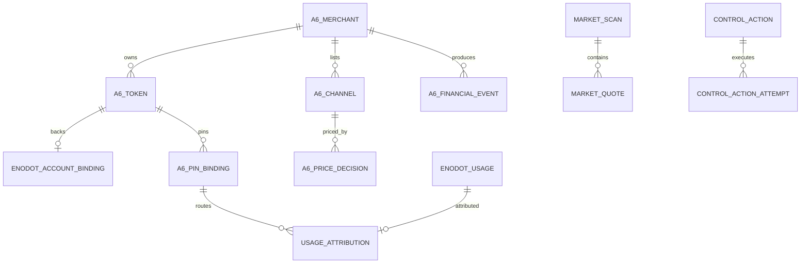
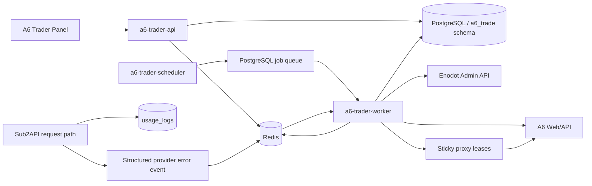
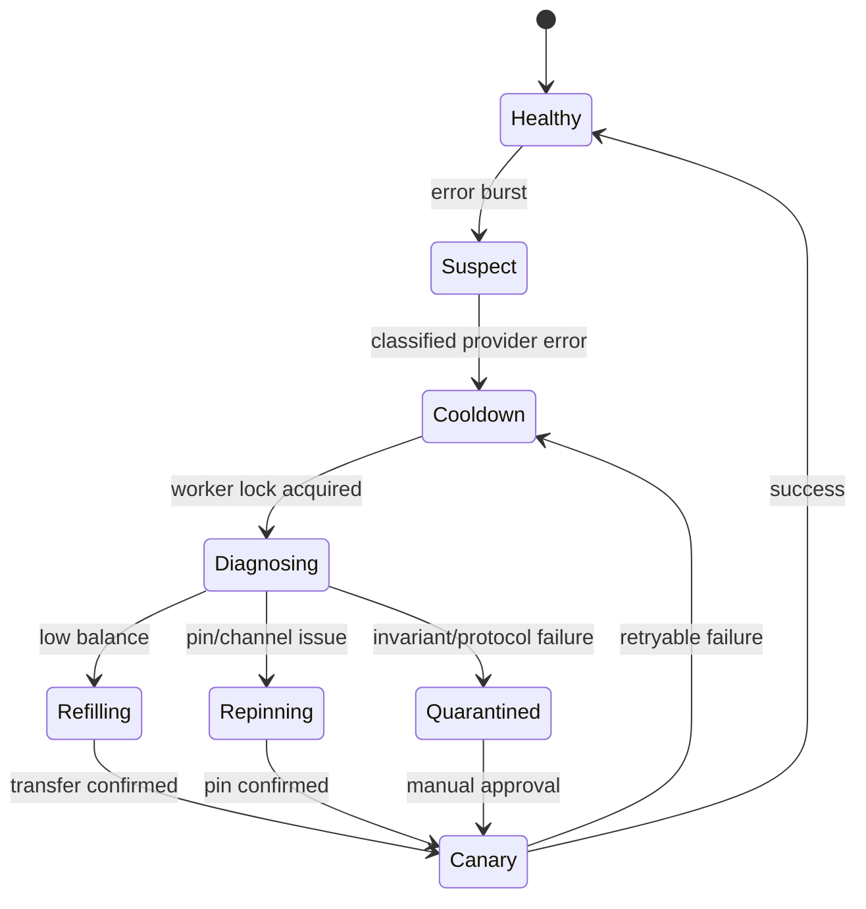

# A6 / Enodot 买卖与调度系统设计

## 1. 结论先行

建议把系统拆成一个独立的 `a6-trader` 控制平面，部署在 `us_cloud`，复用现有
PostgreSQL、Redis、Caddy、Sub2API 管理 API 和内部调度器，不直接侵入当前
Sub2API 请求主链。

首期只投入 8 个 A6 会话。每个会话都具有 Seller 基础身份，并额外分配至多一个运行职责：

- 2 个 `enodot_provider` duty：创建 A6 Token，并作为 Enodot 的 OpenAI API Key 账号。
- 3 个 Seller-only：上架一个模型，分布到三个定价档位。
- 3 个 `market_observer` duty Seller：与其他 Seller 一样上架模型，同时使用独立固定出口 IP，
  交叉采集市场报价和渠道状态。

首批 8 个账号都创建并维持各自的受管渠道与 Listing。Provider / Observer 职责可根据余额、
可提现、出口健康、限流和近期收益原子切换；职责切换不改变 Seller 上架状态。

先只跑 `gpt-5.6-sol`。控制器先以 `observe` 和 `recommend` 模式运行，积累 3-7 天数据，
随后依次开放余额划转、Pin、Enodot 调度参数、A6 定价和有损探活。

核心原则：

1. 财务状态、市场观测和控制动作分表保存。
2. 每个写动作先落意图，再执行，再读取确认。
3. 任意 Provider Key 的候选渠道集合在选择前排除组织内全部 A6 渠道。
4. Pin 变更前先摘除 Enodot 调度并等待在途请求排空，确认 Pin 后再恢复流量。
5. `no_available_channel` 和 `account_quota_insufficient` 在内部调度层完成分类、短冷却和
   换账号重试，客户端只看到统一错误。
6. 实际利润按业务流量逐请求计算；余额划转、提现和打款属于资金移动，不计为收入。
7. 使用窄事件表和 5 分钟汇总，原始 JSON 只保留变化点、异常和关键写操作。

## 2. 已确认的运行事实

### 2.1 现有资产

- 本机存在 19 个权限为 `0600` 的持久化会话。
- 其中 16 个状态为 `supplier_submitted`，3 个仍为 `allocated`。
- `SessionRecord` 已保存 A6 用户 ID、Cookie、A6 Key、供应商申请 ID、模型和上游引用。
- 现有 `A6ApiClient` 已覆盖登录、用户信息、Token 创建/读取、上游模型发现和供应商申请。
- `EnodotAdminClient` 已封装账号查询、按 `binding_uid` 幂等创建或更新、用量读取、短冷却
  和调度参数更新；写方法都需要显式调用，Phase 0 默认执行链不自动调用。
- CALLBACK 脚本已实现市场搜索、Pin、Unpin、Pin 确认、进程互斥锁、就绪探测和原 Pin 恢复。

### 2.2 `us_cloud`

远端已有：

- Caddy
- PostgreSQL 16
- Redis
- Sub2API 蓝绿实例
- 内部 Key 调度器和额外调度器
- sing-box 代理池
- `codex-auth`、`kiro-go` 等 Sidecar

现有 `accounts` 表已经具有：

- `proxy_id`
- `concurrency`
- `priority`
- `rate_multiplier`
- `schedulable`
- `rate_limit_reset_at`
- `overload_until`
- `temp_unschedulable_until`
- `temp_unschedulable_reason`
- `account_pool_id`

因此 Provider 的短冷却、并发和优先级调节应走现有管理 API，不再建立第二套调度字段。

### 2.3 Enodot 现有日志

`usage_logs` 已记录：

- `api_key_id`
- `account_id`
- `request_id`
- 模型与上游模型
- 输入、输出、缓存 Token
- `total_cost`
- `actual_cost`
- `account_stats_cost`
- `rate_multiplier`
- `account_rate_multiplier`
- 延迟
- `channel_id`

当前约 7.6 万行占 76 MB，最近 24 小时约 2000 行。`ops_system_logs` 约 25 万行占
594 MB，说明长文本运行日志比结构化用量事件更消耗空间。

### 2.4 A6 财务字段

只读实测确认：

| 数据 | 接口与字段 |
| --- | --- |
| 用户余额 | `/api/user/self.data.quota` |
| 用户累计消费 | `/api/user/self.data.used_quota` |
| 用户调用数 | `/api/user/self.data.request_count` |
| 商户可用余额 | `/api/supplier/withdraw/summary.data.balance_available_micros` |
| 提现中 | `withdrawing_micros` |
| 累计收益 | `total_earned_micros` |
| 已打款 | `total_paid_micros` |
| 今日应得 | `/api/supplier/earnings/summary.data.today_earned_micros` |
| 本月应得 | `month_earned_micros` |
| 今日/月调用 | `today_calls`、`month_calls` |
| 收益明细 | `/api/supplier/earnings` |
| 结算汇总 | `/api/supplier/settlements/summary` |
| 用户消费明细 | `/api/log/self` |

A6 收益明细包含：

- `id`、`log_id`、`request_id`
- `channel_id`、渠道名
- 平台模型、上游模型
- 输入、输出、缓存 Token
- `quota_micros`
- `earned_micros`
- `user_market_quota`
- `supplier_earn_quota`
- `markup_percent`
- 模型、输出、缓存、分组倍率
- 请求结果和耗时

A6 用户消费明细包含：

- `token_id`、`token_name`
- `channel`、`channel_name`
- `model_name`
- `quota`
- Token 用量
- `request_id`
- 路由类型、结果和耗时

这两类明细可分别作为 Seller 收入和 Provider 成本的逐请求事实来源。

### 2.5 余额划转

`GET /api/supplier/balance/transfer/preview?amount=500000` 实测返回：

```json
{
  "amount_micros": 500000,
  "quota_to_add": 500000,
  "fee_micros": 0,
  "net_micros": 500000,
  "balance_available_micros": 3267676,
  "enabled": true,
  "rate_limit_seconds": 3
}
```

当前规则是商户余额微单位与用户 Quota 1:1 转换、无手续费、3 秒限频。控制器仍需每次
先读 Preview，以服务端返回为准。

金额的美元含义由每个 Session 的 `quota_per_unit` 决定，当前是 `500000 A6 quota = $1`。
转入用户余额的最小金额为 `$1`，因此请求下限为该商户的 `quota_per_unit`，到账语义为立即。
事实表继续持久化 A6 原始整数；跨商户总计和经营利润先逐商户换算为 USD 微单位，再求和。

加密货币提现账户采用私有 `(network, address)` 池。完整地址只存在权限为 `0600` 的池文件和
A6 请求中；控制库保存 SHA-256、掩码及 secret ref。每个商户最多一个绑定，每个地址最多分配
给一个商户。创建前先回读已有账户，事务预留地址后再调用 A6，响应丢失时保留预留并通过稳定
Remark 对账。账户创建与实际提现分离，账户池 Reconciler 不提交提现。

## 3. 领域模型

### 3.1 角色

每个 A6 商户固定具有 `seller` 基础角色，并可拥有至多一个运行职责。`provider` 和 `observer`
互斥且可原子切换；没有运行职责时角色数组只有 `seller`。

| 角色 | 职责 |
| --- | --- |
| `seller` | 在 A6 上架自有渠道，获得 A6 市场收益 |
| `provider` | 创建 A6 Token，作为 Enodot 上游账号消费外部 A6 渠道 |
| `observer` | 附加执行只读市场列表、报价、熔断和渠道状态；Seller 渠道与 Listing 持续售卖 |

Probe 是使用独立 Token、预算和 `probe_run_id` 的运行任务类型，不是商户角色；它的成本、
Seller 回流和净损耗仍进入独立事实与利润科目。

“A6 商户”是平台身份；“Enodot Provider”是本系统内部职责；“Enodot Seller”是本系统
内部对 A6 上架商户的称呼。数据库中使用明确枚举，界面上同时显示平台身份与内部角色。

### 3.2 核心实体



### 3.3 强约束

- `a6_token` 唯一属于一个 A6 用户。
- `enodot_account_binding` 对 `(a6_merchant_id, a6_token_id)` 唯一。
- `a6_pin_binding` 对 `(a6_token_id, model, valid_at)` 只有一个有效版本。
- 自有渠道集合按数值 `supplier_id/channel_id/listing_id` 维护，不依赖名称匹配。
- 数据库层反连接排除自有渠道只承担**运行时**候选过滤，**不构成 Provider 激活门禁**。
  任一 Provider 账号首次变为可调度前，必须对每个 owned Channel 执行远端 disable 并逐项
  精确读回 `user_channel_disabled=true` 且 `route_status=user_disabled`；完整分页
  marketplace inventory（`route_status=all`、`include_seed=true`、
  `include_user_disabled=true`、`exclude_unavailable=false`）中缺失的本地已知 owned
  资源（含 retired）视为激活失败，不得隐式豁免。该硬规则来自仓库根 `AGENTS.md`
  Provider Auto-Pool 自路由硬规则；激活门禁的当前权威语义与演进见
  [`architecture-deployment-review-20260805.md`](architecture-deployment-review-20260805.md)。
- 每个 A6 会话绑定一个稳定代理租约；首期不在账号间复用出口 IP。
- 所有货币使用整数微单位或 PostgreSQL `numeric`，控制器使用 `Decimal`。
- 所有时间存 UTC，面板按 Asia/Shanghai 展示。

## 4. 服务架构



### 4.1 进程

| 进程 | 责任 |
| --- | --- |
| `a6-trader-api` | 面板查询、配置、审批、SSE 状态流、审计查询 |
| `a6-trader-scheduler` | 创建周期任务，不执行外部写操作 |
| `a6-trader-worker` | A6 采集、市场扫描、控制动作和确认 |
| `a6-trader-rollup` | 5 分钟、小时、日聚合，可并入 worker |
| `a6-trader-reconciler` | 会话、Enodot 账号、Pin、余额和动作意图的周期对账 |

首期可把 scheduler、rollup 和 reconciler 合并为一个 worker 进程，但代码模块保持独立。

### 4.2 部署

- 新建系统用户 `a6-trader`。
- 会话文件放在 `/var/lib/a6-trader/secrets/sessions`，目录 `0700`，文件 `0600`。
- `$AI_ENODOT_SHOP_ADMIN_KEY` 放在 systemd `EnvironmentFile`，权限 `0600`。
- 数据库新建 `a6_trade` Schema 和专用角色。
- 对 `usage_logs`、`accounts`、`api_keys` 只授予所需只读权限。
- Enodot 账号写操作走 Admin API，保留现有校验与审计链。
- Caddy 将 `/ops/a6-trader/*` 转发到独立端口。
- 浏览器端只持有面板会话，不接触 A6 Cookie、A6 Key 或 Enodot Admin Key。
- 运行时不依赖 SSH；SSH 只用于部署和排障。

## 5. 数据模型

建议新建以下表。名称以 `a6_` 或 `trade_` 开头，避免混入现有 Sub2API 业务表。

### 5.1 商户与密钥

#### `a6_merchants`

- `id`
- `a6_user_id`
- `supplier_id`
- `session_ref`
- `session_fingerprint`
- `roles text[]`
- `status`
- `proxy_lease_id`
- `last_auth_ok_at`
- `last_poll_at`
- `poll_error_count`
- `created_at`、`updated_at`

数据库只保存会话引用和指纹，Cookie、密码、完整 Key 留在私密文件或密钥存储中。

#### `a6_tokens`

- `merchant_id`
- `a6_token_id`
- `token_name`
- `key_fingerprint`
- `key_secret_ref`
- `status`
- `created_by_controller`
- `last_reconciled_at`

唯一键：`(merchant_id, a6_token_id)` 和 `(merchant_id, token_name)`。

#### `enodot_account_bindings`

- `a6_token_id`
- `enodot_account_id`
- `binding_uid`
- `model_scope`
- `desired_priority`
- `desired_concurrency`
- `state`
- `cooldown_until`
- `last_error_class`
- `last_error_at`
- `created_at`、`updated_at`

`binding_uid` 使用稳定值，例如 `a6:{merchant_id}:{a6_token_id}`。创建前先按
`binding_uid` 对账，已有账号执行更新或复用。

### 5.2 财务状态与事件

#### `a6_financial_current`

每个商户一行：

- `user_balance_quota`
- `used_quota`
- `request_count`
- `withdrawable_micros`
- `withdrawing_micros`
- `lifetime_earned_micros`
- `paid_micros`
- `today_earned_micros`
- `month_earned_micros`
- `today_calls`
- `month_calls`
- `observed_at`
- `source_hash`

#### `a6_financial_snapshots`

只在以下条件插入：

- 任一财务字段变化。
- 到达整点检查点。
- 会话恢复、日期/月切换或控制动作前后。
- 数据源返回异常状态。

唯一键：`(merchant_id, observed_bucket_5m)`。

#### `a6_earning_events`

逐条同步 `/api/supplier/earnings`：

- A6 `id`、`log_id`、`request_id`
- 商户、渠道、Listing、模型
- Token 用量
- `quota_micros`
- `earned_micros`
- `markup_percent`
- 倍率字段
- 结果、耗时、发生时间

优先使用 A6 事件 ID 去重，`request_id` 作为第二唯一性校验。

#### `a6_provider_usage_events`

逐条同步 `/api/log/self`：

- A6 日志 ID、`request_id`
- Provider 商户、Token、模型
- 实际 A6 `channel_id`
- `quota`
- Token 用量
- 路由类型、结果、耗时、发生时间
- `probe_run_id`

这张表既是 Provider 成本账，也用于自有渠道误路由检测。

#### 其他财务表

- `a6_settlement_events`
- `a6_withdrawal_events`
- `a6_balance_transfer_intents`
- `a6_balance_transfer_confirmations`

余额划转没有已确认的历史列表接口，因此必须保存本地意图与前后快照。传输超时后的
动作进入 `unknown`，由 Reconciler 根据用户 Quota、商户余额和时间窗口判定，避免直接
重发同金额动作。

### 5.3 市场和 Pin

#### `a6_market_scan_runs`

- 观察账号与代理租约
- 模型
- 开始/完成时间
- 页数、候选数
- HTTP 状态、耗时
- 结果哈希

#### `a6_market_quotes`

只保存每个模型合格候选的 Top N 和所有自有渠道：

- `scan_run_id`
- `supplier_id`、`channel_id`、`listing_id`
- 输入、输出、缓存读写价格
- 路由状态、最后成功时间、熔断状态
- 市场排序位置
- `is_owned`

无需每次保存整个市场列表。首期 `N=10`，原始响应只在哈希变化或异常时保留 7 天。

#### `a6_pin_bindings`

- `a6_token_id`
- `model`
- `channel_id`
- `fallback_to_smart_routing`
- `valid_from`、`valid_to`
- `decision_id`
- `confirmed_at`
- `change_reason`

Pin 是版本化事实，历史行不覆盖。用量按发生时间连接有效 Pin 版本。

#### `a6_pin_decisions`

保存候选集合、分数、排除原因、当前 Pin、新 Pin、预期成本、切换收益、迟滞阈值和
配置版本。这样可以重放“当时为何切换”。

### 5.4 定价与实验

- `a6_listing_price_versions`
- `trade_pricing_decisions`
- `trade_pricing_exposures_5m`
- `trade_model_mix_profiles`

每次价格或 `delta` 改动都生成 `decision_id`。曝光表按 5 分钟记录：

- Seller、Listing、模型
- A6 定价档位
- Enodot `delta` 档位
- 有效秒数
- 市场排名
- 调用数与 Token 数
- A6 Seller 收益
- Enodot 收入
- Provider A6 成本
- 探活成本
- 实际利润
- 错误率、P50/P95 延迟

这就是后续分析“不同区间的针”的基础数据。

### 5.5 控制与故障

- `trade_control_actions`
- `trade_control_action_attempts`
- `trade_incidents`
- `trade_probe_runs`
- `trade_job_heartbeats`

所有动作带：

- `idempotency_key`
- `entity_type/entity_id`
- `desired_state`
- `observed_before`
- `observed_after`
- `status`
- `error_class`
- `config_version`
- `requested_by`
- 时间和耗时

## 6. 采集、聚合与保留

### 6.1 采集频率

| 数据 | 首期频率 | 说明 |
| --- | --- | --- |
| 财务 Summary | 5 分钟 | 账号间加随机抖动，避免同秒突发 |
| Earnings 明细 | 1 分钟 | 按事件 ID 增量，活跃账号可调到 20-30 秒 |
| Provider 用量日志 | 15-30 秒 | 用于成本与自有渠道误路由检测 |
| Settlement/Withdrawal | 5 分钟 | 控制动作后立即补采 |
| 市场 Top N | 活跃模型 30-60 秒 | 两个 Observer 交叉确认 |
| 非活跃模型 | 5 分钟 | 由调度器分片 |
| Pin 状态 | 1 分钟 | 切换后立即确认 |
| Enodot `usage_logs` | 数据库增量 | 按自增 ID 或时间水位读取 |

### 6.2 窗口语义

以下是流量指标，可在窗口内求和：

- 收益
- 打款
- 余额转入金额与次数
- Enodot 销售额
- Provider 成本
- 探活成本
- 实际利润
- 调用与 Token 数

以下是存量指标，只展示时间点状态与变化：

- 用户余额
- 可提现
- 提现中

对存量指标，窗口选择器显示：

- 窗口起点值
- 窗口终点值
- 净变化
- 最小/最大值

不对同一个余额在多个时间点求和。

建议窗口：

- `5m`
- `1h`
- `5h`
- `12h`
- `24h`
- `7d`
- `30d`
- `MTD`（自然月截至当前）
- `all`

将“一个月滚动”和“本月累计”分开，避免月初统计歧义。

### 6.3 汇总表

- `trade_metrics_5m`：最近 180 天。
- `trade_metrics_hourly`：最近 2 年。
- `trade_metrics_daily`：长期保留。
- 原始变化快照：180 天。
- 精确财务事件：长期保留。
- 市场 Top N：90 天，之后只留小时摘要。
- 原始成功响应：7 天，仅哈希变化时保存。
- 原始错误响应和关键写操作：30-90 天。

按 10 个商户每 5 分钟采集，即使每次都插入也只有每天 2880 行、每年约 105 万行。
窄表加合理索引在现有 PostgreSQL 上可控。采用“变化时插入 + 整点检查点”后规模更小。

## 7. 面板设计

### 7.1 总览

顶部显示全部筛选账号的：

- 当前用户余额
- 当前可提现
- 当前提现中
- 窗口收益
- 窗口打款
- 窗口余额转入金额与次数
- Enodot 销售额
- A6 Provider 成本
- A6 Seller 收益
- 探活损耗
- 实际利润和利润率

每个值同时显示数据时间与新鲜度。

### 7.2 商户表

每行一个 A6 商户：

- 角色
- 会话/代理状态
- 用户余额
- 可提现、提现中
- 今日、本月、累计收益
- 已打款
- 窗口转入金额与次数
- Seller 渠道数、活跃 Listing 数
- Provider Token 数、Enodot 账号数
- 当前 Pin 与模型
- 近 1 小时收入、成本、利润
- 错误率与最后异常

支持按角色、模型、状态、代理、利润档位和新鲜度筛选。

### 7.3 Provider 与 Pin

采用矩阵视图：行是 Enodot Provider Key，列是模型，单元格显示：

- 当前 Pin 渠道
- 是否自有渠道
- 候选排名与成本
- Pin 生效时间
- 近 1 小时用量权重
- Enodot 优先级和并发
- 冷却状态
- 余额续航时间

自有渠道命中使用最高级别红色告警，并立即显示自动处置进度。

### 7.4 定价实验

按模型展示不同档位：

- A6 定价
- Enodot `delta`
- 最终倍率
- 曝光时长
- 市场排名
- 调用数/Token 数
- 收益、成本、利润
- 错误率和延迟

支持只读回放任一 `decision_id` 的输入数据和计算过程。

“受管渠道实时经营位置”以当前非退休的 managed channel/listing binding 为集合真相，而不是历史
`apply_seller_price_band` 计划。商户 tombstone、已完成退休、已移除 Seller 角色、退休 binding，以及
`正常API中转站` 和 `^e[a-z0-9]{9}$` 形态的 A6 随机乱码渠道不进入实时经营列表。每个新审核通过的
正常渠道由 auto-onboard 单独建立 channel/listing binding；新增一个，纳管一个。completed price-band
计划仅按同一个 listing `managed_uid` 作为可选定价注解，没有计划的当前 binding 仍必须显示。

当前受管 Listing 即使已经下架也保留在列表中，用 `operational_state/blocked_reason` 解释当前未经营
原因，并同时展示 binding `control_state` 与 Listing `status/availability/visibility` 原始值；这类
状态不等同于请求熔断或人工封禁。只有当前 `2/1/1` 且资格完整的位置计入实时价格档位中的受管
Listing 数，正常位置继续展示市场健康、延迟、调用、收益和定价指标。

### 7.5 事故与动作

独立页面展示：

- `no_available_channel`
- 余额不足
- Pin 失效
- 自有渠道误路由
- A6 会话失效
- 代理异常
- 定价越界
- 有损探活
- Listing 下架/恢复

每条事故关联动作意图、重试、确认、相关请求 ID 和最终状态。

## 8. Provider 选择与资金管理

### 8.1 Provider 数量

20% 可以作为容量规划起点，不作为固定规则。建议：

```text
required_providers = max(
  2,
  ceil(peak_concurrency / (safe_concurrency_per_provider * 0.7))
)
```

保留 30% 余量并至少跨两个商户。随着负载增加，再从高余额、会话健康、代理健康的
Seller/普通账号中晋升 Provider。

### 8.2 Provider 评分

```text
provider_score =
  liquidity_runway_score
  + session_health_score
  + proxy_health_score
  + recent_success_score
  - error_penalty
  - concentration_penalty
```

首期 Provider 与 Seller 分离。稳定后允许角色重叠，但自有渠道排除集合仍覆盖组织内
全部商户。

### 8.3 余额划转策略

目标用户余额按成本续航计算：

```text
target_user_balance =
  max(min_balance,
      p95_provider_cost_per_hour * target_runway_hours * safety_factor)
```

首期建议：

- `target_runway_hours = 12`
- `safety_factor = 1.5`
- 单次划转不超过当前可用商户余额的 25%
- 单商户每日划转上限可配置
- 每次执行 Preview
- 按商户加 PostgreSQL Advisory Lock
- 执行后立即读取用户余额和商户余额确认

若余额低于 2 小时续航，Provider 先进入短冷却；划转确认后以并发 1 恢复，再逐步增加。

## 9. Enodot 账号生命周期

### 9.1 幂等创建

每个 A6 Token 对应一个 Enodot `openai/apikey` 账号：

```json
{
  "name": "a6-provider-MERCHANT-TOKEN",
  "platform": "openai",
  "type": "apikey",
  "credentials": {
    "api_key": "A6_API_KEY",
    "base_url": "https://a6.a6api.com/v1",
    "model_mapping": {}
  },
  "extra": {
    "managed_by": "a6-trader",
    "a6_binding_uid": "a6:MERCHANT:TOKEN"
  },
  "proxy_id": "UNIQUE_PROXY_ID",
  "concurrency": 1,
  "priority": 1,
  "rate_multiplier": 1
}
```

流程：

1. 按 `binding_uid` 查询本地绑定。
2. 读取 Enodot 账号并核对 `extra.a6_binding_uid`。
3. 已存在时更新差异字段。
4. 缺失时创建一次。
5. 创建后回读确认并保存 `enodot_account_id`。
6. 完整 A6 Key 只通过 Admin API 请求体传输，本地库保存指纹。

### 9.2 并发与优先级

新账号首期：

- `priority = 1`
- `concurrency = 1`
- 单模型稳定 30 分钟后升到 2
- 上限先设 5
- `priority` 范围为 `0..32767`；Provider TopN 使用 `priority_offset + rank`，默认 Top1 从 2 开始

并发采用 AIMD：

- 连续健康且 P95 延迟稳定：每 15 分钟 `+1`。
- 错误率或超时上升：减半。
- `no_available_channel`、自有渠道误路由、余额不足：立即摘除调度并短冷却。

优先级只在 1 和 2 之间调整，并设置至少 15 分钟驻留时间。优先级由利润、健康度和
余额续航共同决定，不按单次调用波动。

## 10. 市场扫描与 Top K Pin

### 10.1 Observer 池

- 每个 Observer 使用独立固定 IP。
- 任务按模型分片，不要求每个 Observer 扫全部模型。
- 活跃模型至少由两个 Observer 在相邻时间段采集。
- 两个观测结果在价格、渠道状态和 Listing ID 上一致后进入候选集。
- 单账号并发 1，加入 10%-20% 时间抖动。
- 遇到限流后指数退避并换另一个 Observer 承接任务。

首期 3 个 Observer；稳定后扩到 5，再根据模型数量和限流情况扩到 10。

### 10.2 合格候选

候选必须满足：

- 非组织自有 `supplier_id/channel_id/listing_id`
- Listing 和路由状态可用
- 熔断未打开
- 最近成功时间在阈值内
- 两个 Observer 的观测一致
- 价格字段完整且非负
- 不在人工黑名单或事故隔离期

名称只用于展示，不参与所有权判断。

### 10.3 成本向量

输入、输出、缓存读写价格差异很大，建议按模型真实 Token 结构计算预期成本：

```text
expected_cost(channel, model) =
    input_share       * input_price
  + output_share      * output_price
  + cache_read_share  * cache_read_price
  + cache_write_share * cache_write_price
```

Token Share 使用 Enodot 最近 1 小时与 24 小时的 EWMA。缺少历史时使用固定初始画像。

### 10.4 Top K 分配

不是直接选择绝对最低价，而是按风险调整成本排序：

```text
risk_adjusted_cost = expected_cost
  * (1 + error_penalty + latency_penalty + concentration_penalty)
```

首期：

- `top_k = 3`
- 单渠道最多承接该模型 50% Provider Key
- 使用加权 Rendezvous Hash，让分配稳定
- 新候选至少连续两次优于当前 5% 才切换
- 正常 Pin 最短驻留 10 分钟
- 同一 Provider Pin 在同一 channel 上连续 3 个终态请求均失败，且三次均由权威分类器判定为
  channel-owned，才触发故障切换；任一成功、非 channel-owned 失败或 Pin/channel 变化都中断该 streak
- failure journal 的账号必须按事件时间连接当时有效的 Pin binding，禁止按消费时的当前 Pin 归属旧失败
- streak 达到 3 后先强制停止该账号调度，再排除故障 channel 选择候选；此路径绕过普通最小容量保留，
  新 Pin 只有在真实探测成功并严格读回后才恢复调度
- 自有渠道误路由等身份不变量违规仍立即隔离，不等待三次

### 10.5 加权基准 `K`

`K` 使用各 Pin 最近 1 小时的实际 A6 成本权重：

```text
w_i = max(
  provider_cost_1h_i,
  provider_cost_24h_i / 24 * 0.25,
  minimum_weight
)

K = sum(w_i * effective_multiplier_i) / sum(w_i)
```

使用成本权重优于调用次数，因为不同请求的 Token 量可相差多个数量级。

每次任一有效 Pin 更新后，必须用当前完整 Pin 集合重新计算 `K`，并为全部非 retired 的受控 Listing
生成新目标，不能只处理 canonical Listing 或发生 Pin 切换的商户。若某个商户的任一受控 Listing 达到
价格跳涨硬阈值，该商户的全部受控 Listing 作为同一风险组同步下架，具体恢复顺序以定价合同第 10.3 节为准。

## 11. 自有渠道误路由保护

> 自 2026-08-05 起，Provider 账号激活前的自有渠道隔离以仓库根 `AGENTS.md` 的
> Provider Auto-Pool 自路由硬规则为合同：远端 owned-Channel Ban 是激活门禁，
> 本地反连接不是。当前实现、部署证据与未决问题（含 Ban 可见性合同冲突、dispatch
> 跨 schema/consumer 合同、lifecycle stop boundary）见
> [`architecture-deployment-review-20260805.md`](architecture-deployment-review-20260805.md)。

### 11.1 预防

1. 维护完整 `a6_owned_channels`。
2. 市场候选查询使用数值 ID 排除（仅运行时过滤，不是激活门禁）。
3. `fallback_to_smart_routing` 首期固定为 `false`。
4. Pin POST 后读取 `/api/marketplace/pins` 确认。
5. Provider 进入调度前再次检查 Pin 的 `channel_id`。
6. Provider 账号首次变为可调度（含 auto-pool 激活）前，对该 Provider Token + model 执行
   完整分页 inventory（`route_status=all`、`include_seed=true`、`include_user_disabled=true`、
   `exclude_unavailable=false`），对每个 owned Channel 执行远端 disable，并逐项精确读回
   `user_channel_disabled=true` 且 `route_status=user_disabled`；active、down、unavailable、
   retired、hidden 均属禁用范围，retirement 不是豁免。完整远端结果与本地控制面 known
   set 取并集，任一本地 known owned Channel 缺失即激活失败。

### 11.2 运行时检测

每 15-30 秒增量读取 Provider 的 `/api/log/self`。若实际 `channel` 属于
`a6_owned_channels`：

1. 创建 `SELF_ROUTE_VIOLATION` 事故。
2. 将对应 Enodot 账号设置为临时不可调度。
3. 等待在途请求排空。
4. 选择外部安全候选并重新 Pin。
5. 回读 Pin。
6. 以单并发 Canary 恢复。
7. 成功后逐步恢复并发；再次命中则隔离并要求人工确认。

建议在 Sub2API 上游适配器中保存 A6 的 `X-Oneapi-Request-Id`，并在新表中记录
`upstream_request_id`，用于和 A6 用户日志、Seller 收益日志精确关联。

### 11.3 Pin 切换事务

```text
lock(provider_token, model)
  -> account temp-unschedulable
  -> wait inflight = 0
  -> record old pin
  -> POST new pin
  -> GET pins confirm
  -> insert versioned binding
  -> single canary
  -> account schedulable, concurrency = 1
  -> unlock
```

并发控制使用 PostgreSQL Advisory Lock 加 Redis 短 TTL 锁。前者提供最终互斥，后者用于
快速可见状态。

### 11.4 Provider Auto-Pool 自路由硬合同（AGENTS.md 权威条款，2026-08-05 补全）

以下条款直接转录并收口仓库根 `AGENTS.md` 的 Provider Auto-Pool 自路由硬规则，
为长期架构合同；与本文其他段落冲突时以此为准，细节与未决问题见
[`architecture-deployment-review-20260805.md`](architecture-deployment-review-20260805.md)。

#### 11.4.1 owned-Channel Ban 激活门禁

- 启用 Provider auto-pool 或使任一 Provider 账号可调度**之前**，必须先远端禁用该
  Provider 用户的每一个 A6-owned Channel。authoritative owned set = 完整远端查询结果中
  的 A6-owned Channels/Listings ∪ 本地控制面已知的 controlled Listing Channels；
  active、down、unavailable、retired、hidden 均属禁用范围，**retirement 不是豁免**。
- Ban 审计必须使用完整分页 marketplace search：`route_status=all`、
  `include_seed=true`、`include_user_disabled=true`、unavailable filtering 关闭。
- 每个 owned Channel 必须执行远端 disable，并逐项精确读回
  `user_channel_disabled=true` 且 `route_status=user_disabled`。
- 有效订阅的 `auto_channels` 必须**非空**且**不包含任何 owned Channel**。
- **本地已知 owned Channel 或 Listing 若在完整远端 readback 中缺失，即为 activation
  failure**（包括仍存在于远端的 retired 资源），不是泛化的 readback failure 带过。
- 任一 readback 失败时 Provider 保持不可调度或 slot 保持 `VACANT`；
  **本地 candidate filtering 不能代替远端 Ban**。
- Ban 集合在以下时点必须 reconcile：Provider Token onboarding 时、owned Channel
  创建/采用/恢复时、每次 auto-pool `max_ratio` 更新前。先 Ban 后 enable，禁止先
  enable auto-pool 再补 Ban。
- 每次 auto-pool `max_ratio` 更新前必须重跑该 Ban 审计与精确 readback。

#### 11.4.2 `insufficient_quota`（流动性失败，不得走扩价路径）

- 立即把该 Provider 移出调度并标记 `UNFUNDED`，交给 liquidity 控制器。
- 不得用 Observer 或 `max_ratio` 调整作为其恢复路径。
- 修复顺序：先把该 merchant withdrawable balance 中 eligible 整单位转入 user balance；
  仍不满足 funding contract 时移除其 Provider duty、把旧 slot 投影为 `VACANT`、
  请求一个 funded replacement。
- **replacement 保持 slot 外**：replacement 在 owned-Channel Ban、Observer-derived
  auto-pool range、Enodot cost、schedulability readback 全部通过前**始终位于 slot 之外**；
  旧 slot 在此期间持续为 `VACANT`；全部门禁通过后才原子纳入/激活（不得把 replacement
  描述为提前占用的 slot `REPAIRING` 状态——candidate 自身的控制状态不是 slot REPAIRING）。

#### 11.4.3 非 quota runtime failure

- 保持该 Provider identity paused。
- 执行一轮 fresh Observer。
- `max_ratio` 严格扩到下一 observed CNY price band，且不超过 `0.3`。
- 提交与 generation 匹配的 USD cost。
- 该 Provider 自身的远端 readbacks 全部通过后恢复。
- 恢复后**立即触发** Seller repricing/publication；Seller 可以预计算或并发 apply，
  但 **Seller 完成不是 Provider activation barrier**。

#### 11.4.4 Observer 与成本

- auto-pool range 必须来自新鲜 Observer snapshot。
- CNY `max_ratio` 是 marketplace authoritative cap，必须 `<= 0.3`。
- 同一 snapshot 换算的 USD ratio 写入 Enodot Provider cost，并与 routing/cost
  generation 关联（immutable matching cost generation）。

#### 11.4.5 Liquidity/callback Token

- liquidity/callback Token 与 Provider Token 是不同实体。
- Token 名从 `src/a6api_auto/data/token_name_corpus.json` 选择。
- duty 存储在控制平面状态（如 `a6_token_duties`），**不编码进 Token 名**。
- 只允许 Pin 到当前 listed 且 callable 的 A6-owned small-merchant Channel；
  没有合格目标时跳过 liquidity transfer，不降级 Pin 到未知或不可调用对象。

#### 11.4.6 Shadow

- `a6-trader-provider-pool-shadow.timer` 始终 disabled；service 默认 inactive。
- 日常诊断、Pin refresh、liquidity repair、retry、readback、部署验证均不使用 shadow。
- 仅当 routing/cost 变化要求新 immutable generation 且无已 planned/active generation
  可复用时，先记录具体原因再一次性运行；运行后 timer 仍 disabled；不等待观测窗口，
  除非用户明确要求 shadow evidence 或 generation contract 使其不可缺。

## 12. 定价公式

定价实现、变量口径、孤立低价保护、动态 Pin 输入契约和生产验收统一以
[`a6-trader-pricing-contract.md`](a6-trader-pricing-contract.md) 为规范。本节保留系统设计背景；
若公式或命名与该规范冲突，以该规范为准。

### 12.1 统一变量

- `K`：Provider 当前 Pin 组合归一到 `K_CNY` 后的加权上游原始价值倍率。
- `C_landed=K/c`：经过平台换算后 Provider 的实际拿货成本倍率。
- `P`：A6 Seller 后台持久化的原始面板倍率。
- `L`：Observer 在 A6 市场看到的 Seller 公开倍率，`L = P / c`。
- `delta_configured`：Enodot 单 Key 配置倍率，范围 `[0, 0.5]`。
- `delta_effective`：本轮联合定价目标；执行时必须先写入并读回，之后才能写入依赖它的更低
  Listing 价格。
- `c`：平台转换因子，当前按 `5/6 = 0.833333...`。
- `m`：最低利润率，首期 `0.20`。
- `F`：面向最终业务的倍率。

平台换算按实际读回方向处理：A6 后台保存 `P`，Observer 公开页面看到 `L=P/c`。
所有变量先归一到同一 `K_CNY` 坐标；页面 `x...` 展示坐标另行转换，不与 `c` 混用：

```text
L = P / c
F = (1 + delta_effective) * L * c
  = (1 + delta_effective) * P
```

利润底线：

```text
F >= (1 + m) * C_landed
  = (1 + m) * K / c
```

反解 A6 最低定价：

```text
P_min = ((1 + m) * (K / c)) / (1 + delta_effective)
L_min = P_min / c
```

当 `m=0.20`、`c=5/6` 时：

| delta | `P_min / K` | `L_min / K` |
| ---: | ---: | ---: |
| 0.00 | 1.440000 | 1.728000 |
| 0.10 | 1.309091 | 1.570909 |
| 0.20 | 1.200000 | 1.440000 |
| 0.30 | 1.107692 | 1.329231 |
| 0.40 | 1.028571 | 1.234286 |
| 0.44 | 1.000000 | 1.200000 |
| 0.50 | 0.960000 | 1.152000 |

固定反例为 `K=100`：平台换算后的实际拿货成本是 `C_landed=120`；若 `P=100`、
`delta=0.20`，则 `F=120`，只够保本。要相对成本 `120` 获得 20% 利润，必须使
`F=144`，所以 `P=100` 时应取 `delta=144/100-1=0.44`。

`delta=0.5` 时，后台最低可行面板价为 `0.96K`，Observer 看到的公开价格为 `1.152K`，
而 `F=(1+0.5)*0.96K=1.44K`，相对实际拿货成本 `1.2K` 的成本加成率正好为 20%。

最低 Listing 使用 `delta=0.5`；价格由最低点向上移动时，delta 只向 0 衰减：

```text
F_target = (1 + m)C_landed = (1 + m)K/c = 1.44K
y        = F_target / (1 + delta_max) = 0.96K
y1       = F_target = 1.44K

P < y                           : 不可行，抬价到 y 或停止写价
delta(P) = 0.5                 , P = y
delta(P) = F_target / P - 1    , y < P < y1
delta(P) = 0                   , P >= y1
```

所以 `[y,y1]` 是恒定 20% 利润区间：改变 Listing 价格时同步衰减 delta，始终满足
`F=(1+delta)P=1.44K`。到 `y1` 后 delta 已为 0；更高 Listing 价格直接带来超过 20% 的利润。
若市场孤立低价保护把最低点抬高到区间内部，则最低 Listing 使用
`delta=F_target/P_guard-1`，不再机械拉满 0.5。

delta 写入或读回失败时，本轮不执行降价；恢复目标使用 `delta=0, P>=1.44K`。

### 12.2 最大定价约束

若 `P_max = 1.0`，先做可行性检查：

```text
feasible = P_min <= P_max
```

不可行模型进入 `price_infeasible` 状态，暂停自动上架或调整 Provider 成本，而不是以
低于利润底线的价格运行。

### 12.3 初始定价档位

首期 8 个 Seller 都上架同一模型，按 Listing 分成 3 个 `value`、3 个 `balanced` 和
2 个 `profit` 初始样本；Provider/Observer duty 不决定价格档位：

| 档位 | delta | A6 定价目标 | 目标 |
| --- | ---: | ---: | --- |
| `value` | 由公式反解，接近 0.5 | `0.96K` 附近 | 获得调用和价格弹性样本 |
| `balanced` | 由公式从 0.5 衰减到 0 | `(0.96K,1.44K)` | 价格变化但利润保持 20% |
| `profit` | 固定为 0 | `>=1.44K` | 测试高于 20% 的利润需求 |

档位按 Listing/模型分配，不永久绑定商户。每次变更至少保持 30 分钟，低流量模型保持
2-6 小时，避免频繁改价造成观测噪声。

### 12.4 后续优化

前 7 天使用固定档位。数据量充足后再使用受约束的 Bandit：

```text
objective = expected_profit_per_hour
constraints = {
  final_multiplier >= 1.2 * (K / c),
  error_rate <= limit,
  own_route_count = 0,
  max_price <= configured_max
}
```

先按曝光时长、市场排名和模型 Token 结构校正，再比较档位利润，避免只按调用数选择低价。

## 13. 实际利润

### 13.1 口径

窗口内：

```text
enodot_sales
  = sum(Enodot usage_logs.actual_cost for external customer traffic)

a6_customer_provider_cost
  = sum(A6 provider /api/log/self.quota uniquely matched to Enodot traffic)

a6_organic_seller_income
  = sum(A6 /api/supplier/earnings.earned_micros excluding probe matches)

probe_net_loss
  = sum(A6 provider quota for probe-tagged requests)
    - sum(matching seller earned_micros)

actual_profit
  = enodot_sales
    - a6_customer_provider_cost
    + a6_organic_seller_income
    - probe_net_loss
    - refunds
    - withdrawal_fees
    - other_external_costs
```

探活请求和 managed Seller Key 的内部启动流量没有客户销售额。Provider 客户流量成本、
自然 Seller 收益和 Probe 净损耗使用
互斥 Ledger 科目，避免同一笔 A6 成本或 Seller 回流收益出现两次。

Enodot 生成的 `request_id` 与 A6 `request_id` 属于不同命名空间。外部收入归属以已绑定
`account_id` 和 A6 Token 为边界，再按模型、五秒时间窗以及可用的输入/输出 Token 做双向
唯一匹配；任何一侧存在多个候选时都保留为待归属，`actual_profit` 返回 `null`。Managed
Seller Key 的 Enodot 扣账是内部转移，单列为 `managed_internal_debit_micros`；对应请求实际
产生的 A6 Provider quota 才计入外部成本，并且只计一次。

Owner 激活等非客户流量使用带 User/Key、有效时间、原因和创建者的
`enodot_usage_classification_rules` 分类。其 Enodot 扣账不进入销售额，唯一匹配的真实 Provider
quota 单列为 `owner_internal_provider_cost_micros`。Pin 控制器健康探活依据
`provider_pin_probe` 审计动作的 Token、模型、渠道和两秒时间窗双向唯一匹配，计入
`pin_probe_cost_micros`，不混入客户 Provider 成本。

### 13.2 不计收入的项目

- 商户余额转入用户余额
- 提现中金额
- 已打款金额
- Provider 之间的资金调配
- Pin 变更

这些项目影响现金和可用资金，不影响利润；提现手续费单独计成本。

### 13.3 对账

每日执行三方对账：

1. Enodot `usage_logs` 收入。
2. A6 Provider 用户日志成本。
3. A6 Seller 收益日志。

按 `upstream_request_id` 优先关联；缺少时使用 Token、模型、时间和金额组合进行待确认
匹配。未匹配项目进入对账队列，不混入已确认利润。

## 14. 错误分类与恢复

### 14.1 `no_available_channel`

该错误在 Provider 调度层处理：

1. 识别 HTTP 503 和 `error.code=no_available_channel`。
2. 当前 Enodot 账号立即短冷却 60 秒。
3. 同一客户请求换下一个尚未尝试的 Provider 账号。
4. 总重试次数首期上限 2，受原请求 Deadline 约束。
5. 向 Redis Stream 写入结构化诊断事件。
6. 后台按 `(provider_account_id, model)` 去重并加锁。
7. 客户端只接收稳定的 `provider_pool_temporarily_unavailable`，不含 A6 渠道、供应商和
   内部 Request ID。

### 14.2 `account_quota_insufficient`

以下响应按 Provider 额度不足处理，不归入普通认证失败：

- HTTP 状态为 `403`。
- 错误码为 `insufficient_quota` 或 `account_quota_insufficient`，或者正文包含
  `账户额度不足`、`账户余额或订阅额度不足`、`额度不足，请充值` 等明确额度语义。
- `consecutive_403=3/3` 表示连续错误已经达到短路阈值；在当前抓到的额度不足响应中，
  它与上述额度语义一起出现。

固定处理流程：

1. 分类为 `account_quota_insufficient`。
2. 立即短路当前 Provider，并将绑定的 Enodot 面板账号短冷却 60 秒。
3. 当前客户请求切换到下一个尚未尝试的 Provider，仍受请求 Deadline 和总重试上限约束。
4. 后台按 `balance -> transfer_policy -> pin` 顺序诊断；先确认余额，再判断是否及划转多少，
   最后检查 Pin。
5. 客户端只接收 `provider_pool_temporarily_unavailable`。A6 原始错误正文、渠道、商户、
   A6 Request ID 和连续错误计数都不进入客户端响应。

### 14.3 后台诊断顺序

额度不足使用专用顺序：

```text
BALANCE
  -> TRANSFER_POLICY
  -> PIN
  -> CANARY
  -> RESTORE
```

`no_available_channel` 和尚未分类的 Provider 故障使用完整顺序：

```text
AUTH
  -> BALANCE
  -> PIN_EXISTS
  -> PIN_IS_EXTERNAL
  -> CHANNEL_AVAILABLE
  -> CANARY
  -> RESTORE
```

#### 余额不足

- 读取用户余额与 Provider 最近成本。
- 计算续航时间。
- 有可用商户余额时按策略 Preview 和划转。
- 划转确认后以并发 1 恢复。
- 余额来源不足时延长冷却并降级该 Provider。

#### Pin 问题

- 读取当前 Pin。
- 校验模型、Token、状态和所有权。
- 当前渠道不可用或属于自有集合时选择新候选。
- 使用 Pin 切换事务。

#### 其他错误

- `429`：按账号与代理分别退避。
- 超时：降低并发，保留当前 Pin，先做单请求 Canary。
- 连续协议错误：隔离 Provider，等待人工检查。

#### 普通 `401/403` 认证失败

普通认证路径与 `account_quota_insufficient` 分开：

- HTTP `401`，或不含额度不足错误码和文本标记的认证型 HTTP `403`，进入认证诊断。
- A6 Session 请求先刷新 Session；A6 Token 请求校验 Key、Token 状态和所属账号。
- 认证错误本身不触发余额划转或 Pin 切换；修复后先做单请求读取或 Canary，再恢复调度。
- 不得仅凭 HTTP `403` 或 `consecutive_403` 字样把认证错误归类为额度不足。
- `/api/supplier/me` 在供应商未生效时返回的业务型 `403` 继续按供应商状态处理，也不进入
  认证或额度不足路径。

### 14.4 状态机



## 15. 有损探活与 Listing 恢复

### 15.0 渠道模型健康事实

Observer 每 10 秒完成一轮市场覆盖，3 名 Observer 在窗口内错峰执行，不在同一秒集中请求。
每个 Observer 的最新结果独立保存；增长动作至少要求 2 名新鲜 Observer 对当前健康状态给出
一致结论。单个账号、IP 或请求条件产生的局部结果只展示，不触发写操作。

Observer 正常时保持 10 秒一轮。若成功 Observer 少于 2 名，则记录每名失败 scan，并按
`15/30/60/120/240/300s` 开启全局市场扫描退避；退避期间 timer 仍运行但不发网络请求。
任意一轮恢复至少 2 名成功后立即清零 breaker。单名失败、另外 2 名成功时继续形成 quorum，
同时在面板显示失败 Observer 和错误类。

每个渠道模型保留以下原始事实，不把它们压缩成单一“可用/不可用”布尔值：

- `circuit_state`、`scope`、`recovery_mode`、`cooling_until` 和最近冷却时间。
- `probe_status`、`probe_success_streak / probe_success_required` 和最近探活时间。
- cooldown 状态、剩余秒数、预计恢复时间、来源与 capability cooldown。
- 智能路由是否带标及标签内容。
- 最近成功、最近失败、失败类型、样本量、成功率、P50 和 TTFT。

派生状态固定为 `cooling / unavailable / degraded / unlabeled / idle / healthy / unknown`；
面板同时展示派生状态、原始证据、Observer 同态数量和最近动作，控制器只消费仍在新鲜窗口内的
信号。

### 15.1 成本

实测 A6 收益样本中：

```text
seller_earned / buyer_market_quota ~= 0.83333
```

因此自买自卖探活的直接资金损耗约为买方支出的 16.67%，另有请求机会成本。面板应显示
每次 Probe 的预计成本、实际成本和恢复收益。

### 15.2 探活阶梯

自动流程不直接从高并发批次开始：

1. 先直接访问 Seller 上游，确认 callback 规则已装载且精确返回 `CALLBACK`。
   访问前回读绑定 Enodot Seller 工作余额；低于 `$0.25` 时用动作 ID 作为幂等键补到 `$1`，
   回读确认后继续。
2. Booster Token 临时 Pin 到目标渠道，确认 Pin 回读正确。
3. `recovery_mode=natural` 时等 `cooling_until + 5s`；`recovery_mode=probe` 时等
   `next_probe_at + 1s`，不把两个窗口混用。
4. 固定 Pin 请求在平台 cooling 时会被门控为 503，不能代替平台 probe；probe 模式只观察
   `next_probe_at / probe_status / probe_success_streak`，等待自然流量完成平台探针。
5. circuit 退出 cooling 后，独立的 `callback_burst` 才先发 1 次 readiness，再执行剩余 14 次，
   批次总计 15、最大并发 5。
6. readiness 返回 503 时立即停止，记录 `callback_http_503`，按对应 probe/恢复时间设置
   `next_allowed_at`；不发送剩余请求，也不计虚构成本。
7. 任一阶段错误率超过阈值立即停止，并在 finally 中恢复 Booster 原 Pin。

`-c 15 -n 85` 适合作为人工压力验证，不作为自动恢复默认值。

### 15.3 预算

首期建议：

- 每日 Probe 总预算不超过过去 24 小时实际毛利的 0.5%。
- 单渠道 30 分钟内最多一个批次。
- 单次预计损耗超过配置上限时要求人工批准。
- 专用 Probe Token、Token 名和 `probe_run_id`，从自然流量统计中排除。

### 15.4 冷却渠道的 Listing 恢复

```text
lock(listing_id)
  -> record current state
  -> POST takedown
  -> confirm state
  -> wait random(0.8, 2.0) seconds
  -> POST resubmit
  -> confirm state
  -> verify status=2 and all four prices unchanged
  -> wait for circuit recovery deadline
  -> natural: one A6 callback readiness
  -> probe: observe platform probe window and streak
  -> optional remaining callback burst
  -> release lock
```

- 单 Listing 30 分钟最多一次。
- 操作前记录价格版本，恢复后核对价格。
- 摘挂与 callback 是两个独立审计动作；摘挂成功不代表 circuit 已恢复。
- 自然冷却窗口内只等待，不盲打 readiness，也不重复摘挂。
- model-scope `upstream_5xx` 的 probe 恢复不重复摘挂 Listing，也不使用固定 Pin 请求强行探针；
  channel-scope 余额不足才进入余额修复和摘挂路径。
- callback 只使用精确短路请求；不进入 `post_recovery_load_started` 路径。
- 平台门控型 503 使用恢复时间重试，不累计为人工故障；真正的摘挂、Pin 恢复或协议错误连续
  两次失败才进入人工队列。

## 16. 小规模上线计划

### Phase 0：事实层，1-2 天

- 导入 19 个会话元数据，秘密仍留在私密文件。
- 建立 Schema 和只读 Collector。
- 补齐 A6 财务、收益、用户日志、市场和 Pin 客户端。
- 封装 Enodot Admin 账号读写 API。
- 上线只读面板。
- 所有控制动作只生成建议，不执行。

验收：

- 16 个已提交商户都能完成会话与财务读取。
- 5 分钟数据新鲜度达到 99%。
- A6 收益明细无重复。
- Enodot 用量水位可重启续传。

#### 当前实现边界

| 能力 | 实现 | Phase 0 行为 |
| --- | --- | --- |
| Schema | `migrations/0001_a6_trade_phase0.sql`、`trade_db.py` | checksum 保护、幂等执行 |
| 会话导入 | `trade-import-sessions` | 只导入秘密脱敏元数据，默认基础角色为 `seller` |
| 会话刷新 | `trade-refresh-sessions-once` | 固定代理验 Cookie、按需重登、同步 supplier/status 和脱敏元数据 |
| A6 采集 | `trade-collect-once` | 对 A6 只读，向事实表写快照、事件、Pin 和水位 |
| Enodot Admin | `enodot_admin.py` | 显式调用的账号对账、用量、冷却和调度接口；默认链不执行写方法 |
| 总览面板 | `trade-dashboard` | 只读 WSGI、聚合查询、秘密过滤、默认只监听 loopback |

四个 CLI 命令默认从 `A6_TRADE_DATABASE_DSN` 读取数据库连接。也可以通过
`--database-dsn-file` 使用权限为 `0600` 的文件；文件优先于环境变量，CLI 不接受明文 DSN。
`AI_ENODOT_SHOP_ADMIN_KEY` 只留在服务端供 Enodot Admin 客户端使用，不进入 Collector 输出、
数据库业务字段或浏览器。

#### 本地执行顺序

```bash
.venv/bin/a6api-auto trade-migrate

.venv/bin/a6api-auto trade-import-sessions \
  --sessions-dir ~/.config/a6api-auto/sessions

.venv/bin/a6api-auto trade-refresh-sessions-once \
  --sessions-dir ~/.config/a6api-auto/sessions \
  --proxy-map-file ~/.config/a6api-auto/trade-proxy-map.secret.json \
  --max-workers 4

.venv/bin/a6api-auto trade-collect-once \
  --sessions-dir ~/.config/a6api-auto/sessions \
  --proxy-map-file ~/.config/a6api-auto/trade-proxy-map.secret.json

.venv/bin/a6api-auto trade-dashboard \
  --sessions-dir ~/.config/a6api-auto/sessions \
  --host 127.0.0.1 --port 8765
```

当前基线的导入结果应为 19 行：16 个 `supplier_submitted`、3 个 `allocated`。第一轮全部以
`seller` 基础角色导入，再按试水计划分配可切换的运行职责。Collector 只采集已提交且具有 A6
用户 ID 的会话。`trade-collect-once` 强制在 `--proxy-map-file` 与 `--allow-direct` 中二选一；19
会话基线使用前者。代理映射按 A6 用户 ID 配置，文件权限为 `0600`。任何 A6 请求开始前，
CLI 会校验所有可采集会话均有映射并且代理 URL 不重复；部署还必须保证它们对应不同且
稳定的出口 IP。`--allow-direct` 只允许最多一个可采集会话，因此不会让完整会话目录回退到
共享直连。

刷新器仅对非 `allocated/abandoned` 且具有 `user_id` 的会话发起网络请求。Cookie 有效时只做
`self_user` 快速验证；失效后才登录，并在写回前严格校验用户 ID。supplier profile 中存在
`supplier_id` 即恢复 `supplier_submitted`，不要求只属于申请流程的 `request_id`。每个成功
会话使用 `SessionStore` 原子写回；网络阶段使用 `--max-workers` 控制的有界并发，默认 `4`，并与
内联重登共用 `.<session>.auth.lock` 覆盖完整读改写。网络阶段全部结束后，主线程才按 session path
稳定顺序逐项 UPSERT merchant metadata，不在线程间共享 psycopg 连接；单账号失败不会中止整轮。
`abandoned` 会话不登录，只同步 tombstone 状态，保留 merchant 行及全部事实/审计外键。
输出仅含 `sessions_found/eligible/refreshed/supplier_active/tombstoned/skipped/failed`、
`metadata_synced`、`cookie_valid/relogged` 和稳定错误计数。

面板健康检查为 `/healthz`，数据接口为 `/api/overview` 和 `/api/merchants`。支持窗口：
`5m`、`1h`、`5h`、`12h`、`24h`、`7d`、`30d`、`mtd`、`all`。Collector 首期由
Collector systemd timer 每 5 分钟运行一次；session refresh timer 以 7 分钟为基础并增加最多
3 分钟 jitter，使用 nonblocking lock。生产约 46 个会话时显式使用 `--max-workers 8`，降低网络
等待触及 4 分钟 oneshot 上限的风险。刷新 CLI 的部分失败退出码 `2` 与锁冲突退出码 `75` 均
由 oneshot service 接受，避免单账号故障阻断后续周期。Dashboard 作为常驻服务绑定
`127.0.0.1:8765`，再由 Caddy
转发。更完整的本地与 `us_cloud` 操作步骤见 [README](../README.md#phase-0-交易事实层)。

### Phase 1：8 个 Seller 会话试水，3-7 天

- 2 个 Provider duty Seller、3 个 Seller-only、3 个 Observer duty Seller。
- 只运行 `gpt-5.6-sol`。
- 每个 Provider duty Seller 一个 A6 Token 和一个 Enodot 上游账号。
- 8 个 Seller 都拥有独立受管 Enodot Key、A6 渠道和 Listing；职责切换不重建或下架这些资源。
- Provider 并发 1，优先级 1。
- Top K 和定价只提供建议。
- 手动审批余额划转与 Pin。
- 三个 Seller 使用 `value/balanced/profit` 档位。

验收：

- 自有渠道路由次数为 0。
- 收入、成本、Seller 收益可逐请求或按分钟对账。
- 实际利润与余额差分的日误差小于 1%。
- Observer 没有持续限流。

### Phase 2：自动 Pin 与短冷却

- 开放安全候选内的自动 Pin。
- 开放 `no_available_channel`、`account_quota_insufficient` 短冷却和换账号重试。
- 开放余额不足诊断与小额自动划转。
- 并发使用 AIMD 增长到 2-5。
- 优先级保持 1，验证语义后再开放 2。

验收：

- Pin 动作 100% 有前后确认。
- 故障切换 P95 小于 30 秒。
- 上游详细错误透传次数为 0。
- 同一 Token/模型没有并发 Pin 写入。

### Phase 3：自动定价

- 固化倍率公式和 Decimal 单元测试。
- 开放 `delta` 与 A6 定价协同调整。
- 保持 20% 利润硬底线、价格上限和最短驻留时间。
- 每周检查档位收益、调用弹性和市场排名。

### Phase 4：有损恢复

- 先开放 1x1 Canary。
- 再开放受预算约束的 5 并发、15 请求探活。
- 最后开放 Listing 下架、等待 2 秒、重新提交。
- 每阶段独立开关和每日预算。

## 17. 首期默认参数

| 参数 | 初值 |
| --- | ---: |
| Seller 总数 | 8 |
| Provider duty 数 | 2 |
| Seller-only 数 | 3 |
| Observer duty 数 | 3 |
| 活跃模型数 | 1 |
| Top K | 3 |
| 单渠道最大 Pin 占比 | 50% |
| 市场活跃扫描 | 60 秒 |
| 财务 Summary | 5 分钟 |
| Provider A6 日志 | 20 秒 |
| 正常 Pin 最短驻留 | 10 分钟 |
| 定价最短驻留 | 30 分钟 |
| Provider 初始并发 | 1 |
| Provider 并发上限 | 5 |
| Enodot 优先级上限 | 2 |
| 普通短冷却 | 60 秒 |
| `no_available_channel` 重试账号数 | 2 |
| 利润底线 | 20% |
| `delta` 范围 | 0-0.5 |
| Probe Canary | 1 并发 / 1 请求 |
| Probe 容量确认 | 5 并发 / 15 请求 |
| Probe 日预算 | 过去 24h 毛利的 0.5% |

所有参数进入版本化配置表，每次决策记录 `config_version`。

## 18. 第一批实现顺序

1. 建立数据库迁移、Merchant 导入器和 Secret 引用。
2. 扩展 A6 客户端的只读财务、收益、用户日志、市场、Pin 接口。
3. 实现 Enodot Admin Account 客户端和幂等绑定。
4. 实现 Collector、水位、去重与 5 分钟 Rollup。
5. 实现只读 API 和总览/商户/Provider/市场面板。
6. 实现所有权集合和 Pin 建议器，先运行 Dry Run。
7. 实现控制动作框架、锁、意图、确认和审计。
8. 开放小额余额划转与人工批准 Pin。
9. 接入 `no_available_channel`、`account_quota_insufficient` 结构化事件和短冷却。
10. 最后实现定价控制器和有损探活。

初期不要先做自动改价和大规模探活。先建立可信账本、所有权约束、Pin 归因和动作确认，
后续控制算法才有可靠反馈。

## 19. 仍需补充的证据

- Enodot 单 Key `delta` 写接口、字段位置和计费落库口径。
- A6 Listing 更新价格接口及请求体。
- A6 Pin 的覆盖、重复提交和 Unpin 当前响应 Schema。
- Sub2API 上游响应中 A6 Request ID 的保留情况。
- Enodot Admin API 对 `temp_unschedulable_until`、并发和优先级的更新接口。
- A6 Settlement/Withdrawal 明细在有数据账号上的字段。
- Listing `takedown -> resubmit` 后的状态转换和审核时间。

这些项目属于 Phase 0 的只读抓包或单动作验证，不影响先建立数据层和只读面板。
