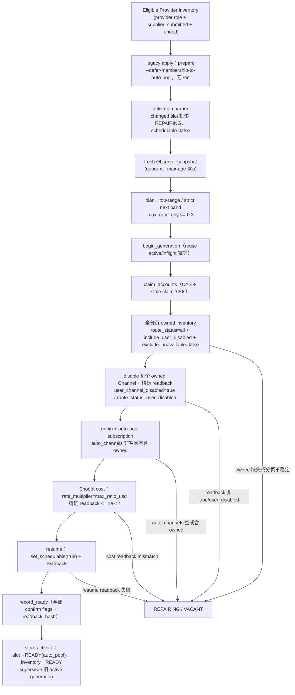
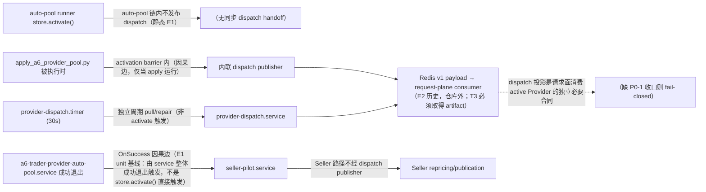
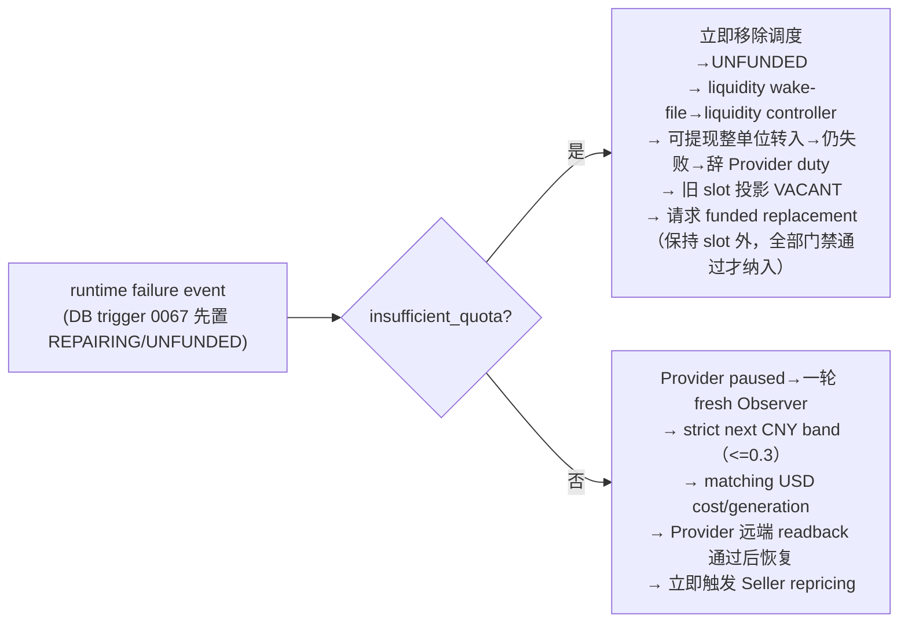

# A6 Trader 架构、设计与部署演进审阅（2026-08-05）

> 本文件是 2026-08-05 轮次的**权威审阅稿**（一稿退回、二稿退回，本版为第二轮定向返工稿）。
> 收口范围：Provider auto-pool、owned-Channel Ban、Observer/cost generation、
> membership/liquidity/runtime failure、listing schedulability、economic source/profit
> gate、model publication、dispatch、regional、cashout、retention。
> 本轮只做本地只读静态核对与四份 Markdown 的定向编辑；未修改任何 Python/JS/SQL/systemd/
> env/部署脚本/测试代码，未运行测试、SSH、部署、迁移、systemctl、生产/远端读写，
> 未启动/启用 `a6-trader-provider-pool-shadow.service`/`.timer`。
> 工作树大量用户既有改动保留，本轮不覆盖、不回滚、不清理。

## 0. 证据等级（互斥三层，全篇统一）

| 等级 | 定义 | 本轮是否成立 |
| --- | --- | --- |
| `E1 静态事实` | **当前工作区本轮直接读取**的实现、unit、migration、测试源码、git 元数据。文件存在、符号/行号/ExecStart 内容本即可复核 | 成立 |
| `E2 历史记录` | 历史文档/evidence ledger 声称的测试结果、部署动作、live 快照；**未在本轮重跑或 live 复验**。含 focused 166 passed、PostgreSQL 集成 16 passed、全套 2168/1 skipped/5 failed、v190/v198 部署、0066-0069 已应用、2026-08-04 各项 live 读数 | 仅记录，不作为当前已复验证据 |
| `E3 fresh live readback` | 今后在 T1 中用生产只读命令重新读回的值。**本轮未执行任何生产命令，因此当前所有 live 状态都只有 E2 或 E3 待做** | 待 T1 |

规则：`E1` 只表达“源码/配置如此”，不表达“已通过/已部署/已生效”；`E2` 不升级为 `E1`；
`E3` 只能用 T1 的只读命令建立。**测试源码存在（E1）≠ 测试本轮通过（E2）≠ 生产已部署（E3）。**
文件 mtime 不推导“仍在演进”，不以 mtime 作为部署成功证据。§2.3 的部署记录全部为 `E2`。

## 1. 一页结论与当前可信基线

- 系统正在把 Provider 调度从 fixed Pin 链迁移到 **marketplace auto-pool**（Observer →
  owned-Channel Ban → auto-pool subscription → Enodot cost → schedulability），并把
  Listing 上/下架交给 **k_CNY 利润门禁 duty**（`listing-schedulability`）。
- 已提交基线（HEAD `ae30382`）= economic gate + listing schedulability + model
  publication + economic facts/source（`1b3faeb` + `ae30382`，`E1` git log）。
- 未提交工作树 = Provider auto-pool / membership / liquidity / runtime failure /
  dispatch / regional / cashout / retention 及其 unit、迁移 `0066-0069`（顶层 + packaged
  镜像逐字节一致，`E1` cmp）、新 observer・control.target 等（`E1` git status）。
- **P0 未闭合，不进入生产启用**：
  - P0-1 **Dispatch 跨 schema/consumer 端到端合同缺口**（DB source → Python projection
    schema → Redis v1 payload → request-plane consumer）。auto-pool READY 行首先在
    `_positive_int(confirmed_pin_binding_id)` 报 `provider_dispatch_ready_pin_invalid`，
    绕过后再因 `channel_id=NULL` 报 `provider_dispatch_slot_identity_invalid`；
    `provider_dispatch_ready_slot_unconfirmed` 只适用于 pin 字段存在但未确认的 fixed-Pin 行。
    即使给 `_ready_slot` 加 route_mode 分支，`ProviderDispatchSlot`/Redis v1 payload 仍无法
    表达 auto-pool READY（无 channel_id、无 auto-pool identity/readback 字段）。
  - P0-2 **Listing lifecycle stop boundary 缺口**：`a6-trader-listing-schedulability.timer/service`
    不在 `control.target` 的 Wants/PropagatesStopTo，service 无 PartOf；target stop 后
    Listing 写 duty 仍可能运行；与 `docs/a6-trader-system-control.md` 声明不一致。
  - P0-3 **owned-Channel Ban 可见性合同冲突**（文档 §7 与两处代码语义相反，待实测收口）。
  - P0-4 部署证据三层（repo target / 历史 deployment record / fresh live state）未对齐。
  - P0-5 auto-pool/membership/liquidity/runtime/dispatch 及 `0066-0069`、多数新 unit 均
    **untracked**，不得写成已提交或可直接发布。
  - P0-6 shadow 纪律：timer 始终 disabled，普通流程不得依赖 shadow（§8.6 合同）。
  - P0-7 **缺少独立于 general auto-pool gate 的 owned-Channel Ban preflight 可审计入口**
    （§8.7）：仓库内不存在可在 `PROVIDER_AUTO_POOL_ENABLED=false`、账号不可调度时执行硬门
    A 的独立入口；缺入口时 runbook step 7 硬停止、**不得启用 auto-pool**。
- 生产迁移 `0066-0069` “已应用”目前只有 E2 部署记录；须 T1 ledger readback 确认。
- 后续顺序：T1 fresh live 只读预检 → T2 Ban 合同实证与文档决策 → T3 Dispatch
  route-mode/consumer + lifecycle 的完整设计规格（不改代码）→ T4 跨边界代码/unit/测试修复
  （单独批准）→ T5 部署（再单独批准）。
- 说明：仓库**存在**内联 dispatch publisher 实现与独立周期 publisher 实现（E1），但当前
  生产是否运行、gate 是否 true 是 E3；auto-pool activate 无同步 dispatch handoff 是静态
  事实（E1），不代表生产长期没有 publisher。

## 2. 近期演进时间线

### 2.1 已提交（commit，`E1` git log）

| 提交 | 时间 (CST) | 主题 |
| --- | --- | --- |
| `dfb3b42` | 2026-07-26 20:56 | Baseline: a6-trader control plane |
| `938b96b` | 2026-07-26 21:01 | Retire in place for unproductive off-market Listings |
| `557747e` | 2026-08-02 13:51 | Hide upstream relay details in timeout responses |
| `1b3faeb` | 2026-08-04 21:55 | Enforce k_CNY profit gate + schedulability-driven delist/relist（9965 行/15 文件：economic facts/source、model publication、`reconcile_a6_listing_schedulability.py`、economic-priority1 + listing-schedulability units 等） |
| `ae30382` | 2026-08-04 22:02 | Fix schedulability duty timer：`OnUnitActiveSec`、去外层 flock |

### 2.2 工作树未提交改动（worktree，`E1` git status，采样于 2026-08-05 本轮）

工作树含大量 dirty 改动与构建产物，精确计数随采样变化、不作为证据，仅描述构成：

- tracked modified：README、pyproject、多个既有 deploy/systemd unit、
  `docs/a6-trading-system-design.md`、`docs/phase1-trial-20260725.md`、
  `src/a6api_auto/data/trade_dashboard.html`、一批 scripts/src/tests。
- untracked：Provider auto-pool 全域（`scripts/reconcile_a6_provider_auto_pool.py`、
  `scripts/apply_a6_provider_pool.py`、`src/a6api_auto/trade_provider_auto_pool*.py`、
  `trade_provider_pool*.py`、`trade_provider_membership_repair.py`、
  `trade_provider_runtime_failure.py`、`trade_provider_liquidity.py`、
  `trade_liquidity_token.py`、`trade_provider_dispatch.py`、`trade_provider_region*.py`、
  `trade_cashout*.py`、`trade_market_history_retention.py`、`trade_provider_pool_shadow*.py`）、
  独立发布脚本 `scripts/project_a6_provider_dispatch.py`、迁移 `0066-0069`（顶层 +
  packaged 镜像逐字节一致）、全部相关新 unit（observer、auto-pool、apply、dispatch、
  membership、liquidity、failure-repair、runtime-failure、regional、cashout、control.target、
  market-history-cleanup、economic-account-sync、model-publication 等）、
  新设计文档（`listing-schedulability-gate-semantics-20260804.md`、
  `economic-gate-schedulability-deploy-20260804.md`、`a6-trader-system-control.md`、
  `provider-auto-pool-agent-handoff-20260804.md`、
  `provider-auto-pool-design-and-progress-20260804.md`）。

### 2.3 历史部署记录（deployment record，**全部为 `E2`**，未在本轮复验）

| 时间 (CST) | 记录 |
| --- | --- |
| 2026-08-04 17:23 | 交接基线：HEAD `557747e`；migration max `0065`；worker `/opt` v188、web `/www` v181；旧 Pin timer/path 与 legacy apply timer active/enabled；shadow disabled/inactive |
| 2026-08-04 | 恢复 + 第二/三阶段：focused 166 passed；PostgreSQL 集成 16 passed（0001-0069 全链、claim CAS、stale claim、completion CAS、lease、record_prepared 比值 CAS）；全套 2168 passed/1 skipped/5 failed（5 个失败属其他任务工作树） |
| 2026-08-04 | 第五阶段 live 预检：13 个 eligible Provider（6 个 funding_eligible）、12 slots 全 DRAINING/REPAIRING（0 READY）、observer 近 6h completed=2677 / failed=8064、旧链 Observer OnSuccess=pin |
| 2026-08-04 19:30 | 第六阶段：release v190 部署；`0066-0069` 应用并补录 ledger；安装 8 个 unit；禁用旧 pin/apply triggers；`PROVIDER_AUTO_POOL_ENABLED=true`；并发 release v190-force-account-quota-refresh-minimal（文件哈希逐字节一致）翻转 `/opt` 链 |
| 2026-08-04 23:00 | 第七阶段修订（`1b3faeb`+`ae30382` 审核）：门禁数学 1.92 正确；fx 市场配对 6.7526、env 7.2 仅回退；双门禁语义；0 live（89/89 下架）；v198 duty 30s callable=1（45933）、would_relist=0 |

## 3. 目标架构与控制器所有权表

| 领域 | 控制器/入口（文件:符号） | 所有权与写边界 |
| --- | --- | --- |
| auto-pool 规划 | `plan_provider_auto_pool` `src/a6api_auto/trade_provider_auto_pool.py:161` | 纯计算；Observer top-range，CNY cap `<=0.3`，strict next band 由 `boundary_index>expand_above_ratio`（:253-266） |
| auto-pool 远程（Ban/订阅/成本） | `reconcile_provider_auto_pool` `trade_provider_auto_pool.py:316`、`reconcile_provider_owned_channel_ban` :413 | 远端写；全分页 inventory + owned 精确 readback |
| auto-pool 状态机/CAS | `PostgresProviderAutoPoolStore` `src/a6api_auto/trade_provider_auto_pool_store.py:86`（`begin_generation`:360、`claim_accounts`:601、`record_prepared`:778、`record_ready`:863、`record_failed`:896、`activate`:967、`fail_generation`:1168） | DB 写；claim token CAS、比值 CAS、READY 契约 |
| model-scoped lease | `PostgresProviderModelLease.hold` `src/a6api_auto/trade_provider_pool_reconciler.py:411` | session advisory lock `0x41365051`，跨完整 saga |
| activation barrier | `PostgresProviderActivationBarrier` `trade_provider_pool_reconciler.py:452` | `0x41365052` pre-send fence；apply 路径内联 publisher 在其内发布 |
| auto-pool runner | `scripts/reconcile_a6_provider_auto_pool.py:82` `run()` | `PostgresProviderModelLease.hold(model)` 包全程（:184）；apply 门禁 `PROVIDER_AUTO_POOL_ENABLED`（:109-115）；**无 activation barrier、无同步 dispatch handoff（E1）** |
| legacy membership apply | `scripts/apply_a6_provider_pool.py` `run_model`:150 | 规划/激活/repin + **内联 dispatch publisher**（:1464 `build_dispatch_projector`、:519 `_project_active_dispatch`、:749 barrier；`--defer-membership-to-auto-pool` 需 `PROVIDER_AUTO_POOL_ENABLED=true` :1443-1450）；仅在 apply 被执行时运行 |
| 独立 dispatch publisher | `scripts/project_a6_provider_dispatch.py`（gate `PROVIDER_DISPATCH_RECONCILE_ENABLED` :39,165）+ `a6-trader-provider-dispatch.service/.timer` | 独立周期 pull/repair：`OnUnitActiveSec=30s`、`RandomizedDelaySec=2s`、`AccuracySec=1s`；flock nonblock `provider-dispatch.lock`、exit75、`--publish`；**无 OnSuccess 到 Seller** |
| membership repair | `PostgresProviderMembershipRepairStore` `src/a6api_auto/trade_provider_membership_repair.py`（`claim`:151、`observe`:196、`defer`:255、`complete`:379） | DB 写；claim `FOR UPDATE SKIP LOCKED`、completion CAS |
| runtime failure | `src/a6api_auto/trade_provider_runtime_failure.py` `run_once`:348 / `_handle_auto_pool`:430；`scripts/consume_a6_provider_runtime_failures.py` 长驻 listener | DB trigger `0067` 同步置 REPAIRING/UNFUNDED；consumer 按 action 写 wake-file（`/run/a6-trader/provider-auto-pool-request`、`provider-liquidity-request`、`model-publication-request`），由对应 path 唤醒控制器 |
| liquidity | `src/a6api_auto/trade_provider_liquidity.py` | 可提现整单位转入用户余额、funding 读回、`UNFUNDED` 投影 |
| listing schedulability | `scripts/reconcile_a6_listing_schedulability.py` `decide`:440 / `main`:910 | 上/下架；`banned_channel_ids` 来自 auto-pool account 的 `disabled_owned_channel_ids`（:805-822）；banned 渠道 keep `auto_pool_banned`（:456-462） |
| dispatch read-model + schema | `src/a6api_auto/trade_provider_dispatch.py`（`ProviderDispatchSlot`:19-63、`ProviderDispatchBundle`:66-144、`_ACTIVE_SLOTS_SQL`:721-762、`_ready_slot`:519-576、REPAIRING 注释 :265-266） | **fixed-Pin 专属**：slot 必须带 `channel_id` 正整数、bundle `schema_version=1`、channel 唯一性；SQL 无 route_mode 与 auto-pool identity/readback 字段；见 P0-1 |
| request-plane consumer | 仓库内无源码；历史记录 `docs/a6-provider-topn-failover-design-20260728.md:245-258` 描述 Sub2API Redis dispatch 消费 / PostgreSQL fallback / pre-send barrier | E2 记录；当前实现为仓库外（Go 请求面）artifact，T3 必须取得 |
| economic facts/source | `src/a6api_auto/trade_economic_facts.py`（fx 市场配对 :114-125、回退 :186-190、`fx_source` :206）、`scripts/reconcile_a6_economic_sources.py` | 只读聚合 + 门禁投影；`DEFAULT_FX_CNY_PER_USD=7.2` 仅回退（:25） |
| model publication | `src/a6api_auto/trade_model_publication.py`（`seller_cost_guard_plan` `schedulable_sources` 门禁 :280-309）；unit `a6-trader-model-publication.service`（`After=...a6-trader-provider-pool-shadow.service` :3，仅排序边，见 §8 P2-4） | publication 写；unit 未 commit |

## 4. 端到端顺序 / 状态机

主链路（auto-pool activation 内部，`E1` 静态 + 部分 E2 行为记录）：



**因果边 / 独立边 / 静态实现（重要，纠正确误因果关系）**：



文字说明：
- systemd `OnSuccess` 由 **auto-pool.service 整体成功退出**触发，**不是**由
  `store.activate()` 直接触发（后者只是 service 内的一次 DB 调用）。apply
  `OnSuccess=observer`、observer `OnSuccess=auto-pool`、auto-pool `OnSuccess=seller-pilot`
  同样是 service 退出级因果边，属于**当前 E1 unit 基线**，不是 T3 已批准的“未来唯一触发
  owner”；触发 ownership 仍以 §9 T3 产物 C 的裁决为准。
- `auto-pool activate()` 没有同步 dispatch handoff；内联 publisher 只在
  `apply_a6_provider_pool.py` 实际被调用时运行，**不是** activate 的直接后继；
  `dispatch.timer` 是独立周期 pull/repair，**不是** activate 直接触发；
  Seller 路径不经过 dispatch publisher；`dispatch.service` 没有 OnSuccess 到 Seller。
- “dispatch 投影被请求面消费”是**独立的必要合同**：Seller 完成不是 Provider activation
  barrier，但缺 dispatch 投影时请求面无法消费 active Provider。
- 本图区分：因果 edge（OnSuccess/事件）、独立周期 edge（timer/path）、静态实现存在
  （E1）、live 是否 active/gate=true（**E3 待 T1**）。

运行时故障分流（AGENTS.md 硬规则，`E1` 实现 + `E2` 记录）：



## 5. 关键不变量与 fail-closed 条件（`E1` 实现证据）

| 不变量 | 实现证据 | 失效行为 |
| --- | --- | --- |
| `max_ratio_cny <= 0.3` 双层强制 | `plan_provider_auto_pool` :178-190；`0066` `provider_auto_pool_generation_ratio_valid` CHECK | 规划报错 / DB 拒绝 |
| owned Channel 精确 readback | `_user_disabled` `trade_provider_auto_pool.py:614`；:399/:458 raise | `owned_channel_readback_failed`，账号保持不可调度 |
| owned 集合不得缺失（retired 不豁免） | `_verify_known_owned_visible` :591；缺失→relist 后仍缺→`owned_resource_not_visible` | 激活失败 |
| `auto_channels` 非空且不含 owned | `_verify_subscription` :627-673 | `effective_pool_empty` / `owned_channel_selected` |
| claim CAS | store `record_prepared/ready/failed` 校验 `claim_token` | 写失败、不投影 |
| 同 model 单 active generation | `0066` `provider_auto_pool_one_active_idx`；`activate()` :1137-1155 | 并发激活失败 |
| generation ratio 不可变匹配 | `record_prepared` 比值 CAS（:813-819） | `provider_auto_pool_account_cost_generation_mismatch` |
| READY slot 契约（fixed vs auto_pool 双 shape） | `0066` `provider_pool_slot_ready_contract` :203-225 | DB CHECK 拒绝 |
| **dispatch schema 只接受 fixed-Pin shape（P0-1）** | `ProviderDispatchSlot.channel_id` 必填正整数（`trade_provider_dispatch.py:25,30-44`）、bundle `schema_version=1`（:76,82-83）、channel 唯一性（:119）、`ready_dispatch_set` 每项带 channel_id（:133-144）；`_ACTIVE_SLOTS_SQL` 无 route_mode/auto-pool 字段（:721-762）；`_ready_slot` 首行 `_positive_int(confirmed_pin_binding_id)`（:520-523） | 合法 auto-pool READY 行首个错误 = `provider_dispatch_ready_pin_invalid`；绕过后在 channel_id 处报 `provider_dispatch_slot_identity_invalid`；`provider_dispatch_ready_slot_unconfirmed` 仅对 pin 字段存在但未确认的 fixed-Pin 行（:524-538） |
| completion CAS（membership） | `trade_provider_membership_repair.py` `complete`/`defer` `FOR UPDATE` + 全条件再验 | `provider_membership_repair_completion_state_changed` |
| `insufficient_quota` 不走扩价路径 | `0067` trigger：quota→`block_liquidity`；runtime failure `_handle_auto_pool` :437-439 | 走 liquidity 控制器 |
| replacement 保持 slot 外 | AGENTS.md 硬规则；旧 slot VACANT、replacement 全部门禁通过前不进入 slot（见 §8 P1-5、设计稿 §11.4.2） | 违反则提前占 slot = P0 |

## 6. systemd 触发图、互斥/lease/幂等边界（`E1` unit 文件）

```mermaid
graph LR
    subgraph 周期触发（timers）
      T1["provider-pool-apply.timer (15s)<br/>legacy apply timer 静态周期（非 Dispatch 时延）"] --> APP["pool-apply.service<br/>flock nonblock provider-control.lock exit75<br/>内联 dispatch publisher（仅 apply 执行时）<br/>OnSuccess→observer"]
      T2["observer.timer (1/min)"] --> OBS["observer.service（无 flock）<br/>OnSuccess→auto-pool"]
      TD["provider-dispatch.timer (30s)<br/>OnUnitActiveSec=30s + RandomizedDelay 2s + Accuracy 1s<br/>WantedBy=timers.target；control.target Wants 该 timer"] --> DSP["provider-dispatch.service<br/>flock nonblock provider-dispatch.lock exit75<br/>--publish 门禁 PROVIDER_DISPATCH_RECONCILE_ENABLED<br/>无 OnSuccess→Seller"]
      LS["listing-schedulability.timer (30s)<br/>WantedBy=timers.target<br/>不在 control.target 内（P0-2）"] --> LSS["listing-schedulability.service<br/>WantedBy=control.target 但无 PartOf<br/>脚本内 fcntl seller-control.lock<br/>成功码 75"]
    end
    subgraph 事件路径（wake-file → path）
      APW["auto-pool-refresh.path<br/>PathChanged provider-auto-pool-request"] --> OBS
      LQW["liquidity.path<br/>PathChanged provider-liquidity-request"] --> LQ["provider-liquidity.service"]
      MPW["model-publication.path<br/>PathChanged model-publication-request"] --> MP["model-publication.service"]
    end
    APP -->|OnSuccess| OBS
    OBS -->|OnSuccess| AP["provider-auto-pool.service<br/>ExecCondition PROVIDER_AUTO_POOL_ENABLED=true<br/>flock blocking provider-control.lock<br/>OnSuccess→seller-pilot"]
    AP -->|OnSuccess| SP["seller-pilot.service<br/>flock nonblock seller-control.lock<br/>OnSuccess→onboard"]
    RF["runtime-failure.service<br/>Type=simple 长驻 listener（PartOf=control.target）"] -->|refresh_auto_pool 写 wake| APW
    RF -->|block_liquidity 写 wake| LQW
    RF -->|publication 写 wake| MPW
```

- **互斥**：auto-pool blocking `flock provider-control.lock`（`a6-trader-provider-auto-pool.service:15`）
  + `PostgresProviderModelLease`；apply 与 dispatch 各自 nonblocking flock（`provider-control.lock`、
  `provider-dispatch.lock`）exit 75；seller-pilot nonblock `seller-control.lock`；
  listing-schedulability 脚本内 fcntl `seller-control.lock`（unit 无外层 flock）。
- **`control.target` 边界**：`Wants=a6-trader-provider-dispatch.timer`（`a6-trader-control.target:23`）、
  `PropagatesStopTo` 覆盖 dispatch/auto-pool/membership/liquidity/影子/旧 pin/apply（:45-114）；
  **未纳入 listing-schedulability.timer/service（P0-2）**；不 `Wants` auto-pool.service
  与 observer.timer（auto-pool 仅由 observer `OnSuccess` 启动）。live 是否 active/enabled 为 E3。
- **幂等边界**：`begin_generation` 复用 active/inflight（`trade_provider_auto_pool_store.py:420-512`）；
  claim 幂等重 claim + stale 120s；`activate` 单事务 + advisory xact lock `0x41364150`；
  Redis dispatch 发布用 `_ATOMIC_PUBLISH_LUA`（`trade_provider_dispatch.py:763-`）CAS + exact
  readback（`_assert_exact_readback` :448-465）。
- **已知 churn**（`E2` 部署记录）：apply exit75 → `OnSuccess` → observer → auto-pool blocking
  lock 重入；曾人工停 observer.timer 打破循环（§8 P1-8）。

## 7. 设计/实现/部署证据矩阵

| 主题 | 证据（精确到符号/行号或 unit） | 分级 |
| --- | --- | --- |
| auto-pool plan/cap/strict band | `trade_provider_auto_pool.py:161-313` | E1 |
| owned ban 全分页 + 精确 readback | `trade_provider_auto_pool.py:316-466,518-574,591-617` | E1 |
| 订阅自动池 readback | `trade_provider_auto_pool.py:627-681` | E1 |
| claim/比值 CAS + READY 契约（auto_pool shape） | `trade_provider_auto_pool_store.py:601-966`、`0066:118-129,202-225` | E1 |
| session lease + barrier | `trade_provider_pool_reconciler.py:411-483` | E1 |
| membership completion CAS | `trade_provider_membership_repair.py:151-444` | E1 |
| runtime failure 分流 + wake-file | `trade_provider_runtime_failure.py:348-460`、`0067` trigger、`consume_a6_provider_runtime_failures.py`（`--auto-pool-trigger-file` 等 :50-60） | E1 |
| listing 双门禁 + banned keep | `reconcile_a6_listing_schedulability.py:440-549,805-822` | E1 |
| fx 市场配对 + 7.2 回退 | `trade_economic_facts.py:25,114-125,186-206` | E1 |
| publication schedulable 门禁 | `trade_model_publication.py:280-309` | E1 |
| dispatch 内联 publisher（仅 apply 执行时） | `apply_a6_provider_pool.py:1464,519-529,749`（activation barrier 内） | E1 |
| dispatch 独立周期 publisher | `scripts/project_a6_provider_dispatch.py`（gate :39,165）、`a6-trader-provider-dispatch.service`（flock exit75 `--publish`）、`.timer`（OnUnitActiveSec=30s + RandomizedDelay 2s + Accuracy 1s）、`control.target:23,66-67` | E1 |
| **dispatch schema 合同缺口（P0-1）** | `trade_provider_dispatch.py:19-63`（slot.channel_id 必填）、`:66-144`（bundle schema_version=1、channel 唯一、ready_dispatch_set 每项带 channel_id）、`:721-762`（无 route_mode/auto_pool 字段）、`:519-538`（`ready_pin_invalid` 首错）、`:563-566`（`slot_identity_invalid`） | E1 |
| dispatch 测试无 auto-pool READY 投影 | `tests/test_trade_provider_dispatch.py` ready_row fixture（confirmed_pin_binding_id=61、pin/probe_confirmed=True，:295-340）无 route_mode；`tests/test_project_a6_provider_dispatch.py:207` 仅断言默认关 + 周期 | E1（源码存在，未运行） |
| request-plane consumer / fallback / fence | 仓库内无源码；`docs/a6-provider-topn-failover-design-20260728.md:245-258` 历史描述 | E2 记录；T3 须取得静态/live artifact |
| lifecycle stop boundary 缺口（P0-2） | `control.target` 无 listing-schedulability 引用；`listing-schedulability.timer` WantedBy=timers.target；`service` [Install] WantedBy=control.target、无 PartOf；`docs/a6-trader-system-control.md` stop 声明 | E1（静态） |
| migration 镜像一致 | `cmp` 0065-0069 顶层 vs packaged 全部 MATCH | E1 |
| focused 166 / PostgreSQL 16 / 全套 2168-1-5 | handoff/design evidence ledger | E2（未复验） |
| v190/v198 部署、0066-0069 应用、2026-08-04 live 读数 | handoff evidence ledger | E2（记录） |
| 生产当前 chain / slots / providers / dispatch / shadow / gates | 无（本轮未执行生产命令） | E3（T1 待做） |

## 8. P0 / P1 / P2 发现

### P0-1 ｜ Dispatch 跨 schema/consumer 端到端合同缺口（核心阻塞，二次返工重写）

- **影响**：`0066` 允许、`store.activate` 刻意投影的 auto-pool READY slot，在
  DB source → Python projection schema → Redis v1 payload → request-plane consumer
  整条链上**无法表示**，两个 publisher（内联 + 周期）都会 fail-closed 拒绝。auto-pool
  `activate()` 无同步 dispatch handoff 只是次要时序事实（有周期 publisher），真正断层在
  schema/consumer 合同。
- **证据（全部 E1，行号本稿已复核）**：
  1. **schema**：`ProviderDispatchSlot.channel_id: int` 必填（`trade_provider_dispatch.py:25`），
     `__post_init__` 对 slot_no/account_id/token_ref_id/external_token_id/**channel_id**/rank/priority
     全部要求 `int >= 1`（:30-44），否则 `provider_dispatch_slot_identity_invalid`；
     `document()` 每项带 channel_id（:59）。
  2. **bundle**：`ProviderDispatchBundle.schema_version` 固定 `1`（:76），`!= 1` 即
     `provider_dispatch_schema_invalid`（:82-83）；对 slot_no/account_id/token_ref_id/
     external_token_id/**channel_id**/rank/priority 做唯一性约束（:111-125，channel 唯一 :119）；
     `ready_dispatch_set` 由 `slot.document()` 组成（:133-144），因此 v1 payload 的每个成员
     **必然带 channel_id**。
  3. **producer**：`_ready_slot`（:519-576）**首行** `_positive_int(confirmed_pin_binding_id, ...)`，
     合法 auto-pool READY 行（confirmed_pin_binding_id=NULL）在此报
     **`provider_dispatch_ready_pin_invalid`**（:520-523）；绕过后才在构造输出时对
     channel_id 调 `_positive_int`（:563-566），NULL 报 **`provider_dispatch_slot_identity_invalid`**；
     `provider_dispatch_ready_slot_unconfirmed`（:538）**只**用于进入布尔确认块
     （:524-537：funding/双 schedulable/pin_confirmed/probe_confirmed/状态/token/binding/
     current_pin）后不满足 fixed-Pin 确认的行。
  4. **SQL**：`_ACTIVE_SLOTS_SQL`（:721-762）**既没有 SELECT route_mode，也没有
     SELECT auto_pool_generation_id、auto_pool_subscription_id、auto_pool_confirmed**
     等 auto-pool identity/readback 字段；pin 连接以 `confirmed_pin_binding_id`/
     `desired_channel_id` 为准。
  5. **DB 投影**：`0066` `provider_pool_slot_ready_contract`（:203-225）auto_pool 分支要求
     `desired_channel_id IS NULL`、`confirmed_pin_binding_id IS NULL`、`NOT pin_confirmed`、
     `auto_pool_confirmed`；`store.activate`（:1073-1104）按此投影（pin 字段置 NULL/false）。
  6. **REPAIRING 注释**（:265-266）：“等待 auto-pool 接管的身份不会通过 fixed-Pin 请求面进入 dispatch”。
  7. 内联 publisher（`apply_a6_provider_pool.py:519,749`）与周期 publisher
     （`project_a6_provider_dispatch.py`）共用同一个 `ProviderDispatchProjector →
     load_active → _ready_slot` 读模型与同一个 v1 payload。
- **结论**：即使只给 `_ready_slot` 加 route_mode 分支，现有 `ProviderDispatchSlot`/Redis
  v1 payload 仍不能表示 auto-pool READY。**不得假定应让 auto-pool 伪造 Pin 字段**；
  需要端到端设计决策（T3）。
- **T3 必须产出的完整设计决策**（不得预设“加一个分支即可”）：
  1. DB source 要新增 SELECT 哪些 route-mode 字段（`route_mode`、`auto_pool_generation_id`、
     `auto_pool_subscription_id`、`auto_pool_confirmed`、可选的 observed readback 哈希）；
  2. canonical slot identity 对 `fixed_pin` 与 `auto_pool` 分别是什么（fixed：channel_id + pin
     binding；auto_pool：subscription/auto-pool-generation + account/token，无 channel_id）；
  3. auto_pool 无 channel_id 时 Redis payload 如何表达（nullable channel_id 或 auto_pool 专用
     identity 字段；同时满足 bundle 唯一性约束的替代键）；
  4. schema：沿用 v1 并向后兼容（channel_id 允许为 null 但保持 key 兼容），还是引入
     `schema_version=2`/双写/双读；给出迁移与回退顺序；
  5. Sub2API/request-plane Redis decoder、PostgreSQL fallback、pre-send fencing、
     regional projection/receipt 如何兼容（当前仓库内无 consumer 源码，只能列为 T3
     必须取得的**静态或 live artifact**；可引用 `docs/a6-provider-topn-failover-design-20260728.md:245-258`
     的“Sub2API consumer / fallback / fence”历史记录，但分级为 **E2**，当前 Python
     producer/schema 才是 E1）；
  6. producer/consumer 发布先后、default-off gates、回退、exact readback，以及
     mixed（fixed+auto_pool 同 generation）/ empty / VACANT / REPAIRING 场景的测试矩阵。
- **验收方法（T3 文档 + T4 测试）**：对 auto_pool READY 输入行 → 期望进入 bundle → Redis
  发布后 exact readback 含该 slot 且 schema 版本/identity 一致；fixed_pin 行为不变；
  VACANT/REPAIRING 不发布；断言不再以 `provider_dispatch_ready_pin_invalid` /
  `provider_dispatch_slot_identity_invalid` 拒绝合法 auto_pool 行。
- **停止条件**：T3 决策未定案前不得写任何 producer/schema 代码；无 request-plane consumer
  artifact 前不得宣称兼容。

### P0-2 ｜ Lifecycle stop boundary 缺口（Listing 写 duty 逃逸 control.target）

- **影响**：`a6-trader-control stop` 后，`a6-trader-listing-schedulability.timer/service`
  可能继续运行并持续执行 Listing 上/下架写操作；`docs/a6-trader-system-control.md` 声称
  stop 边界包含全部 trigger/worker，与静态 unit 事实不一致。
- **证据（全部 E1）**：
  1. `a6-trader-control.target` 无 `Wants=`/`PropagatesStopTo=` 引用
     `a6-trader-listing-schedulability.{timer,service}`（grep 无命中）。
  2. `.timer` `WantedBy=timers.target`（.timer:11-13）。
  3. `.service` `[Install] WantedBy=a6-trader-control.target`（service:23-24），无
     `PartOf`；target stop 只停止 PropagatesStopTo/PartOf 传播的 unit，WantedBy 只影响 start。
  4. `docs/a6-trader-system-control.md` 的 stop 边界声明与上述静态事实不一致（该文档不在
     本轮可改清单内，只记录矛盾）。
- **修订建议（T3 设计 + T4 unit 修复）**：补 `PartOf=a6-trader-control.target` +
  target `Wants/PropagatesStopTo`（或独立 lifecycle 表达）；更新 system-control.md 描述。
- **验收方法**：start/stop 事务验证放 **T4/T5**（`a6-trader-control stop` 后 30s 内无新
  duty 执行；start 事务包含该 duty）。T1 只读只能读回依赖/active 状态，**不得直接执行
  control stop 来证明**。
- **停止条件**：修复前控制面文档与 unit 不一致持续记录为阻塞。

### P0-3 ｜ owned-Channel Ban 可见性合同冲突（不选边，待实测收口）

- **影响**：两份权威来源对“已 ban owned 渠道最终状态”语义相反；目标是收口为**唯一合同**，
  不是让 listing duty 与 auto-pool 互相覆盖。
- **证据（E1 静态 + E2 文档）**：
  1. `docs/listing-schedulability-gate-semantics-20260804.md` §7：上架 → Ban → **最终下架 + ban 标记**。
  2. `scripts/reconcile_a6_listing_schedulability.py:454-462`：banned 渠道 `keep / auto_pool_banned`，
     注释“保持上架+banned 以维持市场审计可见性”；`load_banned_channel_ids:805-822`。
  3. `trade_provider_auto_pool.py:430-441`：缺失 owned 渠道先 relist 再 ban，依赖上架可见性做审计。
- **修订建议（T2）**：只读实测 DOWN+banned 渠道在 `route_status=all +
  include_user_disabled + exclude_unavailable=false` 下的可见性与回退标准；**若无现成
  DOWN+banned fixture，不得为实测制造远端状态**，记录缺样本并保持 P0；不做远端 mutation。
- **验收方法**：两份文档给出相同权威表述；有实证（可见或不可见各有证据与回退路径）。

### P0-4 ｜ 部署证据三层未对齐（repo target ≠ 历史 deployment record ≠ fresh live state）

- **证据**：repo `a6-trader-observer.service:6`（OnSuccess=auto-pool，E1）vs 2026-08-04 17:23
  记录“生产 Observer OnSuccess=pin”（E2）vs 19:30 部署记录“已装新链并禁用旧 triggers”（E2）；
  `a6-trader-pin.service:6` 旧链仍在 repo（E1）。
- **修订建议**：结论标注三层之一；部署验证以 fresh live readback 为准（T1）。
- **验收方法**：T1 产出三层对齐表（FragmentPath/ExecStart/OnSuccess/UnitFileState/ActiveState、
  旧 pin/path/apply trigger enable 状态）。

### P0-5 ｜ 核心文件大量 untracked，禁止“已提交/可直接发布”表述

- **证据**：`git status --porcelain` 采样（E1）。
- **影响/建议**：release 与验收用显式 manifest（§10）；本任务文件先按清单纳入版本控制或随
  release 打包校验哈希；交付语言不得出现“已提交/已部署”，除非有 commit 或 E3 readback。
- **验收**：release manifest 每文件 sha256 与打包内容逐项一致。

### P0-6 ｜ Shadow 合同（严格；延续 AGENTS.md 硬规则）

- **硬约束**（本节即合同，无“如需 enable”一类表述）：
  1. `a6-trader-provider-pool-shadow.timer` **始终 disabled**；service 默认 inactive。
  2. 日常诊断、Pin refresh、liquidity repair、retry、readback、部署验证**均不使用 shadow**。
  3. 仅当 routing/cost 变化要求新 immutable generation 且**无已 planned/active generation
     可复用**时，先记录具体原因，才允许 one-shot 启动 service 一次。
  4. one-shot 后 timer 仍 disabled。
  5. **不等待 observation window**，除非用户明确要求 shadow evidence，或 generation contract
     使其不可缺。
  6. runbook 与任务不得把 shadow 作为常规依赖。
- **证据（E1）**：`control.target` 仅 `PropagatesStopTo` shadow（:108-109），不 Wants。
- **验收**：每次只读预检记录 shadow timer `disabled/inactive` + service `inactive/dead`。

### P0-7 ｜ 缺少独立于 general auto-pool gate 的 owned-Channel Ban preflight 可审计入口

- **影响**：根 AGENTS.md 硬规则要求在**启用 Provider auto-pool 之前**远端禁用该 Provider
  用户的全部 owned Channels。当前仓库没有任何入口能在 `PROVIDER_AUTO_POOL_ENABLED=false`
  且账号不可调度时单独完成该前置审计（完整分页 owned-set 审计 + 远端 disable + 逐项
  `true/user_disabled` 精确 readback）。因此唯一合规的硬门 A 目前**不可执行**；若绕过它先
  开 auto-pool gate，即违反 AGENTS.md 硬规则。
- **证据（E1，本稿已核对）**：
  1. `scripts/reconcile_a6_provider_auto_pool.py` `_prepare_account` 是唯一“先 pause 再 Ban+
     订阅+成本”的执行点，但其 `--apply` 受 `PROVIDER_AUTO_POOL_ENABLED` 门禁（:109-115），
     必须先打开 gate 才能进入 prepare——**不能作为独立 preflight**。
  2. `scripts/apply_a6_provider_pool.py:668` 的 `pre_enable_guard` → `reconcile_provider_owned_channel_ban`
     由 `trade_provider_pool_remote.py:1034` 在 legacy apply 启用 slot 时执行，受 legacy
     apply gates 门禁、不建立 subscription，且与 slot-enable 耦合——也不能作为独立 preflight。
  3. 仓库内无第三个调用点（rg 全量核对）。
- **关闭标准**：存在一个独立于 general auto-pool gate 的可审计入口，满足：
  1. 在 `PROVIDER_AUTO_POOL_ENABLED=false` 且账号不可调度时可执行；
  2. 完成完整分页 authoritative owned-set 审计（`route_status=all`、`include_seed=true`、
     `include_user_disabled=true`、`exclude_unavailable=false`）、远端 disable、逐项
     `true/user_disabled` 精确 readback、审计落账；
  3. 本地 known owned 在远端完整 readback 中缺失即失败（含 retired 资源）；
  4. 失败不改变 general gates、不使账号可调度；
  5. 可复用底层 `reconcile_provider_owned_channel_ban`，但调用入口/gate/owner 必须独立，
     **不得复用“需先打开 auto-pool gate 才能进入 prepare”的调用方式**；
  6. **产出可审计 admission grant / evidence record**，至少绑定：Provider
     token/user/model identity、authoritative local-known owned-set revision/hash、完整
     远端分页 snapshot hash、每项 exact readback、完成时间、入口 revision/owner、结果；
     定义 freshness/TTL 与失效条件（owned Channel/Listing 创建、adopt、restore、
     retire/远端 inventory 变化、evidence 超时或 identity mismatch 即失效并重跑 A）；
     **grant 中不得写入 token secret**。schema/TTL/原子消费方式由 T3 决定、T4 实现测试。
  7. **admission grant 状态机与 consumed evidence**：T3 产物 D 必须定义单次
     admission grant 状态机，至少覆盖 `ISSUED / CONSUMED / INVALIDATED / EXPIRED`
     （命名可调整），并绑定同一 Provider identity、owned-set revision/snapshot、
     generation/activation-attempt；**原子消费后 grant 转为不可复用但可审计的 consumed
     evidence**（step 9 检查的是绑定当前 attempt 的 consumed evidence + B evidence，不是可
     再次消费的 grant）；**消费与 admitted-set 纳入必须处于同一原子边界或由等价 CAS/事务
     保证，避免 TOCTOU/replay**；TTL/失效事件发生在消费前后分别如何 fail-closed 由 T3
     定案、T4 测试。
  8. **controller admission 隔离合同**：T3 必须设计
     generation/activation-attempt scoped 的 **admitted-set 序列化**与 controller
     load/claim 过滤合同——opening global gate 不得使 `C0 - C1` 或其他无 admission 的账号
     被 load/prepare/resume；admitted-set 的创建、冻结、minimum-ready 计数、B 失败移除/
     重算、attempt 结束清理都需原子性/并发 ownership 规格。**当前控制面不仅缺 owned-set
     revision/serialization，也缺 admitted-set handoff/serialization，二者均为设计关闭项，
     不声称已有实现**。
- **归属**：T3 产物 D 定案（入口/gate/owner/审计语义 + admission grant 契约 +
  admitted-set 隔离合同），T4-producer 实现与测试；缺失时 runbook §10 step 7 硬停止，
  **T5 禁止**。
- **设计关闭项（不假定已有）**：当前控制面**同时缺少** owned-set revision/serialization
  （`owned_resources` 仅为查询，无 revision 列/序列）**与 admitted-set handoff/serialization**，
  二者均由 T3 产物 D 定案、T4-producer 实现。
- **验收方法**：新增 focused 测试证明入口在 gate=false 时执行完整 A、产出含上述字段的
  admission grant、失败不改 gate、不使账号可调度；grant 失效触发重跑 A；controller 在
  global gate 打开时不得 load/prepare/resume 任何无 admission 的账号；T5 前该入口已
  批准且生产只读复核存在。

### P1

- P1-1 `record_failed()` slot/inventory UPDATE 无 rowcount 断言（`trade_provider_auto_pool_store.py:928-959`）。
- P1-2 `_resume_account`（`scripts/reconcile_a6_provider_auto_pool.py:452-468`）只读回
  `schedulable`；prepare→resume 与 resume→activate 两个窄窗口不再复核 ban/订阅/成本。
- P1-3 store 短事务 advisory lock（`0x41364150`）与 runner session lease（`0x41365051`）
  双命名空间；脱离 runner 直接调 store 的入口无全程串行。
- P1-4 `absent_owned_channel_ids` 恒为空（claim 重置 `:698`、`record_prepared :803`、
  远程 `:406`），缺失实际由 relist 或 raise 处理；列语义需文档化。
- P1-5 quota→resign→VACANT→replacement 全链缺单个端到端集成证明；**replacement 语义按
  AGENTS.md 必须为“保持 slot 外、旧 slot VACANT、全部门禁通过后原子纳入/激活”，不得写成
  提前占 slot 的 REPAIRING**（见设计稿 §11.4.2）。
- P1-6 fx 双口径：无新鲜行情静默回退 `DEFAULT_FX_CNY_PER_USD=7.2`
  （`trade_economic_facts.py:25`）；`fx_source`（:206）可区分。**处置归属：独立后续任务**
  （fx fallback 告警/面板提示 + 测试），不并入 T4；见 §9 遗留项登记。
- P1-7 legacy `a6-trader-pin.service:6` 仍具备双写 Provider 调度能力
  （`OnSuccess=apply+seller-pilot`）。**处置归属：T1 readback 确认运行期状态 + T5 stop
  condition/禁用验收**（旧 pin/apply triggers 必须保持 disabled）。
- P1-8 apply exit75 → `OnSuccess` → observer → auto-pool blocking lock 重入 churn
  （`a6-trader-provider-pool-apply.service:5,18`；E2 记录曾人工停 observer.timer）。
  **处置归属：T3 ownership 设计**（评估 apply exit75 是否仍应 OnSuccess，或改为显式
  resume 驱动），给出停止/验收条件；见 §9 遗留项登记。

### P2（观察项）

- P2-1 `0066` ratio CHECK 只约束 `max_ratio_usd>0`，USD cap 由观察 + `1e-12` readback 保障。
- P2-2 **dispatch 周期 publisher 时延表述**：timer 为 `OnUnitActiveSec=30s` +
  `RandomizedDelaySec=2s` + `AccuracySec=1s`，叠加调度与执行时间，**不存在“最坏约 30s”的硬上界**；
  只在 timer active/enabled 且 `PROVIDER_DISPATCH_RECONCILE_ENABLED=true` 时产生投影
  （live 状态 E3）。nominal cadence 30s + 0..2s random + scheduler/exec delay。
- P2-3 `reused_active` 每轮重复 pause→ban→订阅→cost 写操作，幂等但写放大。
- P2-4 `a6-trader-model-publication.service:3` `After=...provider-pool-shadow.service`：
  **只是当两者在同一 transaction 时的一条排序边**；它不会拉起 shadow，也不会等待一个
  未加入 transaction 的 inactive unit。不构成 activation dependency，不改变 timer 始终
  disabled 的合同。作为 stale ordering edge 记录（不写“空置依赖”）。

## 9. 下一阶段任务目标（顺序任务；边界与授权分开）

> 任务边界：T1-T3 只读/文档，不改代码；T4（**单独批准后**的代码/unit/测试修复）分
> T4-producer（in-repo）与 T4-consumer（request-plane，同批批准），producer-only 不允许
> 进入 T5；T5 是 T4-producer + T4-consumer 通过后再**单独批准**的部署。本审阅轮自身只修改
> 四份 Markdown。全部任务不 reset/clean/checkout、不启动 shadow、不等待 shadow 观测窗口。

### T1 ｜ fresh live 只读状态与三层对齐（不修改生产）

- **输入**：以 §2.3 的 **E2 行作为待对齐历史基线** + §7 矩阵 **E3 行 / P0-4 为 fresh
  readback 清单**（不是“§2.3 的 E3 项”，§2.3 全部为 E2）。
- **动作边界**：仅只读；不启停 unit、不写 DB、不读 secret/token/password 值；
  **不得直接执行 control target stop 来证明 P0-2**（start/stop 事务验收放 T4/T5）。
- **必须读回的非敏感门禁与参数值**（精确名单，过滤 secret）：
  `PROVIDER_AUTO_POOL_ENABLED`、`PROVIDER_DISPATCH_RECONCILE_ENABLED`、
  `PROVIDER_POOL_RECONCILE_ENABLED`、`PROVIDER_POOL_APPLY_STAGE`、
  `PROVIDER_POOL_APPLY_CONFIRMATION`、`PROVIDER_POOL_MAX_MEMBERSHIP_CHANGES`、
  `PROVIDER_LIQUIDITY_RECONCILE_ENABLED`、`PROVIDER_FAILURE_REPAIR_ENABLED`；
  以及 unit ExecStart 中的 `--hard-max-ratio-cny`、`--minimum-ready-accounts`。
  若静态核对发现另有明确 owning gate，一并列出（本轮未在生产读回，仅按 repo unit/脚本
  静态核对存在哪些 gate 名；确切集合以 T1 实际读回为准）。
- **DB 投影判定**：正确条件为 `slot_state='READY' AND route_mode='auto_pool'`
  （不是把 route_mode 误写作 READY 的错误写法）。
- **dispatch 专项验证**：`a6-trader-provider-dispatch.timer/service` enable/active、
  ExecStart、实际周期（OnUnitActiveSec=30s + RandomizedDelay 2s + Accuracy 1s）、
  gate（`PROVIDER_DISPATCH_RECONCILE_ENABLED`）、Redis exact readback（只读键值，不输出
  payload secret）；DB `slot_state='READY' AND route_mode='auto_pool'` 投影与 Dispatch
  输出 bundle 覆盖关系。
- **样本边界**：若 live 无 `auto_pool` READY slot，T1 **不得声称对 P0-1 取得运行实证**；
  只记录“无样本，E1 P0 仍成立”，P0-1 的 fixture/integration 验证仍是 T3/T4 硬门。
- **Listing lifecycle（P0-2）证据边界**：T1 的 live 只读检查只能形成**配置级证据**——
  unit dependency（control.target 是否引用该 timer/service）、enable/active 状态等 live
  config readback；**实际 stop transaction / stop-boundary 行为证据留给 T4/T5 的受控验证**。
  T1 不得声称已取得 P0-2 的“直接行为 E3”。
- **产物/验收**：evidence ledger 追加；三层对齐表逐项有值；P0-1 获得直接 E3 证据或“无样本”
  记录、P0-2 获得配置级 E3（行为证据归 T4/T5）、P0-4 获得三层对齐；shadow timer/service
  状态读回。
- **停止条件**：shadow 非 disabled、双写（auto-pool 与 legacy 同时 active）、migration
  hash 与本地不一致 → 停止并上报，不继续任何部署动作。

### T2 ｜ Ban 可见性合同：只读实证 + 文档决策（不改代码、不做远端 mutation）

- **输入**：P0-3 三方（文档 §7 / duty 代码 / auto-pool 代码）。
- **动作边界**：只读实测 marketplace 对 DOWN+banned 渠道在 `route_status=all +
  include_user_disabled + exclude_unavailable=false` 下的可见性；**若无现成 DOWN+banned
  fixture，不得为实测制造远端状态**——记录缺样本并保持 P0，不做远端 mutation。
- **产物**：唯一权威合同声明 + 实测记录 + 回退标准。
- **验收**：两份文档一致；有实证或明确缺样本的待办。
- **停止条件**：无法在当前 API 上完成实测时停止，列出待平台确认项。

### T3 ｜ Dispatch route-mode/consumer 合同、Lifecycle stop boundary 与测试规格（文档设计，不改代码、不声称测试通过）

- **输入**：P0-1、P0-2、P0-7 全部证据。
- **动作边界**：只产设计文档与测试规格；不写代码，不运行测试。
- **硬性前置（无此则停在 T3）**：**必须先取得并固定 request-plane consumer 的实际
  artifact/revision/owner**（当前仓库内无 consumer 源码）。T3 输出的每个兼容决策都必须
  绑定该 artifact 的 revision 与 owner；若无法取得 artifact，T3 停在“缺 artifact”状态，
  不得继续到 T4 审批。
- **产物 A（dispatch 端到端设计决策，覆盖 P0-1 的 6 个子项）**：
  1. DB source 需 SELECT 的 route-mode/auto-pool 字段；
  2. canonical slot identity（fixed_pin vs auto_pool）；
  3. auto_pool 无 channel_id 时 Redis payload 表达（nullable channel_id 或 auto-pool
     identity 字段 + 替代唯一性键）；
  4. schema v1 向后兼容 vs `schema_version=2`/双写/双读的迁移与回退顺序；
  5. **request-plane Redis decoder / PostgreSQL fallback / pre-send fencing / regional
     projection/receipt 的兼容契约**——以 T3 固定下来的 consumer artifact 为准，给出
     producer→consumer 的**双向 schema 契约**、发布顺序、回滚顺序；可引用
     `docs/a6-provider-topn-failover-design-20260728.md:245-258` 的 E2 历史记录，但
     **不得凭历史文档宣称兼容**，一切兼容性以固定后的 artifact 静态核对与 T4-consumer
     集成测试为准；
  6. producer/consumer 发布先后、default-off gates、回退、exact readback，
     mixed/empty/VACANT/REPAIRING 场景测试矩阵。
  同时给出每个场景的输入行 → 期望输出 → Redis exact readback 断言。
- **产物 B（lifecycle）**：listing-schedulability 补 `PartOf=control.target` + target
  Wants/PropagatesStopTo 的 unit 修改规格；`a6-trader-system-control.md` stop 边界修正规格；
  start/stop 事务断言与 `systemd-analyze verify` 用例规格；apply exit75→observer→auto-pool
  重入的 ownership 决策（P1-8）。
- **产物 C（触发 ownership，runbook 前置条件）**：裁决“legacy apply timer 禁用后，一次性
  apply / fresh Observer 由谁、在何时、以何种可审计入口触发”，给出唯一触发 owner；未裁决
  时列为阻塞决策（§11），runbook §10 不得把它写成既定事实。
- **产物 D（硬门 A 的独立 ban-only preflight 可审计入口、admission grant 契约、admitted-set
  隔离合同与 ownership；P0-7）**：
  设计并定案一个**独立于 general auto-pool gate**、可在 `PROVIDER_AUTO_POOL_ENABLED=false`
  且账号不可调度时执行硬门 A 的可审计入口（CLI/service/method ownership、gate 语义、
  readback 与审计落账），并定义 **admission grant / evidence record 状态机**
  （`ISSUED / CONSUMED / INVALIDATED / EXPIRED`，绑定 Provider identity、owned-set
  revision/snapshot、generation/activation-attempt；原子消费后转 consumed evidence；
  消费与 admitted-set 纳入同一原子边界或等价 CAS/事务，见 §8.7 关闭标准 6-7）与
  **admitted-set 序列化 + controller load/claim 过滤合同**（opening global gate 不得使
  `C0 - C1` 或无 admission 账号被 load/prepare/resume；admitted-set 创建/冻结/minimum-ready
  计数/B 失败移除/attempt 清理的原子性与并发 ownership，见 §8.7 关闭标准 8）。**产物 D 只
  负责硬门 A，不把 subscription 建立/核验混入 A**（subscription 属硬门 B，由已启用
  controller 的 prepare 阶段执行）。可复用 runner 的底层 `reconcile_provider_owned_channel_ban`
  函数，但调用入口/gate/owner 必须独立，**不得复用“需先打开 auto-pool gate 才能进入
  prepare”的调用方式**；并复用“B 通过前账号不可调度”的 fail-closed 不变量。owned-set
  revision/serialization 与 admitted-set handoff/serialization 缺失均登记为设计关闭项。该
  入口与隔离合同在 T4-producer 实现与测试；缺失时 runbook §10 step 7 硬停止、T5 禁止。
- **验收**：四份规格（产物 A/B/C/D）给出断言与停止条件；列出 T4-producer 与 T4-consumer
  需要改动的文件与测试（跨边界，不只 `trade_provider_dispatch.py`）。
- **停止条件**：consumer artifact 缺失或无法静态核对 → 停在 T3；**P0-7 独立 preflight
  入口、admission grant 契约，以及 admitted-set 隔离/序列化与 controller load/claim
  过滤合同任一未定案 → 停在 T3**；无法在静态 evidence 上确定合同时
  不强行定案，标为“待 T1 实测确认后定案”。

### T4 ｜ 跨边界代码/unit/测试修复与回归（单独批准后执行；分 T4-producer 与 T4-consumer 同批批准）

- **输入**：T3 决策 + 本稿 P1 清单（P1-1..P1-5）中批准修复的项。
- **动作边界**：仅按批准范围修改代码/unit/测试；逐文件记录；不格式化无关文件。
- **T4-producer（in-repo）**：dispatch producer schema（slot/bundle 定义）与 Redis payload、
  SQL source 字段、`record_failed` rowcount、resume 复核窗口、quota 全链集成测试、dispatch
  auto_pool READY 投影测试、listing-schedulability lifecycle unit/测试；**T3 产物 D 的
  ban-only/preflight reconciliation 可审计入口、admission grant 状态机与原子消费、
  admitted-set 序列化 + controller load/claim 过滤的实现与测试**（复用“B 通过前账号不可
  调度”fail-closed 不变量；`load_accounts` 的 C1-filtering 属实现项，不假设现状已具备）。
- **T4-consumer（request-plane，T3 固定 artifact 的 owner 侧；与 T4-producer 同批批准）**：
  consumer decoder 对 v1/v2 与 nullable channel_id 的兼容实现与测试、PostgreSQL fallback、
  pre-send fence、regional receipt/projection 的兼容实现与测试；双向 schema 契约的双方
  一致性断言。**producer-only 变更不允许进入 T5**：producer 与 consumer 必须按兼容矩阵、
  发布顺序、回滚顺序和双向 schema 契约一起批准。
- **P1-6/P1-7/P1-8 不在 T4 默认范围内**（见 §8 P1 处置归属）：P1-6 独立后续任务；
  P1-7 归 T1 readback + T5 禁用验收；P1-8 归 T3 ownership 设计。T4 不得静默吞并。
- **产物/验收**：T4-producer 与 T4-consumer 各自的 focused + Provider 域 + PostgreSQL 集成
  + 全套回归命令与结果写入 ledger；本任务文件 ruff 与 focused 全绿；producer/consumer 双向
  schema 契约测试全绿。
- **停止条件**：发现与 AGENTS.md 硬规则冲突的新行为 → 停止并升级为 P0；回归失败归因清楚；
  T4-consumer 未按批准范围完成时 T4 不标记完成。

### T5 ｜ 部署（T4-producer + T4-consumer 通过后再单独批准）

- 按 §10 runbook 执行；每个 Provider 精确 readback（evidence record 模板沿用
  handoff §9 的逐 Provider evidence record 与 §12 的 ledger 模板）。
- **producer-only 发布明确禁止进入 T5**；T5 只允许在 T4-producer + T4-consumer 按兼容
  矩阵、发布顺序、回滚顺序和双向 schema 契约**一并批准**后执行。

## 10. 部署/回滚 runbook（只读预检 → 硬门 A → 硬门 B → dispatch → 逐 Provider 复核）

> 设计稿；具体命令以生产现有部署脚本与 schema ledger 为准；执行前必须由审批者授权。
> shadow timer 保持 disabled，全程不依赖 shadow。
> **两个硬门互不混淆**：
> - **硬门 A（owned-Channel Ban，早于任何 general 写 gate）**：全部候选 Provider 完成完整
>   分页 owned-set 审计、每个 owned Channel 远端 disable、逐项 `true/user_disabled` 精确
>   readback；失败者保持不可调度并排除。**A 只能由独立 preflight 入口执行（step 7），
>   不得以“先打开 auto-pool gate、再由 runner prepare 完成 A”的方式执行**——根
>   AGENTS.md 硬规则要求启用 Provider auto-pool **之前**先远端禁用全部 owned Channels，
>   因此该路径不合规。
> - **硬门 B（账号可调度）**：账号的 effective subscription `auto_channels` 必须非空且不含
>   owned，并逐一通过 Observer range、Enodot cost/generation、schedulability 等 pre-enable
>   readback；只有全部通过才 `set_schedulable(true)` 并精确读回 true。B 由已启用 controller
>   的 prepare 阶段执行（step 8），不包含 A。
> - **“B 通过前账号不可调度”是 fail-closed 不变量**：静态实现（E1）通过
>   `_prepare_account` 先 `set_schedulable(False)`（`reconcile_a6_provider_auto_pool.py:358-366`）、
>   `_resume_account` 才 `set_schedulable(True)`（:459-467）、`record_prepared` 要求
>   Ban+订阅+成本确认（`trade_provider_auto_pool_store.py:778-861`）与 0066 READY 契约
>   保证该点；T4 独立 preflight 入口必须复用该不变量并加测试，否则**升级为 P0/T3-T4
>   阻塞并禁止 T5**，不得假定安全。

1. **只读预检（T1 产物）**：三层对齐、shadow disabled、旧 pin/apply triggers 状态、
   migration checksum、relation sizes/locks、Observer 新鲜度、§9 T1 的全部非敏感 gate 值。
2. **备份**：`/etc/a6-trader.env`（mode 600）、symlink（`/opt` 与 `/www` 分别记录）、
   相关 unit 文件、schema-migration-ledger 快照、`provider_pool_*`/`auto_pool_*` 只读快照；
   备份带时间戳与哈希。
3. **release 打包**：显式 manifest（base release、新文件清单 + sha256、wheel/hash、
   migration 0065-0069 hash、unit hash、env 备份位置、ledger 快照、操作者、回退点）；
   不把无关 build/他人中间文件打进去。
4. **迁移**：`0066-0069`（已应用则复核；未应用则按 0065 同款 lock/statement timeout 策略），
   逐项读回表/约束/索引/FK；ledger 行与本地 sha256 精确一致。
5. **unit 安装（所有 general 写 gate 保持关闭）**：`install -m 0644` + `daemon-reload` +
   `systemd-analyze verify`；逐 unit `cat/show` 核对 FragmentPath/ExecStart/OnSuccess/PartOf。
   此阶段不打开 `PROVIDER_AUTO_POOL_ENABLED`/`PROVIDER_DISPATCH_RECONCILE_ENABLED` 等任何
   写 gate。
6. **先停旧写者并做静态/只读读回**：pin.timer/pin.path/provider-pool-apply.timer 保持
   disabled（P1-7）；shadow timer/service 仍 disabled/inactive；确认 `control.target` 不
   Wants auto-pool 之外的第二写者；对停用结果做只读 readback（UnitFileState/ActiveState）。
7. **硬门 A——owned-Channel Ban 前置门禁（唯一合规执行方式：独立 preflight；早于任何
   general 写 gate，`PROVIDER_AUTO_POOL_ENABLED=false`、账号不可调度）**：
   - **可执行入口静态结论（E1，本稿已核对，不运行）**：仓库内**不存在**独立于
     `PROVIDER_AUTO_POOL_ENABLED`、可在账号保持不可调度时单独执行 A 的 ban-only
     CLI/service。真实入口只有两处：
     1. `scripts/reconcile_a6_provider_auto_pool.py` `_prepare_account`：先
        `admin.set_schedulable(False)` + readback（:358-366），再 `reconcile_provider_auto_pool`
        （:381-395）执行 Ban+订阅+成本；但 `--apply` 受 `PROVIDER_AUTO_POOL_ENABLED`
        门禁（:109-115）——**必须先打开 auto-pool gate 才能进入 prepare，因此不能作为
        A 的独立 preflight**。
     2. `scripts/apply_a6_provider_pool.py:668` 以 `pre_enable_guard` 调
        `reconcile_provider_owned_channel_ban`，由 `ProviderPoolRemoteAdapter.set_schedulable(..., True)`
        （`trade_provider_pool_remote.py:1034`）在 legacy apply **启用 slot 时**执行；受
        legacy apply gates（+defer 时 `PROVIDER_AUTO_POOL_ENABLED`，:1443-1450）门禁，
        **不建立 subscription**，且与 slot-enable 耦合，也不能作为独立 preflight。
   - **因此（P0-7）**：缺少独立于 general auto-pool gate 的 owned-Channel Ban preflight
     可审计入口时，本 runbook 在 step 7 **硬停止**，**不得启用 auto-pool**。
   - **集合语义（C0 → C1，按仓库 E1 设计确定，不自造）**：集合差记为 `C0 - C1`
     （“属于 C0 但不属于 C1”），不在 Markdown 中使用反斜杠集合差记号。
     - `C0` = 预检（T1）确认的**数学意义上的原始候选集合**，按仓库定义 = active generation
       中 `slot_state<>'VACANT'`、`liquidity_state='FUNDED'`、`funding_eligible`、provider +
       `supplier_submitted` 的槽位/账号（`trade_provider_auto_pool_store.py:130-132`）。
     - 对 C0 **逐个**执行硬门 A（独立 preflight，T3 产物 D）；**失败者仍属于数学意义上的
       C0、落入 `C0 - C1`**：它们只是**从本轮 admission/activation working set 移出**，
       **绝不进入 C1**；其在 generation 内槽位按 E1 `record_failed` 投影 REPAIRING 且
       desired/observed_schedulable=false（`trade_provider_auto_pool_store.py:930-936`）；
       若走 membership/quota-resign 路径，旧 slot 投影 `VACANT`、replacement 保持槽外。
     - `C1` = A 通过且 admission grant 合格（`ISSUED` 且未失效）的成员（grant 要求见
       §8.7 关闭标准 6-8 与 step 8 消费段）。
     - **前进条件（精确量词）**：只有“**交给 controller / 纳入 activation 的每个 C1 成员
       都通过 A 且 admission grant 合格（`ISSUED`）**，**并且 C1 达到 T1 readback + T3 批准
       的 effective minimum-ready 门槛**”时才可开 auto-pool gate；`C0 - C1` 保持排除。仓库
       E1 设计为**部分集合前进 + minimum-ready 门槛**（非整批原子全过）：runner plan 前要求
       `len(accounts) >= minimum_ready_accounts`（`reconcile_a6_provider_auto_pool.py:129-130`）、
       `store.activate` 要求 `ready_count >= minimum_ready`（:1017-1018）；不满足门槛 →
       `fail_generation` 整体不激活（fail-closed）。若 T3 最终批准整批原子合同则整体停
       （该保留语义不变）；当前 E1 设计按 minimum-ready 门槛允许部分前进。
     - **计数边界**：step 7 的门槛计数 = “合格并进入 C1 的 admission 数”，依据 T1 readback
       读回的生产当前值 + T3 批准的 effective threshold；**当前 E1 `runner len(accounts)`
       只是现状证据，不能证明尚未实现的 C1 filtering**（见 P0-7/T3 产物 D 的 admitted-set
       隔离合同）。
     - 缺入口、C1 为空、或 C1 不满足门槛 → step 7 硬停止，general gates 保持关闭、账号
       保持不可调度。
   - **`--minimum-ready-accounts`**：当前值 `4` 是 E1 unit/脚本参数默认，**不是永恒常量**；
     由 T1 readback（读回生产 unit ExecStart 当前值）+ T3 批准值共同决定，**当前记录值 4**。
   - **合规执行**：step 7 使用 **T4 已实现并经批准的独立 preflight 入口**（T3 产物 D）
     对 C0 完成 A——完整分页 authoritative owned-set 审计（`route_status=all`、
     `include_seed=true`、`include_user_disabled=true`、`exclude_unavailable=false`）+ 每个
     owned Channel 远端 disable + 逐项 `true/user_disabled` 精确 readback + 审计落账；本地
     known owned 在远端完整 readback 缺失即失败。每个 C1 成员必须持有处于 `ISSUED` 且未失效
     的 admission grant（§8.7 关闭标准 6-8 + step 8 消费段），无合格 grant 不视为 A 通过。
8. **硬门 B——账号可调度前置门禁（仅当交给 controller 的每个 C1 成员均通过 A 且
   admission grant 合格、且 C1 达到 effective minimum-ready 后，T3 批准 owner 才仅打开
   auto-pool gate；dispatch 保持关闭）**：
   - **admission grant 消费与失效（衔接 step 7，避免陈旧 preflight）**：开 gate 前逐项消费并
     核验 C1 每成员的 admission grant（`ISSUED` → `CONSUMED`；绑定字段见 §8.7 关闭标准 6）：
     Provider token/user/model identity、authoritative local-known owned-set revision/hash、
     完整远端分页 snapshot hash、每项 exact readback、完成时间、入口 revision/owner、结果。
     **owned Channel/Listing 创建、adopt、restore、retire/远端 inventory 变化，或 grant
     超时（`EXPIRED`）/identity mismatch（`INVALIDATED`）→ 该成员 grant 立即失效并重跑 A**
     （回到 step 7 重新执行 preflight）。grant 中不得写入 token secret；schema/TTL/原子消费
     方式与消费前/后失效的 fail-closed 语义由 T3 决定，T4 实现测试（**控制面同时缺
     owned-set 与 admitted-set serialization**，二者均为设计关闭项，见 §8.7 关闭标准 7-8
     与 T3 产物 D）。
   - **controller admission 隔离（不只是一句口号）**：global gate 打开后，controller 的
     load/prepare/resume 必须以 **admitted-set（generation/activation-attempt scoped）**
     过滤为准（P0-7 关闭标准 8 / T3 产物 D 合同），**opening global gate 不得使 `C0 - C1`
     或其他无 admission 的账号被 load/prepare/resume**；当前 E1 `load_accounts` 不是天然
     C1-filtered，其过滤合同属 T3 设计与 T4-producer 实现项，不声称已有。
   - **仅将 C1 交给 auto-pool controller**；`C0 - C1`（集合差：未通过 A 的账号）**本轮剩余
     期间持续不可调度、且不得被 resume**；后续轮次只有重新完成 A、取得新的合格 admission
     grant 并进入新的 C1 后才可重入（不构成身份永久封禁）。
   - T3 产物 C 的唯一 owner 打开 `PROVIDER_AUTO_POOL_ENABLED`（dispatch gate 不开）；随后
     由 controller 的 prepare 阶段执行 B。
   - **设为可调度前条件（pre-enable readbacks，全部通过前账号必须保持 `schedulable=false`，
     静态保证见 §10 引言 fail-closed 不变量）**：
     1. `schedulable=false` 精确读回（`_prepare_account` :358-366 语义）；
     2. effective subscription `auto_channels` 非空且不含 owned；
     3. fresh Observer cap（`max_ratio_cny<=0.3`、新鲜 snapshot）；
     4. matching Enodot cost/generation 精确 readback。
   - **设为 true 后 readback**：上述条件全部通过后才 `set_schedulable(true)`，并精确读回
     `true`（`_resume_account` 语义 :459-467）。
   - **B 失败处理**：C1 中任何账号 B 失败 → 退出 activation set；槽位按 E1 `record_failed`
     投影 REPAIRING（auto-pool 失败）或 membership-resign 投影 `VACANT` + replacement 槽外；
     **按最终 active/READY 候选重新计数 minimum-ready/capacity，低于批准门槛 → fail-closed，
     不开 dispatch**。
   - **max_ratio 更新的 Ban 重审**：此后每次 auto-pool `max_ratio` 更新前仍必须重跑同等
     完整 Ban 审计；可由已启用 controller 内的 pause→Ban exact readback→update 流完成，
     **但首次 general gate enable 仍必须依赖独立 step 7 preflight，不得混淆**。
   - 触发 ownership 以 §9 T3 产物 C 为准，**不得预设 apply OnSuccess 一定触发**；legacy
     apply timer 已禁用时一次性 apply 的可审计入口未裁决前，本步为阻塞前置。
9. **打开 dispatch gate（仅同一 generation/activation-attempt 的最终 active set 满足门槛，
   且每个 READY 项绑定当前 attempt 的成功 consumed evidence + B evidence 后）**：
   开 `PROVIDER_DISPATCH_RECONCILE_ENABLED`（以 T1 读回 gate 清单为准），dispatch
   timer/service enable/active、ExecStart、周期（30s + 2s random + 1s accuracy）读回；DB
   `slot_state='READY' AND route_mode='auto_pool'` 投影与 Dispatch 输出 bundle 覆盖关系
   （route-mode aware 修复后）做 DB→Redis **exact readback**；不再以
   `provider_dispatch_ready_pin_invalid` / `provider_dispatch_slot_identity_invalid` 拒绝合法
   auto_pool READY 行；producer 与 consumer 双向 schema 契约一致。mixed/VACANT 集合按 T3
   schema 合同投影。**step 9 检查的是绑定当前 attempt 的成功 consumed evidence + B evidence，
   不是可再次消费的 admission grant**（grant 在原子消费后转为不可复用但可审计的 consumed
   evidence，见 P0-7 关闭标准 7）。**不把 auto-pool 与 dispatch 在一个步骤同时打开**：
   auto-pool gate 在硬门 A 通过后于 step 8 打开，dispatch gate 在硬门 B 通过后于本步打开。
10. **Listing 写 duty 生命周期验证（P0-2 修复后）**：`a6-trader-control start/stop` 后确认
    `a6-trader-listing-schedulability.timer/service` 进入/退出运行；stop 后 30s 内无新
    duty 执行。该 start/stop 事务验证属于 T4/T5，不是 T1 只读。
11. **逐 Provider live 复核（激活后的 readback 复核，不是 Ban 的首次路径）**：每个 eligible
    Provider 保存 evidence record（owned set、disabled 精确 readback `true/user_disabled`、
    auto_channels 非空且不含 owned、max_ratio_cny<=0.3、Enodot multiplier 精确、
    schedulability、slot READY、dispatch 已发布、Seller 已触发但非 barrier）；任一失败该
    Provider 保持不可调度并退出激活集合。
12. **停止条件（不继续扩大 activation）**：marketplace pagination 不完整/owned 缺失；
    disable readback 非精确 `true/user_disabled`；auto_channels 空或含 owned；Observer
    stale/quorum 不足/cap>0.3；Enodot cost/subscription/schedulability readback 不匹配；
    generation 身份不一致；同 model 双 owner；legacy 与 auto-pool 同时写（P1-7）；dispatch
    auto_pool READY slot 被 `provider_dispatch_ready_pin_invalid` 等拒绝；Listing duty
    逃逸 control.target 边界（P0-2）；shadow 意外启动；migration/unit hash 与 manifest
    不一致；**任何未通过 A 的账号（`C0 - C1` 成员）被纳入 activation 或恢复调度**；或开
    auto-pool gate 时并非每个 C1 成员都有合格 admission grant、或 C1 未达 effective
    minimum-ready；独立 ban-only 入口缺失而试图前置执行 A。
13. **回滚**：保持 Provider paused、slot REPAIRING/VACANT（replacement 保持 slot 外）、
    shadow disabled；schema 已前滚后不直接跑未验证 down migration；先确认新 schema 对旧
    worker 兼容再切 `current` symlink 与 env（备份在 `/var/lib/a6-trader/deploy-backups/`）。

## 11. 未决问题与遗留项登记（不得静默丢失）

- 生产当前（2026-08-05）状态：**T1 已执行（HARD STOP 收尾，非批准通过）**，E3 只读证据已
  采集并落档于 `provider-auto-pool-agent-handoff-20260804.md` §12（T1 ledger）+ 本机
  `.codex-tmp/t1-evidence-20260805/`（sha256 见 MANIFEST）。T1 结果要点：
  shadow disabled/inactive；legacy pin timer/path disabled；auto-pool gate=true、observer
  OnSuccess=auto-pool 新链 live；dispatch gate 未设置（周期 publisher fail-closed）；
  DB 无 `READY+route_mode=auto_pool` 样本（P0-1 E1 仍成立）；P0-2 取得配置级证据。
  **HARD STOP 判定**（溯源/兼容未证明 + 运行闸门违例）：两核心脚本
  （reconcile/apply）untracked 且 worktree≠v203（Ban owned-set 语义差异：v203=全局、
  worktree=per-merchant，方向已纠错）；已安装 auto-pool.service snapshot-max-age=120 vs release
  载荷 30（安装漂移）；dispatch.timer/listing-schedulability 无任何 release 来源；live
  `PROVIDER_AUTO_POOL_ENABLED=true` 且 auto-pool prepare 路径存在（含远端 Ban/subscription/cost），
  当前 attempts 均在 prepare 段 transport 失败（远端 mutation 未证明），独立 preflight/grant/
  admitted-set/C1 过滤均不存在（P0-7 运行闸门违例）；apply planner 经
  `SingleModelProviderPoolShadowController.run` 运行 shadow controller 代码路径
  （gen 7402 `generation_source='observer-shadow'`），shadow unit 未运行但代码路径随 routine
  apply 执行（额外遏制候选）。**T1 只形成配置级/只读证据，不代表部署完成或运行兼容已验证**；
  stop-boundary 行为验证归 T4/T5；已批准最小遏制已执行：T1-R 置 `PROVIDER_AUTO_POOL_ENABLED=false`
  （auto-pool 触发全部 exec-condition skip），T1-R2 置 `PROVIDER_POOL_RECONCILE_ENABLED=false` +
  `disable --now a6-trader-provider-pool-apply.timer`（pool-apply 在 main `:1436` enabled=False 早退，
  ShadowController/planning/mutation 停；membership-apply.path 仍 active，其触发的 apply 为 gate=false
  早退无副作用）。剩余遏制仅计划、未执行。
- P0-1 dispatch 跨 schema/consumer 合同与 P0-2 lifecycle stop boundary 在 T3 定案、T4
  修复前，auto-pool 不得进入更大范围 activation；runbook §10 step 7（硬门 A）/step 8
  （硬门 B）/step 9（dispatch）/step 10（Listing lifecycle）为硬门。
- **P0-7 独立 ban-only preflight 入口缺失**（§8.7）：缺入口时 runbook §10 step 7 **硬停止**，
  **不得启用 auto-pool**；归属 T3 产物 D 定案、T4-producer 实现/测试，T5 禁止直至通过。
- P0-3 Ban 可见性合同在 T2 实测收口前保持未定案；duty 与 auto-pool 语义以各自代码 +
  本稿 P0-3 为准，不得互相覆盖。
- `0066-0069` “已应用”仅存在于 E2 部署记录；以 T1 ledger readback 为准。
- focused 166 / PostgreSQL 16 / 全套 2168-1-5 / v190 / v198 均为 E2 历史记录，不构成
  当前已复验证据。
- **遗留项**（明确归属，不并入 T4 默认范围）：
  - P1-6 fx fallback 告警/面板 → 独立后续任务（新任务描述待定）；
  - P1-7 legacy pin 双写 → T1 readback + T5 禁用验收/停止条件；
  - P1-8 apply→observer→auto-pool churn → T3 ownership 设计，附停止/验收条件。
- 全套 5 个失败（E2 记录）属其他任务工作树，不归入本任务关闭条件；但全套回归须在
  T4 重跑并记录。
- shadow 不进入任何常规流程依赖；本审阅轮未运行、未计划运行任何 shadow。
- `docs/a6-trader-system-control.md` 的 stop 边界声明与静态 unit 事实不一致（P0-2），
  该文件不在本轮可改清单内，须随 T3/T4 修正。
- **未决设计决策**（T3 输出，本稿不做预设）：schema_version 沿用 v1（nullable channel_id）
  还是 v2/双写/双读；request-plane consumer 的兼容 artifact 来源与 revision/owner（T3
  硬性前置）；apply exit75 是否仍 OnSuccess 的 ownership 选择；**fresh Observer / 一次性
  apply 的唯一触发 owner**（legacy apply timer 禁用后的可审计入口，runbook step 7/8 前置，
  未裁决前不得写成既定事实）；**硬门 A 独立 preflight 入口及 fail-closed ownership（P0-7 /
  T3 产物 D）**——缺失时 runbook step 7 硬停止、不得启用 auto-pool；admission grant 状态机
  （ISSUED/CONSUMED/INVALIDATED/EXPIRED）、schema/TTL/原子消费方式、owned-set
  revision/serialization 与 admitted-set handoff/serialization（P0-7 关闭标准 6-8）由 T3
  定案、T4-producer 实现。
