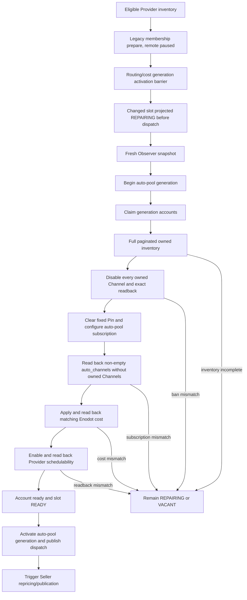

# Provider Auto-Pool 恢复任务：目标、设计与进展

> 状态时间：2026-08-04 17:23 CST
> 工作区：`/Users/haven/Documents/code/a6api-auto`
> 原任务内部标识：`019fc7da-db50-7310-a6ef-36753ead4a55`
> 恢复来源任务：`019fcbbd-7dfb-7640-b170-1307c38af046`
> 当前分支与 HEAD：`main` / `557747e`
> 部署状态：本地中间态，尚未发布 `0066-0069`，尚未切换生产 Provider 到 auto-pool

本文是 Provider auto-pool 恢复任务的设计与进展基线。后续执行步骤见
[`provider-auto-pool-agent-handoff-20260804.md`](provider-auto-pool-agent-handoff-20260804.md)。

## 1. 一页结论

当前工作不是“实现完成、等待部署”，而是“主体实现已恢复，关键并发和 generation 语义仍在收口”。

| 范围 | 当前结论 |
| --- | --- |
| 本地实现 | `0066-0069`、auto-pool、owned Channel Ban、runtime failure、liquidity、membership consumer、Token duty/name、CLI/DB/systemd 接线均已存在 |
| 最新本地回归 | `148 passed, 1 failed`；失败仅为测试文件漏导入 `nullcontext`，Ruff 同时报一个 `F821` |
| 迁移镜像 | `migrations/0066` 与 packaged `0066` 一致；`migrations/0069` 与 packaged `0069` 一致 |
| 仍需设计闭合 | model-scoped 数据库 lease、`begin_generation()`/`claim_accounts()` 原子边界、immutable matching cost generation 证明 |
| 生产数据库 | migration ledger 最高仍是 `0065` |
| 生产 runtime | systemd 实际使用 `/opt/a6-trader/current`，指向 `v188`；auto-pool 和 membership units 未安装 |
| 生产旧链路 | Observer 仍 `OnSuccess=a6-trader-pin.service`；Pin timer/path 与 legacy Provider apply timer 仍 active/enabled |
| Provider shadow | timer `disabled/inactive`，service `inactive`；本任务从未启动 shadow |

## 2. 证据与状态口径

本文使用以下标签，避免把历史测试结果当成最新补丁的证明：

| 标签 | 含义 |
| --- | --- |
| `LIVE` | 2026-08-04 本轮通过生产只读命令重新读回 |
| `LOCAL` | 当前工作区文件中已经存在，但未必通过最新回归 |
| `VERIFIED` | 当前文件状态下已经执行并通过 |
| `HISTORICAL` | 在后续补丁写入前通过，只能作为早期基线 |
| `OPEN` | 已识别但尚未完成或尚未形成足够证据 |

证据优先级仍为：live runtime → 网络/远端 readback → 当前 process/unit 配置 → 数据库状态 →
构建产物 → 工作区源代码 → 注释和设计文稿。

## 3. 任务目标与不可变合同

### 3.1 Provider 自路由隔离门禁

Provider 从 fixed Pin/轮询 Pin 迁移到 marketplace auto-pool。任一 Provider Token 首次变为可调度前，
必须完成以下门禁：

1. 对该 Provider Token 和 model 执行完整分页 marketplace inventory 查询。
2. 每一页都使用 `route_status=all`、`include_seed=true`、`include_user_disabled=true`、
   `exclude_unavailable=false`。
3. authoritative owned set 是“完整远端查询结果中的 A6-owned Channels/Listings”与“本地控制面已知
   controlled Listings/Channels”的并集。
4. active、down、unavailable、retired、hidden 均属于禁用范围，retirement 不是豁免。
5. 对每个 owned Channel 执行远端 disable，并逐项精确读回：
   `user_channel_disabled=true` 且 `route_status=user_disabled`。
6. 本地已知 owned Channel 如果没有出现在完整远端 inventory 中，视为 activation failure。
7. 有效 subscription 的 `auto_channels` 必须非空，并且不包含任何 owned Channel。
8. 任一条件未满足时，账号保持不可调度，replacement slot 保持 `REPAIRING` 或 `VACANT`。

### 3.2 Observer 与 Provider 成本

- auto-pool range 必须来自新鲜 Observer snapshot。
- CNY `max_ratio` 是 marketplace authoritative cap，必须 `<= 0.3`。
- 同一 snapshot 换算得到的 USD ratio 写入 Enodot Provider cost，并与 routing/cost generation 关联。
- Provider 恢复前必须精确读回 subscription、Enodot multiplier 和 schedulability。
- 当前实现已经将 `max_ratio_usd` 写入 Enodot 和 slot；`provider_cost_generations` 是否已经形成完整、
  immutable、matching 的同 generation 证据仍是 `OPEN`。

### 3.3 `insufficient_quota`

- 立即从 dispatch/scheduling 中移除该 Provider，标记 `UNFUNDED`。
- 先将同一 merchant 可提现余额中的整单位转入用户余额。
- 转账后重新读取 funding contract；仍不达标则辞去 Provider duty。
- 旧 slot 投影为 `VACANT`，创建 funded replacement 请求。
- replacement 在 owned Ban、Observer range、Enodot cost、schedulability readback 全部通过前保持
  `REPAIRING`，不得进入 slot dispatch。
- quota failure 不走 Observer 扩价恢复路径。

### 3.4 Liquidity Token

- liquidity/callback Token 与 Provider Token 是不同实体。
- duty 存在控制面 `a6_token_duties`，不编码进 Token name。
- Token name 从 `src/a6api_auto/data/token_name_corpus.json` 选择。
- 只允许 Pin 到当前 listed、callable、A6-owned 的小微 merchant Channel。
- 找不到合格 Channel 时跳过 transfer，不降级 Pin 到未知或不可调用对象。

### 3.5 非 quota runtime failure

- Provider identity 先保持 paused。
- 执行一轮 fresh Observer。
- `max_ratio` 严格扩到下一 observed CNY price band，且不得超过 `0.3`。
- 提交 matching USD cost/generation。
- Provider 自身远端 subscription、Ban、cost、schedulability readback 通过后恢复。
- Provider 恢复后立即触发 Seller repricing/publication。
- Seller 可以预计算或并发 apply；Seller 完成不是 Provider activation barrier。

### 3.6 Shadow 与纳管范围

- Provider shadow 始终保持 `disabled/inactive`。
- 常规恢复、Pin、liquidity、failure repair、readback、发布验证均不启动 shadow。
- 优先复用 active 或已 planned generation。
- 只有 routing/cost 变化要求新的 immutable generation 且没有可复用 planned generation 时，才讨论
  一次性 shadow；运行前必须记录具体原因。
- 纳管范围覆盖所有未 retired 且符合条件的 Provider，而非仅覆盖当前可见 slot。

## 4. 目标运行链路



### 4.1 Membership 首次启用门禁

最新本地设计允许 legacy Provider apply 在 `schedulable=false` 时准备 replacement，但
**不产生任何 Pin**（temp Pin / repin / probe 均不在 changed identity 上执行——Provider
身份与 Pin 无关，Pin 仅存在于资金转移方案的 liquidity Token 上且使用独立 key）。changed
identity 的首次启用只能通过 auto-pool 链路：

1. `ProviderPoolReconciler` 完成远端 paused-state 准备和 readback（set_slot_cost、drain、
   schedulable 保持 false；deferred slots 跳过 repin/probe/assignment metadata）。
2. 在 activation barrier 内激活 routing/cost generation；`store.activate(bundle,
   deferred_slot_nos=...)` 将 changed slots **直接以 `REPAIRING`、无 pin binding、
   desired/observed_schedulable=false 写入**（不再经过 fixed_pin READY → hold 两步）。
3. 远端读回对 deferred slots 只校验身份/cost/schedulable，不要求 `pin_binding_id`/
   `pin_confirmed`（`provider_reconcile_slot_readback_mismatch` 对 deferred 槽位按
   "无 pin" 断言）。
4. Provider inventory 同步投影为 `REPAIRING`、`schedulable=false`。
5. dispatch publication 发生在该写入之后；changed slot 在发布前已确定是 `REPAIRING`。
6. changed slot 跳过 legacy remote enable；unchanged READY slot 继续原有 enable 流程。
7. fresh Observer 和 auto-pool controller 成为 replacement 的首次启用者。

CLI 新参数是 `--defer-membership-to-auto-pool`。启用该参数时，环境变量
`PROVIDER_AUTO_POOL_ENABLED` 必须为真；本地 systemd Provider apply unit 已带该参数。

已知边界：`store.activate()` 内 changed slot 直接投影为 REPAIRING 与 dispatch 发布位于
同一 barrier 事务窗口内，但发布方是 request plane 的 advisory barrier 协调者；直接 DB
reader 在 barrier 外仍可能读到极短中间态。需要 PostgreSQL 集成测试证明当前读模型边界，
或将两步合并为一个原子事务。

### 4.2 Auto-pool account claim CAS

`0069` 为 `provider_auto_pool_accounts` 增加：

- `claim_token`
- `claimed_by`
- `claimed_at`

当前 controller 为一次 operation 生成一个 token，一次 claim 同 generation 的所有 accounts。claim 时同时
将 slot 和 inventory 投影为 `REPAIRING`。以下写操作都校验同一个 token：

- `record_prepared()`
- `record_ready()`
- `record_failed()`

非过期的其他 claim 返回 `provider_auto_pool_account_claim_busy`；systemd 当前设计显式使用
`--stale-account-claim-seconds 120`。generation activation/failure 会释放 claim。

当前 claim 只按 generation 隔离。单主机有 `/var/lib/a6-trader/provider-control.lock` 的 `flock`，但共享
数据库上的跨 generation 或跨节点竞争仍需要 model-scoped PostgreSQL lease。另有一个短间隙：
`begin_generation()` 与 `claim_accounts()` 尚未处于同一事务。

### 4.3 Membership completion CAS

`trade_provider_membership_repair.py::complete()` 在完成 request 前重新锁定并验证：

- request 仍是当前 claim 的 `running`；
- routing generation 已推进，cost generation 未倒退；
- replacement merchant、Enodot account、A6 Token 均未复用 outgoing identity；
- slot 是 active generation 中的 READY auto-pool slot；
- auto-pool account 是 `ready`；
- Ban、unpin、subscription、cost、schedulability 全部确认；
- account subscription ID 与 slot 一致。

查询对 request、routing generation、slot、auto generation、auto account 使用 `FOR UPDATE`。任一状态在
observe/complete 之间失效时返回 `provider_membership_repair_completion_state_changed`，而不是把 stale
replacement 标记为完成。

### 4.4 Provider 与 Seller 顺序

本地 unit 目标链路是：

```text
Provider pool membership apply
  -> OnSuccess Observer
  -> OnSuccess Provider auto-pool
  -> Provider generation/account readback and activation
  -> OnSuccess Seller pilot
```

这满足“Provider 自身 readback 是激活门禁，Seller 完成不是门禁”。生产仍运行旧链：Observer
`OnSuccess=a6-trader-pin.service`。

## 5. 数据库迁移设计

| Migration | 主要内容 | 当前状态 |
| --- | --- | --- |
| `0066_provider_auto_pool.sql` | auto-pool generation/account 表、slot route mode、READY contract、auto subscription 索引 | `LOCAL`；已显式删除 `provider_pool_slot_ready_pin_required` |
| `0067_provider_auto_pool_runtime_failure.sql` | runtime failure 与 auto-pool repair bridge | `LOCAL` |
| `0068_provider_membership_retirement.sql` | membership retirement/replacement request 状态 | `LOCAL` |
| `0069_provider_membership_consumer_and_liquidity_tokens.sql` | durable wakeup、account claims、Token duty/liquidity route、matching FK | `LOCAL` |

`0069` 最新增补包括：

- account claim shape CHECK；
- account `(token_ref_id, merchant_id)` 复合 FK；
- Provider routing `(model, generation, cost_generation)` 唯一约束；
- auto-pool generation 到 matching routing/cost generation 的复合 FK；
- liquidity Token duty 与 merchant/model 的复合约束。

生产目前没有 auto-pool rows，新增 FK 的数据校验面预计较小；普通 `ALTER TABLE ... ADD CONSTRAINT`
仍可能持有表锁，发布前必须读回 relation size、lock wait 和 statement timeout 策略。

## 6. 已恢复的实现面

### 6.1 核心模块

| 领域 | 文件 |
| --- | --- |
| auto-pool plan/controller | `src/a6api_auto/trade_provider_auto_pool.py` |
| auto-pool persistence/CAS | `src/a6api_auto/trade_provider_auto_pool_store.py` |
| Provider membership planner/store | `src/a6api_auto/trade_provider_pool.py`, `trade_provider_pool_store.py` |
| Provider reconcile/remote | `src/a6api_auto/trade_provider_pool_reconciler.py`, `trade_provider_pool_remote.py` |
| membership repair | `src/a6api_auto/trade_provider_membership_repair.py` |
| runtime failure bridge | `src/a6api_auto/trade_provider_runtime_failure.py` |
| liquidity | `src/a6api_auto/trade_provider_liquidity.py`, `trade_liquidity_token.py` |
| Token naming | `src/a6api_auto/token_names.py`, `token_name_migration.py`, `data/token_name_corpus.json` |
| client/readback | `src/a6api_auto/client.py` |

### 6.2 Entrypoints 与 systemd

| 领域 | 文件 |
| --- | --- |
| auto-pool runner | `scripts/reconcile_a6_provider_auto_pool.py` |
| legacy membership apply | `scripts/apply_a6_provider_pool.py` |
| membership consumer | `scripts/consume_a6_provider_membership_repairs.py` |
| liquidity runner | `scripts/reconcile_a6_provider_liquidity.py` |
| runtime failure consumer | `scripts/consume_a6_provider_runtime_failures.py` |
| Observer | `deploy/systemd/a6-trader-observer.service` |
| auto-pool | `deploy/systemd/a6-trader-provider-auto-pool.service` |
| membership | `deploy/systemd/a6-trader-provider-membership-repair.service`, `a6-trader-provider-membership-apply.path` |
| lifecycle | `deploy/systemd/a6-trader-control.target` |

CLI、DB、Pin、Role、Dashboard 相关接线也已存在于当前工作树，但它们与其他任务的大量未提交改动混在
一起；后续仅使用定向 diff 和 focused formatter 处理本任务文件。

## 7. 当前本地验证账本

### 7.1 当前文件状态下的复验

复验时间：2026-08-04 17:22:31 CST。

```text
pytest focused: 148 passed, 1 failed
ruff focused:   1 x F821
```

唯一失败：

```text
tests/test_trade_provider_pool_reconciler.py:1784
Undefined name `nullcontext`
```

所需最小修复是在测试文件顶部加入：

```python
from contextlib import nullcontext
```

该修复尚未写入，所以最新补丁目前仍标记为回归未通过。

当前已通过的文件一致性检查：

```bash
cmp migrations/0066_provider_auto_pool.sql \
  src/a6api_auto/data/migrations/0066_provider_auto_pool.sql

cmp migrations/0069_provider_membership_consumer_and_liquidity_tokens.sql \
  src/a6api_auto/data/migrations/0069_provider_membership_consumer_and_liquidity_tokens.sql
```

### 7.2 历史基线，不代表最新补丁

| 检查 | 历史结果 |
| --- | --- |
| 原始专项 | `56 passed` |
| CLI/DB/Pin/Role/systemd 跨模块 | `267 passed` |
| 后续聚焦回归 | `174 passed` |
| migration chain | 本机临时 PostgreSQL 从 `0001` 顺序应用到 `0069` 成功 |
| 新增 Python 文件 Ruff | 当时通过 |

这些结果发生在 membership deferral、account claim CAS、completion CAS 和最新 FK 修改之前，必须重跑。

## 8. 生产只读基线

核对时间：2026-08-04 17:23 CST。所有命令均为只读；未发布、未迁移、未修改 env/unit、未启动任何
服务。

| 项目 | LIVE readback |
| --- | --- |
| SSH alias | `us_cloud` |
| hostname | `ser635876468110` |
| worker release | `/opt/a6-trader/current -> /www/a6-trader/releases/20260804T070952Z-v188-economic-floor-observability-minimal` |
| web/current symlink | `/www/a6-trader/current -> /www/a6-trader/releases/20260804T004613Z-v181-observer-cookie-seller-fastpath` |
| 数据库 | `sub2api_codexmanager` |
| migration ledger | `0065, 0063, 0062, 0061, 0060`；最高 `0065` |
| auto-pool unit | `not-found` |
| membership repair unit/path | `not-found` |
| auto-pool release files | 在 `/opt/a6-trader/current` 中未找到 |
| auto-pool feature gate | `/etc/a6-trader.env` 中未发现 `PROVIDER_AUTO_POOL_ENABLED=` |
| Observer | 旧 unit，`OnSuccess=a6-trader-pin.service` |
| legacy Provider apply | 未带 `--defer-membership-to-auto-pool` |
| old schedulers | Pin timer/path、Provider pool apply timer 均 `active/enabled` |
| shadow timer | `disabled`, `inactive/dead` |
| shadow service | `static`, `inactive/dead` |

`/opt` 与 `/www` 的 current symlink 当前不一致。systemd `ExecStart` 使用 `/opt/a6-trader/current`，因此
worker runtime 基线是 `v188`；后续 release/backup/rollback 必须分别记录两个 symlink，并以
`/opt/a6-trader/current` 作为 worker 版本证据。

## 9. 已识别但尚未闭合的风险

| 优先级 | 风险 | 所需证据/修复 |
| --- | --- | --- |
| P0 | 测试漏导入 `nullcontext` | **已闭合**：最小导入补丁后 focused 166 passed / ruff clean |
| P0 | claim 只按 generation 隔离 | **已闭合**：`reconcile_a6_provider_auto_pool.py` 将 apply 全生命周期包进 `PostgresProviderModelLease.hold(model)`；集成测试证明同 model 第二执行者 busy、异 model 并行、会话关闭自动释放 |
| P0 | `begin_generation()` 与 `claim_accounts()` 有事务间隙 | **已闭合**：session advisory lease 串行化完整 controller lifetime（begin→claim→remote apply→activate/fail），短事务 row lock 不再是唯一防线 |
| P0 | matching Provider cost generation 语义未证明 | **已闭合**：审计通过（cap<=0.3 双层强制、strict next band、Enodot 精确 readback、slot multiplier=generation max_ratio_usd、Seller 查询精确匹配、0069 FK）；新增 `record_prepared` 比值 CAS（`provider_auto_pool_account_cost_generation_mismatch`）关闭 DB 写入缺口 |
| P1 | activate 后 hold 的两事务短窗口 | PostgreSQL 并发测试，或合并为原子 store operation |
| P1 | `record_failed()` slot/inventory update 未逐项断言 rowcount | 增加 CAS rowcount 校验和错误 token 测试（投影行为已被集成测试覆盖，但 rowcount 断言仍缺失） |
| P1 | legacy prepare 仍可产生不可调度 fixed Pin | 明确合同是否允许；若连 paused Pin 都禁止，需要独立 membership staging generation |
| P1 | `0069` 新 FK 的生产锁影响 | 发布前 relation size/locks/read timeout 预检 |
| P1 | 所有 eligible non-retired Provider 的纳管完整性未做 live audit | 部署前后输出完整名单及逐账号结论 |
| P1 | 生产 `/opt` 与 `/www` release symlink 分叉 | release manifest 中单独记录并验证两条路径 |

## 10. 最终验收条件

只有同时满足以下条件，任务才可标记完成：

- 最新本地补丁的 focused、跨模块和 PostgreSQL 并发/迁移测试全部通过。
- `0066-0069` 在与生产相同的 schema baseline 上顺序应用成功。
- 生产 migration ledger、checksum、unit FragmentPath、ExecStart、OnSuccess、timer/path 状态精确读回。
- 旧 Pin/legacy apply 双写触发被关闭，auto-pool 目标链路成为唯一 Provider 首次启用链路。
- shadow timer/service 仍为 `disabled/inactive`。
- 每个 eligible Provider 都有完整分页 inventory 证据。
- 每个 owned Channel 都精确读回 `user_channel_disabled=true`、`route_status=user_disabled`。
- 每个 ready Provider 的 `auto_channels` 非空且不含 owned Channel。
- 每个 ready Provider 的 Observer snapshot 新鲜，CNY cap `<=0.3`，USD cost 与 generation 匹配。
- replacement 在所有 readback 通过前没有进入 dispatch。
- quota failure 能复现 `UNFUNDED -> transfer -> VACANT/replacement`。
- non-quota failure 能复现 paused -> fresh Observer -> next band -> Provider restore -> Seller trigger。
- Dashboard/read API 与 live runtime 一致。
- release、migration、unit、远端 readback 和运行日志形成可复现 evidence bundle。

## 11. 工作树保护说明

当前 `main` 工作树包含大量其他任务的 modified、untracked 和构建产物。Provider auto-pool 的多数新增文件
本身也是 untracked。后续工作必须按文件精确修改，并遵守：

- 不执行 `git reset --hard`、`git checkout -- <path>`、`git clean`。
- 不做全仓格式化或自动 rewrite。
- 不删除 `.codex-tmp`、build/dist 目录或不属于本任务的文件。
- 不把“当前文件存在”误写成“已提交”或“已部署”。
- 每次修改前后都用 focused `git status --short -- <paths...>` 和定向 diff 核对。
