# A6API Canonical Design 项目文档合集（未横切单文件版）

> 本文件以横切前 `docs(2).md` 为恢复基线，吸收后续已经确认的纯设计语义修正；
> 不包含任何横向实施版本切片、版本化 scope 或测试裁剪；它是后续实施切片的 Canonical Design 源稿。
> 恢复/收敛日期：2026-08-12。

横向交付版本独立建立在 [A6 Channel 横向渐进交付总纲](a6-channel-blueprint/delivery-slices/README.md)：R0-R4 只投影本 canonical design 的累积支持面，不复制或改写业务合同。Provider owned-Channel 规则采用 S05 最小事件驱动 Exclusion Gate：复用 BanRelation、membership generation 和 operation audit，不新增 attestation 表/状态机；远端仍存在的 retired/hidden/unavailable 项必须参与，每次 Auto-Pool `max_ratio` 更新前核对。

## 0. 目录树结构

```text
a6api-auto/
├── docs/                                          # 设计文档目录（本合集的主要来源）
│   ├── a6-api-reference.md                        # A6 API 接口总览（活跃接口合同，46 个确认接口）
│   ├── legacy-trader-logic.md                     # 旧 A6 Trader 逻辑说明（迁移来源，冻结 2026-08-11）
│   ├── sub2api-a6-channel-implementation-prompt.md # Sub2API v0.1.173 原生 A6 Channel 实现 Prompt（总合同）
│   └── a6-channel-blueprint/                      # 分系统实施蓝图（将总 Prompt 拆成 17 个工作包 S00-S16）
│       ├── README.md                              # 分系统实施总纲：工作包索引、批次、全局硬门、完成定义
│       ├── architecture.md                        # 架构总图与分图：边界、所有权、事实流、实施依赖图
│       ├── traceability.md                        # 原始 Prompt 需求追踪表：源章节 -> 工作包 -> 需求 ID
│       ├── delivery-slices/                       # 横向 R0-R4 可部署版本覆盖层（独立于本合集正文）
│       │   ├── README.md                          # 版本阶梯、不可延期硬门、可部署定义
│       │   ├── scope-matrix.md                    # S00-S16 × R0-R4 范围与验收矩阵
│       │   └── r0..r4-*.md                       # 每版支持边界、E2E、升级与回滚门
│       └── subsystems/
│           ├── 00-foundation/                     # S00 基础数据、Decimal、凭据安全、公共文本语料
│           │   ├── logic.md                       #   自然语言蓝图（FND-*）
│           │   ├── pseudocode.md                  #   实现伪代码
│           │   └── tests.md                       #   测试规格
│           ├── 01-a6-connector/                   # S01 A6 Typed Connector（CON-*）
│           ├── 02-output-identity/                # S02 出口身份、用户与绑定（OUT-*）
│           ├── 03-output-lifecycle/               # S03 Channel/Listing 生命周期与入口 Key（LIF-*）
│           ├── 04-input-accounts/                 # S04 Class1/2/3 输入账号与经济能力（ACC-*）
│           ├── 05-provider-token-ban/             # S05 Provider Token、Ban Initialization 与 Self-Route Guard（BAN-*）
│           ├── 06-provider-routing-liquidity/     # S06 Provider 路由、失败恢复与流动性（RTE-*）
│           ├── 07-price-facts/                    # S07 Listing 价格事实、ck 与 FX（PRF-*）
│           ├── 08-pricing-policy/                 # S08 Listing 定价策略与分布（PRC-*）
│           ├── 09-eligibility-delta/              # S09 Eligibility、Delta 策略与 Attempt 快照（ELG-*）
│           ├── 10-usage-billing/                  # S10 Usage 合成、Winner 与本地计费（BIL-*）
│           ├── 11-revenue-replay/                 # S11 收益对账、迟到补账与 Replay（REV-*）
│           ├── 12-scheduling-incidents/           # S12 调度硬门、错误聚合与平台 Incident（ERR-*）
│           ├── 13-listing-recovery/               # S13 Listing 状态、下架与恢复（REC-*）
│           ├── 14-async-control/                  # S14 Outbox、Reconciler 与可观测性（ASY-*）
│           ├── 15-admin-console/                  # S15 管理端与控制面 Read Model（ADM-*）
│           └── 16-migration-rollout/              # S16 迁移、us_cloud 发布与总验收（MIG-*）
└── api-docs/                                     # A6 抓包/实测证据目录
    ├── 7-24-15-54.md                             # a6api HAR 合并接口文档（569 请求、54 接口）
    ├── api-status.md                             # GET /api/status 完整实测响应（平台动态配置）
    ├── api-supplier-profile.md                   # PATCH /api/supplier/me/profile 抓包实测
    └── 2026-08-12-channel-update-restore-probe.md # Channel PATCH api_key / takedown / restore 脱敏实测
```

## 1. 文档之间的树结构关系

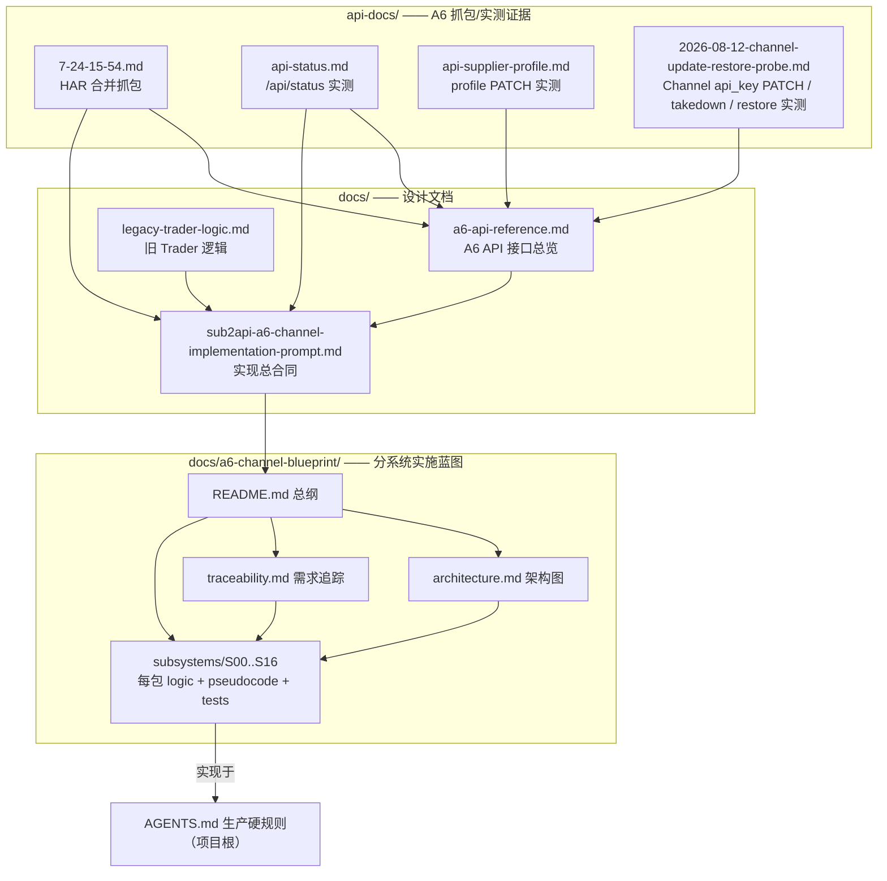

### 1.1 各文档定位

| 文档 | 定位 | 树上的父/子关系 |
| --- | --- | --- |
| `docs/sub2api-a6-channel-implementation-prompt.md` | **总合同**：定义原生 A6 Channel 经营模块的全部规范（§1-§17） | 消费 A6 API Reference、api-docs 抓包、旧 Trader 逻辑；被蓝图拆分 |
| `docs/a6-api-reference.md` | **活跃接口合同**：46 个已确认 A6 HTTP 接口的精确请求/响应/鉴权 | 由 api-docs 抓包与实测支撑；供 Prompt §3 与蓝图 S01 落地 |
| `docs/legacy-trader-logic.md` | **迁移来源**：旧独立 Python Trader 的逻辑与取舍 | 供 Prompt 参考“以前怎样实现”；新行为以 Prompt 为准 |
| `api-docs/7-24-15-54.md` | A6 前端协议证据（HAR 合并） | 支撑 A6 API Reference 与 Prompt；蓝图 S01 的 fixture 来源 |
| `api-docs/api-status.md` | `/api/status` 完整实测响应 | 支撑 A6 API Reference §4 与 Typed Client |
| `api-docs/api-supplier-profile.md` | `PATCH /api/supplier/me/profile` 抓包 | 支撑 A6 API Reference §6 与 Prompt §3 rename 边界 |
| `api-docs/2026-08-12-channel-update-restore-probe.md` | Channel `PATCH api_key`、takedown、restore 脱敏实测 | 支撑 A6 API Reference §6.4 与 Prompt §6.1/§8 的 Channel 级维护合同 |
| `docs/a6-channel-blueprint/README.md` | 蓝图总纲：17 个工作包索引、批次 A-G、全局硬门 | 父：Prompt；子：architecture、traceability、subsystems |
| `docs/a6-channel-blueprint/architecture.md` | 架构总图与分图（端到端、写入边界、ER、依赖图） | 兄弟：traceability；被各子系统 logic 引用 |
| `docs/a6-channel-blueprint/traceability.md` | Prompt 章节 -> 工作包 -> 需求 ID 命名空间追踪 | 约束 subsystems 的验收可回溯性 |
| `docs/a6-channel-blueprint/delivery-slices/` | **横向发布覆盖层**：R0 受控闭环到 R4 最终完整稿 | 消费 canonical/纵向三联稿；不作为第二套业务事实源 |
| `docs/a6-channel-blueprint/subsystems/Sxx/` | 每个工作包的三联稿（logic/pseudocode/tests） | 需求 ID 前缀 FND/CON/OUT/LIF/ACC/BAN/RTE/PRF/PRC/ELG/BIL/REV/ERR/REC/ASY/ADM/MIG |
| 项目根 `AGENTS.md` | 生产与授权硬规则（最高优先级） | 所有蓝图硬门的上位依据 |

### 1.2 优先级与依赖顺序（冲突时的裁决顺序）

```text
AGENTS.md > 原始实现 Prompt > A6 API Reference + errorlist.md > 蓝图 > 归档实现
```

实施批次：A(S00,S01,S14) -> B(S02,S04) -> C(S03,S05,S07) -> D(S06,S08,S09) ->
E(S10,S11,S12) -> F(S13,S15) -> G(S16)。完整依赖图见 `architecture.md#8-实施依赖图`。

### 1.3 阅读导航

- 想了解接口本身 → 跳到 **Part 1：A6 API 接口总览**。
- 想了解旧系统 → **Part 2：旧 A6 Trader 逻辑说明**。
- 想了解总实现合同 → **Part 3：Sub2API 原生 A6 Channel 实现 Prompt**。
- 想了解分系统拆分 → **Part 4：A6 Channel 蓝图（README → architecture → traceability → 各子系统）**。
- 想按可上线版本实施 → 打开外部导航 **`docs/a6-channel-blueprint/delivery-slices/README.md`**（R0-R4，不拼入本 canonical 正文）。
- 想看抓包/实测证据 → **Part 5：A6 抓包文档（api-docs）**。

---

# Part 1：docs/a6-api-reference.md（A6 API 接口总览）

<!-- 以下内容为对应源文件的完整当前版本（随合集同步修订） -->

<!-- ===== 源文件：docs/a6-api-reference.md ===== -->
# A6 API 接口总览

> 基于当前仓库运行代码、已保存的前端协议证据和只读/临时资源实测整理。核对日期：2026-08-11。

## 1. 文档口径

本文覆盖两类 A6 外部接口：

1. A6 控制面：`https://a6api.com`，负责账号、Token、供应商、Listing、财务和市场路由。
2. A6 OpenAI 兼容请求面：`https://a6.a6api.com`，负责模型查询与模型请求。
归档源码确认的 A6 接口共有 **46 个 HTTP 方法与路径组合**：

- 控制面 43 个，由归档 `archive/legacy-trader/src/a6api_auto/client.py` 封装。
- 请求面 3 个，由归档 `client.py` 或 `trade_upstream_relay.py` 调用。
- 另有一组控制面接口只存在于已保存的前端协议证据或临时资源实测中，归档客户端尚未全部封装；本文仍将其
  作为已观测接口列出，不用一个容易失真的固定数量掩盖差异。

状态说明：

| 状态 | 含义 |
| --- | --- |
| 当前封装 | 归档 `A6ApiClient` 有对应方法和测试，属于已实现迁移来源 |
| 当前探测 | 归档运行代码直接请求，但没有独立业务封装 |
| 已观测未封装 | 前端协议证据中已捕获，归档客户端尚无方法 |
| 设计记录 | 旧设计文档提到，但仓库没有 A6 上游调用证据，不计入 46 个已确认接口 |

主要证据：

- `archive/legacy-trader/src/a6api_auto/client.py`
- `archive/legacy-trader/src/a6api_auto/trade_upstream_relay.py`
- `archive/legacy-trader/tests/test_client.py`
- `archive/legacy-trader/docs/protocol.md`
- `archive/legacy-trader/docs/a6-trading-system-design.md`
- `api-docs/api-supplier-profile.md`
- `api-docs/api-status.md`

`api.a6api.com`、`a6.a6api.com` 与 `a6api.com` 是不同的请求边界。本文不把它们的响应或可用性结论混算。

## 2. 服务与鉴权

| 服务 | Base URL | 鉴权 | 主要用途 |
| --- | --- | --- | --- |
| A6 控制面 | `https://a6api.com` | 统一凭据对 `(a6_user_id, system_access_token)` | 账号、Token、供应商、财务、市场 |
| A6 请求面 | `https://a6.a6api.com` | `Authorization: Bearer API_KEY` | OpenAI 兼容模型请求 |
| 本地 Provider relay | 默认 `http://127.0.0.1:8767` | 原样转发调用方 Bearer Token | 固定直连 A6 请求面 |
| 本地 Trader Dashboard | 默认 `http://127.0.0.1:8765` | 外围访问控制；部分内部路由另用 Bearer Token | 经营读 API 与控制操作 |

### 2.1 统一控制面鉴权对

自本版起，所有需要认证的 A6 控制面请求统一使用不可拆分的凭据对：

```text
(a6_user_id, system_access_token)
```

本文中的“系统管理令牌”与接口返回的“系统访问令牌”指同一种凭据，持久化字段统一命名为 `system_access_token`。两个字段固定映射到以下请求头：

```http
Authorization: Bearer SYSTEM_ACCESS_TOKEN
New-API-User: A6_USER_ID
Accept: application/json, text/plain, */*
```

Shell 变量约定：

```bash
export A6_USER_ID='A6_USER_ID'
export A6_SYSTEM_ACCESS_TOKEN='SYSTEM_ACCESS_TOKEN'
```

通用控制面调用模板：

```bash
curl --fail-with-body -sS \
  -H "Authorization: Bearer ${A6_SYSTEM_ACCESS_TOKEN}" \
  -H "New-API-User: ${A6_USER_ID}" \
  -H 'Accept: application/json, text/plain, */*' \
  'https://a6api.com/api/ENDPOINT'
```

必须遵守以下规则：

- 每个认证请求同时发送两个请求头，不单独使用其中任意一个字段。
- `A6_USER_ID` 必须等于该 `SYSTEM_ACCESS_TOKEN` 所属用户的 A6 用户 ID，禁止跨用户混配。
- `system_access_token` 是 opaque token，必须按接口返回值原样使用；即使值没有 `sk-` 前缀，也不得自行添加 `sk-`。
- 不从 `system_access_token` 推导用户 ID。`a6_user_id` 取自登录响应 `data.id` 或受控凭据文件。
- 轮换系统管理令牌时，原子替换同一 `a6_user_id` 对应的 `system_access_token`，后续请求立即使用新凭据对。
- Session Cookie 不作为日常控制面鉴权方式。验证码、注册、登录以及生成或轮换系统管理令牌属于引导流程例外；注册、验证码和登录使用 `New-API-User: -1`，`GET /api/user/token` 使用已登录 Session 和真实 `A6_USER_ID`。

只携带 Bearer 令牌而缺少 `New-API-User` 时，当前线上服务返回 `401 Unauthorized, New-Api-User header not provided`。

### 2.2 控制面响应信封

控制面通常返回：

```json
{
  "success": true,
  "message": "",
  "data": {}
}
```

错误可能出现在顶层 `message`、`error`，或嵌套的 `code` / `error_code` 中。调用方必须同时检查 HTTP 状态、`success` 和 `data` 类型。

分页响应通常为：

```json
{
  "success": true,
  "data": {
    "items": [],
    "total": 0,
    "page": 1,
    "size": 100
  }
}
```

不同接口可能使用 `size` 或 `page_size`。`supplier/listings` 还兼容 `data` 直接为数组的旧响应。

### 2.3 重试与写后读

- 当前客户端对 GET 的传输错误最多尝试 2 次，并共享同一个总超时预算。
- `GET /api/user/token` 具有生成或轮换凭据的写入语义，不得纳入通用 GET 自动重试。响应丢失时，应先验证原令牌状态，再决定是否重新生成。
- POST、PUT、PATCH 不做传输层自动重试，避免重复写。
- A6 控制面写接口没有在当前客户端暴露统一 Idempotency Key。响应丢失时，应通过对应 GET 接口读回，不应盲目重复提交。
- 所有凭据、Cookie、完整 API Key 和提现地址都不得进入日志或文档样例。

### 2.4 金额、Quota 与倍率

- `*_micros`、`quota`、`amount` 均按 A6 返回的整数原值保存。
- 金额与用户 Quota 的换算由每个 Session 的 `quota_per_unit` 决定。当前默认值是 `500000`，即当前运行口径下 `500000 quota = 1 USD`。
- 提现客户端约束 `amount >= 50000000`。
- 余额划转客户端约束 `amount >= quota_per_unit`。
- `min_ratio`、`max_ratio` 使用十进制定点字符串，避免二进制浮点误差。

## 3. A6 请求面接口

Base URL：`https://a6.a6api.com`

| 方法 | 路径 | 状态 | 用途 |
| --- | --- | --- | --- |
| GET | `/v1/models` | 当前探测 | 模型列表；relay 就绪探测也用无凭据 `401` 验证完整链路 |
| POST | `/v1/responses` | 当前封装 | Responses API，支持非流式与 SSE |
| POST | `/v1/chat/completions` | 当前封装 | Chat Completions API，当前探测为非流式 |

### 3.1 `GET /v1/models`

请求：

```http
GET /v1/models
Authorization: Bearer API_KEY
Accept: application/json
```

正常响应遵循 OpenAI 兼容模型列表，核心字段为 `data[].id`。Provider relay 的 readiness 不带认证，请求得到完整 `401` 即视为 A6 网络、TLS 和 HTTP 链路可达；这个 `401` 不是业务可调用证明。

### 3.2 `POST /v1/responses`

普通非流式请求体：

```json
{
  "model": "MODEL",
  "input": "INPUT_TEXT",
  "max_output_tokens": 128,
  "reasoning": {"effort": "low"},
  "stream": false
}
```

流式探测请求体：

```json
{
  "model": "MODEL",
  "input": "INPUT_TEXT",
  "max_output_tokens": 16,
  "reasoning": {"effort": "low"},
  "stream": true
}
```

普通非流式请求头：

```http
Authorization: Bearer API_KEY
Content-Type: application/json
Accept: application/json
```

流式探测将 `Accept` 改为 `text/event-stream`，并额外发送
`X-Request-ID: REQUEST_ID`。当前探测器在收到首个合法 `response.created` 事件后即确认路由并关闭流；错误事件会提取稳定错误码。当前代码明确识别：

- `fixed_merchant_unavailable`
- `insufficient_quota`
- `account_quota_insufficient`
- `no_available_channel`

生产流动性/回调请求使用以下精确输入，并验证现实用量及高缓存特征：

```text
PING 5db98307ce2d442ee568baacf8b0e7076fa657cbe2806ccff9da6386997915e2
```

`prompt_tokens=1`、`completion_tokens=0`、`total_tokens=1` 这类探测形状不计为有效生产转移。

### 3.3 `POST /v1/chat/completions`

当前探测请求体：

```json
{
  "model": "MODEL",
  "messages": [
    {"role": "user", "content": "INPUT_TEXT"}
  ],
  "max_completion_tokens": 16,
  "stream": false
}
```

鉴权与 Responses 相同。当前仓库只直接实现非流式探测；设计文档同时记录了流式 `chunk + [DONE]` 的协议适配目标。

### 3.4 仅存在于设计记录的路径

以下路径出现在 Sub2API replay/adapter 设计记录中，但当前 Python 源码没有直接调用 A6 上游的证据，因此不计入已确认清单：

- `/v1/messages`
- `/v1/responses/compact`
- Responses WebSocket Upgrade

## 4. 账号与会话

第 4 至第 10 节的所有 A6 控制面端点，除验证码、注册、登录、状态查询和 `GET /api/user/token` 等明确标注的引导或免认证流程外，均继承第 2.1 节的统一鉴权对，并同时发送：

```http
Authorization: Bearer SYSTEM_ACCESS_TOKEN
New-API-User: A6_USER_ID
```

后续各接口表格不再重复列出这两个必需请求头。

| 方法 | 路径 | Query | JSON Body | 状态 |
| --- | --- | --- | --- | --- |
| GET | `/api/status` | 无 | 无 | 响应已捕获，未封装 |
| GET | `/api/verification` | `email`, `turnstile=` | 无 | 当前封装 |
| POST | `/api/user/register` | `turnstile=` | 注册资料 | 当前封装 |
| POST | `/api/user/login` | `turnstile=` | 登录资料 | 当前封装 |
| GET | `/api/user/self` | 无 | 无 | 当前封装 |
| GET | `/api/user/token` | 无 | 无 | 已观测未封装 |

`GET /api/status` 的完整实测响应保存在 `api-docs/api-status.md`。`data` 是平台动态配置对象；Typed Client应强类型化本模块
实际使用的 `quota_per_unit`、`payment_fx_rate_cny_per_usd`、`price`、`start_time`、`system_name` 等字段，同时保留未知字段，
避免平台新增配置导致反序列化失败。

### 4.1 发送邮箱验证码

```http
GET /api/verification?email=EMAIL&turnstile=
New-API-User: -1
```

成功要求 HTTP `200` 且 `success=true`。若返回消息包含邮箱已被占用，当前客户端归类为 `email_already_registered`。

### 4.2 注册

```json
{
  "username": "USERNAME",
  "password": "PASSWORD",
  "password2": "PASSWORD",
  "email": "EMAIL",
  "verification_code": "OTP_CODE",
  "wechat_verification_code": "",
  "aff_code": null
}
```

### 4.3 登录

```json
{
  "username": "USERNAME_OR_EMAIL",
  "password": "PASSWORD"
}
```

成功时 `data` 是用户对象，并由响应写入 Cookie。当前恢复流程先试用户名，再试邮箱。

### 4.4 当前用户

`GET /api/user/self` 用于校验 `(a6_user_id, system_access_token)` 的精确账号绑定；引导流程中也可用于校验 Session Cookie。项目已确认的核心财务字段包括：

| 字段 | 含义 |
| --- | --- |
| `data.id` | A6 用户 ID |
| `data.quota` | 当前用户余额 |
| `data.used_quota` | 累计消费 |
| `data.request_count` | 累计调用数 |

### 4.5 生成系统访问令牌

`GET /api/user/token` 使用已登录的 Session 生成或刷新当前用户的系统访问令牌。尽管方法是 `GET`，该接口具有凭据变更语义，调用方应将每次请求视为一次可能的令牌轮换。

请求：

```bash
curl --fail-with-body -sS \
  -b 'session=SESSION_COOKIE' \
  -H 'Accept: application/json, text/plain, */*' \
  -H 'New-API-User: A6_USER_ID' \
  -H 'Referer: https://a6api.com/console/personal' \
  'https://a6api.com/api/user/token'
```

`accept-language`、`sec-ch-ua*`、`sec-fetch-*`、`priority` 和 `user-agent` 是浏览器附带的请求头，不是当前已观测协议的必需字段。

成功响应：

```json
{
  "data": "SYSTEM_ACCESS_TOKEN",
  "message": "",
  "success": true
}
```

返回的 `data` 是完整凭据，不是 Token ID。后续控制面请求示例：

```bash
curl --fail-with-body -sS \
  -H "Authorization: Bearer ${A6_SYSTEM_ACCESS_TOKEN}" \
  -H "New-API-User: ${A6_USER_ID}" \
  -H 'Accept: application/json' \
  'https://a6api.com/api/user/self'
```

生成成功后必须持久化完整凭据对，而不是只保存令牌：

```json
{
  "a6_user_id": 12345,
  "system_access_token": "SYSTEM_ACCESS_TOKEN"
}
```

Sub2API 生产实现按实现 Prompt 将完整令牌写入加密 credential secret generation，业务表只保存引用、fingerprint 和
last4。仅本地 curl 夹具可以使用 `accounts[]` JSON；该文件权限必须为 `0600`，每项同时保存配对的 `a6_user_id` 与
`system_access_token`，完整令牌不得进入日志或 Git。

该凭据与 `/api/token/` 创建的模型调用 API Key 属于两个鉴权边界：

- `SYSTEM_ACCESS_TOKEN` 用于 `https://a6api.com/api/*` 控制面。
- `API_KEY` 用于 `https://api.a6api.com/v1/*` 或 `https://a6.a6api.com/v1/*` 请求面。

## 5. Token / API Key

| 方法 | 路径 | Query / Body | 用途 |
| --- | --- | --- | --- |
| GET | `/api/token/` | `p`, `size` | Token 分页列表 |
| GET | `/api/token/{token_id}` | 无 | 单个 Token 读回 |
| POST | `/api/token/` | Token 元数据 | 创建 Token |
| PUT | `/api/token/` | 含 `id` 的完整元数据 | 更新 Token |
| POST | `/api/token/{token_id}/key` | 无 Body | 显示完整 Key |
| DELETE | `/api/token/{token_id}` | 无 | 删除 Token |

### 5.1 列表与详情

当前列表固定使用：

```http
GET /api/token/?p=1&size=100
```

详情接口用于更新前读取完整元数据，也用于写后确认 Token ID 和名称。

### 5.2 创建 Token

当前创建体：

```json
{
  "name": "TOKEN_NAME",
  "remain_quota": 0,
  "expired_time": -1,
  "unlimited_quota": true,
  "model_limits_enabled": false,
  "model_limits": "",
  "allow_ips": "",
  "group": "default",
  "cross_group_retry": false
}
```

`name` 必须从 `resources/corpora/token_name_corpus.json` 的 `names[]` 选择；创建、轮换和重命名均保存语料文件
SHA-256、数组索引、选中值与 selection generation，重试复用同一选择，重名时改选另一项。

### 5.3 更新 Token

当前客户端允许更新：

```text
id, name, remain_quota, remain_amount, expired_time, unlimited_quota,
model_limits_enabled, model_limits, allow_ips, group, cross_group_retry,
routing_enabled, routing_preference, pricing_strategy, pricing_custom_pct,
routing_allow_fallback
```

重命名流程是 `GET detail -> PUT merged metadata -> GET detail`，避免覆盖服务端已有路由设置。完整 `key` 字段不会放回更新请求。

### 5.4 显示完整 Key

```http
POST /api/token/TOKEN_ID/key
```

成功数据形状：

```json
{
  "success": true,
  "data": {"key": "KEY_MATERIAL"}
}
```

调用方统一将结果规范为 `sk-...`。该接口返回敏感数据，只应在内存和权限受控的 secret 文件中处理。

### 5.5 删除 Token

```http
DELETE /api/token/TOKEN_ID
Authorization: Bearer SYSTEM_ACCESS_TOKEN
New-API-User: A6_USER_ID
Accept: application/json
```

2026-08-11 使用临时 Token 实测确认该接口支持统一控制面凭据
`(a6_user_id, system_access_token)`，成功响应为：

```json
{"message":"","success":true}
```

删除是不可逆写操作。调用方必须先记录待删 Token 的 ID、用途和当前替代 Token，DELETE 后同时执行：

1. `GET /api/token/{token_id}`，期望 `success=false` 且 `message="record not found"`。
2. `GET /api/token/?p=1&size=...`，期望列表中不存在该 ID。

HTTP 200 本身不代表删除完成，必须检查 JSON `success` 并完成上述双读回。当前
`A6ApiClient` 尚未封装该方法，Typed Client 实现时应新增 `delete_token`。

## 6. 供应商申请与渠道

| 方法 | 路径 | 用途 |
| --- | --- | --- |
| POST | `/api/supplier/fetch-models` | 由 A6 代查上游模型 |
| POST | `/api/supplier/apply` | 首次申请 Supplier，或为已有 Supplier 申请新增 Channel |
| GET | `/api/supplier/me/requests` | 查询申请记录 |
| GET | `/api/supplier/me` | 查询当前供应商资料 |
| PATCH | `/api/supplier/me/profile` | 更新供应商联系方式和简介，请求已确认、未封装 |
| GET | `/api/supplier/me/channels` | 查询当前渠道 |
| PATCH | `/api/supplier/me/channels/{channel_binding_id}` | 更新渠道 |
| POST | `/api/supplier/channels/{channel_binding_id}/takedown` | 下架渠道 |
| POST | `/api/supplier/channels/{channel_binding_id}/restore` | 恢复渠道 |
| GET | `/api/supplier/channels/markup-preview` | 批量查询渠道加价来源和百分比 |

`PATCH /api/supplier/me/profile` 的实测请求体为：

```json
{
  "contact_info": "CONTACT_INFO",
  "description": "SUPPLIER_DESCRIPTION"
}
```

成功响应为`{"message":"","success":true}`，原始抓包见`api-docs/api-supplier-profile.md`。当前抓包请求体没有`name`字段，
因此只确认联系方式和简介更新，尚不能据此推导Supplier重命名能力；写后读取`GET /api/supplier/me`核对。

### 6.1 A6 代查上游模型

```json
{
  "base_url": "UPSTREAM_BASE_URL",
  "key": "UPSTREAM_API_KEY",
  "channel_type": 1
}
```

成功时 `data` 是模型字符串或含 `id` 的对象数组。项目优先直接查询上游 `/models` 或 `/v1/models`，两者都失败后才调用此接口。

### 6.2 Supplier 与新增 Channel 申请

```json
{
  "supplier": {
    "name": "SUPPLIER_NAME",
    "contact_info": "CONTACT_EMAIL",
    "description": "SUPPLIER_DESCRIPTION"
  },
  "channel": {
    "name": "CHANNEL_NAME",
    "nickname": "CHANNEL_NICKNAME",
    "channel_type": 1,
    "base_url": "UPSTREAM_BASE_URL",
    "api_key": "UPSTREAM_API_KEY",
    "models": "MODEL_A,MODEL_B",
    "description": "CHANNEL_DESCRIPTION"
  }
}
```

`models` 是逗号分隔字符串，不是 JSON 数组。若返回稳定错误码 `pending_request_exists`，表示已有待处理申请，应读 `GET /api/supplier/me/requests` 对账。

公共文本必须先从版本化仓库语料选择：Supplier `name/description` 来自
`resources/corpora/merchant_templates_split.xlsx` 的“商户资料”同一行；Channel `name/description` 与Listing
`description` 来自“渠道资料”同一行的 `channel_name/channel_description/model_description`；所有Token/Key `name`
来自 `resources/corpora/token_name_corpus.json`。`nickname`只投影所选Channel名以适配平台长度。请求必须记录语料文件
SHA-256、sheet、source row/index和selection generation；重名时改选未占用项，不追加ID、模型、职责、时间或后缀。
Listing `display_name`固定为空，直至版本化语料新增专用字段。语料校验失败时不发送远端写入，管理端只提供语料选择和随机重选。

该端点同时覆盖两个场景：

1. 尚未成为 Supplier：提交 Supplier资料和第一个 Channel。
2. 已经是 Supplier：保留当前 Supplier资料并提交一个新的 Channel申请。

HAR已确认第二种场景：同一账号在 `/api/supplier/me` 返回200且已有Channel时，从 `/supplier/channels` 页面再次
调用该端点；重名请求返回409，更换Channel名称后返回200，随后 `/api/supplier/me/requests` 响应增大。因此新增
Channel使用同一申请端点，成功只表示申请已提交；控制器继续读取requests和channels，直到新Channel获批并出现。

### 6.3 申请、供应商和渠道读回

- `GET /api/supplier/me/requests`：`data` 为申请数组。
- `GET /api/supplier/me`：`data` 为供应商对象；供应商尚未生效时可能返回业务型 `403`。
- `GET /api/supplier/me/channels`：`data` 为渠道数组。当前客户端兼容旧的扁平结构和新的 binding/channel/request 嵌套结构。

渠道读回中需要区分：

- `id`：A6 Channel ID。
- `binding_id`：供应商渠道绑定 ID，渠道更新与下架路径通常使用它。

### 6.4 更新、下架与恢复渠道

当前项目写入过的更新字段：

```json
{
  "nickname": "CHANNEL_NICKNAME",
  "description": "CHANNEL_DESCRIPTION",
  "models": "MODEL_A,MODEL_B"
}
```

2026-08-12 的 Channel 更新/恢复 probe（脱敏证据见 `api-docs/2026-08-12-channel-update-restore-probe.md`）进一步确认 `base_url`、`test_model`、`api_key` 可写。字段可按需提交：

```json
{
  "nickname": "CHANNEL_NICKNAME",
  "description": "CHANNEL_DESCRIPTION",
  "models": "MODEL_A,MODEL_B",
  "base_url": "UPSTREAM_BASE_URL",
  "test_model": "TEST_MODEL",
  "api_key": "UPSTREAM_API_KEY"
}
```

下架请求发送空对象：

```http
POST /api/supplier/channels/CHANNEL_BINDING_ID/takedown
Content-Type: application/json

{}
```

恢复请求同样发送空对象，是 2026-08-12 probe 新确认的 Channel 级恢复接口：

```http
POST /api/supplier/channels/CHANNEL_BINDING_ID/restore
Content-Type: application/json

{}
```

`POST /api/supplier/listings/{listing_id}/resubmit` 只恢复单个 Listing，不恢复整个 Channel。即使 restore 已确认，每次 `success:true` 之后仍建议 `GET /api/supplier/me/channels` 与 marketplace readback 复核，避免以单次 HTTP 200 当作完整恢复。旧 HAR（7-24-15-54.md）当时未抓到 `restore` 与 `api_key` 写入，只代表当时未观测，不代表接口不存在；需要替换已下架 Channel 时仍通过 `POST /api/supplier/apply` 申请新 Channel。

### 6.5 渠道加价预览

```http
GET /api/supplier/channels/markup-preview?channel_ids=CHANNEL_ID_A,CHANNEL_ID_B
```

`channel_ids` 是逗号分隔的 A6 Channel ID。2026-08-11 实测响应：

```json
{
  "data": {
    "items": [
      {
        "channel_id": 123,
        "percent": 20,
        "source": "supplier"
      }
    ]
  },
  "message": "",
  "success": true
}
```

| 字段 | 类型 | 含义 |
| --- | --- | --- |
| `data.items[].channel_id` | integer | 被查询的 A6 Channel ID |
| `data.items[].percent` | integer/number | 当前公开加价百分比；`20` 对应 `commission=0.2` |
| `data.items[].source` | string | 加价配置来源；当前实测值为 `supplier` |

响应项顺序不保证与请求顺序一致，调用方必须按 `channel_id` 建立映射。每个受管 Channel 都应恰好返回一项；缺项、
重复项、非数值 percent 或 `percent != 20` 均进入输出配置校验。保存 `source` 原始值用于审计，不根据数组位置绑定。

该接口用于 Supplier Listing 页面预览渠道的平台加价/公开价格关系，与提现无关：

```text
commission = Decimal(percent) / 100
ck_public = ck * (1 + commission)
```

## 7. Listing

| 方法 | 路径 | 用途 |
| --- | --- | --- |
| GET | `/api/supplier/listings` | 分页查询 Listing |
| POST | `/api/supplier/listings` | 批量创建 Listing |
| PUT | `/api/supplier/listings/{listing_id}` | 更新 Listing |
| POST | `/api/supplier/listings/{listing_id}/takedown` | 下架 Listing |
| POST | `/api/supplier/listings/{listing_id}/resubmit` | 重新提交 Listing |

### 7.1 查询

```http
GET /api/supplier/listings?page=1&size=1000&status=STATUS
```

`status` 可省略。当前客户端将结果规范为：

```json
{
  "items": [],
  "total": 0,
  "page": 1,
  "size": 1000
}
```

2026-08-11 实测的 Listing 状态事实字段包括：

```text
status, visibility, availability, down_reason,
channel_id, supplier_channel_id, own_model, platform_model
```

当前观测到的组合语义为：

| 状态 | `status` | `visibility` | `availability` | `down_reason` |
| --- | ---: | ---: | ---: | --- |
| 商户上架且控制面可用 | 2 | 1 | 1 | 空字符串 |
| 商户下架 | 0 | 0 | 0 | `商户下架` |

这些是当前运行时观测值，业务代码应保存原始枚举和观测时间，不应只保存一个本地布尔值。

### 7.2 创建

请求体必须是数组，即使只创建一个 Listing：

```json
[
  {
    "channel_id": 123,
    "own_model": "MODEL",
    "platform_model": "MODEL",
    "charge_type": "per_token",
    "input_price_micros": 500000,
    "output_price_micros": 3000000,
    "cache_read_price_micros": 50000,
    "cache_write_price_micros": 625000,
    "display_name": "",
    "description": "DESCRIPTION"
  }
]
```

当前Supplier Listing抓包只确认`charge_type="per_token"`及四个token价格字段。本项目按该合同创建和更新Listing。

### 7.3 更新

当前项目的更新体包含：

```json
{
  "charge_type": "per_token",
  "input_price_micros": 500000,
  "output_price_micros": 3000000,
  "cache_read_price_micros": 50000,
  "cache_write_price_micros": 625000,
  "display_name": "",
  "description": "DESCRIPTION"
}
```

创建和更新后都按Listing ID读回`charge_type="per_token"`与完整token价格向量。A6商户结算使用返回token usage；
delta沿用usage改写链路，不引入固定按次结算分支。

更新、下架和重新提交后都应重新分页读取 Listing，以远端状态为准。两个动作接口都发送 `{}`。

### 7.4 平台模型官方价格目录

```http
GET /api/platform-models?enabled=1&size=1000
Authorization: Bearer SYSTEM_ACCESS_TOKEN
New-API-User: A6_USER_ID
Accept: application/json
```

该目录是 Listing `K_CNY` 计算的官方价格向量来源。已确认字段包括：

```text
id, brand, model_no, billing, enabled, sellers, official_source,
official_input_price_micros, official_output_price_micros,
official_cache_read_price_micros, official_cache_write_price_micros,
official_per_request_price_micros, created_at, updated_at
```

`official_per_request_price_micros`是平台目录的真实返回字段，但本项目不把它映射为Supplier Listing写入字段，也不用于ck或delta。

调用方必须按 `model_no` 精确匹配，保存完整官方向量、`official_source`、目录版本/hash 和抓取时间。以 input
维度计算商户净倍率：

```text
fx_usd_cny = realtime_ratio_cny / realtime_ratio_usd
ck = fx_usd_cny * listing.input_price_micros / official_input_price_micros
```

output/cache_read/cache_write 维度应使用各自官方价格做交叉校验；不能用 input 官方价解释其他维度。

## 8. 收益、结算、提现与余额划转

### 8.1 接口总表

| 方法 | 路径 | Query / Body | 用途 |
| --- | --- | --- | --- |
| GET | `/api/supplier/earnings/summary` | 无 | 收益汇总 |
| GET | `/api/supplier/earnings` | `page`, `size` | 收益明细 |
| GET | `/api/supplier/settlements/summary` | 无 | 结算汇总 |
| GET | `/api/supplier/settlements` | `page`, `size` | 结算明细 |
| GET | `/api/supplier/withdraw/summary` | 无 | 可提现与提现中余额 |
| GET | `/api/supplier/withdraw/preview` | `account_id`, `amount` | 提现预览 |
| GET | `/api/supplier/withdraw` | `page`, `size` | 提现记录 |
| POST | `/api/supplier/withdraw` | `account_id`, `amount` | 提交提现 |
| GET | `/api/supplier/withdraw/accounts` | 无 | 提现账户列表 |
| POST | `/api/supplier/withdraw/accounts` | 提现账户资料 | 创建提现账户 |
| GET | `/api/supplier/balance/transfer/preview` | `amount` | 商户余额转用户余额预览 |
| POST | `/api/supplier/balance/transfer` | `amount` | 执行余额划转 |

### 8.2 已确认的汇总字段

`GET /api/supplier/earnings/summary`：

- `today_earned_micros`
- `month_earned_micros`
- `today_calls`
- `month_calls`

`GET /api/supplier/withdraw/summary`：

- `balance_available_micros`
- `withdrawing_micros`
- `total_earned_micros`
- `total_paid_micros`

收益明细已确认包含请求、渠道、模型、输入/输出/缓存 Token、`quota_micros`、`earned_micros`、倍率、结果和耗时等字段。

### 8.3 提现预览与提交

预览：

```http
GET /api/supplier/withdraw/preview?account_id=ACCOUNT_ID&amount=AMOUNT_MICROS
```

提交：

```json
{
  "account_id": 132,
  "amount": 55000000
}
```

HAR 已完整保存提交路径、`application/json` 和两个整数请求字段；该次请求以
`net::ERR_INTERNET_DISCONNECTED` 结束，因此没有成功响应、提现单 ID或余额变化样本。

当前客户端要求 `account_id > 0` 且 `amount >= 50000000`。提交后通过 `GET /api/supplier/withdraw?page=1&size=1000` 按 `id` 或 `withdrawal_id` 对账。

### 8.4 创建 USDT 提现账户

外层请求：

```json
{
  "channel": "usdt",
  "remark": "STABLE_REMARK",
  "account_info": "SERIALIZED_JSON_STRING",
  "is_default": true
}
```

`account_info` 是 JSON 字符串，不是嵌套对象。反序列化后的结构为：

```json
{
  "channel": "usdt",
  "remark": "STABLE_REMARK",
  "display": "NETWORK: MASKED_ADDRESS",
  "fields": {
    "network": "NETWORK",
    "address": "FULL_ADDRESS"
  }
}
```

完整地址属于敏感数据。创建响应丢失时，使用稳定 `remark` 和地址指纹读回对账。

### 8.5 商户余额转用户余额

预览：

```http
GET /api/supplier/balance/transfer/preview?amount=500000
```

已观测的成功 `data` 示例：

```json
{
  "amount_micros": 500000,
  "quota_to_add": 500000,
  "fee_micros": 0,
  "net_micros": 500000,
  "balance_available_micros": 3267676,
  "enabled": true,
  "rate_limit_seconds": 3
}
```

执行：

```json
{
  "amount": 500000
}
```

调用方每次先读 Preview，并以服务端返回的 `enabled`、手续费、限频和可用余额为准。

## 9. 用户调用日志

| 方法 | 路径 | 用途 |
| --- | --- | --- |
| GET | `/api/log/self` | 查询当前用户的请求与用量明细 |

当前查询参数：

```text
p=PAGE
page_size=PAGE_SIZE
type=0
token_name=TOKEN_NAME
model_name=MODEL_NAME
start_timestamp=UNIX_SECONDS
end_timestamp=UNIX_SECONDS
group=
request_id=REQUEST_ID
```

除时间和分页外，过滤字段可为空。已确认的明细字段包括：

- `token_id`, `token_name`
- `channel`, `channel_name`
- `model_name`
- `quota`
- 输入、输出和缓存 Token 用量
- `request_id`
- 路由类型、结果和耗时

该接口是 Provider 成本和请求归因的重要事实来源。分页同步时应按稳定事件身份去重，而不是只依赖页码。

## 10. Marketplace、订阅、Auto-Pool 与 Pin

### 10.1 接口总表

| 方法 | 路径 | 用途 |
| --- | --- | --- |
| GET | `/api/marketplace/hot-models` | 热门模型/品牌聚合 |
| GET | `/api/marketplace/pins` | 当前用户的 Pin 列表 |
| GET | `/api/marketplace/channels/search` | 搜索可路由渠道 |
| GET | `/api/marketplace/circuit-states` | 查询 Channel/模型熔断与 cooling 状态 |
| GET | `/api/marketplace/platform-models/{model}/price-range` | 查询模型市场价格范围 |
| POST | `/api/marketplace/channels/{channel_id}/disable` | 对当前用户禁用渠道 |
| GET | `/api/subscriptions` | 订阅列表 |
| GET | `/api/subscriptions/{subscription_id}` | 订阅详情 |
| POST | `/api/subscriptions` | 创建订阅/Auto-Pool |
| PUT | `/api/subscriptions/{subscription_id}/auto-pool` | 更新 Auto-Pool |
| POST | `/api/marketplace/pin` | Pin 到固定渠道 |
| POST | `/api/marketplace/unpin` | 解除 Pin |

### 10.2 Pin 列表

`GET /api/marketplace/pins` 的 `data` 是数组。写 Pin 或 Unpin 后必须重新读取，并校验：

- Token ID
- Model
- Channel ID
- `fallback_to_smart_routing`

### 10.3 渠道搜索

完整参数集：

```text
token_id=TOKEN_ID
model=MODEL
route_status=all
exclude_unavailable=true|false
include_seed=true|false
include_disabled=true|false
include_user_disabled=true|false
sort=input_asc
view=list
page=PAGE
page_size=PAGE_SIZE
```

返回 `data.items` 分页，常用字段包括：

- `channel_id` 或 `id`
- `supplier_id`
- 四类价格 `*_price_micros`
- `route_status`
- `user_channel_disabled`
- `listing_availability`
- `supplier_channel_disabled`

2026-08-11 当前运行时的 marketplace search item 没有内嵌 `circuit_status` 或
`cooldown_status`；熔断与 cooling 必须从独立的 `circuit-states` 端点读取。调用方可兼容旧响应中的
内嵌字段，但不得依赖它们一定存在。

Provider 自路由隔离审计必须读取完整分页，固定使用：

```text
route_status=all
exclude_unavailable=false
include_seed=true
include_disabled=true
include_user_disabled=true
sort=input_asc
```

禁用成功的精确读回是：

```json
{
  "user_channel_disabled": true,
  "route_status": "user_disabled"
}
```

### 10.4 Circuit / cooling 状态

```http
GET /api/marketplace/circuit-states?limit=500
Authorization: Bearer SYSTEM_ACCESS_TOKEN
New-API-User: A6_USER_ID
Accept: application/json
```

上例中的 `500` 是 2026-08-11 抓包值。Sub2API A6 Channel 模块固定请求 `limit=1000`；返回正好 1000 项时产生容量
告警并等待管理员提高上限，该快照中的“未出现”不作为 circuit 已关闭的证据。

响应为 `data.items[]`。2026-08-11 实测字段：

```text
scope, channel_id, model, state, remaining_seconds,
probe_status, last_probe_at, probe_success_streak, probe_success_required,
next_probe_at, cooling_until, last_cooling_at,
last_error_kind, last_error_message, recovery_mode
```

已观测枚举：

```text
state: cooling | half_open | model_excluded
scope: channel | model
recovery_mode: natural | probe
probe_status: idle | running
```

`last_probe_at`、`next_probe_at`、`cooling_until` 和 `last_cooling_at` 是 Unix 数值时间。
端点没有返回独立的 `cooling_epoch`。控制器应把规范化后的
`(scope, channel_id, model, state, cooling_until, last_cooling_at, last_error_kind)` 做稳定 hash，
生成本地 `remote_cooling_epoch`，用于幂等去重；任何字段变化都产生新 epoch。

A6 也没有单一 `callable` 字段。对本模块而言，只要 Marketplace search 按
`listing_id/channel_id/model` 找到精确项、`listing_availability=1`，并且对应 circuit 没有
`cooling/half_open/model_excluded` 等阻断状态，即确认 Listing 到 Sub2API 面板的通路可用。Supplier Listing
`status=2, visibility=1, availability=1, down_reason=""` 只作为resubmit写后读审计，不构成第二套可用性门；后续请求失败按账号或route归因，
Listing恢复不再增加数据面Probe、Pin或earnings前置确认。

### 10.5 禁用渠道

```http
POST /api/marketplace/channels/CHANNEL_ID/disable?model=MODEL
```

该写操作没有 JSON Body。Provider Token onboarding、owned Channel create/adopt、父 Channel restore、Provider 进入/恢复可调度，以及每次 Auto-Pool `max_ratio` 更新前，必须执行 S05 owned-Channel exclusion gate：使用 §10.3 的固定完整分页参数，将完整 Supplier inventory 与本地仍受控且无远端删除证明的 owned 集合取并集，对每个 Token × (Channel, Model) 读取并在必要时执行 disable，最终精确确认 `user_channel_disabled=true && route_status=user_disabled`。该 gate 复用现有 BanRelation、`ban_membership_generation` 和 operation audit，不要求第二套 attestation 表或状态机。普通 Seller Listing 改价、请求、cooling 和 Listing-scope 的 create/adopt/takedown/resubmit 不触发完整 gate。

### 10.6 创建 Auto-Pool

```json
{
  "token_id": 20406,
  "model_name": "MODEL",
  "channels": [],
  "caps": {
    "input_price_micros": 0,
    "output_price_micros": 0,
    "cache_read_price_micros": 0,
    "cache_write_price_micros": 0
  },
  "sort_strategy": "price_asc",
  "fallback_enabled": false,
  "auto_pool_enabled": true,
  "min_ratio": "0",
  "max_ratio": "0.0567353452"
}
```

### 10.7 更新 Auto-Pool

```json
{
  "enabled": true,
  "min_ratio": "0",
  "max_ratio": "0.0567353452"
}
```

客户端语法约束是 `min_ratio >= 0`、`max_ratio > 0`、`max_ratio >= min_ratio`。本项目生产控制合同另要求 `max_ratio <= 0.3`。每次更新前暂停受影响 Provider，并执行一次 S05 owned-Channel exclusion gate；已精确禁用的关系只记录本次 fresh readback，不重复发送 disable，发现漂移才重新 disable。PUT 后精确读取 effective subscription，确认 `auto_channels` 非空且不含任何 owned Channel，并确认 gate 使用的 `ban_membership_generation` 未变化，之后才恢复 Provider。

创建或更新后读取 `GET /api/subscriptions/{subscription_id}`。有效 Auto-Pool 订阅还必须满足：

- `auto_channels` 非空。
- `auto_channels` 不含任何 A6 自有 Channel。
- Token、Model、倍率与预期一致。

### 10.8 Pin 与 Unpin

Pin：

```json
{
  "token_id": 14020,
  "channel_id": 839,
  "model_name": "MODEL",
  "fallback_to_smart_routing": false
}
```

Unpin：

```json
{
  "token_id": 14020,
  "model_name": "MODEL"
}
```

### 10.9 热门模型与价格范围

```http
GET /api/marketplace/hot-models?limit=LIMIT&brand=OPTIONAL_BRAND
GET /api/marketplace/platform-models/MODEL/price-range
```

`hot-models` 用于模型/品牌聚合展示；`brand` 可省略。`price-range` 的模型名是路径参数，调用方必须做 URL
编码。两者是市场观测接口，不能替代 `/api/platform-models` 的官方价格向量，也不能替代完整分页
`channels/search` 的路由或 BAN_INIT/SelfRoute 自路由隔离审计。

## 11. 调用示例

以下示例只展示协议结构，所有值均为占位符。

### 11.1 加载统一鉴权对

```bash
export A6_USER_ID='A6_USER_ID'
export A6_SYSTEM_ACCESS_TOKEN='SYSTEM_ACCESS_TOKEN'

test -n "${A6_USER_ID}" \
  && test -n "${A6_SYSTEM_ACCESS_TOKEN}"
```

也可以按商户从持久化文件读取配对值：

```bash
A6_MERCHANT_ID='MERCHANT_ID'
A6_CREDENTIAL_FILE='/path/to/a6-credentials.json'

IFS=$'\t' read -r A6_USER_ID A6_SYSTEM_ACCESS_TOKEN < <(
  jq -r --argjson merchant_id "${A6_MERCHANT_ID}" '
    .accounts[]
    | select(.merchant_id == $merchant_id)
    | [.a6_user_id, .system_access_token]
    | @tsv
  ' "${A6_CREDENTIAL_FILE}"
)

export A6_USER_ID A6_SYSTEM_ACCESS_TOKEN
test -n "${A6_USER_ID}" \
  && test -n "${A6_SYSTEM_ACCESS_TOKEN}"
```

### 11.2 读取供应商渠道

```bash
curl --fail-with-body \
  -H "Authorization: Bearer ${A6_SYSTEM_ACCESS_TOKEN}" \
  -H 'Accept: application/json' \
  -H "New-API-User: ${A6_USER_ID}" \
  'https://a6api.com/api/supplier/me/channels'
```

### 11.3 完整读取 Marketplace 页面

```bash
curl --fail-with-body \
  -H "Authorization: Bearer ${A6_SYSTEM_ACCESS_TOKEN}" \
  -H 'Accept: application/json' \
  -H "New-API-User: ${A6_USER_ID}" \
  'https://a6api.com/api/marketplace/channels/search?token_id=TOKEN_ID&model=MODEL&route_status=all&exclude_unavailable=false&include_seed=true&include_disabled=true&include_user_disabled=true&sort=input_asc&view=list&page=1&page_size=100'
```

必须继续翻页，直到达到返回的 `total`，不能只读取第一页。

### 11.4 Responses 非流式请求

```bash
curl --fail-with-body \
  -H 'Authorization: Bearer API_KEY' \
  -H 'Content-Type: application/json' \
  -H 'X-Request-ID: REQUEST_ID' \
  'https://a6.a6api.com/v1/responses' \
  --data '{"model":"MODEL","input":"INPUT_TEXT","max_output_tokens":128,"reasoning":{"effort":"low"},"stream":false}'
```

## 12. Typed Client 覆盖索引

以下归档 Python 方法用于标记已经存在的迁移来源。Sub2API Typed Client 应覆盖对应 HTTP 合同，不沿用 Python
进程边界或 session 文件存储方式。`update_supplier_channel` 的 Typed 合同必须按 §6.4 同时支持
`nickname/description/models/base_url/test_model/api_key`，其中 `api_key` 与 `restore` 由
2026-08-12 probe 确认。

| Python 方法 | HTTP 接口 |
| --- | --- |
| `send_verification` | `GET /api/verification` |
| `register` | `POST /api/user/register` |
| `login` | `POST /api/user/login` |
| `self_user` | `GET /api/user/self` |
| `list_tokens` | `GET /api/token/` |
| `get_token` | `GET /api/token/{token_id}` |
| `update_token`, `rename_token` | `PUT /api/token/` |
| `ensure_one_key` | `GET/POST /api/token/`, `POST /api/token/{token_id}/key` |
| `fetch_models_via_a6` | `POST /api/supplier/fetch-models` |
| `apply_supplier` | `POST /api/supplier/apply` |
| `supplier_requests` | `GET /api/supplier/me/requests` |
| `supplier_me` | `GET /api/supplier/me` |
| `supplier_channels` | `GET /api/supplier/me/channels` |
| `update_supplier_channel` | `PATCH /api/supplier/me/channels/{channel_binding_id}` |
| `takedown_supplier_channel` | `POST /api/supplier/channels/{channel_binding_id}/takedown` |
| `supplier_listings` | `GET /api/supplier/listings` |
| `create_supplier_listings` | `POST /api/supplier/listings` |
| `update_supplier_listing` | `PUT /api/supplier/listings/{listing_id}` |
| `takedown_supplier_listing` | `POST /api/supplier/listings/{listing_id}/takedown` |
| `resubmit_supplier_listing` | `POST /api/supplier/listings/{listing_id}/resubmit` |
| `supplier_earnings_summary` | `GET /api/supplier/earnings/summary` |
| `supplier_earnings` | `GET /api/supplier/earnings` |
| `supplier_settlements_summary` | `GET /api/supplier/settlements/summary` |
| `supplier_settlements` | `GET /api/supplier/settlements` |
| `supplier_withdraw_summary` | `GET /api/supplier/withdraw/summary` |
| `supplier_withdraw_preview` | `GET /api/supplier/withdraw/preview` |
| `supplier_withdraw_submit` | `POST /api/supplier/withdraw` |
| `supplier_withdrawals`, `supplier_withdraw_status` | `GET /api/supplier/withdraw` |
| `supplier_withdraw_accounts` | `GET /api/supplier/withdraw/accounts` |
| `create_supplier_withdraw_account` | `POST /api/supplier/withdraw/accounts` |
| `balance_transfer_preview` | `GET /api/supplier/balance/transfer/preview` |
| `balance_transfer` | `POST /api/supplier/balance/transfer` |
| `user_logs` | `GET /api/log/self` |
| `marketplace_pins` | `GET /api/marketplace/pins` |
| `marketplace_channels` | `GET /api/marketplace/channels/search` |
| `marketplace_subscriptions` | `GET /api/subscriptions` |
| `marketplace_subscription` | `GET /api/subscriptions/{subscription_id}` |
| `marketplace_disable_channel` | `POST /api/marketplace/channels/{channel_id}/disable` |
| `marketplace_create_auto_pool` | `POST /api/subscriptions` |
| `marketplace_update_auto_pool` | `PUT /api/subscriptions/{subscription_id}/auto-pool` |
| `marketplace_pin` | `POST /api/marketplace/pin` |
| `marketplace_unpin` | `POST /api/marketplace/unpin` |
| `provider_responses_probe`, `provider_responses_request` | `POST /v1/responses` |
| `provider_chat_completions_probe` | `POST /v1/chat/completions` |

归档客户端尚缺以下已确认方法，Sub2API Typed Client 同样需要覆盖：

| 待新增 Python 方法 | HTTP 接口 |
| --- | --- |
| `status` | `GET /api/status` |
| `generate_system_access_token` | `GET /api/user/token` |
| `delete_token` | `DELETE /api/token/{token_id}` |
| `update_supplier_profile` | `PATCH /api/supplier/me/profile` |
| `restore_supplier_channel` | `POST /api/supplier/channels/{channel_binding_id}/restore` |
| `platform_models` | `GET /api/platform-models` |
| `marketplace_circuit_states` | `GET /api/marketplace/circuit-states` |
| `marketplace_hot_models` | `GET /api/marketplace/hot-models` |
| `marketplace_model_price_range` | `GET /api/marketplace/platform-models/{model}/price-range` |
---

# Part 2：docs/legacy-trader-logic.md（旧 A6 Trader 逻辑说明）

<!-- 以下内容为对应源文件的完整当前版本（随合集同步修订） -->

<!-- ===== 源文件：docs/legacy-trader-logic.md ===== -->
# 旧 A6 Trader 逻辑说明

> 冻结日期：2026-08-11。本文解释整理前的独立 Python Trader，帮助将有效逻辑迁移到 Sub2API
> 原生 A6 Channel 模块。新行为以 `sub2api-a6-channel-implementation-prompt.md` 为准。

## 1. 系统定位

旧 Trader 同时承担四类工作：

1. 批量注册 A6 商户并维护 Cookie、Token、Supplier、Channel 和 Listing。
2. 把部分 A6 账号作为 Provider，通过 Pin 或 Auto-Pool 为 Sub2API 提供上游能力。
3. 把部分 A6 账号作为 Seller，通过 Sub2API Key 向 A6 Marketplace 输出模型能力。
4. 采集市场、收益、用量和资金事实，驱动定价、上下架、故障恢复、补款和提现。

它从账号自动化逐步演化成独立控制面，最终包含 91 个 Python 模块、49 个脚本、68 个迁移、
43 个 service 和 26 个 timer。主要问题不是功能缺少，而是业务状态分散在 Python 控制器、PostgreSQL、
Redis、session 文件、systemd 触发器和 Sub2API 外部补丁中，跨边界修改成本较高。

## 2. 总体架构

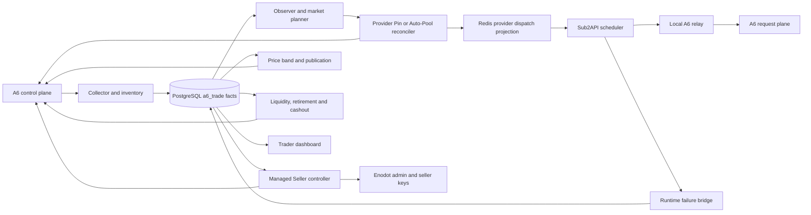

### 2.1 事实来源

| 事实 | 旧系统真源 | 本地保存方式 |
| --- | --- | --- |
| A6 用户、Supplier、Channel、Listing、Token | A6 控制面读回 | session 引用、inventory 快照、绑定表 |
| 市场报价、Pin、Auto-Pool | A6 Marketplace | Observer scan、quote、route generation |
| Provider 实际调用与成本 | A6 用户日志及 Sub2API usage | usage event、请求归因、cost generation |
| Seller 对外收入 | A6 earnings | earning event、counterparty classification |
| Sub2API 账号、Key、组和余额 | Enodot Admin/PostgreSQL | binding、readback、内部 adjustment |
| 当前可调度 Provider | PostgreSQL current generation | Redis 只读投影 |
| 运行凭据 | 权限为 0600 的本地文件 | 数据库仅存引用、指纹、last4 和脱敏元数据 |

## 3. 领域模型

### 3.1 商户与职责

每个 A6 商户天然是 Seller。旧控制面另外给商户分配互斥运行职责：

- `Observer`：读取 Marketplace，形成完整市场快照，不承接生产请求。
- `Provider`：使用 A6 Token、Pin 或 Auto-Pool 承接 Sub2API 上游请求。
- `Seller`：通过自己的 A6 Channel 和 Listing 向 Marketplace 输出服务。

职责切换不等于删除商户。商户 ID、session、Supplier inventory 和历史事实继续保留。

### 3.2 Managed Seller

Managed Seller 控制器为每个商户维护：

- 一套 Enodot 用户、Key 和分组绑定。
- 一个或多个 A6 Channel binding。
- 每个模型的 Listing binding。
- 稳定 `managed_uid`、期望配置 fingerprint、远端 instance ID 和动作审计。

控制器先读取完整 inventory，再决定 create、adopt、update、takedown 或 noop。远端写入后重新读取；
超时或响应不明时依靠稳定 UID、请求记录和 inventory 判断采用结果还是继续补偿。

### 3.3 Provider Slot 与 Generation

Provider 不是简单账号列表，而是按模型维护的槽位和不可变 generation：

- pool generation 决定哪些账号占据 active、standby 或 vacant slot。
- route generation 决定 Token 使用 Pin 还是 Auto-Pool，以及对应 Channel 或价格范围。
- cost generation 保存该 route 的成本口径。
- dispatch generation 把当前激活结果投影给 Sub2API。

远端读回、成本、健康、owned-Channel Ban 和本地账号绑定全部一致后，generation 才进入 active。

## 4. 关键运行链路

### 4.1 账号注册与 Supplier 建立

```text
QQ 地址池
-> 请求并关联邮箱验证码
-> A6 注册和登录
-> 创建并 reveal 一个 Token
-> 读取上游模型
-> POST supplier/apply
-> 保存 owner-only session
-> 导入脱敏 merchant metadata
```

注册工作流位于 `batch.py`、`workflow.py`、`mail.py`、`client.py` 和 `storage.py`。随机商户、Channel、
Listing 和 Token 文案后来改为读取工作簿与 Token 语料。Session 文件保存敏感材料，数据库只保存引用和指纹。

### 4.2 Collector 与事实层

`trade_collector.py` 周期读取：

- 用户和 Supplier 资料。
- Channel、Listing、Token 和 Pin inventory。
- 财务余额、收益、结算、提现和用户调用日志。
- Marketplace quote 与 Provider usage。

Collector 使用分页、水位、稳定事件 identity 和 source hash 幂等写入 PostgreSQL。Repository 再把原始事实聚合成
经营指标、健康状态、Provider 成本、Seller 收益和 Dashboard read model。

### 4.3 Observer、Pin 与 Auto-Pool

Observer 按模型读取完整 Marketplace，过滤自有、不可用和价格越界 Channel，生成有版本的市场快照。

Pin 模式选择固定 Channel，记录 assignment epoch、成本和读回。Auto-Pool 模式按价格排序选择 Top-N，并完整纳入
第 N 名所在价格带。旧后期实现增加了 owned-Channel Ban 激活门：

```text
完整读取当前 Token + 模型可见的 Marketplace
-> 合并远端和本地 owned Channel
-> 逐项 disable
-> 读回 user_channel_disabled=true 和 route_status=user_disabled
-> 更新 Auto-Pool
-> 读回 auto_channels 非空且与 owned set 无交集
-> 激活 Provider
```

Provider shadow 只负责产生新计划证据，生产日常修复复用已有 generation。Shadow timer 在旧项目最终合同中保持关闭。

### 4.4 Provider 请求路径

Sub2API 从 Redis 读取当前 Provider dispatch projection。每个账号的 base URL 指向本地 relay：

```text
Sub2API
-> http://127.0.0.1:8767/a6-user/{a6_user_id}/v1/...
-> https://a6.a6api.com/v1/...
```

Relay 只做请求转发、连接池、流式传输和超时控制。URL 中的 A6 User ID 用于归因，控制面代理映射不进入数据面。

### 4.5 Seller 定价与 Publication

Seller Price Band 从市场报价、Provider 成本、利润参数、模型价格和现有 Listing 状态生成逐 Listing 价格计划。
旧算法包含：

- 成本下限和最大价格限制。
- 几何或分段价格带。
- Marketplace 密度采样和稳定分配。
- 价格跳变 cooldown。
- 写入 claim、幂等 action、远端更新和读回。

Model Publication 根据健康 Provider 数量、Seller inventory、控制门和最近成功决定 Listing 上下架。旧实现通过独立
controller 和 systemd 高频触发完成，新设计把这部分并入 `a6-channel` 用户、逐 Listing eligibility 和统一 Output Recovery。

### 4.6 失败分类与恢复

数据面失败通过内部接口或失败 journal 进入 Trader。旧后期分类已经区分：

- 用户请求错误。
- Provider 余额或 Token 配置错误。
- Pin/Auto-Pool 上游路由错误。
- 平台、网络、timeout 和责任不明错误。

账号级错误先摘账号，再触发 liquidity、repin、Auto-Pool 扩价或 replacement。Listing 是否下架由重新计算后的可调度容量
和 publication controller 决定。该分类后来整理成根目录 `errorlist.md`，新实现直接使用根合同。

### 4.7 Provider Liquidity

Provider 的 A6 请求消耗用户余额，Seller earnings 先进入商户可提现余额。Liquidity Controller：

1. 读取用户余额、可提现余额和 Provider 合同。
2. 按 `quota_per_unit` 的整单位预览划转。
3. 先写 intent，再执行一次 mutation，最后读回确认。
4. 仍不满足资金合同时撤销 Provider duty，将旧 slot 投影为 `VACANT`。
5. replacement 通过 Ban、route、cost、模型能力和读回后才进入 slot。

`insufficient_quota` 始终走该链路，不触发 Observer 扩价。

### 4.8 Retirement 与 Cashout

Seller retirement 先停止新流量，再等待在途动作、下架 Listing、处理 Channel 和 Key，最后归档商户。Cashout 子系统
维护提现账户 inventory、风险证据、preview、intent、submit 和异步 reconciliation。资金动作按稳定 identity 去重，
结果不明时先查询状态，不重复提交同额操作。

## 5. 数据库演进

旧数据库使用 `a6_trade` schema，根迁移与 Python package 内嵌迁移逐文件一致。

| 迁移范围 | 主要能力 |
| --- | --- |
| `0001-0004` | 商户、财务、收益、用量、市场、Pin、提现账户和 Supplier inventory |
| `0005-0010` | Managed resources、Enodot binding、Seller 基础角色、权限和 Dashboard 索引 |
| `0011-0021` | 币种、用量分类、市场信号、退休、Channel 健康、Observer 和收益对手方分类 |
| `0022-0031` | 安全归档、Supplier profile、故障责任、增长、Provider Top-N、generation 和一致性 |
| `0032-0041` | 模型 publication、Provider read model、失败修复、成本匹配和 Sub2API dispatch 权限 |
| `0042-0050` | 区域协调、FX、Seller 计划、readiness、内部操作 Key、liquidity 和风险提现 |
| `0051-0061` | Pin 失败、价格 cooldown、提现调度、历史保留、assignment epoch 和价格释放 |
| `0062-0069` | 经济路由、runtime failure、profit、Auto-Pool、Provider membership 和 liquidity Token |

旧控制器没有一张统一 Outbox 表，而是使用多套 intent、audit、claim、failure request、generation 和 reconcile 表。
新模块应按 Prompt 收敛为统一 Outbox、资源 operation 和 owner 明确的状态投影。

## 6. 代码地图

| 领域 | 主要归档模块 |
| --- | --- |
| A6 协议与账号工作流 | `client.py`, `models.py`, `workflow.py`, `batch.py`, `storage.py` |
| Enodot/Sub2API 管理 | `enodot.py`, `enodot_admin.py`, `trade_enodot_*` |
| 事实采集与查询 | `trade_db.py`, `trade_collector.py`, `trade_repository.py` |
| Managed Seller | `trade_managed_listings.py`, `trade_managed_listing_store.py`, `trade_seller_orchestration.py` |
| 定价与上下架 | `trade_seller_price_band.py`, `trade_model_publication.py`, `trade_publication_control.py` |
| Provider 计划与应用 | `trade_provider_pool*.py`, `trade_provider_cost.py`, `trade_provider_binding.py` |
| Pin 与 Auto-Pool | `trade_pin_*.py`, `trade_provider_auto_pool*.py` |
| Dispatch 与 relay | `trade_provider_dispatch.py`, `trade_provider_region.py`, `trade_upstream_relay.py` |
| 故障恢复 | `trade_channel_failure.py`, `trade_provider_failure_repair.py`, `trade_provider_runtime_failure.py` |
| 资金 | `trade_provider_liquidity.py`, `trade_provider_topup.py`, `trade_cashout_*.py` |
| 生命周期 | `trade_seller_retirement.py`, `trade_merchant_recovery.py`, `trade_market_history_retention.py` |
| 管理界面 | `trade_dashboard.py`, `trade_dashboard_management.py`, `data/trade_dashboard.html` |

CLI 中的 15 个 `trade-*` 命令覆盖迁移、导入、采集、Dashboard、角色、Seller 资源、Pin、定价、
补款、增长、上游校验、自动纳管和退休。其余 49 个脚本承担后来新增的 Provider、publication、资金、
区域和应急控制器。

## 7. 进程与触发模型

systemd 大致分为以下串行所有权域：

| 锁或所有权域 | 旧进程 |
| --- | --- |
| `network-scan` | session refresh、merchant recovery |
| `seller-control` | Seller onboard、pricing、publication、retirement、upstream guard |
| `provider-control` | pool apply、failure repair、Auto-Pool、liquidity |
| `provider-dispatch` | PostgreSQL 到 Redis/Valkey 投影 |
| Dashboard/relay | 常驻 WSGI 与 HTTP relay |
| Collector/Observer | 周期事实读取和市场扫描 |

一些 timer 是事件丢失后的补偿触发器，另一些直接承担固定频率控制。随着功能增长，多个 path、timer 和 listener
可能同时唤醒同一资源，依靠 flock、数据库 claim 和 generation 去重。新设计的统一 Outbox 与 Reconciler 正是为了
把这些触发入口收敛为单写者。

## 8. 必须保留的不变量

1. 所有 A6 控制面调用使用 `(a6_user_id, system_access_token)`，凭据加密或外置，日志脱敏。
2. 远端 mutation 先写 intent，结果明确后读回；结果不明先 GET，再采用、重放或重规划。
3. Provider Auto-Pool 激活前完整执行 owned-Channel Ban，远端 disable 和 subscription 都要精确读回。
4. Provider route/cost/health 使用匹配 generation，旧 generation 不覆盖新事实。
5. `insufficient_quota` 属于 liquidity，不属于扩价。
6. Provider shadow 默认关闭，只在确需新 immutable generation 且无可复用计划时单次运行。
7. 瞬时满并发不等于结构性无账号，不触发 Listing 下架。
8. 资金、Key、Pin、上下架和价格写入均按稳定 operation identity 幂等。
9. 原始金额和倍率使用整数或 Decimal；数据库保存原始 A6 单位和换算 generation。
10. 公共文案来自版本化语料，不用职责、ID 或时间拼接名称。

## 9. 迁移到新模块的取舍

| 旧能力 | 新模块处理 |
| --- | --- |
| A6 HTTP client 与协议样本 | 依据活跃 API Reference 重写成 Sub2API Typed Client |
| Session 文件和 Python secret reader | 迁移为 Sub2API 加密 credential 与 secret generation |
| Managed Seller 一套资源控制 | 改为一 `a6-channel` 用户绑定一 Channel、多模型 Listing |
| Seller Key 与 Provider Token 混在同一项目 | 分为输出入口 Key 与输入 Provider route Token 两个部门和两套 Saga |
| Listing 或分组级倍率 | 改为 `(listing, account, model)` eligibility 和 delta |
| 独立 Price Band controller | 迁入逐模型 Listing pricing generation |
| 多套 intent/audit/claim 表 | 收敛为统一 Outbox、operation journal、hold/desired/observed/plan |
| Redis Provider projection | 只投影当前 eligible account 与 delta，PostgreSQL 保持事实源 |
| 独立 WSGI Dashboard | 融入 Sub2API 管理端 `/admin/users` 和 A6 控制台 |
| systemd 脚本网络 | 改为 Sub2API 内部事件、worker、lease 和定时补漏 |
| Trader failure bridge | 合并到每次 attempt 的统一经济与故障硬门 |
| Trader retirement/publication | 合并到 Output Lifecycle 与 Recovery Reconciler |

## 10. 已知历史边界

- 归档代码代表整理时工作树，不代表所有逻辑都已部署到同一生产版本。
- 归档专题设计稿包含不同阶段的参数和未决结论；根目录 Prompt 已完成去重和最终取舍。
- 旧 `client.py` 工作树曾给 Auto-Pool caps 增加 `per_request_price_micros`，A6 抓包未确认该字段；新实现仅按
  per-token Listing 和最终 token usage 计费。
- 旧 `TPA6API`、`ToA6API` alias、Managed Seller 用户和 Key 关系需要按 Prompt 的 Channel 聚合迁移，不直接复制。
- 真实代理、钱包、Cookie、Token 和 HAR 留在本机 `.local/`，归档路径只保存其 schema、代码引用和控制逻辑。

## 11. 归档定位方式

从新 Prompt 追旧实现时，优先使用：

```bash
rg "关键状态或接口" archive/legacy-trader/src archive/legacy-trader/scripts
rg "对应表名" archive/legacy-trader/migrations archive/legacy-trader/src
rg "控制器或状态" archive/legacy-trader/tests
rg "ExecStart|OnUnitActiveSec|OnCalendar" archive/legacy-trader/deploy/systemd
```

旧代码只回答“以前怎样实现”，根目录 Prompt 回答“现在应实现什么”。
---

# Part 3：docs/sub2api-a6-channel-implementation-prompt.md（实现总合同）

<!-- 以下内容为对应源文件的完整当前版本（随合集同步修订） -->

<!-- ===== 源文件：docs/sub2api-a6-channel-implementation-prompt.md ===== -->
# Sub2API v0.1.173 原生 A6 Channel 经营模块实现 Prompt

> 当前精简执行版 v15，2026-08-11

请在当前定制版 Sub2API v0.1.173 中实现原生 A6 Channel 经营模块。主体逻辑从
`/Users/haven/Documents/code/a6api-auto/archive/legacy-trader` 的 Trader 迁移并重新梳理，保留现有 Managed Seller、
Class2Adjustment、A6 Provider、Pin、Auto-Pool、Replay 和生产升级兼容能力。

当前 v0.1.173 已包含并上线 `Class2Adjustment`。它是本实现必须保持兼容的既有能力，不是待重新迁移的
`delta` 实现。经营 `delta` 与 `Class2Adjustment` 共享最终 usage compositor，但拥有独立的策略、账本和观测事实。

实现依据：

- Sub2API：`/Users/haven/Documents/code/codex-pool/sub2api-update-20260811-v0173`
- A6 API：`/Users/haven/Documents/code/a6api-auto/docs/a6-api-reference.md`
- A6 抓包：`/Users/haven/Documents/code/a6api-auto/api-docs/7-24-15-54.md`
- Supplier Profile：`/Users/haven/Documents/code/a6api-auto/api-docs/api-supplier-profile.md`
- A6 Status：`/Users/haven/Documents/code/a6api-auto/api-docs/api-status.md`
- 错误分类：`/Users/haven/Documents/code/a6api-auto/errorlist.md`
- 生产约束：`/Users/haven/Documents/code/a6api-auto/AGENTS.md`

## 1. 实施方式

编码前提交并审核：数据模型/约束/Decimal/加密；三层边界图；Listing与Class1状态机；两套Key Saga；A6写入、结果不明、
读回/补偿/重放顺序；旧Seller/Provider/OAuth/API Key迁移映射；每个状态、hold和operation的owner及自动/失败/人工出口。

实现必须包含数据库迁移、后端服务、请求路径硬门、异步控制器、管理端和测试；不得用占位实现替代远端写后读、
经济结算或故障恢复。

## 2. 领域边界

### 2.1 输入/上游部门

负责 Sub2API 从上游取得服务能力：

- Class1 A6 Provider、Class2 原生 OAuth、Class3 上游 API Key。
- `provider_route_token`、Auto-Pool、Pin、Provider liquidity 和 owned-Channel Ban 隔离（BanRelation/BAN_INIT 与 SelfRoute Guard）。
- 账号 `sk`、profit、模型能力、健康和 Sub2API 原生调度状态。
- route、cost、capability 和 billing generation。

### 2.2 输出/下游部门

负责通过 A6 Channel 对外提供服务：

- `users.user_type='a6-channel'`、唯一 `output_channel_ingress_key` 和 `ToA6API`。
- 一个本地用户绑定一个远端 A6 Channel；一个 Channel 下绑定多个按模型区分的 Listing。
- 每个 Listing 独立管理 `ck`、delta、价格边界、资格、上下架、冷却和收益核对。

### 2.3 连接层

先以 `(local_user_id, requested_model)` 唯一解析稳定 `listing_binding_id`，再以
`(listing_binding_id, account_id, normalized_model)` 计算 eligibility 和 delta。

每个 attempt 在派发前冻结：

```text
output_channel_generation, listing_generation, account_generation, route_generation,
cost_generation, capability_generation, billing_generation, pricing_generation,
model_price_generation, fx_generation, transport_profile_generation, delta_effective
```

派发前任一 generation 失效都必须重新选择；已经派发的 attempt 按不可变快照结算，新 generation 只阻止新请求。

## 3. A6 Typed Client

1. 控制面统一使用`(a6_user_id, system_access_token)`；一套凭据可绑定多个输出Channel/Listing和输入资源。
2. Typed Client完整覆盖A6 API Reference，包括Token删除、模型/市场/Supplier、Pin/Auto-Pool、circuit、earnings及读回。
3. system token envelope encryption；业务表只存secret reference/fingerprint/last4；所有Token、Key、session、Authorization、
   Cookie在日志/trace/错误/审计摘要中脱敏。
4. 写操作保存操作者、部门、摘要、source generation、幂等键、写前读和写后读。**只有传输结果不明**才进入 GET 三态判定：已生效则 adopt，
   仍为旧值则同 operation 重放，第三种状态按远端事实重规划。服务端已明确返回的业务拒绝/非重试失败必须保留为
   `REMOTE_REJECTED` 交业务 owner 分类，不能因为 post-read 仍是旧值就误判成 `REPLAY_SAME_OPERATION`。
5. 集合读取完整分页并标记completeness；不完整快照的“未找到”不能证明删除、恢复或Ban。
6. 管理端通用控制台只调用白名单；受管写入仍走同一Outbox和单写者。

已确认`PATCH /api/supplier/me/profile`抓包请求体为`contact_info + description`，`GET /api/status`响应合同见上述独立抓包；
Typed Client按这两份协议建模并保留未知扩展字段。当前Profile抓包未出现Supplier `name`，不得拿description或Channel PATCH冒充重命名。

## 4. 核心数据模型

至少建立以下实体，最终字段按第 1 节的数据模型评审落地：

```text
a6_credentials, a6_output_channels, a6_output_channel_instances
a6_output_channel_keys, a6_listing_bindings, a6_listing_instances
provider_route_token_bindings, provider_listing_ban_relations
a6_merchant_price_orders
owned_routing_listings, owned_historical_tombstones
account_cost_generations
account_economic_profiles, account_capability_generations, a6_model_price_generations
a6_listing_pricing_generations, a6_listing_account_delta_overrides
a6_listing_account_eligibility, a6_output_attempt_economic_snapshots
a6_output_winner_billing_intents, a6_output_revenue_reconciliations
a6_public_text_selections, a6_listing_holds, a6_output_recovery_operations
a6_provider_route_operations, a6_platform_incidents, a6_control_outbox
```

关键约束：

```text
a6_credentials.a6_user_id UNIQUE for active control owner；Token轮换写同一credential的secret generation
a6_output_channels.local_user_id UNIQUE；当前 a6_channel_id 全站 UNIQUE
每个 output_channel 任意时刻最多一个有效 ingress key
(output_channel_id, normalized_model) UNIQUE；当前 a6_listing_id 全站 UNIQUE
provider account 与当前 remote_token_id 均一对一 UNIQUE
provider_listing_ban_relations.(provider_token_instance_id, listing_instance_id) UNIQUE
a6_merchant_price_orders.active rank UNIQUE；每个 active merchant 至多一个 current rank
(listing_binding_id, account_id, normalized_model) UNIQUE for delta override
economic_snapshot.attempt_id UNIQUE；billing_intent.economic_snapshot_id UNIQUE
revenue_reconciliation.(a6_credential_id, request_id) UNIQUE
每个远端资源任意时刻最多一个 current-generation 写 operation
```

**Merchant Price Order**（事前策略事实）：`a6_merchant_price_orders` 以稳定商户身份
`a6_credential_id` 绑定 `merchant_price_rank`（或等价的 `merchant_price_position`）与
`merchant_price_order_generation`，不绑定 Channel/Listing。它固定商户之间的相对价格位置（如
`M1 < M2 < M3 < M4`），只由管理员显式调整；不定义绝对价格，不参与 Delta 决策。

**Merchant Risk Profile**（事后观测事实）：只记录某商户实际承担的 Delta 流量
（`delta_request_ratio`、`average_delta`、`high_delta_ratio`、`delta_adjusted_volume`）、收益/结算异常、
平台 warning、商户 suspension/takedown 事件并形成 `risk_score`。它是 S10/S11/S12 历史事实的事后观测，
**不作为 S08 pricing、S09 eligibility 或 S10 Delta 的输入**，不反向修改 Merchant Price Order。

**Owned-Ban 新模型**：`owned_routing_listings` 是远端排除集合：完整 Supplier inventory 中仍存在的
active/down/unavailable/retired/hidden owned `(Channel, Model)`，加上本地仍受控且尚无精确远端删除证明的
Channel/Listing。`owned_historical_tombstones` 仅包含远端删除已精确确认且完整 current Supplier inventory
证明不存在的历史实例，仅审计、不参与激活门。`provider_listing_ban_relations` 仍是唯一 Ban 业务表，
以 `(provider_token_instance_id, listing_instance_id)` 保存关系状态；不新增 attestation 表或第二套状态机。

稳定本地 `listing_binding_id` 是 delta、eligibility、hold、attempt、账单和收益的外键。远端 Channel/Listing 删除重建时
关闭旧 instance 并创建新 instance，不改写历史外键。

所有金额、倍率和经济判定使用 NUMERIC/Decimal，向上量化规则必须显式；`float64` 只可作为展示兼容副本。

### 4.1 公共文本语料硬门

所有Supplier名/简介、Channel名/简介、Listing简介和A6/Sub2 Token或Key显示名都必须先从仓库语料选定：Supplier
字段取`resources/corpora/merchant_templates_split.xlsx`“商户资料”同一行；Channel字段及Listing简介分别取“渠道资料”
同一行的`channel_name/channel_description/model_description`；令牌名取`resources/corpora/token_name_corpus.json`。
`nickname`只做所选Channel名的平台长度投影，不拼接ID、模型、职责、类别、时间、hash或后缀。写前持久化catalog SHA-256、
sheet、source row/index、原值和selection generation；重试复用原选择，重名冲突改选未占用语料项。语料不可读、无效、耗尽
或冲突时增加`TEXT_CORPUS_INVALID`并停止对应远端写：输出资源投影Listing hold，输入Token保持账号不可调度。Listing
`display_name`固定为空，直至版本化语料新增专用字段；管理员仅能选择或随机重选语料。迁移旧值保留审计原文，只有“系统当前
准备执行新公共文本远端写入”的字段必须取得语料选择；远端不可修改的历史 Supplier name 保存为 `LEGACY_REMOTE`
public-text fact：只审计、不产生`TEXT_CORPUS_INVALID`、不阻止ACTIVE，也永远不作为未来新写入来源。
`TEXT_CORPUS_INVALID`仅针对系统现在准备执行一次新公共文本写入却拿不到合法语料选择的情况；当前Profile抓包只证明简介
可写，无Supplier rename合同，因此历史 name 一律按 `LEGACY_REMOTE` 处理，不等待不存在的rename流程。

## 5. 输出 Channel 用户

1. 新增`users.user_type='a6-channel'`，不复用role；一用户绑定一远端Channel、一入口Key和多个模型Listing，Key固定同一
   Sub2 UserID，不按模型切用户。
2. 鉴权后以规范化模型唯一解析Listing；只接受A6 `platform-models.model_no`精确值或版本化显式alias，碰撞进入绑定审核。
3. 初始余额0且可持续为负；`concurrency=0`和`quota=0`分别表示无限并发/配额。仅此类型跳过余额、reserve和platform quota，
   Key/IP/RPM/并发/分组/模型/eligibility仍校验。
4. 禁止普通登录、自助注册和用户端Key管理；`users.status`管Channel生命周期，逐Listing admission管模型状态；`/v1/models`
   只暴露当前绑定且允许的模型。
5. 首个、新增及replacement Channel均使用`POST /api/supplier/apply`，以request受理和inventory出现新ID为完成证据；
   replacement切换稳定binding，不把Listing resubmit冒充Channel恢复。

`ToA6API` 是输出入口的唯一 canonical 分组：输出用户只能使用它，普通用户严格排除；禁止改名、删除和误授权；组倍率
及用户组倍率恒为 `1.0`。Class1/2/3 候选由账号 binding 显式投影，经济倍率不得再存进分组倍率。

现有`TPA6API`及其到`ToA6API`的运行时alias只是旧输出入口命名，不是输入部门/第二业务组。迁移前盘点两名称的group ID、
用户、账号和Key：双实体先按Channel binding合并再退役旧组，同一实体旧名则原地canonicalize；验证唯一入口Key和候选投影
后删除alias。此后只精确匹配`ToA6API`，禁止名称fallback。

Channel/Listing 生命周期统一如下：

1. 新建 Channel 时先创建 inactive 用户和 DISABLED/STAGED 唯一 Key；写入远端 Channel、同步完整 Listing inventory、
   完成各 intended Listing 的 `LISTING_BAN_INIT`、价格、能力和 eligibility 后再启用用户和 Key，逐 Listing 恢复。
2. 远端 Listing 删除但父 Channel 与 canonical model 不变时，保留稳定 `listing_binding_id`，关闭旧 instance并创建新
   instance；canonical model改变时退役旧 binding并创建新 binding。
3. Channel 被删除或 takedown 后不猜测原 ID 可恢复；通过 `POST /api/supplier/apply` 申请 replacement，切换新的
   Channel instance，稳定本地用户、Channel binding和历史外键不变。
4. 退役 Listing 时先关闭 admission并等待该 binding inflight归零，再 takedown/readback并关闭 current instance；
   超时由Lifecycle Controller保持`RETIRE_PENDING`、核对stale attempt lease并重试；远端写前可人工取消，写后只能继续或修复
   重放。最后一个Listing退役后再takedown父Channel、删除入口Key并退役用户。
5. owner/model/channel唯一匹配可由 Binding Controller自动采用新 generation；owner冲突、多候选或资源消失进入
   `BINDING_REVIEW`，管理员只可选择指定实例、接受远端事实并生成新 generation，或退役。

## 6. 两类 Key 与轮换

### 6.1 输出入口 Key

`output_channel_ingress_key` 属于输出部门，是 A6 自有 Channel 调用 Sub2API 的本地 Key。入口 Key 轮换是
**Channel-scope maintenance**（已由 2026-08-12 probe 确认 `PATCH api_key` 与 Channel `restore`）：

```text
创建 STAGED 新入口 Key
-> 关闭整个父 Channel admission
-> Channel takedown / readback
-> PATCH 远端 Supplier Channel api_key
-> readback / verification（结合 Channel 配置 generation 精确判定）
-> 本地旧 Key OFF / 新 Key ON，任意时刻最多一个有效
-> Channel restore / readback
-> 删除旧本地 Key
```

Channel takedown 会使其所有子 `(Channel, Model)` 暂时市场不可见，因此 Key Rotation **不需要逐 Listing
takedown/resubmit**，也不给子 Listing 加任何 hold。`maintenance_state=KEY_ROTATION` 从 Saga 开始到 Channel restore/readback
确认前必须关闭父 Channel admission；生命周期 observer 在该 maintenance operation 存在时只能记录 observed，**不得把这次受控
takedown 误判成 Channel missing/takedown 而启动 replacement**。中断恢复仍以远端事实决定：远端仍指旧 Key 时回滚到
“旧 Key 唯一启用”；远端已确认新 Key 时继续到“新 Key 唯一启用”；若远端只回显 last4/fingerprint，则结合
Channel 配置 generation 做精确判定；仍有歧义时 Channel 保持 DOWN、所有 child admission=CLOSED 并进入可重放
operation，禁止同时启用新旧 Key。删除旧 Key 失败只进入清理 dead-letter，不回退已经确认的新 Key，
不触发普通 child Listing recovery。

### 6.2 Provider 路由 Token

`provider_route_token` 属于输入部门，是 Class1 请求 A6 上游的远端 Token：

```text
创建新远端 Token
-> 读取旧 Token 的模型、额度和route配置；为新 Token创建新的Auto-Pool subscription或新的Pin assignment
-> 执行 TOKEN_BAN_INIT：对所有 owned_routing_listings 建立 BanRelation 并逐项精确读回
-> 完成 route/cost/model/callability验证
-> 原子切换 account绑定
-> DELETE旧远端 Token，确认详情不存在且列表无旧ID
```

新 Token就绪前旧 Token继续服务，但只有本地当前绑定的 Token可调度。切换前失败时删除新 Token并保留旧绑定；切换后
旧 Token删除失败时将其记录为 `ORPHANED_REMOTE_TOKEN`，持续以同一 operation DELETE/readback，禁止重新绑定或复制出
第二个可调度账号。远端写结果不明统一按第3节先读回再采用、重放或重规划。

两类资源必须使用不同表、字段、权限、服务和 Saga；名称遵循第4.1节，duty只存控制面。Key material规范化为且仅为一个`sk-`前缀。

## 7. 输入账号与 sk

### 7.1 Class1

Class1 是 A6 Provider API Key：

```text
Auto-Pool: sk = 完整纳入价格带的 topN_max_cny_ratio
Pin:       sk = 当前 pin_assignment_epoch 精确 Channel K_CNY
```

- 默认 `target_n=10, min_n=3, max_n=20, min_ratio=0, hard_max_ratio=0.3`。
- 外部可调用比率排序为`r1<=...<=rM`；`M<min_n`时range exhausted，否则`N=min(target_n,M)`、`max_ratio=rN`并完整纳入同价带；
  `cv_n=stddev(r1..rN)/mean(r1..rN)`、`tail_jump=(rN-rN-1)/rN-1`，mean/variance/min只观测。
- 不叠加 `realized_cost_p95`、`retry_reserve` 或额外 `5/6` 换算。
- 成本上涨立即切新 generation；下降连续 3 个快照后生效。
- Pin 不使用 Top-N，成本和模型必须精确匹配当前 assignment epoch。

### 7.2 Class2

Class2 为 Free/Plus/Team/K12/Pro OAuth，以人工管理为主：

```text
multiplier = expected_weekly_quota_multiplier, default 1.0, constraint > 0
used_A > 0 AND utilization > 0: one_week_A = used_A / utilization
otherwise: one_week_A = 100
expected_total_A = one_week_A * multiplier
sk = account_cost_cny / expected_total_A
```

`utilization` 使用 Decimal，可大于 1；只影响成本估算。100% 不暂停、不刷新、不替换、不退役账号，账号状态继续遵循
Sub2API 原生 OAuth 规则。字段缺失或矛盾时保留最近确认 sk；没有历史值时用 `one_week_A=100` 并标记估算。

### 7.3 Class3

- 使用稳定类别 `class3:<provider_code>`。
- 管理员填写账号默认 `declared_sk`，可按规范化模型覆盖。
- 适配器同步 `/v1/models`、余额、Acost 和账单。
- 15 分钟窗口、至少 20 个收费请求且 expected cost >= CNY 1：偏差不超过 5% 正常，5%-15% 告警，
  连续三窗超过 15% 暂停，单窗超过 30% 立即暂停。
- 恢复使用上游账单重同步和有界审计 Probe，连续 3 个窗口不超过 5% 后生成新 billing generation。

默认 profit：Class1 `0.20`、Class2 `0.50`、Class3 `0.40`；允许账号级覆盖，每个 provider_code 有独立默认值。
Class2/Class3 入池前同步模型并对当前 A6 OpenAI 模型做有界探测，生成版本化白名单。
探针原始 input usage范围默认 `500..3000`，全局并发、每分钟请求数和每小时成本上限均可配置；达到预算只延后探测，
不绕过模型能力或账单恢复条件。Class3账单偏差恢复的每个15分钟审计窗口仍需至少20个收费样本且expected cost >= CNY 1；
预算不足时保持暂停并显示原因，管理员可修正 declared sk或扩大审计预算。

## 8. Class1 Auto-Pool 与 Ban

Ban 的业务单位是 `(provider_token_instance_id, listing_instance_id)`，即 **Provider Token × (Channel, Model)**，
持久化为 `provider_listing_ban_relations`。只保留四种核心概念：

```text
owned_routing_listings      远端仍存在，或本地仍受控且无精确远端删除证明的 owned Listing instances
owned_historical_tombstones 仅限远端删除精确确认且完整 current Supplier inventory 证明不存在的历史实例
BanRelation                 (provider_token_instance_id, listing_instance_id) 的禁用关系
BAN_INIT                    新 Token / 新 Listing 创建时的一次性 Ban 初始化
EXCLUSION_GATE              复用 BanRelation 的事件驱动完整远端核对，不是独立业务状态机
```

BanRelation 的首次建立或 scoped repair 由以下三种情况触发：

1. 新 Provider Token instance：执行 `TOKEN_BAN_INIT`，对所有 `owned_routing_listings` 建立 BanRelation；
   已有市场可见 Listing 直接 Ban，业务上不可见 Listing 通过 maintenance visibility 临时可见后 Ban 并恢复。
2. 新 Listing instance：执行 `LISTING_BAN_INIT`。其初始化价格**不使用正式 S08 市场分布算法**：对 canonical
   model 取得当前 S07 已确认的 A6 官方价格/FX generation，生成

   ```text
   init_ck = random_decimal_closed("0.8", "1.9")
   ```

   即 Listing 初始化净 k_CNY 随机位于当前 A6 官方价格的 0.8x～1.9x。随机结果必须以 Decimal 生成并在 BAN_INIT
   operation 中持久化；同一 operation 的 crash/retry/replay 必须复用第一次生成的 `init_ck`，不得每次重试重新随机。
   执行顺序明确为：

   ```text
   write init price + exact Supplier readback
   -> temporary resubmit + Supplier readback
   -> 立即执行 all Ban-domain Provider Token instances × Listing disable
   -> exact Ban readback
   -> 恢复 Listing 原远端状态
   ```

   `LISTING_BAN_INIT` **不以 Marketplace visible polling 作为 Ban 前置门**。若 disable 因远端传播延迟返回
   not-found / unknown / target 未确认，BanRelation 保持 `PENDING`，由同一 BAN_INIT operation 按 S01
   unknown-result/readback/retry 合同继续；不得因此把 Listing 交给正常 scheduler。全部 BanRelation READY 后
   恢复原状态，随后才交给正常 pricing/eligibility/recovery。
3. 运行期 `SELF_ROUTE_DETECTED`：SelfRoute Monitor 观测到 Provider Token 实际选择了
   owned_routing_listing，立即暂停受影响 Provider 并执行 scoped repair（已知 Token -> Token × all owned
   routing listings；已知 Listing -> all Ban-domain Provider Token instances × Listing；无法定位 -> all Ban-domain Provider Token instances × all owned routing listings）。

READY BanRelation 跨普通事件持续有效，不重复建行。另在 Provider Token onboarding、owned Channel
create/adopt、父 Channel restore、Provider 进入/恢复 schedulable、每次 Auto-Pool `max_ratio` 更新时执行
`EXCLUSION_GATE`：完整分页 fresh readback，已禁用关系不重复 mutation，发现漂移才 disable。普通 Seller Listing
改价、请求、cooling 和 Listing-scope 的 create/adopt/takedown/resubmit 只执行 scoped LISTING_BAN_INIT 或原操作，不触发完整 gate；Pin/route 参数变化本身不修改
membership，但若随后恢复 Provider 可调度，必须在恢复前通过 gate。

### 8.1 ban_membership_generation

```text
ban_membership_generation 只在以下成员关系变化时递增：
1. 新 Provider Token instance 加入 Ban 初始化域；
2. 新 owned_routing_listing instance 加入 Ban 初始化域；
3. Provider Token instance 永久退出当前初始化域；
4. owned routing Listing 的远端删除已精确确认，且完整 current Supplier inventory 证明不存在，永久退出并进入 historical tombstone。
```

普通 price generation、route generation、`max_ratio`、Pin、Listing 上下架、cooling/recovery 均不得修改该
generation。

每个 `TOKEN_BAN_INIT` / `LISTING_BAN_INIT` 开始时冻结 `membership_generation_start`。准备把 Token 切为
current，或准备把新 Listing 交给正常 pricing/eligibility/recovery 前，重新读取 current
`ban_membership_generation`。若 generation 已变化：只计算并补齐当前矩阵中缺失的
`(provider_token_instance_id, listing_instance_id)` BanRelations；**不得重新 Ban 已经 READY 的关系**。
只有在 `missing_relations = 0` 且 membership generation 稳定时才允许完成初始化。**Ban-domain member 的加入/永久退出与对应
`ban_membership_generation + 1` 必须在同一个数据库事务中提交或一起回滚**；不得先提交 membership 再单独 bump generation，也不得反过来。

`TOKEN_BAN_INIT` / `LISTING_BAN_INIT` 的临时市场可见性（S13 `maintenance_visibility_override`）不修改业务
`desired`，期间 admission 始终 `CLOSED`；父 Channel 为 DOWN 时按 Channel 批次临时 restore、Ban 完成后恢复
原父级与 Listing 状态。成功、失败、超时、失租或 generation 替换都必须先恢复/readback。Channel/Listing 的 maintenance pre-state 必须在第一次
远端 mutation **之前持久化一次并在同 operation 的 crash/retry/replay 中复用**，不得在重放时把临时 restore/resubmit 后的状态重新采样成
“原状态”。BanRelation READY 只证明 disable 已确认；父 Channel 与所有临时 Listing 都恢复/readback 到持久化 pre-state 后，BAN_INIT parent
operation 才能 COMPLETE。

Provider Token 启用 Auto-Pool 或进入/恢复可调度状态前，必须执行 current `EXCLUSION_GATE`。固定使用完整分页
Marketplace search：`route_status=all`、`exclude_unavailable=false`、`include_seed=true`、
`include_disabled=true`、`include_user_disabled=true`；每个 owned Channel/model 精确读回
`user_channel_disabled=true && route_status=user_disabled`。本地已知 owned 项在完整 search 中缺失、分页不完整或
任一读回失败都保持 Provider 不可调度/VACANT。Auto-Pool effective subscription 还必须 `auto_channels` 非空且
不含任何 owned Channel。gate 只把证据写入现有 operation/audit 与 BanRelation readback 字段，不创建平行证明模型。

Auto-Pool上游失败无需证明具体Channel；将当前区间视为失效或集体改价：

```text
暂停受影响 Class1
-> fresh Observer/完整 marketplace snapshot并执行target_n + 1，纳入下一完整价格带
-> 执行 current EXCLUSION_GATE（READY 关系 fresh readback，漂移才重新 disable）
-> 生成新route/cost generation
-> PUT Auto-Pool并精确读回
-> 确认 auto_channels 非空/无 owned 且 gate membership generation 未变化
-> 恢复 Class1
```

稳定/距上次变更各30分钟、成功100次、无上游错误，且`cv_n>5%`或`tail_jump>3%`时每轮`target_n-1`。超过`max_n`、
无非owned可调用项或下一完整价带超过0.3时进入`AUTO_POOL_RANGE_EXHAUSTED`并摘流；每60秒fresh重评，重新出现合法完整
价带则生成route/cost generation并恢复。人工可切Pin、退役或重放；禁止截断同价带、空auto_channels或越界。

PUT超时仅摘受影响Class1并进入`ROUTE_UNKNOWN`，GET后adopt、重放或重规划；旧route不再视为远端事实。Provider shadow
默认关闭，仅在必须创建且无可复用generation时单次运行，timer始终关闭。

Pin不执行`target_n+1`或自动切Auto-Pool。当前assignment epoch的Channel运行失败时摘流并创建repin generation；选择新
Channel；写 Pin 前执行 current EXCLUSION_GATE，读回 assignment/channel/cost/model 且 assignment 非 owned 后激活。
失败/结果不明保持摘流并可重放；route mode只能人工修改。**初始 route、管理员 route-mode 变更以及 Token rotation 的 staged Token route copy
均由 S06 route owner 执行；S05 只拥有 Token/BAN_INIT，不直接创建第二套 Pin/Auto-Pool route generation；route 对应成本 generation 仍由 S04 拥有。**

Class1 `insufficient_quota` 立即摘流并由Liquidity Controller置`UNFUNDED`，不扩池：先读取余额并计算合格整单位。**任何真实 balance transfer 都必须
先持久化 transfer intent（operation identity、amount、pre-balance/readback hash），取得下述 callback 有效 witness 后只执行一次 mutation，再按
user/merchant balance post-readback 判定 target / exact-pre / third-state。响应丢失或读回不完整时保持 UNFUNDED 并继续同 operation 对账，不得
重新计算新 amount 或盲目重复 POST。**满足合同则清除此状态；否则移除Provider duty、槽位置VACANT，再引入通过Ban、Observer range、成本、能力和读回的替补。

liquidity/callback Token 与 Provider route Token、输出入口 Key均为独立资源和duty，名称来自令牌语料。它只可Pin到当前
listed且callable的A6自有small-merchant Channel；没有合格Channel时跳过划转请求。生产callback继续使用精确输入
`PING 5db98307ce2d442ee568baacf8b0e7076fa657cbe2806ccff9da6386997915e2`，并验证既有realistic sampled usage与
high-cache不变量；`prompt_tokens=1/completion_tokens=0/total_tokens=1`等probe-shaped结果不计作有效划转。

## 9. ck、官方价格与 FX

`commission=0.2` 固定，`ck` 定义为商户净 `K_CNY`：

```text
ck_public = ck * 1.2
fx_usd_cny = realtime_ratio_cny / realtime_ratio_usd
ck = fx_usd_cny * listing_price_micros[canonical] / official_price_micros[canonical]
```

A6 官方价格来自 `/api/platform-models`。本模块的Supplier Listing统一使用`charge_type=per_token`，按
input、output、cache_read、cache_write中第一个官方价非零维度选择canonical。写入目标ck时，每个非零官方维度：

```text
listing_price_micros[d] = ceil(official_price_micros[d] * ck / fx_usd_cny)
```

写后对每个非零维度计算 `ck_d=fx_usd_cny*listing_price_micros[d]/official_price_micros[d]`。canonical维度用于展示，
经济门使用 `confirmed_ck=min(ck_d)` 作为保守净倍率；各维度只允许由单个micros向上取整产生的误差，超出该整数误差包络
即视为价格向量漂移。批量调用`markup-preview`，按`channel_id`映射`percent/source`。缺项、重复、非法值、
`percent != 20`、billing、官方维度、charge type或价格向量不一致时增加`OUTPUT_CONFIG_INVALID`，修复并读回后恢复。

A6远端读回是ck、markup、Listing状态和模型官方价格的事实源。Sub2API为`ToA6API`建立独立的版本化价格resolver，使用同一
A6官方USD价格向量计算`base_actual_cost`，不全局覆盖普通分组定价。A6暂时不可达时继续使用`last_confirmed_ck`和当前
model-price generation；写入失败进入待重试operation，不覆盖最后确认事实。

FX 优先使用 A6 marketplace 同一快照的 CNY/USD 比值。A6 缺失或不可达时使用：
```text
https://api.frankfurter.app/latest?from=USD&to=CNY
json_path=rates.CNY, timeout=3s, cache_ttl=30m
fallback_active_refresh=15m, max_source_date_age=96h, credential=null
```

外部源只兜底，不与 A6 投票；A6 恢复立即切回。两者都不可用时沿用 `last_confirmed_fx`，不执行新价格写入。

## 10. Listing 定价范围与分布

```text
listing_hard_min_ck default 0.025
listing_hard_max_ck default 4.0
0 < hard_min <= hard_max <= 4.0

effective_delta_cap = min(0.5 if delta_transport_capable(profile) else 0
                          for profile in required_transport_profiles)
class1_floor = min_ready_class1_for_model(sk * (1 + profit) / (1 + effective_delta_cap))
raw_lower = max(hard_min, class1_floor)
band_lower = min(raw_lower, hard_max)
band_upper = hard_max
```

上下限是逐模型可管理policy，但hard max不得配置超过4.0。`ready_class1_for_model`必须满足Sub2原生可调度、模型能力、
当前route/cost generation和current Provider Token instance `BAN_INIT` READY；瞬时满并发不改变ready。没有ready Class1时只用hard min；
`raw_lower>hard_max` 时价格固定在 hard max，
不得生成超过上限的 Listing，最终是否下架仍由 eligibility 决定。

在 `[band_lower, band_upper]` 建 8 个对数桶。
仅采样 A6 外部、可调用、非 owned Channel；公开 k 先除以 1.2 变为净 ck。
按外部市场桶频率用最大余数法生成全站目标 ck 集合并升序排列，作为 target price slots；再按 Merchant Price Order
（`merchant_price_rank` 升序）和各商户该模型 Listing 数量切分连续 slots，**对任意
`merchant_price_rank_i < merchant_price_rank_j`：`max_ck(Mi) <= min_ck(Mj)` 必须成立（硬约束，无“尽量”）**，
商户内再用稳定匹配最小化价格移动（minimum-movement stable matching）。零外部市场样本：`candidate_targets =
existing Listings 的 current_ck 裁剪到 hard bounds + new Listings 的 band_lower`，随后必须
`sort(candidate_targets)` → 按 Merchant Price Order 切连续 target slots → 分配给各商户；
零样本只改变 target values 的来源，**不得绕过 Merchant Price Order**。上下界相等时退化为单点价，不计算对数。
市场目标分布仍以同一规范化模型的全站受管、未退役的输出 Listing 集合统一计算；Merchant Price Order 不改变市场
分布目标，只约束目标价格槽向各商户的分配顺序，价格排序由管理员显式调整才改变。等成本时保持稳定 binding顺序。
每批默认最多写 10 个，普通改价每 Listing 至少间隔 5 分钟。

价格顺序：

- ck 下调先发布 `min(last_confirmed_ck, desired_ck)` 的保守经济 generation，再等待旧 inflight 清零。普通分布调价超时
  时取消本轮降价并恢复 `last_confirmed_ck` generation，不写远端；当前价突破 `hard_max` 的纠正不得取消，保持 admission
  CLOSED并继续等待/重试，归零后写入上限并读回。
- ck 上调先写远端并读回，再发布允许降低 delta 的 generation。
- 写结果不明时暂停该 Listing 后续调价，GET 后 adopt、重放或重规划。

## 11. Delta、Class2Adjustment、计费与收益

对每个 `(listing_binding_id, account_id, normalized_model)`：

```text
required = sk * (1 + profit)
delta_auto = max(0, required / ck - 1)
delta_effective = COALESCE(delta_override, delta_auto)
requires_delta = delta_effective > 0

structural_eligible =
    model_capable
    AND account_schedulable_by_sub2api
    AND 0 <= delta_effective <= 0.5
    AND ck * (1 + delta_effective) >= required

attempt_eligible =
    structural_eligible
    AND (NOT requires_delta OR delta_transport_capable(request_transport_profile))
```

不得再乘 commission。`delta_override` 可空、永久、无需审批、范围 `[0,0.5]`；清空恢复自动值，且不能绕过公式。
transport profile至少区分Responses/Chat、stream/non-stream和终态usage schema；无需调整的请求保持原usage。每个Listing
generation从已启用的A6入口adapter生成`required_transport_profiles`；只有每个required profile都至少有一个attempt candidate才可清除
`NO_ELIGIBLE`，未暴露profile不参与。数据库保存版本化事实/稀疏eligibility，Redis投影candidate、`requires_delta`、
transport能力和generation；满并发不改变资格。required集合为空或实际收到未声明profile时增加`OUTPUT_CONFIG_INVALID`，
当前请求不处罚账号，修复profile generation后恢复。

### 11.1 经营 delta

经营 delta 是输出部门的 `(Listing, account, model)` 调整，不复用 Class2Adjustment：

1. 每次派发冻结经济和generation快照；换账号新建快照，失败attempt不扣费。
2. 成功终态发出前以CAS选定唯一winner，保存原始/最终usage、两份decision/hash和唯一billing intent；状态为
   `PREPARED|TERMINAL_WRITTEN|DELIVERY_UNKNOWN|BILLED|RECONCILED|VOID`。`PREPARED` 只表示当前 terminal owner 仍有下游写权；winner/intent 提交时必须
   **同事务登记延迟 `RECONCILE_INTENT` 补漏任务**。owner deadline 到期仍无确定 terminal write 证据时，先把同一 intent 保守推进为 `DELIVERY_UNKNOWN`，
   再由同一 `request_id` 的 A6 earnings/settlement 决定 bill 或等待；不得直接从 live/stale `PREPARED` 跳到 `BILLED`。完整收益/结算同步超过
   配置终局窗口仍无记录时，仅未完成本地 billing 的 `TERMINAL_WRITTEN/DELIVERY_UNKNOWN` 可转 VOID并保留 tombstone。已 `BILLED` 但远端记录迟到/暂缺时
   保持 BILLED、进入 late reconciliation sweep，只记录异常而不 VOID、不重扣；VOID 后迟到收益只能在原 intent 上重开并做一次补账。
3. 仅winner幂等扣负余额：`ActualCost=BalanceCost=ceil_scale8(base_actual_cost*(1+delta_applied))`，复用现有
   NUMERIC(20,8) UsageBilling；snapshot、claim和Replay共用幂等身份。**正常路径先持久化 winner+intent，再确认 terminal write boundary；
   只有 `TERMINAL_WRITTEN` 才执行普通本地 billing。`DELIVERY_UNKNOWN` 可由 S11 的同 request_id earnings 证据授权补 bill；`PREPARED` 必须先由 terminal owner
   写入确定结果，或在 owner deadline 失效后转成 `DELIVERY_UNKNOWN`，不能直接 bill。同一 winning attempt 重放必须 adopt 已有 winner/intent，不能把同 identity 冲突当 loser。**
4. 确定性solver基于确认的整数price vector，从原始usage求达到
   `ceil(base_merchant_earning*(1+delta_applied)*(1+class2_adjustment_rate))` 的最小合法整数usage，保存目标、实际收益和
   overshoot，并保持endpoint的input/output/cache/total不变量；两项调整都为0时逐字节不变。
5. A6统一根据返回token usage计费，delta通过同一usage改写链路生效。`delta_transport_capable`只表示endpoint adapter
   能够取得并合法改写最终usage。上线验收执行一个`delta_required>0`请求，确认compositor、返回usage、本地
   ActualCost和A6收益均使用同一delta。

两项调整共用改写前`input_tokens`，缺失时取`prompt_tokens`，均含cached input。低于1000时都跳过、保持base cost和原
usage，记录`input_usage_below_1000`及shortfall；这是明确的小额利润例外，不failover或下架。达到1000才调整。

语义说明（不改变任何公式）：S09 的 structural economic relation 描述正常适用 Delta 时的经营资格；
S10 的 `<1000 input usage` 是显式经营例外，它优先于实际 Delta application，但**不重新定义 structural
eligibility**，不触发 failover、`NO_ELIGIBLE` 或 Listing 下架；`=1000` 仍按既有规则生效。
`requires_delta=true`却缺usage/合法schema时禁止发成功终态，并撤销该账号对应transport profile的资格。stream 的可切换边界以
`upstream_stream_committed` 为准：S12 为降低 SSE 首字等待而发送的 synthetic no-op prelude **不算** upstream response commit；
只有第一段 upstream-originated SSE event 真正转发给下游后才置 `upstream_stream_committed=true`。因此仅发过 prelude 时仍可按 S12
现有错误分类和 S09 硬门切换 candidate；一旦 upstream stream 已 committed，后续错误不得拼接第二 upstream。若此后缺合法终态 usage，
立即终止该流并原子取得该 request 的唯一 terminal ownership、持久化 `DELIVERY_UNKNOWN` intent 后进入 earnings 核对。由于合法 usage
从未取得/改写，该异常 intent 不得伪造 `delta_applied`：先记录 `applied_rate=0` 与 required delta/schema failure；只有 S11 后续
authoritative settlement 能提供可用于原生 base-cost resolver 的 canonical usage 时才允许按该 resolved usage 做一次 base-cost billing
并对账；若远端只能证明成功却仍无法重建合法 usage，则保持 `DELIVERY_UNKNOWN`、进入 visible reconciliation dead-letter/manual review，
绝不猜 usage、delta 或 debit。

### 11.2 Class2Adjustment

v0.1.173的Class2Adjustment是上线基线：

- 标识/配置使用`Class2Adjustment/class2_adjustment`，API为`/api/v1/admin/settings/class2adjustment`，规则文件为
  `/etc/sub2api/class2adjustment-rules.json`；旧billing adjustment名称只兼容读取，新写使用新名称。
- 仅`account.IsOpenAIOAuth()`命中；保持现有算法、shadow/apply、berserk、probe passthrough和观测，不承担eligibility或delta职责。
- `<1000`跳过，`=1000`生效；不覆盖原UsageLog、component cost和base ActualCost，只通过返回usage传输并记录decision。
- 普通流量仍可单独运行它；只有`a6-channel`流量可能同时命中经营delta。

### 11.3 两套体系的合成

两项策略独立计算，但winner只合成一次：

```text
delta_decision = evaluate_delta(economic_snapshot, U0)
class2_decision = evaluate_class2adjustment(selected_account, U0)
final_usage = compose_once(U0, delta_decision, class2_decision)
```

每份decision独立保存policy/generation、rate、skip reason、原始hash和目标收益，均只读取`U0`。仅delta改变本地
ActualCost；最终因子为`(1+delta_applied)*(1+class2_adjustment_rate)`。compositor、intent和Replay共用幂等键；普通
Class2缺usage沿用既有skip，依赖delta的A6 attempt按11.1节失败。

以 A6 earnings 的 `request_id` 对齐 attempt、原始/调整 usage、本地 UsageLog、ActualCost、负余额、价格向量和
`earned_micros`，分别核对：

```text
local_actual_cost / local_base_cost ~= 1 + delta_applied
earned_micros ~= earning_from(final_usage, confirmed_listing_price_vector)
A6_public_quota / supplier_earning ~= 1.2
```

`earning_from`直接按同一请求的最终usage和已确认Listing价格向量计算。本地单位与A6 micros只比较比例；先扣除
`max(1 micros, solver记录的整数overshoot/量化包络)`，再应用相对偏差阈值。重复
回调/Replay不重复扣费，usage hash冲突拒绝二次结算。Listing共享价格事实异常增加
`OUTPUT_CONFIG_INVALID`；仅某`(account, transport_profile)`异常则只撤销该关系；Class2Adjustment偏差不扩散。earnings在
前10分钟每15秒、之后每5分钟查至24小时，并做daily late-arrival sweep；延迟只告警。15分钟内3个独立request持续偏差，
或单次相对偏差超过5%，按上述作用域修复。

## 12. 调度与错误分类

经济公式只做硬过滤，之后复用 Sub2API 现有调度。初选、手动指定、粘性、抢槽重检、failover、retry 和 Replay 的
每次 attempt 都经过同一硬门。

三个无成功账号出口互斥：

```text
请求前结构性 eligible=0，或当前 required transport eligible=0
-> 维护 NO_ELIGIBLE并异步下架

eligible>0且已派发的所有attempt均运行失败
-> 聚合错误后产生本地cooldown或平台incident

eligible>0但全部仅满并发/排队，未派发attempt
-> 普通service_busy，不加hold、不下架
```

错误按 `errorlist.md` 规范化：

- `USER_SHORT_CIRCUIT`：输入、入口鉴权、内容策略、客户端取消；不处罚账号、不扩池、不下架。
- `A6_ACCOUNT_RECOVERABLE`：余额、Provider Token、Pin或配置问题；摘账号并进入对应窄控制器。
- `UPSTREAM_AUTO_POOL_EXPAND`：沿用`errorlist.md`的canonical类型；Auto-Pool摘流扩池，Pin摘流并创建repin generation，
  不执行`target_n+1`或隐式切换route mode。
- `LISTING_COOLDOWN_TRIGGER`：平台、endpoint、egress、本地依赖、责任不明的 timeout/5xx/unknown，以及确实派发后
  候选全部失败；关闭该 Listing准入并异步下架。

SSE 请求额外使用一个**仅存在于当前请求内存中的轻量 first-byte guard**，不新增表、Saga、controller 或后台任务。只有在
auth/input/policy/model 等可确定的用户侧检查全部通过并真正开始第一个 upstream attempt 后，才为该请求一次性生成
`500ms..2000ms` 的随机 first-byte deadline；candidate failover 不重置 deadline。deadline 到达且尚未转发任何 upstream SSE event 时，
最多发送一次合法 SSE no-op prelude（默认 `:\n\n`）并立即 flush，以尽快建立下游 SSE；上游随后返回时仍在原连接继续透传。
该 synthetic prelude 仅是 transport keepalive，**不设置 `upstream_stream_committed`，也不阻止 failover**。上游 error event 必须先经过
现有 `errorlist.md` / S12 classifier 再决定是否转发：只有已明确归因于当前 upstream account/route、且现有分类允许 candidate failover 的错误，
才在 `upstream_stream_committed=false` 时记录该 attempt 的既有窄作用域副作用，并重新经过 S09 current hard gate / 原生 scheduler 选择下一
未尝试 candidate，在同一 downstream SSE 连接上继续；`USER_SHORT_CIRCUIT` 直接短路，平台/Listing/本地依赖/责任不明错误仍交既有聚合、
cooldown/incident/error writer，不为 SSE 新造一套分类。第一段 upstream-originated SSE event 一旦真正转发，立即
`upstream_stream_committed=true`，此后不得把另一 upstream 的 event 拼接到同一响应。每个请求最多一个 cancellable timer、一个 prelude flush，
不使用 ticker、不轮询、不持久化 first-byte 状态；进程崩溃即当前请求终止，不跨进程续流。

单 attempt 只影响对应账号或 route；只有请求聚合终态影响 Listing。Class2/Class3 继续使用 Sub2API 原生账号状态机。

请求聚合顺序固定为：先对每个attempt执行账号/route级处置，再重算structural eligibility；归零时只维护
`NO_ELIGIBLE`。eligible仍大于0但终态集合含`LISTING_COOLDOWN_TRIGGER`或无法归责的错误时，才增加
`LOCAL_FAILURE_COOLDOWN`。全部只是busy时不创建状态事件。用户错误在scheduler前短路，不进入该聚合。

### 12.1 平台 Incident

明确的Cloudflare/A6全局、endpoint、egress或本地DB/Redis/Relay/Scheduler健康故障可直接建立对应scope的incident。
单次裸5xx、timeout、reset、missing terminal或unknown先只影响当前Listing；模糊错误满足以下任一条件才提升：

- 同一请求至少两个独立account/route identity经相同endpoint得到同一fingerprint；
- 60秒内第二个独立Listing得到同一fingerprint。

fingerprint至少包含：

```text
failure_domain | canonical_error_code | endpoint_host | endpoint_path_class |
http_method | egress_region | relay_generation | credential_scope
```

Listing/account/channel ID只作member。Incident Controller枚举scope内活动Listing并发membership事件，由Local Cooldown owner为本地故障成员
维护hold；REMOTE_COOLING成员不伪造hold，Incident只编排其reset顺序且不改observed。健康恢复后先让canary owner清hold或
执行cooling reset，再由普通Output Recovery resubmit；Marketplace可见且circuit无阻断形成witness。随后每批10个、间隔
5-15秒jitter恢复；任一失败即停。各owner只接受匹配generation的witness，channel scope只建一个父operation。

## 13. Listing 状态、下架与恢复

本地hold、远端期望、远端观测和执行计划必须正交：

```text
holds = { NO_ELIGIBLE, LOCAL_FAILURE_COOLDOWN, OUTPUT_CONFIG_INVALID, TEXT_CORPUS_INVALID,
  BINDING_REVIEW, OPERATOR_HOLD }
desired = LISTED | UNLISTED
observed = LISTED | UNLISTED | COOLING | UNKNOWN
plan = NONE | ALIGN_UNLISTED | DIRECT_RELIST | COOLING_RESET | VERIFY_UNKNOWN
maintenance_visibility_override = NONE | TEMP_VISIBLE_FOR_BAN_INIT
```

`OUTPUT_KEY_ROTATION` 已删除：入口 Key Rotation 是父 Channel 级维护（takedown -> PATCH key -> restore），
不再给子 Listing 加 hold。父 Channel 维护态为 `maintenance_state = NONE | KEY_ROTATION | BAN_INIT | ...`；
`maintenance_visibility_override` 只允许 S05 `BAN_INIT` 使用，它不修改业务 desired，期间 admission 始终
CLOSED，完成/失败后恢复 pre-operation 远端状态。override 存在期间普通 S13 Planner/Recovery **不得另发 ALIGN/RELIST/RESET mutation**；
只允许该 maintenance operation 继续/恢复。父 Channel `maintenance_state != NONE` 时所有 child admission 同样 CLOSED，**普通 child Planner/Recovery 也必须暂停远端 mutation**，避免 Key Rotation/BAN_INIT 与 Listing recovery 双写。

每个hold保存`owner_controller/source_key/source_generation`，只能由owner清除：

| hold | owner | 进入 | 自动退出 |
| --- | --- | --- | --- |
| `NO_ELIGIBLE` | Eligibility | structural或任一required transport eligible=0 | 同generation重算后每项恢复为正 |
| `LOCAL_FAILURE_COOLDOWN` | Local Cooldown | 第12节聚合终态 | 退避到期且eligible/本地readiness恢复；incident成员还需witness |
| `OUTPUT_CONFIG_INVALID` | Output Config | 共享价格、markup、Key或官方向量漂移 | 修复和current-generation读回匹配 |
| `TEXT_CORPUS_INVALID` | Text Corpus | 语料无效、耗尽或冲突 | 有效重选和相关读回完成 |
| `BINDING_REVIEW` | Binding | owner冲突、多候选、消失或模型碰撞 | 管理员选择采用/绑定/退役并读回inventory |
| `OPERATOR_HOLD` | Operator | 人工设置 | 人工清除 |

binding/父Channel非ACTIVE或任一hold存在时`desired=UNLISTED`，否则为`LISTED`。`OPEN`还要求Marketplace按
listing/channel/model精确可见且available、circuit无cooling/half_open/model_excluded、generation匹配；其余均CLOSED。

显示和动作互斥：本地hold中的`LOCAL_FAILURE_COOLDOWN`显示`COOLING`并只等待本地恢复；无hold但observed=UNLISTED显示
`REMOTE_HOLD`并DIRECT_RELIST；observed=COOLING显示`REMOTE_COOLING`并COOLING_RESET；UNKNOWN只GET。普通GET失败仅
标记stale，保留最后事实；只有写结果不明、矛盾枚举或完整快照无法唯一解析才置UNKNOWN。

Planner固定优先级：继续current operation -> VERIFY_UNKNOWN -> 对齐desired=UNLISTED -> COOLING_RESET ->
DIRECT_RELIST -> 已LISTED且ready则NONE。Desired Projector只写desired/Outbox，Observer只写observed，Planner只选计划，
Output Recovery Reconciler是**Listing-scope**上下架/恢复的唯一写者；**Channel-scope** takedown/restore/
maintenance 由 S03 唯一拥有（`scope=channel`共用一个父operation，`scope=model`才逐Listing执行）。

恢复合同：

- eligible变0增加`NO_ELIGIBLE`；恢复为正只清除此hold。终态失败增加`LOCAL_FAILURE_COOLDOWN`，退避15秒、120秒、
  10分钟后封顶；到期仅核对eligible、Key/绑定、Sub2依赖和原生账号健康，不发数据面Probe。
- 普通恢复为`resubmit/readback -> Marketplace精确可见且available -> circuit无阻断 -> generation匹配 -> OPEN`；超时保持
  CLOSED并重试。Supplier读回只审计写入，不是第二套可用性门。
- cooling epoch由circuit scope、Channel、model、state、cooling时间和error kind稳定哈希，同epoch只reset一次。等待
  `max(now+15s,cooling_until+jitter)`；5分钟内复发退避120秒、10分钟后封顶并告警，但保留自动/人工重放。
  `COOLING_RESET`固定执行`takedown/readback -> wait -> resubmit/readback -> Marketplace/circuit验证 -> OPEN`；中途变为
  UNLISTED仍继续原operation。所有轮询和超时可配置，不使用固定sleep。

## 14. 事件、频率与 Reconciler

- attempt同步检查模型、projection和经济generation；eligible跨0、绑定、Key、route、能力、账单及管理员参数变化在提交后发Outbox。
- Class1 marketplace/Top-N/A6 FX每60秒，运行错误立即fresh读取；platform models每5分钟，变更立即重算。
- circuit `limit=1000`，有活动Listing时每15秒及相关错误后读取；恰好1000项视为不完整并告警，不用“未出现”证明恢复。
- Supplier增量每60秒、完整inventory每5分钟；Class2复用现有刷新；Class3账单窗口15分钟；drift sweep每5分钟只读补漏。
- 普通调价按模型/generation合并30秒、每批10个且单Listing至少间隔5分钟；安全界、成本上涨和eligible归零立即处理。

所有目录、circuit和inventory轮询按`a6_credential_id`共享并扇出，不逐Listing重复请求。默认每凭据控制面并发2、全局并发10，
RPS均可配置；HTTP 429只延后对应读任务并沿用last-confirmed事实，不生成虚假down/cooling事件。

去重覆盖attempt、request terminal、circuit epoch、route/cooldown generation和pricing desired hash；同资源同generation仅一个
pending operation。只有aggregator可按`request_id+listing_binding_id`提交terminal event；重复stream/callback只补证据。
Class1路由修复按`account_id+route_generation+failure_fingerprint`唯一；eligible正数内变化只更新projection/指标。

Reconciler 合同：

1. 锁顺序为incident -> credential -> Provider Token/output Channel -> Listing；数据库lease默认30秒、每10秒续租，均可配置。
2. Outbox按资源/generation/kind唯一；旧generation先标superseded；远端写后GET，结果不明先读回。**任何 correctness-critical follow-up event
   必须与产生它的业务事实在同一数据库事务写入 Outbox；commit 后 notification 只能作为唤醒提示，不能承担不丢事件的正确性。**
3. 默认重试8轮、指数退避封顶30分钟，之后进入可见dead-letter并保持保守准入；**lease claim/worker crash 不消耗业务 retry round，只有一次
   已分类的 RETRYABLE 业务结果才递增 retry_round**；人工重放复用identity并核对desired generation。
4. 请求路径只fast-block和写Outbox；Ban、Pin、Auto-Pool、Token及上下架只能由Reconciler写。
5. operation保存phase journal；接管者先读journal/远端事实，从最后确认phase继续。共享 poll 的失败/不完整分页只记录 attempt/stale 指标，
   不得前移 confirmed snapshot 或 fan-out 依赖“缺失”的业务事件。

## 15. 管理端

`/admin/users`增加`a6-channel`过滤；行内显示Channel、模型/Listing及eligible汇总、状态、负余额、读回和入口Key。抽屉按
Listing显示ck/public倍率、边界、delta范围、hold/desired/observed/plan，再展开账号class/sk/profit/delta/失败原因/generation。
输入部门管理账号、Provider Token/route/Ban/成本/能力/账单；输出部门管理Channel/Key/Listing/价格/delta/状态/收益；危险操作
必须标明部门和远端资源。

支持编辑或清空 delta override、账号 profit override、Class2 成本和 multiplier、Class3 declared sk及模型 override、
逐模型 hard min/max、**显式修改 merchant_price_rank（Merchant Price Order 管理，预览 rank 调整后的价格分布）**；
公共文本界面仅有语料选择、随机重选和来源审计，`LEGACY_REMOTE` 条目只读显示
`Source: LEGACY_REMOTE / Mutable: No / Activation blocking: No`，不提供“修复 Supplier name”；提交前预览 eligibility 变化。
另展示 **Merchant Risk Profile**（`delta_request_ratio`、`average_delta`、`high_delta_ratio`、
`delta_adjusted_volume`、earnings anomaly、platform warning、merchant suspension/takedown、`risk_score`），
它只是 S10/S11/S12 历史事实的事后观测，**不能自动改变 Merchant Price Order 或影响 S08/S09/S10**。

同时展示并允许按权限处理`ROUTE_UNKNOWN`、`AUTO_POOL_RANGE_EXHAUSTED`、orphan Token、dead-letter、平台incident、
`BINDING_REVIEW`及每种hold的owner/source generation。人工重放复用原operation identity；管理员只提交带 expected generation 的**owner command**或选择明确恢复动作，不直接篡改 observed 状态、
历史 readback，也不直接写 S04/S08/S09 等 owner 的 current generation。owner handler 必须在自身事务中写事实+Outbox。

## 16. 迁移

1. 按远端Channel聚合旧Managed Seller；结合binding、完整inventory、Key fingerprint/last4和成功入口日志选唯一anchor。
2. 一用户一Channel时保留`users.id`/Key原地转换；多用户一Channel时保留实际入口anchor并合并；一用户多Channel时保留一个
   anchor，其余Channel新建用户/唯一Key并逐个轮换。歧义进入`BINDING_REVIEW`。
3. 按第5节把旧组/alias canonicalize为`ToA6API`且倍率回填1.0。旧Listing delta只为切换时现有candidate建立
   `(listing,account,model)` nullable override并标记`legacy_managed_seller`；新账号只使用delta_auto。
4. 保存公共文本旧值审计原文；只有“系统准备执行新远端写入”的字段必须取得 S00 corpus selection，远端不可修改的
   历史 Supplier name 保存为 `LEGACY_REMOTE` 且不阻塞 ACTIVE；保存旧余额，删除巨额余额约束/触发器，以opening adjustment使新账本从0开始负扣。
5. Provider迁Class1独立Token；OAuth/API Key经管理员确认成本合同后进入Class2/Class3。
6. 先backfill/shadow-read，再按Channel flag切换；切换前下架。**恢复前**只检查 Key/模型/BanRelation/price/eligibility 等不要求 Listing 已市场可见的门；
   随后由 S13 recovery 执行 resubmit，并在它自己的 VERIFY 阶段证明 Marketplace visible+available 与 circuit clear 后才 OPEN。不得在 Listing 仍被主动下架时
   把 Marketplace availability 当作恢复前置门。
7. 不启动Provider shadow timer，不改变无关用户/账号；单Channel失败只回滚该Channel并保留历史事实。

每个Channel切换前保存本地用户/Key/分组、远端Channel Key、全部Listing状态和价格的回滚快照。未产生新流量时可按快照完整
恢复旧入口；已经产生新winner账本后只允许forward rollback：保留新账本、实例和负余额，恢复旧读取/调度路径时仍沿用当前
唯一远端Key，禁止复活非anchor Key或删除新事实。回滚完成同样要求逐项远端readback。

## 17. 验收标准

至少覆盖：

1. 唯一约束、稳定binding/instance、Decimal、加密脱敏、语料来源/冲突，以及一Channel一用户一Key/多Listing解析。
2. `concurrency=0`、`quota=0`、持续负余额、缓存一致性、`/v1/models`隔离和两类Key轮换。
3. Class1 Auto-Pool/Pin成本、Ban/BAN_INIT与SelfRoute Guard、扩缩池、repin、ROUTE_UNKNOWN和liquidity；Class2/3成本与账单恢复。
4. per-token各usage维度、delta usage结算生效、官方价/markup/FX、hard bounds、Merchant Price Order及8桶稳定分布。
5. Listing+账号delta/override、transport profile、failover快照、SSE 500-2000ms 单次 prelude / upstream commit 边界、winner唯一结算、ActualCost/负余额/A6 earnings；
   999/1000边界及与Class2Adjustment同时命中只合成一次。
6. 初选、粘性、抢槽、failover、retry、Replay同门；NO_ELIGIBLE、运行终态失败和纯busy三出口。
7. hold/desired/observed/plan正交、owner/退出、BINDING_REVIEW、完整下架/恢复/cooling reset。
8. Outbox乱序/重复、结果不明、租约、dead-letter、人工重放和platform incident提升/canary恢复。
9. Managed Seller聚合/拆分、组名canonicalize、opening adjustment、历史保留、forward rollback和现有生产能力回归。
交付时提供：迁移文件、后端与前端实现、测试结果、A6写后读证据、delta收益闭环证据、回滚步骤和运维参数清单。
---

# Part 4：docs/a6-channel-blueprint/（分系统实施蓝图）

> 蓝图内部阅读顺序：README（总纲） -> architecture（架构图） -> traceability（需求追踪）
> -> subsystems/S00..S16（每个工作包的 logic/pseudocode/tests 三联稿）。

## Part 4.0：a6-channel-blueprint/README.md（总纲）

<!-- 以下内容为对应源文件的完整当前版本（随合集同步修订） -->

<!-- ===== 源文件：docs/a6-channel-blueprint/README.md ===== -->
# A6 Channel 分系统实施总纲

> **冻结状态（2026-08-13）**：S00-S16 纵向三联稿、A6 API Reference、实现总合同与实测证据构成冻结终稿。
> 允许的后续修改仅限用户明确授权、当前硬规则直接冲突、已验证 API/事实错误或可复现正确性故障；不得因开放式审计
> 或假设性鲁棒性继续增补。冻结哈希与源文件清单见 [Frozen Manifest](FROZEN-MANIFEST.md)。横向 R0-R4 只做能力投影，
> 不反向修改本终稿。

> 蓝图版本：v1，依据 `Sub2API v0.1.173 原生 A6 Channel 经营模块实现 Prompt` v15。
> 最终实施目标：通过 SSH 别名 `us_cloud` 落实到该机承载的定制版 Sub2API。本文档集本身不授权提前切流、启用 Provider shadow 或修改生产远端事实。

## 1. 总纲用途

本目录把单一大 Prompt 拆成 17 个可独立交付的工作包。拆分依据是数据所有权、远端写入单写者、事务边界、状态机和可独立验证的失败域，而不是原文标题。每个工作包包含互相绑定的三份稿：

- `logic.md`：给人审阅的规范性自然语言蓝图，定义边界、不变量、状态、所有者和验收出口。
- `pseudocode.md`：给实现 Agent 的语言无关伪代码，明确事务、Decimal、CAS、幂等键、读回与补偿顺序。
- `tests.md`：给实现和审查 Agent 的测试合同，每个用例回链需求 ID 和伪代码符号。

本蓝图同时提供一套[横向渐进交付总纲](delivery-slices/README.md)。两套拆分回答不同问题：

- `S00..S16` 是纵向所有权边界，回答“哪一个工作包拥有数据、算法、远端写入和测试合同”。
- `R0..R4` 是横向可上线切片，回答“这一版端到端启用哪些能力，哪些能力必须显式关闭，以及凭什么升级”。

横向切片只编排既有三联稿，不复制第二套算法或状态机。实现时先选目标 release，再从[范围与验收矩阵](delivery-slices/scope-matrix.md)取得该版需要的工作包合同。

发生冲突时的优先级为：根目录 `AGENTS.md` > [原始实现 Prompt](../sub2api-a6-channel-implementation-prompt.md) > [A6 API Reference](../a6-api-reference.md) 与 [错误分类合同](../../errorlist.md) > 本蓝图 > 归档实现。蓝图不得削弱上位合同；发现差异必须先修蓝图和追踪表，再编码。

## 2. 三联稿绑定合同

每个需求使用稳定命名空间，例如 `FND-001`、`CON-004`、`OUT-007`。三份稿必须遵守以下规则：

1. `logic.md` 是该工作包的规范事实，列出全部需求 ID。
2. `pseudocode.md` 的每个入口、状态迁移或关键算法标注其实现的需求 ID。
3. `tests.md` 的每个测试 ID 至少覆盖一个需求 ID，并引用被测伪代码符号。
4. 一个需求只有在单元、集成或故障注入测试中存在可执行证据时才算实现；生产合同另需远端写后读证据。
5. 跨包不变量由一个包拥有，其他包只能消费其版本化事实或命令接口，不得复制第二套状态机。

建议提交时把 `requirements: ["OUT-003", "OUT-004"]` 写入 PR 描述或变更清单，以便按 [需求追踪表](traceability.md) 回溯。

## 3. 工作包索引

| 包 | 子系统与实现边界 | 自然语言 | 伪代码 | 测试 |
| --- | --- | --- | --- | --- |
| S00 | 基础数据、Decimal、凭据安全与公共文本语料 | [Logic](subsystems/00-foundation/logic.md) | [Pseudo](subsystems/00-foundation/pseudocode.md) | [Tests](subsystems/00-foundation/tests.md) |
| S01 | A6 Typed Connector、分页、审计、写后读与结果不明 | [Logic](subsystems/01-a6-connector/logic.md) | [Pseudo](subsystems/01-a6-connector/pseudocode.md) | [Tests](subsystems/01-a6-connector/tests.md) |
| S02 | A6 Channel 出口用户、`ToA6API`、模型解析与稳定绑定 | [Logic](subsystems/02-output-identity/logic.md) | [Pseudo](subsystems/02-output-identity/pseudocode.md) | [Tests](subsystems/02-output-identity/tests.md) |
| S03 | Channel/Listing 生命周期、replacement、退役与入口 Key 轮换 | [Logic](subsystems/03-output-lifecycle/logic.md) | [Pseudo](subsystems/03-output-lifecycle/pseudocode.md) | [Tests](subsystems/03-output-lifecycle/tests.md) |
| S04 | Class1/2/3 输入账号、成本、利润、能力与账单合同 | [Logic](subsystems/04-input-accounts/logic.md) | [Pseudo](subsystems/04-input-accounts/pseudocode.md) | [Tests](subsystems/04-input-accounts/tests.md) |
| S05 | Provider Token、Listing Ban Initialization、事件驱动 Exclusion Gate 与 Self-Route Guard | [Logic](subsystems/05-provider-token-ban/logic.md) | [Pseudo](subsystems/05-provider-token-ban/pseudocode.md) | [Tests](subsystems/05-provider-token-ban/tests.md) |
| S06 | Provider Auto-Pool/Pin、运行失败、流动性与替补 | [Logic](subsystems/06-provider-routing-liquidity/logic.md) | [Pseudo](subsystems/06-provider-routing-liquidity/pseudocode.md) | [Tests](subsystems/06-provider-routing-liquidity/tests.md) |
| S07 | A6 官方价格、Listing 价格向量、markup、ck 与 FX 事实 | [Logic](subsystems/07-price-facts/logic.md) | [Pseudo](subsystems/07-price-facts/pseudocode.md) | [Tests](subsystems/07-price-facts/tests.md) |
| S08 | Listing 定价、Merchant Price Order 与市场分布 | [Logic](subsystems/08-pricing-policy/logic.md) | [Pseudo](subsystems/08-pricing-policy/pseudocode.md) | [Tests](subsystems/08-pricing-policy/tests.md) |
| S09 | Listing-account-model eligibility、delta 策略与 attempt 快照 | [Logic](subsystems/09-eligibility-delta/logic.md) | [Pseudo](subsystems/09-eligibility-delta/pseudocode.md) | [Tests](subsystems/09-eligibility-delta/tests.md) |
| S10 | 经营 delta 与 Class2Adjustment 合成、流式边界和 winner 计费 | [Logic](subsystems/10-usage-billing/logic.md) | [Pseudo](subsystems/10-usage-billing/pseudocode.md) | [Tests](subsystems/10-usage-billing/tests.md) |
| S11 | A6 earnings 收益对账、迟到记录、补账与 Replay 幂等 | [Logic](subsystems/11-revenue-replay/logic.md) | [Pseudo](subsystems/11-revenue-replay/pseudocode.md) | [Tests](subsystems/11-revenue-replay/tests.md) |
| S12 | 请求硬门、错误分层、三出口与平台 Incident | [Logic](subsystems/12-scheduling-incidents/logic.md) | [Pseudo](subsystems/12-scheduling-incidents/pseudocode.md) | [Tests](subsystems/12-scheduling-incidents/tests.md) |
| S13 | Listing hold/desired/observed/plan、下架、冷却、恢复与 Maintenance Visibility | [Logic](subsystems/13-listing-recovery/logic.md) | [Pseudo](subsystems/13-listing-recovery/pseudocode.md) | [Tests](subsystems/13-listing-recovery/tests.md) |
| S14 | Outbox、operation journal、lease、轮询、限流与可观测性 | [Logic](subsystems/14-async-control/logic.md) | [Pseudo](subsystems/14-async-control/pseudocode.md) | [Tests](subsystems/14-async-control/tests.md) |
| S15 | 管理端、read model、权限、预览和人工重放 | [Logic](subsystems/15-admin-console/logic.md) | [Pseudo](subsystems/15-admin-console/pseudocode.md) | [Tests](subsystems/15-admin-console/tests.md) |
| S16 | 旧 Seller/Provider 迁移、`us_cloud` 发布、回滚与总验收 | [Logic](subsystems/16-migration-rollout/logic.md) | [Pseudo](subsystems/16-migration-rollout/pseudocode.md) | [Tests](subsystems/16-migration-rollout/tests.md) |

## 4. 实施顺序

依赖图见 [架构总图与分图](architecture.md#8-实施依赖图)。推荐批次如下：

| 批次 | 工作包 | 退出条件 |
| --- | --- | --- |
| A | S00, S01, S14 | schema/加密/语料、Typed Client 和通用 operation 引擎测试通过，尚无生产写入 |
| B | S02, S04 | 出口与入口身份、绑定、成本和能力事实可 backfill/shadow-read |
| C | S03, S05, S07 | 两套 Key/Token Saga、Token/Listing BAN_INIT、最小事件驱动 Exclusion Gate、价格事实完成写后读沙箱验收 |
| D | S06, S08, S09 | Provider 路由/流动性、定价和 eligibility generation 闭环 |
| E | S10, S11, S12 | usage 合成、唯一 winner 账单、earnings 对账和错误聚合闭环 |
| F | S13, S15 | Listing 单写者恢复与管理端操作只走命令/Outbox |
| G | S16 | 迁移 rehearsal、逐 Channel flag、生产证据和 forward rollback 均可执行 |

同批次可以并行开发，但共享 schema 或接口必须先在 S00/S14 合同中落定。不得为了并行而复制 owner 或跳过 current-generation fence。

## 5. 全局硬门

- 所有金额、倍率、usage 经济判断使用数据库 `NUMERIC` 和应用 Decimal；不允许 `float64` 参与判定。
- A6 凭据 envelope encryption；业务表和日志只存 secret reference、fingerprint、last4 或脱敏摘要。
- 所有远端写入由 owning reconciler 经同一 Outbox 执行，保存写前读、写后读、操作者、部门、generation 和幂等键；**任何 correctness-critical follow-up event 必须与源业务事实在同一数据库事务写入 Outbox，commit 后 notification 仅作唤醒提示。**
- 结果不明必须先 GET；完整分页快照才允许用“未找到”证明删除、恢复或 BAN_INIT/SelfRoute 审计。
- 公共文本只来自版本化仓库语料；语料失败以 `TEXT_CORPUS_INVALID` 阻断相应远端写；远端不可修改的历史 Supplier name 按 `LEGACY_REMOTE` 只审计、不阻塞 ACTIVE。
- Provider Token onboarding、owned Channel create/adopt/restore、Provider 进入/恢复可调度与 Auto-Pool `max_ratio` 更新前必须执行 S05 事件驱动 Exclusion Gate；完整分页逐项读回 disabled，漂移才重发 disable。复用 BanRelation/generation/operation audit，不新增证明表或状态机；普通 Seller 改价、请求、cooling、Listing-scope resubmit 不触发。
- Merchant Price Order（`merchant_price_rank`）固定商户相对价格位置，只由管理员显式调整；Merchant Risk Profile 是事后观测，不回流 S08/S09/S10。
- Provider shadow 默认和最终都保持关闭；只有路由/成本确需新 generation 且无可复用计划时才允许说明理由后单次运行。
- `insufficient_quota` 只进入流动性控制器，不扩 Auto-Pool；非 quota 运行失败才 fresh Observer 并扩至下一完整 CNY 价格带，最高 `0.3`。
- `a6-channel` 请求的初选、粘性、抢槽、failover、retry 与 Replay 全部经过同一 generation/eligibility 硬门。
- `Class2Adjustment` 是 v0.1.173 既有基线；经营 delta 独立决策、一次合成，仅 delta 改变本地 ActualCost。
- hold、desired、observed、plan 正交；只有各自 owner 可清 hold；Listing-scope 上下架只有 Output Recovery 写，Channel-scope takedown/restore/maintenance 只有 S03 写。

## 6. 单工作包 Agent Prompt 模板

将以下模板与目标工作包的三联稿一起交给实现 Agent：

```text
在 ssh us_cloud 上的定制版 Sub2API v0.1.173 中实现工作包 <Sxx>。

先只读确认：实际仓库根、当前版本、工作树、schema 版本、运行 unit、Class2Adjustment 基线和 Provider shadow timer 状态。
按顺序阅读：根 AGENTS.md、原始实现 Prompt、Sxx logic.md、pseudocode.md、tests.md、依赖包公开合同。

只实现 Sxx 拥有的数据和写路径；跨包通过已定义接口/事件/版本化事实连接。不得复制 owner、绕过 Outbox、使用 float 经济判断、
省略远端写后读或用不完整分页证明不存在。先完成迁移与测试，再做默认关闭的接线；没有明确发布授权时不得切生产流量。

交付：代码与迁移、测试输出、需求 ID 覆盖表、远端写后读证据（如该包需要）、回滚步骤、运行参数和剩余风险。
```

## 7. 完成定义

单包完成必须同时满足：

1. 该包全部需求 ID 有实现位置和测试 ID。
2. migration 可前滚，回滚策略明确；历史和 generation 外键不被覆盖。
3. 所有失败分支有 owner、保守状态、自动出口、失败出口和人工出口。
4. 外部写入有可复现的写前/写后事实；结果不明和重放被故障注入覆盖。
5. 日志、trace、错误和审计摘要不泄露完整 Token、Key、Cookie、Session 或 Authorization。
6. 依赖包合同测试与现有 Sub2API/Class2Adjustment 回归测试通过。

整体验收由 S16 汇总，不以“代码已合并”代替生产读回、delta 收益闭环或 forward rollback 证据。

## 8. 相关导航

- [架构总图与分图](architecture.md)
- [横向渐进交付总纲：R0-R4](delivery-slices/README.md)
- [横向范围与验收矩阵](delivery-slices/scope-matrix.md)
- [原始章节到工作包的需求追踪表](traceability.md)
- [原始实现 Prompt](../sub2api-a6-channel-implementation-prompt.md)
- [A6 API Reference](../a6-api-reference.md)
- [错误分类合同](../../errorlist.md)
- [旧 Trader 逻辑说明](../legacy-trader-logic.md)
- [公共文本语料说明](../../resources/README.md)
---

## Part 4.1：a6-channel-blueprint/architecture.md（架构总图与分图）

<!-- 以下内容为该文件的完整原文，未做任何修改 -->

<!-- ===== 源文件：docs/a6-channel-blueprint/architecture.md ===== -->
# A6 Channel 架构总图与分图

本文件只表达边界、所有权、事实流和实施依赖。节点编号 `S00..S16` 对应 [分系统实施总纲](README.md#3-工作包索引)。

## 1. 端到端总图

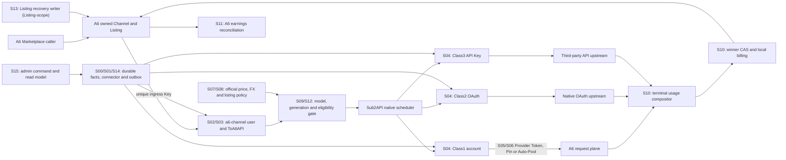

这条链路的核心循环是 `A6 -> Sub2API -> upstream -> Sub2API -> A6`。S05 用 BAN_INIT 建立 BanRelation，并在真正可能改变 owned 集合或 Auto-Pool 候选的事件上运行一次完整 Exclusion Gate；运行期 SelfRoute Monitor 兜底。普通请求和 Seller 改价不运行 gate。

## 2. 控制面写入与事实边界

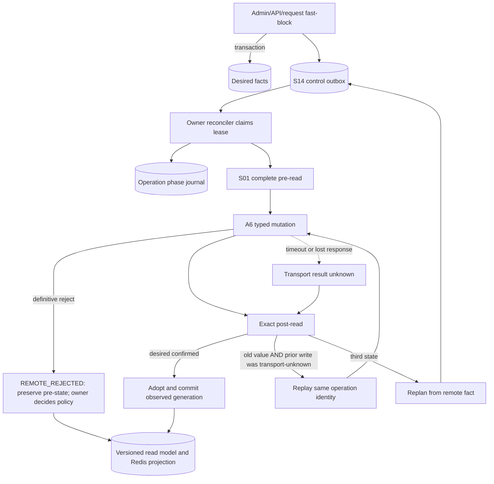

`Observed` 只来自读取，`Desired` 只来自业务/管理员事实，`Plan` 只由 planner 计算；远端 mutation 只有 owning reconciler 可以执行。

## 3. 出口身份与实例图

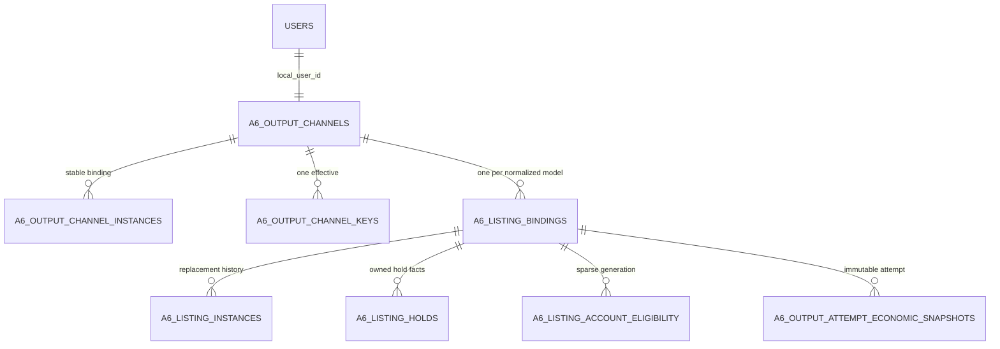

稳定 binding 承载历史外键；远端 Channel/Listing 删除重建只关闭旧 instance 并创建新 instance。一个本地 `a6-channel` 用户始终绑定一个稳定 Channel、一个有效入口 Key 和多个按模型区分的 Listing。

## 4. Provider 激活与 Ban Initialization

```mermaid
sequenceDiagram
    participant P as Provider controller
    participant I as Local controlled inventory
    participant A as A6 marketplace and token APIs
    participant D as Sub2API dispatch

    P->>I: build owned set = complete Supplier inventory union local controlled without delete proof
    P->>I: tombstone only exact remote delete + complete current absence
    P->>D: pause account or keep slot vacant
    alt TOKEN_BAN_INIT (new Provider Token instance)
        P->>I: atomic member-enter + ban_membership_generation++ in one DB transaction
        P->>I: freeze membership_generation_start
        P->>A: complete paginated search(all, seed, disabled, user-disabled, unavailable included)
        P->>A: for each owned routing listing: disable Token × (Channel, Model)
        P->>A: exact item readback per relation
    else LISTING_BAN_INIT (new Listing instance)
        P->>I: atomic member-enter + ban_membership_generation++ in one DB transaction
        P->>I: freeze membership_generation_start
        P->>I: persist init_ck = random_decimal_closed("0.8","1.9") on operation
        P->>A: write init price (S07 vector from init_ck) + exact Supplier readback
        P->>A: temporary resubmit + Supplier readback
        P->>A: immediately disable all Ban-domain Tokens × Listing
        P->>A: exact Ban readback per relation
        P->>A: restore immutable pre-operation Listing/Channel state + exact readback
    end
    P->>P: recheck ban_membership_generation
    alt membership changed
        P->>P: fill only missing Token × Listing BanRelations
    else membership stable
        P->>P: initialization complete
    end
    P->>A: EXCLUSION_GATE fresh readback; drift-only disable; generation fence
    P->>D: hand READY result to S06 route owner
    Note over P,D: S06 writes Pin/Auto-Pool; no second gate table/state machine
    P->>A: read route, cost, model and auto_channels through owning route/cost handlers
    alt all BanRelations READY and route/cost/capability callable
        P->>D: atomically publish current generation
    else incomplete/missing/mismatch
        P->>D: remain unschedulable or VACANT
    end
    Note over P,A: SelfRoute Monitor (runtime): SELF_ROUTE_DETECTED -> pause + scoped repair
    Note over P,A: LISTING_BAN_INIT: No Marketplace-visible polling before Ban; disable/readback is the readiness proof. Propagation failure handled by BAN_INIT same-operation retry/readback.
```

BanRelation 仍是唯一持久化关系。远端仍存在的 retired/hidden/unavailable/replaced 项继续属于 owned set，只有 exact
remote delete 与完整 current Supplier absence 同时确认才进 tombstone。Exclusion Gate 只在 Token onboarding、Channel
create/adopt/restore、Provider schedulable、Auto-Pool `max_ratio` 和 SelfRoute repair 运行；它复用 relation、generation、
operation audit，已禁用时零 mutation。并发成员变化由 `ban_membership_generation` 在提交前阻断。

## 5. 价格、eligibility 与不可变 attempt

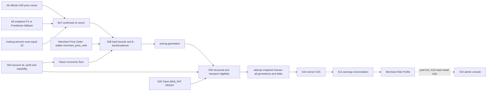

任一派发前 generation 失效都重新选账号；已经派发的 attempt 只按冻结快照结算。新 generation 只能阻止新请求，不能重写历史。

Merchant Price Order 是事前策略事实：只约束 S08 目标价格槽向各商户的分配顺序（`max_ck(M1) <= min_ck(M2) <= ...`），
不改变市场分布目标，也不参与 Delta。Merchant Risk Profile 是 S10/S11 历史结果的事后观测，只流向 S15，
**禁止画 Risk → S08 的反向箭头**；Risk Profile 不会自动改变 Merchant Price Order 或 Delta 分布。

## 6. Usage 合成、账单与收益

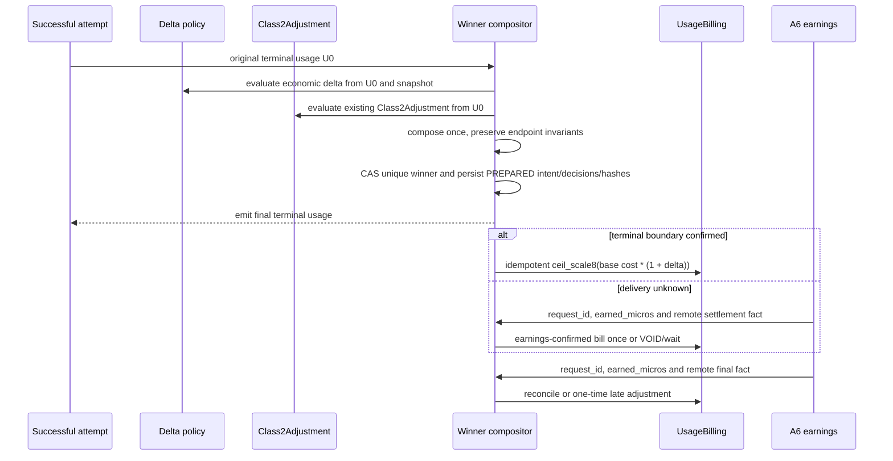

两套策略都读原始 `U0`，但只合成一次；只有经营 delta 改变本地 ActualCost。输入 usage `<1000` 时两者都跳过，`=1000` 生效。

## 7. Listing 状态与恢复

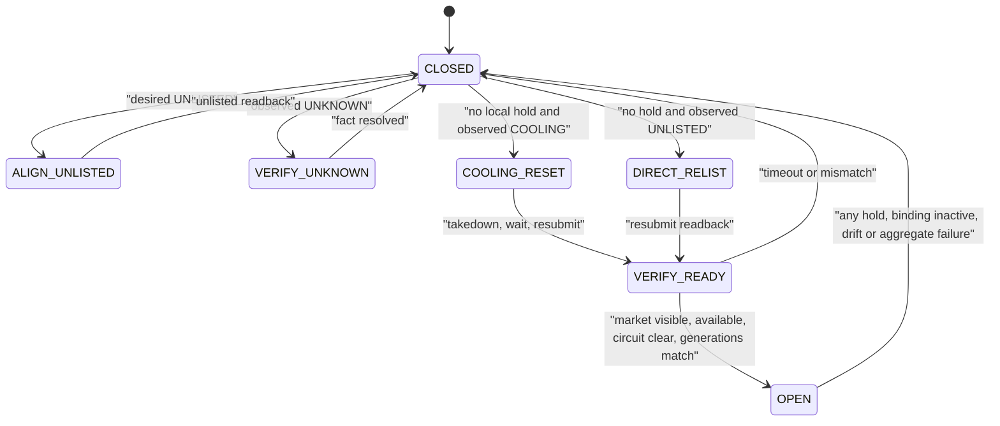

本地图中的动作不是第二套业务状态。规范事实仍是 `holds + desired + observed + plan` 四个正交维度；OPEN/CLOSED 只是请求准入投影。

`maintenance_visibility_override`（`NONE | TEMP_VISIBLE_FOR_BAN_INIT`）只允许 S05 BAN_INIT 使用：它不修改业务
`desired`，临时可见期间 admission 始终 CLOSED，Ban 完成或失败后立即恢复 pre-operation 远端状态。Channel-scope
takedown/restore/maintenance 由 S03 唯一拥有，S13 只拥有 Listing-scope 的 takedown/resubmit/reset。

## 8. 实施依赖图

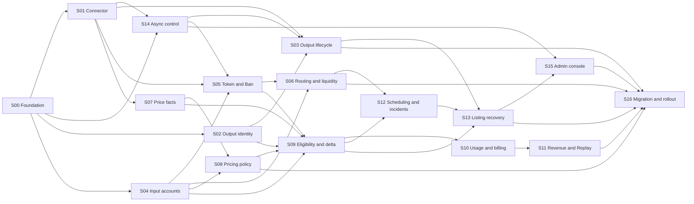

## 9. 图谱阅读结论

- 请求热路径只消费已确认 generation 和 Redis/read-model 投影；所有远端修复异步执行。
- SSE first-byte guard 是 request-local transport helper：一次 500-2000ms deadline、最多一个 no-op prelude；prelude 不构成 upstream commit，candidate failover 仍复用 S09/S12/native scheduler，不形成 durable controller。
- 输出 Channel 与输入 Provider 都和 A6 双向交互，但 Key、Token、状态 owner 和 Saga 完全隔离。
- S05 用 BAN_INIT 建立关系，用事件驱动 Exclusion Gate 核对当前远端排除；无周期扫描、无请求热路径调用、无第二套证明状态机。
- S10/S11 是不可拆散的结算链，但分别拥有“本地唯一 winner”与“远端收益最终事实”。
- S13 只决定和执行 Listing 恢复，不能清除其他控制器拥有的 hold。

返回 [分系统实施总纲](README.md)。
---

## Part 4.2：a6-channel-blueprint/traceability.md（需求追踪表）

<!-- 以下内容为对应源文件的完整当前版本（随合集同步修订） -->

<!-- ===== 源文件：docs/a6-channel-blueprint/traceability.md ===== -->
# 原始 Prompt 需求追踪表

本表证明 [原始实现 Prompt](../sub2api-a6-channel-implementation-prompt.md) 的每个规范章节都有明确工作包，并给出三联稿需求 ID 命名空间。一个章节可以被多个包消费，但只有表中“主 owner”可以定义该状态或远端写入流程。

## 1. 需求命名空间

| 包 | 命名空间 | 主 owner |
| --- | --- | --- |
| S00 | `FND-*` | schema、Decimal、secret、public text selection |
| S01 | `CON-*` | A6 HTTP 合同、分页、readback、transport unknown |
| S02 | `OUT-*` | output identity、group、model binding |
| S03 | `LIF-*` | Channel/Listing instance、ingress Key Saga、retirement |
| S04 | `ACC-*` | Class1/2/3 economic/capability generations |
| S05 | `BAN-*` | Provider Token binding、BanRelation、BAN_INIT 与 SelfRoute Guard |
| S06 | `RTE-*` | Auto-Pool/Pin route、liquidity、replacement |
| S07 | `PRF-*` | official price、FX、markup、confirmed ck facts |
| S08 | `PRC-*` | price bounds、distribution、price write ordering |
| S09 | `ELG-*` | eligibility、delta decision input、attempt snapshot |
| S10 | `BIL-*` | usage compositor、winner、billing intent、stream terminal |
| S11 | `REV-*` | earnings reconciliation、late arrival、Replay settlement |
| S12 | `ERR-*` | request gate、error aggregation、platform incident |
| S13 | `REC-*` | holds、desired/observed/plan、relisting/cooling reset |
| S14 | `ASY-*` | Outbox、lease、journal、polling、rate limits |
| S15 | `ADM-*` | admin read model、RBAC、commands、previews |
| S16 | `MIG-*` | migration、rollout、rollback、production acceptance |

## 2. 源章节覆盖

| 原始章节 | 主 owner | 消费者 | 落地说明 |
| --- | --- | --- | --- |
| 标题、版本、实现依据 | S16 | 全部 | 固定 v0.1.173 与 Class2Adjustment 基线；部署目标为 `ssh us_cloud` |
| §1 实施方式 | S16 | S00, S14 | 评审产物、全栈交付、禁止占位远端写后读/结算/恢复 |
| §2.1 输入/上游 | S04 | S05, S06, S09, S12 | Class1/2/3、route/cost/capability/billing generation |
| §2.2 输出/下游 | S02 | S03, S07-S13 | `a6-channel`、唯一 Key、一 Channel 多 Listing |
| §2.3 连接层 | S09 | S02, S04, S10 | 稳定 binding 解析、attempt 冻结 generation |
| §3 A6 Typed Client | S01 | 所有远端写包 | 鉴权、encryption reference、分页、读回、unknown result、白名单控制台 |
| §4 核心数据模型 | S00 | 全部 | 基础实体和唯一约束；各业务包拥有自身表的状态语义 |
| §4.1 公共文本语料 | S00 | S03, S05, S15, S16 | 语料 provenance、冲突重选、`TEXT_CORPUS_INVALID` |
| §5 输出 Channel 用户 | S02 | S03, S09, S13, S16 | 用户、模型解析、负余额例外、`ToA6API`、binding 生命周期入口 |
| §6.1 输出入口 Key | S03 | S13, S14 | Channel-scope ingress Key rotation：Channel takedown → PATCH api_key → restore；唯一有效 Key、清理 dead letter |
| §6.2 Provider 路由 Token | S05 | S06, S14 | 新旧 Token Saga、切换、删除 readback、orphan cleanup |
| §7.1 Class1 | S04 | S05, S06 | Auto-Pool/Pin `sk`、Top-N 统计与 cost generation |
| §7.2 Class2 | S04 | S09, S10 | weekly quota Decimal、100% 不暂停、缺失保留历史 |
| §7.3 Class3 | S04 | S09, S12 | declared sk、模型覆盖、账单偏差窗口、恢复 gate |
| §8 Auto-Pool 与 Ban | S05 | S03, S06, S14, S16 | authoritative owned set、remote-delete-only tombstones、Token/Listing BAN_INIT、事件驱动 Exclusion Gate、SelfRoute repair |
| §9 ck、官方价格与 FX | S07 | S08-S11 | micros 向上量化、markup、事实源和 FX fallback |
| §10 定价范围与分布 | S08 | S09, S13 | hard bounds、Class1 floor、8 桶、Merchant Price Order、稳定匹配、改价先后 |
| §11 eligibility 公式 | S09 | S10, S12, S13 | delta override、transport profile、sparse projection |
| §11.1 经营 delta | S10 | S09, S11, S12 | winner、solver、ActualCost、usage 边界、synthetic SSE prelude 与 upstream stream commit 分界 |
| §11.2 Class2Adjustment | S10 | S16 | 保持现有算法/API/rules/shadow/apply/berserk/probe 兼容 |
| §11.3 合成与核对 | S10 | S11 | 两决策同读 U0、一次合成、比例对账与偏差作用域 |
| §12 调度与错误 | S12 | S04, S06, S09, S10, S13 | 同门、三出口、attempt 与聚合终态分层；SSE 500-2000ms 单次 prelude 与 pre-commit candidate failover |
| §12.1 平台 Incident | S12 | S13, S14 | fingerprint、提升阈值、scope member、canary 编排 |
| §13 Listing 状态与恢复 | S13 | S03, S09, S12, S14 | hold owner、四维状态、Listing-scope 唯一写者、maintenance visibility、resubmit/cooling 合同 |
| §14 事件与 Reconciler | S14 | 全部 | Outbox、锁序、lease、频率、429、去重、dead letter |
| §15 管理端 | S15 | 全部 | 部门边界、read model、参数编辑、Merchant Price Order 管理、Risk Profile 展示、语料选择（含 LEGACY_REMOTE 只读）、重放 |
| §16 迁移 | S16 | S02-S15 | Seller 聚合/拆分、组 canonicalize、账本、flag、rollback |
| §17 验收 | S16 | 每个 `tests.md` | 单包验收在本包，端到端与生产证据由 S16 汇总 |

## 3. `AGENTS.md` 硬规则覆盖

| 硬规则 | 主 owner | 必须出现的证据 |
| --- | --- | --- |
| Provider shadow 默认禁用、只在无可复用 generation 时单次运行 | S06, S16 | timer disabled readback；若例外，记录具体 generation 理由 |
| 公共文本全部来自仓库语料 | S00 | SHA-256、sheet/row 或 index、selected value、selection generation |
| Provider owned-Channel self-route exclusion | S05 | Supplier union local owned set、固定参数完整 Marketplace 分页、逐关系 exact disabled readback、drift-only disable、effective subscription 无 owned、membership fence；无第二 attestation 表 |
| `insufficient_quota` 进入 liquidity，不走 Observer 扩池 | S06 | account pause、UNFUNDED、whole-unit transfer/replacement journal |
| liquidity/callback Token 独立且只 Pin 合格小商户 Channel | S06 | 独立 duty/binding、目标 listed+callable readback |
| 生产 callback 使用唯一固定 PING 且拒绝 probe-shaped usage | S06 | exact input hash、realistic usage 与 high-cache witness |
| 非 quota Provider 失败扩到下一 CNY 价格带且不超过 0.3 | S06 | fresh Observer、strict expansion、matching USD cost generation、Seller trigger |

> `AGENTS.md` 根文件本身不在本合集内；本行记录其 owned self-route 原则的现行版本，供实现 Agent 对照根文件核对：
>
> `BanRelation = provider_token_instance × owned_listing_instance` remains the only durable Ban business state.
> The owned set includes every remotely present active/down/unavailable/retired/hidden item and every locally
> controlled item without exact remote-delete proof. Run one complete gate on Token onboarding, owned Channel
> create/adopt/restore, Provider schedulable activation, every Auto-Pool max_ratio update, and SelfRoute repair.
> Already-disabled relations require fresh readback but zero mutation. Ordinary Seller price/request/cooling and
> Listing-scope resubmit do not run the gate. `ban_membership_generation` fences concurrent set changes.
> New Listing BAN_INIT uses persisted Decimal `init_ck` randomly selected in `[0.8, 1.9]`
> against current confirmed official-price generation.
> BAN_INIT does not wait for Marketplace visibility before disable;
> disable/readback itself is the readiness proof.

## 4. 跨包状态所有权

| 状态/事实 | 唯一 owner | 其他包允许的动作 |
| --- | --- | --- |
| secret generation | S00 | 只按 reference 读取授权后的 secret |
| remote observed fact/completeness | S01 | 消费带时间和 generation 的读回，不自行猜测 |
| output binding/current instance | S02/S03 | 使用稳定 ID；不得覆盖历史 instance |
| account economic/capability generation | S04 | S09 只消费 current confirmed generation |
| BanRelation / BAN_INIT / Exclusion Gate | S05 | S03/S06/S16 只触发并消费 READY/阻断；S08/S09/账单不感知 gate，不复制内部证据或状态 |
| Ban membership generation（ban_membership_generation） | S05 | S03/S13/S16 只消费或触发成员事件，不得自行递增/修改 generation |
| Merchant Price Order / merchant_price_order_generation | S08 | S15 只提交显式管理命令与读取 read model；Risk Profile 不得作为输入 |
| route generation/UNFUNDED | S06 | scheduler 只消费 schedulable projection |
| confirmed price/FX generation | S07 | S08-S11 不写第二套价格事实 |
| desired price generation | S08 | S13 只按当前 generation 协调上下架 |
| eligibility/delta snapshot | S09 | scheduler/计费不可临时重算历史 attempt |
| winner/billing intent | S10 | S11 只推进同一 intent 的对账状态 |
| reconciliation/late adjustment | S11 | S10 不重复扣费 |
| error aggregate/incident | S12 | S13 只消费 membership/witness，不改 classification |
| holds/desired/observed/plan | S13 各字段指定 owner | 管理端发命令，不直接篡改 observed |
| operation/lease/retry/dead letter | S14 | 业务包提供 handler，不另建任务系统 |

## 5. 审查方法

1. 从源章节选择一行，进入主 owner 的 `logic.md` 并找到对应需求 ID。
2. 在同目录 `pseudocode.md` 找到实现该 ID 的符号和事务/失败分支。
3. 在 `tests.md` 找到至少一个正常路径和一个适用的失败/重放路径。
4. 跨包要求再检查本表的唯一 owner，拒绝重复状态和双写。
5. 发布前由 S16 汇总所有需求 ID、测试 ID、迁移、远端 readback 与回滚证据。

## 6. 原始实现依据路径映射

原 Prompt 记录的是设计时 Mac 工作区路径；它们用于来源审计，不得在 `us_cloud` 上当作真实部署路径。S16 必须只读发现远端源码与 release 根。

| 原始路径 | 当前权威位置/处理 |
| --- | --- |
| `/Users/haven/Documents/code/codex-pool/sub2api-update-20260811-v0173` | `us_cloud` 上由 S16 preflight 发现并核对 v0.1.173/commit，不猜路径 |
| `/Users/haven/Documents/code/a6api-auto/archive/legacy-trader` | [冻结归档](../../archive/legacy-trader/) |
| `/Users/haven/Documents/code/a6api-auto/docs/a6-api-reference.md` | [活跃 A6 API Reference](../a6-api-reference.md) |
| `/Users/haven/Documents/code/a6api-auto/api-docs/7-24-15-54.md` | [A6 抓包](../../api-docs/7-24-15-54.md) |
| `/Users/haven/Documents/code/a6api-auto/api-docs/api-supplier-profile.md` | [Supplier Profile 抓包](../../api-docs/api-supplier-profile.md) |
| `/Users/haven/Documents/code/a6api-auto/api-docs/api-status.md` | [A6 Status 抓包](../../api-docs/api-status.md) |
| `/Users/haven/Documents/code/a6api-auto/errorlist.md` | [错误分类合同](../../errorlist.md) |
| `/Users/haven/Documents/code/a6api-auto/AGENTS.md` | [生产与安全硬约束](../../AGENTS.md) |

返回 [分系统实施总纲](README.md)。
---

## Part 4.3：a6-channel-blueprint/subsystems/00-foundation/（S00 基础数据、安全与公共文本）

> 本工作包三份稿的树关系：`logic.md`（规范事实）-> `pseudocode.md`（实现，标注需求 ID）-> `tests.md`（每个测试回链需求 ID）。
> 需求 ID 命名空间见 traceability.md 第 1 节。

### 00-foundation/logic.md（自然语言蓝图）

<!-- 以下内容为对应源文件的完整当前版本（随合集同步修订） -->

<!-- ===== 源文件：docs/a6-channel-blueprint/subsystems/00-foundation/logic.md ===== -->
# S00 基础数据、安全与公共文本：自然语言蓝图

[总纲](../../README.md) | [伪代码](pseudocode.md) | [测试](tests.md) | [需求追踪](../../traceability.md)

## 1. 目标与边界

S00 提供所有工作包共同依赖的持久化、数值和安全不变量。它拥有基础表结构、稳定 ID/instance 模式、Decimal 规则、凭据 secret generation、脱敏和公共文本选择；不拥有 A6 HTTP、业务状态机、调度、价格策略或远端写入。

## 2. 需求

| ID | 规范 |
| --- | --- |
| FND-001 | 本地稳定 binding 与远端 instance 分离。远端重建只关闭旧 instance、创建新 instance，不改历史外键。 |
| FND-002 | 建立原 Prompt §4 的全部实体；业务包可追加字段，但不得删除规定的唯一约束、generation、审计或历史关系。 |
| FND-003 | 金额、倍率、价格、quota、sk、profit、delta 和经济比较只使用数据库 `NUMERIC` 与应用 Decimal；量化方向和 scale 必须显式。 |
| FND-004 | `a6_credentials.a6_user_id` 对 active control owner 唯一；system token 使用 envelope encryption，轮换写同一 credential 的新 secret generation。 |
| FND-005 | 业务表只保存 secret reference、fingerprint、last4；Token、Key、Cookie、Session、Authorization 在日志、trace、错误和审计摘要中脱敏。 |
| FND-006 | Supplier、Channel、Listing 与 Token/Key 的公共显示文本只能从仓库语料选择，并保存 catalog SHA-256、sheet、row/index、原值和 selection generation。 |
| FND-007 | 同一 selection 的重试复用原值；远端唯一性冲突必须选择另一未使用语料项，不得拼接、截改或新写文案。 |
| FND-008 | 语料不可读、无效、耗尽或冲突时产生 `TEXT_CORPUS_INVALID`：输出资源投影 Listing hold，输入 Token 对应账号保持不可调度。`TEXT_CORPUS_INVALID` 只针对系统当前准备执行一次新公共文本远端写入却拿不到合法语料选择的情况；既有 Supplier 远端不可修改的历史 name 保存为 `LEGACY_REMOTE` public-text fact：只审计、不产生 `TEXT_CORPUS_INVALID`、不阻止 ACTIVE，也永远不作为未来新写入来源。 |
| FND-009 | Channel `nickname` 只能是所选 `channel_name` 的平台长度投影；Listing `display_name` 固定为空；duty 只存控制面元数据。 |
| FND-010 | Key material 规范化为且仅为一个 `sk-` 前缀，完整材料只在最小授权作用域短暂解密。 |
| FND-011 | 每个 attempt/operation 引用不可变 source generation；current 指针可以前移，历史 generation 不更新。任何由 operation/command/确定性 source observation 驱动的 immutable generation 写入必须携带稳定 `change_identity`（不得含 retry/time），在 `(owner,resource,kind,change_identity)` 唯一：若 commit 后 worker 在 phase/journal 确认前 crash，重放只能校验 payload hash 后 adopt 已存在 generation；若 current 已被更晚 generation 前移则返回 SUPERSEDED，绝不得再插一条或把 current 指针倒回。 |
| FND-012 | migration 必须可重复检测、先加后切，约束失败时给出具体冲突记录而不是静默修正生产数据。 |
| FND-013 | 建立 `a6_merchant_price_orders` 与 `provider_listing_ban_relations` 基础实体：前者以稳定商户身份 `a6_credential_id` 绑定 `merchant_price_rank` 与 `merchant_price_order_generation`，active rank 全站唯一、每个 active merchant 至多一个 current rank；后者唯一键 `(provider_token_instance_id, listing_instance_id)`，state 为 `PENDING | READY | FAILED`（`FAILED` 表示当前 operation 失败且待人工/重试，不是永久“不 Ban”的证明）。Merchant Risk Profile 第一版只做派生 read model，不建正式业务表。 |
| FND-014 | 每个 A6 credential 保存一个单调递增 `ban_membership_generation BIGINT`（初始 0、恒 >= 0）。仅 S05 在 Ban 成员集合实际变化时 +1；本地 retire/takedown/hidden/unavailable/replacement 不是退出，只有精确远端删除且完整 current Supplier inventory 证明不存在才退出。**membership row 变更、generation +1 与对应 audit 必须使用同一数据库事务提交/回滚**。price/route/max_ratio/Pin/上下架/cooling 与 EXCLUSION_GATE readback 不修改该 generation。 |

## 3. 核心实体分组

| 分组 | 实体 |
| --- | --- |
| 凭据与身份 | `a6_credentials`, `a6_public_text_selections` |
| 输出绑定 | `a6_output_channels`, `a6_output_channel_instances`, `a6_output_channel_keys`, `a6_listing_bindings`, `a6_listing_instances` |
| 商户事实 | `a6_merchant_price_orders`（rank/generation，只由管理员显式调整；Risk Profile 为派生 read model） |
| 输入经济事实 | `provider_route_token_bindings`, `provider_listing_ban_relations`（BanRelation：Token instance × Listing instance）, `account_cost_generations`, `account_economic_profiles`, `account_capability_generations` |
| 价格与资格 | `a6_model_price_generations`, `a6_listing_pricing_generations`, `a6_listing_account_delta_overrides`, `a6_listing_account_eligibility` |
| attempt 与结算 | `a6_output_attempt_economic_snapshots`, `a6_output_winner_billing_intents`, `a6_output_revenue_reconciliations` |
| 控制与恢复 | `a6_listing_holds`, `a6_output_recovery_operations`, `a6_provider_route_operations`, `a6_platform_incidents`, `a6_control_outbox` |

业务包负责给这些表定义完整字段和枚举；S00 负责公共主键、外键、current-generation 约束、创建/更新时间、审计主体和不可变历史策略。

## 4. 强制唯一约束

- active `a6_credentials.a6_user_id` 唯一。
- `a6_output_channels.local_user_id` 唯一；current `a6_channel_id` 全站唯一。
- 一个 output Channel 任一时刻最多一个 effective ingress key。
- `(output_channel_id, normalized_model)` 唯一；current `a6_listing_id` 全站唯一。
- Provider account 和 current remote Token ID 分别一对一唯一。
- `provider_listing_ban_relations.(provider_token_instance_id, listing_instance_id)` 唯一，state ∈ `PENDING|READY|FAILED`。
- `a6_credentials.ban_membership_generation >= 0`，仅 S05 可 CAS 递增。
- `a6_merchant_price_orders` active rank 全站唯一；每个 active merchant 至多一个 current rank。
- `(listing_binding_id, account_id, normalized_model)` 的 delta override 唯一。
- `economic_snapshot.attempt_id` 唯一；`billing_intent.economic_snapshot_id` 唯一。
- reconciliation 的 `(a6_credential_id, request_id)` 唯一。
- 每个远端资源任一时刻最多一个 current-generation 写 operation。

## 5. 公共文本选择子图

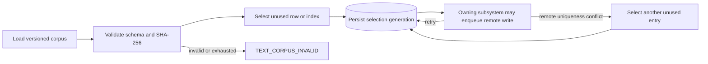

Supplier 的 name/description 来自“商户资料”同一行；Channel 与 Listing 精确使用“渠道资料”同一行的 `channel_name/channel_description/model_description`；Token/Key name 来自 JSON corpus。旧值迁移只保留为审计原文，不能作为新写入来源。

精确语料路径为 `resources/corpora/merchant_templates_split.xlsx` 与 `resources/corpora/token_name_corpus.json`。不得读取归档副本作为 active catalog；工作簿 sheet 固定为“商户资料”和“渠道资料”。

当前 A6 Profile 合同只证明 `contact_info + description` 可写，不存在 Supplier rename 合同。既有 Supplier 的
不可修改历史 name 保存为 `LEGACY_REMOTE` public-text fact：`source=LEGACY_REMOTE`、`writeable=false`、
`corpus_compliant=false`、`activation_blocking=false`。它只审计，不作为未来新写入来源，也不阻塞 ACTIVE；
S00 不允许用 description、Channel PATCH 或本地覆盖伪造改名。`TEXT_CORPUS_INVALID` 仅当系统准备执行一次新的
公共文本远端写入而拿不到合法语料选择时才产生。

## 6. Decimal 与量化合同

应用层 Decimal 必须从十进制字符串、整数 micros 或数据库 numeric 构造，禁止先经二进制浮点。每个算法声明 rounding mode，例如 Listing micros 和 delta ActualCost 使用向上量化。展示层可以生成 float 兼容副本，但不能回流到判定或写入。

## 7. 凭据生命周期

1. credential 记录稳定 `a6_user_id` 和 active secret generation reference。
2. 加密服务生成 data key，用 key-encryption-key 包装；密文、nonce、算法版本和 key ID 持久化。
3. 解密只返回作用域受限的内存值；不得进入结构化日志或 panic dump。
4. 轮换先保存新 generation，验证精确用户绑定，再原子前移 active pointer；旧 generation 按保留策略禁用而不覆盖。
5. fingerprint/last4 只用于匹配和审计，不能用于重建 secret。

## 8. 交付接口

S00 向其他包提供：Decimal/quantize helper、secret store、redactor、corpus catalog/selection service、稳定 binding/instance repository primitives、generation/current-pointer primitives。调用方必须传业务 owner、source generation 和审计主体。

## 9. 完成条件

- schema 和约束 migration 在空库、历史样本库、重复执行场景均通过。
- corpus 两种文件均校验真实 SHA-256 与字段，不产生任何合成公共文本。
- 日志安全测试证明完整 secret 不出现在所有输出通道。
- 经济 helper 对边界值和超大 Decimal 无 float 漂移。

上位依据：[原 Prompt §4/§4.1](../../../sub2api-a6-channel-implementation-prompt.md#4-核心数据模型) 与 [根 AGENTS](../../../../AGENTS.md)。
---

### 00-foundation/pseudocode.md（实现伪代码）

<!-- 以下内容为对应源文件的完整当前版本（随合集同步修订） -->

<!-- ===== 源文件：docs/a6-channel-blueprint/subsystems/00-foundation/pseudocode.md ===== -->
# S00 基础数据、安全与公共文本：实现伪代码

[自然语言](logic.md) | [测试](tests.md) | [总纲](../../README.md)

## 1. 数值原语

```text
type Money = Decimal
type Ratio = Decimal
type Micros = int64_or_bigint

decimal_from_wire(value):                         # FND-003
    require value is decimal string, integer, or DB numeric
    reject binary float for economic input
    return Decimal(value)

ceil_scale(value, scale):                         # FND-003
    return value.quantize(10^-scale, ROUND_CEILING)

micros_ceil(value):                                      # FND-003
    return integer(value.quantize(1, ROUND_CEILING))

normalize_sk(raw):                                # FND-010
    material = trim(raw)
    while material starts_with "sk-": material = material[3:]
    require material != ""
    return "sk-" + material
```

所有业务函数签名使用 `Money/Ratio/Micros`，展示转换必须命名为 `to_display_float` 并位于序列化边界。

## 2. Binding/instance 原语

```text
create_stable_binding(owner_id, normalized_model?):       # FND-001, FND-011
    begin transaction
    insert stable binding with immutable id
    insert generation 1 desired facts
    commit

replace_remote_instance_in_tx(tx, binding_id, remote_id, readback): # FND-001,FND-011
    require tx active; lock binding
    require readback proves owner/model for remote_id
    current = current instance if any
    if current exists and current.remote_id == remote_id and current.readback identity matches:
        return {changed:false, old:current, current:current}     # replay/adopt is idempotent
    if current exists: close current instance at now
    next_generation = 1 if current absent else current.generation + 1
    insert new instance(remote_id, generation=next_generation, readback_hash)
    CAS current_instance_id from expected current/null to new instance
    return {changed:true, old:current, current:new instance}

replace_remote_instance(binding_id, remote_id, readback, followup_command): # FND-001,FND-011
    begin transaction
    result = replace_remote_instance_in_tx(tx, binding_id, remote_id, readback)
    if followup_command and (result.changed or required follow-up Outbox absent):
        insert deduped follow-up Outbox in SAME tx
    commit
    publish optional wake-up notification after commit
    return result.current

advance_current_generation(resource, expected, next):     # FND-011
    require next > expected
    update current pointer where generation = expected
    require affected_rows == 1
    never update rows belonging to expected generation

resolve_generation_change_replay(repository, owner, resource, kind, change_identity, payload_hash): # FND-011
    existing = repository.find_unique(owner, resource, kind, change_identity)
    if absent: return NOT_COMMITTED
    require existing.payload_hash == payload_hash
    current = repository.current(resource, kind)
    if current.id == existing.id: return ADOPT_EXISTING(existing)
    if current.generation > existing.generation: return SUPERSEDED(existing, current)
    otherwise fail invariant                                  # never move current backward
```

## 3. Ban membership generation

```text
advance_ban_membership_generation_in_tx(tx, credential, reason): # FND-014
    require caller == S05
    require tx is active and owns credential lock
    require reason in {
        PROVIDER_TOKEN_INSTANCE_ADDED,
        PROVIDER_TOKEN_INSTANCE_REMOVED,
        OWNED_ROUTING_LISTING_ADDED,
        OWNED_ROUTING_LISTING_REMOTE_DELETE_CONFIRMED
    }
    update a6_credentials
        set ban_membership_generation = ban_membership_generation + 1
        where id = credential and ban_membership_generation >= 0
    require affected_rows == 1
    append immutable audit in the SAME tx(credential, reason, new_generation, actor=tx.audit_actor)
    return new_generation              # caller commits membership + bump + audit together

# 明确禁止以下 reason 调用 advance_ban_membership_generation:
# PRICE_CHANGED / ROUTE_CHANGED / MAX_RATIO_CHANGED / PIN_CHANGED
# LISTING_LISTED / LISTING_UNLISTED / COOLING_CHANGED / LOCAL_RETIREMENT
# EXCLUSION_GATE readback 也不改变 membership generation。

read_ban_membership_generation(credential):                # FND-014
    return credential.ban_membership_generation (read-only)
```

## 4. Secret generation

```text
store_secret(credential_id, plaintext, actor):             # FND-004, FND-005
    require actor has credential_write scope
    data_key = CSPRNG()
    ciphertext, nonce = AEAD_ENCRYPT(data_key, plaintext, aad=credential_id)
    wrapped_key = KMS_WRAP(data_key, configured_kek_id)
    fingerprint = HMAC_SHA256(fingerprint_key, plaintext)
    last4 = last_four(plaintext)
    zeroize(data_key, plaintext_buffer)
    insert immutable secret_generation(ciphertext, nonce, wrapped_key,
        algorithm_version, fingerprint, last4, actor)
    return secret_generation_id

activate_secret(credential_id, expected_generation, new_generation): # FND-004,FND-005
    begin transaction
    lock credential
    require remote_identity_check(new_generation) == credential.a6_user_id
    CAS active_secret_generation from expected to new
    commit

with_secret(reference, scope):                              # FND-005
    authorize(scope)
    plaintext = decrypt(reference)
    try: yield SecretValue(plaintext, non_serializable=true) as scoped context value
    finally: zeroize(plaintext)
```

## 5. Redaction

```text
redact(event):                                             # FND-005
    for header in [Authorization, Cookie, Set-Cookie, X-API-Key]: replace value
    recursively replace values for token/key/session/password/secret fields
    replace known active secret substrings before sink write
    preserve fingerprint, last4, operation_id, request_id
    return event

install_redaction_at_all_sinks():                       # FND-005
    configure application logger, HTTP trace, audit summary, error serializer,
              metrics labels and panic reporter to call redact
```

## 6. Corpus validation and selection

```text
ACTIVE_WORKBOOK = "resources/corpora/merchant_templates_split.xlsx"
ACTIVE_TOKEN_NAMES = "resources/corpora/token_name_corpus.json"

load_corpus_catalog(path, kind):                            # FND-006
    require path in [ACTIVE_WORKBOOK, ACTIVE_TOKEN_NAMES]
    reject archive corpus paths for active selection
    bytes = read_exact(path)
    sha = SHA256(bytes)
    if kind == MERCHANT_OR_CHANNEL:
        workbook = parse_xlsx(bytes)
        require sheets include 商户资料 and 渠道资料
        validate required columns and non-empty normalized values
    else if kind == TOKEN_NAME:
        values = parse_json_array(bytes)
        validate each is non-empty string and platform-valid
    reject duplicate semantic values that make provenance ambiguous
    return Catalog(sha, parsed_rows)

select_public_text(resource, kind, selection_generation, mode, requested_ref?, followup_command?): # FND-006..009
    begin transaction
    lock resource and catalog allocation scope
    existing = find selection(resource, kind, selection_generation)
    if existing:
        if followup_command and required follow-up Outbox absent: insert deduped follow-up Outbox in SAME tx
        commit; return existing                               # retry reuse + lost-notification repair
    catalog = load current versioned catalog
    candidates = valid unallocated entries for remote uniqueness scope
    if candidates empty:
        set TEXT_CORPUS_INVALID owner fact
        insert corresponding owner/reprojection Outbox in SAME tx
        commit; return BLOCKED
    if requested_ref: require requested_ref in candidates; chosen = requested_ref
    else: chosen = cryptographic_random(candidates)
    projected = project_platform_length(chosen.channel_name) only if nickname
    listing_display_name = ""
    insert selection(catalog_sha, sheet, row_or_index, exact values,
                     selection_generation, resource, chosen)
    if followup_command: insert deduped owning-resource reconcile Outbox in SAME tx
    commit
    return chosen

handle_remote_name_conflict(selection_id, followup_command): # FND-007
    begin transaction
    lock selection/resource allocation scope
    mark selection conflict with exact remote evidence
    replacement = idempotently allocate next unused corpus entry under one new selection generation
    never mutate selected text or append suffix
    insert/verify deduped owning-resource follow-up Outbox(replacement generation, followup_command) in SAME tx
    commit; return replacement
```

## 7. Migration skeleton

```text
migrate_foundation():                                      # FND-002, FND-012
    preflight report duplicate active credentials, bindings, instances,
                     tokens, listings, snapshots and reconciliations
    if conflicts: abort with deterministic conflict table
    create enum/check domains and tables
    add foreign keys NOT VALID where online migration requires
    backfill stable IDs and generations without rewriting history
    validate constraints
    add partial unique indexes for active/current rows
    record schema version and source prompt version
```

## 8. 调用方合同

```text
before_any_remote_public_text_write(resource):              # FND-006..009
    selection = require_current_valid_selection(resource)
    if missing/invalid and this write requires new remote public text:
        project TEXT_CORPUS_INVALID and reject command
    if resource field is an existing Supplier immutable remote value:
        persist/retain LEGACY_REMOTE audit fact (source=LEGACY_REMOTE,
        writeable=false, activation_blocking=false)
        do not require rename/replacement; do not use it as write source
    return immutable selection
```

## 需求覆盖索引

本稿实现：`FND-001`, `FND-002`, `FND-003`, `FND-004`, `FND-005`, `FND-006`, `FND-007`, `FND-008`, `FND-009`, `FND-010`, `FND-011`, `FND-012`, `FND-013`, `FND-014`。
---

### 00-foundation/tests.md（测试规格）

<!-- 以下内容为对应源文件的完整当前版本（随合集同步修订） -->

<!-- ===== 源文件：docs/a6-channel-blueprint/subsystems/00-foundation/tests.md ===== -->
# S00 基础数据、安全与公共文本：测试规格

[自然语言](logic.md) | [伪代码](pseudocode.md) | [总纲](../../README.md)

## 1. 测试层级

- 单元：Decimal、前缀、redactor、corpus parser 和平台长度投影。
- 数据库：约束、current pointer CAS、稳定 binding/instance、migration 重入。
- 安全：secret envelope、授权、内存/输出通道泄漏扫描。
- 集成：语料选择到业务写命令硬门，不执行真实 A6 mutation。

## 2. 核心用例

| Test ID | 需求 | 被测符号 | Given / When / Then |
| --- | --- | --- | --- |
| FND-T001 | FND-003 | `decimal_from_wire` | 给定 `0.1` 字符串可精确参与比较；给定 binary float 经济输入则拒绝。 |
| FND-T002 | FND-003 | `ceil_scale`, `micros_ceil` | 覆盖正数、零、边界和高精度尾数，结果始终按指定 scale 向上。 |
| FND-T003 | FND-010 | `normalize_sk` | 无前缀、一个或多个前缀最终都得到且仅得到一个 `sk-`；空材料拒绝。 |
| FND-T004 | FND-001 | `replace_remote_instance` | 首次 adopt 在无 current instance 时创建 generation 1；replacement 关闭旧 instance、创建新 generation；同 remote ID/readback 重放 no-op，不额外前移 generation；历史 attempt 外键仍指向旧稳定 binding。 |
| FND-T005 | FND-002 | migration constraints | 并发创建第二 active credential/current remote ID/effective Key 被数据库拒绝。 |
| FND-T006 | FND-011 | generation CAS/replay | 两个并发 writer 只有一个 CAS 成功，旧 generation 内容不变；operation-driven generation 在 row+current commit 后、phase journal 确认前 crash，same `change_identity` replay 必须 ADOPT 同一 row；更晚 current 已存在时返回 SUPERSEDED、绝不回退。 |
| FND-T007 | FND-004 | `store_secret` | 数据库无明文，解密可还原，AAD 换 credential 后认证失败。 |
| FND-T008 | FND-005 | `redact` | header、嵌套 JSON、error、trace、panic fixture 中完整 secret 全部消失，last4/fingerprint 保留。 |
| FND-T009 | FND-006 | `load_corpus_catalog` | 精确 active 路径的 xlsx 两个 sheet 和 JSON corpus 可读，SHA-256 与保存值一致；归档副本拒绝。 |
| FND-T010 | FND-006,FND-009 | `select_public_text` | Supplier/Channel 各取同一行规定字段；nickname 只截取 name；Listing display_name 为空。 |
| FND-T011 | FND-007 | `select_public_text` | 相同 selection generation 重试得到同一行/索引，不再次随机。 |
| FND-T012 | FND-007 | `handle_remote_name_conflict` | 唯一性冲突选择另一未用项，文本无 ID、模型、hash、计数或后缀；replacement selection 与 owning follow-up Outbox 同事务，commit 后 crash/replay 仍只得到同一 replacement generation 并继续 reconcile。 |
| FND-T013 | FND-008 | `load/select` | 文件损坏、字段缺失、耗尽分别设置 `TEXT_CORPUS_INVALID` 并拒绝远端命令。 |
| FND-T014 | FND-008 | corpus gate integration | 输出失败投影 Listing hold；输入 Token 失败使账号不可调度，二者不串 owner。 |
| FND-T015 | FND-012 | `migrate_foundation` | 空库、已有合法数据、重复运行均成功；冲突数据输出稳定清单并零静默修复。 |
| FND-T016 | FND-008 | legacy Supplier gate | 既有 Supplier 历史 name 不在语料：保存为 `LEGACY_REMOTE`、允许 ACTIVE、不产生 `TEXT_CORPUS_INVALID`，且不能被当作未来新写入来源。 |
| FND-T017 | FND-013 | schema/price order | `a6_merchant_price_orders` active rank 唯一、每商户至多一个 current rank；BanRelation 唯一键 `(token_instance, listing_instance)` 且 state ∈ PENDING/READY/FAILED；Risk Profile 只作为派生 read model 存在。 |
| FND-T018 | FND-014 | membership increment | Token/Listing enter 与“远端删除精确确认 + 完整 current Supplier absence”退出的 membership DML、`ban_membership_generation` +1、audit 同事务；各 commit-boundary crash 整体 rollback，commit 后 replay 不重复 +1；本地 retire/takedown/replacement 退出被拒绝。 |
| FND-T019 | FND-014 | membership stability regression | 连续 100 次 price/route/list/unlist/cooling/max_ratio/EXCLUSION_GATE readback → `ban_membership_generation` 不变；只有真实 member enter/confirmed remote-delete exit 可递增。 |

## 3. 属性与故障测试

- 随机生成 10,000 组 Decimal 运算，与任意精度参考实现比较，断言无 float 路径。
- 对 corpus 行做顺序扰动、重复值、Unicode/空白和平台长度边界，断言 provenance 可唯一复现。
- 在 secret activate 前后注入进程终止，断言 active pointer 只指向验证完成的 generation。
- 并发 50 个 selection 请求，断言相同唯一作用域无重复分配。

## 4. 验收证据

测试报告必须包含 migration schema hash、corpus SHA-256、约束名称、泄漏扫描 sink 列表和 property-test seed。不得把实际完整 secret 写入报告。

## 需求覆盖索引

本测试集覆盖：`FND-001`, `FND-002`, `FND-003`, `FND-004`, `FND-005`, `FND-006`, `FND-007`, `FND-008`, `FND-009`, `FND-010`, `FND-011`, `FND-012`, `FND-013`, `FND-014`。
---

## Part 4.4：a6-channel-blueprint/subsystems/01-a6-connector/（S01 A6 Typed Connector）

> 本工作包三份稿的树关系：`logic.md`（规范事实）-> `pseudocode.md`（实现，标注需求 ID）-> `tests.md`（每个测试回链需求 ID）。
> 需求 ID 命名空间见 traceability.md 第 1 节。

### 01-a6-connector/logic.md（自然语言蓝图）

<!-- 以下内容为对应源文件的完整当前版本（随合集同步修订） -->

<!-- ===== 源文件：docs/a6-channel-blueprint/subsystems/01-a6-connector/logic.md ===== -->
# S01 A6 Typed Connector：自然语言蓝图

[总纲](../../README.md) | [伪代码](pseudocode.md) | [测试](tests.md) | [A6 API Reference](../../../a6-api-reference.md)

## 1. 目标与边界

S01 是所有 A6 控制面与请求面协议的唯一 typed transport 层。它负责认证、类型、分页完整性、重试语义、写前/写后读取、结果不明分类、未知扩展字段和脱敏；它不决定 Provider 路由、Listing desired、价格、hold 或补偿业务策略。

## 2. 需求

| ID | 规范 |
| --- | --- |
| CON-001 | 日常控制面统一使用精确 `(a6_user_id, system_access_token)`；一套 credential 可服务多个输入和输出资源。 |
| CON-002 | Typed Client 覆盖活跃 A6 API Reference 的全部确认接口，包括 Token 删除、平台模型、市场、Supplier/Profile、Channel/Listing、Pin/Auto-Pool、circuit、earnings、settlement、withdraw、balance transfer 与读回。 |
| CON-003 | 请求/响应模型强类型化业务字段，Decimal 不经 float；保留未知扩展字段和原始响应 hash。 |
| CON-004 | 集合读取追完全部分页并返回 completeness、页游标、项数、source timestamp/hash；不完整快照的缺失不证明不存在。 |
| CON-005 | 每个 mutation 接受 operation identity、actor、department、source generation、摘要和 readback contract；保存写前读、写响应和写后读。 |
| CON-006 | **仅 transport 结果不明**时按同一 credential GET：目标已生效则 adopt，仍是旧值则 replay 同一 operation，第三种状态交业务 owner replan。服务端已明确返回的业务拒绝/非重试失败保留为 `REMOTE_REJECTED`，不得因 post-read 仍是旧值而误标 replay。 |
| CON-007 | 自动重试只用于明确幂等读取；具有写语义的 `GET /api/user/token` 不进入通用 GET 重试。429 返回 retry hint，不伪造 down/cooling。 |
| CON-008 | HTTP trace、body 摘要、错误和 audit 经过 S00 redactor；Authorization、Cookie、Token、Key、Session 永不进入输出。 |
| CON-009 | 管理端通用 A6 控制台只能调用版本化白名单；受管 mutation 仍创建 S14 Outbox command，不能直写。 |
| CON-010 | `PATCH /api/supplier/me/profile` 只建模已确认的 `contact_info + description`；没有 rename 合同时不得把 description 或 Channel PATCH 当 Supplier rename。 |
| CON-011 | Token 删除成功必须同时读取详情为 not found 且完整列表无旧 ID；任一读取不完整时结果仍未知。 |
| CON-012 | Connector 只输出规范 transport/business envelope，不执行账号摘流、hold、扩池或重定价。 |
| CON-013 | `PATCH /api/supplier/me/channels/{channel_binding_id}` 可写字段含 `nickname/description/models/base_url/test_model/api_key`（`api_key` 由 2026-08-12 probe 确认）；更新后必须 GET 渠道读回，对 last4/fingerprint 或配置 generation 精确判定。 |
| CON-014 | `POST /api/supplier/channels/{channel_binding_id}/restore` 以空对象 Body 恢复已下架 Channel；`success:true` 之后仍建议 GET Supplier channels 与 marketplace readback 复核。 |

## 3. 接口族

| 接口族 | 主要合同 |
| --- | --- |
| 请求面 | `/v1/models`, `/v1/responses`, `/v1/chat/completions`，含 non-stream/SSE 终态 usage |
| 引导/身份 | `GET /api/status`、verification、register、login、self、system token generation |
| Token | list/get/create/update/reveal/delete |
| Supplier/Channel/Listing | fetch-models、apply、requests、profile、inventory、markup、create/update/takedown/**restore**/resubmit，以及 `/api/platform-models` 官方价格目录 |
| 财务 | earnings、settlements、withdraw、accounts、balance transfer、user logs |
| Marketplace | hot models、pins、complete channel search、circuit、price range、disable、subscriptions、Auto-Pool、Pin/Unpin |

精确字段、query 和响应信封以 [A6 API Reference](../../../a6-api-reference.md) 为准，Connector 需用覆盖测试防止 Reference 中的已确认端点漏实现。

## 4. Mutation 子图

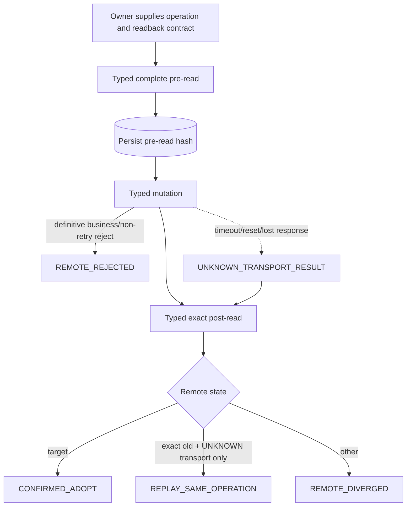

Connector 不自行循环 replay；它返回分类给 owning reconciler，避免在 HTTP 层复制业务 Saga。

## 5. 分页与不存在证明

Paginator 必须理解各端点的 page/size、游标或总数合同。它保留重复 ID、页间变动和恰好命中上限等异常，不能静默去重后宣称 complete。Marketplace owned Ban（BAN_INIT / EXCLUSION_GATE / SelfRoute repair）查询固定使用 `route_status=all`、`include_seed=true`、`include_disabled=true`、`include_user_disabled=true` 和 `exclude_unavailable=false`。

Circuit 固定请求 `limit=1000`；返回正好 1000 项视为不完整。Token delete、inventory disappearance、Ban audit 和恢复验证必须调用对应的完整性判定。

## 6. 错误信封

Connector 返回：HTTP status、A6 success/code/message 的规范化字段、request ID、retry-after、transport outcome、可脱敏的 body hash 和未知扩展。业务包再依据 [错误分类合同](../../../../errorlist.md) 与上下文分流。

## 7. 完成条件

- API Reference 的覆盖索引与实现 method registry 一一对应。
- 所有 mutation 有 readback contract 和 transport-unknown 测试。
- 分页不完整不能产生 not-found witness。
- Profile rename 被类型系统阻止；未知响应字段 round-trip 保留。

上位依据：[原 Prompt §3](../../../sub2api-a6-channel-implementation-prompt.md#3-a6-typed-client)。
---

### 01-a6-connector/pseudocode.md（实现伪代码）

<!-- 以下内容为对应源文件的完整当前版本（随合集同步修订） -->

<!-- ===== 源文件：docs/a6-channel-blueprint/subsystems/01-a6-connector/pseudocode.md ===== -->
# S01 A6 Typed Connector：实现伪代码

[自然语言](logic.md) | [测试](tests.md) | [总纲](../../README.md)

## 1. 核心类型

```text
type CredentialRef { a6_user_id, secret_generation_id }
type ReadResult<T> { value:T, complete:bool, source_hash, fetched_at, pages, extensions }
type MutationContext { operation_id, idempotency_key, actor, department, source_generation }
type MutationResolution = CONFIRMED_ADOPT | REPLAY_SAME_OPERATION |
                          REMOTE_DIVERGED | REMOTE_REJECTED |
                          READBACK_INCOMPLETE | RETRY_LATER
type A6ErrorEnvelope { http_status, code, message, request_id, retry_after,
                       transport_outcome, redacted_hash, extensions }
```

## 2. 统一调用

```text
call_typed(method, path, query, body, credential_ref, semantics):   # CON-001..003,008
    validate request against endpoint registry
    with S00.with_secret(credential_ref, A6_CONTROL_PLANE) as token:
        headers = {Authorization: "Bearer " + token,
                   "New-API-User": credential_ref.a6_user_id}
        response = transport.send(method, path, query, typed_encode(body), headers)
    parsed = typed_decode(response, preserve_unknown=true, decimal_from_wire=true)
    audit only redacted metadata and response hash
    return parsed or A6ErrorEnvelope

read(endpoint, args, credential):                                # CON-007
    retry boundedly only if registry[endpoint].semantics == IDEMPOTENT_READ
    if status == 429: return RETRY_LATER(retry_after, last_confirmed_unchanged=true)
    never generic-retry generate_system_access_token
```

## 3. 完整分页

```text
collect_complete(endpoint, args, credential):                    # CON-004
    items = []
    seen_page_tokens = set()
    completeness = true
    for page in paginator(endpoint):
        result = read(endpoint, args + page, credential)
        if result failed: return ReadResult(items, complete=false, failure=result)
        if page.token in seen_page_tokens: completeness = false; break
        record page raw hash and declared total
        append items without hiding duplicate IDs
        if endpoint == circuit_states and count(page.items) == 1000:
            completeness = false
        if page metadata contradicts previous total/order:
            completeness = false
        if paginator says final: break
    validate unique resource identities where endpoint requires them
    return ReadResult(items, completeness, combined_hash, now, pages)

prove_absent(read_result, predicate):                            # CON-004
    require read_result.complete
    require no duplicate/ambiguity affecting predicate
    return none(read_result.items, predicate)
```

## 4. Mutation 与结果不明

```text
execute_mutation(ctx, pre_reader, mutation, post_reader, matcher=registry matcher for mutation): # CON-005,006
    pre = pre_reader()
    require pre.complete_for_contract
    persist audit(ctx, phase=PRE_READ, hash=pre.source_hash)
    try:
        wire = mutation(ctx.idempotency_key)
        persist redacted wire outcome
    catch transport_timeout_or_reset:
        wire = UNKNOWN_TRANSPORT_RESULT
    post = post_reader()
    persist audit(ctx, phase=POST_READ, hash=post.source_hash, complete=post.complete)
    if not post.complete_for_contract: return READBACK_INCOMPLETE
    classification = matcher(pre.value, post.value)
    if classification == TARGET: return CONFIRMED_ADOPT
    if wire is definitive business/non-retry rejection:
        return REMOTE_REJECTED(wire.error, post.value)
    if classification == EXACT_PRE_STATE and wire is UNKNOWN_TRANSPORT_RESULT:
        return REPLAY_SAME_OPERATION
    if classification == EXACT_PRE_STATE:
        return REMOTE_REJECTED(wire.error_or_non_success, post.value)
    return REMOTE_DIVERGED(post.value)
```

Owning reconciler 对 `REPLAY_SAME_OPERATION` 复用 `operation_id/idempotency_key`；对 `REMOTE_DIVERGED` 生成新 plan generation。

## 5. 特殊合同

```text
delete_token(ctx, token_id):                                    # CON-011
    resolution = execute_mutation(ctx, exact token pre-read, DELETE /api/token/{id},
                                  detail+complete-list post-reader, deletion matcher)
    if resolution == CONFIRMED_ADOPT:
        require detail == record_not_found and complete list proves ID absent
    # exact-pre may become REPLAY only when the DELETE transport result was unknown;
    # definitive reject stays REMOTE_REJECTED by CON-006.
    return resolution

update_supplier_channel(ctx, binding_id, fields):                # CON-013
    typed body allows nickname, description, models, base_url,
        test_model and api_key; api_key never logged
    return execute_mutation(ctx, exact channel pre-read, PATCH, exact channel post-read,
                            matcher for writable fields/key fingerprint)
    # preserve CONFIRMED_ADOPT / REPLAY_SAME_OPERATION / REMOTE_DIVERGED /
    # REMOTE_REJECTED / READBACK_INCOMPLETE / RETRY_LATER

restore_supplier_channel(ctx, binding_id):                       # CON-014
    typed body is exactly {}
    return execute_mutation(ctx, exact channel pre-read,
                            POST /api/supplier/channels/{binding_id}/restore,
                            supplier-channel post-reader, restore matcher)
    # Marketplace readback is added by the owning caller only when its business gate needs it.

update_supplier_profile(ctx, contact_info, description):         # CON-010
    typed body has exactly contact_info and description
    reject field name or rename intent at compile/API validation boundary
    PATCH then GET /api/supplier/me and compare confirmed writable fields

complete_owned_market_search(token, model):                       # CON-004
    credential = authoritative A6 credential owning token
    args = {token_id:token.id, model, route_status:"all", include_seed:true,
            include_disabled:true, include_user_disabled:true, exclude_unavailable:false}
    return collect_complete(marketplace_channels_search, args, credential)

complete_supplier_inventory(credential):                          # CON-004
    channels = collect_complete(supplier_channels, {}, credential)
    listings = collect_complete(supplier_listings, {}, credential)
    return combined inventory with complete=(channels.complete and listings.complete),
           both source hashes/pages and raw items; never infer absence if either incomplete

batch_markup_preview(channel_ids, credential):                    # CON-003,007
    require channel_ids are explicit stable remote IDs
    return typed read through endpoint registry for the confirmed batch-markup preview contract

disable_token_for_listing(ctx, token, listing):                   # CON-005,006
    return execute_mutation(ctx,
        exact Token×Listing disable-state pre-reader,
        registered user-disable mutation for token+listing,
        exact Token×Listing disable-state post-reader,
        matcher requiring the contract's user-disabled fields)

admin_console_command(endpoint, args, credential):                # CON-009
    require endpoint+method in versioned read whitelist
    if registry says mutation: create S14 command; do not call transport
    else return read(endpoint, args, credential)
```

## 6. 覆盖自检

```text
assert_reference_coverage():                                    # CON-002
    confirmed = load_machine_readable_endpoint_manifest_checked_into_repo
    implemented = endpoint_registry.keys
    require confirmed - implemented == empty
    require every mutation has pre_reader, post_reader, matcher and redaction policy
```

## 需求覆盖索引

本稿实现：`CON-001`, `CON-002`, `CON-003`, `CON-004`, `CON-005`, `CON-006`, `CON-007`, `CON-008`, `CON-009`, `CON-010`, `CON-011`, `CON-012`, `CON-013`, `CON-014`。
---

### 01-a6-connector/tests.md（测试规格）

<!-- 以下内容为对应源文件的完整当前版本（随合集同步修订） -->

<!-- ===== 源文件：docs/a6-channel-blueprint/subsystems/01-a6-connector/tests.md ===== -->
# S01 A6 Typed Connector：测试规格

[自然语言](logic.md) | [伪代码](pseudocode.md) | [A6 API Reference](../../../a6-api-reference.md)

## 1. Fixture 原则

使用 API Reference 与 `api-docs/` 的脱敏响应建立 contract fixtures。HTTP mock 必须能注入分页变动、429、超时、响应丢失、重复资源和未知字段；生产 smoke 只在 S16 发布门内执行。

## 2. 核心用例

| Test ID | 需求 | 被测符号 | Given / When / Then |
| --- | --- | --- | --- |
| CON-T001 | CON-001 | `call_typed` | credential A 绑定多个资源时每次仍发送同一精确 user/token 对；错 user 被 self readback 拒绝。 |
| CON-T002 | CON-002 | `assert_reference_coverage` | Reference manifest 任一确认端点缺 method 或 mutation readback 时测试失败。 |
| CON-T003 | CON-003 | `typed_decode` | Decimal 字段精确，未知 status/profile/listing 字段被保存并可 round-trip。 |
| CON-T004 | CON-004 | `collect_complete` | 多页正常返回 complete=true，并保存所有页 hash/游标/总数。 |
| CON-T020 | CON-004 | `complete_owned_market_search` | 请求逐字包含 token/model、`route_status=all`、`include_seed=true`、`include_disabled=true`、`include_user_disabled=true`、`exclude_unavailable=false`；漏任一参数或任一页不完整时不得作为 owned exclusion 证明。 |
| CON-T005 | CON-004 | `prove_absent` | 中间页失败、重复游标、页总数矛盾时 complete=false 且不得证明不存在。 |
| CON-T006 | CON-004 | circuit paginator | 恰好 1000 个 circuit 项标记 incomplete，不用缺项证明恢复。 |
| CON-T007 | CON-005 | `execute_mutation` | 正常写入保存 actor/department/generation/idempotency/pre/post hashes。 |
| CON-T008 | CON-006 | `execute_mutation` | mutation 响应丢失但 post=target，返回 CONFIRMED_ADOPT 且不重复写。 |
| CON-T009 | CON-006 | `execute_mutation` | 超时后 post=exact pre，返回 REPLAY_SAME_OPERATION；operation identity 不变。 |
| CON-T010 | CON-006 | `execute_mutation` | post 为第三状态，返回 REMOTE_DIVERGED 且 connector 不自行补偿。 |
| CON-T011 | CON-007 | `read` | 普通 GET 有界重试；`GET /api/user/token` 首次超时后不自动重试。 |
| CON-T012 | CON-007 | `read` | 429 返回 retry hint 并保留 last-confirmed，不生成 down/cooling 字段。 |
| CON-T013 | CON-008 | all HTTP paths | request/response/error/trace fixture 扫描不到完整 Authorization、Cookie、Token 或 Key。 |
| CON-T014 | CON-009 | `admin_console_command` | 白名单读取可执行；mutation 只落 Outbox；非白名单拒绝。 |
| CON-T015 | CON-010 | `update_supplier_profile` | body 只有 contact_info/description；name/rename 输入在发包前失败。 |
| CON-T016 | CON-011 | `delete_token` | detail not-found + 完整列表无 ID 才确认；列表不完整保持 unknown。 |
| CON-T017 | CON-012 | error envelope | Connector 返回错误事实但不会直接 pause account、加 hold 或写 route。 |
| CON-T018 | CON-013 | `update_supplier_channel` | PATCH 含 `api_key/base_url/test_model` 成功；响应丢失时 GET 读回精确判定 target/old/third，完整 Key 不出现在日志。 |
| CON-T019 | CON-014 | `restore_supplier_channel` | restore 空对象 Body 确认；`success:true` 后按 GET readback 复核；超时后 GET 读回三态分类。 |

## 3. Protocol matrix

每个端点至少具备：成功 fixture、业务失败 fixture、非 2xx fixture、未知字段 fixture、redaction 断言。每个 mutation 额外具备正常 readback、响应丢失后 target、响应丢失后 old、第三状态、readback incomplete，以及**服务端明确拒绝且 post 仍为 old 时返回 REMOTE_REJECTED（不得 replay）**的路径。

## 4. 生产前证据

- 使用受控 credential 读取 self/status 和每个只读接口族，记录脱敏 request ID/hash。
- mutation smoke 由所属业务包在隔离资源执行，不由 Connector 测试随意创建/删除生产资源。
- Token delete 证据必须同时包含 detail not-found 和完整列表 absence 的 readback hash。

## 需求覆盖索引

本测试集覆盖：`CON-001`, `CON-002`, `CON-003`, `CON-004`, `CON-005`, `CON-006`, `CON-007`, `CON-008`, `CON-009`, `CON-010`, `CON-011`, `CON-012`, `CON-013`, `CON-014`。
---

## Part 4.5：a6-channel-blueprint/subsystems/02-output-identity/（S02 出口身份、用户与绑定）

> 本工作包三份稿的树关系：`logic.md`（规范事实）-> `pseudocode.md`（实现，标注需求 ID）-> `tests.md`（每个测试回链需求 ID）。
> 需求 ID 命名空间见 traceability.md 第 1 节。

### 02-output-identity/logic.md（自然语言蓝图）

<!-- 以下内容为对应源文件的完整当前版本（随合集同步修订） -->

<!-- ===== 源文件：docs/a6-channel-blueprint/subsystems/02-output-identity/logic.md ===== -->
# S02 出口身份、用户与绑定：自然语言蓝图

[总纲](../../README.md) | [伪代码](pseudocode.md) | [测试](tests.md) | [架构图](../../architecture.md#3-出口身份与实例图)

## 1. 目标与边界

S02 建立 Sub2API 输出部门的稳定身份：`a6-channel` 用户、唯一 `ToA6API` 入口分组、一个稳定 Channel binding、一个有效入口 Key 和多个模型 Listing binding。它拥有认证后的本地解析和候选投影边界；远端创建/替换/退役与 Key 轮换由 S03，eligibility 计算由 S09。

## 2. 需求

| ID | 规范 |
| --- | --- |
| OUT-001 | 新增 `users.user_type='a6-channel'`，不复用 role；一个本地用户只绑定一个稳定 output Channel。 |
| OUT-002 | 一个 Channel 只有一个有效 `output_channel_ingress_key`，该 Key 固定同一 Sub2 UserID；一个 Channel 下有多个 `(output_channel_id, normalized_model)` 唯一 Listing binding。 |
| OUT-003 | `ToA6API` 是唯一 canonical 输出分组：输出用户只能属于它，普通用户严格排除；组倍率与用户组倍率恒为 Decimal `1.0`。 |
| OUT-004 | 仅 `a6-channel` 跳过余额 reserve 与平台级 quota accounting；初始余额 0 且可持续为负。Key/IP/RPM/并发/分组/模型/eligibility **以及用户自身非零 quota 限制**仍校验。 |
| OUT-005 | 对该用户 `concurrency=0` 表示无限并发，`quota=0` 表示无限配额；两个语义独立。 |
| OUT-006 | 禁止普通登录、自助注册和用户端 Key 管理；`users.status` 管 Channel 生命周期，逐 Listing admission 管模型状态。 |
| OUT-007 | 鉴权后只接受 A6 `platform-models.model_no` 精确值或版本化显式 alias；alias 碰撞或多 binding 进入 `BINDING_REVIEW`，不猜测。 |
| OUT-008 | `/v1/models` 只返回当前 output 用户绑定、current generation 且 admission 允许的模型，不泄露普通组或其他 Channel 模型。 |
| OUT-009 | Class1/2/3 候选由 account binding 显式投影到 `ToA6API`；经济倍率不写 group multiplier。 |
| OUT-010 | 连接层先以 `(local_user_id, requested_model)` 唯一解析稳定 `listing_binding_id`，再交 S09 按 `(listing_binding_id, account_id, normalized_model)` 判断。 |
| OUT-011 | 新建用户先 inactive，Key 为 DISABLED/STAGED；S03/S05/S07/S09 的绑定、BAN_INIT（BanRelation READY）、价格、能力、eligibility 门全部通过后才能激活用户/Key并逐 Listing 恢复。 |
| OUT-012 | 历史 `TPA6API` 只作为迁移输入；切换后运行时精确匹配 `ToA6API`，无名称 fallback 或 alias。 |

## 3. 出口身份子图

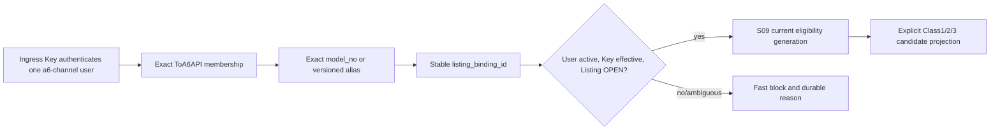

## 4. 请求路径语义

普通 Sub2API 鉴权先完成，但 `a6-channel` 分支必须在任何余额 reserve 前被可靠识别。跳过余额不等于跳过安全限制；IP、RPM、Key 状态、并发、模型和 eligibility 任一失败都按现有 API 合同返回。负余额来自 winner 计费，不影响后续入口认证。

请求携带显式 model；未指定、未知、alias generation 过期或解析出多个 binding 时禁止调度。解析结果包含 stable binding、normalized model、output/listing generation 和 required transport profile，供 S09/S10 冻结。

## 5. `ToA6API` 不变量

- canonical group 名称不可改名、删除或授权普通用户。
- 输出用户不得同时属于其他请求分组。
- 账号候选不是通过把账号“加入输出组”隐式推导，而是由版本化 binding projection 明确列出。
- 任何成本、profit、ck 或 delta 都不写组倍率。
- 启动时和 drift sweep 均校验 group ID、名称、倍率、成员类型与 alias absence；漂移关闭受影响输出准入并交 S13/S15 显示。

## 6. 状态与所有权

`users.status` 只表达父 Channel 本地生命周期；模型可用性由 listing admission 表达。父用户 inactive 必然关闭全部模型，但单 Listing hold 不应禁用同用户其他健康模型。S02 只读 current remote instance，远端 instance 的 adoption/replacement 由 S03。

## 7. 完成条件

- 一用户/一稳定 Channel/一有效 Key/多 Listing 的数据库与缓存解析一致。
- 普通用户和输出用户的余额、group、models 与登录边界测试完整隔离。
- 所有 scheduler 入口都消费同一解析器，没有按名称 fallback。

上位依据：[原 Prompt §2.2/§2.3/§5](../../../sub2api-a6-channel-implementation-prompt.md#5-输出-channel-用户)。
---

### 02-output-identity/pseudocode.md（实现伪代码）

<!-- 以下内容为对应源文件的完整当前版本（随合集同步修订） -->

<!-- ===== 源文件：docs/a6-channel-blueprint/subsystems/02-output-identity/pseudocode.md ===== -->
# S02 出口身份、用户与绑定：实现伪代码

[自然语言](logic.md) | [测试](tests.md) | [总纲](../../README.md)

## 1. Provision 本地身份

```text
stage_output_identity(command):                              # OUT-001,002,011
    begin transaction
    group = require_exact_canonical_group("ToA6API")
    user = insert users(user_type="a6-channel", status=INACTIVE,
                        balance=Decimal("0"), concurrency=0, quota=0)
    insert exact ToA6API membership(user, group_multiplier=Decimal("1.0"))
    require user has exactly group and multipliers == Decimal("1.0")
    channel = insert stable a6_output_channel(local_user_id=user.id)
    key = create_sub2_key(user.id, state=DISABLED_STAGED,
                          name_selection_ref=required_corpus_selection)
    insert output_channel_key(channel.id, key.id, effective=false)
    insert staged-identity follow-up Outbox in SAME tx
    commit
```

## 2. 鉴权与资源限制

```text
authenticate_output_request(raw_key, request):               # OUT-004..006
    auth = normal_key_auth(raw_key)
    require auth.user.user_type == "a6-channel"
    require auth.key == effective_key_for(auth.user.channel)
    require auth.user.status == ACTIVE
    require exact_group(auth.user) == ToA6API and multipliers == 1.0
    enforce_key_ip_rpm_limits(auth, request)
    enforce_concurrency_unless_zero(auth.user.concurrency)
    enforce_user_quota_unless_zero(auth.user.quota)
    # Do not call balance reserve or platform-level quota accounting for this user type.
    return auth

normal_user_request(request, auth_context):               # OUT-004..006
    require user_type != "a6-channel" for ordinary groups
    preserve existing balance/reserve/platform quota behavior
```

## 3. 模型解析

```text
resolve_listing(local_user_id, requested_model, alias_generation): # OUT-007,010
    exact = query current listing binding where
            local_user_id and normalized_model == requested_model
    if exactly one: return exact
    aliases = query enabled versioned aliases matching requested_model
    if alias_generation not current or aliases count != 1:
        ensure BINDING_REVIEW command for collision/ambiguity
        reject before scheduler
    binding = current listing for aliases[0].canonical_model
    require exactly one
    return binding

build_dispatch_context(auth, request):                       # OUT-010
    binding = resolve_listing(auth.user.id, request.model, current_alias_generation)
    require binding parent current and listing admission OPEN
    require parent Channel admission OPEN and maintenance_state == NONE
    profile = normalize_transport_profile(request.endpoint, request.stream,
                                          expected_terminal_usage_schema)
    return {local_user_id, listing_binding_id, normalized_model,
            output_channel_generation, listing_generation, profile}
```

## 4. Models 端点

```text
list_output_models(auth):                                    # OUT-008
    require auth.user_type == "a6-channel"
    return current listing bindings where
        parent channel ACTIVE and admission OPEN and
        current model/capability/pricing generations confirmed
    serialize only canonical A6 model_no and allowed metadata
```

## 5. 候选投影

```text
project_output_candidates(listing_binding, generation):      # OUT-009
    accounts = explicit account bindings for ToA6API and model
    for account in accounts:
        join current S04 economic/capability facts
        join current S05 BAN_INIT READY when Class1
        join S09 eligibility row
    write Redis projection atomically with generation/hash
    never read or write group multiplier as economic input
```

## 6. 激活门

```text
activate_staged_output(channel_id, expected_generation):      # OUT-011
    begin transaction
    lock credential -> user/channel -> all intended Listing rows/current gate pointers in canonical order
    require channel lifecycle/source generation == expected_generation and maintenance_state == NONE
    require S03 binding/key gates confirmed under these locks
    require all relevant S05 BAN_INIT READY for the current Token/Listing matrix and current membership generation
    require S07 current price/config generations confirmed
    require S09 each intended Listing has required-profile candidates for the same current gate vector
    gate_hash = hash(binding,key,ban_membership,price/config,eligibility generations)
    require gate_hash unchanged immediately before commit
    require exactly one staged/effective transition plan
    enable key and user atomically; mark key effective; persist activation gate_hash
    insert per-Listing S13 recovery Outbox rows in the SAME transaction
    commit
    publish optional wake-up notification after commit
```

## 7. Group drift

```text
audit_toa6api_group():                                       # OUT-003,012
    require exactly one group named ToA6API
    require no TPA6API runtime alias/entity after migration cutover
    require every member user_type == a6-channel
    require every a6-channel belongs only to this group
    require group and user-group multipliers == Decimal("1.0")
    on drift:
        begin transaction
        close affected admission with current drift generation
        insert config-invalid owner/reprojection Outbox in SAME tx
        commit
```

## 需求覆盖索引

本稿实现：`OUT-001`, `OUT-002`, `OUT-003`, `OUT-004`, `OUT-005`, `OUT-006`, `OUT-007`, `OUT-008`, `OUT-009`, `OUT-010`, `OUT-011`, `OUT-012`。
---

### 02-output-identity/tests.md（测试规格）

<!-- 以下内容为对应源文件的完整当前版本（随合集同步修订） -->

<!-- ===== 源文件：docs/a6-channel-blueprint/subsystems/02-output-identity/tests.md ===== -->
# S02 出口身份、用户与绑定：测试规格

[自然语言](logic.md) | [伪代码](pseudocode.md) | [总纲](../../README.md)

## 1. 核心用例

| Test ID | 需求 | 被测符号 | Given / When / Then |
| --- | --- | --- | --- |
| OUT-T001 | OUT-001,002 | `stage_output_identity` | 创建 inactive `a6-channel`、稳定 Channel 和 DISABLED/STAGED Key；第二 Channel 或 effective Key 被拒绝。 |
| OUT-T002 | OUT-003 | `audit_toa6api_group` | 输出用户只在 `ToA6API` 且倍率 1.0；普通用户加入或倍率漂移会关闭受影响准入。 |
| OUT-T003 | OUT-004 | `authenticate_output_request` | 负余额请求仍可过余额门，但 Key/IP/RPM/模型/eligibility 继续执行。 |
| OUT-T004 | OUT-005 | auth limit path | `concurrency=0` 不限并发但 `quota>0` 仍执行用户 quota 限制；`quota=0` 不限用户 quota 但 `concurrency>0` 仍限并发；两种情况都跳过余额 reserve/平台级 quota accounting。 |
| OUT-T005 | OUT-006 | login/key APIs | 普通登录、自助注册、用户端 Key create/update/delete 对 `a6-channel` 均拒绝。 |
| OUT-T006 | OUT-007 | `resolve_listing` | 精确 model_no 唯一解析；合法单 alias 解析；alias 碰撞进入 BINDING_REVIEW 且不调度。 |
| OUT-T007 | OUT-008 | `list_output_models` | 只返回该 Channel 当前 OPEN bindings；CLOSED、其他用户和普通组模型不出现。 |
| OUT-T008 | OUT-009 | `project_output_candidates` | Class1/2/3 只由显式 binding 投影；改变 group multiplier 不改变经济值且被 drift audit 拒绝。 |
| OUT-T009 | OUT-010 | `build_dispatch_context` | 每种 endpoint/stream 解析稳定 listing 与 transport profile；未指定/未知 model 在 scheduler 前失败。 |
| OUT-T010 | OUT-011 | `activate_staged_output` | 任一 Binding/BAN_INIT/price/capability/eligibility gate 缺失时用户和 Key 保持 inactive；全通过才原子激活。并发在 gate check 与 commit 间切换 Ban membership/price/eligibility generation 时，旧 expected generation 必须失败，不能激活 stale gate vector。 |
| OUT-T011 | OUT-012 | `audit_toa6api_group` | cutover 后仅有旧 `TPA6API` 时不得 fallback；产生明确 config failure。 |
| OUT-T012 | OUT-002 | concurrent key activation | 两个 staged Key 并发激活最多一个 effective，失败事务不短暂双启用。 |

## 2. 请求面矩阵

对 Responses/Chat、stream/non-stream、精确模型/alias、余额为 0/负数、concurrency/quota 四种零值组合运行集成矩阵。每次断言 stable `listing_binding_id`、transport profile、output/listing generation 和候选 projection hash 一致。

## 3. 隔离与回归

- 普通用户的余额 reserve、quota、登录、Key 管理和 `/v1/models` 行为保持原样。
- 一个 Listing hold 只关闭该模型，不禁用同 Channel 的其他 Listing。
- Redis 丢失时从数据库 current projection 保守失败，不按 group name 临时构造候选。
- 用户 inactive 或 Key 非 effective 时，无论 Listing projection 多新都不能派发。

## 4. 验收证据

保存用户/Channel/Key/Listing 唯一约束查询、`ToA6API` 成员审计、负余额成功鉴权和普通用户回归报告；报告只显示 Key fingerprint/last4。

## 需求覆盖索引

本测试集覆盖：`OUT-001`, `OUT-002`, `OUT-003`, `OUT-004`, `OUT-005`, `OUT-006`, `OUT-007`, `OUT-008`, `OUT-009`, `OUT-010`, `OUT-011`, `OUT-012`。
---

## Part 4.6：a6-channel-blueprint/subsystems/03-output-lifecycle/（S03 出口 Channel/Listing 生命周期与入口 Key）

> 本工作包三份稿的树关系：`logic.md`（规范事实）-> `pseudocode.md`（实现，标注需求 ID）-> `tests.md`（每个测试回链需求 ID）。
> 需求 ID 命名空间见 traceability.md 第 1 节。

### 03-output-lifecycle/logic.md（自然语言蓝图）

<!-- 以下内容为对应源文件的完整当前版本（随合集同步修订） -->

<!-- ===== 源文件：docs/a6-channel-blueprint/subsystems/03-output-lifecycle/logic.md ===== -->
# S03 出口 Channel/Listing 生命周期与入口 Key：自然语言蓝图

[总纲](../../README.md) | [伪代码](pseudocode.md) | [测试](tests.md) | [S02 身份](../02-output-identity/logic.md)

## 1. 目标与边界

S03 拥有输出远端 Channel/Listing instance 的建立、采用、replacement、退役和 `output_channel_ingress_key` 轮换 Saga。稳定本地身份由 S02，公共文本由 S00，所有 A6 调用由 S01。**S03 是 Channel-scope takedown/restore/maintenance 的唯一写者；Listing-scope 的 takedown/resubmit/reset 由 S13 的 Output Recovery 唯一写者执行**，二者通过父 operation 协调而不双写。

## 2. 需求

| ID | 规范 |
| --- | --- |
| LIF-001 | 新建 Channel 必须先有 inactive 用户与 DISABLED/STAGED Key；远端申请前暂停同 credential 的 current Provider，完整 inventory/adopt 后触发 S05 Channel-batch EXCLUSION_GATE。各 intended Listing 的 `LISTING_BAN_INIT`、价格、能力和 eligibility 全通过后可激活 output；Ban gate 未通过只保持相关 Class1 Provider paused，不阻断健康 Class2/3 output。 |
| LIF-002 | 首个、新增和 replacement Channel 都使用 `POST /api/supplier/apply`；完成证据是 request 已受理且完整 inventory 出现新的唯一 Channel ID。 |
| LIF-003 | 远端 Listing 删除但父 Channel 与 canonical model 不变时保留 stable `listing_binding_id`、关闭旧 instance、创建新 instance；canonical model 变化则退役旧 binding、新建 binding。旧实例本地 retire/replacement 不退出 S05 owned set；只有 exact remote delete + complete current Supplier absence 才退出。 |
| LIF-004 | Channel 删除/takedown 后不猜原 ID 可恢复；申请 replacement 并切换新 Channel instance。Listing resubmit 不得冒充父 Channel 恢复。 |
| LIF-005 | 退役 Listing 先关闭 admission、等待该 binding inflight=0，再 takedown/readback 并关闭 current instance；最后一个 Listing 后才处理父 Channel、入口 Key 和用户。takedown/本地 RETIRED 不是 remote delete，相关 Channel/Listing 继续留在 S05 exclusion set。 |
| LIF-006 | 退役等待超时保持 `RETIRE_PENDING`，核对 stale attempt lease 后重试。远端写前允许人工取消；写后只能继续或修复重放。 |
| LIF-007 | owner/model/channel 唯一匹配可自动 adopt 新 generation；owner 冲突、多候选、消失或模型碰撞进入 `BINDING_REVIEW`。 |
| LIF-008 | 入口 Key 轮换是 Channel-scope maintenance：创建 STAGED 新 Key -> 关闭父 Channel admission -> Channel takedown/readback -> PATCH/readback -> 本地 Key 切换 -> 在 Channel restore 前暂停相关 Provider -> restore/readback -> 触发 S05 EXCLUSION_GATE。无需逐 Listing mutation/hold；gate 失败保持 Provider paused，但不回滚已确认的新 Key，也不阻断其他 eligible classes 的 output admission。 |
| LIF-009 | 中断恢复以远端事实决定：远端仍指旧 Key 时回到旧 Key 唯一启用；已确认新 Key 时继续新 Key；歧义时 Channel 保持 DOWN、所有 child admission=CLOSED，绝不双启用。 |
| LIF-010 | 旧 Key 删除失败只进入清理 dead-letter，不回滚已确认的新 Key，也不重新触发 child Listing recovery。 |
| LIF-011 | 每个阶段保存 operation journal、写前/写后读、generation 和 Key fingerprint/last4；完整 Key 不进入业务表/日志。 |
| LIF-012 | 所有新公共名称/描述和 Key display name 先取得 S00 corpus selection；缺失时以 `TEXT_CORPUS_INVALID` 停止申请/更新。 |
| LIF-013 | Channel-scope maintenance（`KEY_ROTATION` / `BAN_INIT`）必须持久化一次 immutable pre-state，设置 `maintenance_state` 并关闭父 Channel admission；maintenance 存在时生命周期 observer 不得启动 replacement。非 BAN_INIT 临时 restore 的父 Channel 在 restore 前暂停相关 Provider，restore 后触发一次 S05 gate；BAN_INIT 自己的 temporary restore 由同一 S05 operation 覆盖，不递归触发第二 gate。 |

## 3. 生命周期子图

```mermaid
stateDiagram-v2
    [*] --> STAGED
    STAGED --> APPLY_PENDING: "corpus and local identity ready"
    APPLY_PENDING --> INVENTORY_SYNC: "request accepted"
    INVENTORY_SYNC --> GATED: "unique Channel and Listings adopted"
    GATED --> ACTIVE: "BAN_INIT, price, capability, eligibility, Key pass"
    ACTIVE --> RETIRE_PENDING: "retire requested; admission closed"
    ACTIVE --> REPLACEMENT_PENDING: "Channel missing or takedown"
    REPLACEMENT_PENDING --> INVENTORY_SYNC: "new apply accepted"
    RETIRE_PENDING --> RETIRED: "inflight zero and remote readback"
    STAGED --> BINDING_REVIEW: "ambiguous inventory"
    INVENTORY_SYNC --> BINDING_REVIEW: "owner/model collision"
```

## 4. Channel/Listing inventory 规则

inventory 必须来自当前 credential 的完整 Supplier/Listing 读取，并保存 completeness。Binding Controller 只在 owner、Channel 和 canonical model 唯一一致时自动采用。采用只前移 current instance，不重写历史远端 ID。

申请返回本身不是 Channel 创建完成。controller 需要读取 supplier request，再等待完整 inventory 中出现与本次 source generation 唯一匹配的新 ID。`pending_request_exists` 进入 request 对账，不盲目再申请。

## 5. 入口 Key Saga

轮换在 output Channel 锁下执行；从开始到远端 Key 精确确认，父 Channel 及其所有子 Listing 保持
admission=CLOSED。远端只返回 last4/fingerprint 时，必须结合 Channel 配置 generation 形成唯一判定。
S03 唯一拥有 Channel takedown/restore/PATCH key 与本地 Key 切换；S13 只处理 Listing-scope 恢复，Key Rotation
不再为子 Listing 创建 hold 或逐项上下架。Saga 阶段为
`STAGE_NEW_KEY -> CHANNEL_TAKEDOWN -> UPDATE_REMOTE_KEY -> SWITCH_LOCAL_KEY -> VERIFY_REMOTE_KEY ->
CHANNEL_RESTORE -> DELETE_OLD_KEY`。

## 6. 人工动作

`BINDING_REVIEW` 仅允许：选择明确 instance 并 readback、接受远端事实生成新 generation、或退役。管理员不能直接编辑 observed ID/状态，也不能在 Key Saga 中同时启用两个 Key。

## 7. 完成条件

- 新建、replacement、Listing 重建和全退役均保留稳定外键与完整 phase journal。
- Key Saga 在每个中断点都可接管，且任意时刻最多一个本地有效 Key。
- 所有远端 mutation 经过 S01/S14/S13 owning path 和精确 readback。
- Channel create/adopt/restore 后 Provider 恢复只消费 S05 READY 与 S06 自身 route/cost/capability gates；S03 不复制 Ban 状态机。

上位依据：[原 Prompt §5/§6.1](../../../sub2api-a6-channel-implementation-prompt.md#6-两类-key-与轮换)。
---

### 03-output-lifecycle/pseudocode.md（实现伪代码）

<!-- 以下内容为对应源文件的完整当前版本（随合集同步修订） -->

<!-- ===== 源文件：docs/a6-channel-blueprint/subsystems/03-output-lifecycle/pseudocode.md ===== -->
# S03 出口生命周期与入口 Key：实现伪代码

[自然语言](logic.md) | [测试](tests.md) | [总纲](../../README.md)

## 1. 新建与 replacement

```text
plan_channel_apply(binding_id, mode):                         # LIF-001,002,004,012
    lock stable output channel
    generation = current desired/lifecycle generation(binding_id)
    require local user INACTIVE if first create
    require effective public text selections
    require staged ingress Key
    begin transaction
    create operation(identity=binding_id+generation+APPLY, phase=PRE_READ)
    S05.pause_current_providers_for_owned_change_in_tx(tx, credential,
        operation.identity, reason=OWNED_CHANNEL_CREATE_ADOPT)
    insert its S14 Outbox row in SAME tx
    commit

reconcile_channel_apply(op):                                  # LIF-002,004,011,013
    binding_id = op.channel_binding_id
    credential = op.credential
    resume phase journal
    require authoritative channel(binding_id).maintenance_state == NONE before planning replacement/apply
    inventory_before = S01.complete_supplier_inventory(credential)
    if op has no confirmed request:
        result = S01.execute_mutation(op child,
            exact supplier-request + complete-inventory pre-reader,
            POST supplier/apply using op.persisted_application_payload,
            exact supplier-request + complete-inventory post-reader,
            matcher for this operation's unique accepted/pending request identity)
        if result == REPLAY_SAME_OPERATION: return RETRYABLE
        if result in [READBACK_INCOMPLETE, RETRY_LATER]: return RETRYABLE
        if result == REMOTE_REJECTED: record visible non-retryable apply failure; return NON_RETRYABLE
        if result == REMOTE_DIVERGED: ensure BINDING_REVIEW with exact evidence; return NON_RETRYABLE
        if pending_request_exists: adopt matching pending request only if unique
    request = exact supplier-request read for op; require accepted/current for op
    inventory_after = S01.complete_supplier_inventory(credential)
    candidates = new channels owned by credential and matching selected corpus/config
    if candidates.count != 1: ensure BINDING_REVIEW; stop
    channel_readback = candidates.one.readback
    S00.replace_remote_instance(binding_id, candidates.one.id, channel_readback,
        followup_command=SYNC_LISTING_INVENTORY(binding_id, inventory_after.source_generation))
    sync_listing_inventory(binding_id, inventory_after)  # eager path; durable Outbox makes crash between steps recoverable
    # Listing adoption transactions themselves enqueue S05/S07/S09 gates; do not emit a second non-durable event here.
    gate = S05.reconcile_owned_channel_create_or_adopt(op.gate_child, candidates.one)
    if gate READY: enqueue S06 reactivation for affected Providers
    else: retain S05-owned pause; output activation may still use healthy Class2/3
```

## 2. Listing inventory

```text
adopt_listing_instance_in_tx(tx, channel_binding_id, stable_binding?, remote_listing, complete_inventory): # LIF-003,007,LIF-013
    require tx active and complete_inventory.complete and unique owner/channel/canonical-model match
    lock credential -> channel binding -> listing binding
    if stable_binding absent: create stable listing binding in tx
    result = S00.replace_remote_instance_in_tx(tx, binding_id, remote_listing.id, remote_listing.readback)
    if result.changed:
        if result.old exists and exact remote delete + complete current inventory prove absence:
            S05.exit_owned_listing_after_confirmed_remote_delete_in_tx(
                tx, result.old, exact delete evidence, complete_inventory)
        # Otherwise old local-retired/replaced/takedown instance remains in the exclusion set.
        S05.enter_listing_ban_domain_in_tx(tx, result.current)  # membership+bump+BAN_INIT_REQUIRED Outbox
        insert S07/S09 gates-required Outbox rows in SAME tx
    return result.current

adopt_listing_instance(channel_binding_id, stable_binding?, remote_listing, complete_inventory): # LIF-003,007,LIF-013
    begin transaction
    current = adopt_listing_instance_in_tx(tx, channel_binding_id, stable_binding,
                                           remote_listing, complete_inventory)
    commit
    return current

sync_listing_inventory(channel_binding_id, complete_inventory): # LIF-003,007
    require complete_inventory.complete
    for canonical model expected by local desired facts:
        matches = remote listings with exact owner/channel/canonical model
        if matches.count == 1:
            adopt_listing_instance(channel_binding_id, stable binding if any, matches.one, complete_inventory)
        else:
            ensure BINDING_REVIEW(source_generation, evidence)
    for current local instance absent remotely and not already replaced above:
        if absence proven and canonical parent/model unchanged:
            close admission; create replacement-listing operation through S14; keep old membership until retirement/replacement is proven
        else ensure BINDING_REVIEW
```

## 3. 激活

```text
try_activate_channel(binding_id, generation):                 # LIF-001
    require current Channel instance uniquely read back
    require inventory complete and intended Listings bound
    require each intended Listing LISTING_BAN_INIT READY
    require S07 output config/current prices confirmed
    require S09 required transport profiles eligible
    S02.activate_staged_output(binding_id, expected_generation=generation)
    # S02 rechecks/locks the same current gate vector and atomically inserts recovery Outbox rows.
```

## 3.1 Channel-scope maintenance primitive

```text
begin_channel_maintenance_in_tx(tx, channel, kind, op, remote_pre_read): # LIF-013
    require tx active; lock channel
    require kind in [KEY_ROTATION, BAN_INIT]
    pre = load persisted maintenance_pre_state for op/channel
    if absent: persist immutable {remote_pre_read, local pre-state} ONCE before any mutation
    set maintenance_state=kind and parent_channel_admission=CLOSED
    return persisted pre-state

begin_channel_maintenance(channel, kind, op):                 # LIF-013
    remote_pre = exact S01 Channel readback BEFORE first mutation
    begin transaction
    pre = begin_channel_maintenance_in_tx(tx, channel, kind, op, remote_pre)
    commit; return pre

temporary_restore_channel_for_ban_init(op, channel):          # LIF-013 (consumer: BAN-008)
    pre = begin_channel_maintenance(channel, BAN_INIT, op)
    if pre.remote_state == DOWN:
        resolution = S01.restore_supplier_channel(op child, channel)
        if resolution != CONFIRMED_ADOPT: return pre with restore=PENDING
    return pre with restore=CONFIRMED
    # Same S05 BAN_INIT operation already owns Provider pause/Ban; do not trigger nested EXCLUSION_GATE.

restore_channel_pre_ban_state(op, channel):                   # LIF-013 (consumer: BAN-008)
    pre = require persisted maintenance_pre_state(op, channel)
    resolution = S01 mutation/readback restoring exact pre.remote_state only if current differs
    if resolution != CONFIRMED_ADOPT: keep maintenance_state/admission CLOSED; return PENDING
    begin transaction
    require current remote readback == pre.remote_state
    clear maintenance_state for matching op; recompute parent admission from lifecycle gates
    commit; return CONFIRMED
```

## 4. 入口 Key 轮换 Saga

```text
execute_channel_state_mutation(op, channel, action, target_state): # LIF-004,005,008,009,013
    require channel maintenance/retirement operation is current
    resolution = S01.execute_mutation(op child, exact Channel pre-read,
                                     typed Channel action, exact Channel post-read,
                                     matcher for target_state)
    if resolution == CONFIRMED_ADOPT: return CONFIRMED
    if resolution == REPLAY_SAME_OPERATION: return RETRY_SAME_ID
    if resolution in [READBACK_INCOMPLETE, RETRY_LATER]: return PENDING
    if resolution == REMOTE_DIVERGED: return REPLAN_OR_REVIEW
    if resolution == REMOTE_REJECTED: return NON_RETRYABLE

start_ingress_key_rotation(command_op, channel_id):            # LIF-008,011,012,013
    channel = load authoritative stable Channel by channel_id
    require command_op is the current S14 owner command for channel/current lifecycle generation
    selection_generation = stable child generation derived once from command_op.identity
    selection = S00.select_public_text(channel, INGRESS_KEY_NAME, selection_generation,
        mode=RANDOM, followup_command=RESUME_KEY_ROTATION(command_op.id))
    require selection valid; replay of command_op must reuse this exact selection_generation/value
    remote_pre = exact S01 Channel readback(channel.current_instance) before any rotation mutation
    begin transaction
    lock channel; require command_op/source generation still current
    new_key = idempotently create/load one DISABLED_STAGED Sub2 key keyed by command_op.identity
        through existing transaction-aware Sub2 key service(name=selection.value)
    operation = idempotently create/load parent operation(
        identity=command_op.identity, channel_id, old_key=current effective key, new_key, phase=STAGE_NEW_KEY)
    begin_channel_maintenance_in_tx(tx, channel, KEY_ROTATION, operation, remote_pre)
    insert/verify key-rotation operation Outbox in SAME tx
    commit

reconcile_key_rotation(op):                                   # LIF-008..011
    channel = authoritative stable Channel(op.channel_id)
    binding_id = channel.binding_id
    old_key = require op.old_key_ref
    new_key = require op.new_key_ref
    lock channel; resume journal
    phase STAGE_NEW_KEY:
        require new key staged and corpus selection persisted
        close parent Channel admission; advance CHANNEL_TAKEDOWN
    phase CHANNEL_TAKEDOWN:
        outcome = execute_channel_state_mutation(op, channel, TAKEDOWN, DOWN)
        if outcome != CONFIRMED: keep maintenance/admission CLOSED; return outcome
        advance UPDATE_REMOTE_KEY
    phase UPDATE_REMOTE_KEY:
        with S00.with_secret(new_key.secret_ref, CHANNEL_KEY_ROTATION) as new_secret:
            resolution = S01.update_supplier_channel(op, binding_id, api_key=new_secret)
        if CONFIRMED_ADOPT: advance SWITCH_LOCAL_KEY
        if REPLAY_SAME_OPERATION: replay UPDATE_REMOTE_KEY under same op
        if REMOTE_DIVERGED: resolve_key_side(op) from exact readback
        if READBACK_INCOMPLETE/RETRY_LATER: remain CLOSED and retry readback
        if REMOTE_REJECTED: remain CLOSED; visible operation failure, no blind replay
    phase SWITCH_LOCAL_KEY:
        begin transaction
        disable old key; enable new key; set exactly one effective via constraint
        commit
        advance VERIFY_REMOTE_KEY
    phase VERIFY_REMOTE_KEY:
        require remote config uniquely points to new key generation
        S05.pause_current_providers_for_owned_change(
            op, channel.credential, reason=OWNED_CHANNEL_RESTORE)
        advance CHANNEL_RESTORE
    phase CHANNEL_RESTORE:
        resolution = S01.restore_supplier_channel(op, binding_id)
        if resolution != CONFIRMED_ADOPT:
            keep maintenance/admission CLOSED; resolve/retry according to S01 classification; return
        begin transaction
        require exact Channel UP/readback and matching new key generation
        clear channel maintenance_state for this op
        insert child observer/admission reprojection Outbox rows in SAME tx
        insert S05 OWNED_CHANNEL_RESTORE_GATE Outbox in SAME tx
        commit                                  # no child Listing resubmit/takedown mutation
        gate = S05.run_owned_exclusion_gate(op.restore_gate_child,
            all Ban-domain tokens, channel models,
            require_effective_subscription for current Provider tokens only)
        if gate READY: enqueue S06 Provider reactivation
        else: keep affected Providers paused; do not roll back confirmed Key/Channel restore
        advance DELETE_OLD_LOCAL_KEY
    phase DELETE_OLD_LOCAL_KEY:
        delete old disabled local key
        on failure record cleanup dead-letter without changing new effective key
        complete

resolve_key_side(op):                                         # LIF-009
    channel = authoritative stable Channel(op.channel_id)
    old_key = require op.old_key_ref; new_key = require op.new_key_ref
    remote = exact Channel config readback(channel.current_instance)
    if remote uniquely matches old_key fingerprint/generation:
        transactionally ensure old_key only enabled and new_key disabled; set op.phase=UPDATE_REMOTE_KEY
    else if remote uniquely matches new_key fingerprint/generation:
        set op.phase=SWITCH_LOCAL_KEY or VERIFY_REMOTE_KEY according to local effective key
    else:
        ensure Channel DOWN and all child admission CLOSED
        retain operation as ambiguous; never enable both
```

## 5. 退役

```text
retire_listing(binding_id, op):                               # LIF-005,006
    close admission and set RETIRE_PENDING
    wait asynchronously until inflight(binding_id)==0
    if leases stale: reconcile attempts; never assume zero from timeout alone
    before remote write operator may cancel and reopen only if gates pass
    after takedown attempt starts cancellation forbidden
    S13 executes takedown/readback under current operation
    begin transaction
    close current instance and mark binding RETIRED
    retain current_instance in S05 authoritative exclusion set
    insert required follow-up Outbox rows
    commit
    if no non-retired siblings: retire_parent_channel(op.parent)

retire_parent_channel(op):                               # LIF-005,LIF-006
    channel = authoritative stable Channel(op.parent_channel_id)
    require every Listing retired and no inflight
    outcome = execute_channel_state_mutation(op, channel, TAKEDOWN, DOWN)
    if outcome != CONFIRMED: keep retirement pending; return outcome
    begin transaction
    disable current ingress key, retire user and close current Channel instance
    retain Channel/Listings in S05 authoritative exclusion set until exact remote delete + complete absence proof
    insert retirement/audit follow-up Outbox in SAME tx
    commit; return CONFIRMED
```

## 需求覆盖索引

本稿实现：`LIF-001`, `LIF-002`, `LIF-003`, `LIF-004`, `LIF-005`, `LIF-006`, `LIF-007`, `LIF-008`, `LIF-009`, `LIF-010`, `LIF-011`, `LIF-012`, `LIF-013`。
---

### 03-output-lifecycle/tests.md（测试规格）

<!-- 以下内容为对应源文件的完整当前版本（随合集同步修订） -->

<!-- ===== 源文件：docs/a6-channel-blueprint/subsystems/03-output-lifecycle/tests.md ===== -->
# S03 出口生命周期与入口 Key：测试规格

[自然语言](logic.md) | [伪代码](pseudocode.md) | [总纲](../../README.md)

## 1. 核心用例

| Test ID | 需求 | 被测符号 | Given / When / Then |
| --- | --- | --- | --- |
| LIF-T001 | LIF-001 | `plan/try_activate_channel` | 用户/Key 先 staged；任一 LISTING_BAN_INIT/price/capability/eligibility 门缺失时保持 inactive。 |
| LIF-T002 | LIF-002 | `reconcile_channel_apply` | apply response 成功但 inventory 尚无 ID 时 operation 等待；出现唯一新 ID 后才完成。 |
| LIF-T003 | LIF-002 | apply pending reconciliation | `pending_request_exists` 读取并采用唯一现有 request，不重复 POST。 |
| LIF-T004 | LIF-001,003 | `sync_listing_inventory` | 同父 Channel/同 canonical model 的新 remote Listing 保留 stable binding/新 instance；Channel batch 前 Provider 已暂停，全部 Listing BAN_INIT 后只触发一次 S05 full gate。 |
| LIF-T005 | LIF-003 | `sync_listing_inventory` | canonical model 改变时旧 binding 退役、新 binding 新建，历史 attempt 不迁移。 |
| LIF-T006 | LIF-004 | replacement | 父 Channel 消失时调用 supplier/apply；禁止只调用 listing resubmit；新 ID 切 instance。 |
| LIF-T007 | LIF-003,005,006 | `retire_listing` | inflight 非零保持 RETIRE_PENDING；归零后 takedown/readback并本地 RETIRED，但 S05 membership 不退出、不 bump；只有 exact remote delete + complete Supplier absence 才原子退出。 |
| LIF-T008 | LIF-007 | binding adoption | owner/model/channel 唯一自动 adopt；两个候选或 owner 冲突进入 BINDING_REVIEW。 |
| LIF-T009 | LIF-008 | `start/reconcile_key_rotation` | 同 command identity 重放只复用一个 selection/staged Key/parent op。N 个 Listings 只需 1 次 Channel takedown/restore/PATCH；restore 前 Provider pause，restore 后 1 次 Channel-batch gate；gate 失败只保持 Provider paused，新 Key 不回滚，子 Listing mutation=0。 |
| LIF-T010 | LIF-009 | `resolve_key_side` | 每个 phase 注入 crash；重启后远端旧则旧唯一启用、远端新则新唯一启用。 |
| LIF-T011 | LIF-009 | ambiguous key readback | 只有 last4 且 generation 无法区分时 Channel 保持 DOWN、所有 Listing CLOSED、本地不双启用。 |
| LIF-T012 | LIF-010 | old key cleanup | 已确认新 Key 后旧 Key 删除失败只生成 dead-letter，Channel restore 不回退新 Key，也不触发 child Listing recovery。 |
| LIF-T013 | LIF-011 | audit/journal | 每个远端阶段有 pre/post hash、actor、generation、operation ID，日志只有 fingerprint/last4。 |
| LIF-T015 | LIF-008,010,013 | no child recovery spy | Channel 含 30 个 Listings，Key rotation 期间 parent admission=CLOSED 且 replacement planner spy=0；完成后 child Listing takedown calls = 0、child Listing resubmit calls = 0、child observer refresh = yes。 |
| LIF-T016 | LIF-013 | BAN_INIT channel maintenance crash | 原 Channel=DOWN，temporary restore 后 crash；重放复用第一次持久化 pre-state=DOWN，不把临时 UP 当原状态；最终 exact DOWN readback 后才清 maintenance。 |
| LIF-T014 | LIF-012 | corpus gate | 缺 Channel/Listing/Key corpus selection 时不发 apply/update，并投影 TEXT_CORPUS_INVALID。 |

## 2. Saga 故障注入矩阵

在 `STAGE_NEW_KEY`、`CHANNEL_TAKEDOWN` 发包前/发包后响应丢失、`UPDATE_REMOTE_KEY` 发包后、`SWITCH_LOCAL_KEY` 提交前/后、`VERIFY_REMOTE_KEY`、`CHANNEL_RESTORE`、`DELETE_OLD_LOCAL_KEY` 每个点终止 worker。恢复后断言：Channel/child 在确认前 CLOSED；最多一个有效 Key；operation identity 和 selection generation 不变；无重复 Channel takedown/restore/apply。

## 3. Inventory 完整性

- 中间页失败不能判定 Channel/Listing 消失。
- 完整 inventory 中零候选、重复候选、owner 冲突分别进入可解释的 BINDING_REVIEW。
- replacement 成功后旧 instance 可审计但不再 current。

## 4. 生产验收证据

隔离 Channel 执行一次 staged 创建或 replacement rehearsal，以及一次入口 Key 轮换。保存 apply request、inventory 新 ID、Channel takedown/restore、远端 Key 指纹和唯一有效本地 Key 的脱敏 readback。

## 需求覆盖索引

本测试集覆盖：`LIF-001`, `LIF-002`, `LIF-003`, `LIF-004`, `LIF-005`, `LIF-006`, `LIF-007`, `LIF-008`, `LIF-009`, `LIF-010`, `LIF-011`, `LIF-012`, `LIF-013`。
---

## Part 4.7：a6-channel-blueprint/subsystems/04-input-accounts/（S04 Class1/2/3 输入账号与经济能力）

> 本工作包三份稿的树关系：`logic.md`（规范事实）-> `pseudocode.md`（实现，标注需求 ID）-> `tests.md`（每个测试回链需求 ID）。
> 需求 ID 命名空间见 traceability.md 第 1 节。

### 04-input-accounts/logic.md（自然语言蓝图）

<!-- 以下内容为对应源文件的完整当前版本（随合集同步修订） -->

<!-- ===== 源文件：docs/a6-channel-blueprint/subsystems/04-input-accounts/logic.md ===== -->
# S04 Class1/2/3 输入账号与经济能力：自然语言蓝图

[总纲](../../README.md) | [伪代码](pseudocode.md) | [测试](tests.md) | [S05 Provider 控制](../05-provider-token-ban/logic.md)

## 1. 目标与边界

S04 定义 Sub2API 输入部门的 Class1/2/3 账号分类、`sk`、profit、模型能力、账单可信度和 schedulability generation。它不写 A6 Token/Pin/Auto-Pool，不决定 Listing 价格或 delta，也不替代 Sub2API 原生账号健康状态机。

## 2. 需求

| ID | 规范 |
| --- | --- |
| ACC-001 | 输入账号使用稳定类别：Class1 A6 Provider、Class2 原生 OAuth、Class3 `class3:<provider_code>` API Key，并通过显式 binding 投影模型。 |
| ACC-002 | Class1 Auto-Pool `sk` 等于完整纳入价格带的 `topN_max_cny_ratio`；Pin `sk` 等于 current assignment epoch 的精确 Channel `K_CNY`。 |
| ACC-003 | Auto-Pool 默认 `target_n=10, min_n=3, max_n=20, min_ratio=0, hard_max_ratio=0.3`；按可调用非 owned 比率排序，N 点必须完整纳入同价带。 |
| ACC-004 | Class1 不叠加 `realized_cost_p95`、`retry_reserve` 或额外 `5/6` 换算；**无 current cost 时第一份合格 route observation 建立 generation 1**；成本上涨立即生效，下降仅对 3 个 distinct/complete snapshot generation 连续确认后生效，事件 replay 不重复计数。 |
| ACC-005 | Class2 `one_week_A=used_A/utilization` 当二者均大于 0，否则 100；`expected_total_A=one_week_A*multiplier`，`sk=account_cost_cny/expected_total_A`。全部使用 Decimal。 |
| ACC-006 | Class2 multiplier 默认 1 且必须 >0；utilization 可 >1。100% utilization 不暂停、刷新、替换或退役，继续使用 Sub2API 原生 OAuth 规则。 |
| ACC-007 | Class2 字段缺失/矛盾时保留最近确认 sk；无历史才用 100 并标记 estimate。 |
| ACC-008 | Class3 由管理员设置默认 `declared_sk` 和可选模型 override；适配器同步 `/v1/models`、余额、Acost 与账单。 |
| ACC-009 | Class3 15 分钟窗口至少 20 个收费请求且 expected cost>=CNY 1：<=5% 正常，5%-15% 告警，连续三窗>15% 暂停，单窗>30% 立即暂停。 |
| ACC-010 | Class3 恢复需账单重同步和有界审计，连续 3 个合格窗口偏差<=5% 后生成新 billing generation；预算不足保持暂停并显示原因。 |
| ACC-011 | 默认 profit：Class1 0.20、Class2 0.50、Class3 0.40；允许账号覆盖和每个 provider_code 独立默认值。 |
| ACC-012 | Class2/3 入池前同步模型并对当前 A6 OpenAI 模型做有界 capability probe，原始 input usage 500..3000；全局并发/RPM/小时成本预算可配置。 |
| ACC-013 | 达到 probe 预算只延期，不绕过 capability 或 billing 恢复条件；生成版本化白名单和 capability generation。 |
| ACC-014 | schedulability 同时要求 Sub2API 原生状态、current cost/capability/billing generation 和本类业务 gate；Class1 capability generation 由 current Provider Token/model/route/callability confirmed readback 产生（不走 Class2/3 data-plane probe）；瞬时满并发不改变结构性 ready。 |

## 3. 输入子图

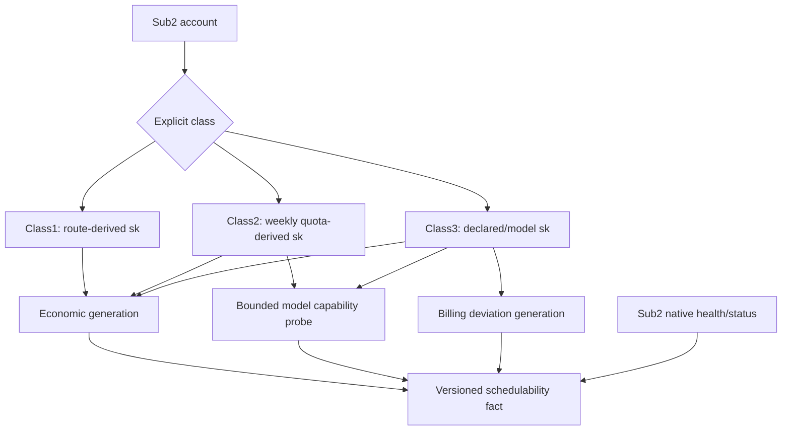

## 4. Class1 Top-N 观测事实

对外部可调用、非 owned 比率 `r1<=...<=rM`：`M<min_n` 表示 range exhausted；否则 `N=min(target_n,M)`，`max_ratio=rN`，选择到 `rN` 并把所有等价带项完整包含。保存 `cv_n=stddev(r1..rN)/mean(r1..rN)` 与 `tail_jump=(rN-rN-1)/rN-1`，mean/variance/min 只用于观测，不改 `sk`。扩缩池的远端动作由 S06。

## 5. Class2 与 Class2Adjustment 分离

S04 的 Class2 经济档案只估算账号成本和模型能力。既有 `Class2Adjustment` 属于 S10 usage compositor，不写入 `sk` 公式，也不在 utilization=100% 时触发账号生命周期动作。

## 6. Class3 账单窗口

只计算满足样本数和 expected cost 的合格窗口。不合格窗口既不累计“三窗暂停”也不能作为“三窗恢复”。偏差分母、absolute/relative 公式和 Decimal rounding 必须版本化。暂停只影响该账号/模型 billing generation，不扩散 Listing 共享价格事实。

## 7. 完成条件

- 三类账号在数据库、API、Redis projection 和调度日志中使用稳定类别，无 role/name 推断。
- 每次成本/能力/账单改变生成不可变 generation，旧 attempt 可复现。
- Class2/3 probe 预算与恢复门有明确延后状态和管理端原因。

上位依据：[原 Prompt §7](../../../sub2api-a6-channel-implementation-prompt.md#7-输入账号与-sk)。
---

### 04-input-accounts/pseudocode.md（实现伪代码）

<!-- 以下内容为对应源文件的完整当前版本（随合集同步修订） -->

<!-- ===== 源文件：docs/a6-channel-blueprint/subsystems/04-input-accounts/pseudocode.md ===== -->
# S04 Class1/2/3 输入账号：实现伪代码

[自然语言](logic.md) | [测试](tests.md) | [总纲](../../README.md)

## 1. 分类与 profit

```text
classify_account(binding):                                   # ACC-001
    require explicit class enum and provider_code when Class3
    never infer from account name, group, role or token name

effective_profit(account):                                   # ACC-011
    if account.override != null: require override >= 0; return override
    if Class3 and provider default exists: return provider default
    return {Class1:0.20, Class2:0.50, Class3:0.40}[class] as Decimal
```

## 2. Account generation commit primitive

```text
commit_account_generation(account, kind, payload, expected_generation,
                          change_identity=payload.change_identity or stable source-evidence identity,
                          followup=ELIGIBILITY_RECOMPUTE):      # ACC-004..014,FND-011
    require change_identity stable and excludes retry/time
    payload_hash = canonical_hash(payload)
    begin transaction
    lock account
    replay = S00.resolve_generation_change_replay(
        S04_GENERATIONS, S04, account.id, kind, change_identity, payload_hash)
    if replay == ADOPT_EXISTING:
        if followup and required follow-up Outbox absent: insert it in SAME tx
        commit; return replay.generation
    if replay == SUPERSEDED: commit; return replay
    current = current generation(account, kind) if any
    require (current.generation if current else NULL) == expected_generation
    insert immutable S04 generation(kind, payload, change_identity, payload_hash,
                                    evidence=payload.source_evidence if present)
    advance current pointer with CAS(expected_generation)
    if followup: insert affected S09 eligibility/account-projection Outbox rows in SAME tx
    commit
    return new generation

apply_account_economic_policy_command(op):                    # ACC-005..011
    account = authoritative account(op.account_id)
    require caller via S14 and op.expected_generation == current ECONOMIC_POLICY generation(account)
    validate op Decimal inputs and class/provider scope
    proposed = derive Class2 multiplier/cost, Class3 declared/model sk, or profit override using production evaluators
    proposed.change_identity = op.identity
    return commit_account_generation(account, ECONOMIC_POLICY, proposed, op.expected_generation)
```

## 3. Class1 cost

```text
observe_auto_pool_ratios(callable_non_owned_ratios, policy):  # ACC-002..004
    ratios = sort Decimal values ascending
    if count(ratios) < policy.min_n: return RANGE_EXHAUSTED
    N = min(policy.target_n, count(ratios))
    boundary = ratios[N-1]
    included = all ratios <= boundary             # complete equal-price band
    sk = boundary
    cv_n = population_stddev(ratios[0:N]) / mean(ratios[0:N]) if mean>0 else 0
    tail_jump = (ratios[N-1]-ratios[N-2])/ratios[N-2] if N>=2 and ratios[N-2]>0 else null
    return observation(sk, included, cv_n, tail_jump)

confirm_class1_cost(account, observation):                    # ACC-004
    require observation snapshot is complete and has stable snapshot_generation
    current = current cost generation if any
    if current absent:
        return commit_account_generation(account, COST, observation, expected_generation=NULL)
    if observation.sk > current.sk:
        return commit_account_generation(account, COST, observation, expected_generation=current.generation)
    else if observation.sk < current.sk:
        count only distinct compatible lower snapshot_generations in immutable evidence
        if distinct_count reaches 3:
            return commit_account_generation(account, COST, observation, expected_generation=current.generation)
        retain current
    else refresh immutable evidence without a new economic value/current pointer change

pin_cost(account, assignment_epoch, pin_readback):             # ACC-002
    require assignment_epoch == current S06 Pin assignment epoch(account)
    require pin_readback exact channel/model/K_CNY for assignment_epoch
    return immutable cost observation(sk=Decimal(pin_readback.K_CNY), assignment_epoch, source_evidence=pin_readback)
```

## 4. Class2 cost

```text
compute_class2_sk(account, profile, sample):                   # ACC-005..007
    multiplier = Decimal(profile.multiplier default "1")
    require multiplier > 0
    if sample.used_A > 0 and sample.utilization > 0:
        one_week_A = sample.used_A / sample.utilization
        estimated = false
    else:
        one_week_A = Decimal("100")
        estimated = true
    expected_total_A = one_week_A * multiplier
    candidate = profile.account_cost_cny / expected_total_A
    if sample fields contradictory:
        if confirmed history exists: return retain history with warning
        candidate = profile.account_cost_cny / (100 * multiplier); estimated = true
    current = current COST generation(account) if any
    commit_account_generation(account, COST, {candidate, inputs=sample, estimated},
                              expected_generation=current.generation if current else NULL)
    do not mutate native OAuth status based only on utilization >= 1
```

## 5. Class3 billing

```text
class3_sk(account, normalized_model):                         # ACC-008
    if account.model_sk_overrides contains normalized_model:
        return Decimal(account.model_sk_overrides[normalized_model])
    return Decimal(account.declared_sk)

evaluate_class3_window(account, start, end):                  # ACC-009
    samples = charged successful requests for account within [start,end) with upstream bill facts
    expected = sum(expected costs using frozen generation)
    actual = sum(upstream billed costs)
    if count(samples)<20 or expected<CNY(1): return INSUFFICIENT_WINDOW
    deviation = abs(actual-expected)/expected
    if deviation > 0.30: pause immediately(reason=SINGLE_WINDOW_GT_30)
    else if deviation > 0.15:
        increment consecutive_bad; pause when count == 3
    else:
        reset >15 streak
        if deviation > 0.05: warn
    persist immutable billing observation
    if pause threshold reached:
        current = current BILLING_GATE generation(account) if any
        commit_account_generation(account, BILLING_GATE, PAUSED(reason, observation),
                                  expected_generation=current.generation if current else NULL)

recover_class3(account):                                     # ACC-010
    require account paused for billing deviation
    resync upstream billing
    schedule bounded audit samples subject to budget
    count only qualified windows with deviation <= 0.05
    if 3 consecutive:
        current = current BILLING_GATE generation(account)
        commit_account_generation(account, BILLING_GATE, HEALTHY(resync+witnesses),
                                  expected_generation=current.generation)
    if budget insufficient: remain paused with reason AUDIT_BUDGET_INSUFFICIENT
```

## 6. Capability probes

```text
schedule_capability_probe(account, model, profile):           # ACC-012,013
    require account.class in [Class2, Class3]
    require model/profile are in the pending capability audit set for this account
    target_input_usage = deterministic bounded audit target for profile
    require 500 <= target_input_usage <= 3000
    if global concurrency/RPM/hourly cost budget exhausted:
        mark DELAYED_BY_BUDGET(account, model, profile); do not whitelist
    else enqueue bounded probe(account, model, profile, target_input_usage)

commit_capability_generation(account, observations):     # ACC-012,ACC-013,ACC-014
    if account.class == Class1:
        require observations contain current S05/S06 Token model + route + callability exact readback evidence
        payload = derive Class1 allowlist + endpoint/transport evidence from observations
    else:
        require observations prove each whitelisted normalized A6 OpenAI model by bounded probe
        payload = derive allowlist + endpoint/transport evidence from observations
    current = current CAPABILITY generation(account) if any
    return commit_account_generation(account, CAPABILITY, payload,
                                     expected_generation=current.generation if current else NULL)

commit_class1_route_facts(account, route_readback):           # ACC-002,004,014
    require route_readback is exact current Token/model/route/callability evidence from S06
    if route_readback.mode == AUTO_POOL:
        cost_observation = derive top-band sk from route_readback
    else:
        cost_observation = pin_cost(account, route_readback.assignment_epoch, route_readback.pin)
    cost_gen = confirm_class1_cost(account, cost_observation bound to route_readback.route_generation)
    cap_gen = commit_capability_generation(account, route_readback model/callability observations)
    return matching {cost_gen, cap_gen, route_generation=route_readback.route_generation}
```

## 7. Ready projection

```text
project_account_schedulability(account, model, profile):       # ACC-014
    ready = native_sub2_schedulable(account)
         and current economic generation(account) valid
         and current capability generation(account) permits model/profile
         and current billing generation(account, model) valid when Class3
         and current S05 BAN_INIT READY / S06 route generation(account, model) valid when Class1
    ignore instantaneous full-concurrency as structural fact
    begin transaction
    write versioned DB schedulability projection with composite generation/hash
    insert Redis/account-dispatch refresh Outbox for the same generation in SAME tx
    commit
    after commit fast-path replace Redis projection; if process crashes, Outbox repairs it
```

## 需求覆盖索引

本稿实现：`ACC-001`, `ACC-002`, `ACC-003`, `ACC-004`, `ACC-005`, `ACC-006`, `ACC-007`, `ACC-008`, `ACC-009`, `ACC-010`, `ACC-011`, `ACC-012`, `ACC-013`, `ACC-014`。
---

### 04-input-accounts/tests.md（测试规格）

<!-- 以下内容为对应源文件的完整当前版本（随合集同步修订） -->

<!-- ===== 源文件：docs/a6-channel-blueprint/subsystems/04-input-accounts/tests.md ===== -->
# S04 Class1/2/3 输入账号：测试规格

[自然语言](logic.md) | [伪代码](pseudocode.md) | [总纲](../../README.md)

## 1. 核心用例

| Test ID | 需求 | 被测符号 | Given / When / Then |
| --- | --- | --- | --- |
| ACC-T001 | ACC-001 | `classify_account` | 三类仅由显式 binding 分类；伪装名称/role/group 不改变类别。 |
| ACC-T002 | ACC-002,003 | `observe_auto_pool_ratios` | target_n=10 时 sk=r10，所有与 r10 相等项都纳入；M<3 range exhausted。 |
| ACC-T003 | ACC-003 | Top-N boundaries | target/min/max/hard max 使用 Decimal，重复价格带不会按 max_n 截断。 |
| ACC-T004 | ACC-004 | `confirm_class1_cost` | 无 current 时第一份合格快照建立 generation 1；上涨首个新 snapshot 生效；下降前两个 distinct snapshot 保留旧值，第三个才切 generation；同 snapshot replay 不重复计数。 |
| ACC-T005 | ACC-004 | Class1 formula | realized p95、retry reserve、5/6 输入变化不影响 sk。 |
| ACC-T006 | ACC-002 | `pin_cost` | 只接受 current assignment epoch 精确 channel/model/K_CNY；过期 epoch 拒绝。 |
| ACC-T007 | ACC-005 | `compute_class2_sk` | used=50/utilization=.5/multiplier=2/account cost=20 得 sk=.1，Decimal 精确。 |
| ACC-T008 | ACC-006 | `compute_class2_sk` | utilization=1 或 >1 不暂停/刷新/替换账号。 |
| ACC-T009 | ACC-007 | `compute_class2_sk` | 矛盾字段保留历史；无历史用 one_week_A=100 并标 estimated。 |
| ACC-T010 | ACC-008 | `class3_sk` | 模型 override 优先，其他模型使用 declared_sk；provider_code 类别稳定。 |
| ACC-T011 | ACC-009 | `evaluate_class3_window` | 样本19或expected<1不合格；5%、15%、30%精确边界按合同处理。 |
| ACC-T012 | ACC-009 | bad streak | 连续三合格窗>15%暂停；中间<=15%重置；单窗>30%立即暂停。 |
| ACC-T013 | ACC-010 | `recover_class3` | 只有三连续合格窗<=5%生成新 billing generation；预算不足仍暂停。 |
| ACC-T014 | ACC-011 | `effective_profit` | 账号 override > provider default > class default，三类默认值精确。 |
| ACC-T015 | ACC-012,013 | probe scheduler | input usage 499/3001 拒绝；预算耗尽只延期且不产生 allowlist。 |
| ACC-T016 | ACC-014 | `project_account_schedulability` | native/cost/capability/billing/BAN_INIT 任一失效则不 ready；满并发不改变 structural ready。 |

## 2. 属性测试

- 随机 Decimal `used/utilization/multiplier/cost` 与高精度参考公式比较。
- Top-N 对排序、重复价带、M/N 边界和极小比率做 permutation invariant 测试。
- Class3 窗口事件乱序/重复时按 request identity 去重，结果稳定。

## 3. 现有能力回归

Class2 utilization 到 100% 及以上时，运行现有 OAuth refresh/status 测试，证明 S04 不注入新生命周期动作。Class2Adjustment 的 API、规则文件和行为由 S10/S16 回归，本包不得修改。

## 4. 验收证据

输出每类账号的 cost/capability/billing generation 示例、公式输入、Decimal 序列化和 schedulability reason。凭据只显示 reference/fingerprint。

## 需求覆盖索引

本测试集覆盖：`ACC-001`, `ACC-002`, `ACC-003`, `ACC-004`, `ACC-005`, `ACC-006`, `ACC-007`, `ACC-008`, `ACC-009`, `ACC-010`, `ACC-011`, `ACC-012`, `ACC-013`, `ACC-014`。
---

## Part 4.8：a6-channel-blueprint/subsystems/05-provider-token-ban/（S05 Provider Token、Ban Initialization 与 Self-Route Guard）

> 本工作包三份稿的树关系：`logic.md`（规范事实）-> `pseudocode.md`（实现，标注需求 ID）-> `tests.md`（每个测试回链需求 ID）。
> 需求 ID 命名空间见 traceability.md 第 1 节。

### 05-provider-token-ban/logic.md（自然语言蓝图）

<!-- 以下内容为对应源文件的完整当前版本（随合集同步修订） -->

<!-- ===== 源文件：docs/a6-channel-blueprint/subsystems/05-provider-token-ban/logic.md ===== -->
# S05 Provider Token、Ban Initialization 与 Self-Route Guard：自然语言蓝图

[总纲](../../README.md) | [伪代码](pseudocode.md) | [测试](tests.md) | [架构图](../../architecture.md#4-provider-激活与-ban-initialization)

## 1. 目标与边界

S05 拥有 Class1 `provider_route_token` 的远端生命周期、稳定 account binding、authoritative owned exclusion set、
BanRelation（Provider Token × Listing instance）的一次性 `BAN_INIT`、事件驱动 `EXCLUSION_GATE` 和运行期
SelfRoute Guard。Auto-Pool/Pin 选择、扩池与流动性由 S06；输出 Channel 生命周期由 S03。
`EXCLUSION_GATE` 复用现有 BanRelation、membership generation 与 operation/audit，只返回 READY/阻断结果；
它不是新表、平行状态机或向其他子系统传播的证明协议。

## 2. 需求

| ID | 规范 |
| --- | --- |
| BAN-001 | Provider Token 与输出入口 Key、liquidity/callback Token 使用不同表、字段、权限、service 和 Saga；一个 Provider account 与 current remote Token 各自一对一唯一。 |
| BAN-002 | Token 轮换：创建新 Token，读取旧 Token 模型/额度/route，为新 Token 建新 Auto-Pool 或 Pin，完成 `TOKEN_BAN_INIT`、route/cost/model/callability，再原子切 account binding，最后删除旧 Token并证明不存在。 |
| BAN-003 | 切换前失败删除新 Token、保留旧绑定；切换后旧 Token 删除失败记录 `ORPHANED_REMOTE_TOKEN`，持续同 operation 删除，禁止重绑或复制第二可调度账号。 |
| BAN-004 | Ban 的业务单位是 `(provider_token_instance_id, listing_instance_id)`，持久化为唯一 `provider_listing_ban_relations`。同一行保存当前 relation 状态与最近精确 readback 引用；每次 gate 的分页与逐项证据写入现有 operation journal/audit，不新增 attestation 实体。member enter/exit 与 `ban_membership_generation + 1`、audit 必须同事务。 |
| BAN-005 | authoritative owned set = 完整 current Supplier inventory 中仍存在的 active/down/unavailable/retired/hidden owned Channel/Listings，加上本地仍受控且尚无精确远端删除证明的实例。仅“远端删除精确确认 + 完整 current Supplier inventory 证明不存在”的实例进入 `owned_historical_tombstones`；本地 retire/takedown/hidden/unavailable/replacement 都不是退出。 |
| BAN-006 | 新 Provider Token instance 创建后执行 `TOKEN_BAN_INIT`：对 authoritative owned set 建立/修复 BanRelation，业务不可见 Listing 仍按 maintenance visibility 处理；在 S06 创建或启用 Auto-Pool/Pin 前，同一 onboarding operation 必须完成一次 `EXCLUSION_GATE`。generation 变化只补 missing/重跑 gate，不重建 READY 行。 |
| BAN-007 | 新 Listing instance 创建后执行 `LISTING_BAN_INIT`。`init_ck=random_decimal_closed("0.8","1.9")` 只生成并持久化一次；写价/readback、temporary resubmit、全部 Ban-domain Token × Listing disable/readback、恢复原状态后才 handoff。一个 owned Channel 的 create/adopt 批次完成全部 Listing 初始化后，S03 触发一次全 Token/model `EXCLUSION_GATE`；失败的 Provider 保持暂停，但不要求建立第二套证明状态。 |
| BAN-008 | BAN_INIT 的临时市场可见性不修改业务 `desired`，期间 admission 始终 CLOSED。父 Channel 为 DOWN 时按 Channel 批次处理：① **第一次 mutation 前持久化且只持久化一次** Channel/Listing pre-state；② 若 parent Channel DOWN，由 S03 temporary restore 一次；③ 对 required Listings 完成 temporary visibility + Ban；④ 每个临时 Listing 恢复并 exact readback 原 pre-state；⑤ parent 按第一次持久化 pre-state 恢复。relation READY 与 maintenance restore 是两个独立证明：**只有 relation 全 READY、全部 temporary state 已恢复、membership generation 稳定时 parent BAN_INIT operation 才 COMPLETE**。 |
| BAN-009 | READY BanRelation 跨普通事件持续有效，不重复建行。`EXCLUSION_GATE` 仅在 Provider Token onboarding、owned Channel create/adopt、父 Channel restore、Provider 进入/恢复 schedulable、每次 Auto-Pool `max_ratio` 更新及 SelfRoute repair 执行。它完整分页 fresh-read 所有关系，已精确禁用时零 mutation，发现漂移才 disable。普通 Seller 改价、请求、cooling 和 Listing-scope 的 create/adopt/takedown/resubmit 只执行 scoped LISTING_BAN_INIT 或原操作，不触发完整 gate。 |
| BAN-010 | SelfRoute Monitor 若观测到 Provider Token 实际选择 owned_routing_listing，立即暂停受影响 Provider 并产生 `SELF_ROUTE_DETECTED`。 |
| BAN-011 | 修复范围按可定位事实最小化：已知 Token → Token × all owned routing listings；已知 Listing → all Ban-domain Provider Token instances × Listing；无法定位 → all Ban-domain Provider Token instances × all owned routing listings。 |
| BAN-012 | Provider Token display name 先从 S00 Token corpus 选择；duty 不编码进名称。 |

## 3. BAN_INIT 隔离子图

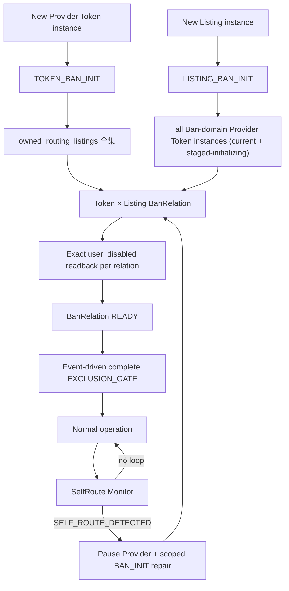

BAN_INIT 的临时可见性由 S13 `maintenance_visibility_override` 执行：不修改业务 desired、admission 全程 CLOSED、
完成/失败后恢复 pre-operation 远端状态。本地候选过滤不是远端 Ban 的替代品。完整远端 union 核对只发生在
BAN-009 的失效事件，不进入请求热路径，也不周期轮询。

## 4. Token 轮换语义

新 Token ready 前旧 Token 可以继续服务，但本地 scheduler 始终只认 current binding。切换事务前必须证明新 Token 的
secret、模型、`TOKEN_BAN_INIT + EXCLUSION_GATE READY`、**由 S06 route owner 随后建立并 exact readback 的 route generation**、
**S04 cost/capability generation** 和 callability 都属于同一 activation generation。S05 不直接写 Pin/Auto-Pool route，
且 S06 不得先启用 Auto-Pool 再补 exclusion。删除旧 Token必须走 S01 双 readback；orphan 绝不恢复为候选。

## 5. BAN_INIT 与 SelfRoute Repair

S05 是整个 BAN_INIT orchestration owner，创建父 operation；S03 拥有 Channel-scope 临时 restore/takedown，
S13 拥有 Listing-scope `maintenance_visibility_override` 临时 listed/unlisted。所有 maintenance pre-state 都是 parent operation 的 immutable snapshot，
重放不得重新采样临时状态。S03 的 parent Channel temporary
restore/takedown 必须发生在相同 parent Channel 的 Listing temporary operations 外层（按 Channel batching），
不得逐 Listing 调用父 Channel restore。锁内保存原 observed/desired/generation；只要无法证明已恢复原远端状态，
所有受影响 Provider 继续暂停且 output Listing CLOSED。运行期 SelfRoute Monitor 观测到自路由时按 BAN-011 的
最小作用域修复。普通 Listing-scope 上下架/改价不是触发源；Auto-Pool `max_ratio` 更新是明确 gate 触发源。

## 6. 完成条件

- 无任何路径可以在 current EXCLUSION_GATE READY 之前启用/更新 Provider Auto-Pool 或发布/恢复 schedulable projection。
- Token rotation 每个中断点可恢复，且最多一个 current remote Token binding。
- 普通 Seller Listing 改价、请求、cooling 与仅 Listing-scope takedown/resubmit 不运行完整 gate；任何 gate 中已禁用关系保持零 mutation。
- retired/hidden/unavailable/replaced 远端实例仍在 authoritative set，直到精确远端删除与完整 Supplier absence 同时确认。
- Ban 后 Listing 任意 takedown/resubmit，BanRelation 仍保持 READY（核心 regression）。

## 7. 冻结成本边界

本设计保留 gate，是因为 owned 集合或 Auto-Pool `max_ratio` 变化会使新的自有 Channel 进入远端候选，可能形成
`A6 owned Channel -> Class1 Provider -> same owned Channel` 自路由。最小实现的成本上限为：每个触发 operation
一次完整 Supplier inventory；每个受影响 Token/model 一次完整 Marketplace 分页；仅漂移关系执行 disable；Auto-Pool
PUT 后一次 subscription exact readback。禁止前后双全量扫描、周期扫描、请求热路径扫描，以及新增 attestation 表、
parent/child 状态机、token-set/owned-set hash 或把内部证据传播到定价、身份、账单。若未来需要突破该边界，必须按
用户级 `OVERENGINEERING_VIOLATION` 规则单独证明收益、性能、实现和运维成本并取得明确授权。

上位依据：[原 Prompt §6.2/§8](../../../sub2api-a6-channel-implementation-prompt.md#8-class1-auto-pool-与-ban) 与 [AGENTS owned Ban hard rule](../../../../AGENTS.md)。
---

### 05-provider-token-ban/pseudocode.md（实现伪代码）

<!-- 以下内容为对应源文件的完整当前版本（随合集同步修订） -->

<!-- ===== 源文件：docs/a6-channel-blueprint/subsystems/05-provider-token-ban/pseudocode.md ===== -->
# S05 Provider Token、Ban Initialization 与 Self-Route Guard：实现伪代码

[自然语言](logic.md) | [测试](tests.md) | [总纲](../../README.md)

## 1. Owned 清单维护

```text
build_owned_routing_listings(credential):                     # BAN-005
    supplier = S01.complete_supplier_inventory(credential)
    require supplier.complete
    remote = every owned Channel/Listing still present in supplier,
             including active/down/unavailable/retired/hidden
    local = every locally controlled Channel/Listing without exact remote-delete proof
    return union(remote, local) with supplier source generation/evidence

build_owned_historical_tombstones(credential):                # BAN-005
    query instances with exact remote-delete confirmation and
        complete current Supplier inventory proving absence
    return tombstone set; audit only, never used for Ban init/gates
```

## 1.1 Ban domain membership transitions（generation 的唯一推动点）

```text
# 成员转换与 generation bump 是一个不可分割的 DB transaction。
# worker crash/replay 只能看到“全部未提交”或“membership+bump+audit 全部已提交”。

transition_ban_membership_once(tx, credential, member, action, reason): # BAN-004,005,FND-014
    require tx active; lock credential
    changed = idempotently apply exactly one transition in tx:
        TOKEN ENTER -> insert Ban-domain membership if absent
        TOKEN EXIT  -> mark permanently exited only after remote delete confirmed
        LISTING ENTER -> insert owned_routing membership if absent
        LISTING EXIT  -> move owned_routing -> historical tombstone only after
                         exact remote delete + complete current Supplier absence
    if not changed: return NO_TRANSITION, current ban_membership_generation
    new_generation = S00.advance_ban_membership_generation_in_tx(tx, credential, reason)
    append membership transition evidence in same tx
    if action == ENTER:
        ban_reason = NEW_PROVIDER_TOKEN if member is Token else NEW_OWNED_ROUTING_LISTING
        insert deduped BAN_INIT_REQUIRED Outbox(member, new_generation, ban_reason) in SAME tx
    return TRANSITION_OCCURRED, new_generation

enter_token_ban_domain_in_tx(tx, token_instance):             # BAN-004,FND-014
    credential = authoritative credential owning token_instance
    return transition_ban_membership_once(tx, credential, token_instance, ENTER,
                                          PROVIDER_TOKEN_INSTANCE_ADDED)

enter_listing_ban_domain_in_tx(tx, listing_instance):         # BAN-004,005,FND-014
    credential = authoritative credential owning listing_instance's parent Channel
    return transition_ban_membership_once(tx, credential, listing_instance, ENTER,
                                          OWNED_ROUTING_LISTING_ADDED)

enter_token_ban_domain(token_instance):                       # BAN-004,FND-014
    begin transaction
    result = enter_token_ban_domain_in_tx(tx, token_instance)
    commit; return result

enter_listing_ban_domain(listing_instance):                   # BAN-004,005,FND-014
    begin transaction
    result = enter_listing_ban_domain_in_tx(tx, listing_instance)
    commit; return result

exit_token_ban_domain_after_confirmed_delete(token_instance): # BAN-003,004,FND-014
    credential = authoritative credential owning token_instance
    begin transaction
    result = transition_ban_membership_once(tx, credential, token_instance, EXIT,
                                            PROVIDER_TOKEN_INSTANCE_REMOVED)
    commit; return result

exit_owned_listing_after_confirmed_remote_delete_in_tx(
        tx, listing_instance, delete_readback, complete_inventory): # BAN-005,FND-014
    require delete_readback exact and complete_inventory.complete
    require listing/channel absent from complete_inventory
    credential = authoritative credential owning listing_instance's parent Channel
    return transition_ban_membership_once(tx, credential, listing_instance, EXIT,
                                          OWNED_ROUTING_LISTING_REMOTE_DELETE_CONFIRMED)

# price/route/max_ratio/Pin/上下架/cooling/local retirement/EXCLUSION_GATE
# 均不得调用 membership transition。
```

## 2. BanRelation 与 BAN_INIT

```text
create_missing_ban_relations(op, pairs):                      # BAN-004
    begin transaction
    for token, listing_instance in stable unique pairs:
        row = load relation(token, listing_instance) FOR UPDATE
        if absent:
            insert relation(state=PENDING, operation_id=op.id)
        else if row.state == READY:
            keep READY                                      # never downgrade/re-ban
        else if row.state == FAILED and row.operation_id == op.id:
            keep FAILED                                     # definitive failure of this op is sticky
        else if row.state == FAILED:
            require op explicitly authorizes retry/supersession of row.operation_id under current generation
            set PENDING, operation_id=op.id, clear current failure fields
        else:
            keep PENDING and require row.operation_id == op.id or explicitly adopt/supersede it
    require unique (token, listing) rows
    current = load relation rows for requested pairs
    commit
    return current

run_ban_init(op, initial_tokens, initial_listings, mode):      # BAN-006..008
    # One matrix reconciler for TOKEN/LISTING/REPAIR. Visibility is grouped by Listing,
    # so a Listing is temporarily resubmitted/restored at most once per reconciliation pass,
    # not once per Token.
    credential = op.credential
    pending_tokens = stable set(initial_tokens)
    pending_listings = stable set(initial_listings)
    while true:
        membership_start = current_ban_membership_generation(credential)
        # First repair any maintenance residue left by a crash before deciding READY rows are done.
        recover unresolved Channel/Listing maintenance_pre_state owned by op
        if any restore not confirmed: return RETRYABLE

        pairs = missing BanRelations for pending_tokens × pending_listings
        # Before completion, also absorb any missing relation in the CURRENT Ban-domain matrix.
        pairs += current_matrix_missing_relations(credential)
        relations = create_missing_ban_relations(op, pairs)
        if any relation FAILED with operation_id == op.id:
            require no unresolved maintenance state for op
            return NON_RETRYABLE

        pass_outcome = READY
        cleanup_pending = false
        groups = group pair Listings by parent_channel stable ID
        for channel, listing_pairs in groups while pass_outcome == READY:
            channel_pre = S03.temporary_restore_channel_for_ban_init(op, channel)
            if channel_pre.restore != CONFIRMED: pass_outcome = RETRYABLE
            try:
                for listing in stable unique Listings from listing_pairs while pass_outcome == READY:
                    listing_pre = S13.persist_ban_pre_state_once(listing, op)
                    relation_tokens = tokens with a missing relation for this listing
                    temporary_used = false
                    try:
                        if listing_pre requires temporary resubmit and relation_tokens not empty:
                            temp = S13.temporary_list_for_ban_init(listing, op)
                            if temp != CONFIRMED: pass_outcome = RETRYABLE; continue
                            temporary_used = true
                        for token in relation_tokens while pass_outcome == READY:
                            ban_state = exact S01 Ban relation readback(token, listing)
                            if already exact user-disabled: mark relation READY; continue
                            resolution = S01.disable_token_for_listing(op child, token, listing)
                            if resolution == CONFIRMED_ADOPT:
                                mark relation READY
                            else if resolution in [REPLAY_SAME_OPERATION, READBACK_INCOMPLETE, RETRY_LATER]:
                                keep relation PENDING with resolution/evidence
                                pass_outcome = RETRYABLE
                            else: # REMOTE_REJECTED or REMOTE_DIVERGED
                                mark relation FAILED for this operation with exact evidence
                                pass_outcome = NON_RETRYABLE
                    finally:
                        if temporary_used or S13.ban_override_active(listing, op):
                            if S13.restore_pre_ban_state(listing, op) != CONFIRMED:
                                cleanup_pending = true
            finally:
                if S03.restore_channel_pre_ban_state(op, channel) != CONFIRMED:
                    cleanup_pending = true

        if cleanup_pending:
            persist underlying pass_outcome/evidence on op; return RETRYABLE_CLEANUP
        if pass_outcome != READY: return pass_outcome  # cleanup is proven restored before terminal failure; no busy-loop

        membership_end = current_ban_membership_generation(credential)
        full_missing = current_matrix_missing_relations(credential)
        if membership_end == membership_start and full_missing empty and no unresolved maintenance state for op:
            require every current required relation READY
            return READY(generation=membership_end)
        pending_tokens = current_ban_domain_tokens(credential)
        pending_listings = current_owned_routing_listings(credential)
        # membership changed while we worked; loop only to close the new missing matrix. READY rows are untouched.

# Auto-Pool 无交集校验（BanRelation 仍是 Token × Listing，
# 但 auto_channels 本身是 Channel ID，因此投影回 parent Channel）：
owned_channel_ids =
    unique(
        listing.parent_remote_channel_id
        for listing in build_owned_routing_listings(credential)
    )
route = exact subscription readback
require route.auto_channels non-empty
    require intersection(set(route.auto_channels), owned_channel_ids).empty
```

## 2.1 事件驱动 owned-Channel exclusion gate

```text
run_owned_exclusion_gate(op, tokens, models, require_effective_subscription): # BAN-004..011
    require op.trigger in [TOKEN_ONBOARD, OWNED_CHANNEL_CREATE_ADOPT, OWNED_CHANNEL_RESTORE,
                           PROVIDER_SCHEDULABLE, MAX_RATIO_UPDATE, SELF_ROUTE_REPAIR]
    credential = op.credential
    pause affected current Providers before remote reads; staged Tokens remain unpublished
    membership_start = current_ban_membership_generation(credential)
    owned = build_owned_routing_listings(credential)          # exactly one complete Supplier inventory
    pairs = every stable token × owned Listing whose canonical model is in models
    relations = create_missing_ban_relations(op, pairs)

    for token, model in stable unique token/model pairs:
        market = S01.complete_owned_market_search(token, model)
        if not market.complete: return BLOCKED(INCOMPLETE_MARKETPLACE)
        for listing in owned filtered to model:
            item = unique exact market item for listing parent Channel/model
            if item absent or non-unique:
                return BLOCKED(OWNED_ITEM_MISSING_OR_AMBIGUOUS)
            relation = relation(token, listing)
            if item.user_channel_disabled == true and item.route_status == user_disabled:
                mark/adopt relation READY with this operation's fresh readback reference
                continue                                           # zero disable mutation
            result = S01.disable_token_for_listing(op child, token, listing)
            if result != CONFIRMED_ADOPT: return BLOCKED(result)
            exact = S01 exact post-read for the same market item
            if exact.user_channel_disabled != true or exact.route_status != user_disabled:
                return BLOCKED(DISABLE_READBACK_MISMATCH)
            mark relation READY with this operation's exact readback reference

        if require_effective_subscription:
            route = S01.exact_effective_subscription(token, model)
            require route.complete and route.auto_channels non-empty
            require intersection(route.auto_channels, owned parent Channel IDs).empty
            if route.mode == PIN: require exact assignment Channel not owned

    if current_ban_membership_generation(credential) != membership_start:
        return RETRY_CURRENT_GENERATION
    append compact gate completion evidence to existing operation journal:
        trigger, membership_start, supplier generation, marketplace page refs,
        relation readback refs, optional subscription readback refs
    return READY(generation=membership_start, operation_id=op.id)

# No gate table, no gate lifecycle state, no token-set/owned-set hash.
# Consumers may only use READY inside the owning operation and while generation remains current.
```

## 3. Provider Token 轮换

```text
start_provider_token_rotation(account, command_op):           # BAN-001,002,012
    begin transaction
    lock account and current token binding
    require command_op is current for account/source generation
    require valid persisted corpus token name selection bound to command_op identity/generation
    operation = idempotently create/load rotation operation(identity=command_op.identity, phase=CREATE_NEW_TOKEN)
    insert/verify rotation Outbox(operation identity) in SAME tx
    commit; return operation

reconcile_provider_token_rotation(op):                        # BAN-002,003
    phase CREATE_NEW_TOKEN:
        resolution = S01 token create/reveal mutation under this stable operation identity + exact get/list readback
        if resolution != CONFIRMED_ADOPT: resolve/retry/review by S01 classification; return
        store revealed secret via S00 and persist/adopt exactly one new Token instance
        enter_token_ban_domain(new token)                     # atomic membership+bump+BAN_INIT_REQUIRED Outbox
        advance BAN_INIT_NEW_TOKEN
    phase BAN_INIT_NEW_TOKEN:
        owned = build_owned_routing_listings(op.credential)
        ban_ready = run_ban_init(op, [new token], owned, mode=TOKEN)
        if ban_ready not READY: return ban_ready
        gate = run_owned_exclusion_gate(op.gate_child, [new token], supported models,
                                        require_effective_subscription=false)
        if gate not READY: return gate
        persist gate generation as COPY_ROUTE fence
        advance COPY_ROUTE
    phase COPY_ROUTE:
        old_route = read old models/quota/route
        route_result = S06.configure_route_for_staged_token(
            op, account, new token, old_route, pre_route_gate=gate)
        require route_result confirmed and owned by S06
        require exact Auto-Pool subscription is non-empty/disjoint, or exact Pin is non-owned
        require matching S04 cost/capability generations
        persist gate generation as SWITCH_BINDING fence
        require route/cost/model/callability current and exact
        advance SWITCH_BINDING
    phase SWITCH_BINDING:
        begin transaction
        lock credential then account; require old binding still current
        if current_ban_membership_generation(op.credential) != op.ban_ready_generation
           or current_matrix_missing_relations(op.credential) not empty:
            keep old binding current; set phase=BAN_INIT_NEW_TOKEN; commit; return RETRYABLE
        require new token has every current required relation READY,
                onboarding gate generation still current, and route/cost/model/callability generations still current
        point account to new token generation
        insert schedulability/eligibility projection refresh Outbox in SAME tx
        commit; advance DELETE_OLD
    phase DELETE_OLD:
        result = S01.delete_token(op child, old token)
        if result == CONFIRMED_ADOPT:
            exit_token_ban_domain_after_confirmed_delete(old token) # atomic membership+bump
            complete
        else:
            mark old token ORPHANED_REMOTE_TOKEN with exact resolution/evidence
            keep it in Ban domain; retry only when S01/S14 classification permits; never restore as candidate

compensate_before_switch(op):                                 # BAN-003
    if any phase before SWITCH_BINDING irrecoverably fails:
        result = S01.delete_token(op cleanup child, new token)
        if result == CONFIRMED_ADOPT:
            # 只有远端删除确认后才把 Token 移出 Ban domain；
            # 否则远端 Token 可能实际还存在，却不再参与新 Listing BAN_INIT
            exit_token_ban_domain_after_confirmed_delete(new token) # atomic membership+bump
            keep old binding and schedulability unchanged
            complete compensation
        else:
            # DELETE unknown/failed：不清除本地 membership，不产生 REMOVED
            mark new token ORPHANED_REMOTE_TOKEN
            keep it in Ban domain
            keep old binding current
            retry cleanup under same operation
```

## 4. Listing 初始化与 SelfRoute 修复

```text
initialize_listing(op, listing_binding, generation):           # BAN-007
    credential = authoritative credential owning listing_binding's parent Channel
    listing = current listing instance for listing_binding/generation
    require op.kind == LISTING_BAN_INIT and op.credential == credential
    lock credential -> output Channel -> Listing
    require listing not yet handed to normal controllers
    enter_listing_ban_domain(listing)                         # idempotent atomic membership+bump
    membership_start = current_ban_membership_generation(credential)
    official = S07 current confirmed official price + FX generation
    init_ck = persisted_random_decimal(op.id, min="0.8", max="1.9") # one-shot, replay-reused
    init_vector = S07.target_listing_vector(official.vector, init_ck, official.fx)
    price_resolution = S07.apply_price_vector(op.init_price_child, init_vector)
    require price_resolution == CONFIRMED_ADOPT and exact S07 confirmed price generation
    tokens = current_ban_domain_tokens(credential)            # includes staged, non-current
    ban_ready = run_ban_init(op, tokens, [listing], mode=LISTING)
    if ban_ready not READY: return ban_ready
    require ban_ready.generation >= membership_start
    begin transaction
    lock credential -> output Channel -> Listing
    require listing still current for binding/generation
    require current_ban_membership_generation(credential) == ban_ready.generation
    require current_matrix_missing_relations(credential) empty
    mark LISTING_BAN_INIT READY for current listing instance/generation
    insert normal S08/S09/S13 handoff Outbox rows in SAME tx
    commit

reconcile_owned_channel_create_or_adopt(op, channel):          # BAN-007,009
    require S03 completed the Channel inventory batch and every intended LISTING_BAN_INIT READY
    tokens = current_ban_domain_tokens(op.credential)
    models = canonical models on the Channel
    return run_owned_exclusion_gate(op, tokens, models,
                                    require_effective_subscription=true)
    # One full gate per Channel batch, not one per Listing.

detect_self_route():                                          # BAN-010
    monitor route usage evidence for each current Provider Token
    if Token actually selected any owned_routing_listing:
        begin transaction
        pause affected Provider with generation fence
        insert deduped SELF_ROUTE_DETECTED Outbox(token, listing, evidence, current generation) in SAME tx
        commit

repair_ban_matrix(token?, listing?, evidence):                # BAN-011
    credential = authoritative credential from known token/listing/evidence scope
    tokens = [token] if token known else current_ban_domain_tokens(credential)
    listings = [listing] if listing known else current_owned_routing_listings(credential)
    repair_op = create/current SELF_ROUTE_REPAIR operation for evidence scope
    ban_ready = run_ban_init(repair_op, tokens, listings, mode=REPAIR)
    if ban_ready not READY: return ban_ready
    gate = run_owned_exclusion_gate(repair_op.gate_child, tokens,
                                    models(listings), require_effective_subscription=true)
    if gate not READY: return gate
    begin transaction
    lock credential then affected Provider/account rows
    require current_ban_membership_generation(credential) == gate.generation
    require current_matrix_missing_relations(credential) empty
    require route/cost/capability generations still current and no other pause/hold reason
    clear only SelfRoute-owned pause + insert schedulability refresh Outbox in SAME tx
    commit

current_ban_membership_generation(credential):                  # BAN-004,FND-014
    return S00.read_ban_membership_generation(credential)

current_ban_domain_tokens(credential):                         # BAN-004,005
    return all Token instances for credential whose Ban-domain membership is entered and not permanently exited

current_owned_routing_listings(credential):                    # BAN-005
    return build_owned_routing_listings(credential)

current_matrix_missing_relations(credential):                  # BAN-004,006,007
    tokens = current_ban_domain_tokens(credential)
    listings = current_owned_routing_listings(credential)
    return every pair in tokens × listings whose BanRelation is absent or state != READY
```

## 需求覆盖索引

本稿实现：`BAN-001`, `BAN-002`, `BAN-003`, `BAN-004`, `BAN-005`, `BAN-006`, `BAN-007`, `BAN-008`, `BAN-009`, `BAN-010`, `BAN-011`, `BAN-012`。
---

### 05-provider-token-ban/tests.md（测试规格）

<!-- 以下内容为对应源文件的完整当前版本（随合集同步修订） -->

<!-- ===== 源文件：docs/a6-channel-blueprint/subsystems/05-provider-token-ban/tests.md ===== -->
# S05 Provider Token、Ban Initialization 与 Self-Route Guard：测试规格

[自然语言](logic.md) | [伪代码](pseudocode.md) | [总纲](../../README.md)

## 1. 核心用例

| Test ID | 需求 | 被测符号 | Given / When / Then |
| --- | --- | --- | --- |
| BAN-T001 | BAN-001 | schema/service boundaries | Provider Token、ingress Key、callback Token 不能写入彼此表或调用彼此 Saga。 |
| BAN-T002 | BAN-002 | token rotation | rotation command/operation/Outbox 重放幂等；command commit 后 crash 不丢 worker、worker replay 不创建第二 rotation operation。新 Token 的 TOKEN_BAN_INIT（BanRelation READY）、route/cost/model/callability 全确认后才 CAS account binding。 |
| BAN-T003 | BAN-003 | pre-switch compensation | 切换前任一失败删除新 Token，旧 binding 和服务保持。 |
| BAN-T004 | BAN-003 | post-switch orphan | 切换后旧删除失败标 orphan；重启只继续 DELETE，不重绑旧 Token。 |
| BAN-T005 | BAN-004 | `create_missing_ban_relations` | Token × Listing 的 BanRelation 唯一；重复 upsert 不产生重复行。 |
| BAN-T006 | BAN-005 | authoritative set/tombstones | active/down/unavailable/retired/hidden 远端项与本地未获远端删除证明项都留在 owned set；只有 exact delete + complete current Supplier absence 才进入 tombstone。本地 retire/takedown/replacement 不退出。 |
| BAN-T007 | BAN-006,008 | `run_ban_init` TOKEN | 新 Token 对所有 owned_routing_listings 建 BanRelation；generation 变化只补 missing、READY 零重 Ban；relation 全 READY 但任一 Listing/Channel pre-state restore 未 confirmed 时 parent op 仍 PENDING、不得 switch；disable 的 definitive reject/diverged 记录 sticky FAILED，同 operation replay 不自动降回 PENDING；若 cleanup restore 未 confirmed，先 `RETRYABLE_CLEANUP` 到原状态恢复，再暴露 NON_RETRYABLE/可见失败；全部恢复且 generation 稳定后才 READY。 |
| BAN-T008 | BAN-007 | `initialize_listing` | 新 Listing → `init_ck ∈ [0.8,1.9]` Decimal、init price exact readback → temporary resubmit → 无 Marketplace-visible poll → 全部 required BanRelations（含 staged Ban-domain Token）READY → 恢复原状态 → 正常 handoff。 |
| BAN-T009 | BAN-007 | unlisted listing | 业务不可见 Listing 通过 maintenance visibility 临时可见后 Ban，完成后恢复原样，desired 不变。 |
| BAN-T010 | BAN-008 | channel batching | Channel A 初始 DOWN、含 10 Listings：Channel temporary restore=1、restore-to-original takedown=1；在 temporary restore 后 crash，重放仍使用第一次持久化 pre-state=DOWN，不把 UP 当原状态；全部恢复前 admission CLOSED。 |
| BAN-T011 | BAN-009 | event boundary regression | Seller price、请求、cooling、Listing takedown/resubmit 不调用完整 gate，BanRelation 仍 READY；Token onboarding、Channel create/adopt/restore、Provider schedulable 与 max_ratio 更新各调用一次 gate。所有 gate 均不改变 `ban_membership_generation`。 |
| BAN-T012 | BAN-010 | `detect_self_route` | Provider 实际选择 owned_routing_listing 时立即暂停 Provider 并产生 `SELF_ROUTE_DETECTED`。 |
| BAN-T013 | BAN-011 | `repair_ban_matrix` | known Token / known Listing / unknown 三种作用域分别只重建最小矩阵并全部 READY。 |
| BAN-T014 | BAN-012 | token corpus | Token 名来自保存的 corpus index；duty/provider/model/ID 不出现在名称。 |
| BAN-T015 | BAN-004,006,007 | membership concurrency | Token T2 与 Listing L2 并发 enter：四个 membership enter/exit DML 与 generation bump 的 commit-boundary crash 全部满足原子性；并在 matrix READY→Token switch、matrix READY→Listing handoff 两个窗口插入新 member，旧 witness 必须提交失败并补齐新矩阵；最终 T2 × L2 = READY；READY 关系零 full re-Ban。 |
| BAN-T016 | BAN-007 | init_ck replay | LISTING_BAN_INIT 生成 `init_ck = 1.347...`；worker crash 后同 operation replay，init_ck 仍为 1.347...，不得重新 random。 |
| BAN-T017 | BAN-003 | pre-switch membership compensation | 新 Token T2 创建并 readback 后进入 Ban domain（generation 10 → 11）；BAN_INIT 或 route copy 在 SWITCH_BINDING 前不可恢复失败 → delete T2 确认 → T2 移出 Ban domain（generation 11 → 12）。断言：T2 不在 Ban-domain Token 集合、旧 Token 仍 current、后续新 Listing 不要求 T2 的 BanRelation。 |
| BAN-T018 | BAN-003 | compensation unknown delete | delete T2 响应 unknown → T2 仍保持 Ban-domain member、不产生 REMOVED generation、旧 binding 不变，cleanup 在同一 operation 下继续重试；远端确认删除前不得本地移除。 |
| BAN-T019 | BAN-004,005,009 | `run_owned_exclusion_gate` | 完整 Supplier union + 每 Token/model 固定参数完整 search；任一 owned 项缺失/歧义、分页不完整、disabled 两字段不匹配均 BLOCKED。已禁用关系 disable spy=0；注入 enable drift 时仅该关系 disable=1并 exact readback。 |
| BAN-T020 | BAN-009 | minimal persistence | schema 中无 exclusion-attestation 表；gate 只追加现有 operation/audit 与 BanRelation readback reference，返回 READY/阻断。定价、身份、账单 schema/状态机均无 gate hash/generation 字段。 |
| BAN-T021 | BAN-006,009 | activation ordering | Token onboarding 与 max_ratio 更新严格满足 pause/unpublished < full gate READY < Auto-Pool mutation < effective subscription non-empty/disjoint < schedulable；gate 后 membership generation 变化使提交失败并重试。 |
| BAN-T022 | BAN-007,009 | Channel batch | 一个含 30 Listings 的 Channel create/adopt：逐 Listing BAN_INIT 后只执行 1 次全 Token/model gate；普通单 Listing resubmit 的 gate spy=0。 |

## 2. 轮换故障注入

对 CREATE、route copy、BAN_INIT 中间项、switch transaction、DELETE 发包后响应丢失分别终止 worker。断言 operation identity 不变、最多一个 current binding、新 Token 未 ready 时旧 Token 可服务、切换后旧 Token永不成为候选。membership 原子事务在 COMMIT 前 crash 时整体 rollback，replay 必须重新得到 TRANSITION_OCCURRED 且只提交一次 +1；COMMIT 后 crash 的 replay 才返回 NO_TRANSITION 且不重复 +1。另在 `run_ban_init` 返回 READY 后、Token switch/Listing handoff 提交前插入新 Ban member，断言 generation fence 必须使提交失败并回到 matrix reconcile。pre-switch compensation 的 DELETE 响应丢失时，新 Token 保持 Ban-domain member、不产生 REMOVED，cleanup 同 operation 重试。

## 3. Ban 属性测试

- 随机普通事件序列（Seller price、请求、cooling、Listing-scope takedown/resubmit）下 full-gate spy=0；随机失效事件序列精确触发一次 gate。所有 fresh-disabled readback 的 disable mutation spy=0。
- BAN_INIT 每项 readback 两个字段（`user_channel_disabled`、`route_status`）任一缺失时 relation 不 READY。
- 所有事件排列下，不存在新 Token/新 Listing 的 `route_enabled_at < ban_confirmed_at`。
- 随机并发成员变化（新 Token/新 Listing 插入）下，最终矩阵无 missing relation，且已 READY 关系零重 Ban。

## 4. 生产验收证据

对隔离 Provider Token 保存完整搜索参数/页引用、owned_routing_listings 清单、逐项 disable readback 和最终 subscription 无交集证据；使用现有 operation journal/audit，不创建独立证明实体。另保存一次普通 Listing resubmit 的 full-gate spy=0。报告只使用 Token ID、fingerprint/last4。

## 需求覆盖索引

本测试集覆盖：`BAN-001`, `BAN-002`, `BAN-003`, `BAN-004`, `BAN-005`, `BAN-006`, `BAN-007`, `BAN-008`, `BAN-009`, `BAN-010`, `BAN-011`, `BAN-012`。
---

## Part 4.9：a6-channel-blueprint/subsystems/06-provider-routing-liquidity/（S06 Provider 路由、失败恢复与流动性）

> 本工作包三份稿的树关系：`logic.md`（规范事实）-> `pseudocode.md`（实现，标注需求 ID）-> `tests.md`（每个测试回链需求 ID）。
> 需求 ID 命名空间见 traceability.md 第 1 节。

### 06-provider-routing-liquidity/logic.md（自然语言蓝图）

<!-- 以下内容为对应源文件的完整当前版本（随合集同步修订） -->

<!-- ===== 源文件：docs/a6-channel-blueprint/subsystems/06-provider-routing-liquidity/logic.md ===== -->
# S06 Provider 路由、失败恢复与流动性：自然语言蓝图

[总纲](../../README.md) | [伪代码](pseudocode.md) | [测试](tests.md) | [S05 Ban](../05-provider-token-ban/logic.md)

## 1. 目标与边界

S06 拥有 Class1 Auto-Pool/Pin route generation、运行失败扩缩、`ROUTE_UNKNOWN`、`AUTO_POOL_RANGE_EXHAUSTED`、`UNFUNDED`、merchant balance repair、Provider duty/slot replacement 和独立 liquidity/callback Token。S05 提供 Token/BanRelation 与最小 `EXCLUSION_GATE`；S04 提供成本事实，S08 接收 Seller repricing。S06 只消费 S05 的 READY/阻断结果，不复制 gate 内部状态。

## 2. 需求

| ID | 规范 |
| --- | --- |
| RTE-001 | route mode 是显式管理事实；Auto-Pool 与 Pin 不自动互切，只有管理员可改变 mode。初始/admin/staged-token route 都进入 S06 同一 owner path。Auto-Pool enable/`max_ratio` PUT 前必须取得 S05 gate READY；Pin 可先配置但进入/恢复 schedulable 前必须取得 gate READY。S06 写 route generation，S04 写匹配 cost/capability generation。 |
| RTE-002 | Auto-Pool 运行失败先暂停 Class1，fresh Observer 以 `target_n+1` 扩到下一完整价带。在 `max_ratio` PUT 前运行一次 S05 gate；PUT 后只做 exact subscription readback 与 gate membership generation fence，不重复全量 scan，之后提交 route/cost 并恢复。 |
| RTE-003 | 非 quota Provider runtime failure 不要求证明具体 Channel；保持 paused，严格扩到下一 CNY 带且不超过 0.3。S05 gate、matching USD cost、route/effective subscription/capability readback通过后恢复，并立即触发 Seller 重定价/发布。 |
| RTE-004 | 稳定且距上次变更均>=30 分钟、成功>=100、无上游错误，且 `cv_n>5%` 或 `tail_jump>3%` 时每轮 `target_n-1`；不得截断同价带。 |
| RTE-005 | 超过 max_n、无非 owned 可调用项或下一完整价带>0.3 时置 `AUTO_POOL_RANGE_EXHAUSTED` 并摘流；每 60 秒 fresh 重评，有合法完整价带才恢复。 |
| RTE-006 | 任一 Auto-Pool mutation（expand/shrink/manual）结果不明仅摘受影响 Class1并置 `ROUTE_UNKNOWN`；GET 后 adopt、同 operation replay 或按第三状态 replan，旧 route 不再视为远端事实；服务端 definitive reject 不当作 unknown/replay。 |
| RTE-007 | Pin 不执行 target_n+1。assignment 失败时暂停、创建 repin generation，选择新非 owned Channel并写 Pin/readback；在恢复 schedulable 前运行一次 S05 gate并确认 assignment 非 owned，随后匹配 S04 cost/capability/model。失败保持 paused。 |
| RTE-008 | `insufficient_quota` 立即摘流并置 `UNFUNDED`，只进入 liquidity controller，绝不 fresh Observer、扩池或调 max_ratio。 |
| RTE-009 | 流动性修复先读取余额计算合格整单位；真实 transfer 前写 immutable transfer intent 并取得 RTE-011/012 callback witness，mutation 后 exact readback。unknown/incomplete 时保持同 intent/amount 对账且 UNFUNDED，不盲重 POST；确认后仍不满足 funding contract 才移除 Provider duty、旧 slot=`VACANT`、请求 funded replacement。 |
| RTE-010 | replacement 在 slot 外完成 BAN_INIT、current S05 gate、Observer range、Enodot cost、能力、funding、route/subscription 与 schedulability readback前不得进入 slot；任一 owned 项未确认 disabled 时 slot 保持 VACANT。 |
| RTE-011 | liquidity/callback Token 与 Provider Token/ingress Key 独立，名称来自 token corpus；只可 Pin 到当前 listed、callable 的 A6-owned small-merchant Channel，无目标则跳过请求。 |
| RTE-012 | 生产 callback 只使用精确输入 `PING 5db98307ce2d442ee568baacf8b0e7076fa657cbe2806ccff9da6386997915e2`；要求 realistic sampled usage 与 high-cache invariant，`prompt_tokens=1, completion_tokens=0, total_tokens=1` 等 probe-shaped usage 不计有效划转。 |
| RTE-013 | Provider shadow timer 始终禁用。仅当路由/成本变化确需新 immutable generation 且无 active/planned generation 可复用时，记录具体理由后单次运行；不等待非必需 observation window。 |
| RTE-014 | Seller 可以并发预计算/应用，但 Seller 完成不是 Provider 激活前置；Provider 恢复后必须有即时 repricing/publication 事件。 |

## 3. 路由恢复子图

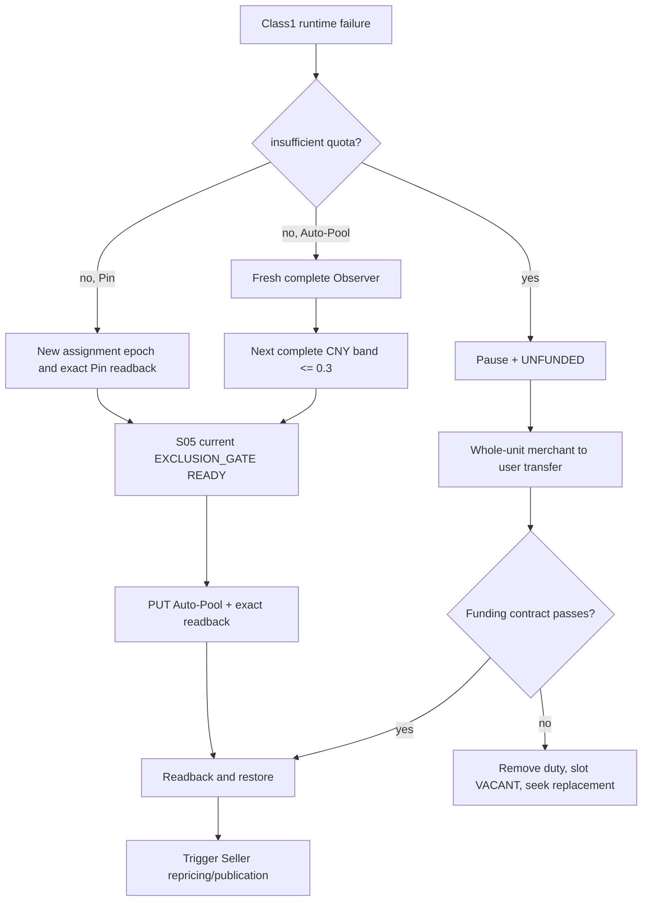

## 4. Auto-Pool 边界

扩池按完整价格带而非固定数量；若下一带使包含项超过 `max_n`，视为 exhausted，不能截断。`hard_max_ratio=0.3` 是不可突破的 ceiling。缩池每次只减少一个 target 并重新完整包含边界带，避免抖动。

`ROUTE_UNKNOWN` 期间没有可信旧 route，scheduler 必须继续摘流。GET 只能确定 adopt/replay/replan，不能因为缓存仍显示旧 generation 而恢复。

## 5. 流动性与 callback

whole unit 的单位按 A6 balance transfer 合同显式配置并使用 Decimal/micros。transfer preview 与执行都读回 user/merchant balance。callback 不是通用探针；只有存在合格 small-merchant Channel 时才发唯一固定 PING，并把完整 response usage 与 high-cache witness 绑定 transfer operation。

## 6. Shadow 规则

日常 Pin refresh、liquidity repair、retry、readback、deployment verification 都直接使用窄 controller 和现有 generation，不运行 shadow。例外 one-shot 后必须再次读回 timer disabled。

## 7. 完成条件

- quota 与非-quota 错误在分类入口即互斥，无法走错恢复路径。
- Auto-Pool/Pin 的 unknown、exhausted 和 replacement 都保持保守摘流。
- 每次 Auto-Pool PUT 前最多一个完整 S05 gate；PUT 后不重复 full scan，普通 Seller 改价和请求不调用 gate。
- shadow timer 默认、执行前后和发布后均有 disabled 证据。

上位依据：[原 Prompt §8](../../../sub2api-a6-channel-implementation-prompt.md#8-class1-auto-pool-与-ban) 与 [根 AGENTS](../../../../AGENTS.md)。
---

### 06-provider-routing-liquidity/pseudocode.md（实现伪代码）

<!-- 以下内容为对应源文件的完整当前版本（随合集同步修订） -->

<!-- ===== 源文件：docs/a6-channel-blueprint/subsystems/06-provider-routing-liquidity/pseudocode.md ===== -->
# S06 Provider 路由与流动性：实现伪代码

[自然语言](logic.md) | [测试](tests.md) | [总纲](../../README.md)

## 0. 初始/人工/Staged Token route owner path

```text
apply_route_policy(op, account, token, desired_policy):       # RTE-001,006,007
    require caller is authorized admin command or S05 TOKEN_ROTATION child command
    require token Ban-domain membership present
    require TOKEN_BAN_INIT READY or onboarding gate operation owns this staged Token
    require desired_policy.mode in [AUTO_POOL, PIN]
    persist S06 desired route generation/operation before remote mutation; never auto-switch mode
    if AUTO_POOL:
        gate = S05.run_owned_exclusion_gate(op.pre_put_gate_child, [token], [desired_policy.model],
            require_effective_subscription=false)
        if gate not READY: keep paused/unpublished; return gate
        resolution = S01.execute_mutation(op, subscription pre-read, PUT auto-pool, exact subscription post-read)
    else:
        resolution = S01.execute_mutation(op, pin pre-read, POST pin, exact pins post-read)
    handle target/old/third/reject using the same resolution contract
    on target confirmation:
        if AUTO_POOL:
            require auto_channels non-empty and disjoint from S05 owned Channel IDs
            require current ban_membership_generation == gate.generation
        else:
            gate = S05.run_owned_exclusion_gate(op.pre_activation_gate_child, [token], [desired_policy.model],
                require_effective_subscription=true)
            require gate READY and exact Pin assignment Channel not owned
        facts = S04.commit_class1_route_facts(account, exact route readback)
        activate route only when facts cost/capability and route/model/callability all match
        if token is current: activation + account restore + Seller repricing/publication Outbox are one DB transaction
        if token is staged: persist confirmed route facts only; do not publish schedulability
    return confirmed activation facts or conservative pending/failure

configure_route_for_staged_token(parent_op, account, staged_token, old_route): # RTE-001
    desired = immutable copy of old route policy under staged token identity
    return apply_route_policy(child operation of parent_op, account, staged_token, desired)
```

## 1. 运行失败入口

```text
handle_provider_runtime_failure(account, error, fingerprint): # RTE-001..003,007,008
    begin transaction
    pause account with generation fence
    if canonical_error(error) == insufficient_quota:
        set UNFUNDED
        insert deduped liquidity-operation Outbox in SAME tx
        commit; return
    if account.route_mode == AUTO_POOL:
        insert unique expand-operation Outbox(account, route_generation, fingerprint) in SAME tx
    else if account.route_mode == PIN:
        insert unique repin-operation Outbox(account, assignment_epoch, fingerprint) in SAME tx
    never change route_mode
    commit
```

## 2. Auto-Pool 扩缩

```text
next_complete_band(snapshot, current_policy):                 # RTE-002,003,005
    require snapshot fresh, complete, callable and non-owned filtered
    current_boundary = current confirmed max_ratio
    bands = group sorted CNY ratios by exact Decimal value
    next = first band strictly greater than current_boundary
    if no next or next.ratio > Decimal("0.3"): return EXHAUSTED
    included_count = count(all items with ratio <= next.ratio)
    if included_count > max_n: return EXHAUSTED
    return {max_ratio:next.ratio, included_count, snapshot_generation}

reconcile_auto_pool_expand(op):                              # RTE-002,003,006,014
    account = authoritative account(op.account_id)
    route = current confirmed S06 route generation(account)
    require account paused and op still current for route.generation
    snapshot = fresh Observer full marketplace round
    desired = next_complete_band(snapshot, route.policy)
    if EXHAUSTED:
        transactionally set AUTO_POOL_RANGE_EXHAUSTED + insert 60s fresh-reevaluation Outbox; keep paused; return
    desired_route_generation = idempotently get/create immutable S06 route generation
        keyed by (account, ROUTE, op.identity) with exact desired payload hash;
        replay adopts same generation, later current -> SUPERSEDED
    gate = S05.run_owned_exclusion_gate(op.pre_put_gate_child,
        [current Provider Token], [route.model], require_effective_subscription=false)
    if gate not READY: keep paused; return gate
    result = S01.execute_mutation(op, subscription pre-read, PUT auto-pool, exact subscription readback)
    if result in [READBACK_INCOMPLETE, RETRY_LATER]: set ROUTE_UNKNOWN; keep paused; resolve by GET
    if result == REPLAY_SAME_OPERATION: set ROUTE_UNKNOWN; keep paused; replay same op only after exact old readback
    if result == REMOTE_DIVERGED: set ROUTE_UNKNOWN; supersede/replan from remote fact
    if result == REMOTE_REJECTED: keep paused; classify error; do not blind replay
    if result == CONFIRMED_ADOPT:
        facts = S04.commit_class1_route_facts(account, exact route readback)
        require auto_channels non-empty/disjoint, model/facts.cost/facts.capability/readiness exact
        require current ban_membership_generation == gate.generation
        begin transaction
        activate S06 route generation and restore account if no other pause reason
        insert immediate Seller repricing/publication Outbox in SAME tx
        commit

maybe_shrink_auto_pool(account, observation):                 # RTE-004
    require stable_for>=30m and since_change>=30m and successes>=100 and errors==0
    require cv_n>0.05 or tail_jump>0.03
    desired_target = target_n - 1, bounded by min_n
    recompute complete boundary band; never truncate equal band
    use the same one pre-PUT S05 gate + S01 mutation/readback + generation fence + S04 activation as expand;
    unknown -> ROUTE_UNKNOWN
```

## 3. Route unknown

```text
resolve_route_unknown(op):                                   # RTE-006
    remote = exact GET subscription with complete related facts
    if remote == op.desired: adopt generation
    else if remote == op.pre_state: replay same operation ID
    else supersede op and plan new generation from remote fact
    account remains paused until full activation readbacks pass
```

## 4. Pin

```text
reconcile_repin(op):                                         # RTE-007
    account = authoritative account(op.account_id)
    route = current confirmed S06 route generation(account)
    require route.mode == PIN and account paused and op.assignment_epoch == route.assignment_epoch
    snapshot = fresh callable marketplace; choose new non-owned Channel by route.Pin policy
    create S06 assignment_epoch+1; require current Provider Token instance TOKEN_BAN_INIT READY
    resolution = S01.execute_mutation(op, pin pre-read, POST pin, exact pins post-read)
    if CONFIRMED_ADOPT:
        gate = S05.run_owned_exclusion_gate(op.pre_activation_gate_child,
            [current Provider Token], [route.model], require_effective_subscription=true)
        if gate not READY: keep paused; return gate
        facts = S04.commit_class1_route_facts(account, confirmed Pin assignment/readback)
        require assignment non-owned and channel/facts.cost/facts.capability/model all match epoch
        begin transaction
        activate assignment generation and restore account if no other pause reason
        insert Seller repricing Outbox in SAME tx
        commit
    if REPLAY_SAME_OPERATION: keep paused; replay same op after exact old readback
    if REMOTE_DIVERGED: keep paused; supersede/replan from remote fact
    if READBACK_INCOMPLETE/RETRY_LATER: keep paused; retry readback
    if REMOTE_REJECTED: keep paused; classify; do not blind replay
```

## 5. Liquidity

```text
reconcile_liquidity(op):                                     # RTE-008..010
    account = authoritative account(op.account_id)
    funding_policy = immutable policy referenced by op.funding_policy_generation
    require account UNFUNDED and paused and op still current
    balances = exact read merchant withdrawable + user balance
    if op.transfer_intent absent:
        amount = floor_to_eligible_whole_units(balances.withdrawable,
                                                funding_policy.transfer_unit)
        if amount > 0:
            witness = run_liquidity_callback(op)
            if witness != VALID: record SKIPPED/INVALID_CALLBACK; keep UNFUNDED; return
            persist immutable transfer_intent(op.identity, amount, balances pre-hash, witness)
    if transfer_intent exists and not confirmed:
        require same persisted amount; never recompute it on retry
        preview exact persisted amount
        resolution = S01.execute_mutation(op, exact balance pre-reader,
                                          POST balance transfer(persisted amount), exact balance post-reader)
        if CONFIRMED_ADOPT: mark transfer intent confirmed with post balances
        if REPLAY_SAME_OPERATION: replay same intent only after exact-pre readback
        if REMOTE_DIVERGED or READBACK_INCOMPLETE or RETRY_LATER:
            keep UNFUNDED; reconcile same intent from balances; do not POST a new amount; return
        if REMOTE_REJECTED: keep UNFUNDED; record failure; return
    readback = exact current balances                           # defined even when amount==0
    if funding_contract(account, readback) passes:
        gate = S05.run_owned_exclusion_gate(op.reactivation_gate_child,
            [current Provider Token], [route.model], require_effective_subscription=true)
        require gate READY and route/callability/cost/capability readbacks current
        begin transaction
        clear UNFUNDED by owner; restore account only if no other pause reason
        insert schedulability/eligibility reprojection Outbox in SAME tx
        commit
    else:
        transactionally remove Provider duty and project slot VACANT
        enqueue funded replacement request in same transaction

admit_replacement(slot, account):                        # RTE-010
    require funded, native schedulable, capability current, cost current,
            Observer route current and S05 current EXCLUSION_GATE READY
    CAS slot VACANT -> account
```

## 6. Callback Token

```text
run_liquidity_callback(op):                                  # RTE-011,012
    token = require distinct callback duty and valid corpus name
    candidates = A6-owned small-merchant Channels with exact listed+callable readbacks
    if none: record SKIPPED_NO_ELIGIBLE_CHANNEL; return without request
    pin_resolution = S01.execute_mutation(op child, callback-pin pre-read, POST pin, exact pin readback)
    if pin_resolution != CONFIRMED_ADOPT: return NO_VALID_WITNESS
    response = POST /v1/responses input EXACT_PRODUCTION_PING
    require realistic sampled usage and configured high-cache invariant
    reject prompt_tokens=1, completion_tokens=0, total_tokens=1
           or other probe-shaped usage
    only then persist and return VALID callback witness for the same liquidity operation
```

## 7. Shadow guard

```text
maybe_run_provider_shadow(reason, required_route_change):     # RTE-013
    require timer is disabled
    reusable = current active or already-planned generation satisfies operation
    if reusable: return reusable without running shadow
    require required_route_change and explicit persisted concrete reason
    run service one-shot; do not enable timer or wait optional observation window
    finally require service inactive and timer disabled readback
```

## 需求覆盖索引

本稿实现：`RTE-001`, `RTE-002`, `RTE-003`, `RTE-004`, `RTE-005`, `RTE-006`, `RTE-007`, `RTE-008`, `RTE-009`, `RTE-010`, `RTE-011`, `RTE-012`, `RTE-013`, `RTE-014`。
---

### 06-provider-routing-liquidity/tests.md（测试规格）

<!-- 以下内容为对应源文件的完整当前版本（随合集同步修订） -->

<!-- ===== 源文件：docs/a6-channel-blueprint/subsystems/06-provider-routing-liquidity/tests.md ===== -->
# S06 Provider 路由与流动性：测试规格

[自然语言](logic.md) | [伪代码](pseudocode.md) | [总纲](../../README.md)

## 1. 核心用例

| Test ID | 需求 | 被测符号 | Given / When / Then |
| --- | --- | --- | --- |
| RTE-T001 | RTE-001 | route owner/failure entry | 初始/admin/staged-token route 全命中 S06；Auto-Pool PUT 前 gate READY，Pin 进入 schedulable 前 gate READY；S05 route mutation spy=0，S06 不保存 gate 内部状态。 |
| RTE-T002 | RTE-002,003 | `next_complete_band` | fresh snapshot 严格选择当前边界后的下一 Decimal 价带并完整包含同价项。 |
| RTE-T003 | RTE-002,003 | expand activation | pause < 单次 full gate < PUT < subscription exact readback/generation fence < route+cost activation < restore；gate 后 membership 变化不恢复；post-PUT full-gate spy=0。 |
| RTE-T004 | RTE-004 | `maybe_shrink_auto_pool` | 四个稳定条件和二选一统计阈值全满足才 target-1；相等价带不截断。 |
| RTE-T005 | RTE-005 | range exhausted | >max_n、无 candidate、下一带>.3 各自摘流；60 秒后 fresh 合法带可恢复。 |
| RTE-T006 | RTE-006 | `resolve_route_unknown` | PUT 响应丢失后 target/old/third 三状态分别 adopt/replay/replan，期间始终 paused。 |
| RTE-T007 | RTE-007 | `reconcile_repin` | Pin 失败不扩 target_n；五类结果闭合；pre-activation gate、assignment non-owned、channel/S04 cost+capability/model 任一缺失不恢复。 |
| RTE-T008 | RTE-008 | `handle_provider_runtime_failure` | 所有 insufficient quota 变体只进入 UNFUNDED/liquidity，Observer 未被调用。 |
| RTE-T009 | RTE-009 | `reconcile_liquidity` | callback witness + immutable transfer intent 在 POST 前存在；响应丢失后 target/old/third/incomplete 不重复新 amount；amount=0 路径 readback 有定义；仍不足才 duty 移除、slot VACANT。 |
| RTE-T010 | RTE-010 | `admit_replacement` | funding/BAN_INIT/current gate/range/cost/capability/subscription/schedulability 任一缺失时 replacement 在 slot 外。 |
| RTE-T011 | RTE-011 | callback selection | Token 三资源隔离；无 listed+callable small Channel 时记录 skip，balance transfer POST spy=0；callback Pin unknown/reject 时同样无 transfer。 |
| RTE-T012 | RTE-012 | `run_liquidity_callback` | 请求 input 字节精确；高缓存 realistic usage 通过；`prompt_tokens=1/completion_tokens=0/total_tokens=1` 或其他 probe-shaped usage 不计 transfer。 |
| RTE-T013 | RTE-013 | `maybe_run_provider_shadow` | 有 reusable generation 时不运行；无合理 route change 时拒绝；one-shot 前后 timer disabled。 |
| RTE-T014 | RTE-014 | Seller dependency | Seller apply 延迟/失败不阻止已满足自身 readback 的 Provider；事件仍可靠投递。 |
| RTE-T015 | RTE-001,002,007 | gate cost regression | 每个 Auto-Pool PUT 恰有一个 pre-PUT full gate、零 post-PUT full scan；所有关系已禁用时 disable mutation=0。Pin 配置后仅在 schedulable activation 运行一次 gate；Seller price/request 的 gate spy=0。 |

## 2. 属性与竞态

- 对随机价格带断言结果严格大于旧 boundary、<=0.3、完整价带且 included_count<=max_n。
- quota 与非-quota 分类对所有 `errorlist.md` 变体互斥。
- 并发两次 expand 只有 current generation operation 可 PUT；旧 operation superseded。
- PUT 后任意 crash 不会把旧 route 当作确认事实。

## 3. 生产验收证据

保存一次隔离 Auto-Pool readback 或复用 generation 的证据、一次 Pin readback、一次无损 liquidity dry-run/受控 transfer、callback usage witness，以及 `a6-trader-provider-pool-shadow.service` 和 timer 未启用的前后状态。生产失败演练不得伪造 quota 或发送额外显眼 Probe。

## 需求覆盖索引

本测试集覆盖：`RTE-001`, `RTE-002`, `RTE-003`, `RTE-004`, `RTE-005`, `RTE-006`, `RTE-007`, `RTE-008`, `RTE-009`, `RTE-010`, `RTE-011`, `RTE-012`, `RTE-013`, `RTE-014`。
---

## Part 4.10：a6-channel-blueprint/subsystems/07-price-facts/（S07 Listing 价格事实、ck 与 FX）

> 本工作包三份稿的树关系：`logic.md`（规范事实）-> `pseudocode.md`（实现，标注需求 ID）-> `tests.md`（每个测试回链需求 ID）。
> 需求 ID 命名空间见 traceability.md 第 1 节。

### 07-price-facts/logic.md（自然语言蓝图）

<!-- 以下内容为对应源文件的完整当前版本（随合集同步修订） -->

<!-- ===== 源文件：docs/a6-channel-blueprint/subsystems/07-price-facts/logic.md ===== -->
# S07 Listing 价格事实、ck 与 FX：自然语言蓝图

[总纲](../../README.md) | [伪代码](pseudocode.md) | [测试](tests.md) | [S08 定价策略](../08-pricing-policy/logic.md)

## 1. 目标与边界

S07 把 A6 官方 USD 价格、Listing 整数 micros、固定 markup 和 FX 读回转换成版本化 `confirmed_ck` 事实，并为 `ToA6API` 提供独立 base cost resolver。它不选择经营价格分布、不计算 delta、不执行下架恢复。

## 2. 需求

| ID | 规范 |
| --- | --- |
| PRF-001 | A6 `commission=0.2` 固定；`ck` 是商户净 `K_CNY`，公开倍率 `ck_public=ck*1.2`。 |
| PRF-002 | `fx_usd_cny=realtime_ratio_cny/realtime_ratio_usd`；`ck=fx_usd_cny*listing_price_micros[canonical]/official_price_micros[canonical]`。 |
| PRF-003 | Listing 统一 `charge_type=per_token`；canonical 维度按 input、output、cache_read、cache_write 中第一个官方非零价选择。 |
| PRF-004 | 写目标 ck 时每个官方非零维度使用 `ceil(official_micros[d]*ck/fx)`；写后逐维计算 `ck_d`，`confirmed_ck=min(ck_d)`。 |
| PRF-005 | 各维度只允许单个 micros 向上取整造成的误差；超出整数误差包络即价格向量 drift。零官方维度保持协议允许值且不参与 ck。 |
| PRF-006 | 批量 `markup-preview` 按 `channel_id` 唯一映射；缺项、重复、非法值、`percent!=20`、source/billing/official vector/charge type 不一致置 `OUTPUT_CONFIG_INVALID`。 |
| PRF-007 | A6 远端读回是 ck、markup、Listing 状态和官方模型价格的事实源。修复并 current-generation readback 匹配后才允许 owner 清 config hold。 |
| PRF-008 | `ToA6API` 使用独立版本化价格 resolver，以同一 A6 官方 USD vector 计算 `base_actual_cost`；不得全局覆盖普通分组定价。 |
| PRF-009 | A6 暂不可达时保留 `last_confirmed_ck` 和 current model-price generation；写失败只建待重试 operation，不覆盖确认事实。 |
| PRF-010 | FX 首选 A6 marketplace 同一 snapshot 的 CNY/USD 比值；A6 不可用才使用 Frankfurter `latest?from=USD&to=CNY` 的 `rates.CNY`。不做投票，A6 恢复立即切回。 |
| PRF-011 | fallback timeout=3s、cache TTL=30m、active refresh=15m、source date 最大 96h、无 credential；两源均不可用时沿用 last confirmed FX 且禁止新价格写入。 |
| PRF-012 | 每个 model-price/FX/listing-price generation 保存原始整数 vector、source timestamp/hash、rounding policy 和 canonical 维度。 |

逐维读回公式为 `ck_d=fx_usd_cny*listing_price_micros[d]/official_price_micros[d]`。批量 markup 读回保存 `percent/source`，且 `percent != 20` 必须视为配置错误。

## 3. 价格事实子图

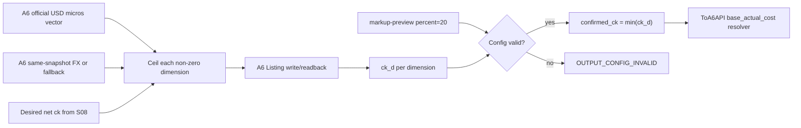

## 4. 保守经济口径

`confirmed_ck=min(ck_d)` 防止任一 token dimension 因远端整数价格比目标更低而被忽略。canonical 仅用于 UI 展示和主要公式，不可代替逐维配置验证。S10 结算必须使用 attempt 冻结的同一 vector generation。

## 5. FX 状态

FX 事实包含 `source=A6|FRANKFURTER|LAST_CONFIRMED`、quote date、fetched time、freshness、snapshot ID。两源不可用时使用 `last_confirmed_fx`；它允许现有请求按旧 generation 结算，但 S08 不得创建新的远端 price mutation。

## 6. 完成条件

- 整数 micros round-trip 对所有非零维度可复算，误差包络精确。
- A6/Frankfurter 切换不会投票或混用不同 snapshot。
- 普通 Sub2API group 定价回归不受 `ToA6API` resolver 影响。

上位依据：[原 Prompt §9](../../../sub2api-a6-channel-implementation-prompt.md#9-ck官方价格与-fx)。
---

### 07-price-facts/pseudocode.md（实现伪代码）

<!-- 以下内容为对应源文件的完整当前版本（随合集同步修订） -->

<!-- ===== 源文件：docs/a6-channel-blueprint/subsystems/07-price-facts/pseudocode.md ===== -->
# S07 价格事实、ck 与 FX：实现伪代码

[自然语言](logic.md) | [测试](tests.md) | [总纲](../../README.md)

## 1. Price vector

```text
DIMENSIONS = [input, output, cache_read, cache_write]
COMMISSION = Decimal("0.2")

choose_canonical(official):                                  # PRF-003
    return first d in DIMENSIONS where official[d] > 0
    or CONFIG_INVALID if all zero

target_listing_vector(official, target_ck, fx):              # PRF-002..005
    require target_ck>0 and fx>0
    vector = {}
    for d in DIMENSIONS:
        if official[d] > 0:
            vector[d] = ceil_integer(Decimal(official[d]) * target_ck / fx)
        else:
            vector[d] = protocol_zero_value
    return vector

confirm_listing_vector(official, remote_vector, fx, target_ck, expected_vector): # PRF-004,005,012
    canonical = choose_canonical(official)
    ck_by_dimension = {}
    envelope = {}
    for d where official[d]>0:
        require remote_vector[d] is nonnegative integer
        require remote_vector[d] == expected_vector[d]          # remote must equal our exact ceil target
        ck_d = fx * Decimal(remote_vector[d]) / Decimal(official[d])
        one_micros_ck = fx / Decimal(official[d])
        require target_ck <= ck_d < target_ck + one_micros_ck   # only the local ceil error envelope is allowed
        ck_by_dimension[d] = ck_d
        envelope[d] = one_micros_ck
    return generation(canonical_ck=ck_by_dimension[canonical],
                      confirmed_ck=min(ck_by_dimension.values),
                      ck_by_dimension, quantization_envelope=envelope,
                      vector=remote_vector, expected_vector, target_ck,
                      official=official, fx=fx)

price_vector_quantization_envelope(snapshot):                 # PRF-005,012
    return max per-dimension allowed earning/micros effect derived from snapshot.quantization_envelope
```

## 2. 版本化价格事实与 Markup/config audit

```text
commit_price_fact_generation(scope, kind, payload, source_evidence, followup): # PRF-006,007,010..012
    begin transaction
    lock scope/kind current pointer
    if current generation has identical source hash + payload hash: return current (no duplicate generation)
    insert immutable generation(payload, source timestamp/hash, rounding policy, canonical dimension)
    advance current pointer with CAS
    if followup: insert owning recompute/audit Outbox rows in SAME tx
    commit
    return new generation

ingest_official_model_prices(snapshot):                       # PRF-002,003,012
    require snapshot COMPLETE and every official micros vector is nonnegative integer
    for model in snapshot.models:
        canonical = choose_canonical(model.official_vector)
        commit_price_fact_generation(model, MODEL_PRICE,
            {integer_vector=model.official_vector, canonical}, snapshot.evidence,
            followup=PRICE_CONFIG_AND_PRICING_RECOMPUTE)

audit_output_config(credential, channels, listings, model_generation, fx_generation): # PRF-006,007,012
    preview = S01.batch_markup_preview([c.remote_channel_id for c in channels], credential)
    if preview incomplete or channel_id mapping missing/duplicate:
        transactionally ensure OUTPUT_CONFIG_INVALID + config-repair Outbox; return INVALID
    official = load immutable MODEL_PRICE generation(model_generation)
    fx = load immutable FX generation(fx_generation)
    for listing in listings:
        errors = []
        item = preview[listing.parent_remote_channel_id]
        if item.percent != Decimal("20") or item.source invalid: errors += MARKUP_DRIFT
        if listing.charge_type != per_token: errors += CHARGE_TYPE_DRIFT
        if listing.billing/model ref != model_generation identity: errors += MODEL_PRICE_REF_DRIFT
        expected_vector = target_listing_vector(official.integer_vector, listing.target_ck, fx.value)
        if confirm_listing_vector(official.integer_vector, listing.remote_vector, fx.value,
                                  listing.target_ck, expected_vector) fails: errors += PRICE_VECTOR_DRIFT
        begin transaction
        append immutable config observation(errors, preview/model/fx source hashes)
        if errors:
            ensure S07-owned OUTPUT_CONFIG_INVALID + owning repair Outbox in SAME tx
        else:
            publish/retain confirmed Listing price fact and clear only matching S07 config-invalid source + downstream recompute Outbox in SAME tx
        commit
```

## 3. FX resolver

```text
resolve_fx(a6_snapshot, now):                                # PRF-010,011,012
    if a6_snapshot COMPLETE and has positive CNY/USD ratios from the same snapshot:
        value = Decimal(a6_snapshot.cny_ratio) / Decimal(a6_snapshot.usd_ratio)
        return commit_price_fact_generation(FX_USD_CNY, FX,
            {value, source=A6, allow_new_price_write=true}, a6_snapshot.evidence,
            followup=PRICING_RECOMPUTE)
    cached = fresh persisted Frankfurter quote with age<=30m and source_date_age<=96h
    if cached:
        return commit_price_fact_generation(FX_USD_CNY, FX,
            {value=cached.value, source=FRANKFURTER, allow_new_price_write=true}, cached.evidence,
            followup=PRICING_RECOMPUTE)
    result = GET https://api.frankfurter.app/latest?from=USD&to=CNY timeout=3s
    if valid Decimal(result.rates.CNY) and source_date_age<=96h:
        persist fallback quote/cache metadata; refresh active fallback every 15m
        return commit_price_fact_generation(FX_USD_CNY, FX,
            {value=Decimal(result.rates.CNY), source=FRANKFURTER, allow_new_price_write=true}, result.evidence,
            followup=PRICING_RECOMPUTE)
    last = current confirmed FX generation
    require last exists
    return immutable view(last, source=LAST_CONFIRMED, read_only=true, allow_new_price_write=false)

load_model_price_generation(id):                              # PRF-012
    return immutable MODEL_PRICE generation by id

load_fx_generation(id):                                       # PRF-012
    return immutable FX generation by id
```

## 4. ToA6API resolver

```text
resolve_base_actual_cost(request_usage, model, generation, group): # PRF-008
    if group != exact ToA6API: return existing_native_price_resolver(request_usage, model, generation, group)
    require generation current at dispatch or frozen on attempt
    vector = A6 official USD model-price vector from generation
    return existing_usage_cost_formula(request_usage, vector) using Decimal
```

## 5. Remote price write outcome

```text
apply_price_vector(op, desired_vector):                       # PRF-007,009,012
    official = load_model_price_generation(op.official_generation)
    fx = load_fx_generation(op.fx_generation)
    resolution = S01.execute_mutation(op, exact listing pre-read, PUT listing desired_vector, exact listing post-read)
    if resolution == CONFIRMED_ADOPT:
        remote_vector = resolution.post_read.price_vector
        confirmed = confirm_listing_vector(official.integer_vector, remote_vector, fx.value, op.desired_ck, desired_vector)
        commit_price_fact_generation(op.listing_instance_id, LISTING_PRICE, confirmed,
            resolution.post_read.evidence, followup=ELIGIBILITY_AND_REVENUE_RECOMPUTE)
    else:
        retain last_confirmed_ck/model generation; never publish desired as observed
    return resolution                                         # preserve old/third/reject/incomplete to S08
```

## 需求覆盖索引

本稿实现：`PRF-001`, `PRF-002`, `PRF-003`, `PRF-004`, `PRF-005`, `PRF-006`, `PRF-007`, `PRF-008`, `PRF-009`, `PRF-010`, `PRF-011`, `PRF-012`。
---

### 07-price-facts/tests.md（测试规格）

<!-- 以下内容为对应源文件的完整当前版本（随合集同步修订） -->

<!-- ===== 源文件：docs/a6-channel-blueprint/subsystems/07-price-facts/tests.md ===== -->
# S07 价格事实、ck 与 FX：测试规格

[自然语言](logic.md) | [伪代码](pseudocode.md) | [总纲](../../README.md)

## 1. 核心用例

| Test ID | 需求 | 被测符号 | Given / When / Then |
| --- | --- | --- | --- |
| PRF-T001 | PRF-001 | public/net conversion | 任意 Decimal ck 的公开倍率精确为 `ck*1.2`，不再额外扣 commission。 |
| PRF-T002 | PRF-002 | FX/ck formula | CNY/USD ratio 与 canonical micros 可正反复算，零/负输入拒绝。 |
| PRF-T003 | PRF-003 | `choose_canonical` | 按 input/output/cache_read/cache_write 首个非零；全零触发 config invalid。 |
| PRF-T004 | PRF-004 | `target_listing_vector` | 每个非零维度独立 ceil；不存在四舍五入或 float 漂移。 |
| PRF-T005 | PRF-004,005 | `confirm_listing_vector` | remote vector 必须逐维等于精确 ceil expected_vector；ck_d 落在 `[target_ck,target_ck+one_micros_ck)`，canonical 索引正确、confirmed_ck=min；额外/不足 1 micros 的远端漂移都失败。 |
| PRF-T006 | PRF-006 | `audit_output_config` | markup 缺失、重复、非法、19.999/20.001、source 异常都被收集为 errors 并持久化 `OUTPUT_CONFIG_INVALID`，不得因 `require` 提前退出而漏建 hold；完整修复 readback 后只清匹配 S07 source。 |
| PRF-T007 | PRF-006,007 | config drift | charge type/billing/official vector/remote price 任一漂移被检测；修复读回后才清。 |
| PRF-T008 | PRF-008 | base resolver | `ToA6API` 使用 A6 vector；普通 group 仍走原 resolver，结果不被全局覆盖。 |
| PRF-T009 | PRF-009 | write outcome | CONFIRMED 仅一个 S07 confirmed generation；old/third/reject/incomplete resolution 原样返回 S08，均保留 last_confirmed 且 desired 不成为 observed。 |
| PRF-T010 | PRF-010 | `resolve_fx` | A6 与 fallback 同时可用时只选 A6；A6 恢复立即切回，不平均。 |
| PRF-T011 | PRF-011 | fallback policy | 3s timeout、30m cache、15m refresh、96h source age 边界精确。 |
| PRF-T012 | PRF-011 | both sources down | 返回 LAST_CONFIRMED 可结算旧 attempt，但 `allow_new_price_write=false`。 |
| PRF-T013 | PRF-012 | generation persistence | official model-price、FX、Listing-price 三类 generation 都保存原始整数/value、canonical、source hash/time 和 rounding policy；相同 source/payload replay 不创建重复 current generation，任一历史 generation 可离线重算相同 ck。 |

## 2. 属性测试

随机生成官方 micros、目标 ck 与 FX，验证远端 vector 每维是满足目标的最小整数，`micros-1` 必低于目标（官方非零时）。对极大 micros 和小 FX 使用 arbitrary precision，禁止溢出。

## 3. 生产前合同测试

用 A6 read-only platform models、markup-preview 和 Listing readback 形成一组真实脱敏 fixture；用 mock Frankfurter 验证 stale/timeout。生产不为价格事实测试单独写价，写入由 S08 隔离 operation 触发。

## 需求覆盖索引

本测试集覆盖：`PRF-001`, `PRF-002`, `PRF-003`, `PRF-004`, `PRF-005`, `PRF-006`, `PRF-007`, `PRF-008`, `PRF-009`, `PRF-010`, `PRF-011`, `PRF-012`。
---

## Part 4.11：a6-channel-blueprint/subsystems/08-pricing-policy/（S08 Listing 定价策略与分布）

> 本工作包三份稿的树关系：`logic.md`（规范事实）-> `pseudocode.md`（实现，标注需求 ID）-> `tests.md`（每个测试回链需求 ID）。
> 需求 ID 命名空间见 traceability.md 第 1 节。

### 08-pricing-policy/logic.md（自然语言蓝图）

<!-- 以下内容为对应源文件的完整当前版本（随合集同步修订） -->

<!-- ===== 源文件：docs/a6-channel-blueprint/subsystems/08-pricing-policy/logic.md ===== -->
# S08 Listing 定价策略与分布：自然语言蓝图

[总纲](../../README.md) | [伪代码](pseudocode.md) | [测试](tests.md) | [S07 价格事实](../07-price-facts/logic.md)

## 1. 目标与边界

S08 拥有逐模型 hard bounds、Class1 经济 floor、8 个对数桶、市场密度分配、稳定价格匹配和远端改价顺序。它只使用 S07 已确认的价格/FX事实、S04/S05 ready Class1 和 S09 transport profile 能力，不自行读取或解释第二套 A6 价格。

## 2. 需求

| ID | 规范 |
| --- | --- |
| PRC-001 | 默认 `listing_hard_min_ck=0.025`、`listing_hard_max_ck=4.0`，要求 `0<hard_min<=hard_max<=4.0`；逐模型可管理。 |
| PRC-002 | `effective_delta_cap` 是 required transport profiles 的 capability cap 最小值：capable 为 0.5，否则 0；空 required set 是配置错误。 |
| PRC-003 | `class1_floor=min_ready_class1_for_model(sk*(1+profit)/(1+effective_delta_cap))`；ready 必须含原生 schedulable、能力、route/cost 和 current Provider Token instance `BAN_INIT` READY，满并发不改变 ready。 |
| PRC-004 | `raw_lower=max(hard_min,class1_floor)`，无 ready Class1 时只用 hard min；`band_lower=min(raw_lower,hard_max)`、`band_upper=hard_max`。`raw_lower>hard_max` 时固定 max，不生成越界价格，是否下架仍由 eligibility。 |
| PRC-005 | 在 `[band_lower, band_upper]` 建 8 个对数桶；只采样 A6 外部、callable、非 owned Channel，把公开 k 除以 1.2 转净 ck。 |
| PRC-006 | 按外部桶频率以最大余数法生成全站同模型 target ck 集合并升序排列；按 Merchant Price Order（`merchant_price_rank` 升序）及各商户该模型 Listing 数量切分连续 target slots，不同商户维持规定相对价格序，**对任意 `rank_i < rank_j`：`max_ck(Mi) <= min_ck(Mj)` 必须成立（硬约束）**。商户内部是一维绝对移动目标 `Σ|new_ck-current_ck|`：将 current Listings 按 `(current_ck, stable_binding_id)` 升序、target slice 升序后一一 zip 即得到 minimum-movement matching，复杂度 `O(n log n)`；禁止引入 Hungarian/min-cost-flow 等通用 assignment framework。 |
| PRC-007 | **仅完整 market snapshot 中外部样本数确认为 0** 时使用零样本规则：`candidate_targets = existing current_ck 裁剪 hard bounds + new Listing 的 band_lower`，再经 Merchant Price Order 分配。snapshot 不完整/读取失败不得伪装成 zero-sample，也不得据此生成新远端价格 plan；保留 current confirmed plan 等待完整事实。上下界相等退化单点。 |
| PRC-008 | 默认每批最多写 10 个；普通改价每 Listing 至少间隔 5 分钟；按 model/generation 合并由 S14 调度。 |
| PRC-009 | ck 下调先发布 `min(last_confirmed_ck, desired_ck)` 的保守经济 generation，再等待旧 inflight=0，之后才远端写价。 |
| PRC-010 | 普通分布降价 drain 超时取消本轮并恢复 last-confirmed generation；当前价>hard_max 的纠正不可取消，保持 CLOSED 直至写上限并读回。 |
| PRC-011 | ck 上调先远端写/readback，再发布允许降低 delta 的 generation。 |
| PRC-012 | 写结果不明暂停该 Listing 后续调价，GET 后 adopt、同 operation replay 或按远端事实 replan。 |

## 3. 定价子图

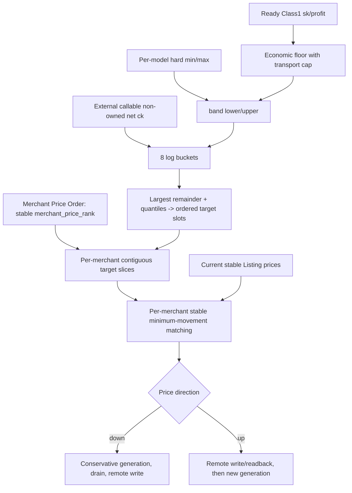

## 4. 分布范围与采样

市场目标价格仍以 canonical normalized model 的全站受管、未退役输出 Listing 集合统一计算；
**Merchant Price Order 不改变市场分布目标，只约束目标价格槽向各商户的分配顺序**。商户按稳定
`merchant_price_rank` 获得连续有序价格槽，商户内部再以 stable binding 执行最小价格移动匹配，从而保证
`max_ck(Mi) <= min_ck(Mj)`（`rank_i < rank_j`）的硬相对序——包括零样本路径在内，任何 target 分配结果
都必须满足该不变量。市场整体上涨/下降时排序不变，只有管理员显式调整 rank 才改变。
外部 owned 过滤依赖 S05 authoritative owned_routing_listings，callability 依赖完整 marketplace/circuit facts。
所有 ck 先裁剪 band 后进入桶；样本落桶和分位数使用 Decimal/log 实现，不能让展示 float 决定结果。

稳定匹配的主目标是最小化总价格移动，次序以 stable binding ID 固定，确保相同输入重放得到相同计划。

## 5. 改价与 inflight

降价会提高所需 delta/降低利润空间，因此先发布保守经济 generation 阻止新请求使用过度乐观值，再 drain 旧 attempt。涨价先远端确认，防止本地提前假设更高收入。每个 attempt 永远按其冻结 generation 结算。

## 6. 完成条件

- 所有结果在 `[hard_min, hard_max]`，相同输入 deterministic。
- 普通降价、hard-max 纠正、涨价和 unknown result 四条路径分别测试。
- planner 与 remote applier 分离，远端写只经 S14/S01。

上位依据：[原 Prompt §10](../../../sub2api-a6-channel-implementation-prompt.md#10-listing-定价范围与分布)。
---

### 08-pricing-policy/pseudocode.md（实现伪代码）

<!-- 以下内容为对应源文件的完整当前版本（随合集同步修订） -->

<!-- ===== 源文件：docs/a6-channel-blueprint/subsystems/08-pricing-policy/pseudocode.md ===== -->
# S08 Listing 定价策略与分布：实现伪代码

[自然语言](logic.md) | [测试](tests.md) | [总纲](../../README.md)

## 1. Band 计算

```text
compute_band(model, policy, required_profiles, accounts):      # PRC-001..004
    hard_min = Decimal(policy.min default "0.025")
    hard_max = Decimal(policy.max default "4.0")
    require 0 < hard_min <= hard_max <= 4
    require required_profiles non-empty
    cap = min(Decimal("0.5") if profile_delta_capable(p) else Decimal("0")
              for p in required_profiles)
    ready_c1 = accounts where Class1 and native schedulable and capability current
              and route/cost current and current Token instance BAN_INIT READY
    if ready_c1 empty: floor = null; raw_lower = hard_min
    else:
        floor = min(a.sk*(1+a.profit)/(1+cap) for a in ready_c1)
        raw_lower = max(hard_min, floor)
    return {hard_min, hard_max,
            lower:min(raw_lower, hard_max), upper:hard_max,
            raw_lower, fixed=(min(raw_lower,hard_max)==hard_max)}
```

## 2. 桶与目标分配

```text
build_targets(model, band, listings, market, price_order):    # PRC-005..007
    managed = all non-retired controlled Listings for model sorted stable ID
    samples = [quote.public_k/Decimal("1.2") for quote in market
               if quote.callable and not quote.owned]
    samples = [clip(s, band.lower, band.upper) for s in samples]
    if band.lower == band.upper:
        targets = [band.lower] * len(managed)               # single point, no log
    else if samples empty:
        # zero sample: no new market distribution invented,
        # but MUST still pass through Merchant Price Order below
        targets = []
        for listing in managed:
            if listing existing:
                targets.append(clip(listing.current_ck,
                                    band.hard_min, band.hard_max))
            else:
                targets.append(band.lower)
    else:
        edges = eight_equal_intervals_in_log_space(band.lower, band.upper)
        frequencies = count samples per bucket
        allocation_counts = largest_remainder(frequencies,
                                              total=len(managed),
                                              deterministic_bucket_tie_order)
        targets = []
        for bucket,count in allocation_counts:
            targets += actual_quantile_points(samples in bucket, count,
                                              bounded by bucket and band)

    # 所有分支统一从这里继续，zero-sample 也不得绕过 Merchant Price Order：
    ordered_targets = sort(targets)                        # global ascending slots
    merchant_groups = group managed by merchant
                      ordered by price_order.merchant_price_rank
    slices = allocate contiguous ordered_targets by listing count per merchant
    result = {}
    for merchant in merchant_groups:
        # 1-D L1 optimal matching: sorted current prices zip sorted target prices.
        current_sorted = sort merchant.listings by (current_ck, stable_binding_id)
        target_sorted = sort slices[merchant.id] ascending
        result += zip(current_sorted, target_sorted)             # O(n log n), deterministic
    require every pair rank_i < rank_j:
        max_ck(result, rank_i) <= min_ck(result, rank_j)
    return result
```

## 3. Plan 与 apply

```text
plan_price_change(listing, desired_ck, generation, band, official_generation, fx_generation): # PRC-008..012
    require band.hard_min <= desired_ck <= band.hard_max
    coalesce by model+generation; respect batch<=10 and last write>=5m
    last = listing.last_confirmed_ck
    begin transaction
    persist operation snapshot {
        desired_ck, old_generation=generation,
        last_confirmed_ck=last,
        hard_min=band.hard_min, hard_max=band.hard_max,
        official_generation, fx_generation,
        pricing_plan_generation=generation,
        merchant_price_order_generation=current price_order generation,
        market_snapshot_hash=current complete market snapshot hash
    }
    if desired_ck < last:
        write conservative S08 economic/desired-price generation min(last, desired_ck)
        set phase=WAIT_OLD_INFLIGHT and close/fence new optimistic dispatch as needed
        insert drain/reconcile Outbox in SAME tx
    else if desired_ck > last:
        set phase=WRITE_REMOTE_FIRST; insert price-apply Outbox in SAME tx
    else set phase=NOOP
    commit

reconcile_price_change(op):                                  # PRC-008..012
    if op.phase == WAIT_OLD_INFLIGHT:
        if inflight(op.old_generation)>0:
            if timeout and op.last_confirmed_ck<=op.hard_max:
                transactionally cancel ordinary change + restore op.last_confirmed_ck generation + insert reprojection Outbox
            if op.last_confirmed_ck>op.hard_max:
                keep admission CLOSED; return RETRYABLE through S14
                # retry rounds may reach visible DLQ, but safety state never restores the >hard_max generation;
                # owner/manual replay continues the same correction identity after review.
            return
        op.phase = WRITE_REMOTE
    require op pricing_plan/merchant_price_order/official/fx/hard-bound source generations still current; else supersede/replan
    official = S07.load_model_price_generation(op.official_generation)
    fx = S07.load_fx_generation(op.fx_generation)
    desired_vector = S07.target_listing_vector(
        official.integer_vector, op.desired_ck, fx.value)
    result = S07.apply_price_vector(op, desired_vector)
    if result == CONFIRMED_ADOPT:
        consume S07 confirmed generation; mark S08 operation complete; do NOT publish a second confirmed price fact
    else if result == REPLAY_SAME_OPERATION:
        pause subsequent pricing; replay same operation after exact-old readback
    else if result == REMOTE_DIVERGED:
        pause subsequent pricing; supersede and replan from remote fact
    else if result in [READBACK_INCOMPLETE, RETRY_LATER]:
        pause subsequent pricing; retry readback under same op
    else if result == REMOTE_REJECTED:
        pause subsequent pricing; classify/report; do not blind replay
```

## 4. FX/事实门

```text
precondition_for_new_plan():
    require S07 current official model-price generation
    require S07 FX generation allow_new_price_write
    require market snapshot COMPLETE; if complete sample_count==0 then and only then apply PRC-007 zero-sample rule
    require current hard-bound generation and current Merchant Price Order generation

apply_pricing_policy_command(op):                            # PRC-001,008, ADM-005
    require caller via S14 and op.expected_generation == current hard-bound policy generation(op.model)
    if op.kind == SET_HARD_BOUNDS:
        hard_min = Decimal(op.hard_min); hard_max = Decimal(op.hard_max)
        validate 0 < hard_min <= hard_max <= 4
        begin transaction
        existing = S08 hard-bound generation by unique change_identity=op.identity
        if existing:
            verify identical policy payload; ensure required replan/correction Outbox rows exist; commit; return ADOPT_EXISTING
        require current hard-bound generation == op.expected_generation
        write new S08 hard-bound policy generation(change_identity=op.identity) + audit actor
        for affected Listing whose current S07 confirmed_ck is outside [hard_min,hard_max]:
            write current S08 desired-price correction generation(target_ck=clip(confirmed_ck, hard_min, hard_max), safety_fence=CLOSED_UNTIL_CONFIRMED)
            insert S13 admission-reprojection + price-correction Outbox rows in SAME tx
        insert ordinary affected pricing-replan Outbox rows in SAME tx
        commit
    else reject unsupported kind

apply_merchant_price_order_command(op):                       # PRC-006, ADM-013（S08 owning handler）
    require op.kind == SET_MERCHANT_PRICE_ORDER and caller via S14
    require op.expected_generation == current merchant_price_order_generation
    validate op.proposal has one unique active rank per active merchant and active rank 全站唯一
    begin transaction
    existing = merchant_price_order generation by unique change_identity=op.identity
    if existing:
        verify identical rank payload; ensure its pricing-replan Outbox exists; commit; return ADOPT_EXISTING
    require current merchant_price_order_generation == op.expected_generation
    write new a6_merchant_price_orders generation(change_identity=op.identity) and audit actor
    insert exactly one S08 pricing-replan Outbox row for the new order generation
    commit
    publish optional wake-up notification after commit
```

## 需求覆盖索引

本稿实现：`PRC-001`, `PRC-002`, `PRC-003`, `PRC-004`, `PRC-005`, `PRC-006`, `PRC-007`, `PRC-008`, `PRC-009`, `PRC-010`, `PRC-011`, `PRC-012`。
---

### 08-pricing-policy/tests.md（测试规格）

<!-- 以下内容为对应源文件的完整当前版本（随合集同步修订） -->

<!-- ===== 源文件：docs/a6-channel-blueprint/subsystems/08-pricing-policy/tests.md ===== -->
# S08 Listing 定价策略与分布：测试规格

[自然语言](logic.md) | [伪代码](pseudocode.md) | [总纲](../../README.md)

## 1. 核心用例

| Test ID | 需求 | 被测符号 | Given / When / Then |
| --- | --- | --- | --- |
| PRC-T001 | PRC-001,010 | `compute_band/apply_pricing_policy_command` | 默认值正确；min<=0、min>max、max>4 拒绝；合法 hard-bound admin command 只由 S08 写 generation，并与 pricing-replan Outbox 同事务；若新 bound 立即使 current confirmed_ck 越界，同事务产生 clipped correction desired generation + admission safety fence，不能等待异步 planner 后才 CLOSED。 |
| PRC-T002 | PRC-002 | `compute_band` | required profiles 全 capable cap=.5；任一不 capable cap=0；空集合 config invalid。 |
| PRC-T003 | PRC-003 | class1 floor | 只使用 full ready Class1；满并发仍参与，BAN_INIT/route/capability 失效则排除。 |
| PRC-T004 | PRC-004 | bounds | 无 ready 用 hard min；raw>max 固定 max 且不生成>4；不在本包擅自下架。 |
| PRC-T005 | PRC-005 | `build_targets` | 只采外部 callable 非 owned，公开 k 精确除 1.2，构造 8 log buckets。 |
| PRC-T006 | PRC-006 | largest remainder | 分配数总和等于 Listing 数，按频率和稳定 tie-break；桶内来自实际分位点。 |
| PRC-T007 | PRC-006 | stable matching | 商户内 current ck 按 `(current_ck,stable_binding_id)` 排序、target 升序后一一 zip；同输入/不同遍历顺序得到相同 binding->price，`Σ|new-current|` 不高于任意随机/逆序对照；实现不得调用 Hungarian/min-cost-flow/general assignment。 |
| PRC-T008 | PRC-007 | zero/single-point | **complete** snapshot 零样本不调用 log 且仍经 Merchant Price Order；incomplete/failed snapshot 不得走 zero-sample、price-write spy=0；lower=upper 全部单点。 |
| PRC-T009 | PRC-008 | batching | 第 11 项进入下一批；5 分钟未到的普通改价不写。 |
| PRC-T010 | PRC-009 | down ordering | 先发布保守 generation，再等待旧 inflight，归零后才远端 PUT。 |
| PRC-T011 | PRC-010 | down timeout | 普通降价超时取消并恢复；hard-max breach 保持 CLOSED 且继续重试。 |
| PRC-T012 | PRC-011 | up ordering | 涨价远端 readback 前不发布允许降低 delta 的 generation。 |
| PRC-T013 | PRC-012 | write outcome | target/old/third/reject/incomplete 分别 adopt/replay/replan/fail/retry-readback；期间禁止后续调价；confirmed path 只产生一个 S07 confirmed price generation。 |
| PRC-T014 | PRC-006 | merchant price order | Merchant A rank < Merchant B rank 时 A 获得的目标价格槽不能整体高于 B（`max_ck(A) <= min_ck(B)`）。 |
| PRC-T015 | PRC-006 | market shift | 市场整体上涨/下降后，商户间相对价格顺序不变；管理员改 rank 才改变顺序。 |
| PRC-T016 | PRC-006 | per-merchant matching | 商户内部满足 minimum-movement；相同输入重放 mapping 完全 deterministic。 |

## 2. 属性测试

- 对随机 bounds、样本和 Listings，所有目标在 bounds 内且数量完全守恒。
- 最大余数分配误差每桶小于 1 个 Listing。
- 绝对不变量：任意 merchant 分组与 rank 排列（含零样本与单点路径）下，商户间 `max_ck(Mi) <= min_ck(Mj)` 对 `rank_i < rank_j` 恒成立。
- 重放相同 generation 的 plan hash 完全一致。
- hard-bound / Merchant Price Order command 在 generation+Outbox commit 后、phase journal 确认前 crash：same `op.identity` 只 ADOPT 同一 generation；更晚 current 存在时旧 op SUPERSEDED。
- 任意 crash 点不存在本地假设 ck 高于远端 confirmed 的窗口。

## 3. 端到端验收

用至少 8 个受管 Listing 的脱敏市场 fixture 验证桶分布、稳定匹配和批次；隔离 Listing 各执行一次涨价与降价，保存 generation 顺序、inflight drain、A6 price vector readback 和 S07 confirmed ck。

## 需求覆盖索引

本测试集覆盖：`PRC-001`, `PRC-002`, `PRC-003`, `PRC-004`, `PRC-005`, `PRC-006`, `PRC-007`, `PRC-008`, `PRC-009`, `PRC-010`, `PRC-011`, `PRC-012`。
---

## Part 4.12：a6-channel-blueprint/subsystems/09-eligibility-delta/（S09 Eligibility、Delta 策略与 Attempt 快照）

> 本工作包三份稿的树关系：`logic.md`（规范事实）-> `pseudocode.md`（实现，标注需求 ID）-> `tests.md`（每个测试回链需求 ID）。
> 需求 ID 命名空间见 traceability.md 第 1 节。

### 09-eligibility-delta/logic.md（自然语言蓝图）

<!-- 以下内容为该文件的完整原文，未做任何修改 -->

<!-- ===== 源文件：docs/a6-channel-blueprint/subsystems/09-eligibility-delta/logic.md ===== -->
# S09 Eligibility、Delta 策略与 Attempt 快照：自然语言蓝图

[总纲](../../README.md) | [伪代码](pseudocode.md) | [测试](tests.md) | [S10 Usage/Billing](../10-usage-billing/logic.md)

## 1. 目标与边界

S09 是连接输出 Listing 与输入账号的唯一经济硬门。它按稳定 `(listing_binding_id, account_id, normalized_model)`，即经营语义上的 `(Listing, account, model)` / `(listing,account,model)`，计算结构资格、transport 资格和经营 delta，并在派发前冻结完整 generation 快照。transport 失效的最小作用域是 `(account, transport_profile)`。S09 不改 usage、不扣费、不做远端上下架。

## 2. 需求

| ID | 规范 |
| --- | --- |
| ELG-001 | 先由 S02 以 `(local_user_id, requested_model)` 唯一解析 stable listing binding，再按 `(listing_binding_id,account_id,normalized_model)` 计算，不以 remote instance ID 作经济主键。 |
| ELG-002 | `required=sk*(1+profit)`；`delta_auto=max(0,required/ck-1)`；公式不再乘 commission。 |
| ELG-003 | `delta_effective=COALESCE(delta_override,delta_auto)`；override nullable、永久、无需审批、范围 `[0,0.5]`，清空恢复 auto，且不能绕过最终利润不等式。 |
| ELG-004 | structural eligibility 要求 model capable、Sub2 native schedulable、`0<=delta<=0.5` 且 `ck*(1+delta)>=required`。 |
| ELG-005 | attempt eligibility 还要求：不需 delta，或当前 request transport profile 能合法取得并改写最终 usage。 |
| ELG-006 | transport profile 至少区分 Responses/Chat、stream/non-stream 与终态 usage schema；无需调整的请求保持原 usage。 |
| ELG-007 | required transport profiles 从当前启用的 A6 入口 adapter generation 产生；每个 required profile 至少一个 attempt candidate 才能清 `NO_ELIGIBLE`。 |
| ELG-008 | required set 为空或收到未声明 profile 时置 `OUTPUT_CONFIG_INVALID`；当前未声明请求不处罚账号，修复 profile generation 后恢复。 |
| ELG-009 | 数据库存版本化事实/稀疏 eligibility，Redis 投影 candidate、`requires_delta`、transport capability 与完整 generation；满并发不改变结构资格。 |
| ELG-010 | attempt 派发前冻结 output channel、listing、account、route、cost、capability、billing、S08 desired-pricing、S07 confirmed-listing-price、model-price、FX、transport-profile generation 和 `delta_effective`；同时保存 S07 confirmed Listing price generation 的整数 vector/hash，S10/S11 不得回读 current vector 代替。 |
| ELG-011 | 派发前任一 generation 失效必须重选；已派发 attempt 按不可变快照结算，新 generation 只阻止新请求。 |
| ELG-012 | 初选、手动指定、粘性、抢槽重检、failover、retry 和 Replay 每次 attempt 都调用同一硬门，不能使用旧缓存绕过。 |
| ELG-013 | 实际终态证明某 `(account,transport_profile)` 无法提供合法 delta usage 时，只撤销该关系的资格并重算；不扩散到其他 profile 或共享价格。 |
| ELG-014 | 语义澄清（不改公式）：S09 的 structural economic relation 描述正常适用 Delta 时的经营资格；S10 的 `<1000 input usage` 是显式经营例外，它优先于实际 Delta application，但不改变 structural eligibility，不产生 failover、`NO_ELIGIBLE` 或 Listing 下架副作用。 |

## 3. 公式子图

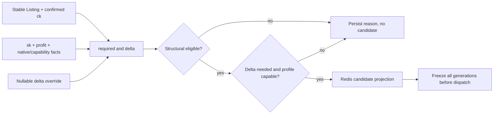

## 4. Generation 一致性

eligibility row 保存所有输入 generation 的组合 hash。Redis 是候选筛选的加速投影；请求路径必须验证投影 generation 与数据库/current fence，但**不得按候选逐个执行 N+1 authoritative generation 查询**。同一 selection round 先对 Redis 排序出的候选集合做一次 bounded batch gate-pointer read，剔除明显 stale 候选；只有真正准备 dispatch 的 candidate 再执行一次 authoritative final fence，并在同一短事务中冻结 economic snapshot。这样保持 send 前 correctness fence，同时把 DB 开销收敛为“一次 batch read + 最终 candidate 一次 fenced read/commit”。

## 5. `NO_ELIGIBLE` 语义

S09 只维护结构/required profile 资格事实并向 S13 发 owner event。瞬时 busy 不会使 eligible 变零。eligible 从零恢复时只清 current source generation 的 `NO_ELIGIBLE`，不碰其他 hold。

`<1000 input usage` 是 S10 的显式经营例外：它只跳过 Delta 应用，不改变本包的结构资格判定，不触发
failover、`NO_ELIGIBLE` 或 Listing 下架。

## 6. Override 管理

预览和提交都用同一 evaluator。override 小于自动值是允许保存的管理事实，但如果 `ck*(1+override)<required`，该关系变为不 eligible；不能为了“尊重 override”跳过硬利润门。

## 7. 完成条件

- 所有 scheduler 分支共享 evaluator 与 pre-send fence。
- 冻结快照能离线重算 delta 和资格，不引用 current mutable 行。
- required profiles、sparse DB 与 Redis projection 在 generation 变更后原子可辨。

上位依据：[原 Prompt §2.3/§11](../../../sub2api-a6-channel-implementation-prompt.md#11-deltaclass2adjustment计费与收益)。
---

### 09-eligibility-delta/pseudocode.md（实现伪代码）

<!-- 以下内容为对应源文件的完整当前版本（随合集同步修订） -->

<!-- ===== 源文件：docs/a6-channel-blueprint/subsystems/09-eligibility-delta/pseudocode.md ===== -->
# S09 Eligibility 与 Attempt 快照：实现伪代码

[自然语言](logic.md) | [测试](tests.md) | [总纲](../../README.md)

## 1. Evaluator

```text
evaluate_relationship(listing, account, model, profile):       # ELG-001..006
    require stable listing.normalized_model == model
    sk = Decimal(account.current_cost.sk)
    profit = Decimal(account.effective_profit)
    ck = Decimal(listing.current_confirmed_ck)
    required = sk * (1 + profit)
    delta_auto = max(0, required / ck - 1)
    override = nullable Decimal override for stable tuple
    if override != null: require 0 <= override <= 0.5
    delta = override if override != null else delta_auto
    structural = model_capable(account, model)
              and native_sub2_schedulable(account)
              and 0 <= delta <= 0.5
              and ck * (1 + delta) >= required
    requires_delta = delta > 0
    attempt = structural and
              (not requires_delta or delta_transport_capable(account, profile))
    return immutable Decision(inputs={listing_binding_id=listing.binding_id, account_id=account.id, model, profile, ck, sk, profit},
                              required, delta_auto, delta_effective=delta,
                              structural, attempt, reason_codes)
```

## 2. Required profiles 与 projection

```text
recompute_listing_eligibility(listing, adapter_generation):    # ELG-007..009
    required = adapter_generation.required_transport_profiles
    if required empty:
        begin transaction
        insert OutputConfig-owned INVALID command/fact + desired/reprojection Outbox for this source generation
        commit; return
    begin transaction
    for explicitly bound account and each profile in required:
        decision = evaluate_relationship(listing, account, listing.normalized_model, profile)
        upsert sparse eligibility only for candidate or explainable failure as policy
    per_profile_counts = count attempt=true
    if any required count == 0:
        ensure NO_ELIGIBLE source_generation=current composite hash
    else:
        clear only matching Eligibility-owned NO_ELIGIBLE
    write DB projection generation and deduped Redis/admission refresh Outbox in SAME tx
    commit
    after commit attempt fast Redis replacement; if process dies, Outbox rebuilds the same generation/hash

normalize_actual_profile(request):                            # ELG-006,008
    profile = endpoint_kind + stream_mode + terminal_usage_schema_version
    if profile not declared by current adapter generation:
        transactionally insert deduped OutputConfig-owned invalid/reprojection Outbox for current adapter generation
        reject this request before account penalty
    return profile
```

## 3. 候选选择与冻结

```text
current_candidates(listing_binding_id, normalized_model, profile): # ELG-009,010,012
    require all three inputs are explicit and normalized
    projection = read Redis candidate projection for exact listing_binding_id/model/profile
    require projection composite generation/hash matches current authoritative DB projection
    if stale/missing: return GENERATION_STALE, never silently use old candidates
    return candidates with attempt=true for exact profile plus projection generation/hash

select_and_freeze_attempt(request, selection_mode):            # ELG-010..012
    context = S02.build_dispatch_context(request.auth, request)
    profile = normalize_actual_profile(request)
    candidates = read current Redis projection for context.listing_binding_id + context.normalized_model
                 filtered attempt=true for exact profile
    ordered = native_scheduler_order(candidates, selection_mode)
    gate_batch = batch load authoritative current gate pointers/facts for ordered candidate IDs in one bounded query
    ordered = discard candidates whose projected composite generation/hash is stale against gate_batch
    for candidate in ordered:
        acquire native capacity slot
        begin transaction
        # Only the candidate about to dispatch pays the full authoritative fence cost.
        current = load/lock this candidate's authoritative generations + current S07 confirmed Listing price fact
        decision = evaluate_relationship(context.listing, candidate.account, context.normalized_model, profile)
        if projection/facts changed or decision.attempt == false:
            rollback; release slot; continue
        insert economic_snapshot(attempt_id unique,
            output_channel_generation, listing_generation, account_generation,
            route_generation, cost_generation, capability_generation,
            billing_generation, desired_pricing_generation,
            confirmed_listing_price_generation, frozen_integer_price_vector, frozen_price_vector_hash,
            model_price_generation, fx_generation, transport_profile_generation,
            delta_effective=decision.delta_effective, required=decision.required, ck=decision.inputs.ck,
            sk=decision.inputs.sk, profit=decision.inputs.profit, composite_hash)
        commit
        recheck pre-send generation fence
        if invalid before dispatch: mark snapshot NOT_DISPATCHED; release; continue
        hand {attempt_id, immutable economic_snapshot} to the existing native scheduler dispatch primitive
        # native scheduler's existing attempt/send state is the sole dispatch boundary;
        # S09 must not invent a second non-atomic "mark DISPATCHED then send" lifecycle.
        return attempt handle from native scheduler
    return no dispatch result classified by S12
```

## 4. Override

```text
set_delta_override(stable_tuple, nullable_value, expected_generation, change_identity, actor): # ELG-003,FND-011
    if nullable_value != null:
        require Decimal("0") <= Decimal(nullable_value) <= Decimal("0.5")
    payload_hash = canonical_hash(nullable_value)
    begin transaction
    lock exact stable_tuple = (listing_binding_id, account_id, normalized_model)
    existing = override generation by unique change_identity
    if existing:
        require existing.payload_hash == payload_hash
        if current override generation == existing: ensure eligibility-recompute Outbox exists; commit; return ADOPT_EXISTING
        if current override generation newer: commit; return SUPERSEDED
    require expected_generation == current override generation(stable_tuple)
    write new S09-owned override generation(nullable Decimal value, change_identity, payload_hash) and audit
    insert affected eligibility-recompute Outbox rows in SAME transaction
    commit
    return pending operation identity; preview is computed separately from same evaluator
```

## 5. Runtime capability revocation

```text
revoke_delta_transport(account, profile, evidence):            # ELG-013,FND-011
    change_identity = stable_hash(account.id, profile, evidence.failure_identity)
    payload_hash = canonical_hash(revoked=true, evidence.normalized_reason)
    begin transaction
    existing = exact revocation generation by unique change_identity
    if existing:
        require identical payload_hash; ensure affected eligibility-recompute Outbox exists; commit; return existing
    write S09-owned exact (account, transport_profile) revocation generation(change_identity, payload_hash) + evidence
    insert affected Listing eligibility-recompute Outbox rows in SAME transaction
    commit
    do NOT mutate S04 account capability generation; do not invalidate other profiles/accounts or S07 price generation
```

## 需求覆盖索引

本稿实现：`ELG-001`, `ELG-002`, `ELG-003`, `ELG-004`, `ELG-005`, `ELG-006`, `ELG-007`, `ELG-008`, `ELG-009`, `ELG-010`, `ELG-011`, `ELG-012`, `ELG-013`, `ELG-014`。
---

### 09-eligibility-delta/tests.md（测试规格）

<!-- 以下内容为对应源文件的完整当前版本（随合集同步修订） -->

<!-- ===== 源文件：docs/a6-channel-blueprint/subsystems/09-eligibility-delta/tests.md ===== -->
# S09 Eligibility 与 Delta：测试规格

[自然语言](logic.md) | [伪代码](pseudocode.md) | [总纲](../../README.md)

## 1. 核心用例

| Test ID | 需求 | 被测符号 | Given / When / Then |
| --- | --- | --- | --- |
| ELG-T001 | ELG-001 | `evaluate_relationship` | 两个 remote Listing instances 共用 stable binding 时 override/eligibility 历史连续。 |
| ELG-T002 | ELG-002 | evaluator formula | 已知 sk/profit/ck 精确得 required/delta_auto；commission 输入不参与。 |
| ELG-T003 | ELG-003 | `set_delta_override` | null 清空恢复 auto；0/.5 边界有效；负值或>.5拒绝。 |
| ELG-T004 | ELG-003,004 | override hard gate | override 低于所需值时保存但 structural=false，不能绕过利润不等式。 |
| ELG-T005 | ELG-004 | structural matrix | model/native/range/profit 四个条件逐项失效均给稳定 reason。 |
| ELG-T006 | ELG-005,006 | attempt matrix | delta=0 对 incapable profile 可尝试且原 usage；delta>0 必须 profile capable。 |
| ELG-T007 | ELG-007 | `recompute_listing_eligibility` | 每个 required profile 至少一个 candidate 才清 NO_ELIGIBLE。 |
| ELG-T008 | ELG-008 | profile validation | required 空或实际未声明置 config hold；本次账号不被 cooldown/paused。 |
| ELG-T009 | ELG-009 | projection | DB projection + refresh Outbox 同事务；DB commit 后、Redis replace 前 crash，Outbox 可重建同 generation/hash；candidate/requires_delta/capability 一致，满并发不改结构行。 |
| ELG-T010 | ELG-010 | `select_and_freeze_attempt` | candidate 必须来自请求解析出的 exact listing_binding/model/profile；另一 Listing 即使同 model/profile 也不能串入。一个 selection round 对候选 authoritative gate pointer 使用 bounded batch query，禁止 per-candidate N+1 generation loads；只有最终准备 dispatch 的 candidate 做一次 full authoritative fence + snapshot transaction。snapshot 包含列出的 generation、S07 confirmed Listing integer vector/hash 与 delta，attempt_id 唯一；后续 current Listing price 改变不能改变历史 snapshot 的 vector。 |
| ELG-T011 | ELG-011 | pre-send fence | 选中后 route/price/Ban generation 改变则释放并重选；合法 snapshot 只交给既有 native dispatch primitive，S09 无第二套 DISPATCHED/send 状态；已发送 snapshot 不改。 |
| ELG-T012 | ELG-012 | scheduler entry matrix | initial/manual/sticky/slot recheck/failover/retry/Replay 都命中同一 evaluator spy。 |
| ELG-T013 | ELG-013 | `revoke_delta_transport` | schema 失败写 S09-owned exact account/profile revocation + same-tx Outbox；S04 capability mutation spy=0；其他 profile/account/price 保持。 |

## 2. 属性测试

- 对随机正 Decimal 输入断言 eligible 时 `ck*(1+delta)>=sk*(1+profit)`。
- 对相同 composite generation 重算，decision hash 必须稳定。
- 在 select/acquire/freeze/send 四点并发切 generation，只有 send 前全匹配的 attempt 可标 DISPATCHED。

## 3. 集成验收

构造同 Listing 的 Class1/2/3 候选、四种 transport profile 和 delta 0/>0 矩阵，验证数据库 sparse rows、Redis projection、S12 三出口以及 S10 frozen snapshot 输入一致。

## 需求覆盖索引

本测试集覆盖：`ELG-001`, `ELG-002`, `ELG-003`, `ELG-004`, `ELG-005`, `ELG-006`, `ELG-007`, `ELG-008`, `ELG-009`, `ELG-010`, `ELG-011`, `ELG-012`, `ELG-013`, `ELG-014`。
---

## Part 4.13：a6-channel-blueprint/subsystems/10-usage-billing/（S10 Usage 合成、Winner 与本地计费）

> 本工作包三份稿的树关系：`logic.md`（规范事实）-> `pseudocode.md`（实现，标注需求 ID）-> `tests.md`（每个测试回链需求 ID）。
> 需求 ID 命名空间见 traceability.md 第 1 节。

### 10-usage-billing/logic.md（自然语言蓝图）

<!-- 以下内容为对应源文件的完整当前版本（随合集同步修订） -->

<!-- ===== 源文件：docs/a6-channel-blueprint/subsystems/10-usage-billing/logic.md ===== -->
# S10 Usage 合成、Winner 与本地计费：自然语言蓝图

[总纲](../../README.md) | [伪代码](pseudocode.md) | [测试](tests.md) | [收益对账](../11-revenue-replay/logic.md)

## 1. 目标与边界

S10 拥有成功 attempt 的终态 usage 处理：经营 delta 和既有 Class2Adjustment 独立决策、一次合成、唯一 winner CAS、stream 提交边界、billing intent 与本地负余额扣费。A6 earnings 是否确认交付和收入由 S11。

## 2. 需求

| ID | 规范 |
| --- | --- |
| BIL-001 | 经营 delta 是 `(Listing,account,model)` 输出策略，不复用 Class2Adjustment；两者都只读取同一原始 usage `U0`，独立保存 decision。 |
| BIL-002 | `final_usage=compose_once(U0,delta_decision,class2_decision)`，最终收益因子 `(1+delta_applied)*(1+class2_adjustment_rate)`；不得串行拿前一策略改写结果再次决策。 |
| BIL-003 | 每个派发 attempt 有独立 S09 快照；换账号建新快照，失败 attempt 不扣费。 |
| BIL-004 | 发成功终态前 CAS 选唯一 winner，保存原始/最终 usage、两份 decision/hash 和唯一 billing intent；同一 attempt/claim identity 重放若 winner 已存在且身份相同必须 adopt 已有 intent，只有不同 attempt 冲突才是 loser。 |
| BIL-005 | intent 状态为 `PREPARED|TERMINAL_WRITTEN|DELIVERY_UNKNOWN|BILLED|RECONCILED|VOID`。正常路径 `PREPARED -> TERMINAL_WRITTEN -> BILLED -> RECONCILED`；winner/intent 与延迟补漏 `RECONCILE_INTENT` 同事务提交。`PREPARED` 只表示 terminal owner 仍有写权；owner deadline 到期且无确定 write 证据时才可保守转 `DELIVERY_UNKNOWN`。S11 不得直接从 `PREPARED` bill；只可凭同 request_id earnings 从 `DELIVERY_UNKNOWN`（或 crash 后未 bill 的 `TERMINAL_WRITTEN`）补 bill。`TERMINAL_WRITTEN/DELIVERY_UNKNOWN` 可在完整远端 absence 终局后 VOID；late reopen 仍由 S11；`BILLED` 不回退到 delivery 状态。 |
| BIL-006 | 仅 winner 幂等扣负余额：`ActualCost=BalanceCost=ceil_scale8(base_actual_cost*(1+delta_applied))`；Class2Adjustment 不改变本地 cost。 |
| BIL-007 | snapshot、winner claim、billing intent 和 Replay 共享稳定幂等身份；重复 callback/terminal 不能再扣。 |
| BIL-008 | 确定性 solver 基于 attempt 冻结的整数 price vector，从原始 usage 求达到 `ceil(base_merchant_earning*(1+delta_applied)*(1+class2_adjustment_rate))` 的最小合法整数 usage，并保存 target/actual/overshoot。 |
| BIL-009 | solver 保持 endpoint input/output/cache/total 不变量；两项调整都为 0 时返回 usage 逐字节不变。 |
| BIL-010 | 两项策略共用改写前 input usage：优先 `input_tokens`，缺失取 `prompt_tokens`，均含 cached input。`<1000` 两者都跳过，保持 base cost/U0，记录 `input_usage_below_1000` 和 shortfall；`=1000` 生效。 |
| BIL-011 | `requires_delta=true` 且缺 usage/合法 schema 时禁止成功终态，调用 S09 撤销 exact account/profile 资格。stream 是否还能换候选由 request-local `upstream_stream_committed` 决定：S12 synthetic SSE prelude 不计 commit；第一段 upstream-originated SSE event 真正转发后即 committed。未 committed 可按 S12 既有 classifier/S09 gate failover；已 committed 则终止流并原子取得唯一 terminal ownership、持久化 `DELIVERY_UNKNOWN` intent，绝不拼接第二 upstream。该异常 intent 因未合法取得/改写 usage，必须记录 required delta 但 `delta_applied=0`，不得伪造 final usage/solver；只有 S11 authoritative settlement 后续提供可重建 base cost 的 canonical usage 时才可做一次 base-cost billing，否则保持 DELIVERY_UNKNOWN 并进入 visible reconciliation review。 |
| BIL-012 | v0.1.173 Class2Adjustment 标识/API/规则文件保持 `Class2Adjustment/class2_adjustment`、`/api/v1/admin/settings/class2adjustment`、`/etc/sub2api/class2adjustment-rules.json`；旧名只读兼容。 |
| BIL-013 | Class2Adjustment 仅 `account.IsOpenAIOAuth()`，保留现有算法、shadow/apply、berserk、probe passthrough 与观测；不承担 eligibility/delta，且不覆盖原 UsageLog/component/base ActualCost。 |
| BIL-014 | 普通 Class2 流量可单独运行 Class2Adjustment；只有 `a6-channel` 流量可能同时命中经营 delta。 |

## 3. 合成子图

```mermaid
flowchart LR
    U0["Raw terminal usage U0"] --> D["Evaluate delta decision"]
    U0 --> C["Evaluate Class2Adjustment"]
    D --> Solver["One deterministic integer solver"]
    C --> Solver
    Snap["Frozen price/economic snapshot"] --> Solver
    Solver --> CAS{"Unique winner CAS"}
    CAS -->|"won"| Intent["Persist PREPARED intent and hashes"]
    CAS -->|"lost"| Drop["No terminal, no bill"]
    Intent --> Terminal["Write one final terminal usage"]
    Terminal -->|"confirmed"| Bill["Idempotent delta-only local billing"]
    Terminal -->|"unknown"| Unknown["DELIVERY_UNKNOWN -> S11 earnings proof"]
    Unknown --> Bill
```

## 4. Stream 提交边界

对 non-stream，完整上游响应可以在任何下游字节前完成验证、winner 与 intent。对 SSE stream，**transport prelude 与 upstream response commit 必须分开**：

- S12 可在 request-local first-byte deadline 到达时发送一次 synthetic SSE no-op prelude；它只负责让下游尽快收到字节/flush，不能被计入 `upstream_stream_committed`。
- upstream error event 在第一次真实 upstream event 转发前先经过 S12 classifier；若现有分类明确允许 candidate failover，则可换下一 candidate，synthetic prelude 不构成阻碍。
- 第一段 upstream-originated SSE event 真正转发给下游前，必须先原子地把请求内 `upstream_stream_committed=true`；从这个瞬间起，当前连接不得再拼接第二 upstream，后续错误走既有 stream/error/terminal 路径。
- `downstream_bytes_written` 不再作为是否可 failover 的判断，因为它会把 synthetic prelude 错当成业务响应；S10/S12 统一只看 `upstream_stream_committed`。
- 缺终态 usage 且 upstream stream 已 committed、当前进程仍存活时，按 BIL-011 持久化 `DELIVERY_UNKNOWN` intent，再交 S11 通过 request_id 查 earnings。

first-byte guard 仅是当前请求的三个轻量内存字段（deadline / prelude_sent / upstream_stream_committed），**不得持久化、不得新增 Saga/controller/table**。进程崩溃会终止当前 HTTP/stream 请求；系统不尝试跨进程续接原连接，也不因 crash 自动创建第二 upstream attempt 来“继续”该请求。S11 Replay 是显式业务重放/对账能力，不是透明 stream-resume 机制。

## 5. Solver 合同

solver 只能调整 endpoint 合法的整数 usage 字段，并求达到目标 earnings 的最小合法解。选择/优先级必须版本化且 deterministic。**solver 的计算复杂度必须只受 endpoint schema 可调整维度数约束，不得随 token 数量或 target earning 的绝对大小线性增长；严禁逐 token `+1 -> recalc` 搜索。** 应按当前 deficit 与各合法维度的 marginal micros 使用整数 `ceil/division` 直接生成有限候选，再在固定上界候选集中按 deterministic field order 选择最小合法解。保存原始/最终 canonical JSON hash、solver version、目标 micros、实际 micros 和 overshoot，供 S11 容差计算。

## 6. 本地账单

`base_actual_cost` 来自 S07 的 `ToA6API` resolver 和 attempt model-price generation。即使 Class2Adjustment 放大远端收益，本地只按 delta 放大；`<1000` skip 时 `delta_applied=0`，本地仍为 base cost。

## 7. 完成条件

- 999/1000、delta only、Class2 only、两者同时、两者为零和缺 usage 全矩阵通过。
- 任意并发终态最多一个 winner、一个 intent、一次负余额。
- 现有 Class2Adjustment 全量回归通过，无配置/API 重命名回归。

上位依据：[原 Prompt §11.1-§11.3](../../../sub2api-a6-channel-implementation-prompt.md#111-经营-delta)。
---

### 10-usage-billing/pseudocode.md（实现伪代码）

<!-- 以下内容为对应源文件的完整当前版本（随合集同步修订） -->

<!-- ===== 源文件：docs/a6-channel-blueprint/subsystems/10-usage-billing/pseudocode.md ===== -->
# S10 Usage 合成与本地计费：实现伪代码

[自然语言](logic.md) | [测试](tests.md) | [总纲](../../README.md)

## 1. Decision

```text
raw_input_usage(U0):                                         # BIL-010
    return U0.input_tokens if present else U0.prompt_tokens if present else MISSING

evaluate_delta(snapshot, U0):                                # BIL-001,010
    input = raw_input_usage(U0)
    if input is MISSING:
        if snapshot.delta_effective>0: return ERROR_REQUIRED_SCHEMA
        return Decision(rate=0, applied_rate=0, skip=missing_usage_no_delta, original_hash=hash(U0))
    if input < 1000: return Decision(rate=0, applied_rate=0, skip=input_usage_below_1000,
                                     shortfall=1000-input, original_hash=hash(U0))
    return Decision(rate=snapshot.delta_effective, applied_rate=snapshot.delta_effective,
                    policy_generation=snapshot.desired_pricing_generation,
                    original_hash=hash(U0))

evaluate_class2(account, U0):                                # BIL-001,012..014
    if not account.IsOpenAIOAuth():
        return Decision(rate=0, applied_rate=0, skip=not_oauth, original_hash=hash(U0))
    decision = invoke existing Class2Adjustment evaluator on U0, preserving shadow/apply/
               berserk/probe behavior and identifiers
    require decision is based only on U0 and attach original_hash=hash(U0)
    return decision
```

## 2. 一次合成 solver

```text
compose_once(U0, delta_decision, class2_decision, price_snapshot): # BIL-002,008,009
    require both decisions.original_hash == hash(U0)
    delta_rate = Decimal(delta_decision.applied_rate)
    class2_rate = Decimal(class2_decision.applied_rate)
    vector = price_snapshot.integer_vector
    if delta_rate == 0 and class2_rate == 0: return exact original bytes/U0, overshoot=0
    base_earning = earning_from(U0, vector)
    target = ceil_micros(base_earning * (1+delta_rate) * (1+class2_rate))
    constraints = endpoint_schema_invariants(U0)
    deficit = max(0, target - base_earning)
    # Exact bounded solver: work is a function of the small endpoint schema dimension set, never token magnitude.
    candidates = bounded_schema_candidates(
        U0, vector, constraints, deficit, deterministic_field_order)
    # Generator uses marginal micros + integer ceil/division and enumerates only the finite
    # single-/coupled-dimension boundary combinations required by this endpoint's invariants.
    # It MUST NOT increment token counts one-by-one.
    require candidate_evaluation_count <= configured_constant_bound_for_schema(constraints)
    final = choose exact minimum legal candidate with earning>=target, deterministic tie-break
    require invariants_hold(U0, final)
    actual = earning_from(final, vector)
    return final, {target, actual, overshoot=actual-target, solver_version}
```

## 3. Winner 与 terminal

```text
prepare_success_terminal(attempt, raw_response):              # BIL-003..005,007,011
    U0 = extract_and_validate_terminal_usage(raw_response, attempt.profile)
    if attempt.snapshot.requires_delta and U0 invalid:
        S09.revoke_delta_transport(attempt.account, attempt.profile, evidence)
        # Synthetic SSE prelude does not count; only an upstream-originated event commit closes failover.
        if attempt.stream.upstream_stream_committed == false: return FAILOVER_ALLOWED
        terminate_stream
        return prepare_missing_usage_delivery_unknown(attempt, evidence)  # durable; NO_SECOND_ATTEMPT
    delta = evaluate_delta(attempt.snapshot, U0)
    class2 = evaluate_class2(attempt.account, U0)
    price_snapshot = {integer_vector=attempt.snapshot.frozen_integer_price_vector,
                      generation=attempt.snapshot.confirmed_listing_price_generation,
                      hash=attempt.snapshot.frozen_price_vector_hash}
    base_actual_cost = S07.resolve_base_actual_cost(
        U0, attempt.snapshot.normalized_model,
        attempt.snapshot.model_price_generation, group=ToA6API)
    final, solver = compose_once(U0, delta, class2, price_snapshot)
    begin transaction
    winner = insert winner_claim(request_id unique, attempt_id, claim_identity) on conflict load existing
    if existing winner belongs another attempt/claim_identity: rollback; return LOSER_NO_BILL
    if existing winner belongs this same attempt/claim_identity:
        intent = load existing billing_intent and verify hashes/snapshot identical
        commit; return ADOPT_EXISTING_INTENT(intent)
    terminal_owner_deadline = now + configured bounded terminal-finality handoff window
    insert billing_intent(economic_snapshot_id unique, state=PREPARED,
        raw_usage=U0, final_usage=final, base_actual_cost,
        hashes, delta_decision=delta, class2_decision=class2, solver,
        usage_status=VALID,
        terminal_owner_identity=attempt.terminal_owner_identity, terminal_owner_deadline)
    insert deduped RECONCILE_INTENT Outbox(intent identity, not_before=terminal_owner_deadline) in SAME tx
    commit
    return prepared intent

prepare_missing_usage_delivery_unknown(attempt, evidence):      # BIL-004,005,007,011
    begin transaction
    winner = insert winner_claim(request_id unique, attempt_id, claim_identity) on conflict load existing
    if existing winner belongs another attempt/claim_identity:
        append HARD terminal-ownership conflict; commit; return NO_SECOND_ATTEMPT_REVIEW
    if existing winner belongs this same attempt/claim_identity:
        intent = load existing billing_intent
        require intent.state == DELIVERY_UNKNOWN and intent.usage_status == MISSING_REQUIRED_SCHEMA
        commit; return ADOPT_EXISTING_DELIVERY_UNKNOWN(intent)
    delta = Decision(required_rate=attempt.snapshot.delta_effective, applied_rate=0,
                     skip=missing_required_schema_after_content_commitment)
    class2 = Decision(rate=0, applied_rate=0, skip=missing_usage_after_content_commitment)
    insert billing_intent(economic_snapshot_id unique, state=DELIVERY_UNKNOWN,
        raw_usage=null, final_usage=null, base_actual_cost=null, solver=null,
        delta_decision=delta, class2_decision=class2,
        usage_status=MISSING_REQUIRED_SCHEMA,
        terminal_owner_identity=attempt.terminal_owner_identity,
        delivery_unknown_evidence=evidence)
    insert deduped RECONCILE_INTENT Outbox(intent identity) in SAME tx
    commit
    return DELIVERY_UNKNOWN_NO_SECOND_ATTEMPT

write_terminal(intent, downstream):                          # BIL-005,007,011
    reload intent by stable claim/delivery identity
    if state in [TERMINAL_WRITTEN, BILLED, RECONCILED]:
        require stored terminal hash/delivery identity matches; return ALREADY_CONFIRMED without another write
    if state == DELIVERY_UNKNOWN: return DELIVERY_UNKNOWN      # S11 decides; never blind-redeliver
    require state == PREPARED and caller == intent.terminal_owner_identity
    try write final response/terminal under stable delivery identity
    if confirmed write boundary:
        begin transaction
        CAS PREPARED -> TERMINAL_WRITTEN with exact delivery evidence
        insert deduped BILL_WINNER Outbox(intent, evidence=TERMINAL_CONFIRMED) in SAME tx
        insert/retain RECONCILE_INTENT Outbox in SAME tx
        commit; return TERMINAL_WRITTEN
    if uncertain or stream content already written:
        begin transaction
        CAS PREPARED -> DELIVERY_UNKNOWN with uncertain-write evidence
        insert/retain RECONCILE_INTENT Outbox in SAME tx
        commit; return DELIVERY_UNKNOWN
    never transition BILLED/RECONCILED/VOID back to a delivery state

mark_orphan_prepared_delivery_unknown(intent_id, witness):    # BIL-005,007
    begin transaction
    lock intent; require intent.state == PREPARED
    require now >= intent.terminal_owner_deadline and witness proves terminal owner no longer has live write authority
    require no confirmed terminal-write evidence exists
    CAS PREPARED -> DELIVERY_UNKNOWN with owner-expired witness
    append immutable transition evidence
    commit; return DELIVERY_UNKNOWN
```

## 4. 本地计费

```text
bill_winner(intent, evidence, resolved_base_actual_cost=null): # BIL-005..007,010,011
    require intent is unique winner; reload current state
    if state in [BILLED, RECONCILED]:
        require existing UsageBilling/ledger key and amount identical; return existing billing
    if evidence == TERMINAL_CONFIRMED:
        require state == TERMINAL_WRITTEN and intent.usage_status == VALID
    if evidence == S11_EARNINGS_CONFIRMED:
        require state in [TERMINAL_WRITTEN, DELIVERY_UNKNOWN]
    otherwise reject billing
    if intent.usage_status == VALID:
        require intent.base_actual_cost != null
        billing_base = intent.base_actual_cost
    else if intent.usage_status == MISSING_REQUIRED_SCHEMA:
        require evidence == S11_EARNINGS_CONFIRMED
        require resolved_base_actual_cost != null
        require intent.delta_decision.applied_rate == 0             # never pretend missing delta was applied
        billing_base = resolved_base_actual_cost
    delta_applied = intent.delta_decision.applied_rate
    cost = ceil_scale(billing_base * (1+delta_applied), 8)
    begin transaction
    insert UsageBilling(idempotency_key=intent.claim_identity,
                        ActualCost=cost, BalanceCost=cost) on conflict verify identical
    insert/apply one negative balance ledger entry with same key on conflict verify identical
    CAS intent current allowed source state -> BILLED using the same evidence guard
    commit
```

Class2 rate 永不出现在 `cost` 公式。失败 attempt 或 winner claim loser 不调用 `bill_winner`。

## 5. 状态迁移 guard

```text
transition_intent(id, from_set, to, evidence):                # BIL-005
    allowed = {
      PREPARED:[TERMINAL_WRITTEN,DELIVERY_UNKNOWN],
      TERMINAL_WRITTEN:[BILLED,VOID],
      DELIVERY_UNKNOWN:[BILLED only by S11_EARNINGS_CONFIRMED,VOID],
      BILLED:[RECONCILED],
      VOID:[BILLED only by S11 late-arrival reopen]
    }
    require current in from_set when caller supplied from_set
    require to in allowed[current] and owner/evidence authorized
    CAS state and append immutable transition journal
```

## 需求覆盖索引

本稿实现：`BIL-001`, `BIL-002`, `BIL-003`, `BIL-004`, `BIL-005`, `BIL-006`, `BIL-007`, `BIL-008`, `BIL-009`, `BIL-010`, `BIL-011`, `BIL-012`, `BIL-013`, `BIL-014`。
---

### 10-usage-billing/tests.md（测试规格）

<!-- 以下内容为对应源文件的完整当前版本（随合集同步修订） -->

<!-- ===== 源文件：docs/a6-channel-blueprint/subsystems/10-usage-billing/tests.md ===== -->
# S10 Usage 合成、Winner 与计费：测试规格

[自然语言](logic.md) | [伪代码](pseudocode.md) | [总纲](../../README.md)

## 1. 核心用例

| Test ID | 需求 | 被测符号 | Given / When / Then |
| --- | --- | --- | --- |
| BIL-T001 | BIL-001,002 | decision/compositor | 两 decision 的 original hash 都是 U0；第二策略看不到第一策略改写值；只调用一次 solver。 |
| BIL-T002 | BIL-003 | attempt billing | failover 前失败 attempt 有 snapshot 但无 winner/账单；新账号新 snapshot。 |
| BIL-T003 | BIL-004,007 | `prepare_success_terminal` | 50 个并发不同 attempts 只有一个 winner；winner commit 后 crash 再以同 attempt/claim identity 重放时 adopt 同一 intent，不被当 loser、不创建第二 intent。 |
| BIL-T004 | BIL-005,007 | state/terminal guard | 正常 PREPARED→TERMINAL_WRITTEN→BILLED；S11 earnings 只可从 TERMINAL_WRITTEN/DELIVERY_UNKNOWN 补 bill，PREPARED 直接 bill 必须拒绝。owner deadline 前 S11 不抢 terminal；deadline 后 orphan PREPARED 先转 DELIVERY_UNKNOWN。write_terminal 对已 TERMINAL_WRITTEN/BILLED/RECONCILED 同 identity no-op、对 DELIVERY_UNKNOWN 不盲写；BILLED→delivery 永远拒绝。 |
| BIL-T005 | BIL-006 | `bill_winner` | cost 精确 `ceil_scale8(base*(1+delta))`；Class2 rate 改变不影响本地 cost。 |
| BIL-T006 | BIL-007 | billing idempotency | terminal/callback/Replay 重复只得到同一 UsageBilling 与负余额 ledger entry。 |
| BIL-T007 | BIL-008 | `compose_once` | delta/class2 applied_rate 与 frozen integer_vector 均显式取自 decision/snapshot；final earning 是达到 target 的最小合法整数解，减少选择字段一步即不足或违反 invariant。 |
| BIL-T008 | BIL-009 | endpoint invariants | Responses/Chat、stream/non-stream 的 input/output/cache/total 约束全部保持。 |
| BIL-T009 | BIL-009 | zero adjustment | 两 rate=0 时 serialized terminal usage 与 U0 逐字节相同。 |
| BIL-T010 | BIL-010 | 999/1000 | 999 两策略 skip、base cost/U0；1000 正常应用；prompt_tokens fallback 含 cached input。 |
| BIL-T011 | BIL-011 | missing usage before upstream commit | delta required 且 schema 缺失，在 `upstream_stream_committed=false` 时撤销 exact profile 并允许 failover；即使已经发过 synthetic SSE prelude 也仍属于可 failover。 |
| BIL-T012 | BIL-011 | missing usage after upstream commit | 第一段 upstream-originated SSE event 已转发、`upstream_stream_committed=true` 后缺 usage：终止当前流；同一事务取得唯一 winner/terminal ownership + `DELIVERY_UNKNOWN` intent，`usage_status=MISSING_REQUIRED_SCHEMA`、`delta_applied=0`、零第二 upstream。synthetic prelude 单独出现不得触发本用例；S11 无 canonical usage 时不得猜 debit。 |
| BIL-T013 | BIL-012 | baseline identifiers | 新写只用 Class2Adjustment 名、API 和 rules path；旧名只读兼容。 |
| BIL-T014 | BIL-013 | existing behavior | OAuth-only、shadow/apply、berserk、probe passthrough 与原观测 golden tests 不变。 |
| BIL-T015 | BIL-014 | traffic matrix | ordinary Class2 仅 adjustment；a6-channel Class2 可两项；Class1/3 不误命中 Class2Adjustment。 |

## 2. Solver 属性测试

- 随机合法 U0、整数 vector 和 rate，断言 actual>=target、overshoot=actual-target 且最终字段非负整数。
- 对每个允许调整的维度尝试减一，验证不存在更小合法解。
- 相同 U0/snapshot/solver version 重放生成相同 final hash。
- 极大 usage、极大合法 delta/Class2 rate 下，solver 的 candidate evaluation count 仍只与 endpoint 可调整维度数成固定上界关系；测试禁止逐 token 线性扫描实现。

## 3. Crash 与并发

在 winner CAS 前后、intent commit、**upstream-originated** terminal 首 event/终态、`TERMINAL_WRITTEN+BILL_WINNER Outbox` commit、账单 commit 前后终止进程。synthetic SSE prelude 不属于 durable terminal 边界，也不要求 crash 后续流。特别断言：winner/intent commit 后立刻 crash 时，延迟 RECONCILE_INTENT 不丢；terminal owner deadline 前 S11 不 bill；deadline 后 PREPARED 先变 DELIVERY_UNKNOWN，再由 earnings 决定；缺 usage 且 upstream stream 已 committed 的路径在 winner+DELIVERY_UNKNOWN intent commit 前/后 crash 也只能得到一个 terminal owner、零第二 attempt；最多一次负余额且不向 A6 重复内容。

## 4. 端到端验收

至少执行一个 `delta_required>0` 的隔离请求，保存同一 request_id 的 U0、两 decision、final usage、solver、ActualCost 和 S11 A6 earning；完整 usage 可以保存，凭据必须脱敏。

## 需求覆盖索引

本测试集覆盖：`BIL-001`, `BIL-002`, `BIL-003`, `BIL-004`, `BIL-005`, `BIL-006`, `BIL-007`, `BIL-008`, `BIL-009`, `BIL-010`, `BIL-011`, `BIL-012`, `BIL-013`, `BIL-014`。
---

## Part 4.14：a6-channel-blueprint/subsystems/11-revenue-replay/（S11 收益对账、迟到补账与 Replay）

> 本工作包三份稿的树关系：`logic.md`（规范事实）-> `pseudocode.md`（实现，标注需求 ID）-> `tests.md`（每个测试回链需求 ID）。
> 需求 ID 命名空间见 traceability.md 第 1 节。

### 11-revenue-replay/logic.md（自然语言蓝图）

<!-- 以下内容为对应源文件的完整当前版本（随合集同步修订） -->

<!-- ===== 源文件：docs/a6-channel-blueprint/subsystems/11-revenue-replay/logic.md ===== -->
# S11 收益对账、迟到补账与 Replay：自然语言蓝图

[总纲](../../README.md) | [伪代码](pseudocode.md) | [测试](tests.md) | [S10 Billing](../10-usage-billing/logic.md)

## 1. 目标与边界

S11 使用 A6 earnings/settlement 的 `request_id` 作为远端最终事实，对齐 attempt、usage、价格、账单和负余额，推进 intent 的 RECONCILED/VOID/迟到补账，并保证 Replay/重复 callback 不重复结算。S10 拥有 winner 和首次本地账单；S07 拥有价格事实。

## 2. 需求

| ID | 规范 |
| --- | --- |
| REV-001 | 以 A6 earnings `request_id` 唯一对齐 winner attempt、原始/最终 usage、UsageLog、ActualCost、负余额、冻结 price vector、`earned_micros` 和两份 decision。BIL-011 的 `MISSING_REQUIRED_SCHEMA` 异常 intent 允许本地 usage 暂缺：只能从 authoritative joined settlement 补充 canonical usage，禁止猜值。 |
| REV-002 | reconciliation `(a6_credential_id,request_id)` 唯一；重复 earnings/callback/Replay 不重复扣费，usage hash 冲突拒绝二次结算并告警。 |
| REV-003 | 分别核对 `local_actual_cost/local_base_cost ~= 1+delta_applied`、`earned_micros ~= earning_from(final_usage,confirmed_vector)`、`A6_public_quota/supplier_earning ~= 1.2`。 |
| REV-004 | `earning_from` 直接使用同请求 final usage 和冻结整数 vector；本地单位与 A6 micros 只比较比例。先扣除 `max(1 micros,solver overshoot/量化包络)` 再套相对阈值。 |
| REV-005 | DELIVERY_UNKNOWN/中断由同 request_id earnings/settlement 决定继续 Apply 还是等待；只有 earnings 与 settlement 两类 relevant complete snapshot 都能证明 absence 且超过终局窗口才 VOID。 |
| REV-006 | VOID 后迟到 earnings 只能在原 intent 上重开并做一次 adjustment；已 BILLED 后的延迟只记对账异常，不重扣。 |
| REV-007 | earnings 前 10 分钟每 15 秒、之后每 5 分钟查至 24 小时；另做 daily late-arrival sweep。延迟本身只告警。 |
| REV-008 | 共享价格/markup/vector 异常置 `OUTPUT_CONFIG_INVALID`；只在某 account/profile 的 usage 偏差只撤销该关系；Class2Adjustment 偏差不扩散到其他策略。 |
| REV-009 | 15 分钟内 3 个独立 request 持续偏差，或单次相对偏差>5%，才按对应作用域触发修复；整数包络内不计偏差。 |
| REV-010 | Replay 使用原 request/attempt snapshot、winner claim、compositor version 和 billing identity；如果需要新 upstream attempt，仍须经过 S09 current hard gate并保留与原 request 的 lineage。 |
| REV-011 | 完整收益/结算 snapshot 的 completeness 必须保存；不完整读取的“未找到”不能 VOID。 |
| REV-012 | 对账 observation、异常、adjustment 和 tombstone 都是不可变 journal，不能覆盖原始账单或 usage。 |

## 3. 对账子图

```mermaid
flowchart TD
    Intent["Winner billing intent"] --> Poll["Poll complete earnings by request_id"]
    Poll --> Found{"Record found?"}
    Found -->|"yes"| Hash{"Usage/request identity matches?"}
    Hash -->|"no"| Conflict["Reject second settlement + alert"]
    Hash -->|"yes"| Ratios["Three economic checks with tolerance"]
    Ratios --> Scope["Price shared / account-profile / Class2 scope"]
    Scope --> Reconciled["RECONCILED + immutable observation"]
    Found -->|"no, incomplete"| Wait["Wait; absence not proven"]
    Found -->|"no, complete before window"| Wait
    Found -->|"no, complete after final window"| Void["VOID tombstone"]
    Void --> Late["Daily late-arrival sweep"]
    Late -->|"found once"| Adjust["Reopen original intent + one adjustment"]
```

## 4. 容差与作用域

solver 的 overshoot 和 S07 单 micros ceil 都是可解释量化，不应触发经营故障。绝对容差精确取 `max(1 micros, solver记录的整数overshoot/量化包络)`，去除该包络后再计算 relative deviation。单 request >5% 可立即进入对应修复；较小持续偏差需要三个独立 request，不能由同 request Replay 重复计数。

## 5. Replay

Replay 首先复用原 terminal/intents 证据完成投递或对账，不重新扣费。只有明确需要新的 upstream attempt 时，创建新 attempt snapshot 并走 S09 当前硬门；最终仍只能归到原 request 的唯一 winner/账单身份，禁止双 winner。

## 6. 完成条件

- earnings 延迟、缺失、不完整分页、冲突和迟到记录分别有确定状态。
- 任意重复与 Replay 顺序下账本总额不变。
- 偏差修复准确落在共享 Listing、exact account/profile 或 Class2Adjustment 观测域。

上位依据：[原 Prompt §11.1/§11.3](../../../sub2api-a6-channel-implementation-prompt.md#113-两套体系的合成)。
---

### 11-revenue-replay/pseudocode.md（实现伪代码）

<!-- 以下内容为对应源文件的完整当前版本（随合集同步修订） -->

<!-- ===== 源文件：docs/a6-channel-blueprint/subsystems/11-revenue-replay/pseudocode.md ===== -->
# S11 收益对账与 Replay：实现伪代码

[自然语言](logic.md) | [测试](tests.md) | [总纲](../../README.md)

## 1. 收益读取计划

```text
next_earnings_poll(intent, now):                              # REV-007
    age = now - intent.created_at
    if age < 10m: return last_poll + 15s
    if age < 24h: return last_poll + 5m
    return DAILY_SWEEP

load_remote_settlement_fact(credential, request_id):          # REV-001,005,011
    earnings = S01 complete supplier earnings for relevant bounded window
    settlements = S01 complete settlement records required by finality contract
    persist completeness/hash for BOTH datasets
    if either dataset incomplete: return ABSENT_INCOMPLETE with evidence
    matches = exact request_id facts across both datasets
    if conflicting identities/hashes: return CONFLICT
    if any authoritative success fact found: return FOUND(canonical joined fact)
    return ABSENT_COMPLETE
```

## 2. 对账

```text
safe_ratio_check(numerator, denominator, target):             # REV-003,004
    if denominator == 0:
        if numerator == 0: return NOT_APPLICABLE_ZERO_BASE
        return HARD_DEVIATION_ZERO_BASE
    return Decimal(numerator) / Decimal(denominator) compared with target

reconcile_intent(intent_id):                                  # REV-001..006,008,009
    intent = load billing intent + winner identity by intent_id
    lock unique (intent.credential, intent.request_id)
    intent = reload winner snapshot, decisions, usage, billing and frozen vector under lock
    if intent.state == PREPARED:
        if now < intent.terminal_owner_deadline or terminal owner still has live write authority:
            reschedule at/after owner deadline; return
        S10.mark_orphan_prepared_delivery_unknown(intent.id, expired-owner witness)
        intent = reload intent                                  # now DELIVERY_UNKNOWN or concurrent terminal result
    remote = load_remote_settlement_fact(intent.credential, intent.request_id)
    if remote == CONFLICT:
        append conflict observation; reject settlement; alert; return
    if remote == ABSENT_INCOMPLETE: schedule next poll; return
    if remote == ABSENT_COMPLETE:
        if beyond configured finality window:
            if intent.state in [TERMINAL_WRITTEN, DELIVERY_UNKNOWN]:
                begin transaction
                S10.transition_intent(intent.id,
                    from_set=[TERMINAL_WRITTEN, DELIVERY_UNKNOWN],
                    to=VOID, evidence=complete remote-absence snapshot)
                insert immutable tombstone + late-sweep index in SAME tx
                commit
            else if intent.state == BILLED:
                append immutable missing-remote-finality anomaly; keep BILLED and include in late sweep
        else schedule next poll
        return
    require remote == FOUND and remote request identity matches intent
    if intent.usage_status == MISSING_REQUIRED_SCHEMA:
        append immutable exact account/profile schema-failure observation
        ensure S09 exact transport revocation is current/idempotent
        if remote.canonical_usage is missing or invalid for S07 native base-cost resolver:
            mark visible reconciliation dead-letter(reason=MISSING_CANONICAL_USAGE, intent_id)
            keep intent DELIVERY_UNKNOWN; do not guess usage/delta/debit; return
        resolved_usage = canonicalize(remote.canonical_usage)
        resolved_base = S07.resolve_base_actual_cost(
            resolved_usage, intent.snapshot.normalized_model,
            intent.snapshot.model_price_generation, group=ToA6API)
        begin transaction
        insert immutable late-usage-resolution(intent_id, hash(resolved_usage), resolved_base, remote evidence)
            on conflict verify identical
        commit
        S10.bill_winner(intent, evidence=S11_EARNINGS_CONFIRMED,
                        resolved_base_actual_cost=resolved_base)
        CAS BILLED -> RECONCILED
        return
    require remote usage/request identity hash matches intent
    tolerance = max(1 micros, intent.solver.overshoot,
                    S07.price_vector_quantization_envelope(intent.snapshot))
    local_check = safe_ratio_check(intent.ActualCost, intent.base_actual_cost, target=(1+intent.delta_applied))
    earning_expected = earning_from(intent.final_usage, intent.frozen_integer_price_vector)
    earning_check = deviation_after_absolute_tolerance(remote.earned_micros, earning_expected, tolerance)
    public_check = safe_ratio_check(remote.public_quota, remote.supplier_earning, target=Decimal("1.2"))
    checks = {local_check, earning_check, public_check}
    append immutable reconciliation observation with all three checks
    scope_and_record_deviation(intent, checks)
    if intent.state == RECONCILED: return idempotent no-op
    if billing exists and intent.state == BILLED: CAS BILLED -> RECONCILED
    else if no billing and remote proves success:
        S10.bill_winner(intent, evidence=S11_EARNINGS_CONFIRMED)
        CAS BILLED -> RECONCILED
    else if billing exists but state/hash inconsistent:
        append HARD reconciliation conflict; do not mutate ledger
```

## 3. 迟到记录

```text
daily_late_arrival_sweep():                                  # REV-006,007,012
    candidates = bounded union of:
        VOID tombstones not permanently resolved
        + BILLED but not RECONCILED intents whose remote finality record was missing/late
    for intent in candidates:
        remote = load_remote_settlement_fact(intent.credential, intent.request_id)
        if remote != FOUND: append sweep observation as applicable; continue
        verify original intent/usage hash before mutation
        if intent.state == VOID and no late adjustment exists:
            begin transaction
            S10.transition_intent(intent.id, from_set=[VOID], to=BILLED,
                evidence=S11_LATE_ARRIVAL_CONFIRMED)
            insert exactly one late UsageBilling/ledger adjustment with stable late-adjustment identity
            append late observation
            insert RECONCILE_INTENT Outbox in SAME tx
            commit                               # never call remote reconciliation inside this tx
        else if intent.state == BILLED:
            begin transaction
            append latency anomaly only; no new debit
            insert RECONCILE_INTENT Outbox in SAME tx
            commit
```

## 4. 偏差作用域

```text
scope_and_record_deviation(intent, checks):                   # REV-008,009
    begin transaction
    if checks.price_vector_or_markup_shared_failure:
        record immutable Listing-scoped deviation
        repair_owner = S07 CONFIG_INVALID
    else if checks.delta_or_schema_failure tied to account/profile:
        record immutable exact account/profile deviation
        repair_owner = S09 TRANSPORT_REVOCATION
    else if checks.only_class2_adjustment_failure:
        record immutable Class2Adjustment observation; repair_owner = NONE
    independent_count = unique request_ids in 15m with same scope/fingerprint under transaction snapshot
    if repair_owner != NONE and (one relative deviation >5% or independent_count >=3):
        insert deduped owning repair Outbox(scope, fingerprint, current source generation) in SAME tx
    commit
```

## 5. Replay

```text
replay_request(request_id, reason):                           # REV-002,010
    # Explicit business Replay only; never automatic process-restart continuation of a dead HTTP/stream connection.
    load original winner claim, intent, snapshots and compositor version
    if terminal can be safely redelivered without new upstream:
        reuse final bytes/hash and same delivery identity; never rebill
    else if new upstream attempt required and no downstream content commitment and winner_claim absent:
        candidate = S09.select_and_freeze_attempt(current hard gate, mode=REPLAY)
        link new attempt to original request lineage
        S10 winner CAS still uses original request_id
    else if winner_claim exists:
        redeliver/reconcile existing winner only; never create a doomed second upstream attempt
    else wait for earnings/reconciliation
```

## 需求覆盖索引

本稿实现：`REV-001`, `REV-002`, `REV-003`, `REV-004`, `REV-005`, `REV-006`, `REV-007`, `REV-008`, `REV-009`, `REV-010`, `REV-011`, `REV-012`。
---

### 11-revenue-replay/tests.md（测试规格）

<!-- 以下内容为对应源文件的完整当前版本（随合集同步修订） -->

<!-- ===== 源文件：docs/a6-channel-blueprint/subsystems/11-revenue-replay/tests.md ===== -->
# S11 收益对账与 Replay：测试规格

[自然语言](logic.md) | [伪代码](pseudocode.md) | [总纲](../../README.md)

## 1. 核心用例

| Test ID | 需求 | 被测符号 | Given / When / Then |
| --- | --- | --- | --- |
| REV-T001 | REV-001 | `reconcile_intent` | 一个 request_id 对齐 attempt、U0/final、UsageLog、billing、ledger、vector 和 earning。 |
| REV-T002 | REV-002 | unique reconciliation | 重复 earnings/callback/Replay 只一行 reconciliation/账单；不同 usage hash 冲突拒绝。 |
| REV-T003 | REV-003 | ratio checks | 三个比例分别计算，delta 只影响 local ratio，公开 quota ratio 目标 1.2。 |
| REV-T004 | REV-004 | tolerance | 1 micros、solver overshoot、price quantization 三者取最大；包络内 deviation=0。 |
| REV-T005 | REV-001,005 | delivery unknown | PREPARED 且 terminal owner 仍有效时只等待；owner deadline 失效先原子转 DELIVERY_UNKNOWN。随后 earnings 找到才完成唯一账单/对账。BIL-011 missing-usage intent：有 authoritative canonical usage 时仅按 resolved base cost、`delta_applied=0` 幂等 bill；无 canonical usage 时 visible reconciliation dead-letter、保持 DELIVERY_UNKNOWN、零猜测 debit。 |
| REV-T006 | REV-005,011 | void gate | earnings+settlement 都 complete/absent 且过终局窗口时，仅 TERMINAL_WRITTEN/DELIVERY_UNKNOWN → VOID；PREPARED 必须先经过 owner-expired → DELIVERY_UNKNOWN，BILLED 保持 BILLED 并进 late sweep；任一不完整不得 VOID。 |
| REV-T007 | REV-006 | late sweep | sweep 同时覆盖 VOID tombstone 与 BILLED-unreconciled；VOID 迟到只重开原 intent 并一次 adjustment，BILLED 迟到只 anomaly+reconcile Outbox、零新 debit；重复 sweep 幂等。 |
| REV-T008 | REV-006 | billed latency | 已 BILLED 的迟到记录只增加 latency anomaly，不新增 ledger。 |
| REV-T009 | REV-007 | `next_earnings_poll` | 0-10m 每15s、10m-24h每5m、之后 daily，边界精确且任务去重。 |
| REV-T010 | REV-008 | scope | shared vector -> Listing hold；exact schema -> account/profile；Class2-only 不扩散。 |
| REV-T011 | REV-009 | threshold | 15m 三个不同 request 触发；同 request Replay 不计多个；单次>5%立即触发。 |
| REV-T012 | REV-010 | `replay_request` | redelivery 复用 final hash/identity；只有 winner absent 且无 downstream commitment 才允许新 attempt 走 S09；winner 已存在时 upstream-attempt spy=0。 |
| REV-T013 | REV-012 | immutable journal | 后续状态只追加 observation/adjustment，不覆盖原 usage、billing 或 tombstone。 |

## 2. 时序与故障注入

模拟 earnings 在 1 分钟、9:59、10:00、23:59、24 小时后、VOID 后到达；在查询分页中断、账单 commit、状态 CAS、late adjustment commit 各点 crash。重启后总 debit 与唯一 request identity 保持一致。

## 3. 端到端验收

使用 S10 的 `delta_required>0` 请求，确认 A6 `earned_micros` 可由 final usage 和冻结 vector 重算，local/base ratio 对应 delta，public/supplier ratio约 1.2。报告列出容差包络和偏差，不泄露 credential。

## 需求覆盖索引

本测试集覆盖：`REV-001`, `REV-002`, `REV-003`, `REV-004`, `REV-005`, `REV-006`, `REV-007`, `REV-008`, `REV-009`, `REV-010`, `REV-011`, `REV-012`。
---

## Part 4.15：a6-channel-blueprint/subsystems/12-scheduling-incidents/（S12 调度硬门、错误聚合与平台 Incident）

> 本工作包三份稿的树关系：`logic.md`（规范事实）-> `pseudocode.md`（实现，标注需求 ID）-> `tests.md`（每个测试回链需求 ID）。
> 需求 ID 命名空间见 traceability.md 第 1 节。

### 12-scheduling-incidents/logic.md（自然语言蓝图）

<!-- 以下内容为对应源文件的完整当前版本（随合集同步修订） -->

<!-- ===== 源文件：docs/a6-channel-blueprint/subsystems/12-scheduling-incidents/logic.md ===== -->
# S12 调度硬门、错误聚合与平台 Incident：自然语言蓝图

[总纲](../../README.md) | [伪代码](pseudocode.md) | [测试](tests.md) | [错误分类合同](../../../../errorlist.md)

## 1. 目标与边界

S12 把 S09 经济硬门接到 Sub2API 原生调度，统一 attempt 级处置、request 聚合三出口、SSE 请求内 first-byte prelude / pre-commit failover 和 platform incident 提升。它不直接写远端路由/Listing，不清 hold；S06/S13 分别消费账号/路由和 Listing 事件。SSE guard 只存在于当前请求内存，不形成新的持久化 owner。

## 2. 需求

| ID | 规范 |
| --- | --- |
| ERR-001 | 初选、手动指定、粘性、抢槽重检、failover、retry、Replay 的每次 attempt 都先过 S09 硬门，之后才复用原生 scheduler。 |
| ERR-002 | 请求前三出口互斥：结构或 required profile eligible=0 -> `NO_ELIGIBLE`/异步下架；eligible>0 且已派发 attempts 全运行失败 -> 聚合处置；eligible>0 但全 busy/排队且零派发 -> `service_busy`，无 hold/下架。 |
| ERR-003 | `USER_SHORT_CIRCUIT` 是输入、入口鉴权、内容策略、client cancel；不处罚账号、不扩池、不下架，并在 scheduler 前短路。 |
| ERR-004 | `A6_ACCOUNT_RECOVERABLE` 只摘对应账号并进入 Token/Pin/config/liquidity 等窄 controller；`insufficient_quota` 必须去 S06 liquidity。 |
| ERR-005 | `UPSTREAM_AUTO_POOL_EXPAND`：Auto-Pool 交 S06 扩下一完整带，Pin 交 S06 repin；不隐式改 route mode。 |
| ERR-006 | `LISTING_COOLDOWN_TRIGGER` 覆盖平台/endpoint/egress/本地依赖/责任不明 timeout/5xx/unknown，以及确有派发且候选全失败的聚合终态。 |
| ERR-007 | 单 attempt 只影响对应账号或 route；分类后的失败 attempt 必须按 `attempt_id` 幂等记录既有窄作用域 owner action，即使随后 failover 到其他账号并成功也不能丢失该失败事实。只有 request aggregator 可以影响 Listing。Class2/3 保留 Sub2API 原生账号状态机。 |
| ERR-008 | 聚合顺序：每个失败 attempt 先按 ERR-007 / `attempt_id` 幂等提交其既有窄作用域 owner action；request aggregator 自己的事务只写 S09 eligibility-recompute Outbox 与一个带不可变 aggregate 摘要的去重 `FINALIZE_AGGREGATE` Outbox，随后**立即结束当前失败请求，不等待异步 eligibility recompute**。S12 的异步 finalizer 在目标 S09 generation 就绪后决定：归零只维护 `NO_ELIGIBLE`；仍>0 且终态含 cooldown/unknown 才加 `LOCAL_FAILURE_COOLDOWN`/incident consideration。不得为了这个异步化新增第二套 request-terminal 状态表，也不得把多个 remote failover attempt 包进一个长事务。 |
| ERR-009 | 明确 Cloudflare/A6 global、endpoint、egress、DB/Redis/Relay/Scheduler 健康故障可直接建相应 scope incident；单次裸错误先只影响当前 Listing。 |
| ERR-010 | 模糊错误仅在同请求至少两个独立 account/route 同 endpoint 同 fingerprint，或 60 秒内第二个独立 Listing 同 fingerprint时提升 Incident。 |
| ERR-011 | fingerprint 至少含 failure_domain、canonical_error_code、endpoint_host/path_class、method、egress_region、relay_generation、credential_scope；Listing/account/channel ID 只作 member。 |
| ERR-012 | Incident Controller 枚举 scope 活动 Listing 发 membership；LOCAL failure hold 仍由 Local Cooldown owner，REMOTE_COOLING member 不伪造本地 hold。 |
| ERR-013 | 健康恢复先 canary owner 清 hold/重置 cooling并取得 generation witness，再每批10个、间隔5-15秒 jitter 恢复；任一失败即停。channel scope 只建一个父 operation。 |
| ERR-014 | SSE first-byte guard 只在确定性 USER/auth/input/policy/model 检查通过并开始首个 upstream attempt 后创建；每请求一次性随机 deadline `500..2000ms`，不因 candidate failover 重置。deadline 到达且尚无 upstream event 时最多发送一次 synthetic SSE no-op prelude（默认 `:\n\n`）并 flush；prelude 不设置 `upstream_stream_committed`。上游 error event 在转发前先走既有 classifier：仅明确归因当前 upstream account/route 且既有错误合同允许 failover 时，可在未 committed 状态下记录该 attempt 的既有窄作用域 action、重新经过 S09 current hard gate / native scheduler 切下一未尝试 candidate，并保持同一 downstream SSE；USER 短路及平台/Listing/本地/责任不明错误仍走既有 handler。第一段 upstream-originated SSE event 一旦转发即 committed，之后绝不拼接第二 upstream。guard 不持久化、不使用 ticker、每请求最多一个 timer 和一个 prelude flush；进程崩溃即请求结束。 |

## 3. 三出口子图

```mermaid
flowchart TD
    Req["Authenticated valid request"] --> Eligible{"Current structural/profile eligible count"}
    Eligible -->|"0"| No["NO_ELIGIBLE + async unlist"]
    Eligible -->|">0"| Dispatch{"Any attempt dispatched?"}
    Dispatch -->|"no, all capacity busy"| Busy["service_busy only"]
    Dispatch -->|"yes"| Result{"Any success?"}
    Result -->|"yes"| Success["S10 terminal path"]
    Result -->|"no"| Per["Persist terminal aggregate + owner Outbox"]
    Per --> Return["Return aggregate failure immediately"]
    Per --> Finalize["Async S12 FINALIZE_AGGREGATE"]
    Finalize --> Recalc{"Read recomputed eligibility"}
    Recalc -->|"0"| No
    Recalc -->|">0 and cooldown/unknown"| Cool["LOCAL_FAILURE_COOLDOWN or incident"]
```

## 4. 分类上下文

同一原始 code 可因上下文不同分类，例如 user ingress `invalid_api_key` 是 USER，managed Provider Token 则 ACCOUNT；valid Listing model 在某 Channel 不可用是 ROUTE，而用户请求不存在模型是 USER。必须先依据 [错误分类合同](../../../../errorlist.md) 的判定顺序，再使用归因证据，不按 HTTP status 单独猜责任。**SSE 是否尝试下一 candidate 不是第二套错误分类**：它只是读取现有 classification/attribution 的一个 request disposition；不复制 errorlist 映射。

## 5. SSE first-byte 与 pre-commit failover

实现只维护 request-local `prelude_deadline / prelude_sent / upstream_stream_committed`。deadline 在确定性用户侧检查通过后一次性采样；candidate 变化不重置，避免每次 failover 再额外等待 0.5-2 秒。prelude 使用 SSE no-op comment 并最多 flush 一次，不启动周期 heartbeat。

当 upstream 返回 error event 且尚未 committed 时，先分类、按 `attempt_id` 幂等记录现有 account/route side effect；只有明确 candidate-local/upstream-attributable 且原错误合同本来允许 failover 的错误才选下一账号。下一账号仍经过 S09 current hard gate、capacity recheck 和原生 scheduler；已经尝试过的 candidate 在该请求内不重复选择。平台/Listing/本地依赖/unknown 不因为“这是 SSE”而多重试。

第一段 upstream-originated SSE event 在写给下游前先设置 `upstream_stream_committed=true`；其后即使尚未出现文本 token，也不允许切其他 upstream，以免混合 response identity / event sequence。synthetic prelude 不属于 upstream event。若 prelude 已发而后续错误又不允许 failover，HTTP/SSE 头已提交，只复用 Sub2API 现有 stream error/close 行为，绝不尝试再写一个普通 HTTP error 响应，也不在本功能内复制第二套 error serializer。进程退出时这些字段自然消失，不做恢复。

## 6. Incident 与 Listing 隔离

Incident 是编排事实，不是新的 hold owner。它关联 members、fingerprint、scope、health witness 和恢复批次。S13 根据 membership 和本地 cooldown owner 处理 LISTED 状态；A6 remote circuit 的 cooling 仍表现为 observed，不伪造 `LOCAL_FAILURE_COOLDOWN`。

## 7. 完成条件

- 三出口在每个请求只能命中一个，纯 busy 永不创建状态事件。
- attempt 与 aggregate side effect 可重放去重；failover 后最终成功也不会丢前序失败 attempt 的窄作用域处置。
- SSE deadline ∈ `[500,2000]ms`、每请求最多一个 prelude；prelude 后 upstream 未 committed 仍可按既有 classifier failover，committed 后零跨 upstream 拼接。
- 模糊错误不足阈值只局部，达到阈值才 scope incident，恢复可 canary 停止。

上位依据：[原 Prompt §12/§12.1](../../../sub2api-a6-channel-implementation-prompt.md#12-调度与错误分类)。
---

### 12-scheduling-incidents/pseudocode.md（实现伪代码）

<!-- 以下内容为对应源文件的完整当前版本（随合集同步修订） -->

<!-- ===== 源文件：docs/a6-channel-blueprint/subsystems/12-scheduling-incidents/pseudocode.md ===== -->
# S12 调度、错误与 Incident：实现伪代码

[自然语言](logic.md) | [测试](tests.md) | [总纲](../../README.md)

## 1. 请求与 attempt 分类

```text
schedule_request(request, mode):                              # ERR-001..003
    if deterministic user/input/auth/policy/client error:
        return USER_SHORT_CIRCUIT before scheduler side effects
    context = S02.build_dispatch_context(request.auth, request)
    eligible = S09.current_candidates(context.listing_binding_id, context.normalized_model, context.profile)
    if eligible.count == 0:
        ensure current S09 eligibility generation has its deduped NO_ELIGIBLE owner Outbox; return NO_ELIGIBLE
    attempts = native_scheduler_with_S09_gate(eligible, mode)
    if attempts.dispatched_count == 0:
        current = S09.current_candidates(context.listing_binding_id, context.normalized_model, context.profile)
        if current.count == 0:
            ensure current S09 eligibility generation has its deduped NO_ELIGIBLE owner Outbox; return NO_ELIGIBLE
        if attempts.only_busy: return service_busy without state event
        return RETRY_SELECTION_CURRENT_GENERATION without Listing/account penalty
    return aggregate_attempts(context, request, attempts)

classify_attempt(error, context):                             # ERR-003..006
    follow errorlist decision order
    distinguish user credential vs managed Provider credential
    distinguish invalid requested model vs valid model/current route mismatch
    require attribution evidence before UPSTREAM_AUTO_POOL_EXPAND for ambiguous codes
    default unknown/unsupported evidence -> LISTING_COOLDOWN_TRIGGER

record_attempt_failure_once(attempt):                         # ERR-007
    class = classify_attempt(attempt.error, attempt.context)
    begin transaction
    upsert/retain immutable classification evidence by attempt_id; never create a second attempt state machine
    if class == A6_ACCOUNT_RECOVERABLE:
        insert deduped narrow account-owner Outbox in SAME tx
    if class == UPSTREAM_AUTO_POOL_EXPAND:
        insert deduped S06 route-owner Outbox by explicit mode in SAME tx
    if class == USER_SHORT_CIRCUIT:
        evidence only; zero account/route/Listing penalty
    commit
    return class
```

## 2. SSE request-local guard

```text
SSE_PRELUDE_MIN_MS = 500
SSE_PRELUDE_MAX_MS = 2000
SSE_PRELUDE_FRAME = ":\\n\\n"                            # one legal no-op SSE comment

init_sse_guard(request, context):                             # ERR-014
    require context.profile is SSE/stream
    require deterministic user/input/auth/policy/model checks already PASS
    # Randomness is load-spreading only, not a security primitive; use existing cheap bounded RNG.
    delay_ms = random_integer_inclusive(500, 2000)
    return {
        prelude_deadline = monotonic_now + delay_ms,
        prelude_sent = false,
        upstream_stream_committed = false
    }

on_sse_prelude_deadline(guard, downstream):                  # ERR-014
    if guard.prelude_sent or guard.upstream_stream_committed: return
    write SSE_PRELUDE_FRAME and flush once
    guard.prelude_sent = true                                # DOES NOT commit upstream response

forward_upstream_sse_event(guard, event, downstream):         # ERR-014
    # Caller must parse/classify upstream error events before invoking this forward path.
    guard.upstream_stream_committed = true                   # set before first upstream-originated write
    forward event using existing SSE adapter without rewriting event identity

handle_precommit_sse_failure(request, context, attempt, guard): # ERR-003..007,014
    class = record_attempt_failure_once(attempt)
    if guard.upstream_stream_committed:
        return EXISTING_STREAM_ERROR_PATH                    # never stitch another upstream
    if class in [A6_ACCOUNT_RECOVERABLE, UPSTREAM_AUTO_POOL_EXPAND]
       and existing errorlist/native scheduler marks this exact context candidate-failoverable:
        return TRY_NEXT_UNTRIED_CANDIDATE_THROUGH_S09_GATE   # same downstream; same guard/deadline
    if guard.prelude_sent:
        return EXISTING_STREAM_ERROR_OR_CLOSE_PATH            # headers already committed; never try a second HTTP status
    return EXISTING_ERROR_HANDLER_OR_AGGREGATE               # USER/platform/Listing/local/unknown stay native

# Integration contract for the existing stream loop:
# - initialize the guard exactly when the first upstream attempt is actually dispatched after deterministic ingress checks.
# - arm exactly one cancellable deadline per live SSE request; no ticker and no polling goroutine required.
# - if an upstream non-error event wins the race, cancel/ignore prelude timer and forward via forward_upstream_sse_event().
# - if timer wins first, emit one prelude then keep waiting on the current upstream.
# - if a failoverable error arrives before upstream commit, consume that error (do not forward it), record attempt action,
#   select the next candidate through the normal S09/native scheduler path, and keep the original guard/deadline.
# - candidate switch never resets the timer and never emits a second prelude.
# - pass the same request-local guard reference into S10 terminal context as attempt.stream; do not persist/copy it into DB generations.
# - if prelude already committed HTTP/SSE headers and no failover is allowed, reuse the existing stream error/close path; never invent a second HTTP response/error serializer.
# - client cancellation cancels timer/upstream immediately and follows USER_SHORT_CIRCUIT/no-penalty behavior.
# - process exit ends request; no durable guard/reconnect/resume.
```

## 3. 聚合

```text
aggregate_attempts(context, request, attempts):               # ERR-007,008
    class_summary = []
    for failed attempt in dispatched attempts exactly once:
        class = record_attempt_failure_once(attempt)            # own short tx; may already have run before SSE failover
        class_summary += immutable {attempt_id, class, failure_fingerprint}
    if any success:
        return S10 success path                                 # prior failed-attempt actions are already durable
    begin transaction                                           # aggregate tx starts only after per-attempt actions
    recompute_event = insert deduped S09 eligibility-recompute Outbox for listing/profile in SAME tx
    insert deduped FINALIZE_AGGREGATE Outbox(
        key=request_id+listing_binding_id+profile,
        payload={request_id, listing_binding_id, profile, source_eligibility_generation,
                 recompute_event_identity, dispatched_all_failed=true, class_summary}) in SAME tx
    commit
    return aggregate failure immediately                         # never wait for Outbox/S09 on request goroutine

finalize_aggregate(event):                                    # ERR-008
    # Reuse the immutable Outbox payload; do not create another request-terminal state machine/table.
    if S09 recompute generated from event.recompute_event_identity not yet committed:
        return RETRY_LATER                                    # async retry only; no request is waiting
    current = read current S09 structural/profile eligibility generation for event listing/profile
    if current.count == 0:
        transactionally ensure NO_ELIGIBLE only; do not add local cooldown for same terminal
        return
    if event.dispatched_all_failed and (event.class_summary has LISTING_COOLDOWN_TRIGGER
       or responsibility remains unknown):
        transactionally insert Local-Cooldown-owned command + incident-consideration Outbox once
    return
```

## 4. Fingerprint 与 Incident

实现约束：**全系统只保留一个通用 Incident 模型与一套 reconcile/recovery 流程**。Cloudflare、A6、DB、Redis、Relay、Scheduler 等差异只体现在 `scope/failure_domain/fingerprint/member/witness` 数据中；不得为每个故障域再建立独立 `*IncidentController`、独立状态机或独立恢复框架。

```text
failure_fingerprint(event):                                  # ERR-011
    canonical = normalize {
      failure_domain, canonical_error_code, endpoint_host,
      endpoint_path_class, http_method, egress_region,
      relay_generation, credential_scope
    }
    return stable_hash(canonical)          # no listing/account/channel IDs

consider_incident(event):                                    # ERR-009,010
    fp = failure_fingerprint(event)
    scope = derive exact incident scope from authoritative signal/evidence
    should_promote = authoritative global health signal
        or same request has >=2 distinct account/route identities at same endpoint
        or within 60s >=2 distinct listing IDs have fp
    if not should_promote: record listing-local evidence only; return
    begin transaction
    incident = idempotently open_or_join incident(scope, fp, generation)
    insert deduped RECONCILE_INCIDENT Outbox(incident.id, incident.generation) in SAME tx
    commit
```

## 5. Membership 与恢复

```text
reconcile_incident(incident):                                # ERR-012,013
    enumerate active Listings in exact scope
    begin transaction
    persist idempotent incident membership facts
    insert member owner Outbox rows in SAME tx
    commit
    for member:
        if local failure: LocalCooldown owner may ensure hold from its command
        if remote circuit cooling: record membership only; no local hold

recover_incident(incident, health_witness):               # ERR-013
    require witness current for incident generation
    select deterministic canary
    ask owning controller to clear its hold or S13 reset remote cooling
    require owning asynchronous operation completed with matching generation witness
    require marketplace visible/available + circuit clear witness
    for batches of <=10 remaining members with random 5..15s scheduled jitter:
        recover through S13 ordinary path
        stop immediately on first failure
    for channel scope use one parent operation and child evidence, not N channel writes
```

## 需求覆盖索引

本稿实现：`ERR-001`, `ERR-002`, `ERR-003`, `ERR-004`, `ERR-005`, `ERR-006`, `ERR-007`, `ERR-008`, `ERR-009`, `ERR-010`, `ERR-011`, `ERR-012`, `ERR-013`, `ERR-014`。
---

### 12-scheduling-incidents/tests.md（测试规格）

<!-- 以下内容为对应源文件的完整当前版本（随合集同步修订） -->

<!-- ===== 源文件：docs/a6-channel-blueprint/subsystems/12-scheduling-incidents/tests.md ===== -->
# S12 调度、错误与 Incident：测试规格

[自然语言](logic.md) | [伪代码](pseudocode.md) | [错误分类合同](../../../../errorlist.md)

## 1. 三出口与分类

| Test ID | 需求 | 被测符号 | Given / When / Then |
| --- | --- | --- | --- |
| ERR-T001 | ERR-001 | `schedule_request` | initial/manual/sticky/recheck/failover/retry/Replay 都调用 S09 gate。 |
| ERR-T002 | ERR-002 | three exits | exact Listing/profile 的 eligible=0、dispatched-all-fail、all-busy 三者互斥；初选后 generation churn 导致零 dispatched 但仍有 eligible 时只 retry selection，不制造 aggregate cooldown。 |
| ERR-T003 | ERR-003 | `classify_attempt` | 用户输入/auth/policy/model 等确定性错误在 SSE guard/timer 创建前短路；client cancel 立即取消 timer/upstream，账号/route/Listing 无处罚、零 synthetic prelude。 |
| ERR-T004 | ERR-004 | context split | user invalid key 与 Provider invalid key 分入 USER/ACCOUNT；quota 交 liquidity。 |
| ERR-T005 | ERR-005 | route split | Auto-Pool error 发 expand，Pin error 发 repin，二者不改 mode。 |
| ERR-T006 | ERR-006 | unknown failures | 单次裸 timeout/5xx/unknown 默认 cooldown trigger，不错误归因 Provider。 |
| ERR-T007 | ERR-007 | side-effect scope | 单 attempt 只影响 exact account/route；`record_attempt_failure_once` 按 attempt_id 幂等。构造 attempt A 上游失败→failover→attempt B 成功，A 的窄作用域 owner action 仍恰好一次，且不产生 Listing hold。 |
| ERR-T008 | ERR-008 | aggregation order / async finalize | 所有 failed attempt 先各自通过短事务幂等 `record_attempt_failure_once`；随后 request aggregator 的独立短事务只写 eligibility-recompute + 带 immutable aggregate 摘要的 `FINALIZE_AGGREGATE` 并立即返回失败。模拟 S09/Outbox 堵塞时 request goroutine 不等待；断言不存在嵌套事务、remote I/O 跨事务或第二套 request-terminal 表。finalizer 在 recompute generation 就绪前只异步重试；就绪后 eligibility=0 仅 NO_ELIGIBLE，>0 才允许 local cooldown/incident。重复 finalizer 零重复 side effect。 |
| ERR-T009 | ERR-009 | explicit incident | 权威 global/DB/Redis health failure 直接建正确 scope incident。 |
| ERR-T010 | ERR-010 | promotion threshold | 同 request 两 identity 或 60s 两 Listing 提升；单独一次不提升。 |
| ERR-T011 | ERR-011 | `failure_fingerprint` | 所有规定字段影响 hash，member ID 不影响 hash。 |
| ERR-T012 | ERR-012 | membership | local member 有 owner hold；REMOTE_COOLING 只有 membership/observed，无伪 hold。 |
| ERR-T013 | ERR-013 | `recover_incident` | canary 成功才批量；<=10、5-15s；首失败停止；过期 witness 拒绝。 |
| ERR-T014 | ERR-014 | SSE prelude / pre-commit failover | 参数化覆盖：deadline 始终在 500..2000ms；deadline 前上游 event 到达则零 prelude；deadline 先到则只写一次 `:\n\n` 并 flush，后续 upstream event 原连接继续。prelude 后 candidate-local/upstream-attributable error 在 event 未 committed 时必须经 S09 gate 切下一未尝试账号且不重置 timer/不发第二 prelude；USER/platform/Listing/local/unknown 不走该特殊 failover。第一段 upstream event 一旦转发，后续任何错误都零第二 upstream。10k 并发 timer/prelude 模拟断言每请求最多一个 timer/flush、无 ticker、**guard/prelude 自身零 DB write**、无 durable guard、取消后无 timer leak；失败 attempt 仅保留 ERR-007 已有窄作用域写。 |

## 2. 错误表覆盖

把 `errorlist.md` 中每个 canonical code 和上下文分流表变成参数化 fixture。每个 fixture 断言 classification、attempt side effect、aggregate side effect、**SSE pre-commit request disposition（TRY_NEXT / existing handler / short-circuit）** 和禁止动作；SSE 层不得复制一份错误码表。尤其覆盖 `rate_limit_exceeded`、`model_not_available`、`missing_terminal_event`、`unauthorized` 的多上下文。

## 3. 去重与竞态

- 重复 attempt callback 只发送一次 account/route command。
- 两 aggregator 竞争同 request，只有唯一 terminal event owner 可提交 Listing 事件。
- incident promotion 时成员同时恢复/退役，只处理 matching incident generation 的 active member。

## 4. 验收证据

保存分类矩阵、三出口计数、incident fingerprint fields、canary/batch journal。证据中 endpoint/region 可保留，credential 只保留 scope/fingerprint。

## 需求覆盖索引

本测试集覆盖：`ERR-001`, `ERR-002`, `ERR-003`, `ERR-004`, `ERR-005`, `ERR-006`, `ERR-007`, `ERR-008`, `ERR-009`, `ERR-010`, `ERR-011`, `ERR-012`, `ERR-013`, `ERR-014`。
---

## Part 4.16：a6-channel-blueprint/subsystems/13-listing-recovery/（S13 Listing 状态、下架与恢复）

> 本工作包三份稿的树关系：`logic.md`（规范事实）-> `pseudocode.md`（实现，标注需求 ID）-> `tests.md`（每个测试回链需求 ID）。
> 需求 ID 命名空间见 traceability.md 第 1 节。

### 13-listing-recovery/logic.md（自然语言蓝图）

<!-- 以下内容为该文件的完整原文，未做任何修改 -->

<!-- ===== 源文件：docs/a6-channel-blueprint/subsystems/13-listing-recovery/logic.md ===== -->
# S13 Listing 状态、下架与恢复：自然语言蓝图

[总纲](../../README.md) | [伪代码](pseudocode.md) | [测试](tests.md) | [架构状态图](../../architecture.md#7-listing-状态与恢复)

## 1. 目标与边界

S13 定义 `holds + desired + observed + plan` 四个正交事实、Listing admission 投影和 Output Recovery
**Listing-scope** 唯一远端上下架/恢复写者（takedown/resubmit/reset）。**Channel-scope** takedown/restore/
maintenance 由 S03 唯一拥有。它不能清除其他控制器的 hold，也不能把 Supplier inventory readback 当 Marketplace
可用性。S13 另提供 `maintenance_visibility_override`，只允许 S05 `BAN_INIT` 使用。

## 2. 需求

| ID | 规范 |
| --- | --- |
| REC-001 | `holds={NO_ELIGIBLE,LOCAL_FAILURE_COOLDOWN,OUTPUT_CONFIG_INVALID,TEXT_CORPUS_INVALID,BINDING_REVIEW,OPERATOR_HOLD}`（`OUTPUT_KEY_ROTATION` 已删除：入口 Key 轮换是父 Channel 级维护）；`desired=LISTED|UNLISTED`；`observed=LISTED|UNLISTED|COOLING|UNKNOWN`；`plan=NONE|ALIGN_UNLISTED|DIRECT_RELIST|COOLING_RESET|VERIFY_UNKNOWN`；`maintenance_visibility_override=NONE|TEMP_VISIBLE_FOR_BAN_INIT`。 |
| REC-002 | 每个 hold 保存 `owner_controller/source_key/source_generation`，只有 owner 可清。owner 分别为 Eligibility、Local Cooldown、Output Config、Text Corpus、Binding、Operator。 |
| REC-003 | binding/父 Channel 非 ACTIVE 或任一 hold 存在时 desired=UNLISTED，否则 LISTED；Desired Projector 只写 desired/Outbox。 |
| REC-004 | admission OPEN 还要求父 Channel admission OPEN 且 `maintenance_state=NONE`、Marketplace 与 circuit snapshot **current+complete**、listing/channel/model 精确 visible+available、circuit 无 cooling/half_open/model_excluded、generation 匹配；否则 CLOSED。不完整 snapshot 的“未发现阻断”不能 OPEN。 |
| REC-005 | local failure hold 显示 COOLING 且等待本地恢复；无 hold+observed UNLISTED 显示 REMOTE_HOLD/DIRECT_RELIST；observed COOLING 显示 REMOTE_COOLING/COOLING_RESET；UNKNOWN 只 GET。 |
| REC-006 | 普通 GET 失败只标 stale 并保留 last fact；仅写结果不明、矛盾枚举或完整快照无法唯一解析才置 UNKNOWN。 |
| REC-007 | Planner 优先级固定：继续 current operation -> VERIFY_UNKNOWN -> ALIGN_UNLISTED -> COOLING_RESET -> DIRECT_RELIST -> ready LISTED/NONE。 |
| REC-008 | Observer 只写 observed；Planner 只选 plan；Output Recovery 是 **Listing-scope** takedown/resubmit/reset 唯一写者，S03 是 **Channel-scope** takedown/restore/maintenance 唯一写者。`scope=channel` 一个父 operation，`scope=model` 才逐 Listing。 |
| REC-009 | Eligibility 只清其 NO_ELIGIBLE；Local Cooldown 退避 15s、120s、10m 封顶，到期只核对 eligible、Key/binding、Sub2 依赖和原生账号健康，不发数据面 Probe。 |
| REC-010 | 普通恢复：resubmit/readback -> Marketplace 精确 visible+available -> circuit 清晰 -> generation match -> OPEN。Supplier readback 只审计 mutation，不是第二可用性门。 |
| REC-011 | cooling epoch 由 circuit scope、Channel、model、state、cooling time、error kind 稳定 hash，同 epoch 只 reset 一次；等待 `max(now+15s,cooling_until+jitter)`。 |
| REC-012 | `COOLING_RESET` 固定 takedown/readback -> async wait -> resubmit/readback -> Marketplace/circuit验证 -> OPEN；中途 observed 变 UNLISTED 仍继续原 operation。 |
| REC-013 | 5 分钟内复发退避120s、再复发10m封顶并告警，保留自动/人工重放；轮询和 timeout 均可配置，不使用阻塞固定 sleep。 |
| REC-014 | generation 替换、hold 变化或 owner witness 过期时，旧 operation 不可 OPEN；必须 replan current desired。 |
| REC-015 | `maintenance_visibility_override` 只允许 S05 `BAN_INIT` 发起；第一次 mutation 前按 `(operation_id,listing)` **持久化 immutable pre-state 一次**并在 replay 复用，不修改 desired，期间 admission 永远 CLOSED。override 存在时普通 Planner/Recovery 不得发第二个 Listing mutation。temporary visibility 只需 Supplier readback，不等待 Marketplace visible；恢复 exact pre-state/readback 未确认前 override 不清、parent BAN_INIT 不 complete。 |

## 3. 正交状态子图

```mermaid
flowchart LR
    Holds["Owned holds"] --> Desired["Desired projector"]
    Parent["Binding/Channel lifecycle"] --> Desired
    Remote["Marketplace/circuit Observer"] --> Observed["Observed fact"]
    Desired --> Planner["Fixed-priority planner"]
    Observed --> Planner
    Current["Current operation journal"] --> Planner
    Planner --> Recovery["Output Recovery single writer"]
    Recovery --> Remote
    Desired --> Admission["OPEN/CLOSED projection"]
    Observed --> Admission
    Witness["Generation/readiness witness"] --> Admission
```

## 4. Hold owner 表

| Hold | 进入 | 自动退出 |
| --- | --- | --- |
| NO_ELIGIBLE | S09 structural/required profile 为零 | 同 generation 每项恢复正数 |
| LOCAL_FAILURE_COOLDOWN | S12 聚合终态 | 退避到期、本地 readiness；incident member 另需 witness |
| OUTPUT_CONFIG_INVALID | S07/S02 Key/price/markup/vector drift | 修复并 current readback |
| TEXT_CORPUS_INVALID | S00 catalog/selection 失败 | 有效重选及相关 remote readback |
| BINDING_REVIEW | S02/S03 ambiguity | 管理员明确选择/退役并 readback |
| OPERATOR_HOLD | S15 人工设置 | 同权限人工清除 |

`OUTPUT_KEY_ROTATION` 已从 hold 集合删除。父 Channel 维护态
`maintenance_state = NONE | KEY_ROTATION | BAN_INIT | ...` 由 S03 拥有；S13 只暴露
`maintenance_visibility_override = NONE | TEMP_VISIBLE_FOR_BAN_INIT`，调用方必须且只能是 S05 BAN_INIT，
不写 `desired`、admission 恒为 CLOSED、完成后恢复 pre-state。

## 5. 完成条件

- 任意四维组合有 deterministic plan/display/admission，不使用单一 status 覆盖事实。
- 所有 Listing-scope 远端写只有 Output Recovery handler；Channel-scope takedown/restore/maintenance 只有 S03。其他包通过命令协调。
- GET 暂时失败、remote cooling、本地 cooldown 和 unknown 清楚区分。

普通恢复的规范链为 `resubmit/readback -> Marketplace精确可见且available -> circuit无阻断 -> generation匹配 -> OPEN`；remote cooling 的规范链为 `takedown/readback -> wait -> resubmit/readback -> Marketplace/circuit验证 -> OPEN`。实现不得调换或缩短链路。

上位依据：[原 Prompt §13](../../../sub2api-a6-channel-implementation-prompt.md#13-listing-状态下架与恢复)。
---

### 13-listing-recovery/pseudocode.md（实现伪代码）

<!-- 以下内容为对应源文件的完整当前版本（随合集同步修订） -->

<!-- ===== 源文件：docs/a6-channel-blueprint/subsystems/13-listing-recovery/pseudocode.md ===== -->
# S13 Listing 状态与恢复：实现伪代码

[自然语言](logic.md) | [测试](tests.md) | [总纲](../../README.md)

## 1. Hold 与 desired

```text
ensure_hold(listing, type, owner, source_key, generation):     # REC-001,002
    begin transaction
    upsert unique owner/source generation fact; append audit
    if hold changed: insert desired/admission reprojection Outbox in SAME tx
    commit

clear_hold(listing, type, owner, source_key, generation, witness): # REC-002
    require caller == recorded owner
    require source key/generation current and witness matches exit contract
    begin transaction
    close hold fact; never delete history
    insert desired/admission reprojection Outbox in SAME tx
    commit

project_desired(listing):                                     # REC-003
    desired = LISTED if parent_binding ACTIVE and parent_channel ACTIVE
                        and active_holds.count == 0 else UNLISTED
    transactionally write desired generation + S14 Outbox if changed
```

## 2. Observer 与 admission

```text
observe_listing(listing):                                     # REC-004,006
    market = S01 complete/unique marketplace match(listing, channel, model)
    circuit = S01 circuit snapshot
    begin transaction
    if ordinary read transport failure or market/circuit incomplete:
        mark observed stale; retain last confirmed value
    else if mutation outcome unknown or complete facts contradictory/non-unique:
        write observed=UNKNOWN with evidence
    else write derived LISTED/UNLISTED/COOLING generation
    insert deduped planner/admission refresh Outbox in SAME tx
    commit

project_admission(listing):                                   # REC-004,014
    OPEN iff desired==LISTED and observed==LISTED and
        parent_channel_admission==OPEN and parent_channel.maintenance_state==NONE and
        market snapshot current+complete and circuit snapshot current+complete and
        market exact visible+available and circuit no blocking state and
        binding/key/price/eligibility/all witness generations current
        and maintenance_visibility_override == NONE
    otherwise CLOSED

persist_ban_pre_state_once(listing, op):                       # REC-015
    begin transaction
    existing = immutable maintenance_pre_state(op.id, listing.id)
    if existing: commit; return existing
    pre = exact Supplier Listing readback BEFORE first temporary mutation
    persist immutable pre under unique(op.id, listing.id)
    commit; return pre

temporary_list_for_ban_init(listing, op):                     # REC-015
    require op.caller == S05 BAN_INIT operation
    pre = persist_ban_pre_state_once(listing, op)
    begin transaction
    bind maintenance_visibility_override=TEMP_VISIBLE_FOR_BAN_INIT to op.id
    set admission CLOSED; desired unchanged
    append maintenance phase evidence in SAME tx
    commit                                      # override/pre-state is durable BEFORE remote mutation; parent S05 op already owns progress
    resolution = S01.execute_mutation(op child, exact Listing pre-read,
                                     POST listing/resubmit, exact Supplier Listing post-read)
    if resolution == CONFIRMED_ADOPT: return CONFIRMED
    keep override/pre-state and admission CLOSED; return PENDING
    # IMPORTANT: do not poll Marketplace visibility here

restore_pre_ban_state(listing, op):                           # REC-015
    require maintenance_visibility_override belongs to op or persisted pre-state unresolved
    pre = require immutable maintenance_pre_state(op.id, listing.id)
    resolution = S01 execute_mutation/readback restoring exact pre.remote_state only if current differs
    if resolution == CONFIRMED_ADOPT or exact current readback already equals pre.remote_state:
        begin transaction
        clear matching maintenance_visibility_override
        keep desired untouched; insert admission/planner refresh Outbox in SAME tx
        commit; return CONFIRMED
    remain CLOSED and keep override/pre-state until same operation resolves; return PENDING

ban_override_active(listing, op):                             # REC-015
    return maintenance_visibility_override belongs to op and is unresolved
```

## 3. Planner

```text
choose_plan(listing):                                         # REC-005,007,008,015
    if parent_channel.maintenance_state != NONE: return NONE_FOR_ORDINARY_PLANNER
        # Channel maintenance owner controls remote state; no child relist/reset/takedown
    if maintenance_visibility_override != NONE: return NONE_FOR_ORDINARY_PLANNER
        # only the owning S05 maintenance operation may continue/restore it
    if current operation exists and current generation: return CONTINUE_CURRENT
    if observed==UNKNOWN: return VERIFY_UNKNOWN
    if desired==UNLISTED and observed!=UNLISTED: return ALIGN_UNLISTED
    if desired==UNLISTED: return NONE
    if observed==COOLING: return COOLING_RESET
    if observed==UNLISTED: return DIRECT_RELIST
    if observed==LISTED and readiness current: return NONE
    return VERIFY_UNKNOWN
```

## 4. 普通恢复

```text
execute_listing_mutation_phase(op, action, target):           # REC-006,008,010,012,014
    resolution = S01.execute_mutation(op child, exact Supplier Listing pre-read,
                                     typed action, exact Supplier Listing post-read)
    if resolution == CONFIRMED_ADOPT: append confirmed phase journal; return CONFIRMED
    if resolution == REPLAY_SAME_OPERATION: keep CLOSED; return RETRY_SAME_ID
    if resolution == REMOTE_DIVERGED: keep CLOSED; supersede/replan from observed fact; return REPLAN
    if resolution in [READBACK_INCOMPLETE, RETRY_LATER]: keep CLOSED; return PENDING
    if resolution == REMOTE_REJECTED: keep CLOSED; visible failure/manual policy; return FAILED

direct_relist(op):                                            # REC-008,010,014
    require desired/current generations still match op and parent maintenance NONE
    require execute_listing_mutation_phase(op, RESUBMIT, LISTED) == CONFIRMED
    market = poll asynchronously until exact visible+available with COMPLETE snapshot
    circuit = poll until complete and no cooling/half_open/model_excluded
    require all generations equal op desired generation
    then project admission OPEN
    on timeout remain CLOSED and retry through S14; never use Supplier fact as availability
```

## 5. Local cooldown

```text
local_cooldown_deadline(history):                              # REC-009,013
    return now + [15s,120s,10m capped][failure_streak]

release_local_cooldown(hold):                             # REC-009
    at scheduled deadline check S09 eligible, effective Key/binding,
        Sub2 DB/Redis/Relay/Scheduler readiness and native account health
    if incident member require current incident health witness
    do not issue data-plane probe
    LocalCooldown owner clears matching hold then ordinary planner runs
```

## 6. Remote cooling reset

```text
cooling_epoch(circuit):                                       # REC-011
    return hash(scope, channel, model, state, cooling_until, error_kind)

cooling_reset(op):                                            # REC-011..014
    require one operation per epoch and scope and parent maintenance NONE
    phase TAKEDOWN: require execute_listing_mutation_phase(op, TAKEDOWN, UNLISTED) == CONFIRMED
    phase WAIT: schedule_at max(now+15s, cooling_until+jitter); no blocking sleep
    phase RESUBMIT: even if observed became UNLISTED, continue same op;
                    require execute_listing_mutation_phase(op, RESUBMIT, LISTED) == CONFIRMED
    phase VERIFY: require COMPLETE marketplace/circuit + generation witness then OPEN
    if recurrence within 5m use 120s; subsequent cap 10m and alert
```

Channel-scope operations create one parent journal whose children only record per-model evidence.

## 需求覆盖索引

本稿实现：`REC-001`, `REC-002`, `REC-003`, `REC-004`, `REC-005`, `REC-006`, `REC-007`, `REC-008`, `REC-009`, `REC-010`, `REC-011`, `REC-012`, `REC-013`, `REC-014`, `REC-015`。
---

### 13-listing-recovery/tests.md（测试规格）

<!-- 以下内容为对应源文件的完整当前版本（随合集同步修订） -->

<!-- ===== 源文件：docs/a6-channel-blueprint/subsystems/13-listing-recovery/tests.md ===== -->
# S13 Listing 状态与恢复：测试规格

[自然语言](logic.md) | [伪代码](pseudocode.md) | [总纲](../../README.md)

## 1. 核心用例

| Test ID | 需求 | 被测符号 | Given / When / Then |
| --- | --- | --- | --- |
| REC-T001 | REC-001,002 | hold API | 每种 hold 保存 owner/source/generation；错误 owner 或旧 witness 不能清。 |
| REC-T002 | REC-003 | `project_desired` | parent inactive 或任一 hold -> UNLISTED；全清且 active -> LISTED。 |
| REC-T003 | REC-004 | `project_admission` | parent maintenance/admission、market/circuit completeness、visible/available/circuit/generation 任一缺失即 CLOSED；incomplete snapshot 不能用 absence OPEN。 |
| REC-T004 | REC-005 | display mapping | local hold/remote unlisted/remote cooling/unknown 显示和计划严格对应。 |
| REC-T005 | REC-006 | `observe_listing` | 普通 GET 失败只 stale；mutation unknown 或完整矛盾才 UNKNOWN。 |
| REC-T006 | REC-007,015 | `choose_plan` | 用组合表穷举优先级；父 Channel maintenance 或 BAN override 存在时普通 child planner mutation=0；否则 current operation 永远优先。 |
| REC-T007 | REC-008 | writer ownership | Listing-scope takedown/resubmit/reset 只有 S13 Output Recovery 可写；Channel-scope takedown/restore/maintenance 只有 S03；Desired/Observer/Planner 发起直接 mutation 被拒。 |
| REC-T008 | REC-009 | local cooldown | 15s/120s/10m 边界；到期只 readiness 检查，HTTP data-plane spy 零调用。 |
| REC-T009 | REC-010 | `direct_relist` | Supplier readback 成功但 marketplace 不可见时仍 CLOSED；完整 witness 后 OPEN。 |
| REC-T010 | REC-011 | `cooling_epoch` | 相同字段同 hash 且只 reset 一次；任一规范字段改变为新 epoch。 |
| REC-T011 | REC-012 | `cooling_reset` | 固定 takedown/wait/resubmit/verify 顺序；中途 UNLISTED 不改成 direct relist。 |
| REC-T012 | REC-013 | recurrence | 5m 内复发120s，再复发10m cap并告警；仍可重放。 |
| REC-T013 | REC-014 | generation change | verification 前 generation 被替换时不得 OPEN，旧 op supersede/replan。 |
| REC-T014 | REC-008 | scope | channel scope 一个 parent mutation journal；model scope 逐 Listing。 |
| REC-T015 | REC-015 | BAN maintenance crash | desired=UNLISTED → 持久化 pre=UNLISTED + durable override 后才 temporary resubmit；在 override commit/POST/readback 任一点 crash，replay 不重采样 LISTED，Marketplace poll=0、ordinary planner mutation=0、admission CLOSED；exact restore UNLISTED 后才清 override。 |
| REC-T016 | REC-015 | caller gate | 非 S05 BAN_INIT caller（如普通恢复/改价）请求 maintenance_visibility_override 被拒绝；`OUTPUT_KEY_ROTATION` hold 不存在于 hold 集合。 |

## 2. 状态空间测试

生成所有 hold presence、desired、observed、current operation、readiness 组合，断言 planner deterministic、admission 保守、无不可达/双动作状态。用 model checker 或 property test 验证一个 generation 下最多一个 remote recovery operation。

## 3. 故障注入

在 takedown 发包后丢响应、wait 时 lease loss、resubmit 后 GET 失败、marketplace visible 但 circuit blocked、verify 后 commit 前 crash。恢复后从 journal/remote fact 继续且不重复同 epoch reset。

## 4. 生产验收证据

对隔离 Listing 执行 direct relist 与 cooling reset 各一次，保存 Supplier mutation audit、Marketplace exact match、circuit clear、generation witness 和最终 admission；不发送额外数据面 Probe。

## 需求覆盖索引

本测试集覆盖：`REC-001`, `REC-002`, `REC-003`, `REC-004`, `REC-005`, `REC-006`, `REC-007`, `REC-008`, `REC-009`, `REC-010`, `REC-011`, `REC-012`, `REC-013`, `REC-014`, `REC-015`。
---

## Part 4.17：a6-channel-blueprint/subsystems/14-async-control/（S14 Outbox、Reconciler 与可观测性）

> 本工作包三份稿的树关系：`logic.md`（规范事实）-> `pseudocode.md`（实现，标注需求 ID）-> `tests.md`（每个测试回链需求 ID）。
> 需求 ID 命名空间见 traceability.md 第 1 节。

### 14-async-control/logic.md（自然语言蓝图）

<!-- 以下内容为该文件的完整原文，未做任何修改 -->

<!-- ===== 源文件：docs/a6-channel-blueprint/subsystems/14-async-control/logic.md ===== -->
# S14 Outbox、Reconciler 与可观测性：自然语言蓝图

[总纲](../../README.md) | [伪代码](pseudocode.md) | [测试](tests.md) | [S01 Connector](../01-a6-connector/logic.md)

## 1. 目标与边界

S14 提供所有业务控制器共用的事务 Outbox、operation identity、phase journal、lease/锁序、重试/dead-letter、定时补漏、per-credential 共享轮询和可观测性。业务状态和 phase 含义仍由对应工作包拥有。

## 2. 需求

| ID | 规范 |
| --- | --- |
| ASY-001 | 请求/API 路径只 fast-block；**任何 correctness-critical 业务事实变更与其 follow-up Outbox 必须同事务提交/回滚**，commit 后 notification 只是 wake-up hint。Ban、Pin、Auto-Pool、Token、价格、上下架只能由 Reconciler 写远端。 |
| ASY-002 | Outbox 按 resource/generation/kind 唯一；新 generation 提交时旧 pending operation 标 superseded，不执行旧 desired。 |
| ASY-003 | 锁顺序固定 incident -> credential -> Provider Token/output Channel -> Listing，禁止逆序。 |
| ASY-004 | 数据库 lease 默认30秒、每10秒续租且可配置；远端调用前后验证 lease/current generation，失租后停止新写。 |
| ASY-005 | operation 保存不可变 phase journal；接管者先读 journal 与远端事实，从最后 confirmed phase 继续。 |
| ASY-006 | 结果不明调用 S01 GET 后 adopt/replay/replan；replay 复用 operation identity/idempotency key。 |
| ASY-007 | 默认业务 retry 8 轮、指数退避封顶30分钟；**lease claim/worker crash 不增加 retry_round，只有已分类 RETRYABLE outcome 才 +1**。耗尽进 visible dead-letter并保持保守准入；人工重放复用 identity、核对 current desired generation并显式重置 retry_round。 |
| ASY-008 | 事件触发覆盖 attempt、eligible 跨0、binding、Key、route、capability、billing、price 和管理员参数，以及 `BAN_INIT_REQUIRED`（新 Token/新 Listing 初始化）与 `SELF_ROUTE_DETECTED`（运行期自路由）；提交后发布，drift sweep 每5分钟只读补漏。`BAN_INIT_REQUIRED` 事件携带精确字段：`reason ∈ {NEW_PROVIDER_TOKEN, NEW_OWNED_ROUTING_LISTING, SELF_ROUTE_REPAIR}` 与 `ban_membership_generation`，便于识别 stale 事件。eligible 在正数内变化只更新 projection/指标，不创建上下架状态事件。普通 Listing 上下架、价格、route generation 变化不产生 `BAN_INIT_REQUIRED`。 |
| ASY-009 | 默认频率：marketplace/Top-N/A6 FX 60s；platform models 5m且变更后立即重算；circuit active 15s及错误后；Supplier incremental 60s/full 5m；Class2 复用现有刷新；Class3 billing 15m；pricing coalesce 30s。安全边界、成本上涨和 eligible 归零立即处理。 |
| ASY-010 | circuit `limit=1000`，恰好1000 incomplete；所有目录/circuit/inventory poll 按 credential 共享。**failed/incomplete snapshot 只记录 poll attempt/stale，不前移 confirmed snapshot，也不 fan-out 依赖 absence/clear 的业务事件**。 |
| ASY-011 | 默认每 credential 控制面并发2、全局10，RPS可配；429 只延后对应读取并保留 last-confirmed，不生成虚假 down/cooling。 |
| ASY-012 | 去重覆盖 attempt、request terminal、circuit epoch、route/cooldown generation、pricing desired hash；同资源同 generation 最多一个 pending operation。 |
| ASY-013 | 只有 aggregator 可按 `request_id+listing_binding_id` 提交 terminal event；重复 stream/callback 只补证据。Class1 route repair key 为 `account_id+route_generation+failure_fingerprint`。 |
| ASY-014 | metrics/log/read model 展示 queue age、lease、phase、retry、dead-letter、poll completeness、429、generation lag；全部经过 S00 redaction。 |

## 3. 异步控制子图

```mermaid
flowchart LR
    Tx["Business transaction"] --> Facts[("Desired facts")]
    Tx --> Outbox[("Unique Outbox row")]
    Outbox --> Claim["Lease claim with lock order"]
    Claim --> Journal[("Append phase journal")]
    Journal --> Handler["Owning business handler"]
    Handler --> S01["Typed pre/write/post read"]
    S01 --> Done{"Confirmed?"}
    Done -->|"yes"| Complete["Complete + projection event"]
    Done -->|"retry"| Backoff["Bounded backoff"]
    Done -->|"unknown"| Read["Read remote and adopt/replay/replan"]
    Backoff --> Claim
    Read --> Handler
    Backoff -->|"8 exhausted"| DLQ["Visible dead-letter; conservative state"]
```

## 4. Polling 与 fan-out

一个 credential poll 产生带 completeness/hash/watermark 的共享 snapshot，事务提交后按受影响 resource 扇出事件。消费者不能为方便再逐 Listing 请求同一目录。429 或失败只使 snapshot stale，不创建业务 down 事实。

## 5. Operation identity

identity 必须由稳定业务资源、source generation、kind 和规范 fingerprint 构成，不含 retry count/time。人工重放不创建“看起来新”的 operation 来规避历史；若 desired generation 已改变则旧 op superseded，由新 generation 新 identity 负责。

## 6. 完成条件

- worker crash、失租、重复事件、乱序和远端 unknown 均保持单写和可接管。
- scheduler/request goroutine 不等待控制面 HTTP。
- 所有频率、并发、RPS、timeout/backoff 可配置且有默认值/指标。

上位依据：[原 Prompt §14](../../../sub2api-a6-channel-implementation-prompt.md#14-事件频率与-reconciler)。
---

### 14-async-control/pseudocode.md（实现伪代码）

<!-- 以下内容为对应源文件的完整当前版本（随合集同步修订） -->

<!-- ===== 源文件：docs/a6-channel-blueprint/subsystems/14-async-control/pseudocode.md ===== -->
# S14 Outbox 与 Reconciler：实现伪代码

[自然语言](logic.md) | [测试](tests.md) | [总纲](../../README.md)

## 1. Outbox 写入

```text
commit_desired_change(resource, expected_generation, next_generation, kind, payload): # ASY-001,002,008
    require next_generation > expected_generation
    begin transaction
    lock resource current desired pointer
    CAS business desired facts from expected_generation -> next_generation
    require affected_rows == 1
    mark older pending operations for same resource/kind SUPERSEDED
    insert outbox(resource, next_generation, kind,
        identity=stable_hash(resource, next_generation, kind, canonical_payload_hash(payload)))
        on unique conflict verify identical payload hash
    commit
    publish notification only after commit; poller remains fallback

on_eligibility_count_change(tx, listing, before, after):      # ASY-008
    require tx is the transaction committing the eligibility generation
    if before > 0 and after > 0: update projection/metrics only
    if (before == 0) != (after == 0): insert deduped owner Outbox in SAME tx
    after commit notification may wake worker but is not correctness-critical
```

## 2. Claim 与锁

```text
claim_next(worker):                                            # ASY-003,004
    select ready outbox row FOR UPDATE SKIP LOCKED
    acquire advisory/row locks in order incident, credential,
            token_or_channel, listing
    reject if any lower-level lock already held before upper
    set lease_owner, lease_until=now+30s, claim_count++       # claim is not a business retry

renew_lease(op):                                          # ASY-004
    every configurable 10s CAS owner and lease_not_expired -> now+30s
    on failure mark local ownership lost and forbid next remote mutation
```

## 3. Handler loop

```text
run_operation(op):                                             # ASY-005..007
    journal = load append-only phases
    require op generation still current; else supersede
    remote = owning_handler.read_remote_fact_before_resume(journal)
    phase = owning_handler.derive_resume_phase(journal, remote)
    while not complete:
        require lease valid and generation current
        outcome = owning_handler.execute_one_phase(op, phase)
        append journal phase outcome, redacted hashes, readback completeness
        if outcome CONFIRMED: phase = next
        if outcome UNKNOWN:
            resolution = S01 readback classify
            phase = adopt/replay/replan as owner specifies
        if outcome RETRYABLE:
            retry_round += 1
            if retry_round >= 8:
                mark DEAD_LETTER_VISIBLE; preserve conservative admission; release
            else schedule exponential_backoff(retry_round, max=30m); release
        if outcome in [REMOTE_REJECTED, NON_RETRYABLE]:
            mark DEAD_LETTER_VISIBLE(non_retryable=true, exact evidence)
            preserve conservative admission; release            # no blind eight-round replay
```

## 4. 人工重放

```text
replay_dead_letter(op_id, actor):                              # ASY-007
    require actor authorized for operation department
    op = load identity and desired generation
    require desired generation still current
    reset retry_round=0 and retry scheduling but retain operation identity, phase journal and history
    enqueue; do not clear business hold/paused state directly
```

## 5. Shared poll scheduler

```text
poll_credential(credential, dataset):                          # ASY-009..011
    acquire per-credential semaphore(2) and global semaphore(10), token bucket RPS
    result = S01 complete read for dataset
    if 429:
        reschedule only dataset using retry-after; retain last confirmed facts
        emit metric, no down/cooling event
    else if result failed or result.complete == false:
        persist poll-attempt evidence/metrics only; retain current confirmed snapshot;
        do NOT fan-out absence/clear/down events
    else:
        begin transaction
        persist new confirmed snapshot(completeness=true, hash, watermark, fetched_at)
        insert deduped affected-resource Outbox rows in same transaction
        commit
        publish wake-up notification

schedules = {
  marketplace_topn_fx:60s, platform_models:5m,
  circuit_active:15s, supplier_incremental:60s,
  supplier_full:5m, class3_billing:15m,
  drift_sweep:5m, pricing_coalesce:30s
}
Class2 account refresh uses the existing native refresh scheduler.
platform model change, safety-bound correction, cost increase and eligible-to-zero
enqueue immediate priority work instead of waiting for the periodic interval.
```

## 6. Event identity

```text
dedupe_key(event):                                             # ASY-012,013
    switch event.kind:
      attempt -> attempt_id
      terminal -> request_id + listing_binding_id
      circuit -> cooling_epoch
      route_repair -> account_id + route_generation + failure_fingerprint
      pricing -> listing/model generation + desired_hash
      default -> resource + generation + kind

submit_terminal(event):                                   # ASY-013
    require caller role == request aggregator
    duplicate stream/callback append evidence to existing event only
```

## 7. Metrics

```text
emit control_outbox_depth/age by kind
emit operation_phase/retries/dead_letters/lease_losses
emit credential_poll_age/completeness/429/generation_lag
emit remote_mutation_outcome/readback_mismatch
emit ban_init_pending/ban_init_failed/ban_relation_missing/self_route_detected/self_route_repair
pass every label/log through redactor; never label by full credential material
```

## 需求覆盖索引

本稿实现：`ASY-001`, `ASY-002`, `ASY-003`, `ASY-004`, `ASY-005`, `ASY-006`, `ASY-007`, `ASY-008`, `ASY-009`, `ASY-010`, `ASY-011`, `ASY-012`, `ASY-013`, `ASY-014`。
---

### 14-async-control/tests.md（测试规格）

<!-- 以下内容为对应源文件的完整当前版本（随合集同步修订） -->

<!-- ===== 源文件：docs/a6-channel-blueprint/subsystems/14-async-control/tests.md ===== -->
# S14 Outbox 与 Reconciler：测试规格

[自然语言](logic.md) | [伪代码](pseudocode.md) | [总纲](../../README.md)

## 1. 核心用例

| Test ID | 需求 | 被测符号 | Given / When / Then |
| --- | --- | --- | --- |
| ASY-T001 | ASY-001 | `commit_desired_change` | 请求事务提交事实+Outbox后立即返回；HTTP mutation spy 只在 worker。 |
| ASY-T002 | ASY-002 | Outbox uniqueness | 同 resource/generation/kind 重复只一行；新 generation supersede 旧 pending。 |
| ASY-T003 | ASY-003 | `claim_next` | 正确锁序通过；Listing 后再取 credential 被检测/拒绝，无死锁。 |
| ASY-T004 | ASY-004 | lease | 默认30/10；失租 worker 在下一 mutation 前停，接管者可继续。 |
| ASY-T005 | ASY-005 | `run_operation` | 每阶段 append journal；crash 后先读远端并从最后 confirmed phase 继续。 |
| ASY-T006 | ASY-006 | unknown resolution | target/old/third 事实分别 adopt/same-id replay/new-generation replan。 |
| ASY-T007 | ASY-007 | retry/dead-letter | 连续 worker claim/crash 不消耗 retry_round；只有 8 个 RETRYABLE outcomes 才耗尽；REMOTE_REJECTED/NON_RETRYABLE 直接 visible DLQ/review、零 blind retry；人工 replay 重置 retry_round 但保留 identity/journal。 |
| ASY-T008 | ASY-007 | `replay_dead_letter` | current desired 可同 identity 重放；过期 generation 被拒绝/supersede。 |
| ASY-T009 | ASY-008 | event triggers | 所有列出的 generation/参数变化在 commit 后有 Outbox，rollback 无事件。 |
| ASY-T010 | ASY-009 | schedules | fake clock 验证默认频率与错误后 circuit immediate trigger。 |
| ASY-T011 | ASY-010 | shared polling | 100 Listings 同 credential 只发一次完整目录请求并 fan-out；circuit=1000/incomplete 或中间页失败时 confirmed snapshot 不前移、absence/down/clear event spy=0。 |
| ASY-T012 | ASY-011 | concurrency/429 | per credential<=2/global<=10；429只延后 dataset，无 down/cooling。 |
| ASY-T013 | ASY-012 | dedupe identities | attempt/terminal/circuit/route/pricing 重复和乱序均稳定去重。 |
| ASY-T014 | ASY-013 | terminal ownership | 非 aggregator submit 拒绝；重复 stream/callback 只追加 evidence。 |
| ASY-T015 | ASY-014 | observability | queue/lease/phase/retry/completeness 指标齐全，secret leakage scan 为零。 |
| ASY-T016 | ASY-008,ASY-009 | immediate/coalesced events | eligible 正数内变化只投影；跨零、platform-model 变更、安全界和成本上涨立即；Class2 仍用原刷新。 |
| ASY-T017 | ASY-008 | Ban event triggers | 只允许 NEW_PROVIDER_TOKEN、NEW_OWNED_ROUTING_LISTING、SELF_ROUTE_REPAIR；Token/Listing removal 只缩小 membership generation，不产生新的 BAN_INIT_REQUIRED；price/route/普通 relist 同样零 Ban event。 |
| ASY-T018 | ASY-008 | stale ban event | generation 8 的 `BAN_INIT_REQUIRED` pending 期间 generation 移到 9；worker 收到旧 generation-8 事件时不假定初始化完成，而是对照 current generation 9 对账，只补齐 missing relations。 |

## 2. 并发与故障模型

运行多 worker 数据库集成测试：随机 crash、网络 timeout、lease renewal delay、Outbox 重复/乱序、新 generation 穿插。断言每个 remote resource/current generation 最多一个 mutation in flight，最终状态与单线程 reference model 一致。

## 3. 长时间 fake-clock 测试

模拟 24 小时 poll/429/backoff/dead-letter，断言无逐 Listing 请求放大、无固定 blocking sleep、任务不会因一个 credential 429 阻塞其他 credential。

## 4. 验收证据

提供 operation phase journal 示例、worker takeover、unknown readback、DLQ/manual replay、poll fan-out 和并发上限测试输出。生产只读验证 queue/metrics，不为 S14 单独触发业务 mutation。

## 需求覆盖索引

本测试集覆盖：`ASY-001`, `ASY-002`, `ASY-003`, `ASY-004`, `ASY-005`, `ASY-006`, `ASY-007`, `ASY-008`, `ASY-009`, `ASY-010`, `ASY-011`, `ASY-012`, `ASY-013`, `ASY-014`。
---

## Part 4.18：a6-channel-blueprint/subsystems/15-admin-console/（S15 管理端与控制面 Read Model）

> 本工作包三份稿的树关系：`logic.md`（规范事实）-> `pseudocode.md`（实现，标注需求 ID）-> `tests.md`（每个测试回链需求 ID）。
> 需求 ID 命名空间见 traceability.md 第 1 节。

### 15-admin-console/logic.md（自然语言蓝图）

<!-- 以下内容为该文件的完整原文，未做任何修改 -->

<!-- ===== 源文件：docs/a6-channel-blueprint/subsystems/15-admin-console/logic.md ===== -->
# S15 管理端与控制面 Read Model：自然语言蓝图

[总纲](../../README.md) | [伪代码](pseudocode.md) | [测试](tests.md) | [S14 异步控制](../14-async-control/logic.md)

## 1. 目标与边界

S15 把输入/输出部门的版本化事实、状态 owner、operation 和安全管理动作接入 Sub2API 管理端。UI/API 只修改 desired 管理事实或创建 S14 command，不直接写 A6、observed、历史 readback、账单或其他 controller 的 hold。

## 2. 需求

| ID | 规范 |
| --- | --- |
| ADM-001 | `/admin/users` 增加 `user_type=a6-channel` 精确过滤，普通 user role/filter 行为不变。 |
| ADM-002 | 行内显示稳定 Channel、模型/Listing 与 eligible 汇总、admission/remote 状态、负余额、readback freshness 和入口 Key fingerprint/last4。 |
| ADM-003 | 抽屉按 Listing 显示 confirmed ck/public multiplier、hard bounds、delta 范围、hold/desired/observed/plan；展开显示账号 class/sk/profit/delta、失败原因和所有 generation。 |
| ADM-004 | 输入部门只管理 account、Provider Token/route/Ban/cost/capability/billing；输出部门只管理 Channel/ingress Key/Listing/price/delta/state/revenue。危险动作明确部门和远端资源。 |
| ADM-005 | 支持设置/清空 delta override、account profit override、Class2 cost/multiplier、Class3 declared sk/model override、逐模型 hard min/max；所有数值用十进制字符串校验。 |
| ADM-006 | 公共文本只提供 corpus 项选择、随机重选和来源审计，不提供 free-text；显示 catalog SHA、sheet/row/index、selected value 与 selection generation。`LEGACY_REMOTE` 条目只读显示 `Source: LEGACY_REMOTE / Mutable: No / Activation blocking: No`，不提供“修复 Supplier name”。 |
| ADM-007 | 参数提交前调用与 S09/S08 同实现的 dry-run，预览 structural/profile eligibility、price band 和受影响 Listing 变化。 |
| ADM-008 | 展示并按权限处理 `ROUTE_UNKNOWN`、`AUTO_POOL_RANGE_EXHAUSTED`、orphan Token、dead-letter、platform incident、`BINDING_REVIEW` 和每个 hold 的 owner/source generation。 |
| ADM-009 | 人工重放复用原 operation identity 并核对 current desired generation；管理员不能直接改 observed 或历史 readback。 |
| ADM-010 | Binding review 只允许选择明确 instance、接受远端事实生成新 generation、或退役；operator hold 只能由相应权限设置/清除。 |
| ADM-011 | 通用 A6 控制台只调用 S01 版本化白名单；受管 mutation 转为 owning Outbox command。 |
| ADM-012 | RBAC、审计、CSRF/重认证沿用 Sub2API 管理安全基线；完整 Token/Key/Cookie/session 永不返回前端。 |
| ADM-013 | Merchant Price Order 管理：S15 负责展示、preview 与 admin command intake；**S15 不直接写 `a6_merchant_price_orders` generation**。通过 S14 向 S08 提交 `SET_MERCHANT_PRICE_ORDER` command；只有 S08 owning reconciler 可以校验 rank、写新的 `merchant_price_order_generation` 并触发 pricing replan。 |
| ADM-014 | Merchant Risk Profile 只读展示：`delta_request_ratio`、`average_delta`、`high_delta_ratio`、`delta_adjusted_volume`、earnings anomaly、platform warning、merchant suspension/takedown 与 `risk_score`；实现限定为 SQL/analytics read projection -> UI，**不得新增 RiskController、RiskScheduler、RiskActionPolicy 或任何自动业务状态机**。Risk Profile 变化不能自动改变 Merchant Price Order，也不作为 S08/S09/S10 输入。 |

## 3. 管理端子图

```mermaid
flowchart LR
    DB["Versioned facts and readbacks"] --> Read["A6 control read model"]
    Ops["Outbox, incident, holds, dead letters"] --> Read
    Read --> UI["Users row and Listing drawer"]
    UI --> Preview["Shared S08/S09 dry-run"]
    Preview --> Command{"Authorized command?"}
    Command -->|"yes"| Desired["Desired fact + S14 Outbox"]
    Command -->|"no"| Reject["RBAC/validation error"]
    Desired --> Controller["Owning reconciler"]
    Controller --> DB
```

## 4. Read model 一致性

每个列表/抽屉响应包含 `as_of`、DB generation、Redis projection generation、remote readback time/completeness。发生 lag 时显示 stale/lag，不把缺失字段填成健康。大量详情采用批量查询，禁止每行远端读取。

## 5. 命令 API

命令使用明确 verb，例如 `set-delta-override`、`replay-operation`、`select-binding-instance`，请求包含 expected generation 进行 CAS。成功响应表示 desired/Outbox 已提交，不宣称远端已完成；UI 通过 operation/readback 状态跟踪。

## 6. 危险操作

Token rotation、Channel replacement、Key rotation、takedown/retire、route mode 变更、manual replay 和 operator hold 显示作用域、当前/目标 generation、受影响 Listings/accounts 和保守状态。不得提供“直接设 observed LISTED”或“清所有 hold”按钮。

## 7. 完成条件

- 列表/详情可解释为什么某 Listing/账号不可用以及哪个 owner 能处理。
- 所有写按钮都落 desired+Outbox 并有 generation conflict UX。
- UI bundle、API 和日志不泄露 secret，普通 admin 权限不能跨部门危险操作。

上位依据：[原 Prompt §15](../../../sub2api-a6-channel-implementation-prompt.md#15-管理端)。
---

### 15-admin-console/pseudocode.md（实现伪代码）

<!-- 以下内容为对应源文件的完整当前版本（随合集同步修订） -->

<!-- ===== 源文件：docs/a6-channel-blueprint/subsystems/15-admin-console/pseudocode.md ===== -->
# S15 管理端与 Read Model：实现伪代码

[自然语言](logic.md) | [测试](tests.md) | [总纲](../../README.md)

## 1. Read model

```text
list_admin_users(filter, cursor):                            # ADM-001,002,012
    if filter.user_type == a6-channel:
        query users + stable channel + aggregated listing/eligibility/hold facts
    else preserve existing query semantics
    serialize negative Decimal balance, statuses, freshness,
              key fingerprint/last4 only

get_a6_channel_drawer(user_id):                              # ADM-003,008
    batch load Listings, price facts, hard bounds, eligibility relations,
               generations, holds, operations, incidents, readback metadata
    return read_model(as_of, DB generation, projection generation, stale flags)
    perform no remote calls in per-user request
```

## 2. 数值预览与提交

```text
preview_policy_change(command):                              # ADM-005,007
    parse all numeric values from decimal strings; reject float JSON numbers by contract
    snapshot = clone current immutable facts without writing owner tables
    owner = map command type: delta override->S09; profit/Class2/Class3 economic policy->S04;
            hard bounds->S08; route mode/params->S06
    proposed = owner.preview_command(snapshot, command) using the SAME production validator/evaluator
    run only affected downstream production evaluators (S08 price band/targets and/or S09 eligibility)
        against proposed immutable facts
    return before/after counts, per-profile reasons, price bounds, affected resources

submit_policy_change(command, actor):                        # ADM-004,005,012
    authorize department + action + resource scope
    owner = map command type: delta override->S09; profit/Class2/Class3 economic policy->S04;
            hard bounds->S08; route mode/params->S06
    require command.expected_generation == owner.current_generation(command.resource)
    enqueue typed owner command through S14 with command.expected_generation;
        S15 writes no owner current-generation table
    return operation identity and PENDING, not remote success
```

## 3. Corpus 管理

```text
list_corpus_choices(resource, kind):                         # ADM-006
    return S00 valid unused entries plus provenance, no free-text field;
    LEGACY_REMOTE entries rendered read-only
    (source=LEGACY_REMOTE, mutable=no, activation_blocking=no)

select_or_randomize_corpus(resource, choice?, actor):        # ADM-006
    authorize output/input department based on resource
    call S00 selection path that persists selection + owning-resource reconcile Outbox in one DB transaction
    return pending operation; after-commit notification is optional only
```

```text
list_merchant_price_ranks(scope):                            # ADM-013
    return per-merchant a6_merchant_price_orders rank/generation
        with current price band preview (read model only)

preview_merchant_price_rank_change(proposal, actor):         # ADM-013
    run production S08.build_targets under proposed rank assignment
    return before/after per-merchant target slices and delta distribution impact

submit_merchant_price_rank_change(proposal, expected_generation, actor): # ADM-013
    authorize admin policy scope
    require expected_generation == current S08 merchant_price_order_generation
    enqueue S14 command:
        kind = SET_MERCHANT_PRICE_ORDER
        owner = S08
        proposal
        expected_generation
        actor
    return operation pending                    # S15 never writes the generation

merchant_risk_profile(credential):                           # ADM-014
    # Pure read projection only: no timer/controller/command/side effect.
    derive only from S10/S11/S12 historical facts:
        delta_request_ratio, average_delta, high_delta_ratio,
        delta_adjusted_volume, earnings anomaly, platform warning,
        merchant suspension/takedown events -> risk_score
    read-only; never passed to S08/S09/S10
```

## 4. Operations

```text
replay_operation(op_id, expected_generation, actor):         # ADM-008,009
    authorize operation department
    op = load operation
    require expected_generation == op.desired_generation == current desired generation(op.resource)
    return S14.replay_dead_letter(op_id, actor); retain identity/history

resolve_binding(review_id, action, instance_id?, expected_generation, actor): # ADM-010
    require action in [SELECT_INSTANCE, ACCEPT_REMOTE_NEW_GENERATION, RETIRE]
    require exact readback evidence for selected/accepted instance when applicable
    require expected_generation == current Binding review/source generation
    map action to S02/S03 Binding owner command with review_id, expected_generation and evidence
    enqueue that typed command through S14; S15 writes neither current binding nor observed row
    return operation pending

set_operator_hold(listing, enabled, expected_generation, actor):          # ADM-010
    authorize OPERATOR_HOLD for actor
    require expected_generation == current Operator source generation(listing, actor scope)
    if enabled:
        S13.ensure_hold(listing, OPERATOR_HOLD, owner=Operator, source_key=actor policy scope, generation=expected_generation)
    else:
        S13.clear_hold(listing, OPERATOR_HOLD, owner=Operator, source_key=actor policy scope,
                       generation=expected_generation, witness=authorized operator clear command)
```

## 5. A6 console

```text
a6_console_request(method, endpoint, args, actor):            # ADM-011
    authorize console scope and requested A6 credential reference
    credential = resolve authorized credential from args.credential_id
    return S01.admin_console_command({method, endpoint}, args, credential)
    # S01 executes only versioned READ whitelist; managed mutations become owning S14 commands.
```

## 需求覆盖索引

本稿实现：`ADM-001`, `ADM-002`, `ADM-003`, `ADM-004`, `ADM-005`, `ADM-006`, `ADM-007`, `ADM-008`, `ADM-009`, `ADM-010`, `ADM-011`, `ADM-012`, `ADM-013`, `ADM-014`。
---

### 15-admin-console/tests.md（测试规格）

<!-- 以下内容为对应源文件的完整当前版本（随合集同步修订） -->

<!-- ===== 源文件：docs/a6-channel-blueprint/subsystems/15-admin-console/tests.md ===== -->
# S15 管理端与 Read Model：测试规格

[自然语言](logic.md) | [伪代码](pseudocode.md) | [总纲](../../README.md)

## 1. 核心用例

| Test ID | 需求 | 被测符号 | Given / When / Then |
| --- | --- | --- | --- |
| ADM-T001 | ADM-001 | `list_admin_users` | a6-channel 精确过滤；role 相同的普通用户不混入；旧 filter 回归。 |
| ADM-T002 | ADM-002 | row serializer | Channel/Listing/eligible/status/负余额/freshness/Key last4 完整，secret 不出现。 |
| ADM-T003 | ADM-003 | `get_a6_channel_drawer` | 每 Listing/账号/transport 与 generation/hold 四维状态可解释，查询无 N+1 remote。 |
| ADM-T004 | ADM-004 | RBAC | input operator 不能轮换 ingress Key，output operator 不能改 Provider route；superuser 审计部门仍明确。 |
| ADM-T005 | ADM-005 | `preview/submit_policy_change` | 字段 set/clear/Decimal 边界正确；提交只产生 typed owner command，S04/S06/S08/S09 current table direct-write spy=0。 |
| ADM-T006 | ADM-006 | corpus UI/API | 只有选择/随机、无 free-text；selection commit 与 owning reconcile Outbox 同事务，commit 后通知丢失仍可由 Outbox 执行。 |
| ADM-T007 | ADM-007 | preview parity | 预览结果与提交后 S08/S09 重算逐项一致，generation 变化时提交 409。 |
| ADM-T008 | ADM-008 | operational views | unknown/exhausted/orphan/DLQ/incident/review/hold 均显示 owner、source、允许动作。 |
| ADM-T009 | ADM-009 | `replay_operation` | same identity/current generation 可重放；旧 generation 拒绝；observed 不变。 |
| ADM-T010 | ADM-010 | `resolve_binding` | 只接受三个动作和确切 readback；任意 ID/直接状态编辑拒绝。 |
| ADM-T011 | ADM-011 | `a6_console_request` | read whitelist 执行；managed write 仅 Outbox；任意路径/方法拒绝。 |
| ADM-T012 | ADM-012 | security | CSRF、reauth、RBAC、audit 和 API snapshot secret scanner 全通过。 |
| ADM-T013 | ADM-014 | risk profile one-way | risk_score 变化（delta 指标/收益异常/平台警告）不产生任何 pricing generation 或 rank 变更。 |
| ADM-T014 | ADM-013 | price rank command | admin 提交 rank command → S15 不直接 mutation price_order 表（spy=0）→ 恰好一个 S08 owning operation（`apply_merchant_price_order_command`）→ S08 写新 generation → 恰好一次 pricing replan；非管理员/过期 generation 拒绝。 |

## 2. 前端交互与响应式测试

使用真实最长模型名、多个 hold、超长 reason/generation 和负余额，检查桌面与窄屏无重叠/截断。操作提交后显示 operation pending/readback，而不是立即“成功上架”。键盘导航、焦点、表格/抽屉可访问名称必须通过现有前端测试基线。

## 3. 性能与一致性

- 100 个 Channel、每个多 Listing 的列表/抽屉查询使用限定批量查询数。
- DB 与 Redis generation 不同显示 lag；remote readback stale 不渲染为 ACTIVE。
- 并发两个管理员按同 expected generation 提交，只有一个成功。

## 4. 验收证据

保存权限矩阵、API contract、read-model query profile、secret scan 和关键页面截图；截图不得展示完整 Key/Token。

## 需求覆盖索引

本测试集覆盖：`ADM-001`, `ADM-002`, `ADM-003`, `ADM-004`, `ADM-005`, `ADM-006`, `ADM-007`, `ADM-008`, `ADM-009`, `ADM-010`, `ADM-011`, `ADM-012`, `ADM-013`, `ADM-014`。
---

## Part 4.19：a6-channel-blueprint/subsystems/16-migration-rollout/（S16 迁移、us_cloud 发布与总验收）

> 本工作包三份稿的树关系：`logic.md`（规范事实）-> `pseudocode.md`（实现，标注需求 ID）-> `tests.md`（每个测试回链需求 ID）。
> 需求 ID 命名空间见 traceability.md 第 1 节。

### 16-migration-rollout/logic.md（自然语言蓝图）

<!-- 以下内容为该文件的完整原文，未做任何修改 -->

<!-- ===== 源文件：docs/a6-channel-blueprint/subsystems/16-migration-rollout/logic.md ===== -->
# S16 迁移、`us_cloud` 发布与总验收：自然语言蓝图

[总纲](../../README.md) | [伪代码](pseudocode.md) | [测试](tests.md) | [源 Prompt](../../../sub2api-a6-channel-implementation-prompt.md)

## 1. 目标与边界

S16 把旧 Managed Seller/Provider/OAuth/API Key 事实迁到原生模块，并在 `ssh us_cloud` 上通过实际 Sub2API 拓扑完成默认关闭、逐 Channel 切换、证据采集和回滚。它不重新定义任何业务包合同，也不把归档 Trader 继续扩展成新控制面。**legacy mapping、N:1/1:N 合并拆分、opening adjustment 与历史 alias 兼容只允许存在于 migration command/tooling 和迁移期 readback 中；Channel 完成 cutover 后，永久请求/调度热路径不得保留按 legacy shape 分支的代码。**

## 2. 实施前强制评审

| ID | 规范 |
| --- | --- |
| MIG-001 | 编码前提交并审核：数据模型/约束/Decimal/加密；三层边界；Listing 与 Class1 状态机；两套 Key Saga；A6 写入 unknown/readback/补偿/Replay；旧资源映射；每个 state/hold/operation owner 与自动/失败/人工出口。 |
| MIG-002 | 在 `us_cloud` 先只读确认真实源码根、commit/version、dirty state、migration head、Go/前端 toolchain、蓝绿/service 拓扑、DB/Redis、A6 credential reference 和 Class2Adjustment 基线；不得沿用文档中的旧路径猜测。 |
| MIG-003 | 开工和发布前确认 `a6-trader-provider-pool-shadow.service` 及 timer disabled；日常预检/发布验证不运行 shadow。 |

## 3. 数据迁移需求

| ID | 规范 |
| --- | --- |
| MIG-004 | 按远端 Channel 聚合旧 Managed Seller，结合 binding、完整 inventory、Key fingerprint/last4 和成功入口日志选择唯一 anchor；歧义进 BINDING_REVIEW。 |
| MIG-005 | 一用户一Channel保留 users.id/Key 原地转换；多用户一Channel保留实际入口 anchor 并合并；一用户多Channel保留一 anchor，其余新建用户/唯一Key逐个轮换。 |
| MIG-006 | 盘点 `TPA6API`/`ToA6API` 的 group ID、用户、账号、Key；双实体按 Channel binding 合并后退役旧组，同一实体旧名原地 canonicalize；验证唯一 Key/候选后删除 runtime alias。 |
| MIG-007 | 旧 Listing delta 只对切换时现有 candidate 建 nullable override，标 `legacy_managed_seller`；新账号仅 delta_auto。 |
| MIG-008 | 保存旧公共文本审计原文；只有系统准备执行新远端写入的字段必须取得 S00 corpus selection；远端不可修改的历史 Supplier name 保存为 `LEGACY_REMOTE`，不阻塞 ACTIVE。保存旧余额，移除巨额余额约束/trigger，以 opening adjustment 让新账本从0开始负扣。 |
| MIG-009 | 旧 Provider 迁独立 Class1 Token；OAuth/API Key 经管理员确认成本合同后进入 Class2/Class3，不按名称自动猜类别。 |

## 4. 切换与回滚需求

| ID | 规范 |
| --- | --- |
| MIG-010 | 先 backfill/shadow-read，再按 Channel feature flag 切换。切换前下架；恢复前调用一次 S05 current Exclusion Gate（复用 BanRelation/operation audit）并检查 Key/model/price/eligibility。**Marketplace visible+available 与 circuit clear 由随后 S13 recovery VERIFY 建立，不能在主动 unlist 后、resubmit 前作为 gate。** |
| MIG-011 | 不启 Provider shadow timer、不改无关用户/账号；单 Channel 失败只回滚该 Channel并保留历史事实。 |
| MIG-012 | 每个 Channel 切换前保存本地 user/Key/group、远端 Channel Key、全部 Listing 状态/价格的可验证 rollback snapshot。 |
| MIG-013 | 尚无新流量可按 snapshot 完整恢复旧入口；已有新 winner 后只能 forward rollback：保留新账本/instances/负余额，恢复旧读取/调度路径时仍沿用当前唯一远端 Key，禁止复活非-anchor Key或删除新事实。 |
| MIG-014 | 回滚也必须逐项远端 readback；migration/release 不以进程启动、HTTP 200 或 UI 显示代替业务门。 |

## 5. 交付与总验收需求

| ID | 规范 |
| --- | --- |
| MIG-015 | 实现包含 DB migration、后端服务、请求硬门、异步 controller、管理端和测试；不得用占位实现远端写后读、经济结算或故障恢复。 |
| MIG-016 | 验收覆盖源 Prompt §17 九类：数据/安全；用户/Key；Provider；价格；delta/结算；调度三出口；Listing恢复；Outbox/Incident；迁移/回滚/回归。 |
| MIG-017 | 交付迁移文件、前后端实现、测试结果、A6 写后读证据、delta 收益闭环、回滚步骤和运维参数清单。 |
| MIG-018 | v0.1.173 Class2Adjustment 的 API、规则、算法、shadow/apply、berserk、probe 和普通流量回归是发布阻断门。 |
| MIG-019 | 生产公共文本（含 `LEGACY_REMOTE`）、BanRelation/BAN_INIT、quota liquidity、callback exact PING 和 non-quota next-band 行为必须有对应 `AGENTS.md` 证据。 |
| MIG-020 | Merchant Price Order backfill：迁移时为每个历史商户生成确定性的初始 `merchant_price_rank`（不随机），cutover 前由管理员确认最终顺序；rank 只影响 S08 目标槽分配，不参与 Delta 或风险判定。 |

## 6. 发布子图

```mermaid
flowchart TD
    Review["Architecture and owner review"] --> Remote["Read-only us_cloud preflight"]
    Remote --> Build["Implement + migrations + all package tests"]
    Build --> Backfill["Backfill and shadow-read, no remote mutation"]
    Backfill --> Rehearsal["Migration/cutover/rollback rehearsal"]
    Rehearsal --> Snapshot["Per-Channel rollback snapshot"]
    Snapshot --> Unlist["Unlist target Channel and readback"]
    Unlist --> Flag["Enable one Channel flag"]
    Flag --> Gates["Pre-recovery gates: Key/model/Ban/price/eligibility"]
    Gates -->|"pass"| Restore["S13 controlled Listing recovery"]
    Gates -->|"fail before winner"| FullRollback["Snapshot rollback"]
    Restore --> Verify["S13 verifies Marketplace visible+available and circuit clear"]
    Verify -->|"pass"| Evidence["Winner, billing, earnings evidence"]
    Verify -->|"fail before winner"| FullRollback
    Evidence -->|"later rollback"| Forward["Forward rollback, preserve new facts"]
    Evidence --> Next["Next Channel batch"]
```

## 7. `us_cloud` 原则

蓝图不固化未知远端路径或 unit 名。实施 Agent 必须从 SSH 登录后的只读事实建立 deployment manifest，沿该机现有 Sub2API release/blue-green 机制发布。任何 DB、systemd、symlink、Caddy 或流量变更都必须在变更清单中明确，并按实际拓扑给出回滚。

## 8. 完成条件

- 全部 17 包的 requirement/test/implementation/evidence trace 可查询。
- 至少一个受控 Channel 完成端到端 delta-required winner 与 A6 earnings 闭环，再逐批扩大。
- rollback rehearsal 在无流量和已有 winner 两种分界均通过。
- 发布后 Provider shadow timer 仍 disabled，旧 runtime alias/非-anchor Key 不复活。

上位依据：[原 Prompt §1/§16/§17](../../../sub2api-a6-channel-implementation-prompt.md#16-迁移) 与 [根 AGENTS](../../../../AGENTS.md)。
---

### 16-migration-rollout/pseudocode.md（实现伪代码）

<!-- 以下内容为对应源文件的完整当前版本（随合集同步修订） -->

<!-- ===== 源文件：docs/a6-channel-blueprint/subsystems/16-migration-rollout/pseudocode.md ===== -->
# S16 迁移与 `us_cloud` 发布：实现伪代码

[自然语言](logic.md) | [测试](tests.md) | [总纲](../../README.md)

## 1. 远端只读预检

```text
preflight_us_cloud():                                        # MIG-001..003
    connect ssh alias us_cloud
    discover actual Sub2API repository/release root without mutation
    record git commit/version/dirty state and build metadata
    record migration head and DB/Redis connectivity using redacted references
    inventory service/timer/blue-green/proxy topology and current traffic owner
    verify Class2Adjustment API/config/binary behavior baseline
    assert provider pool shadow service is not active and timer disabled
    emit signed/timestamped deployment manifest; do not guess old /Users paths
```

## 2. Migration preflight 与 anchor

```text
build_legacy_channel_map():                                  # MIG-004,005
    inventory = complete A6 Supplier/Channel/Listing readbacks
    local = legacy users, groups, keys, bindings, success ingress logs
    group by remote_channel_id
    for group:
        candidates = score only deterministic evidence:
            exact binding, current remote key fingerprint/last4,
            successful ingress log, unique ownership
        if unique highest exact anchor: persist mapping and evidence
        else create BINDING_REVIEW; exclude from cutover

migrate_output_group(group):                                 # MIG-006
    inventory both TPA6API and ToA6API entities/members/accounts/keys
    if same entity renamed: canonicalize in place
    if two entities: merge by stable Channel mapping, validate unique ingress and projections
    set all multipliers Decimal("1.0")
    retire old entity/alias only after exact membership validation
```

## 3. Backfill

```text
backfill_channel(mapping):                                   # MIG-005,007,008
    begin transaction
    create/preserve stable channel/listing bindings and historical facts
    preserve anchor users.id/key where one-to-one
    split/merge users according to mapping; stage rotations, never duplicate effective keys
    for each remote Listing instance proven current/adoptable:
        S03.adopt_listing_instance_in_tx(tx, channel_binding, stable_binding, remote_listing, complete_inventory)
        # This atomically advances current instance + Ban-domain membership + generation + BAN_INIT_REQUIRED Outbox.
    for each proven retired/deleted/replaced non-routable historical instance:
        persist closed historical instance/tombstone audit only; never make it current or Ban-domain member
    copy legacy delta only for current candidates as nullable override with source tag
    persist old public text audit; allocate corpus selections ONLY for fields
        requiring a new remote mutation; immutable historical Supplier name -> LEGACY_REMOTE
    backfill deterministic merchant_price_rank per merchant, confirmable before cutover
    preserve old balance audit; insert opening adjustment so new A6 ledger starts at zero
    commit; do not delete history

backfill_input_accounts():                                   # MIG-009
    for each Provider remote Token proven current/adoptable:
        create explicit Class1 binding and, before any schedulable projection,
        enter Token through S05 Ban-domain transaction primitive (membership + generation + BAN_INIT_REQUIRED Outbox atomic)
    OAuth/API Key remain pending until admin confirms Class2/3 cost contract
```

## 4. Cutover

```text
cutover_channel(channel):                                    # MIG-010..012,014
    require all dependency package tests/evidence and channel not in review
    snapshot = capture local user/key/group, current remote Channel key,
               every Listing state/vector, generations and complete readback hashes
    persist immutable rollback snapshot
    S13 unlist all Listings and exact readback
    enable only this Channel feature flag in staged request plane
    require current unique Key, exact model bindings
    ban_gate = S05.run_owned_exclusion_gate(cutover operation child,
        every potentially schedulable Provider Token, channel models,
        require_effective_subscription=true)
    require ban_gate READY and current membership generation == ban_gate.generation
    require S07 price config and S09 required profile eligibility
    # Listings are intentionally unlisted here, so marketplace availability is NOT a pre-recovery gate.
    S13 recover Listings in controlled batches
    require each opened Listing obtained S13 marketplace visible+available + complete circuit-clear witness
    watch winner/billing/earnings and error/operation metrics
```

## 5. Rollback 分界

```text
rollback_channel(channel, snapshot):                         # MIG-011..014
    close admission first
    if no new winner ledger exists since cutover:
        restore old local read/dispatch path and snapshot facts
        restore exact single remote ingress key and Listing states/prices
        do not restore non-anchor keys
    else:
        forward rollback:
            preserve new winner intents, billing, instances, generations and negative balance
            restore compatible old read/scheduler path behind current unique remote key
            never delete new facts or resurrect old non-anchor key
    exact remote/local readback every restored item
    keep only failed channel rolled back; other flags unchanged
```

## 6. Acceptance runner

```text
run_release_gates():                                         # MIG-015..019
    collect tests from S00..S16 mapped by requirement ID
    run migration empty/history/idempotency/rehearsal suites
    run existing Sub2API and Class2Adjustment regression suites
    run request-mode, pricing, Provider, recovery and fault-injection matrices
    on authorized isolated resources collect A6 mutation/readback evidence
    execute one delta_required>0 request and join local billing to A6 earning
    verify exact callback contract only if liquidity operation naturally requires it
    verify provider shadow timer disabled
    produce operations parameter manifest and rollback commands for actual topology
    block release on any missing requirement/evidence
```

## 7. 批次推进

```text
rollout_batches(channels):                                # MIG-010,MIG-011,MIG-016
    start with one canary Channel/model
    advance only after configured observation and all gates, without waiting on Provider shadow
    process bounded Channel batches using current production change policy
    stop on first new severity threshold, close affected admission, choose full/forward rollback
```

## 需求覆盖索引

本稿实现：`MIG-001`, `MIG-002`, `MIG-003`, `MIG-004`, `MIG-005`, `MIG-006`, `MIG-007`, `MIG-008`, `MIG-009`, `MIG-010`, `MIG-011`, `MIG-012`, `MIG-013`, `MIG-014`, `MIG-015`, `MIG-016`, `MIG-017`, `MIG-018`, `MIG-019`, `MIG-020`。
---

### 16-migration-rollout/tests.md（测试规格）

<!-- 以下内容为对应源文件的完整当前版本（随合集同步修订） -->

<!-- ===== 源文件：docs/a6-channel-blueprint/subsystems/16-migration-rollout/tests.md ===== -->
# S16 迁移、发布与总验收：测试规格

[自然语言](logic.md) | [伪代码](pseudocode.md) | [总纲](../../README.md)

## 1. 迁移用例

| Test ID | 需求 | 被测符号 | Given / When / Then |
| --- | --- | --- | --- |
| MIG-T001 | MIG-001 | review gate | 八类评审产物和所有 owner/出口缺一则 implementation gate 失败。 |
| MIG-T002 | MIG-002,003 | `preflight_us_cloud` | 从真实远端发现路径/版本/拓扑，零写操作；Class2 baseline 和 shadow disabled 有证据。 |
| MIG-T003 | MIG-004 | `build_legacy_channel_map` | binding+fingerprint+成功日志唯一选 anchor；并列/矛盾进入 review。 |
| MIG-T004 | MIG-005 | user/channel shapes | 1:1 保 ID/Key；N:1 合并到入口 anchor；1:N 拆用户并逐 Key Saga，唯一有效约束保持。 |
| MIG-T005 | MIG-006 | `migrate_output_group` | 单实体 rename 与双实体 merge 两 fixture；最终仅精确 ToA6API、倍率1、无 alias。 |
| MIG-T006 | MIG-007 | legacy delta | 只给 cutover 当时 candidates 创建 nullable tagged override；之后新 account 无 override。 |
| MIG-T007 | MIG-008 | text/balance | 旧文本只审计；需要新远端写入的字段才 corpus 化；历史 Supplier name 按 `LEGACY_REMOTE` 不再导致迁移失败；旧余额保存，opening adjustment 后新账本从0负扣。migration 完成后 runtime request/scheduler path 的 legacy-map/old-group/opening-adjustment branch spy=0。 |
| MIG-T008 | MIG-009 | input classes | Provider 显式 Class1；current/adoptable Provider Token 在任何 schedulable projection 前必须经 S05 原子 Ban-domain enter，membership 与 generation/`BAN_INIT_REQUIRED` 同事务；OAuth/API Key 无 admin-confirmed contract 时保持 pending。 |
| MIG-T009 | MIG-010 | `cutover_channel` | unlist 后 pre-recovery gate 不要求 marketplace visible；S13 resubmit/VERIFY 后才要求 visible+available+circuit clear。若实现尝试在 unlisted 状态等待 marketplace availability，测试判定为不可达流程失败。 |
| MIG-T010 | MIG-011 | isolation | 一个 Channel gate 失败只回滚其 flag/资源，无关用户账号和其他 Channel 不变。 |
| MIG-T011 | MIG-012 | rollback snapshot | snapshot 覆盖本地 user/key/group 和远端 key/listing state/vector，hash 可验证。 |
| MIG-T012 | MIG-013 | pre-winner rollback | 无 winner 时完整恢复 anchor/current key，不复活非-anchor key。 |
| MIG-T013 | MIG-013 | forward rollback | 有 winner 时保留账本/instance/负余额/current Key，新事实一行不删。 |
| MIG-T014 | MIG-014 | rollback readback | 每个本地/远端恢复项都有 readback；仅 service healthy 不算通过。 |
| MIG-T015 | MIG-018 | Class2 regression | baseline API/config/algorithm/shadow/apply/berserk/probe 与普通流量 golden tests 全绿。 |
| MIG-T016 | MIG-019 | AGENTS evidence | corpus/BanRelation+BAN_INIT/quota/callback/non-quota/shadow 每条硬规则都有测试与生产证据链接。 |
| MIG-T017 | MIG-010 | Exclusion cutover gate | 远端仍存在的 retired/hidden/unavailable 项必须参与；任一 owned 项漏读/未 disabled、subscription 含 owned 或 gate 后 generation 变化时 cutover 失败。cutover 只调用 S05 gate，不实现第二套矩阵扫描。 |
| MIG-T018 | MIG-020 | price order backfill | 历史商户获得确定性初始 `merchant_price_rank`（无随机）；cutover 前管理员确认；rank 不影响 Delta 与风险判定。 |

## 2. 源 Prompt §17 验收矩阵

| 类别 | 主测试包 | S16 集成场景 |
| --- | --- | --- |
| 唯一约束/Decimal/加密/语料/一Channel多Listing | S00-S03 | historical DB migration + secret/text audit |
| zero limits/负余额/models/两类Key | S02,S03,S05,S10 | request auth + ingress/provider rotations |
| Class1/2/3/Auto-Pool/Pin/Ban/liquidity | S04-S06 | route failure + replacement rehearsal |
| price dimensions/FX/hard bounds/8桶 | S07,S08 | real readback fixture + isolated price write |
| delta/transport/winner/earnings/999-1000 | S09-S11 | one delta-required end-to-end request |
| all scheduler modes/三出口 | S09,S12 | parameterized request and fault matrix |
| four-dimensional Listing recovery | S03,S13 | direct relist + cooling reset |
| Outbox/unknown/lease/DLQ/incident | S01,S12-S14 | worker crash and canary incident rehearsal |
| legacy migration/rollback/regression | S15,S16 | canary cutover + pre/forward rollback |

## 3. `us_cloud` 发布测试顺序

1. 只读 preflight 和 deployment manifest diff。
2. 在隔离构建目录运行 migration dry-run、后端/前端/数据库和现有回归。
3. 发布默认关闭 artifact，核对 binary/config/schema，不切流。
4. backfill/shadow-read consistency 和 rollback rehearsal。
5. 单 Channel canary，逐门记录远端 readback。
6. delta-required winner/earnings 闭环与 operation/incident metrics。
7. 批次推进或按 winner 分界执行 rollback。
8. 最终确认 provider shadow timer disabled、旧 alias 与非-anchor Key 未复活。

## 4. 交付证据清单

- 远端 commit/release/schema/deployment manifest。
- 每个 requirement ID 的实现文件、测试 ID 和结果。
- migration 前后计数、conflict/review 清单和 idempotency hash。
- A6 mutation 的 operation ID、pre/post readback hash 和 completeness。
- 同一 request_id 的 delta decision、final usage、本地账单、负余额与 A6 earning。
- full/forward rollback rehearsal journal。
- 所有运行参数默认值、生产 override、owner 和 reload/restart 语义。

完整 secret、Cookie、Session、Authorization 和未脱敏输出不得进入测试 artifact。

## 需求覆盖索引

本测试集覆盖：`MIG-001`, `MIG-002`, `MIG-003`, `MIG-004`, `MIG-005`, `MIG-006`, `MIG-007`, `MIG-008`, `MIG-009`, `MIG-010`, `MIG-011`, `MIG-012`, `MIG-013`, `MIG-014`, `MIG-015`, `MIG-016`, `MIG-017`, `MIG-018`, `MIG-019`, `MIG-020`。
---

# Part 5：api-docs/（A6 抓包与实测证据）

## Part 5.1：api-docs/7-24-15-54.md（a6api HAR 合并接口文档）

<!-- 以下内容为对应源文件的完整当前版本（随合集同步修订） -->

<!-- ===== 源文件：api-docs/7-24-15-54.md ===== -->
# a6api HAR 接口文档（合并抓包）

本文档合并分析以下三份抓包：

- `api-docs/7-24-15-54.har`：2026-07-24 15:12:39 至 15:53:22。
- `api-docs/7-24-17-03.har`：2026-07-24 16:56:50 至 17:03:10。
- `api-docs/7-24-18-17.har`：2026-07-24 18:15:49 至 18:16:22。

时间均为 Asia/Shanghai。三次抓包的前端版本响应头均为
`X-New-Api-Version: 0723-fix-something`。

## 1. 抓包概览

| 项目 | 结果 |
| --- | --- |
| HAR 版本 | 三份均为 1.2，WebInspector 537.36 |
| 请求总数 | 569（397 + 164 + 8） |
| `/api/*` 请求数 | 464（359 + 97 + 8） |
| 原始“方法 + 路径”并集 | 55 |
| 归一化后接口数 | 54（合并动态 `listing_id`） |
| 规范接口数 | 51（另有 3 个仅用于 301 跳转的尾斜杠路径） |
| API 主机 | `a6api.com` |
| API 状态分布 | HTTP 200：425；HTTP 301：6；HTTP 403：18；HTTP 409：1；状态 0：14 |
| API 响应类型 | 成功请求以 `application/json` 为主；301 为 `text/html`；断网记录为 `x-unknown` 或 `text/plain` |

状态 `0` 不是服务端 HTTP 状态码。对应记录的 `_error` 均为
`net::ERR_INTERNET_DISCONNECTED`。这些记录来自为了捕获提现请求而进行的请求
override 和主动关闭网络，是人为抓包操作，不是接口或服务故障，据此不足以判断
提现请求的服务端结果。

### HAR 完整性

- 三份 HAR 合计有 18 个请求正文，但 569 个响应均未保存 `response.content.text`。
- 因此本文档可以确认请求方法、路径、查询参数、请求体、状态码、响应类型和响应体大小；本 HAR 不含还原响应 JSON 字段所需的正文。
- 下文的通用响应包络来自仓库现有客户端的消费方式，标记为“实现约定”，不视为本 HAR 对具体字段的证明。
- 原始 HAR 含明文登录信息、注册验证码、会话 Cookie、上游 API Key、联系信息和提现账户信息；本文档统一使用占位符。
- `7-24-15-54.har` 第 32907、33024 行各混入一段 ANSI CSI 控制序列。解析时仅移除匹配 `ESC [ ... final-byte` 的两段序列，原 HAR 保持不变；另外两份 HAR 可直接作为 JSON 解析。

## 2. 通用约定

### 2.1 基础地址

```text
https://a6api.com
```

未登录接口和登录/注册接口使用：

```http
New-API-User: -1
```

登录后的浏览器请求通常带有：

```http
Accept: application/json, text/plain, */*
Cache-Control: no-store
New-API-User: USER_ID
Referer: https://a6api.com/对应页面
```

JSON 写操作还带有：

```http
Content-Type: application/json
```

第二份 HAR 明确记录了登录响应设置的 Cookie：

| 属性 | 抓包值 |
| --- | --- |
| 名称 | `session` |
| 值长度 | 不固定；后两份 HAR 分别观察到 348 和 492 字符，文档不保存具体值 |
| Domain | `a6api.com` |
| Path | `/` |
| HttpOnly | `true` |
| Secure | `false`（HAR 记录值） |
| SameSite | `Strict` |
| Expires | 登录后约 30 天 |

后两份 HAR 合计有 95 个 API 请求携带该 `session` Cookie。`New-API-User` 是用户上下文头，
不是会话 Cookie 的替代品。第一份 HAR 中 4 个由 301 跳转产生的请求没有该请求头，仍借助
会话返回 200。

### 2.2 通用请求模板

```bash
curl 'https://a6api.com/PATH' \
  -H 'Accept: application/json, text/plain, */*' \
  -H 'Cache-Control: no-store' \
  -H 'New-API-User: USER_ID' \
  -H 'Referer: https://a6api.com/REFERER' \
  -b 'session=SESSION'
```

```bash
curl 'https://a6api.com/PATH' \
  -X POST \
  -H 'Accept: application/json, text/plain, */*' \
  -H 'Cache-Control: no-store' \
  -H 'Content-Type: application/json' \
  -H 'New-API-User: USER_ID' \
  -H 'Referer: https://a6api.com/REFERER' \
  -b 'session=SESSION' \
  --data-raw '{"field":"VALUE"}'
```

Cookie 值来自登录响应，应由 Cookie Jar 自动保存和复用；其长度随会话变化，不应
写入代码或文档。

### 2.3 响应约定

成功 API 响应通常包含以下响应头：

```http
Content-Type: application/json; charset=utf-8
X-Oneapi-Request-Id: REQUEST_ID
X-New-Api-Version: 0723-fix-something
Auth-Version: AUTH_VERSION
X-Accel-Buffering: no
```

仓库客户端按以下包络消费响应，但具体接口的 `data` 结构需要通过包含响应正文的
新抓包或实际调用确认：

```json
{
  "success": true,
  "message": "...",
  "data": {}
}
```

### 2.4 数值和时间

- `start_timestamp`、`end_timestamp` 在控制台数据、日志和任务接口中为 10 位 Unix 秒。
- Midjourney 接口中的时间戳为 13 位 Unix 毫秒。
- 上架价格字段明确以 `_micros` 结尾，为整数微单位。
- 转账、提现接口的 `amount` 也是整数；抓包行为与微单位一致，但响应正文缺失，换算比例仍需业务侧确认。

## 3. 接口索引

状态列格式为“状态码 × 次数”。响应大小为 HAR 中未压缩内容的 `content.size` 范围，
单位为字节。

### 3.1 登录、用户和令牌

| 方法 | 路径 | 用途 | 查询参数/正文 | 状态 | 响应大小 |
| --- | --- | --- | --- | --- | --- |
| GET | `/api/verification` | 发送邮箱验证码 | `email` | 200 × 2 | 29-33 |
| POST | `/api/user/register` | 注册 | JSON，见 4.1 | 200 × 1 | 29 |
| POST | `/api/user/login` | 登录并设置 `session` Cookie | JSON：`username`、`password` | 200 × 2 | 130-138 |
| GET | `/api/user/self` | 当前用户信息 | 无 | 200 × 39 | 1088-1101 |
| GET | `/api/user/2fa/status` | 两步验证状态 | 无 | 200 × 1 | 69 |
| GET | `/api/user/oauth/bindings` | OAuth 绑定列表 | 无 | 200 × 1 | 39 |
| GET | `/api/user/passkey` | Passkey 列表/状态 | 无 | 200 × 2 | 54 |
| GET | `/api/user/models` | 当前用户可用模型 | 无 | 200 × 2 | 1197 |
| GET | `/api/user/self/groups` | 当前用户分组 | 无 | 200 × 2 | 82 |
| GET | `/api/token/` | API Token 列表 | `p`、`size` | 200 × 7 | 83-570 |
| POST | `/api/token/` | 创建 API Token | JSON，见 4.3 | 200 × 2 | 29 |
| DELETE | `/api/token/{token_id}` | 删除 API Token | 路径参数 `token_id` | 200 | 29 |
| GET | `/api/support/unread-count` | 客服/支持未读数 | 无 | 200 × 24 | 49 |

### 3.2 控制台数据和任务

| 方法 | 路径 | 用途 | 查询参数 | 状态 | 响应大小 |
| --- | --- | --- | --- | --- | --- |
| GET | `/api/status` | 公共配置/系统状态 | 无 | 200 × 3 | 22356 |
| GET | `/api/notice` | 首页公告 | 无 | 200 × 2 | 964 |
| GET | `/api/home_page_content` | 首页自定义内容 | 无 | 200 × 1 | 39 |
| GET | `/api/data/self` | 当前用户用量趋势 | `start_timestamp`、`end_timestamp`、`default_time` | 200 × 3 | 39 |
| GET | `/api/uptime/status` | 可用性状态 | 无 | 200 × 3 | 39 |
| GET | `/api/log/self` | 当前用户日志列表 | `p`、`page_size` 及过滤项 | 200 × 2 | 83 |
| GET | `/api/log/self/stat` | 当前用户日志统计 | 日志过滤项 | 200 × 2 | 64 |
| GET | `/api/mj/self` | Midjourney 任务列表 | `p`、`page_size`、`mj_id`、毫秒时间范围 | 200 × 1 | 83 |
| GET | `/api/task/self` | 通用任务列表 | `p`、`page_size`、`task_id`、秒时间范围 | 200 × 1 | 83 |

`/api/status`、`/api/notice` 和 `/api/home_page_content` 在未登录状态下以
`New-API-User: -1` 调用且不带 Cookie，属于公共首页接口。

`/api/data/self/`、`/api/log/self/`、`/api/mj/self/` 带尾斜杠时分别返回 301，
跳转到不带尾斜杠的同一路径。客户端应直接使用表中的规范路径。

### 3.3 市场

| 方法 | 路径 | 用途 | 查询参数 | 状态 | 响应大小 |
| --- | --- | --- | --- | --- | --- |
| GET | `/api/marketplace/hot-models` | 热门模型/品牌聚合 | `limit`、可选 `brand` | 200 × 12 | 1215-16654 |
| GET | `/api/marketplace/pins` | 当前用户的模型 Pin | 无 | 200 × 4 | 39-834 |
| POST | `/api/marketplace/pin` | 按模型将用户 Token 固定到市场渠道 | JSON，见 4.7 | 200 × 1 | 832 |
| GET | `/api/subscriptions` | 当前订阅 | 无 | 200 × 4 | 59-154512 |
| GET | `/api/marketplace/circuit-states` | 渠道熔断/健康状态 | `limit` | 200 × 24 | 147953-173605 |
| GET | `/api/marketplace/channels/search` | 市场渠道搜索 | 搜索、排序和分页参数，见 5.2 | 200 × 25 | 45360-341247 |
| GET | `/api/marketplace/platform-models/{model}/price-range` | 平台模型价格范围 | 路径参数 `model` | 200 × 1 | 394 |

### 3.4 供应商、渠道和上架

| 方法 | 路径 | 用途 | 查询参数/正文 | 状态 | 响应大小 |
| --- | --- | --- | --- | --- | --- |
| GET | `/api/supplier/me` | 当前已生效供应商资料 | 无 | 200 × 84；403 × 18 | 44-352 |
| GET | `/api/supplier/me/channels` | 当前供应商渠道 | 无 | 200 × 28 | 1069 |
| GET | `/api/supplier/me/requests` | 供应商申请/变更请求 | 无 | 200 × 10 | 39-985 |
| POST | `/api/supplier/fetch-models` | 通过上游地址发现模型 | JSON，见 4.4 | 200 × 2 | 138 |
| POST | `/api/supplier/apply` | 首次Supplier申请或已有Supplier新增Channel申请 | JSON，见 4.5 | 200 × 2；409 × 1 | 45-74 |
| GET | `/api/supplier/listings` | 上架列表 | `page`、`size`、`status` | 200 × 26 | 61-1894 |
| POST | `/api/supplier/listings` | 批量创建上架项 | JSON 数组，见 4.6 | 200 × 1 | 947 |
| POST | `/api/supplier/listings/{listing_id}/takedown` | 下架 | 空 JSON 对象 | 200 × 2 | 29 |
| POST | `/api/supplier/listings/{listing_id}/resubmit` | 重新提交审核 | 空 JSON 对象 | 200 × 1 | 29 |
| GET | `/api/platform-models` | 平台模型目录 | `enabled`、`size` | 200 × 13 | 30657 |
| GET | `/api/supplier/channels/markup-preview` | 渠道加价预览 | `channel_ids` | 200 × 12 | 101 |

第一份抓包还确认了新增Channel场景：用户9517的 `/api/supplier/me` 已返回200且
`/api/supplier/me/channels` 已有数据，随后从 `/supplier/channels` 页面调用 `/api/supplier/apply`；重名返回409，
改名后返回200，requests响应由545字节增至985字节。第二份抓包是一个新注册用户：`/api/user/self` 始终返回 200，`/api/supplier/apply`
返回 200，申请记录从 39 字节增至 491 字节，但 `/api/supplier/me` 在申请前后均返回
403。这表明 403 对应“尚未成为已生效供应商/申请仍待处理”的状态，而不是会话失效。

抓包中下架使用过两个实际 ID，本文档统一记为 `{listing_id}`。`apply` 的 409 样本
使用了一个已有渠道名，随后更换名称返回 200；由于错误响应正文缺失，只能确认发生
资源冲突，唯一性约束的准确字段仍未确定。

四份 HAR 中没有出现 Channel 级 `resubmit`、`restore` 或 `enable` 请求；已捕获的
`POST /api/supplier/listings/{listing_id}/resubmit` 仅作用于 Listing，不足以据此推导整个 Channel 可按同一路径恢复。

### 3.5 收益、结算、余额和提现

| 方法 | 路径 | 用途 | 查询参数/正文 | 状态 | 响应大小 |
| --- | --- | --- | --- | --- | --- |
| GET | `/api/supplier/earnings/summary` | 收益汇总 | 无 | 200 × 8 | 166 |
| GET | `/api/supplier/earnings` | 收益明细 | `page`、`size` | 200 × 8 | 21837 |
| GET | `/api/supplier/settlements/summary` | 结算汇总 | 无 | 200 × 6 | 139 |
| GET | `/api/supplier/settlements` | 结算列表 | `page`、`size` | 200 × 6 | 61 |
| GET | `/api/supplier/balance/transfer/preview` | 余额转账预览 | `amount` | 200 × 1 | 191 |
| POST | `/api/supplier/balance/transfer` | 执行余额转账 | JSON：`amount` | 200 × 1 | 238 |
| GET | `/api/supplier/withdraw/channels` | 支持的提现渠道 | 无 | 200 × 8；状态 0 × 2 | 0-275 |
| GET | `/api/supplier/withdraw/accounts` | 提现账户列表 | 无 | 200 × 9；状态 0 × 2 | 0-362 |
| POST | `/api/supplier/withdraw/accounts` | 新增提现账户 | JSON，见 4.10 | 200 × 1 | 360 |
| GET | `/api/supplier/withdraw/summary` | 提现余额和汇总 | 无 | 200 × 10；状态 0 × 1 | 0-785 |
| GET | `/api/supplier/withdraw/preview` | 提现预览/费用计算 | `account_id`、`amount` | 200 × 12；状态 0 × 8 | 0-536 |
| POST | `/api/supplier/withdraw` | 提交提现 | JSON：`account_id`、`amount` | 状态 0 × 1 | 0 |

最后一次提交提现使用了请求 override，并在请求发出时主动关闭网络，因此没有取得
服务器响应。该记录只用于捕获前端生成的请求路径和正文，不代表服务端实际执行过
提现，也不代表服务端故障。

## 4. 写操作请求体

以下示例保留抓包字段和数据类型，所有身份、凭据和账户值均已替换。

### 4.1 邮箱验证码与注册

发送验证码：

```http
GET /api/verification?email=USER_EMAIL
New-API-User: -1
```

第二份抓包对同一邮箱发送了两次验证码，间隔约 99 秒，均返回 HTTP 200，响应大小
分别为 33 和 29 字节。请求只包含 `email`，没有 `turnstile` 查询参数。

注册请求为 `POST /api/user/register`：

```json
{
  "username": "USERNAME",
  "password": "PASSWORD",
  "password2": "PASSWORD",
  "email": "USER_EMAIL",
  "verification_code": "CODE",
  "aff_code": "",
  "wechat_verification_code": ""
}
```

抓包中的 `verification_code` 是 6 个小写十六进制字符，不是纯数字验证码；调用方
应把验证码视为字符串，不要转为整数或只接受十进制数字。`aff_code` 和
`wechat_verification_code` 在本次成功注册中均为空字符串。注册请求同样使用
`New-API-User: -1`，没有 `turnstile` 查询参数。

### 4.2 登录

`POST /api/user/login`

```json
{
  "username": "USER_EMAIL_OR_NAME",
  "password": "PASSWORD"
}
```

两份抓包中的 Referer 分别为 `https://a6api.com/?auth=login` 和
`https://a6api.com/`，请求头均为 `New-API-User: -1`。登录成功后响应设置
`session` Cookie，后续请求同时使用 Cookie 和实际 `USER_ID` 请求头。

### 4.3 创建 API Token

`POST /api/token/`

```json
{
  "remain_quota": 0,
  "remain_amount": 0,
  "expired_time": -1,
  "unlimited_quota": true,
  "model_limits_enabled": false,
  "model_limits": "",
  "group": "",
  "cross_group_retry": false,
  "routing_enabled": false,
  "routing_preference": "cheap",
  "pricing_strategy": "auto",
  "pricing_custom_pct": 50,
  "routing_allow_fallback": true,
  "name": "TOKEN_NAME",
  "allow_ips": ""
}
```

观察到的特殊值：`expired_time: -1` 表示不设到期时间的可能性较高；
`unlimited_quota: true` 与两个剩余额度字段为 0 同时出现。具体语义应以接口返回或
前端校验为准。

#### 4.3.1 删除 API Token

```http
DELETE /api/token/TOKEN_ID
```

浏览器操作捕获到 Session Cookie + `New-API-User` 鉴权下的成功响应：

```json
{"message":"","success":true}
```

2026-08-11 另用临时 Token 确认该端点也接受统一控制面鉴权
`Authorization: Bearer SYSTEM_ACCESS_TOKEN` + `New-API-User: A6_USER_ID`。删除后列表中不再出现该 ID，
详情响应为 `success=false, message="record not found"`。测试中的完整 Session、Token 和临时 Key 不写入本文。

### 4.4 发现上游模型

`POST /api/supplier/fetch-models`

```json
{
  "base_url": "https://UPSTREAM.example",
  "key": "UPSTREAM_API_KEY",
  "channel_type": 1
}
```

### 4.5 提交供应商申请

`POST /api/supplier/apply`

```json
{
  "supplier": {
    "name": "SUPPLIER_NAME",
    "contact_info": "CONTACT",
    "description": "SUPPLIER_DESCRIPTION"
  },
  "channel": {
    "name": "CHANNEL_NAME",
    "nickname": "CHANNEL_NICKNAME",
    "channel_type": 1,
    "base_url": "https://UPSTREAM.example",
    "api_key": "UPSTREAM_API_KEY",
    "models": "MODEL_A,MODEL_B,MODEL_C",
    "description": "CHANNEL_DESCRIPTION"
  }
}
```

`models` 是逗号分隔字符串，不是 JSON 数组。抓包中 `channel_type` 固定为整数 `1`。

### 4.6 批量创建上架项

`POST /api/supplier/listings`

顶层是数组，即使只创建一个上架项也不是单对象：

```json
[
  {
    "channel_id": 1234,
    "own_model": "MODEL_AT_UPSTREAM",
    "platform_model": "PLATFORM_MODEL",
    "charge_type": "per_token",
    "input_price_micros": 500000,
    "output_price_micros": 3000000,
    "cache_read_price_micros": 50000,
    "cache_write_price_micros": 625000,
    "display_name": "",
    "description": "LISTING_DESCRIPTION"
  }
]
```

价格字段均为整数微单位。抓包只覆盖 `charge_type: "per_token"`。

### 4.7 按模型 Pin 用户 Token

`POST /api/marketplace/pin`

```json
{
  "token_id": 1234,
  "channel_id": 5678,
  "model_name": "MODEL_NAME",
  "fallback_to_smart_routing": false
}
```

该请求表达的绑定关系为：

```text
(token_id, model_name) -> channel_id
```

| 字段 | 类型 | 含义 |
| --- | --- | --- |
| `token_id` | integer | 当前用户自己的 API Token 记录 ID；它与市场搜索中的 `token_id` 相同，不是 `sk-...` Key 字符串 |
| `channel_id` | integer | 为该模型选中的市场渠道 ID |
| `model_name` | string | 应用 Pin 的模型名；与市场搜索中的 `model` 对应 |
| `fallback_to_smart_routing` | boolean | 智能路由回退开关；本次只观察到 `false` |

实测写入返回 HTTP 200，响应内容大小为 832 字节。约 100 ms 后，前端并行刷新：

1. `GET /api/marketplace/pins`
2. `GET /api/subscriptions`
3. `GET /api/marketplace/channels/search`
4. `GET /api/marketplace/hot-models`
5. `GET /api/marketplace/circuit-states`

刷新后的 Pins 响应为 834 字节。前两份抓包中其他用户的 Pins 空状态样本均为
39 字节，因此本次结果与“已存在一个 Pin”的状态一致；由于不是同一用户的写入前后
对照，仅凭大小不足以推导具体 JSON 字段。

本次没有覆盖取消 Pin、修改已有 Pin、重复提交或
`fallback_to_smart_routing: true` 的行为。

### 4.8 下架与重新提交

```http
POST /api/supplier/listings/LISTING_ID/takedown
Content-Type: application/json

{}
```

```http
POST /api/supplier/listings/LISTING_ID/resubmit
Content-Type: application/json

{}
```

### 4.9 余额转账

先预览：

```http
GET /api/supplier/balance/transfer/preview?amount=500000
```

再提交相同整数金额：

```json
{
  "amount": 500000
}
```

提交路径为 `POST /api/supplier/balance/transfer`。

### 4.10 新增提现账户

`POST /api/supplier/withdraw/accounts`

```json
{
  "channel": "usdt",
  "remark": "ACCOUNT_REMARK",
  "account_info": "{\"channel\":\"usdt\",\"remark\":\"ACCOUNT_REMARK\",\"display\":\"NETWORK: MASKED_ADDRESS\",\"fields\":{\"network\":\"ERC20\",\"address\":\"ACCOUNT_ADDRESS\"}}",
  "is_default": true
}
```

`account_info` 的类型是字符串，字符串内容本身又是一层 JSON。实现时需要先构造内部
对象，再序列化为字符串，最后放入外层 JSON；直接传嵌套对象不符合抓包格式。

内层对象展开后为：

```json
{
  "channel": "usdt",
  "remark": "ACCOUNT_REMARK",
  "display": "ERC20: MASKED_ADDRESS",
  "fields": {
    "network": "ERC20",
    "address": "ACCOUNT_ADDRESS"
  }
}
```

### 4.11 提现预览与提交

```http
GET /api/supplier/withdraw/preview?account_id=ACCOUNT_ID&amount=AMOUNT
```

抓包中同一账户测试过四档整数金额：`2500000`、`25000000`、`250000000`、
`2500000000`。

提交正文：

```json
{
  "account_id": 123,
  "amount": 25000000
}
```

真实调用时将示例 ID 和金额替换为预览阶段使用的值。

## 5. 查询参数明细

### 5.1 分页和过滤

| 接口 | 参数 | 抓包值/说明 |
| --- | --- | --- |
| `/api/token/` | `p`、`size` | `p=1`；`size=10` 或 `100` |
| `/api/supplier/listings` | `page`、`size`、`status` | `page=1`；`size=20` 或 `1000`；`status=0` 或 `2`，枚举语义未包含在 HAR 中 |
| `/api/supplier/earnings` | `page`、`size` | `page=1&size=20` |
| `/api/supplier/settlements` | `page`、`size` | `page=1&size=20` |
| `/api/platform-models` | `enabled`、`size` | `enabled=1&size=1000` |
| `/api/supplier/channels/markup-preview` | `channel_ids` | HAR只见单个 ID；后续实测支持逗号分隔的多个 ID |

2026-08-11 后续实测确认 `channel_ids` 支持逗号分隔的多个 Channel ID，响应为
`data.items[]`，每项包含 `channel_id`、`percent` 和 `source`。实测 `percent=20`、`source="supplier"`；响应顺序
与请求顺序不同，调用方必须按 `channel_id` 匹配。

### 5.2 市场搜索

市场聚合接口的实测参数：

| 接口 | 参数 | 抓包值/说明 |
| --- | --- | --- |
| `/api/marketplace/hot-models` | `limit`、`brand` | 首页使用 `limit=6`；市场页使用 `limit=0`；`brand` 可省略，实测品牌为 `Anthropic`、`OpenAI`、`xAI`、`Zhipu`、`DeepSeek` |
| `/api/marketplace/circuit-states` | `limit` | `limit=500` |
| `/api/marketplace/platform-models/{model}/price-range` | `model` | 路径参数，抓包中使用一个平台模型名 |

`GET /api/marketplace/channels/search`

| 参数 | 抓包值 | 说明 |
| --- | --- | --- |
| `route_status` | `all` | 路由状态过滤 |
| `exclude_unavailable` | `true` | 字符串形式布尔值 |
| `include_seed` | `true` | 字符串形式布尔值 |
| `sort` | `last_success_desc`、`input_asc` | 排序方式 |
| `view` | `list` | 视图模式 |
| `page` | `1` | 页码 |
| `page_size` | `20`、`100` | 每页条数 |
| `token_id` | 整数 | 可选；已有 Token 的抓包会发送，新注册且尚无 Token 时省略 |
| `model` | 模型名 | 可选模型过滤 |
| `brand` | `Anthropic`、`OpenAI`、`xAI`、`Zhipu`、`DeepSeek` | 可选品牌过滤 |

最完整的请求形态：

```text
/api/marketplace/channels/search
  ?route_status=all
  &exclude_unavailable=true
  &include_seed=true
  &sort=last_success_desc
  &view=list
  &page=1
  &page_size=20
  &token_id=TOKEN_ID
  &model=MODEL
  &brand=BRAND
```

`token_id`、`model` 和 `brand` 都在抓包中选择性出现，不应强制同时发送。

### 5.3 日志、用量和任务时间范围

`GET /api/data/self`

```text
start_timestamp=UNIX_SECONDS
end_timestamp=UNIX_SECONDS
default_time=hour
```

`GET /api/log/self`

```text
p=1
page_size=10
type=0
token_name=
model_name=
start_timestamp=UNIX_SECONDS
end_timestamp=UNIX_SECONDS
group=
request_id=
```

`GET /api/log/self/stat` 使用同一组过滤字段，但不带 `p`、`page_size` 和
`request_id`。

`GET /api/mj/self`

```text
p=1
page_size=10
mj_id=
start_timestamp=UNIX_MILLISECONDS
end_timestamp=UNIX_MILLISECONDS
```

`GET /api/task/self`

```text
p=1
page_size=10
task_id=
start_timestamp=UNIX_SECONDS
end_timestamp=UNIX_SECONDS
```

## 6. 抓包中的操作流程

### 6.1 第一份抓包：已有供应商用户

1. 登录，随后读取当前用户、供应商、2FA、OAuth 和 Passkey 状态。
2. 打开控制台首页，读取用量趋势和可用性状态。
3. 打开 Token 页面，读取模型、分组和 Token 列表，并创建一个 Token。
4. 打开市场页面，加载热门模型、置顶项、订阅、熔断状态和渠道搜索结果。
5. 依次打开日志、Midjourney 和任务页面。
6. 打开供应商渠道、上架、收益、结算、提现、资料和申请记录页面。
7. 对一个上架项执行下架和重新提交。
8. 发现上游模型；第一次供应商申请返回 409，更换渠道名称后返回 200。
9. 创建一个按 Token 计费的上架项，随后执行下架。
10. 对 `amount=500000` 做余额转账预览，并成功提交转账。
11. 新增一个 USDT/ERC20 提现账户。
12. 用多档金额反复调用提现预览；通过 override 生成提现请求，并主动关闭网络以保留该请求。

### 6.2 第二份抓包：新用户注册与供应商申请

1. 未登录访问首页，读取 `/api/status`、`/api/notice`、`/api/home_page_content`，并以 `limit=6` 读取热门模型。
2. 对同一邮箱调用两次 `/api/verification`，两次均返回 200。
3. 使用 6 位小写十六进制验证码注册，再登录；登录响应设置 `session` Cookie。
4. 登录后 `/api/user/self` 返回 200，客服未读数持续返回 200，而 `/api/supplier/me` 返回 403。
5. 申请前 `/api/supplier/me/requests` 的响应大小为 39 字节，表示列表内容很小或为空，但具体 JSON 未保存。
6. 发现上游模型并提交供应商申请，两次写操作均返回 200。
7. 申请后的请求列表响应增至 491 字节；`/api/supplier/me` 仍返回 403，符合待审核状态。
8. Token 列表在创建前为 83-84 字节；创建 Token 返回 200，随后列表响应增至 568 字节。

### 6.3 第三份抓包：按模型 Pin 用户自己的 Key

1. 用户在市场页选定自己的 Token、目标模型和目标渠道。
2. 前端调用 `POST /api/marketplace/pin`，将 `token_id`、`model_name`、`channel_id` 和智能路由回退开关一并提交。
3. 写入返回 HTTP 200，响应内容大小为 832 字节。
4. 前端立即并行刷新 Pins、订阅、渠道搜索、热门模型和熔断状态。
5. 刷新时的渠道搜索继续使用同一个 `token_id` 和模型，说明 Pin 绑定的是该用户 Token 在指定模型下的路由选择。
6. `GET /api/marketplace/pins` 返回 834 字节，与已存在 Pin 的状态一致。

## 7. 已确认的边界

- 301 是尾斜杠规范化，调用方可直接避免。
- 新用户的 `/api/supplier/me` 403 是供应商状态判断结果，不是会话失效；同一时段的用户、客服、市场和 Token 接口均正常返回 200。
- 409 仅能确定为供应商申请冲突，精确错误码和消息不在 HAR 中。
- 状态 0 全部来自为捕获提现请求而进行的 override 和主动断网，不应映射为业务错误、接口错误或服务故障。
- `POST /api/supplier/withdraw` 的路径和请求体已确认；由于断网发生在取得响应之前，服务端是否接收或执行该请求没有抓包证据。
- 模型 Pin 的创建请求已经确认；取消、覆盖、重复提交、Pin 数量限制和智能路由回退规则尚未被抓包覆盖。
- `POST /api/marketplace/pin` 和 `GET /api/marketplace/pins` 的响应正文均未保存，因此 Pin 对象字段与服务端唯一键仍待补充。
- 响应正文未保存，因此列表字段、余额字段、手续费字段、状态枚举和错误包络都需要
  通过新抓包补齐。
- 若要补全响应 Schema，重新导出 HAR 时应启用“包含响应内容/敏感数据”，或单独保存
  每个关键请求的 JSON 响应；整理文档前仍应先替换 Cookie、密码、API Key 和账户地址。
---

## Part 5.2：api-docs/api-status.md（GET /api/status 实测）

<!-- 以下内容为对应源文件的完整当前版本（随合集同步修订） -->

<!-- ===== 源文件：api-docs/api-status.md ===== -->
curl --url '<https://a6api.com/api/status>' \
  -H 'accept: text/html,application/xhtml+xml,application/xml;q=0.9,image/avif,image/webp,image/apng,*/*;q=0.8,application/signed-exchange;v=b3;q=0.7' \
  -H 'accept-language: en,zh-CN;q=0.9,zh;q=0.8' \
  -H 'priority: u=0, i' \
  -H 'sec-ch-ua: "Not=A?Brand";v="99", "Google Chrome";v="151", "Chromium";v="151"' \
  -H 'sec-ch-ua-mobile: ?0' \
  -H 'sec-ch-ua-platform: "macOS"' \
  -H 'sec-fetch-dest: document' \
  -H 'sec-fetch-mode: navigate' \
  -H 'sec-fetch-site: none' \
  -H 'sec-fetch-user: ?1' \
  -H 'upgrade-insecure-requests: 1' \
  -H 'user-agent: Mozilla/5.0 (Macintosh; Intel Mac OS X 10_15_7) AppleWebKit/537.36 (KHTML, like Gecko) Chrome/151.0.0.0 Safari/537.36'

{
    "data": {
        "HeaderNavModules": "",
        "SidebarModulesAdmin": "{\"chat\":{\"enabled\":true,\"playground\":false,\"chat\":false},\"console\":{\"enabled\":true,\"detail\":true,\"token\":true,\"log\":true,\"midjourney\":true,\"task\":true},\"personal\":{\"enabled\":true,\"topup\":true,\"personal\":true},\"admin\":{\"enabled\":true,\"channel\":true,\"models\":true,\"deployment\":true,\"redemption\":true,\"user\":true,\"subscription\":true,\"setting\":true,\"admin-smart-routing\":true,\"admin-commission\":true,\"payment-fx\":true}}",
        "announcements": [
            {
                "content": "公告：\n\n今日平台服务器压力较大，部分请求可能出现响应变慢、失败或不稳定的情况。\n\n我们正在紧急排查并修复相关问题。为避免影响正常使用，建议大家暂时切换至其他可用线路或备用方案。\n\n修复完成后，我们会第一时间发布通知。给大家带来的不便，敬请谅解，感谢大家的支持与配合。",
                "extra": "",
                "id": 14,
                "publishDate": "2026-08-02T11:57:48.927Z",
                "type": "default"
            },
            {
                "content": "好消息：\n\nA6API 已正式入驻 CCSwitch 供应商列表。\n\n现在用户在 CCSwitch 中找到 A6API 后，只需要复制并填写自己的 A6API 密钥，即可正常调用相关模型服务，不再需要进行过多繁琐配置，接入更简单，使用更方便。\n\nA6API 平台也在持续更新中，后续会陆续带来更多功能优化、模型支持和使用体验提升。感谢大家一直以来的支持，也欢迎继续反馈建议。",
                "extra": "",
                "id": 13,
                "publishDate": "2026-07-30T08:55:28.834Z",
                "type": "default"
            },
            {
                "content": "公告：\n\n为保障平台用户体验、价格秩序和商家服务质量，A6API 将进一步加强商家风控管理。\n\n即日起，如发现商家存在以下情况，将一律列入平台风控范围：\n\n1. 商家价格突然上涨 1 倍以上，且未提前说明或存在异常涨价行为  \n2. 输入量、输出量、缓存读写量超出真实使用情况  \n3. 模型名称、模型能力、接口说明与实际服务不匹配  \n4. 存在数据掺水、虚假标注、误导用户或异常计费行为  \n5. 其他影响用户体验、平台秩序或损害用户权益的不良行为\n\n一经核实，平台将视情况采取下架、限制结算、暂停服务、封禁商户账号等处理措施。\n\n对于确认存在掺水、虚假计费、模型不匹配、异常涨价或其他恶意行为的商家，平台将直接封禁商户账号，商户账户余额一律不予退回。\n\n请所有商家立即自查价格、模型、计费、输入输出量、缓存读写量及服务说明，确保展示内容、实际调用和计费数据真实一致。\n\n平台将持续巡查并严格执行风控规则，请各位商家务必重视。",
                "extra": "",
                "id": 12,
                "publishDate": "2026-07-29T14:15:37.486Z",
                "type": "default"
            },
            {
                "content": "📣 【重要公告】技术团队正式成立暨 A6api 优化计划说明\n尊敬的开发者与用户，大家好！\n我们非常高兴地向大家宣布一个重要里程碑：我们的专属技术团队将于 8月3日 正式成立！这标志着我们的服务能力、系统稳定性以及问题响应速度都将迈上一个全新的台阶。\n在此，我们要向所有参与并陪伴我们走过内测阶段的用户，表达最诚挚的感谢。正是因为你们在早期使用过程中的包容、耐心以及提供的宝贵反馈，我们才能不断明确方向，持续打磨产品。\n针对大家在内测期间反馈的关于 A6api 的各项使用问题，随着技术团队的正式入驻，我们将启动全面且系统性的优化工作。具体计划如下：\n问题排查与修复： 团队将对内测期间收集到的 A6api 相关反馈进行逐一梳理，并陆续完成修复，解决调用过程中遇到的各类异常与痛点。\n性能与架构优化： 除了修复已知问题，我们还将深耕底层逻辑，进一步优化接口的响应延迟与并发处理能力，确保系统的极致稳定。\n持续迭代更新： 后续我们将建立更规范的更新发布机制，及时向大家同步优化进度与新功能。\n我们的核心宗旨始终未变——为您提供最稳定、最高效、最优的 API 使用体验。\n感谢大家一直以来的信任与支持！未来，我们将以更专业的技术力量，为您提供更坚实的业务保障。敬请期待我们后续的更新与蜕变！\nA6api 运营与技术团队 2026年7月",
                "extra": "",
                "id": 11,
                "publishDate": "2026-07-28T13:32:58.500Z",
                "type": "default"
            },
            {
                "content": "公告：\n\nA6API 已完成商家渠道探活与冷却机制优化。\n\n本次更新后，平台会更及时地检测商家渠道状态，并对异常、不可用或频繁失败的渠道进行冷却处理，减少用户请求到异常线路的情况，进一步提升整体调用稳定性和成功率。\n\n如大家在使用过程中仍发现渠道异常、请求失败、冷却不准确或其他问题，欢迎随时通过工单或群内联系我们反馈。\n\n感谢大家的支持与配合，我们会持续优化平台体验。",
                "extra": "",
                "id": 10,
                "publishDate": "2026-07-22T05:57:17.834Z",
                "type": "default"
            },
            {
                "content": "【公告】关于深化渠道缓存规范及违规加重处罚的通知\n各位合作伙伴/商家：\n为了维护健康、高效的 API 生态，平台即日起将加大对渠道缓存质量的监控力度。请各商家在平台检测前，先自行对旗下渠道开展全面自检。相关管理条例明确如下：\n一、 监控与下架机制 平台将对所有渠道进行常规缓存测试。对于低缓存渠道，商家须立即启动优化流程。 任何经系统检测属于低/无缓存，或被客户投诉举报的渠道，平台将触发快速下架机制，暂停其交易权限。\n二、 重新上架规范 被下架的渠道必须完成缓存优化与改良。 确认状态稳定并满足缓存要求后，方可恢复上架。\n三、 恶意违规处罚 严禁采取“零改良、直接重新提交”的恶意刷量或试探行为。 凡发现未作任何完善、重新上架已被下架渠道的，平台将视为严重恶意违规，直接采取最高级别处罚：立即封禁账户。\n良好的生态需要大家共同维护，请务必合规运营。",
                "extra": "",
                "id": 9,
                "publishDate": "2026-07-17T16:50:40.252Z",
                "type": "default"
            },
            {
                "content": "A6API API 接口地址统一说明\n\nA6API 提供两个功能一致的 API 入口，区别仅在网络连接方式：\n\nCloudflare 加速入口（默认）\nhttps://api.a6api.com\n\n直连入口（全功能兼容）\nhttps://a6.a6api.com\n\n两个入口使用相同的 API Key、模型、余额、额度、计费、路由和接口能力。一般用户建议使用 Cloudflare 入口；如果所在网络访问 Cloudflare 不稳定，或遇到图片、上传、长连接问题，可以切换到直连入口。\n\n一、OpenAI 兼容接口\n\nOpenAI SDK、Cursor、OpenCode、Continue 以及其他 OpenAI 兼容客户端，请填写：\n\n默认：\nhttps://api.a6api.com/v1\n\n直连：\nhttps://a6.a6api.com/v1\n\n常用接口：\n\nGET  {BaseURL}/models\nPOST {BaseURL}/chat/completions\nPOST {BaseURL}/responses\nPOST {BaseURL}/completions\nPOST {BaseURL}/embeddings\nPOST {BaseURL}/images/generations\nPOST {BaseURL}/images/edits\nPOST {BaseURL}/edits\nPOST {BaseURL}/audio/transcriptions\nPOST {BaseURL}/audio/translations\nPOST {BaseURL}/audio/speech\nPOST {BaseURL}/rerank\nPOST {BaseURL}/moderations\n\n例如：\n\nhttps://api.a6api.com/v1/chat/completions\nhttps://a6.a6api.com/v1/chat/completions\n\nClaude、Gemini 等模型如果通过 OpenAI 兼容格式调用，也使用上面的 `/v1` Base URL。\n\n二、Claude 原生接口\n\nClaude 原生 Messages 接口：\n\n默认：\nhttps://api.a6api.com/v1/messages\n\n直连：\nhttps://a6.a6api.com/v1/messages\n\n如果使用 Anthropic SDK 的 `base_url` 配置项，通常填写域名根地址：\n\nhttps://api.a6api.com\n\n或：\n\nhttps://a6.a6api.com\n\n最终请求应当是：\n\nhttps://api.a6api.com/v1/messages\n\n\n请根据 SDK 是否自动补充 `/v1/messages` 进行配置，避免出现：\n\n/v1/v1/messages\n/messages/v1/messages\n\n\n三、Gemini 原生接口\n\nGemini 原生协议使用 `/v1beta`：\n\nGET  https://api.a6api.com/v1beta/models\nPOST https://api.a6api.com/v1beta/models/{model}:generateContent\n\n\n直连方式：\n\nGET  https://a6.a6api.com/v1beta/models\nPOST https://a6.a6api.com/v1beta/models/{model}:generateContent\n\n\nGemini 原生接口不要改成 `/v1`。\n\n四、其他任务接口\n\n以下接口使用各自的路径，不属于 OpenAI `/v1` Base URL：\n\nMidjourney：\nhttps://api.a6api.com/mj/*\nhttps://a6.a6api.com/mj/*\n\nSuno：\nhttps://api.a6api.com/suno/*\nhttps://a6.a6api.com/suno/*\n\nKling：\nhttps://api.a6api.com/kling/v1/*\nhttps://a6.a6api.com/kling/v1/*\n\n即梦：\nhttps://api.a6api.com/jimeng\nhttps://a6.a6api.com/jimeng\n\n\n实时 WebSocket：\n\nwss://api.a6api.com/v1/realtime\nwss://a6.a6api.com/v1/realtime\n\n\n五、请注意\n\n1. OpenAI SDK 的 Base URL 只填写到 `/v1`，不要填写完整的 `/chat/completions` 或 `/responses`。\n2. 不要把 Claude 的 `/v1/messages` 填入会自动拼接路径的 SDK `base_url`。\n3. 不要把 Gemini 原生接口改成 `/v1`。\n4. `https://a6api.com` 主要用于官网和控制台，不作为新的 OpenAI Base URL。\n5. 两个 API 入口不需要分别创建 API Key。\n6. 不建议使用 `www.a6api.com`、`api-direct.a6api.com` 或其他备用地址作为新项目入口。\n\n六、当前未支持的接口\n\n以下接口目前不能因为更换域名而恢复：\n\n/v1/messages/count_tokens\n/v1/files/*\n/v1/fine-tunes/*\n/v1/images/variations\n\n\n以上接口是否支持，以平台最新开发文档为准。\n\n**最简单的记忆方式：**\n\n\nOpenAI 兼容：域名 + /v1\nClaude 原生：域名 + /v1/messages\nGemini 原生：域名 + /v1beta\n任务类接口：域名 + 对应任务路径",
                "extra": "",
                "id": 8,
                "publishDate": "2026-07-17T08:58:48.371Z",
                "type": "default"
            },
            {
                "content": "公告：\n\nA6API 已上线个人智能路由增强功能。\n\n本次更新后，用户可以按“令牌 + 模型”单独配置自己的智能路由池，支持手动添加指定商家，也支持按模型市场页面实时倍率自动入池。手动池和自动池会合并后参与路由，方便用户按自己的价格范围和商家偏好进行选择。\n\n当前请求路由顺序为：\n\n固定商家 -\u003e 个人智能路由池 -\u003e 平台智能优选 -\u003e 系统默认路由\n\n简单说明：\n\n- 如果已固定商家，系统会优先尝试固定商家\n- 未固定时，会进入用户自己配置的个人智能路由池\n- 个人智能路由池包含手动加入商家和按实时倍率自动入池商家\n- 当个人智能路由池没有可用商家，且用户开启“允许兜底”时，才会继续进入平台智能优选\n- 如果平台智能优选仍不可用，最后才进入系统默认路由\n\n简单来说，如果你想完全自己控制商家选择，可以配置个人智能池并关闭兜底；如果你想优先使用自己的池子，失败后再由平台补位，可以开启允许兜底。\n\n本次更新让用户可以更灵活地控制路由策略，同时兼顾价格、稳定性和请求成功率。",
                "extra": "",
                "id": 7,
                "publishDate": "2026-07-05T14:49:20.091Z",
                "type": "default"
            },
            {
                "content": "公告：\n\nA6API 已更新商家线路冷却规则。\n\n当某个商家线路出现频繁请求失败、超时、异常报错等情况时，系统会自动将该线路暂时加入冷却状态，减少用户继续请求到异常线路的概率。\n\n冷却期间，智能路由会优先选择其他可用线路，尽量提升请求成功率和整体稳定性。后续我们也会持续根据实际使用情况优化规则。\n\n如遇到请求失败或模型异常，欢迎及时反馈，我们会持续排查和更新。",
                "extra": "",
                "id": 6,
                "publishDate": "2026-07-04T15:22:43.746Z",
                "type": "default"
            },
            {
                "content": "公告：\n\nA6API 已正式开始推广，平台流量将持续增长。\n\n如果你有优质模型资源、稳定 API 货源、低价高质量上游渠道，欢迎加入我们成为供货商。平台支持商家入驻、多模型供给、按量结算和流量共享，优质资源可获得更多曝光与订单机会。\n\n我们希望与稳定、可靠、有价格优势的上游伙伴长期合作，一起为用户提供更低价、更稳定、更丰富的 AI 模型服务。\n\n有优质货源的朋友，欢迎联系我们入驻合作。",
                "extra": "",
                "id": 5,
                "publishDate": "2026-07-01T16:35:26.465Z",
                "type": "default"
            },
            {
                "content": "公告：\n\n为进一步提升服务体验，我们已开通 24 小时客服支持，大家可通过 Telegram 群或平台工单两种方式联系我们。\n\n如在使用过程中遇到充值、调用、模型、商户入驻、渠道合作或其他相关问题，均可随时提交工单或在群内反馈。\n\n我们会尽快响应并协助处理，感谢大家一直以来的支持。\n\nTG群：https://t.me/a6apicom",
                "extra": "",
                "id": 4,
                "publishDate": "2026-07-01T10:32:36.296Z",
                "type": "default"
            },
            {
                "content": "公告：\n\n我们正在更新 Anthropic 智能路由功能，升级期间建议暂时不要使用 Anthropic 相关模型，以免影响请求稳定性。\n\n其他模型和功能不受影响，可正常使用。\n\n本次升级预计需要 1-2 天完成。升级完成后，我们会再次发布通知，请大家留意后续公告。",
                "extra": "",
                "id": 3,
                "publishDate": "2026-06-30T05:37:03.819Z",
                "type": "default"
            },
            {
                "content": "关于异常高频 API 调用的风控提醒\n为保障平台稳定运行和所有用户的正常使用体验，A6API 会持续监控异常调用行为。\n请勿通过脚本、自动化程序或拆分请求的方式，进行大量小额、高频、重复性的 API 调用。包括但不限于：短时间内密集发起非正常频率请求、刻意拆分任务形成小额高频调用、持续占用高价值模型资源、影响平台服务稳定或其他用户正常使用的行为。\n如系统识别到上述异常行为，平台将视情况采取限速、暂停 API Key、限制账户调用、冻结账户或封禁账户等处理。情节严重或多次触发风控的账户，将不再另行通知。\n正常开发、测试和业务调用不受影响。请合理控制并发和请求频率，优先使用合适的调用方式，避免造成异常请求特征。",
                "extra": "",
                "id": 2,
                "publishDate": "2026-06-24T02:46:52.980Z",
                "type": "default"
            },
            {
                "content": "关于模型调用方式：智能优选与固定商家的区别\n亲爱的 A6API 用户：\n为了让大家更稳定、更低成本地调用 AI 模型，A6API 目前支持两种主要调用方式：智能优选 和 固定商家。\n一、推荐新用户优先使用「智能优选」\n智能优选是系统默认推荐的调用方式。\n当你调用某个模型时，系统会根据当前可用商家、价格、成功率、响应速度和线路状态，自动选择更合适的渠道。\n简单理解就是：\n你只需要选择模型，系统会自动帮你找更合适的商家。\n智能优选适合大多数用户，尤其适合：\n新用户\n不熟悉各个商家稳定性的用户\n希望更稳定调用模型的用户\n不想频繁手动切换商家的用户\n希望在低价和稳定之间自动平衡的用户\n如果某个商家临时限流、繁忙或不可用，智能优选会尽量自动切换到其他可用商家，减少请求失败。\n二、什么是「固定商家」？\n固定商家是指你手动指定某一个商家来调用模型。\n例如你选择了某个模型下的 VOVP、PANI、COSTI 等商家，那么后续请求会优先固定走这个商家。\n固定商家适合：\n你已经测试过某个商家，确认它适合你的业务\n你希望稳定使用某个指定商家的价格或线路\n你对模型效果、速度、价格有明确偏好\n你愿意自行观察该商家的状态和成功率\n需要注意：\n固定商家不代表永远可用。商家上游可能会遇到限流、余额不足、线路异常、模型维护或临时不可用等情况。\n如果你固定的商家暂时不可用，而没有开启“失败后切换智能优选”，请求可能会直接失败。\n三、固定商家失败时怎么办？\n如果你看到类似提示：\n“固定商家当前不可用”\n“该商家渠道正处于熔断冷却中”\n“上游限流或容量不足”\n“请切换商家或开启智能优选”\n说明你当前固定的商家临时不可用。\n你可以选择以下任一方式解决：\n切换到其他商家\n开启“固定商家失败后切换智能优选”\n直接使用默认智能优选\n等待该商家恢复后再使用\n四、我们的建议\n如果你是新用户，或者不确定该选哪个商家，建议直接使用：\n默认智能优选\n这样系统会自动帮你选择当前更合适的渠道，稳定性通常会更好。\n如果你是高级用户，已经明确知道自己想走哪个商家，可以使用固定商家。但建议同时开启：\n固定商家失败后切换智能优选\n这样即使指定商家临时异常，也能尽量自动切换，减少失败。\n感谢大家对 A6API 的支持。我们会持续优化模型市场、价格比价和智能调度能力，让大家用更低成本、更稳定的方式调用 AI 模型。",
                "extra": "",
                "id": 1,
                "publishDate": "2026-06-23T07:21:24Z",
                "type": "default"
            }
        ],
        "announcements_enabled": true,
        "api_info": [
            {
                "color": "blue",
                "description": "做图推荐 · 直连源站",
                "id": 2,
                "route": "香港线路",
                "url": "https://a6.a6api.com"
            },
            {
                "color": "blue",
                "description": "通用 API · Cloudflare 加速",
                "id": 3,
                "route": "香港线路",
                "url": "https://api.a6api.com"
            }
        ],
        "api_info_enabled": true,
        "chats": [
            {
                "Cherry Studio": "cherrystudio://providers/api-keys?v=1\u0026data={cherryConfig}"
            },
            {
                "AionUI": "aionui://provider/add?v=1\u0026data={aionuiConfig}"
            },
            {
                "流畅阅读": "fluentread"
            },
            {
                "CC Switch": "ccswitch"
            },
            {
                "Lobe Chat 官方示例": "https://chat-preview.lobehub.com/?settings={\"keyVaults\":{\"openai\":{\"apiKey\":\"{key}\",\"baseURL\":\"{address}/v1\"}}}"
            },
            {
                "AI as Workspace": "https://aiaw.app/set-provider?provider={\"type\":\"openai\",\"settings\":{\"apiKey\":\"{key}\",\"baseURL\":\"{address}/v1\",\"compatibility\":\"strict\"}}"
            },
            {
                "AMA 问天": "ama://set-api-key?server={address}\u0026key={key}"
            },
            {
                "OpenCat": "opencat://team/join?domain={address}\u0026token={key}"
            }
        ],
        "checkin_enabled": false,
        "custom_currency_exchange_rate": 1,
        "custom_currency_symbol": "¤",
        "data_export_default_time": "hour",
        "default_collapse_sidebar": false,
        "default_use_auto_group": true,
        "demo_site_enabled": false,
        "discord_client_id": "",
        "discord_oauth": false,
        "display_in_currency": true,
        "docs_link": "<https://docs.newapi.pro>",
        "email_verification": true,
        "enable_batch_update": false,
        "enable_data_export": true,
        "enable_drawing": true,
        "enable_task": true,
        "faq": [
            {
                "answer": "答： 可以对照以下常见问题进行排查：\n\n问题 1：设置了个人路由，实际却没走指定线路？\n\n排查： 先检查令牌和模型是否对应正确；其次确认指定的商家近期是否可用；如果开启了系统兜底，当你的路由池全挂时，系统会自动切走。\n\n问题 2：为什么请求直接报错了？\n\n排查： 通常是因为你设置的路由池线路全部不可用了，同时你又【关闭】了系统兜底。解决办法是多添加几条备用商家，或直接开启系统兜底。\n\n问题 3：配置多个商家有什么好处？\n\n排查： 能大幅降低单一商家故障导致业务中断的风险，也给系统留出在优质线路中进行比对和轮询的空间。",
                "id": 1,
                "question": "问：在使用个人路由的过程中，遇到没走指定线路或直接报错该怎么办？"
            },
            {
                "answer": "答： 个人路由是按照**“令牌 + 模型”**单独生效的。\n\n例如：如果你为“A 令牌”设置了 Claude 的个人路由，这只会影响 A 令牌调用 Claude，并不会影响 A 令牌调用其他模型，也不会影响其他令牌的调用。\n\n总结： 如果你有多个令牌或多个模型需要指定线路，必须分别进行配置。",
                "id": 2,
                "question": "问：个人路由是怎么生效的？它会影响我所有的令牌和模型吗？"
            },
            {
                "answer": "答： 系统会严格按照以下顺序进行匹配，只要前一步匹配成功且可用，就不会进入下一步：\n\n固定商家：如果你明确指定了某个商家，系统会绝对优先使用它。\n\n个人智能路由池：未指定固定商家，或固定商家不可用时，系统会从你设置的个人路由池中选择可用线路。\n\n平台智能优选：当个人路由池没有可用线路，且你开启了系统兜底时，系统会自动选择平台可用的优选线路。\n\n系统默认路由：当没有其他任何可用匹配方式时，系统将按默认规则处理请求。",
                "id": 3,
                "question": "问：当发送一个请求时，系统是按照什么顺序来匹配和选择线路的？"
            },
            {
                "answer": "答： 进入“个人路由设置”后，依次进行以下操作：\n\n选择需要配置的令牌；\n\n选择需要配置的模型；\n\n选择需要使用的商家或线路；\n\n点击保存设置。\n\n💡 建议： 首次使用时，建议先只添加 1 至 2 条稳定线路进行测试，确认调用正常后，再逐步增加其他备选线路。",
                "id": 4,
                "question": "问：我想添加一条个人路由，具体的操作步骤是什么？首次配置有什么建议吗？"
            },
            {
                "answer": "答： 这取决于你对线路掌控度的要求：\n\n方式一：手动选择商家\n\n特点： 你自己挑选并添加信任的商家，系统只在这些已选商家中按规则调度。\n\n适用场景： 适合对线路来源有明确要求、有测试过更适合自己业务的特定商家、且不希望系统自作主张的用户。\n\n方式二：自动筛选商家\n\n特点： 系统根据实时倍率、线路状态、成功率、延迟等数据，在符合条件的商家中自动帮你筛出更优线路。\n\n适用场景： 适合想优先控制成本、不想费时手动维护多个商家，希望兼顾价格和稳定性的用户。",
                "id": 5,
                "question": "问：配置方式里的“手动选择商家”和“自动筛选商家”有什么区别？我该选哪个？"
            },
            {
                "answer": "答： 这是个人路由中最重要的设置，决定了你指定的线路故障时系统如何处理：\n\n开启系统兜底： 当你设置的个人路由池全部不可用时，系统会自动切换到平台其他可用线路，优先保证调用成功，避免业务中断。（注意：兜底使用的商家和价格倍率可能与你原设定的不同）。\n\n关闭系统兜底： 当你设置的个人路由池全部不可用时，系统会直接返回错误，绝不使用平台其他线路。适合对成本、线路来源或合规有极严格要求的场景。（注意：关闭后务必多配置几条备用线路，否则极易因单点故障导致请求失败）。",
                "id": 6,
                "question": "问：什么是“系统兜底”？开启和关闭分别有什么影响？"
            },
            {
                "answer": "答： 针对四种常见需求，推荐配置如下：\n\n追求稳定、不想报错 ➔ 选择【自动筛选商家】+ 添加【多个可用商家】+ 【开启】系统兜底。\n\n追求低价、允许少量波动 ➔ 选择【自动筛选商家】+ 根据倍率设置筛选条件 + 【开启】系统兜底（防止低价线路挂掉时报错）。\n\n只想使用特定商家 ➔ 【手动添加】指定商家 + 添加 2 条以上备选线路 + 【关闭】系统兜底。\n\n业务绝不能接受自动换线路 ➔ 【手动选择】商家 + 提前确认额度与稳定性 + 【关闭】系统兜底。",
                "id": 7,
                "question": "问：针对不同的业务需求（如追求稳定、追求低价、指定商家等），有什么推荐的配置组合吗？"
            },
            {
                "answer": "答： 建议重点查看以下 5 个核心信息，切忌只看价格：\n\n倍率/价格：直接关系到你的调用成本，越低越省钱。\n\n成功率：核心指标，成功率越高说明线路越稳定。\n\n延迟：延迟越低，模型的响应速度就越快。\n\n最近成功时间：用于判断该线路近期是否活跃、是否依然存活。\n\n线路状态：若显示“异常”、“冷却”或“不可用”，绝对不要选作唯一线路。",
                "id": 8,
                "question": "问：在查看和挑选商家线路时，我应该重点关注哪些指标？"
            },
            {
                "answer": "答：别慌！这是由于大家配置的 API 入口地址不一致踩了坑。请速把你的 API 地址统一改成这个最稳的官方标准入口：\n👉 [https://a6api.com/v1](https://a6api.com/v1)\n\n避坑指南（请自查你的配置）：\n\n❌ 别用不带 /v1 的地址（如 a6api.com）：SDK 很容易把它拼错，直接撞进官网网页，导致你的程序塞满了一堆网页代码（HTML），引发解析失败。",
                "id": 9,
                "question": "问：调用 A6API 总是莫名其妙报错？一会儿返回 HTML，一会儿接口断流，怎么解？"
            }
        ],
        "faq_enabled": true,
        "footer_html": "",
        "github_client_id": "Ov23ligFZ3T5H8HuvWO9",
        "github_oauth": true,
        "linuxdo_client_id": "",
        "linuxdo_minimum_trust_level": 0,
        "linuxdo_oauth": false,
        "logo": "<https://a6api.com/brand/a6-logo-large-transparent-512.png>",
        "mj_notify_enabled": false,
        "oidc_authorization_endpoint": "<https://accounts.google.com/o/oauth2/v2/auth>",
        "oidc_client_id": "121583037146-1ebhq78s3f6slabcul19e40vmacb1rcu.apps.googleusercontent.com",
        "oidc_enabled": true,
        "passkey_allow_insecure": false,
        "passkey_attachment": "",
        "passkey_display_name": "A6API",
        "passkey_login": false,
        "passkey_origins": "<https://a6api.com>",
        "passkey_rp_id": "www.a6api.com",
        "passkey_user_verification": "preferred",
        "payment_fx_rate_cny_per_usd": "6.7444",
        "price": 6.94,
        "privacy_policy_enabled": false,
        "quota_display_type": "USD",
        "quota_per_unit": 500000,
        "self_use_mode_enabled": false,
        "server_address": "<https://a6api.com>",
        "setup": true,
        "start_time": 1786415221,
        "stripe_unit_price": 1,
        "system_name": "A6api-Token聚合站",
        "telegram_bot_id": "8728635504",
        "telegram_bot_name": "A6apibot",
        "telegram_oauth": true,
        "theme": "default",
        "turnstile_check": false,
        "turnstile_site_key": "",
        "uptime_kuma_enabled": true,
        "usd_exchange_rate": 7.3,
        "user_agreement_enabled": false,
        "version": "pr5-stream-load-10e62f54",
        "wechat_login": false,
        "wechat_qrcode": ""
    },
    "message": "",
    "success": true
}
---

## Part 5.3：api-docs/api-supplier-profile.md（PATCH /api/supplier/me/profile 实测）

<!-- 以下内容为对应源文件的完整当前版本（随合集同步修订） -->

<!-- ===== 源文件：api-docs/api-supplier-profile.md ===== -->
curl --url '<https://a6api.com/api/supplier/me/profile>' \
  -X 'PATCH' \
  -H 'accept: application/json, text/plain, */*' \
  -H 'accept-language: en,zh-CN;q=0.9,zh;q=0.8' \
  -H 'cache-control: no-store' \
  -H 'content-type: application/json' \
  -b 'session=SESSION_COOKIE' \
  -H 'new-api-user: A6_USER_ID' \
  -H 'origin: <https://a6api.com>' \
  -H 'priority: u=1, i' \
  -H 'referer: <https://a6api.com/supplier/profile>' \
  -H 'sec-ch-ua: "Not=A?Brand";v="99", "Google Chrome";v="151", "Chromium";v="151"' \
  -H 'sec-ch-ua-mobile: ?0' \
  -H 'sec-ch-ua-platform: "macOS"' \
  -H 'sec-fetch-dest: empty' \
  -H 'sec-fetch-mode: cors' \
  -H 'sec-fetch-site: same-origin' \
  -H 'user-agent: Mozilla/5.0 (Macintosh; Intel Mac OS X 10_15_7) AppleWebKit/537.36 (KHTML, like Gecko) Chrome/151.0.0.0 Safari/537.36' \
  --data-raw '{"contact_info":"<CONTACT_INFO>","description":"稳定商户"}'

{"message":"","success":true}
---

## Part 5.4：api-docs/2026-08-12-channel-update-restore-probe.md（Channel PATCH api_key / takedown / restore 实测）

<!-- ===== 源文件：api-docs/2026-08-12-channel-update-restore-probe.md ===== -->
# A6 Channel 更新与恢复 Probe（2026-08-12）

> 目的：确认 `PATCH /api/supplier/me/channels/{binding_id}` 的 `api_key` 可写，以及
> `POST /api/supplier/channels/{binding_id}/restore` 的 Channel 级恢复能力。所有凭证、完整 Key 已脱敏。
> 旧 HAR（7-24-15-54.md）当时未抓到这两类请求，只代表当时未观测，不代表接口不存在。

## 1. 前置

- 使用项目受控 A6 商户（`a6_user_id` + `system_access_token` 凭据对）。
- 目标为单个隔离的 A6 自有 Channel；probe 期间该 Channel 不承载生产流量。
- 所有写入都完成 `GET /api/supplier/me/channels` 与 marketplace readback 复核。

## 2. PATCH 更新 Supplier Channel（含 api_key）

```bash
curl --fail-with-body -sS \
  -X 'PATCH' \
  -H "Authorization: Bearer ${A6_SYSTEM_ACCESS_TOKEN}" \
  -H "New-API-User: ${A6_USER_ID}" \
  -H 'Content-Type: application/json' \
  -H 'Accept: application/json, text/plain, */*' \
  'https://a6api.com/api/supplier/me/channels/CHANNEL_BINDING_ID' \
  --data-raw '{
    "nickname": "CHANNEL_NICKNAME",
    "description": "CHANNEL_DESCRIPTION",
    "models": "MODEL_A,MODEL_B",
    "base_url": "UPSTREAM_BASE_URL",
    "test_model": "TEST_MODEL",
    "api_key": "UPSTREAM_API_KEY"
  }'
```

响应信封：`{"message":"","success":true}`（HTTP 200）。

写后核对：

```text
GET /api/supplier/me/channels
-> 同一 binding_id 的 base_url / models / test_model / api_key fingerprint 与本次写入一致
```

结论：

- `nickname / description / models / base_url / test_model / api_key` 均写成功（current probe confirmed）。
- `api_key` 可写意味着入口 Key Rotation 可走“Channel 级 PATCH”路径，无需逐 Listing takedown。

## 3. Channel takedown

```bash
curl --fail-with-body -sS \
  -X 'POST' \
  -H "Authorization: Bearer ${A6_SYSTEM_ACCESS_TOKEN}" \
  -H "New-API-User: ${A6_USER_ID}" \
  -H 'Content-Type: application/json' \
  'https://a6api.com/api/supplier/channels/CHANNEL_BINDING_ID/takedown' \
  --data-raw '{}'
```

响应信封：`{"message":"","success":true}`。

写后核对：`GET /api/supplier/me/channels` 确认 Channel 进入 down/下架状态；其子 `(Channel, Model)`
Listing 不再市场可见。

## 4. Channel restore

```bash
curl --fail-with-body -sS \
  -X 'POST' \
  -H "Authorization: Bearer ${A6_SYSTEM_ACCESS_TOKEN}" \
  -H "New-API-User: ${A6_USER_ID}" \
  -H 'Content-Type: application/json' \
  'https://a6api.com/api/supplier/channels/CHANNEL_BINDING_ID/restore' \
  --data-raw '{}'
```

响应信封：`{"message":"","success":true}`。

写后核对（与 API Reference §6.4 一致）：

```text
GET /api/supplier/me/channels            # Channel 恢复为 active/up
GET /api/marketplace/channels/search ... # 对应 listing 重新精确可见
```

## 5. 结论与影响

| 事实 | 证据 |
| --- | --- |
| `PATCH .../channels/{binding_id}` 可写 `api_key` | 本 probe §2，写后 readback 一致 |
| `POST .../channels/{binding_id}/restore` 存在且可用 | 本 probe §4 |
| takedown 与 restore 均空对象 Body | 本 probe §3/§4 |
| Channel 恢复后仍需 marketplace readback 复核 | 本 probe §4 |

由此：

- S03 入口 Key Rotation 改为 Channel-scope maintenance：takedown -> PATCH api_key -> restore，
  不再逐 Listing takedown/resubmit（见 Prompt §6.1、S03 LIF-008~010）。
- A6 API Reference §6.4 与 Typed Client 覆盖索引（`restore_supplier_channel`）以此 probe 为证据。

---
---

---

# 附录：文档清单与统计

| 源文件 | 相对路径 | 拼接位置 |
| --- | --- | --- |
| A6 API 接口总览 | docs/a6-api-reference.md | Part 1 |
| 旧 A6 Trader 逻辑说明 | docs/legacy-trader-logic.md | Part 2 |
| Sub2API 实现 Prompt | docs/sub2api-a6-channel-implementation-prompt.md | Part 3 |
| 蓝图总纲 | docs/a6-channel-blueprint/README.md | Part 4.0 |
| 架构总图与分图 | docs/a6-channel-blueprint/architecture.md | Part 4.1 |
| 需求追踪表 | docs/a6-channel-blueprint/traceability.md | Part 4.2 |
| 17 个工作包 × 3 份稿 | docs/a6-channel-blueprint/subsystems/S00..S16/{logic,pseudocode,tests}.md | Part 4.3 - Part 4.19 |
| HAR 合并接口文档 | api-docs/7-24-15-54.md | Part 5.1 |
| /api/status 实测 | api-docs/api-status.md | Part 5.2 |
| profile PATCH 实测 | api-docs/api-supplier-profile.md | Part 5.3 |
| Channel update/restore probe | api-docs/2026-08-12-channel-update-restore-probe.md | Part 5.4 |

> 共拼接 61 个源 Markdown 文档：docs/ 根文档 3 个（a6-api-reference、legacy-trader-logic、sub2api 实现 Prompt）
> + a6-channel-blueprint 根文档 3 个（README、architecture、traceability）
> + subsystems 17 个目录 × 3 份稿（logic/pseudocode/tests）= 51 个
> + api-docs 4 个（7-24-15-54、api-status、api-supplier-profile、2026-08-12-channel-update-restore-probe）。正文为源文件完整当前版本，已按多轮修改意见同步修订（不再标注“未做任何修改”）。
