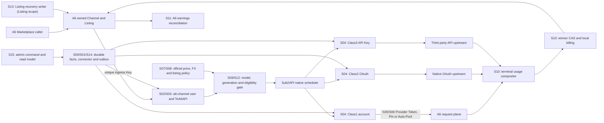
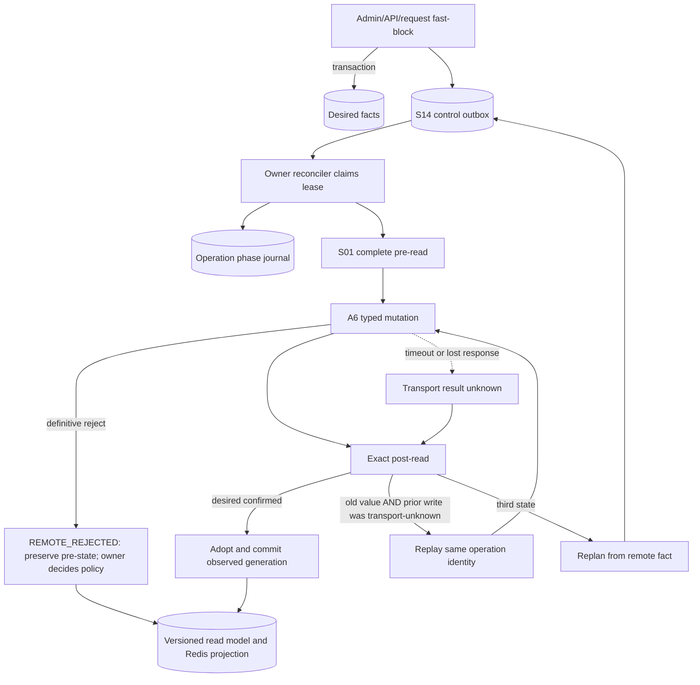
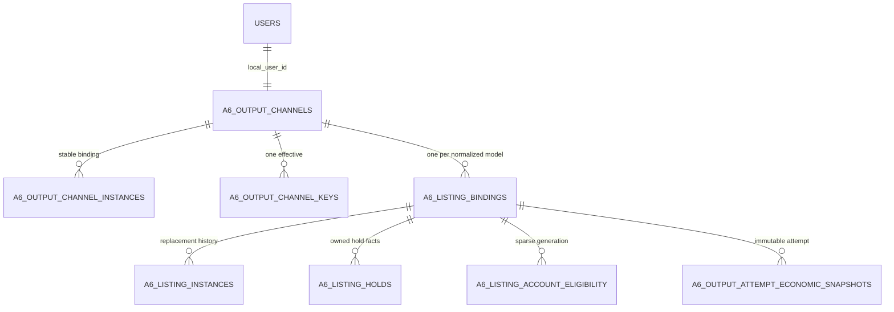
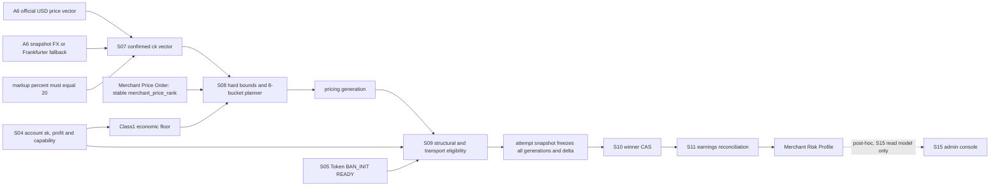
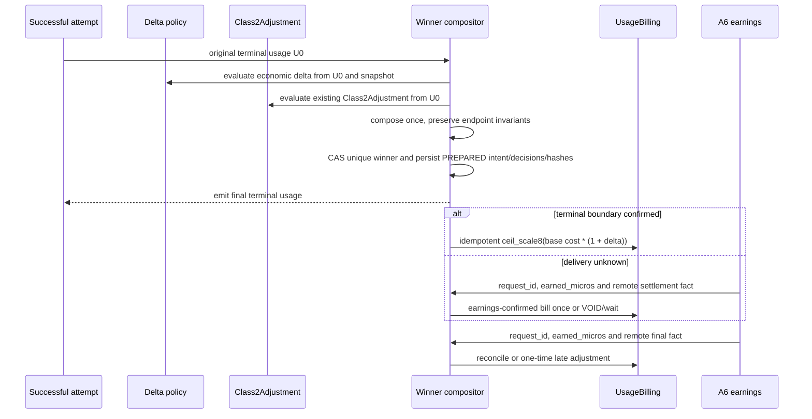
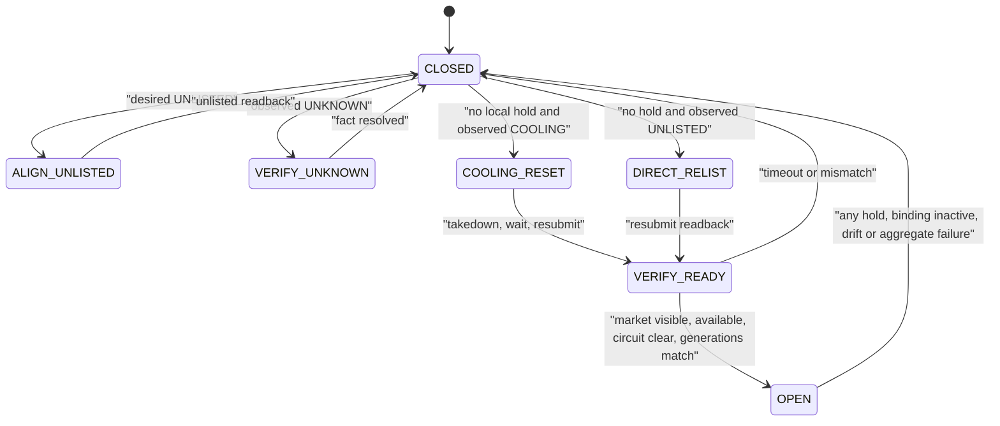
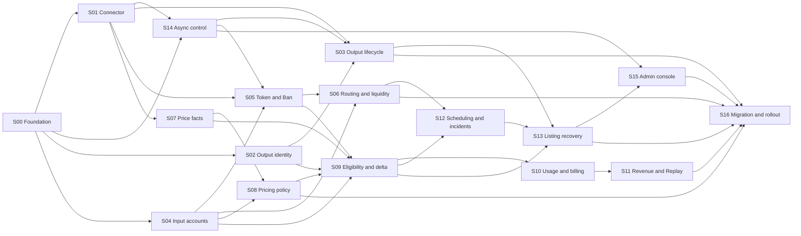

# A6 Channel 架构总图与分图

本文件只表达边界、所有权、事实流和实施依赖。节点编号 `S00..S16` 对应 [分系统实施总纲](README.md#3-工作包索引)。

## 1. 端到端总图



这条链路的核心循环是 `A6 -> Sub2API -> upstream -> Sub2API -> A6`。S05 用 BAN_INIT 建立 BanRelation，并在真正可能改变 owned 集合或 Auto-Pool 候选的事件上运行一次完整 Exclusion Gate；运行期 SelfRoute Monitor 兜底。普通请求和 Seller 改价不运行 gate。

## 2. 控制面写入与事实边界



`Observed` 只来自读取，`Desired` 只来自业务/管理员事实，`Plan` 只由 planner 计算；远端 mutation 只有 owning reconciler 可以执行。

## 3. 出口身份与实例图



稳定 binding 承载历史外键；远端 Channel/Listing 删除重建只关闭旧 instance 并创建新 instance。一个本地 `a6-channel` 用户始终绑定一个稳定 Channel、一个有效入口 Key 和多个按模型区分的 Listing。

## 4. Provider 激活与 Ban Initialization

```mermaid
sequenceDiagram
    participant P as Provider controller
    participant I as Local controlled inventory
    participant A as A6 marketplace and token APIs
    participant D as Sub2API dispatch

    P->>I: build owned set = complete Supplier inventory union local controlled without delete proof
    P->>I: tombstone only exact remote delete + complete current absence
    P->>D: pause account or keep slot vacant
    alt TOKEN_BAN_INIT (new Provider Token instance)
        P->>I: atomic member-enter + ban_membership_generation++ in one DB transaction
        P->>I: freeze membership_generation_start
        P->>A: complete paginated search(all, seed, disabled, user-disabled, unavailable included)
        P->>A: for each owned routing listing: disable Token × (Channel, Model)
        P->>A: exact item readback per relation
    else LISTING_BAN_INIT (new Listing instance)
        P->>I: atomic member-enter + ban_membership_generation++ in one DB transaction
        P->>I: freeze membership_generation_start
        P->>I: persist init_ck = random_decimal_closed("0.8","1.9") on operation
        P->>A: write init price (S07 vector from init_ck) + exact Supplier readback
        P->>A: temporary resubmit + Supplier readback
        P->>A: immediately disable all Ban-domain Tokens × Listing
        P->>A: exact Ban readback per relation
        P->>A: restore immutable pre-operation Listing/Channel state + exact readback
    end
    P->>P: recheck ban_membership_generation
    alt membership changed
        P->>P: fill only missing Token × Listing BanRelations
    else membership stable
        P->>P: initialization complete
    end
    P->>A: EXCLUSION_GATE fresh readback; drift-only disable; generation fence
    P->>D: hand READY result to S06 route owner
    Note over P,D: S06 writes Pin/Auto-Pool; no second gate table/state machine
    P->>A: read route, cost, model and auto_channels through owning route/cost handlers
    alt all BanRelations READY and route/cost/capability callable
        P->>D: atomically publish current generation
    else incomplete/missing/mismatch
        P->>D: remain unschedulable or VACANT
    end
    Note over P,A: SelfRoute Monitor (runtime): SELF_ROUTE_DETECTED -> pause + scoped repair
    Note over P,A: LISTING_BAN_INIT: No Marketplace-visible polling before Ban; disable/readback is the readiness proof. Propagation failure handled by BAN_INIT same-operation retry/readback.
```

BanRelation 仍是唯一持久化关系。远端仍存在的 retired/hidden/unavailable/replaced 项继续属于 owned set，只有 exact
remote delete 与完整 current Supplier absence 同时确认才进 tombstone。Exclusion Gate 只在 Token onboarding、Channel
create/adopt/restore、Provider schedulable、Auto-Pool `max_ratio` 和 SelfRoute repair 运行；它复用 relation、generation、
operation audit，已禁用时零 mutation。并发成员变化由 `ban_membership_generation` 在提交前阻断。

## 5. 价格、eligibility 与不可变 attempt



任一派发前 generation 失效都重新选账号；已经派发的 attempt 只按冻结快照结算。新 generation 只能阻止新请求，不能重写历史。

Merchant Price Order 是事前策略事实：只约束 S08 目标价格槽向各商户的分配顺序（`max_ck(M1) <= min_ck(M2) <= ...`），
不改变市场分布目标，也不参与 Delta。Merchant Risk Profile 是 S10/S11 历史结果的事后观测，只流向 S15，
**禁止画 Risk → S08 的反向箭头**；Risk Profile 不会自动改变 Merchant Price Order 或 Delta 分布。

## 6. Usage 合成、账单与收益



两套策略都读原始 `U0`，但只合成一次；只有经营 delta 改变本地 ActualCost。输入 usage `<1000` 时两者都跳过，`=1000` 生效。

## 7. Listing 状态与恢复



本地图中的动作不是第二套业务状态。规范事实仍是 `holds + desired + observed + plan` 四个正交维度；OPEN/CLOSED 只是请求准入投影。

`maintenance_visibility_override`（`NONE | TEMP_VISIBLE_FOR_BAN_INIT`）只允许 S05 BAN_INIT 使用：它不修改业务
`desired`，临时可见期间 admission 始终 CLOSED，Ban 完成或失败后立即恢复 pre-operation 远端状态。Channel-scope
takedown/restore/maintenance 由 S03 唯一拥有，S13 只拥有 Listing-scope 的 takedown/resubmit/reset。

## 8. 实施依赖图



## 9. 图谱阅读结论

- 请求热路径只消费已确认 generation 和 Redis/read-model 投影；所有远端修复异步执行。
- SSE first-byte guard 是 request-local transport helper：一次 500-2000ms deadline、最多一个 no-op prelude；prelude 不构成 upstream commit，candidate failover 仍复用 S09/S12/native scheduler，不形成 durable controller。
- 输出 Channel 与输入 Provider 都和 A6 双向交互，但 Key、Token、状态 owner 和 Saga 完全隔离。
- S05 用 BAN_INIT 建立关系，用事件驱动 Exclusion Gate 核对当前远端排除；无周期扫描、无请求热路径调用、无第二套证明状态机。
- S10/S11 是不可拆散的结算链，但分别拥有“本地唯一 winner”与“远端收益最终事实”。
- S13 只决定和执行 Listing 恢复，不能清除其他控制器拥有的 hold。

返回 [分系统实施总纲](README.md)。
