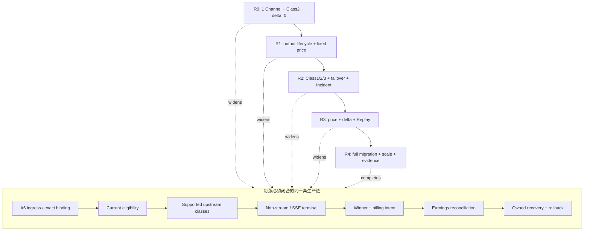

# A6 Channel 横向渐进交付总纲（冻结终稿投影）

[冻结清单](../FROZEN-MANIFEST.md) | [纵向分系统总纲](../README.md) | [范围与验收矩阵](scope-matrix.md) | [Canonical](../../A6API_Canonical_Design_FrozenCandidate_SSEIntegrated.md)

本横切固定投影 Canonical SHA-256：

```text
FF86555B860D6C3EEC05690718C46A4CEA9E04AEC5F8D448A55DA987ED9EEF19
```

若该哈希与 [Frozen Manifest](../FROZEN-MANIFEST.md) 不一致，所有 release 设计自动失效，必须先由用户明确处置
Canonical delta；横切 Agent 不得自行修改纵向终稿。

## 1. 目的

最终候选设计仍是目标事实，但不再要求第一次上线同时开启全部经营、路由、恢复和迁移自动化。本目录把同一目标系统横向切成五个**累积、可部署、可回滚**的 release：先建立一个严格限域的真实闭环，再逐版扩大支持面和自动化程度。

“小版本”只允许减少业务宽度，不允许降低已支持路径的正确性。一个 release 可以明确不支持 Class1、动态定价或自动建 Channel；但不能在已经支持的请求上省略鉴权、Decimal、不可变 attempt 快照、唯一 winner、幂等计费、远端精确读回、失败关闭或回滚证据。

本目录是发布覆盖层，不是第四份业务规范。每个 release 同时绑定三类稿：人阅读对应 S00-S16 的
`logic.md`，实现 Agent 执行同包 `pseudocode.md`，验收 Agent执行 `tests.md` 与本 release 的 `R*-E2E-*`。
横切文档只回答“本版启用哪些已冻结能力、按什么顺序发布、如何回滚”，不复制算法或新增实体。

## 2. 五级版本阶梯

| Release | 名称 | 可上线用途 | 本版新增的核心能力 | 明确不做 |
| --- | --- | --- | --- | --- |
| [R0](r0-controlled-loop.md) | 受控可上线闭环 | 一个既有 Channel/Listing/模型的小流量 canary | A6 出口请求 -> Class2 -> SSE/non-stream 终态 -> winner/负账单 -> earnings 核对；最小 Listing 停用与回滚 | 资源创建、Key 轮换、Class1/3、动态价格、经营 delta、无人值守恢复 |
| [R1](r1-operable-output.md) | 可运维输出经营 | 单一 A6 商户下多 Channel/多模型的受控生产 | Channel/Listing/Key 生命周期、语料、固定价写后读、Outbox、hold、恢复、最小管理端 | Class1 Provider、Class3、自动价格分布、经营 delta、全量旧系统迁移 |
| [R2](r2-resilient-routing.md) | 多上游鲁棒路由 | 多商户、多 Channel、多输入类别的稳定生产 | Class1/2/3、Provider owned-Channel 全量 Ban、Pin/Auto-Pool、流动性、failover、Incident、SSE pre-commit 保护 | 自动经营定价、非零经营 delta、完整收益调参闭环 |
| [R3](r3-economic-automation.md) | 自动经营与对账 | 自动定价、利润保障和收益闭环 | 官方价/FX、Merchant Price Order、价格分布、delta、usage compositor、完整 earnings/Replay | 只剩长尾迁移、全量规模化和最终证据收口 |
| [R4](r4-canonical-complete.md) | 最终完整稿 | 全量目标生产系统 | 最终候选设计全部能力、旧系统全量迁移、HA/规模化、全部验收与证据 | 无；未实现项阻断宣称 R4 |

版本是包含关系：`R0 ⊂ R1 ⊂ R2 ⊂ R3 ⊂ R4`。升级只改变 S16 既有逐 Channel feature flag、deployment
manifest 与各 owner 的 allowlist/config；不新增 `release_capability_generation` 表、状态机或 R0/R1 专用业务模型。




## 3. 每一版都必须闭合的纵向链

任何 release 都不能只完成几个孤立子系统后称为可部署。它必须在自己的支持边界内闭合：

```mermaid
flowchart LR
    A6["A6 caller / owned Listing"] --> Auth["Key、用户、模型绑定"]
    Auth --> Gate["当前 generation 与资格硬门"]
    Gate --> Dispatch["原生 scheduler 与受支持上游"]
    Dispatch --> Terminal["non-stream / SSE 终态"]
    Terminal --> Winner["唯一 winner 与幂等本地账单"]
    Winner --> Earn["A6 earnings / settlement 核对"]
    Earn --> Observe["异常、停用、恢复或人工出口"]
    Observe --> Rollback["逐 Channel rollback 证据"]
```



若其中一环在某版尚未自动化，必须给出显式保守状态、可执行人工出口和时限，不能用 TODO、假远端成功或“稍后补账”代替。

## 4. 不可延期的基线硬门

以下内容从 R0 起生效，不能以“后续增强”为由延期：

1. **范围 fail-closed**：release manifest 外的账号类别、endpoint、模型、远端 mutation 和控制命令均拒绝；不得静默回落到 legacy 猜测路径。
2. **身份隔离**：`a6-channel`、`ToA6API`、唯一入口 Key、精确 model binding 和普通用户隔离必须成立。
3. **数值与历史**：经济值只用 Decimal/NUMERIC；attempt 引用不可变 generation，current 指针变化不改历史结算。
4. **唯一终态**：每请求最多一个 winner、一个 billing intent 和一次负余额扣账；失败 attempt 不扣费，重复 terminal/callback/Replay 幂等。
5. **SSE 边界**：不能跨两个 upstream 拼接一个已 committed stream；无法取得所需终态 usage 时不得伪造成功或 usage。
6. **远端事实**：任何已启用 A6 mutation 都必须经单一 owner、Outbox/operation identity、写前读、精确写后读和 transport-unknown 处理；不完整分页不能证明不存在。
7. **凭据安全**：secret envelope encryption；日志、trace、错误和证据只保存 reference、fingerprint、last4 或脱敏摘要。
8. **公共文本**：一旦本版会写 Supplier/Channel/Listing/Token/Key 公共文本，必须完整启用仓库语料选择合同；没有语料即 `TEXT_CORPUS_INVALID`，不得临时编文案。
9. **Provider 安全门**：任何尚未引入 Class1 的版本必须把 Class1/Provider 功能编译或运行时关闭；从 R2 起，Provider 启用与每次 `max_ratio` 更新都必须先按根 `AGENTS.md` 完成完整 owned-Channel disable/readback gate，包括远端仍存在的 retired/hidden/unavailable 项。
10. **shadow 禁用**：Provider shadow service/timer 从 R0 到 R4 均默认关闭；日常验证不得启动。
11. **回滚分界**：首个新 winner 前允许按快照回退；出现新 winner 后只能 forward rollback，保留账本、attempt、instance 和当前唯一 Key 事实。
12. **既有能力回归**：v0.1.173 原生调度、普通用户账单和 `Class2Adjustment` 不得因任何 release 回归。

## 5. 可部署定义

每个 release 必须有自己的 release manifest，并满足以下门：

| 门 | 必须提供的证据 |
| --- | --- |
| 支持面 | 启用的 credential、Channel、Listing、model、endpoint/transport、account class 和 mutation 白名单 |
| 不支持面 | 对每项关闭能力的 API/worker/scheduler fail-closed 测试，不能只有文档声明 |
| 数据 | 可重复 migration、唯一约束、向前兼容字段、无 float 经济路径、secret 扫描 |
| 请求闭环 | 鉴权、精确模型、eligibility、dispatch、终态、winner、账单、earnings correlation 的 request_id 证据 |
| 故障闭环 | 用户错误、零资格、全忙、上游失败、timeout/unknown、进程 crash 和重复 delivery 的确定出口 |
| 控制面 | 本版每个远端 mutation 的 pre/post read、operation identity、actor、generation 和补偿/人工出口 |
| 回滚 | 无 winner rollback rehearsal、已有 winner forward rollback rehearsal、逐项远端读回 |
| 生产保护 | 默认关闭、逐 Channel flag、并发/流量上限、kill switch、告警和观察窗口 |

“进程可启动”“HTTP 200”“UI 有数据”都不是可部署证据。R0 可以只面向一个 canary Channel，但这一个 Channel 的支持链必须真实闭合。

## 6. 版本与数据演进规则

- 使用同一套稳定 binding/remote instance、operation journal、attempt snapshot、winner intent 和 reconciliation 数据模型；早期 migration 允许先创建必要子集，但表/枚举/唯一键必须能只加不破坏地走向 R4。
- S16 deployment manifest 记录 release 标签、Canonical hash、支持面/配置 hash、目标 credential/Channel、启用时间和操作者；它是发布证据，不是新的运行期业务状态。
- feature flag 以 credential/Channel 为最小切换单元；endpoint/model/account-class 是现有配置中的显式 allowlist，不能只靠 UI 隐藏。attempt 只冻结 Canonical 已定义的 output/account/price/route/capability/economic generations。
- 新 release 先在影子读取和离线验收中建立事实，再对一个 Channel 开启；这里的 shadow-read 不是 Provider pool shadow，后者仍保持禁用。
- 升级失败只回退新增 capability，不删除后续 schema、不倒回 generation、不复活旧 Key。

## 7. 如何给实现 Agent 取包

1. 选择目标 release，例如 R0。
2. 从[范围与验收矩阵](scope-matrix.md)只领取该列标为 `M` 或 `E` 的工作包增量。
3. 对每个工作包同时阅读其 `logic.md`、`pseudocode.md`、`tests.md`，不得只按横切摘要自行发明算法。
4. `M` 项必须完整达到本 release 的 scoped acceptance；`E` 项只实现列中写明的显式子集；`OFF` 项必须有关闭证据。
5. release 集成验收使用各版本文档的 `R*-E2E-*` 用例，再回链纵向 requirement/test ID。

## 8. 设计优先级

冲突时仍按[纵向总纲](../README.md#1-总纲用途)的优先级处理，根 `AGENTS.md` 永远高于冻结候选和本横切稿。横切 release 不能把上位硬规则降级为“后续版本”；若某硬规则只在某能力启用时适用，则在早期版本关闭该能力，在首次启用它的版本一次性满足完整硬门。

## 9. 横切收敛出口

每版只在以下条件全部满足后关闭设计并进入实现：范围矩阵无歧义、流程闭环、`OFF` 有负向测试、E2E 回链纵向
requirement/test、pre-winner 与 post-winner 两类 rollback 都有本版新增能力证据。此后发现的新建议默认记录为
`DEFER`，除非它证明当前支持路径违反冻结合同；不得以“还能更鲁棒”为由继续修改 release。
