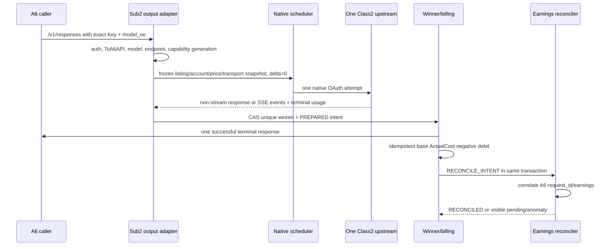

# R0 受控可上线闭环

[横向总纲](README.md) | [范围矩阵](scope-matrix.md) | [R1](r1-operable-output.md)

## 1. Release 结论

R0 的目标是在 `us_cloud` 上让**一个明确 allowlist 的既有 A6 Channel、一个 Listing、一个精确模型**完成真实小流量闭环：

`A6 request -> a6-channel identity -> one Class2 account -> response/SSE -> unique winner -> negative local billing -> A6 earnings correlation`。

R0 不是“先把所有表和 controller 写一半”，而是砍掉资源经营宽度：不自动创建资源、不轮换 Key、不接 Class1/3、不自动定价、经营 delta 固定为 0、不做候选 failover。保留下来的单路径必须达到生产正确性、可观察性和可回滚性。

## 2. 固定支持边界

R0 发布 manifest 必须给出以下确定值；任何未列值 fail-closed：

| 维度 | R0 支持值 |
| --- | --- |
| A6 credential | 1 个精确 `a6_user_id + secret_generation_ref` |
| 输出资源 | 1 个已存在且归属无歧义的 Channel instance、1 个 Listing binding/current instance |
| 本地身份 | 1 个 `user_type=a6-channel` 用户、1 个 effective ingress Key、只属于 `ToA6API` |
| 模型 | 1 个精确 A6 `model_no`；不接受 alias、模糊名或 fallback |
| endpoint | `/v1/responses` non-stream 与 SSE；其他 endpoint 拒绝 |
| 输入账号 | 1 个显式绑定的 Class2 native OAuth account；不做 request 内 candidate failover |
| 经营 delta | 固定 Decimal `0`；override API 关闭 |
| Class2Adjustment | 复用并回归 v0.1.173 既有行为；与 R0 delta=0 的 decision 分开保存 |
| Listing price | 只读取和冻结既有、人工确认且可盈利的 remote vector；R0 不改价 |
| A6 mutation | 仅 S13 owning recovery controller 的 Listing `takedown/resubmit`；Channel restore/API、create、Key、price 等均 OFF |
| 流量 | manifest 固定 RPM、并发、单日请求数和未对账 backlog 上限 |
| rollout | 默认关闭，只对该 Channel flag 开启；同时有本地 kill switch 和远端 Listing stop |

若没有满足条件的既有 Channel/Listing，R0 系统本身不负责创建。准备资源时仍必须遵守仓库公共文本语料硬规则；系统只 adopt 已经由完整远端读取证明归属和身份的实例。任何 N:1、1:N、Key 不唯一、模型歧义或 remote inventory 不完整都进入 `BINDING_REVIEW`，不得为了赶上线猜 anchor。

## 3. 端到端流程

### 3.1 请求入口

1. 先完成标准 Key、IP、RPM、并发和输入合法性检查。
2. 精确识别 `a6-channel`，只跳过余额 reserve/平台 quota accounting；用户自身非零 quota、Key 和安全限制不跳过。
3. 解析唯一 stable `listing_binding_id`、current instance、exact model 和 `responses-stream|responses-nonstream` transport profile。
4. 任一 current pointer 或 S16 deployment manifest 的 Channel/model/endpoint/account allowlist 不匹配，立即拒绝，不进入原生 scheduler。

### 3.2 资格与派发

- Class2 account 必须同时有原生 schedulable、current cost、current capability 和 manifest binding。
- 使用 `required=sk*(1+profit)`；R0 因 `delta=0`，只有 confirmed `ck>=required` 才可派发。
- attempt 原子冻结 Canonical 已定义的 output/listing/account、cost/capability、confirmed price vector/hash、transport profile、Class2Adjustment generation 和 `delta_effective=0`；不新增 release generation。
- R0 每请求最多创建一个 upstream attempt。账号满并发是 `service_busy`；账号不合格是 `NO_ELIGIBLE`；不能把二者混合。

### 3.3 终态、SSE 与账单

- non-stream 在下游任何成功字节前验证 terminal usage、CAS winner 并创建 intent。
- SSE 可透传一个 upstream；第一段 upstream-originated event 写出前设置 `upstream_stream_committed=true`。R0 不发送 synthetic prelude、不切第二 candidate。
- 成功终态对原始 usage 只执行现有 Class2Adjustment；R0 经营 delta decision 恒为 0。两者 decision/hash 仍独立保存。
- 同一 request 最多一个 winner/intent。只有 winner 按 base ActualCost 幂等负扣；失败、client cancel 和 loser 不扣。
- committed SSE 缺合法 terminal usage 时不得伪造 usage 或成功补帧：取得唯一 terminal ownership，保存 `DELIVERY_UNKNOWN`，交 earnings/settlement 和人工可见队列决定。

### 3.4 收益核对

- 以 `(a6_credential_id,request_id)` 唯一关联 winner、usage、billing intent 和 A6 earnings。
- 重复 earnings 只 adopt；usage/hash 冲突形成可见异常，不二次扣费。
- R0 不根据偏差自动调价或改 delta。超过 manifest 的未对账数量/最老年龄后，停止新请求并 Listing stop，等待人工核对。
- 只有完整 earnings/settlement snapshot 能证明 absence；不完整读取不能把 intent 标 VOID。

## 4. R0 控制面

R0 的 A6 控制面以只读为主。唯一 mutation 是 Listing `takedown/resubmit`：

1. 本地事务写 desired hold/plan 与 Outbox。
2. S13 owner 取得 lease，S01 完成写前读。
3. 执行 `takedown` 或 `resubmit`；Listing 没有 `restore` API，父 Channel restore 在 R0 明确 OFF。
4. 通过 Supplier inventory 和 Marketplace 所需完整读取精确确认目标状态；transport unknown 先读后决定 adopt/replay/replan。
5. 只有 current Key、model、price、eligibility、deployment manifest allowlist 和本地健康均通过，才允许 resubmit；随后由 S13 VERIFY 证明 Marketplace visible+available 与 circuit clear 才 OPEN。

R0 不允许 Channel PATCH、Key 创建/删除、Token、Pin/Auto-Pool、price write、profile mutation、withdraw 或 balance transfer。对应 API 即使 Typed Connector 已有代码，也必须被 release mutation policy 拦截。

## 5. 最小持久化事实

R0 不建立临时平行 schema。至少使用可向 R4 扩展的正式实体：

- credential secret generation 与 redacted identity；
- stable output Channel/Listing binding 与 current remote instance；
- effective ingress Key reference/fingerprint；
- Class2 cost/capability generation；
- confirmed remote price vector generation；
- S16 deployment manifest/feature-flag 证据（非运行期业务实体）；
- immutable attempt economic snapshot；
- winner billing intent、negative ledger entry、reconciliation；
- Listing hold/desired/observed/plan；
- control Outbox、operation phase journal、audit/dead letter。

未启用的 Provider、Merchant Price Order、nonzero delta 字段可以为 nullable/空集合，但 schema 演进不得在后续改变 R0 历史主键或经济语义。

## 6. 故障语义

| 情况 | 同步结果 | 持久化/控制动作 |
| --- | --- | --- |
| Key/模型/endpoint 不在 manifest | 用户侧确定性拒绝 | 安全审计；不处罚账号、不停 Listing |
| current generation 漂移 | `OUTPUT_CONFIG_INVALID` | 停止准入，建立可见 hold；不猜 current |
| 结构资格为 0 | `NO_ELIGIBLE` | 幂等 `NO_ELIGIBLE` hold，异步 Listing stop |
| 唯一账号仅因容量满 | `service_busy` | 无 hold、无远端 mutation |
| 唯一 upstream 明确失败 | 原生聚合错误 | 记录 attempt 窄作用域动作；按分类决定本地 cooldown/Listing stop |
| non-stream 缺 usage | 不发送成功终态 | attempt failed；不 winner、不扣费 |
| SSE committed 后缺 usage | 关闭流 | `DELIVERY_UNKNOWN`，不换 upstream、不伪造 usage |
| terminal/callback 重复 | 返回/adopt 既有结果 | 唯一键保证零二次扣费 |
| A6 mutation timeout | 当前 operation unknown | GET 精确读回后 adopt/replay/replan |
| earnings backlog 超门限 | 停止新 canary 流量 | local kill + Listing stop；人工出口可见 |
| worker/process crash | 请求终止或 lease 过期 | Outbox/journal 重放；不跨进程续接 SSE |

## 7. R0 发布与回滚

发布顺序固定为：只读 preflight -> schema/migration rehearsal -> backfill/adopt-only -> shadow-read 比对 -> rollback snapshot -> S13 `takedown`/readback -> 本地 flag 单 Channel开启 -> Key/model/price/eligibility gates -> S13 `resubmit`/readback/Marketplace+circuit VERIFY -> A6 受控请求 -> winner/账单/earnings 证据 -> 保持观察。若 pre-recovery gate 失败，在首 winner 前关闭 flag并按 snapshot恢复；不得在主动 unlisted、尚未 resubmit 时等待 Marketplace availability。

这里的 shadow-read 仅比较本地投影与远端读取，不是 Provider pool shadow；`a6-trader-provider-pool-shadow.service` 和 timer 始终 disabled。

- **首个 R0 winner 前**：可关闭 flag，按 snapshot 恢复旧读取/调度路径和远端 Listing 状态。
- **首个 R0 winner 后**：只能 forward rollback。保留新 attempt、账本、负余额、reconciliation、instance 和当前唯一 Key；关闭新 flag、恢复兼容读取/调度路径并精确读回 Listing 状态。
- rollback 本身也要记录 operation identity 和远端 readback，不能以服务已重启代替。

## 8. R0 E2E 验收

| ID | 场景 | 必须证明 |
| --- | --- | --- |
| R0-E2E-001 | non-stream 成功 | exact binding、one attempt、one winner、one debit、earnings correlation |
| R0-E2E-002 | SSE 成功 | 事件顺序、one upstream identity、terminal usage、one winner/debit |
| R0-E2E-003 | 999/1000 usage 回归 | R0 delta 始终 0；既有 Class2Adjustment 行为与 v0.1.173 一致 |
| R0-E2E-004 | 普通用户回归 | 普通余额/quota/group/账单路径完全不受影响 |
| R0-E2E-005 | 未知 model/endpoint/第二 Channel | 全部 fail-closed，零 upstream attempt |
| R0-E2E-006 | `NO_ELIGIBLE` | 零派发、幂等 hold、Listing stop 精确读回 |
| R0-E2E-007 | capacity busy | `service_busy`，无 hold、无远端写 |
| R0-E2E-008 | upstream failure | 无 winner/扣费；分类与 stop/cooldown 动作唯一 |
| R0-E2E-009 | SSE committed 后缺 usage | 零 candidate 拼接，`DELIVERY_UNKNOWN` 可见，零伪造 usage |
| R0-E2E-010 | 并发/重复 terminal | CAS 后仍只有一个 winner、intent、ledger debit |
| R0-E2E-011 | earnings duplicate/late/missing | 幂等、完整性门、backlog kill switch 均生效 |
| R0-E2E-012 | mutation timeout/crash | exact GET 后 adopt/replay/replan，operation 不重复生效 |
| R0-E2E-013 | secret/log scan | 无完整 Key/Token/Cookie/Authorization 泄漏 |
| R0-E2E-014 | 首 winner 前 rollback | snapshot 状态全部精确恢复 |
| R0-E2E-015 | 首 winner 后 rollback | 历史账本不丢、Key 不复活、远端状态有读回 |
| R0-E2E-016 | R0 create/Channel restore/Provider 负向门 | remote create、Channel restore、Token/Pin/Auto-Pool、第二 Channel 全部被 manifest/mutation policy 拒绝；S05 Provider domain 非空即阻断 |
| R0-E2E-017 | cutover 顺序 | snapshot < takedown/readback < flag < pre-recovery gates < resubmit/VERIFY < first request；任一 gate 失败在 winner 前可完整回滚 |

纵向回链：请求/终态/账单采用 `OUT-*`, `ACC-*`, `ELG-*`, `BIL-*`, `REV-*`, `ERR-*` 对应 tests；控制面采用
`CON-T004..010`, `REC-T001..010`, `ASY-T001..018`；发布/回滚采用 `MIG-T009..014`。具体符号只以冻结三联稿为准。

## 9. R0 完成与升级门

R0 完成要求上述测试、纵向矩阵中的 `M/E` 子集和一个真实受控 request_id 证据全部通过。任一远端身份歧义、缺终态 usage、收益无法关联、账单重复或 rollback 不可证都阻断上线。

升级 R1 前不得先扩大 Channel allowlist。必须先完成公共文本语料、完整 output lifecycle/Key Saga、固定价 mutation、自动 recovery 和相应管理端，使新增 Channel 不依赖数据库手改或临时脚本。
