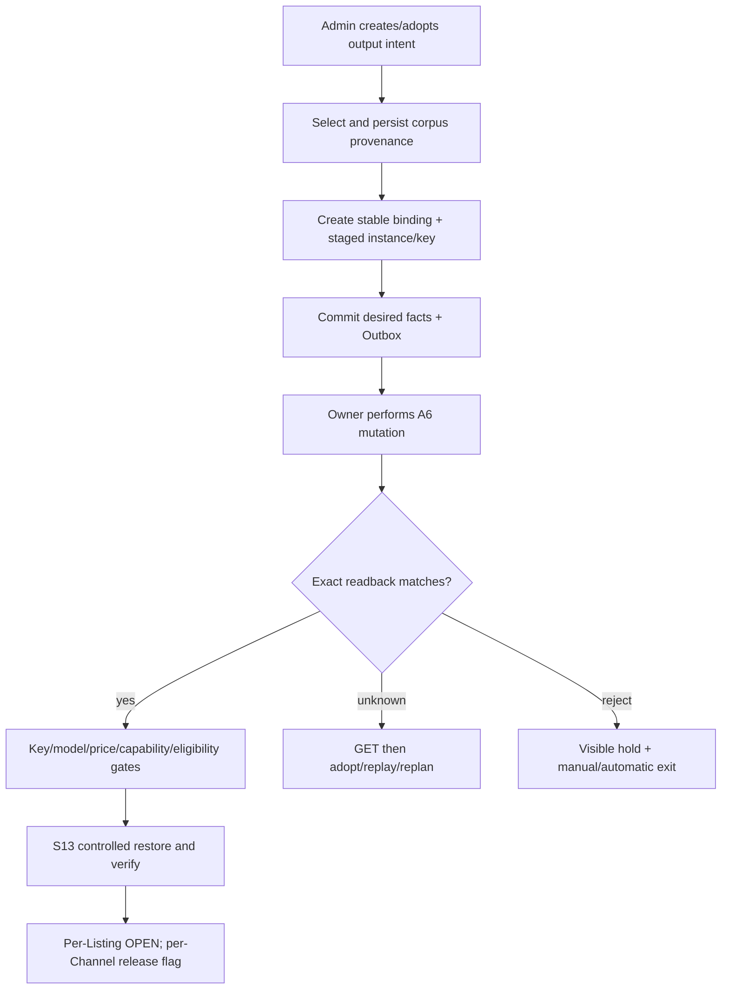

# R1 可运维输出经营

[R0](r0-controlled-loop.md) | [横向总纲](README.md) | [范围矩阵](scope-matrix.md) | [R2](r2-resilient-routing.md)

## 1. Release 结论

R1 把 R0 的单点 canary 扩展为**一个 A6 merchant credential 下、可由正式控制面运维的多 Channel/多 Listing 输出系统**。它解决资源创建/adopt/replacement/retirement、入口 Key、公共文本、固定价写入、hold/recovery、Outbox 和管理端，不依赖数据库手改或一次性脚本维持生产。

R1 仍只调度 Class2 native OAuth，经营 delta 固定为 0，Listing 价格由管理员给出并经过硬边界校验，不做自动市场分布。这样先把出口生命周期和故障恢复做稳，再引入 Provider 和经营算法。

## 2. 相对 R0 的新增支持面

| 维度 | R1 支持 |
| --- | --- |
| 商户 | 1 个 credential；多个显式 Channel binding |
| Listing/model | 每 Channel 多 Listing，精确 model binding；Responses/Chat、stream/non-stream 逐 profile allowlist |
| Class2 | 多账号、多模型显式 projection；每请求仍只执行一个 upstream attempt，不做 in-request failover |
| Output lifecycle | create/adopt/update/replace/retire；稳定 binding 与 remote instance 历史分离 |
| Ingress Key | staged -> 验证 -> 唯一 effective -> 旧 Key 删除/禁用读回的完整 Saga |
| 公共文本 | Supplier/Channel/Listing/Token/Key 的仓库语料选择、provenance、冲突重选和 hold |
| Listing price | 管理员提交固定 Decimal 目标；校验官方价/FX/硬边界后通过 owner 写入并精确读回 |
| Recovery | desired/observed/plan、Listing-scope takedown/resubmit/cooling reset、Channel maintenance 协调 |
| 管理端 | read model、RBAC、生命周期命令、语料选择、固定价预览、hold/replay/dead-letter 处理 |

Class1/Provider 与 Class3 API surface 即使已存在 connector 类型，也必须保持 unschedulable 且 mutation policy 为 `OFF`。S05 只执行本地空域门：Provider Ban-domain Token 集合必须为空；发现任何 Token 即关闭相关 Channel activation，不启动远端 Ban worker。不得用名称猜类别。

## 3. 输出资源生命周期

关键规则：

- 远端 ID 变化只创建新 instance、关闭旧 instance；attempt、账单和 reconciliation 永远引用当时实例。
- create/adopt/replacement 必须证明 Channel/Listing 全局唯一；分页不完整时不允许 adopt 或声明旧实例消失。
- 所有公共文本在 mutation 入队前已经选择并持久化。重试复用同一选择；remote uniqueness conflict 才选择另一个未使用条目，禁止改字拼接。
- Listing `display_name` 为空，Channel nickname 仅是 corpus `channel_name` 的平台长度投影，Token/Key name 不编码 duty。
- 既有不可改 Supplier name 只记 `LEGACY_REMOTE`；它不能成为新写来源，也不能伪造成合规改名。

## 4. 入口 Key Saga

1. 将目标 Channel 置 `KEY_ROTATION` maintenance，关闭父 Channel admission；只对父 Channel执行一次 takedown，不逐 Listing mutation/hold。
2. 生成新 secret material，规范为一个 `sk-` 前缀；完整值只在最小授权内存中出现。
3. 创建本地 STAGED Key generation，并 enqueue Channel `api_key` PATCH。
4. A6 PATCH 后 GET Channel，按 fingerprint/last4 或配置 generation 精确读回。
5. 原子切换本地 effective pointer，验证新 Key 可以唯一认证原用户；旧本地 Sub2 Key OFF。
6. 父 Channel restore/readback；旧本地 Key 删除失败只进 cleanup dead letter，不回滚新 Key、不阻塞父 Channel恢复，也不触发 child recovery。
7. R1 的 Provider Token 域必须仍为空；current Key/model/fixed price/Class2 capability/eligibility 通过后，child observer/admission 重新投影，child Listing remote mutation=0。

任何阶段 crash 都从 operation journal phase 和 remote readback继续；禁止重新生成第二把无关 Key。已有 winner 后回滚不得复活旧 Key。

## 5. 固定价而非自动定价

R1 引入“可控写价”，但不引入 S08 自动分布：

- 管理员输入 Decimal 目标或选择已确认模板，不得使用 float。
- S07 读取当前官方模型价格、FX/markup 与 remote price vector，计算目标 vector 和 `ck`，保存 source generation/hash。
- S08 只执行硬边界、可盈利和稳定性校验；没有 Merchant Price Order 自动槽位匹配。
- 写价通过 single owner/Outbox，保存 pre-read、write response、post-read；confirmed generation 只来自精确 readback。
- 改价期间旧 confirmed generation 仍服务已派发 attempt；新请求只有 current confirmed price 与 eligibility 同 generation 后才进入。
- 固定价变得不可盈利时先撤销对应 eligibility；归零则 stop Listing，绝不暂时用负利润继续跑。

## 6. 请求与恢复增量

R0 的 winner/账单/earnings 不变量原样继承。R1 新增：

- 一个用户可按模型解析多个 stable Listing binding；单 Listing hold 不禁用同 Channel 的健康模型。
- 多个 Class2 candidate 可供请求开始时选择，但 R1 每请求仅一次 dispatch；选中账号失败后不透明切第二账号。
- required transport profiles 来自当前启用 adapter generation；未知 profile 视为 output config invalid，而不是处罚账号。
- S13 正式拥有 Listing-scope desired/observed/plan 和 hold；S03 只拥有 Channel-scope maintenance/takedown/restore。普通 Listing 恢复使用 `resubmit`。
- Listing resubmit 前校验 current Key/model/price/eligibility 与没有 blocking hold；resubmit 后再验证 Marketplace visible/available 与 circuit。父 Channel restore 由 S03 独立读回。
- A6 transport unknown、429、remote cooling、本地 cooldown 分开记录；429 只延迟 operation，不伪造 down。

## 7. 管理与异步控制

R1 管理端只提交版本化 command，不直写业务表或 A6。至少提供：

- merchant/Channel/Listing/Key 的 current 与历史 instance read model；
- corpus source SHA/sheet/row/index/selection generation；
- fixed price preview、confirmed vector/hash 和 eligibility 影响；
- hold owner/reason、desired/observed/plan、operation phase/readback；
- earnings pending/anomaly、dead letter、受限 Replay 和 per-Channel kill switch；
- RBAC、actor、department、理由和审计查询。

S14 对所有 output mutation 提供同事务 Outbox、lease/fence、phase journal、幂等键、rate-limit/backoff 和 dead-letter 可见性。worker crash 后只 adopt/replay同一 change identity。

## 8. R1 E2E 验收

| ID | 场景 | 必须证明 |
| --- | --- | --- |
| R1-E2E-001 | 从 corpus 创建 Channel/Listing | provenance 完整、remote text 精确、稳定 binding/current instance 正确 |
| R1-E2E-002 | adopt 既有资源 | 完整 inventory、无歧义、secret 仅 fingerprint/last4 |
| R1-E2E-003 | corpus invalid/exhausted/conflict | 正确阻断或重选，绝无拼接文本/远端半写 |
| R1-E2E-004 | Key rotation 每阶段 crash | 同一 operation恢复；父 Channel takedown=1/PATCH=1/restore=1，child Listing mutation=0；唯一 effective Key，旧本地 Key cleanup 不阻塞 |
| R1-E2E-005 | Channel replacement/retirement | 历史 instance 不改，旧 attempt/账单可追溯 |
| R1-E2E-006 | fixed price mutation timeout | pre/post readback 和 unknown resolution 正确 |
| R1-E2E-007 | 多模型隔离 | 单 Listing hold/price/config 不污染同 Channel 其他模型 |
| R1-E2E-008 | Responses/Chat 四 transport profiles | 每个 profile 有 exact candidate、终态 usage 和账单 |
| R1-E2E-009 | worker 并发与 lease 过期 | 远端 mutation 不重入、不双写、不倒回 generation |
| R1-E2E-010 | recovery/cooling | owner 正确、restore gates 完整、Marketplace/circuit verify 正确 |
| R1-E2E-011 | 管理命令 RBAC/审计 | 无直写、无越权、命令/actor/reason/readback 可追溯 |
| R1-E2E-012 | R0 全回归 | 单 Channel 请求、账单、earnings、rollback 无回归 |
| R1-E2E-013 | Provider 空域门 | create/adopt/Channel restore 前 Provider Token 域为空；注入一个 Token 后 activation fail-closed，远端 Ban/search worker 调用=0 |
| R1-E2E-014 | R1 新能力两类 rollback | pre-winner rollback 恢复 Channel/Key/price snapshot；已有 winner 后 forward rollback 保留新 Key、instances、账本，绝不复活旧 Key |

纵向回链：资源/Key 使用 `LIF-001..013` 与 `LIF-T001..016`，公共文本使用 `FND-006..009`，固定价使用
`PRF-*`/`PRC-001`/`PRC-008..012`，恢复使用 `REC-*`，空 Provider 域使用 `BAN-004..009` 的空集分支。

## 9. R1 完成与升级门

R1 完成后，新增/轮换/停用/恢复输出资源不再需要数据库手改；所有 A6 output mutation 都能从 command 追到 exact readback。

升级 R2 前必须先把 Class1/3 保持 OFF，并完成 Provider 完整 owned-inventory Ban 设计/测试。不得先启用 Auto-Pool 再补 Ban，也不得把“本地候选过滤”作为防 self-route 证据。
