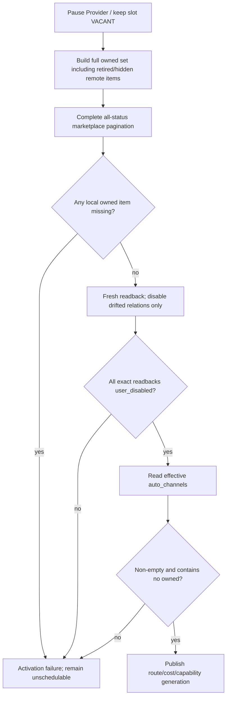

# R2 多上游鲁棒路由

[R1](r1-operable-output.md) | [横向总纲](README.md) | [范围矩阵](scope-matrix.md) | [R3](r3-economic-automation.md)

## 1. Release 结论

R2 把系统从“出口可运维、单类上游”扩展为**Class1/2/3 多输入、可 failover、可隔离平台故障、可自动恢复路由**的稳定生产版。它仍使用管理员确认的固定 Listing 价格，经营 delta 固定为 0；上游成本变化造成利润不满足时撤销资格或停 Listing，而不是提前引入半套自动定价。

R2 的核心风险是 Class1 self-route 回自有 A6 Channel，但防护本身也受冻结成本边界约束：只实现 S05 事件驱动
Exclusion Gate，不新增 attestation 表/状态机，不做周期、请求热路径或 PUT 前后双全量扫描。

## 2. 输入账号支持

### 2.1 Class1 A6 Provider

- 独立 Provider Token instance，不能复用 output ingress Key 或 liquidity/callback Token。
- Auto-Pool `sk` 来自完整纳入价格带的 Top-N `max_ratio`；Pin `sk` 来自 current assignment 的精确 `K_CNY`。
- schedulable 同时要求 native health、current route/cost/capability generation、完整 owned-Channel Ban readback 和 callable route。
- Provider shadow service/timer 保持 disabled。只有根规则允许且确需新 immutable generation 时，才能记录具体理由后单次运行；R2 日常 observer/repair 不使用它。

### 2.2 Class2 native OAuth

继承 R1，完整支持 weekly quota-derived `sk`、模型能力 generation 和原生 health。100% utilization 不触发暂停/刷新/替换；Class2Adjustment 仍是独立 usage policy。

### 2.3 Class3 API Key

使用显式 `class3:<provider_code>`、管理员 declared cost/model override、`/v1/models`/balance/usage/billing adapter 和有界 capability probe。账单偏差按合格窗口暂停/恢复；不能用名称推断类别或成本。

## 3. Provider owned-Channel Ban 硬门

R2 以根 `AGENTS.md` 为准，以下是**每次 Provider schedulable/Auto-Pool 启用及每次 `max_ratio` 更新前**的原子激活门：

1. 暂停 Provider identity 或保持 slot `VACANT`。
2. 构建 authoritative owned set：当前 supplier inventory 中 active、down、unavailable、retired、hidden 等所有仍存在 remote Channel/Listing，加上本地 control plane 已知的全部受控 Listing Channel。retirement 不是豁免。
3. 用 Provider Token + model 执行完整分页 marketplace search：`route_status=all`、`include_seed=true`、`include_disabled=true`、`include_user_disabled=true`、`exclude_unavailable=false`。
4. 任何本地已知 owned resource 在完整 remote readback 中缺失，激活失败；不能把缺失视为已经排除。
5. 对每一 owned Channel fresh readback；已经精确 disabled 时零 mutation，只有漂移时执行 disable，再读回 `user_channel_disabled=true` 且 `route_status=user_disabled`。
6. 读取 effective subscription，确认 `auto_channels` 非空且不含任何 owned Channel。
7. 只有 Ban、route、matching cost、capability 和 callability 的 current generations 同时通过，才原子发布 schedulable generation。

本门直接投影冻结 S05/S06。成本上限是每个 trigger 一次 Supplier inventory、每 Token/model 一次完整 Marketplace 分页、
漂移关系 mutation、Auto-Pool PUT 后一次 subscription readback和一次 membership generation fence。不得自行加强。

## 4. 路由失败与流动性

| 失败 | R2 唯一恢复路径 |
| --- | --- |
| `insufficient_quota` | 立即摘出 Provider、标 `UNFUNDED`，进入 liquidity controller；不得 Observer 扩池或调 `max_ratio` |
| merchant withdrawable 有 eligible whole units | 先转入该 merchant user balance，再读回 funding contract |
| 修复后仍不满足 funding | 移除 Provider duty，旧 slot `VACANT`，申请 funded replacement |
| replacement | 在 slot 外完成 owned Ban、Observer range、Enodot cost、callability/schedulability 全读回后再入 slot |
| non-quota Provider runtime failure | 保持 pause，fresh Observer，严格扩到下一完整 CNY 价格带且不超过 `0.3` |
| max_ratio 更新 | 更新前执行一次 gate；PUT 后只读 subscription + generation fence，不做第二次 full scan；matching USD cost 后恢复 |
| Seller 影响 | 立即触发固定价 revalidation/publication command；R2 无法保持利润时撤资格/停 Listing，不能延后到 R3 |

liquidity/callback Token 是另一独立 Token，名称来自 token corpus，duty 只存控制面。它只可 Pin 当前 listed 且 callable 的 A6-owned small-merchant Channel；没有合格目标就跳过 transfer。生产 callback 使用根规则规定的精确 PING 输入，并拒绝 `prompt_tokens=1/completion_tokens=0/total_tokens=1` 等 probe-shaped usage；必须验证 realistic sampled usage 与 high-cache invariant。

## 5. 调度、failover 与 SSE

R2 把所有入口统一到 S09 current hard gate：初选、手动指定、粘性、抢槽重检、failover、retry 和 Replay 每次 attempt 都重新冻结 current snapshot。

- structural eligible=0 -> `NO_ELIGIBLE`，异步 stop Listing。
- eligible>0 但全 busy、零派发 -> `service_busy`，无 hold。
- 已派发 attempts 全失败 -> 保存每个 attempt 的窄作用域动作，再异步 finalize aggregate；不能丢掉最终成功前的失败事实。
- failover 只在 classifier 明确归因 candidate-local 且合同允许时发生；平台、Listing、本地依赖、unknown 和用户错误不借 SSE 多重试。
- SSE first-byte deadline 每请求一次性采样 `500..2000ms`；最多一个 no-op prelude。prelude 不算 upstream commit，也不重置 deadline。
- 每次切候选前重新通过 S09/容量门且不选本请求已试 candidate。首个 upstream-originated event 转发后绝不拼接另一 upstream。

## 6. Incident 与恢复

R2 引入 platform Incident：明确 global/endpoint/egress/local dependency 故障可直接建 scope incident；模糊错误只有达到独立 account/Listing 阈值才提升。Incident 只是编排和 membership 事实，不夺取 S13 hold owner。

恢复先由 canary owner 取得健康 generation witness，再按小批次+jitter 恢复；任一失败停止批次。remote cooling、local cooldown、account pause、Provider route 和 Listing hold 各自保持 owner，禁止一个 controller 为方便清理别人的状态。

## 7. 固定价格下的经济保护

R2 仍 `delta=0`。route/cost/billing generation 变化后，S09 立即用现有 confirmed `ck` 重算：

- `ck>=sk*(1+profit)`：关系保持 eligible。
- 不满足：只撤销该 `(Listing,account,model)` 关系。
- 某 required transport profile 无 candidate：`NO_ELIGIBLE` 并 stop Listing。
- 触发 R1 fixed-price revalidation；管理员可给出新固定价并精确读回后恢复。

不得为了维持可用性临时降低 profit、放宽 Decimal 比较、使用 stale cost 或暗中应用非零 delta。

## 8. R2 E2E 验收

| ID | 场景 | 必须证明 |
| --- | --- | --- |
| R2-E2E-001 | Provider 首次激活 | 全 remote owned set（含 retired/hidden/unavailable）逐项 fresh exact disabled；已 disabled 的 mutation=0；auto_channels clean |
| R2-E2E-002 | local owned 项在 remote search 缺失 | Provider 保持 unschedulable，不能当作已 ban |
| R2-E2E-003 | 每次 max_ratio 更新 | 一个 pre-PUT full gate、零 post-PUT full scan；subscription clean、membership fence、matching cost、cap `0.3` |
| R2-E2E-004 | Provider self-route drift | fast pause、repair/readback、无请求派发到 owned Channel |
| R2-E2E-005 | insufficient quota | 只走 liquidity/replacement，不 Observer 扩池 |
| R2-E2E-006 | callback | exact PING、真实 high-cache usage；probe-shaped response 不计 transfer |
| R2-E2E-007 | non-quota failure | fresh Observer、下一完整带、Seller fixed-price revalidation 立即触发 |
| R2-E2E-008 | Class3 deviation | 窗口阈值、暂停、三窗恢复和 generation 正确 |
| R2-E2E-009 | non-stream failover | 每 attempt 重过 gate，前序失败动作不丢，只有最终 winner 扣费 |
| R2-E2E-010 | SSE prelude/failover | deadline/一次 prelude/未 commit 可切/commit 后零拼接 |
| R2-E2E-011 | busy 与 no-eligible | 三出口互斥，busy 不生成 Listing 状态 |
| R2-E2E-012 | Incident promotion/recovery | fingerprint/阈值/member/canary/batch stop 全正确 |
| R2-E2E-013 | route/cost 使利润失效 | exact relation 撤资格，归零 stop；无隐式负利润流量 |
| R2-E2E-014 | R0/R1 回归 | output lifecycle、Key、账单、收益和 rollback 无回归 |
| R2-E2E-015 | R2 新能力 pre-winner rollback | Provider/route/Class3/Incident 尚无新 winner时恢复前版 flag/route snapshot，owned BanRelation/审计事实保留 |
| R2-E2E-016 | R2 新能力 forward rollback | 已有 winner 后关闭 Class1/3/Incident 新入口，保留 attempt/route/cost/Ban/账本事实并安全回到 R1 支持面 |
| R2-E2E-017 | gate 复杂度上限 | schema 无 attestation 表/parent-child 状态；price/request gate spy=0；一次 trigger 的 Supplier/Marketplace 调用不超过冻结上限 |

纵向回链：Provider gate 使用 `BAN-004..011`, `BAN-T019..022`, `CON-T004/T020`, `RTE-001..010`,
`RTE-T001/T003/T007/T010/T015`；failover/Incident 使用 `ELG-*`, `ERR-*`；两类 rollback 使用 `MIG-011..014`。

## 9. R2 完成与升级门

R2 完成要求 Class1/2/3 各有受控成功和故障证据，并证明任何 Provider 都不能选中任何仍存在于 remote inventory 的 owned Channel。若纵向 Ban 合同与根 `AGENTS.md` 尚未完全一致，R2 不可标记完成。

升级 R3 前先保持 `delta=0`，完成官方价/FX、Merchant Price Order、价格 solver、usage compositor 和 earnings 比例核对的离线/影子计算；不能用 R2 的固定价字段直接改造成两套并存价格 owner。
