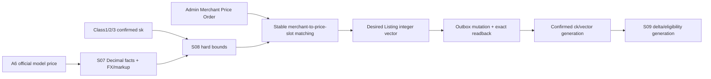

# R3 自动经营与对账

[R2](r2-resilient-routing.md) | [横向总纲](README.md) | [范围矩阵](scope-matrix.md) | [R4](r4-canonical-complete.md)

## 1. Release 结论

R3 在 R2 已经正确、鲁棒的请求/路由系统上打开经营自动化：官方价与 FX 事实、商户相对价格顺序、Listing 价格分布、经营 delta、Class2Adjustment 一次合成、确定性 usage solver、A6 earnings/settlement 对账与 Replay。

R3 不改变 R0-R2 的身份、Ban、调度和 winner 语义。它只增加 Canonical 已定义的 economic generations；
S08/S09/S10 不保存或传播 S05 gate 内部证据。任何经济事实缺失或不一致都撤销新请求资格。

## 2. 价格事实与 Merchant Price Order



- 官方价、Listing integer vector、markup、FX 和 `ck` 都是带 source/hash/completeness 的 Decimal generation。
- `merchant_price_rank` 是管理员显式的稳定相对顺序，active rank 全站唯一；风险 read model 不回流排名。
- S08 先算 hard bounds、Class1 floor 和可行区间，再做稳定分桶/匹配，减少无意义 price churn。
- 改价按 owner 规定顺序执行，confirmed generation 只在 exact remote readback 后发布。
- current price generation 改变只影响新 attempt；旧 winner/对账继续使用冻结 vector。

## 3. Eligibility 与经营 delta

对每个 `(listing_binding,account,model)`：

```text
required = sk * (1 + profit)
delta_auto = max(0, required / ck - 1)
delta_effective = coalesce(delta_override, delta_auto)
```

全部 Decimal；structural eligibility 要求 model/native/cost/capability/billing/route/Provider Ban generations current，`0<=delta<=0.5` 且 `ck*(1+delta)>=required`。attempt 还要求其 transport profile 能取得并合法改写终态 usage。

override 是 nullable 的独立事实，不能绕过最终利润不等式。初选、粘性、failover、retry、Replay 均调用同一硬门并冻结 output/account/route/cost/price/FX/transport/delta/release generations。

## 4. Usage compositor 与本地账单

R3 保持两种策略完全分离：

- 经营 delta 属于 `(Listing,account,model)` 输出策略，决定本地 ActualCost 放大。
- `Class2Adjustment` 是 v0.1.173 既有 Class2 OAuth 策略，不改变本地 cost。
- 两者都读取同一原始 `U0`，各自保存 decision；最终只调用一次 compositor/solver。
- 最终收益因子为 `(1+delta_applied)*(1+class2_adjustment_rate)`，不得把前一策略改写后的 usage 再作为后一策略输入。

输入 usage `<1000` 时两者都跳过，`=1000` 生效；skip 不改变 structural eligibility。solver 完全实现冻结
`BIL-*` 伪代码与测试所定义的确定性最小合法整数解；横切稿不附加新的渐进复杂度合同。保存 U0/final hash、
target/actual/overshoot 和版本。

winner/intent 和本地负账单仍沿用 R0：`ActualCost=ceil_scale8(base_actual_cost*(1+delta_applied))`；Class2Adjustment 不增加本地扣费。缺 required schema/usage 时不得成功；SSE committed 后按最终合同进入 `DELIVERY_UNKNOWN`，等待 authoritative settlement，而不是伪造 delta usage。

## 5. Earnings、补账与 Replay

- A6 earnings 以 request_id 对齐冻结 price vector、原始/最终 usage、两份 decision、本地 ActualCost 和负余额。
- 分别核对 local/base cost 比例、earned micros/冻结 vector 和平台 public quota/supplier earning 比例。
- 容差先扣除整数 solver overshoot/最小 micros 包络，再判断相对偏差；不能把量化噪声当策略错误。
- DELIVERY_UNKNOWN 只凭完整 earnings/settlement 决定 bill/等待/VOID；late arrival 在原 intent 上最多一次 adjustment。
- 异常按共享 price、exact account/profile、Class2Adjustment 或 request scope 归因，不得一次偏差全局下架。
- Replay 使用原 snapshot/winner/compositor/billing identity；需要新 attempt 时仍重过 S09 current gate并保留 lineage。
- 原 observation、账单、adjustment、异常和 tombstone 都是不可变 journal。

## 6. 经营自动化失败策略

| 故障 | 保守动作 | 恢复出口 |
| --- | --- | --- |
| official price/FX/markup stale 或不完整 | 阻止新 pricing generation；保留旧 confirmed 仅供历史 | fresh complete facts 后重算 |
| desired price 写后读不一致 | 不发布 confirmed generation，Listing hold | owner replan/人工核对 |
| 某关系 delta >0.5 或利润仍不足 | 撤销 exact eligibility | 新 cost/price/profit/override generation |
| required transport 无合法 usage | 撤销 exact account/profile | adapter/capability generation 修复 |
| shared price vector 偏差 | `OUTPUT_CONFIG_INVALID`，作用于相关 Listings | price readback/republication |
| 单 account/profile usage 偏差 | 只撤销该关系 | capability/billing/reconciliation 修复 |
| earnings late | 告警和继续轮询，不自动处罚 | 24h window + daily sweep |
| confirmed severe/systematic mismatch | 建对应 scope hold/repair | exact readback、canary 和新 generation |

## 7. 管理端增量

R3 增加 Merchant Price Order 调整、价格 preview/diff、delta auto/override、transport eligibility、solver explain、revenue correlation/Replay 和 anomaly scope。任何“预览”都使用与 worker 同一版本化纯函数；管理员确认只创建 command/generation，不直接覆盖 remote observed 或历史 attempt。

Risk Profile 仍是事后派生只读模型：可显示收益稳定性、对账延迟、故障率等，但不能自动改变 Merchant Price Order、profit、delta、eligibility 或调度权重。

## 8. R3 E2E 验收

| ID | 场景 | 必须证明 |
| --- | --- | --- |
| R3-E2E-001 | official price/FX 完整与不完整 | completeness/current gate、Decimal/量化和 fail-closed 正确 |
| R3-E2E-002 | Merchant rank 调整 | 只有显式命令改变顺序；Risk 不回流；stable matching 最小 churn |
| R3-E2E-003 | price write ordering/timeout | exact vector readback、旧 attempt 历史不变、unknown 可恢复 |
| R3-E2E-004 | delta 公式/override 边界 | 0、0.5、>0.5、清 override、最终利润门全正确 |
| R3-E2E-005 | 999/1000 | 999 两策略 skip，1000 生效；不改 structural eligibility |
| R3-E2E-006 | delta only/Class2 only/both/zero | 两 decision 同读 U0、一次合成、收益因子正确 |
| R3-E2E-007 | solver 极大 token/多 price fields | 按冻结 `BIL-*` 得到 deterministic 合法最小解；无横切自定义算法 |
| R3-E2E-008 | winner 与本地账单 | 仅 delta 改 ActualCost；并发/Replay 无二扣 |
| R3-E2E-009 | stream 缺 required usage | commit 前可按 R2 failover；commit 后 UNKNOWN，无伪造 usage |
| R3-E2E-010 | earnings 比例与量化容差 | frozen vector、overshoot envelope、正确 anomaly scope |
| R3-E2E-011 | VOID 后 late earnings | 原 intent 一次 adjustment，不覆写账单历史 |
| R3-E2E-012 | price/cost generation race | 新请求只用一致 current set；旧 attempt 按快照结算 |
| R3-E2E-013 | Class2Adjustment 全回归 | API/rules/shadow/apply/berserk/probe/普通流量无回归 |
| R3-E2E-014 | R0-R2 全回归 | identity、Provider Ban、route、Incident、rollback 不受经济层破坏 |
| R3-E2E-015 | R3 新能力 pre-winner rollback | 新 price/delta/rank generation 尚无 winner时关闭新经济 flag并恢复前版 confirmed price；不删除 generation |
| R3-E2E-016 | R3 新能力 forward rollback | 已有 delta/price winner后停新经济入口，保留 price/delta/snapshot/billing/reconciliation，回到 R2 fixed-price支持面 |
| R3-E2E-017 | Ban 边界回归 | price plan/apply、delta、solver、earnings/Replay 不调用 S05 full gate；只有冻结 trigger 才运行 gate |

纵向回链：价格使用 `PRF-*`/`PRC-*`，delta/attempt 使用 `ELG-*`，compositor/winner使用 `BIL-*`，收益/Replay
使用 `REV-*`，发布/两类 rollback 使用 `MIG-010..014`；具体算法不在横切重复定义。

## 9. R3 完成与升级门

R3 完成要求至少一个 delta-required 受控 Channel 建立 `request -> final usage -> local delta debit -> A6 earned micros -> RECONCILED` 的可复现闭环，并通过两策略合成矩阵。

升级 R4 不再引入新的核心经济公式；重点是全量 legacy mapping、规模/HA、全部管理读模型、长尾故障和生产证据收口。若 R3 仍依赖人工数据库修复、临时脚本调价或未版本化 solver，则不能把这些债务推给 R4。
