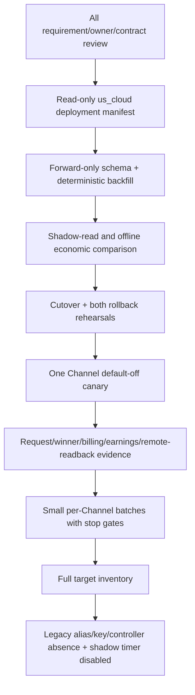

# R4 最终完整稿

[R3](r3-economic-automation.md) | [横向总纲](README.md) | [范围矩阵](scope-matrix.md) | [纵向总纲](../README.md)

## 1. Release 结论

R4 不是再增加一套架构，而是把最终候选设计的剩余长尾全部收口：全量旧 Seller/Provider/OAuth/API Key 迁移、所有远端 API 合同、规模化异步控制、完整管理端/Risk read model、HA/限流/轮询、全部故障注入、生产批次与 forward rollback 证据。

到 R4 时没有“功能暂时 OFF 但仍宣称最终完成”的空间。根 `AGENTS.md`、原始 Prompt、A6 API Reference、错误分类合同和 S00-S16 三联稿的全部规范都必须有实现、测试和证据追踪。

## 2. R4 收口范围

### 2.1 全量迁移

- 按完整 remote inventory、binding、Key fingerprint/last4 和成功入口日志识别 Channel anchor。
- 处理一用户一 Channel、多用户一 Channel、一用户多 Channel；歧义必须 `BINDING_REVIEW`，不静默修数据。
- `TPA6API/ToA6API` 双实体只在 migration tooling 中合并/canonicalize；cutover 后热路径没有 legacy alias/fallback。
- 旧 Listing delta 只为切换时已有 candidate 建 nullable override；新账号走 auto。
- 保存公共文本历史；新远端写全部走 corpus，Supplier 不可改 name 仅 `LEGACY_REMOTE`。
- 旧余额以 opening adjustment 让新账本从 0 开始负扣，历史账单不覆盖。
- 旧 Provider -> 独立 Class1 Token；OAuth/API Key 由管理员确认成本合同后进 Class2/3，不按名称猜测。
- Merchant Price Order 使用确定性初始 rank，cutover 前由管理员确认。

### 2.2 完整控制面与长尾

- S01 覆盖 A6 Reference 全部确认 API、所有分页/completeness、mutation readback、Token 删除证明和通用白名单控制台。
- S03/S05/S06/S13 覆盖 replacement、orphan、dead letter、retired/hidden remote owned Ban、route/liquidity、parent Channel maintenance 与多 Listing 恢复全部竞态。
- S14 覆盖多 worker lease/fence、lock ordering、rate budget、429、backpressure、dead-letter replay、HA failover 和 polling sweep。
- S15 覆盖部门/RBAC、全部 command/previews、operation/evidence、Merchant Price Order 和只读 Risk Profile；不提供绕过 owner 的 free-text/remote-write 后门。
- S11 覆盖 24h earnings 窗口、daily late sweep、VOID/reopen、adjustment 和历史规模查询。

### 2.3 生产规模与可观测性

- per credential/Channel/model/account-class/endpoint/region 的 SLO、队列水位、oldest age、rate-limit budget 和 error fingerprint 可查询。
- high-cardinality request/attempt 证据在受控保留期内可按 request_id 重建，且不泄漏 secret。
- Redis 仅为可重建投影；数据库 immutable facts、Outbox 和 journal 是恢复事实。
- controller storm、A6 429、网络分区、DB/Redis/worker 重启、clock skew、duplicate callback 和 out-of-order event 均有故障注入。
- 大规模恢复使用 canary/batch/jitter 和 generation fence；单资源失败不扩散到无关 merchant/Channel。

## 3. 最终发布序列

实施前在 `ssh us_cloud` 只读确认实际源码根、commit、dirty state、migration head、toolchain、service/blue-green、DB/Redis 和 unit 拓扑。文档不固化猜测路径或 unit。所有 mutation 和发布步骤都必须基于当次 deployment manifest；本设计工作本身不授权执行这些操作。

## 4. 最终验收门

| 门 | R4 通过标准 |
| --- | --- |
| 需求追踪 | S00-S16 每个 requirement -> implementation -> test -> evidence 可查询；无半完成标记 |
| 数据/安全 | migration 可重入、全部唯一约束、Decimal-only、secret/redaction/corpus 全通过 |
| 身份/生命周期 | 所有 Channel/Listing/Key/Token instance 历史可追，唯一 current/effective 正确 |
| Provider | 最小事件驱动 Exclusion Gate、每次 max_ratio 前一次 full gate、零过重 attestation 模型、route/cost/liquidity/replacement 证据完整 |
| 价格/delta | official/FX/price/rank/delta/solver generations 一致，利润与边界矩阵完整 |
| 请求/计费 | 所有 endpoint/transport/class 的三出口、SSE、winner、负账单、Replay 幂等完整 |
| 收益 | earnings/settlement/late/VOID/adjustment 的 ratio 与作用域证据完整 |
| 恢复 | hold/desired/observed/plan owner 唯一，Incident canary 和批量恢复可停 |
| 异步/HA | duplicate、crash、lease、partition、429、backpressure、dead letter 故障注入通过 |
| 管理端 | RBAC、preview/command 一致、Risk 只读、无 direct remote/database mutation 后门 |
| 迁移 | N:1/1:N、group/key/余额/delta/merchant rank 全 rehearsal；legacy 热路径清零 |
| 发布/回滚 | 单 Channel到全量批次证据；无 winner snapshot rollback 与有 winner forward rollback 均通过 |
| 回归 | v0.1.173 普通流量、原生 scheduler、Class2Adjustment 全合同无回归 |

## 5. R4 E2E 总验收

R4 执行所有纵向 `tests.md` 与 R0-R3 E2E，并增加：

纵向回链：R4 不裁剪 requirement，直接执行 [冻结清单](../FROZEN-MANIFEST.md) 中 61 个源文件所定义的全部
S00-S16 requirements/tests，并以 `MIG-*` 汇总实现、证据、发布和两类 rollback。

| ID | 场景 | 必须证明 |
| --- | --- | --- |
| R4-E2E-001 | 全量 migration dry-run/re-run | 决定性 mapping、具体冲突、零静默修正 |
| R4-E2E-002 | N:1/1:N Channel/User/Key | anchor/拆分/合并正确，非-anchor Key 不复活 |
| R4-E2E-003 | legacy runtime removal | cutover 热路径无旧 group/name/shape fallback |
| R4-E2E-004 | 多 merchant 并发 generation churn | 无 stale dispatch、owner 冲突或 current pointer 倒退 |
| R4-E2E-005 | DB/Redis/A6 partition | durable facts 可恢复、Redis 可重建、远端 unknown 不双写 |
| R4-E2E-006 | controller storm/429 | rate budget、公平性、backoff、oldest-age alert 和恢复正确 |
| R4-E2E-007 | worker rolling restart | lease/fence/Outbox/terminal intent 全幂等 |
| R4-E2E-008 | full production canary-to-batch | 每批 stop gate、readback、SLO 和证据完整 |
| R4-E2E-009 | full forward rollback | 新账本/instances/generations 保留，旧读路径安全恢复 |
| R4-E2E-010 | final security/evidence scan | 无 secret、公共文本全有 provenance、审计不可抵赖 |
| R4-E2E-011 | full pre-winner snapshot rollback | 全量 migration/cutover 尚无新 winner时，逐 Channel snapshot/readback 恢复完整且无旧 Key复活 |
| R4-E2E-012 | frozen-canonical integrity | 61 源文件哈希与 Canonical hash 等于 Frozen Manifest；delivery slices 未进入 Canonical 聚合且未新增业务实体 |

## 6. 最终完成定义

只有以下条件同时成立才可称为“最终设计稿版本已实现”：

1. [范围矩阵](scope-matrix.md)所有 S00-S16 行均为 `FULL`，所有早期 `OFF` capability 已按最终合同启用或被上位设计永久删除。
2. 全部 release/纵向测试、故障注入、生产 readback 和两类 rollback 证据可复现。
3. 没有临时脚本、数据库手改、假远端成功、free-text public mutation、legacy fallback、第二 owner 或横切新增业务状态维持日常生产。
4. Provider shadow timer 仍 disabled；任何历史例外 one-shot 都有不可变理由和 generation 证据。
5. 一个请求可从 A6 ingress 一直追到 upstream attempt、winner、final usage、本地负账单、A6 earnings 和 reconciliation，且重放不会改变经济结果。
