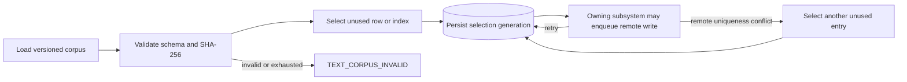

# S00 基础数据、安全与公共文本：自然语言蓝图

[总纲](../../README.md) | [伪代码](pseudocode.md) | [测试](tests.md) | [需求追踪](../../traceability.md)

## 1. 目标与边界

S00 提供所有工作包共同依赖的持久化、数值和安全不变量。它拥有基础表结构、稳定 ID/instance 模式、Decimal 规则、凭据 secret generation、脱敏和公共文本选择；不拥有 A6 HTTP、业务状态机、调度、价格策略或远端写入。

## 2. 需求

| ID | 规范 |
| --- | --- |
| FND-001 | 本地稳定 binding 与远端 instance 分离。远端重建只关闭旧 instance、创建新 instance，不改历史外键。 |
| FND-002 | 建立原 Prompt §4 的全部实体；业务包可追加字段，但不得删除规定的唯一约束、generation、审计或历史关系。 |
| FND-003 | 金额、倍率、价格、quota、sk、profit、delta 和经济比较只使用数据库 `NUMERIC` 与应用 Decimal；量化方向和 scale 必须显式。 |
| FND-004 | `a6_credentials.a6_user_id` 对 active control owner 唯一；system token 使用 envelope encryption，轮换写同一 credential 的新 secret generation。 |
| FND-005 | 业务表只保存 secret reference、fingerprint、last4；Token、Key、Cookie、Session、Authorization 在日志、trace、错误和审计摘要中脱敏。 |
| FND-006 | Supplier、Channel、Listing 与 Token/Key 的公共显示文本只能从仓库语料选择，并保存 catalog SHA-256、sheet、row/index、原值和 selection generation。 |
| FND-007 | 同一 selection 的重试复用原值；远端唯一性冲突必须选择另一未使用语料项，不得拼接、截改或新写文案。 |
| FND-008 | 语料不可读、无效、耗尽或冲突时产生 `TEXT_CORPUS_INVALID`：输出资源投影 Listing hold，输入 Token 对应账号保持不可调度。`TEXT_CORPUS_INVALID` 只针对系统当前准备执行一次新公共文本远端写入却拿不到合法语料选择的情况；既有 Supplier 远端不可修改的历史 name 保存为 `LEGACY_REMOTE` public-text fact：只审计、不产生 `TEXT_CORPUS_INVALID`、不阻止 ACTIVE，也永远不作为未来新写入来源。 |
| FND-009 | Channel `nickname` 只能是所选 `channel_name` 的平台长度投影；Listing `display_name` 固定为空；duty 只存控制面元数据。 |
| FND-010 | Key material 规范化为且仅为一个 `sk-` 前缀，完整材料只在最小授权作用域短暂解密。 |
| FND-011 | 每个 attempt/operation 引用不可变 source generation；current 指针可以前移，历史 generation 不更新。任何由 operation/command/确定性 source observation 驱动的 immutable generation 写入必须携带稳定 `change_identity`（不得含 retry/time），在 `(owner,resource,kind,change_identity)` 唯一：若 commit 后 worker 在 phase/journal 确认前 crash，重放只能校验 payload hash 后 adopt 已存在 generation；若 current 已被更晚 generation 前移则返回 SUPERSEDED，绝不得再插一条或把 current 指针倒回。 |
| FND-012 | migration 必须可重复检测、先加后切，约束失败时给出具体冲突记录而不是静默修正生产数据。 |
| FND-013 | 建立 `a6_merchant_price_orders` 与 `provider_listing_ban_relations` 基础实体：前者以稳定商户身份 `a6_credential_id` 绑定 `merchant_price_rank` 与 `merchant_price_order_generation`，active rank 全站唯一、每个 active merchant 至多一个 current rank；后者唯一键 `(provider_token_instance_id, listing_instance_id)`，state 为 `PENDING | READY | FAILED`（`FAILED` 表示当前 operation 失败且待人工/重试，不是永久“不 Ban”的证明）。Merchant Risk Profile 第一版只做派生 read model，不建正式业务表。 |
| FND-014 | 每个 A6 credential 保存一个单调递增 `ban_membership_generation BIGINT`（初始 0、恒 >= 0）。仅 S05 在 Ban 成员集合实际变化时 +1；本地 retire/takedown/hidden/unavailable/replacement 不是退出，只有精确远端删除且完整 current Supplier inventory 证明不存在才退出。**membership row 变更、generation +1 与对应 audit 必须使用同一数据库事务提交/回滚**。price/route/max_ratio/Pin/上下架/cooling 与 EXCLUSION_GATE readback 不修改该 generation。 |

## 3. 核心实体分组

| 分组 | 实体 |
| --- | --- |
| 凭据与身份 | `a6_credentials`, `a6_public_text_selections` |
| 输出绑定 | `a6_output_channels`, `a6_output_channel_instances`, `a6_output_channel_keys`, `a6_listing_bindings`, `a6_listing_instances` |
| 商户事实 | `a6_merchant_price_orders`（rank/generation，只由管理员显式调整；Risk Profile 为派生 read model） |
| 输入经济事实 | `provider_route_token_bindings`, `provider_listing_ban_relations`（BanRelation：Token instance × Listing instance）, `account_cost_generations`, `account_economic_profiles`, `account_capability_generations` |
| 价格与资格 | `a6_model_price_generations`, `a6_listing_pricing_generations`, `a6_listing_account_delta_overrides`, `a6_listing_account_eligibility` |
| attempt 与结算 | `a6_output_attempt_economic_snapshots`, `a6_output_winner_billing_intents`, `a6_output_revenue_reconciliations` |
| 控制与恢复 | `a6_listing_holds`, `a6_output_recovery_operations`, `a6_provider_route_operations`, `a6_platform_incidents`, `a6_control_outbox` |

业务包负责给这些表定义完整字段和枚举；S00 负责公共主键、外键、current-generation 约束、创建/更新时间、审计主体和不可变历史策略。

## 4. 强制唯一约束

- active `a6_credentials.a6_user_id` 唯一。
- `a6_output_channels.local_user_id` 唯一；current `a6_channel_id` 全站唯一。
- 一个 output Channel 任一时刻最多一个 effective ingress key。
- `(output_channel_id, normalized_model)` 唯一；current `a6_listing_id` 全站唯一。
- Provider account 和 current remote Token ID 分别一对一唯一。
- `provider_listing_ban_relations.(provider_token_instance_id, listing_instance_id)` 唯一，state ∈ `PENDING|READY|FAILED`。
- `a6_credentials.ban_membership_generation >= 0`，仅 S05 可 CAS 递增。
- `a6_merchant_price_orders` active rank 全站唯一；每个 active merchant 至多一个 current rank。
- `(listing_binding_id, account_id, normalized_model)` 的 delta override 唯一。
- `economic_snapshot.attempt_id` 唯一；`billing_intent.economic_snapshot_id` 唯一。
- reconciliation 的 `(a6_credential_id, request_id)` 唯一。
- 每个远端资源任一时刻最多一个 current-generation 写 operation。

## 5. 公共文本选择子图

Supplier 的 name/description 来自“商户资料”同一行；Channel 与 Listing 精确使用“渠道资料”同一行的 `channel_name/channel_description/model_description`；Token/Key name 来自 JSON corpus。旧值迁移只保留为审计原文，不能作为新写入来源。

精确语料路径为 `resources/corpora/merchant_templates_split.xlsx` 与 `resources/corpora/token_name_corpus.json`。不得读取归档副本作为 active catalog；工作簿 sheet 固定为“商户资料”和“渠道资料”。

当前 A6 Profile 合同只证明 `contact_info + description` 可写，不存在 Supplier rename 合同。既有 Supplier 的
不可修改历史 name 保存为 `LEGACY_REMOTE` public-text fact：`source=LEGACY_REMOTE`、`writeable=false`、
`corpus_compliant=false`、`activation_blocking=false`。它只审计，不作为未来新写入来源，也不阻塞 ACTIVE；
S00 不允许用 description、Channel PATCH 或本地覆盖伪造改名。`TEXT_CORPUS_INVALID` 仅当系统准备执行一次新的
公共文本远端写入而拿不到合法语料选择时才产生。

## 6. Decimal 与量化合同

应用层 Decimal 必须从十进制字符串、整数 micros 或数据库 numeric 构造，禁止先经二进制浮点。每个算法声明 rounding mode，例如 Listing micros 和 delta ActualCost 使用向上量化。展示层可以生成 float 兼容副本，但不能回流到判定或写入。

## 7. 凭据生命周期

1. credential 记录稳定 `a6_user_id` 和 active secret generation reference。
2. 加密服务生成 data key，用 key-encryption-key 包装；密文、nonce、算法版本和 key ID 持久化。
3. 解密只返回作用域受限的内存值；不得进入结构化日志或 panic dump。
4. 轮换先保存新 generation，验证精确用户绑定，再原子前移 active pointer；旧 generation 按保留策略禁用而不覆盖。
5. fingerprint/last4 只用于匹配和审计，不能用于重建 secret。

## 8. 交付接口

S00 向其他包提供：Decimal/quantize helper、secret store、redactor、corpus catalog/selection service、稳定 binding/instance repository primitives、generation/current-pointer primitives。调用方必须传业务 owner、source generation 和审计主体。

## 9. 完成条件

- schema 和约束 migration 在空库、历史样本库、重复执行场景均通过。
- corpus 两种文件均校验真实 SHA-256 与字段，不产生任何合成公共文本。
- 日志安全测试证明完整 secret 不出现在所有输出通道。
- 经济 helper 对边界值和超大 Decimal 无 float 漂移。

上位依据：[原 Prompt §4/§4.1](../../../sub2api-a6-channel-implementation-prompt.md#4-核心数据模型) 与 [根 AGENTS](../../../../AGENTS.md)。
