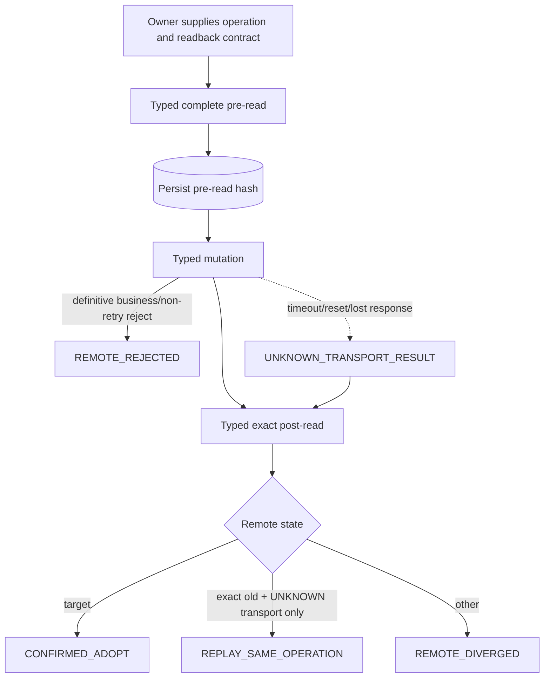

# S01 A6 Typed Connector：自然语言蓝图

[总纲](../../README.md) | [伪代码](pseudocode.md) | [测试](tests.md) | [A6 API Reference](../../../a6-api-reference.md)

## 1. 目标与边界

S01 是所有 A6 控制面与请求面协议的唯一 typed transport 层。它负责认证、类型、分页完整性、重试语义、写前/写后读取、结果不明分类、未知扩展字段和脱敏；它不决定 Provider 路由、Listing desired、价格、hold 或补偿业务策略。

## 2. 需求

| ID | 规范 |
| --- | --- |
| CON-001 | 日常控制面统一使用精确 `(a6_user_id, system_access_token)`；一套 credential 可服务多个输入和输出资源。 |
| CON-002 | Typed Client 覆盖活跃 A6 API Reference 的全部确认接口，包括 Token 删除、平台模型、市场、Supplier/Profile、Channel/Listing、Pin/Auto-Pool、circuit、earnings、settlement、withdraw、balance transfer 与读回。 |
| CON-003 | 请求/响应模型强类型化业务字段，Decimal 不经 float；保留未知扩展字段和原始响应 hash。 |
| CON-004 | 集合读取追完全部分页并返回 completeness、页游标、项数、source timestamp/hash；不完整快照的缺失不证明不存在。 |
| CON-005 | 每个 mutation 接受 operation identity、actor、department、source generation、摘要和 readback contract；保存写前读、写响应和写后读。 |
| CON-006 | **仅 transport 结果不明**时按同一 credential GET：目标已生效则 adopt，仍是旧值则 replay 同一 operation，第三种状态交业务 owner replan。服务端已明确返回的业务拒绝/非重试失败保留为 `REMOTE_REJECTED`，不得因 post-read 仍是旧值而误标 replay。 |
| CON-007 | 自动重试只用于明确幂等读取；具有写语义的 `GET /api/user/token` 不进入通用 GET 重试。429 返回 retry hint，不伪造 down/cooling。 |
| CON-008 | HTTP trace、body 摘要、错误和 audit 经过 S00 redactor；Authorization、Cookie、Token、Key、Session 永不进入输出。 |
| CON-009 | 管理端通用 A6 控制台只能调用版本化白名单；受管 mutation 仍创建 S14 Outbox command，不能直写。 |
| CON-010 | `PATCH /api/supplier/me/profile` 只建模已确认的 `contact_info + description`；没有 rename 合同时不得把 description 或 Channel PATCH 当 Supplier rename。 |
| CON-011 | Token 删除成功必须同时读取详情为 not found 且完整列表无旧 ID；任一读取不完整时结果仍未知。 |
| CON-012 | Connector 只输出规范 transport/business envelope，不执行账号摘流、hold、扩池或重定价。 |
| CON-013 | `PATCH /api/supplier/me/channels/{channel_binding_id}` 可写字段含 `nickname/description/models/base_url/test_model/api_key`（`api_key` 由 2026-08-12 probe 确认）；更新后必须 GET 渠道读回，对 last4/fingerprint 或配置 generation 精确判定。 |
| CON-014 | `POST /api/supplier/channels/{channel_binding_id}/restore` 以空对象 Body 恢复已下架 Channel；`success:true` 之后仍建议 GET Supplier channels 与 marketplace readback 复核。 |

## 3. 接口族

| 接口族 | 主要合同 |
| --- | --- |
| 请求面 | `/v1/models`, `/v1/responses`, `/v1/chat/completions`，含 non-stream/SSE 终态 usage |
| 引导/身份 | `GET /api/status`、verification、register、login、self、system token generation |
| Token | list/get/create/update/reveal/delete |
| Supplier/Channel/Listing | fetch-models、apply、requests、profile、inventory、markup、create/update/takedown/**restore**/resubmit，以及 `/api/platform-models` 官方价格目录 |
| 财务 | earnings、settlements、withdraw、accounts、balance transfer、user logs |
| Marketplace | hot models、pins、complete channel search、circuit、price range、disable、subscriptions、Auto-Pool、Pin/Unpin |

精确字段、query 和响应信封以 [A6 API Reference](../../../a6-api-reference.md) 为准，Connector 需用覆盖测试防止 Reference 中的已确认端点漏实现。

## 4. Mutation 子图

Connector 不自行循环 replay；它返回分类给 owning reconciler，避免在 HTTP 层复制业务 Saga。

## 5. 分页与不存在证明

Paginator 必须理解各端点的 page/size、游标或总数合同。它保留重复 ID、页间变动和恰好命中上限等异常，不能静默去重后宣称 complete。Marketplace owned Ban（BAN_INIT / EXCLUSION_GATE / SelfRoute repair）查询固定使用 `route_status=all`、`include_seed=true`、`include_disabled=true`、`include_user_disabled=true` 和 `exclude_unavailable=false`。

Circuit 固定请求 `limit=1000`；返回正好 1000 项视为不完整。Token delete、inventory disappearance、Ban audit 和恢复验证必须调用对应的完整性判定。

## 6. 错误信封

Connector 返回：HTTP status、A6 success/code/message 的规范化字段、request ID、retry-after、transport outcome、可脱敏的 body hash 和未知扩展。业务包再依据 [错误分类合同](../../../../errorlist.md) 与上下文分流。

## 7. 完成条件

- API Reference 的覆盖索引与实现 method registry 一一对应。
- 所有 mutation 有 readback contract 和 transport-unknown 测试。
- 分页不完整不能产生 not-found witness。
- Profile rename 被类型系统阻止；未知响应字段 round-trip 保留。

上位依据：[原 Prompt §3](../../../sub2api-a6-channel-implementation-prompt.md#3-a6-typed-client)。
