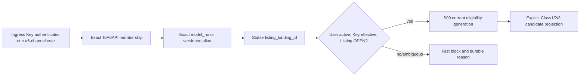

# S02 出口身份、用户与绑定：自然语言蓝图

[总纲](../../README.md) | [伪代码](pseudocode.md) | [测试](tests.md) | [架构图](../../architecture.md#3-出口身份与实例图)

## 1. 目标与边界

S02 建立 Sub2API 输出部门的稳定身份：`a6-channel` 用户、唯一 `ToA6API` 入口分组、一个稳定 Channel binding、一个有效入口 Key 和多个模型 Listing binding。它拥有认证后的本地解析和候选投影边界；远端创建/替换/退役与 Key 轮换由 S03，eligibility 计算由 S09。

## 2. 需求

| ID | 规范 |
| --- | --- |
| OUT-001 | 新增 `users.user_type='a6-channel'`，不复用 role；一个本地用户只绑定一个稳定 output Channel。 |
| OUT-002 | 一个 Channel 只有一个有效 `output_channel_ingress_key`，该 Key 固定同一 Sub2 UserID；一个 Channel 下有多个 `(output_channel_id, normalized_model)` 唯一 Listing binding。 |
| OUT-003 | `ToA6API` 是唯一 canonical 输出分组：输出用户只能属于它，普通用户严格排除；组倍率与用户组倍率恒为 Decimal `1.0`。 |
| OUT-004 | 仅 `a6-channel` 跳过余额 reserve 与平台级 quota accounting；初始余额 0 且可持续为负。Key/IP/RPM/并发/分组/模型/eligibility **以及用户自身非零 quota 限制**仍校验。 |
| OUT-005 | 对该用户 `concurrency=0` 表示无限并发，`quota=0` 表示无限配额；两个语义独立。 |
| OUT-006 | 禁止普通登录、自助注册和用户端 Key 管理；`users.status` 管 Channel 生命周期，逐 Listing admission 管模型状态。 |
| OUT-007 | 鉴权后只接受 A6 `platform-models.model_no` 精确值或版本化显式 alias；alias 碰撞或多 binding 进入 `BINDING_REVIEW`，不猜测。 |
| OUT-008 | `/v1/models` 只返回当前 output 用户绑定、current generation 且 admission 允许的模型，不泄露普通组或其他 Channel 模型。 |
| OUT-009 | Class1/2/3 候选由 account binding 显式投影到 `ToA6API`；经济倍率不写 group multiplier。 |
| OUT-010 | 连接层先以 `(local_user_id, requested_model)` 唯一解析稳定 `listing_binding_id`，再交 S09 按 `(listing_binding_id, account_id, normalized_model)` 判断。 |
| OUT-011 | 新建用户先 inactive，Key 为 DISABLED/STAGED；S03/S05/S07/S09 的绑定、BAN_INIT（BanRelation READY）、价格、能力、eligibility 门全部通过后才能激活用户/Key并逐 Listing 恢复。 |
| OUT-012 | 历史 `TPA6API` 只作为迁移输入；切换后运行时精确匹配 `ToA6API`，无名称 fallback 或 alias。 |

## 3. 出口身份子图

## 4. 请求路径语义

普通 Sub2API 鉴权先完成，但 `a6-channel` 分支必须在任何余额 reserve 前被可靠识别。跳过余额不等于跳过安全限制；IP、RPM、Key 状态、并发、模型和 eligibility 任一失败都按现有 API 合同返回。负余额来自 winner 计费，不影响后续入口认证。

请求携带显式 model；未指定、未知、alias generation 过期或解析出多个 binding 时禁止调度。解析结果包含 stable binding、normalized model、output/listing generation 和 required transport profile，供 S09/S10 冻结。

## 5. `ToA6API` 不变量

- canonical group 名称不可改名、删除或授权普通用户。
- 输出用户不得同时属于其他请求分组。
- 账号候选不是通过把账号“加入输出组”隐式推导，而是由版本化 binding projection 明确列出。
- 任何成本、profit、ck 或 delta 都不写组倍率。
- 启动时和 drift sweep 均校验 group ID、名称、倍率、成员类型与 alias absence；漂移关闭受影响输出准入并交 S13/S15 显示。

## 6. 状态与所有权

`users.status` 只表达父 Channel 本地生命周期；模型可用性由 listing admission 表达。父用户 inactive 必然关闭全部模型，但单 Listing hold 不应禁用同用户其他健康模型。S02 只读 current remote instance，远端 instance 的 adoption/replacement 由 S03。

## 7. 完成条件

- 一用户/一稳定 Channel/一有效 Key/多 Listing 的数据库与缓存解析一致。
- 普通用户和输出用户的余额、group、models 与登录边界测试完整隔离。
- 所有 scheduler 入口都消费同一解析器，没有按名称 fallback。

上位依据：[原 Prompt §2.2/§2.3/§5](../../../sub2api-a6-channel-implementation-prompt.md#5-输出-channel-用户)。
