# S03 出口 Channel/Listing 生命周期与入口 Key：自然语言蓝图

[总纲](../../README.md) | [伪代码](pseudocode.md) | [测试](tests.md) | [S02 身份](../02-output-identity/logic.md)

## 1. 目标与边界

S03 拥有输出远端 Channel/Listing instance 的建立、采用、replacement、退役和 `output_channel_ingress_key` 轮换 Saga。稳定本地身份由 S02，公共文本由 S00，所有 A6 调用由 S01。**S03 是 Channel-scope takedown/restore/maintenance 的唯一写者；Listing-scope 的 takedown/resubmit/reset 由 S13 的 Output Recovery 唯一写者执行**，二者通过父 operation 协调而不双写。

## 2. 需求

| ID | 规范 |
| --- | --- |
| LIF-001 | 新建 Channel 必须先有 inactive 用户与 DISABLED/STAGED Key；远端申请前暂停同 credential 的 current Provider，完整 inventory/adopt 后触发 S05 Channel-batch EXCLUSION_GATE。各 intended Listing 的 `LISTING_BAN_INIT`、价格、能力和 eligibility 全通过后可激活 output；Ban gate 未通过只保持相关 Class1 Provider paused，不阻断健康 Class2/3 output。 |
| LIF-002 | 首个、新增和 replacement Channel 都使用 `POST /api/supplier/apply`；完成证据是 request 已受理且完整 inventory 出现新的唯一 Channel ID。 |
| LIF-003 | 远端 Listing 删除但父 Channel 与 canonical model 不变时保留 stable `listing_binding_id`、关闭旧 instance、创建新 instance；canonical model 变化则退役旧 binding、新建 binding。旧实例本地 retire/replacement 不退出 S05 owned set；只有 exact remote delete + complete current Supplier absence 才退出。 |
| LIF-004 | Channel 删除/takedown 后不猜原 ID 可恢复；申请 replacement 并切换新 Channel instance。Listing resubmit 不得冒充父 Channel 恢复。 |
| LIF-005 | 退役 Listing 先关闭 admission、等待该 binding inflight=0，再 takedown/readback 并关闭 current instance；最后一个 Listing 后才处理父 Channel、入口 Key 和用户。takedown/本地 RETIRED 不是 remote delete，相关 Channel/Listing 继续留在 S05 exclusion set。 |
| LIF-006 | 退役等待超时保持 `RETIRE_PENDING`，核对 stale attempt lease 后重试。远端写前允许人工取消；写后只能继续或修复重放。 |
| LIF-007 | owner/model/channel 唯一匹配可自动 adopt 新 generation；owner 冲突、多候选、消失或模型碰撞进入 `BINDING_REVIEW`。 |
| LIF-008 | 入口 Key 轮换是 Channel-scope maintenance：创建 STAGED 新 Key -> 关闭父 Channel admission -> Channel takedown/readback -> PATCH/readback -> 本地 Key 切换 -> 在 Channel restore 前暂停相关 Provider -> restore/readback -> 触发 S05 EXCLUSION_GATE。无需逐 Listing mutation/hold；gate 失败保持 Provider paused，但不回滚已确认的新 Key，也不阻断其他 eligible classes 的 output admission。 |
| LIF-009 | 中断恢复以远端事实决定：远端仍指旧 Key 时回到旧 Key 唯一启用；已确认新 Key 时继续新 Key；歧义时 Channel 保持 DOWN、所有 child admission=CLOSED，绝不双启用。 |
| LIF-010 | 旧 Key 删除失败只进入清理 dead-letter，不回滚已确认的新 Key，也不重新触发 child Listing recovery。 |
| LIF-011 | 每个阶段保存 operation journal、写前/写后读、generation 和 Key fingerprint/last4；完整 Key 不进入业务表/日志。 |
| LIF-012 | 所有新公共名称/描述和 Key display name 先取得 S00 corpus selection；缺失时以 `TEXT_CORPUS_INVALID` 停止申请/更新。 |
| LIF-013 | Channel-scope maintenance（`KEY_ROTATION` / `BAN_INIT`）必须持久化一次 immutable pre-state，设置 `maintenance_state` 并关闭父 Channel admission；maintenance 存在时生命周期 observer 不得启动 replacement。非 BAN_INIT 临时 restore 的父 Channel 在 restore 前暂停相关 Provider，restore 后触发一次 S05 gate；BAN_INIT 自己的 temporary restore 由同一 S05 operation 覆盖，不递归触发第二 gate。 |

## 3. 生命周期子图

```mermaid
stateDiagram-v2
    [*] --> STAGED
    STAGED --> APPLY_PENDING: "corpus and local identity ready"
    APPLY_PENDING --> INVENTORY_SYNC: "request accepted"
    INVENTORY_SYNC --> GATED: "unique Channel and Listings adopted"
    GATED --> ACTIVE: "BAN_INIT, price, capability, eligibility, Key pass"
    ACTIVE --> RETIRE_PENDING: "retire requested; admission closed"
    ACTIVE --> REPLACEMENT_PENDING: "Channel missing or takedown"
    REPLACEMENT_PENDING --> INVENTORY_SYNC: "new apply accepted"
    RETIRE_PENDING --> RETIRED: "inflight zero and remote readback"
    STAGED --> BINDING_REVIEW: "ambiguous inventory"
    INVENTORY_SYNC --> BINDING_REVIEW: "owner/model collision"
```

## 4. Channel/Listing inventory 规则

inventory 必须来自当前 credential 的完整 Supplier/Listing 读取，并保存 completeness。Binding Controller 只在 owner、Channel 和 canonical model 唯一一致时自动采用。采用只前移 current instance，不重写历史远端 ID。

申请返回本身不是 Channel 创建完成。controller 需要读取 supplier request，再等待完整 inventory 中出现与本次 source generation 唯一匹配的新 ID。`pending_request_exists` 进入 request 对账，不盲目再申请。

## 5. 入口 Key Saga

轮换在 output Channel 锁下执行；从开始到远端 Key 精确确认，父 Channel 及其所有子 Listing 保持
admission=CLOSED。远端只返回 last4/fingerprint 时，必须结合 Channel 配置 generation 形成唯一判定。
S03 唯一拥有 Channel takedown/restore/PATCH key 与本地 Key 切换；S13 只处理 Listing-scope 恢复，Key Rotation
不再为子 Listing 创建 hold 或逐项上下架。Saga 阶段为
`STAGE_NEW_KEY -> CHANNEL_TAKEDOWN -> UPDATE_REMOTE_KEY -> SWITCH_LOCAL_KEY -> VERIFY_REMOTE_KEY ->
CHANNEL_RESTORE -> DELETE_OLD_KEY`。

## 6. 人工动作

`BINDING_REVIEW` 仅允许：选择明确 instance 并 readback、接受远端事实生成新 generation、或退役。管理员不能直接编辑 observed ID/状态，也不能在 Key Saga 中同时启用两个 Key。

## 7. 完成条件

- 新建、replacement、Listing 重建和全退役均保留稳定外键与完整 phase journal。
- Key Saga 在每个中断点都可接管，且任意时刻最多一个本地有效 Key。
- 所有远端 mutation 经过 S01/S14/S13 owning path 和精确 readback。
- Channel create/adopt/restore 后 Provider 恢复只消费 S05 READY 与 S06 自身 route/cost/capability gates；S03 不复制 Ban 状态机。

上位依据：[原 Prompt §5/§6.1](../../../sub2api-a6-channel-implementation-prompt.md#6-两类-key-与轮换)。
