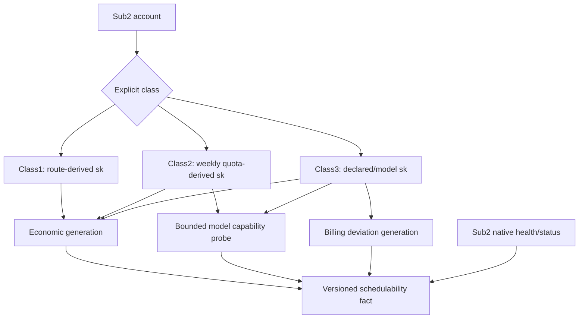

# S04 Class1/2/3 输入账号与经济能力：自然语言蓝图

[总纲](../../README.md) | [伪代码](pseudocode.md) | [测试](tests.md) | [S05 Provider 控制](../05-provider-token-ban/logic.md)

## 1. 目标与边界

S04 定义 Sub2API 输入部门的 Class1/2/3 账号分类、`sk`、profit、模型能力、账单可信度和 schedulability generation。它不写 A6 Token/Pin/Auto-Pool，不决定 Listing 价格或 delta，也不替代 Sub2API 原生账号健康状态机。

## 2. 需求

| ID | 规范 |
| --- | --- |
| ACC-001 | 输入账号使用稳定类别：Class1 A6 Provider、Class2 原生 OAuth、Class3 `class3:<provider_code>` API Key，并通过显式 binding 投影模型。 |
| ACC-002 | Class1 Auto-Pool `sk` 等于完整纳入价格带的 `topN_max_cny_ratio`；Pin `sk` 等于 current assignment epoch 的精确 Channel `K_CNY`。 |
| ACC-003 | Auto-Pool 默认 `target_n=10, min_n=3, max_n=20, min_ratio=0, hard_max_ratio=0.3`；按可调用非 owned 比率排序，N 点必须完整纳入同价带。 |
| ACC-004 | Class1 不叠加 `realized_cost_p95`、`retry_reserve` 或额外 `5/6` 换算；**无 current cost 时第一份合格 route observation 建立 generation 1**；成本上涨立即生效，下降仅对 3 个 distinct/complete snapshot generation 连续确认后生效，事件 replay 不重复计数。 |
| ACC-005 | Class2 `one_week_A=used_A/utilization` 当二者均大于 0，否则 100；`expected_total_A=one_week_A*multiplier`，`sk=account_cost_cny/expected_total_A`。全部使用 Decimal。 |
| ACC-006 | Class2 multiplier 默认 1 且必须 >0；utilization 可 >1。100% utilization 不暂停、刷新、替换或退役，继续使用 Sub2API 原生 OAuth 规则。 |
| ACC-007 | Class2 字段缺失/矛盾时保留最近确认 sk；无历史才用 100 并标记 estimate。 |
| ACC-008 | Class3 由管理员设置默认 `declared_sk` 和可选模型 override；适配器同步 `/v1/models`、余额、Acost 与账单。 |
| ACC-009 | Class3 15 分钟窗口至少 20 个收费请求且 expected cost>=CNY 1：<=5% 正常，5%-15% 告警，连续三窗>15% 暂停，单窗>30% 立即暂停。 |
| ACC-010 | Class3 恢复需账单重同步和有界审计，连续 3 个合格窗口偏差<=5% 后生成新 billing generation；预算不足保持暂停并显示原因。 |
| ACC-011 | 默认 profit：Class1 0.20、Class2 0.50、Class3 0.40；允许账号覆盖和每个 provider_code 独立默认值。 |
| ACC-012 | Class2/3 入池前同步模型并对当前 A6 OpenAI 模型做有界 capability probe，原始 input usage 500..3000；全局并发/RPM/小时成本预算可配置。 |
| ACC-013 | 达到 probe 预算只延期，不绕过 capability 或 billing 恢复条件；生成版本化白名单和 capability generation。 |
| ACC-014 | schedulability 同时要求 Sub2API 原生状态、current cost/capability/billing generation 和本类业务 gate；Class1 capability generation 由 current Provider Token/model/route/callability confirmed readback 产生（不走 Class2/3 data-plane probe）；瞬时满并发不改变结构性 ready。 |

## 3. 输入子图

## 4. Class1 Top-N 观测事实

对外部可调用、非 owned 比率 `r1<=...<=rM`：`M<min_n` 表示 range exhausted；否则 `N=min(target_n,M)`，`max_ratio=rN`，选择到 `rN` 并把所有等价带项完整包含。保存 `cv_n=stddev(r1..rN)/mean(r1..rN)` 与 `tail_jump=(rN-rN-1)/rN-1`，mean/variance/min 只用于观测，不改 `sk`。扩缩池的远端动作由 S06。

## 5. Class2 与 Class2Adjustment 分离

S04 的 Class2 经济档案只估算账号成本和模型能力。既有 `Class2Adjustment` 属于 S10 usage compositor，不写入 `sk` 公式，也不在 utilization=100% 时触发账号生命周期动作。

## 6. Class3 账单窗口

只计算满足样本数和 expected cost 的合格窗口。不合格窗口既不累计“三窗暂停”也不能作为“三窗恢复”。偏差分母、absolute/relative 公式和 Decimal rounding 必须版本化。暂停只影响该账号/模型 billing generation，不扩散 Listing 共享价格事实。

## 7. 完成条件

- 三类账号在数据库、API、Redis projection 和调度日志中使用稳定类别，无 role/name 推断。
- 每次成本/能力/账单改变生成不可变 generation，旧 attempt 可复现。
- Class2/3 probe 预算与恢复门有明确延后状态和管理端原因。

上位依据：[原 Prompt §7](../../../sub2api-a6-channel-implementation-prompt.md#7-输入账号与-sk)。
