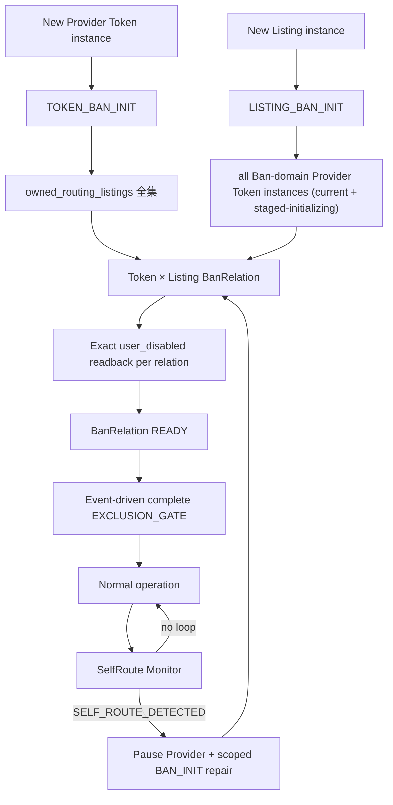

# S05 Provider Token、Ban Initialization 与 Self-Route Guard：自然语言蓝图

[总纲](../../README.md) | [伪代码](pseudocode.md) | [测试](tests.md) | [架构图](../../architecture.md#4-provider-激活与-ban-initialization)

## 1. 目标与边界

S05 拥有 Class1 `provider_route_token` 的远端生命周期、稳定 account binding、authoritative owned exclusion set、
BanRelation（Provider Token × Listing instance）的一次性 `BAN_INIT`、事件驱动 `EXCLUSION_GATE` 和运行期
SelfRoute Guard。Auto-Pool/Pin 选择、扩池与流动性由 S06；输出 Channel 生命周期由 S03。
`EXCLUSION_GATE` 复用现有 BanRelation、membership generation 与 operation/audit，只返回 READY/阻断结果；
它不是新表、平行状态机或向其他子系统传播的证明协议。

## 2. 需求

| ID | 规范 |
| --- | --- |
| BAN-001 | Provider Token 与输出入口 Key、liquidity/callback Token 使用不同表、字段、权限、service 和 Saga；一个 Provider account 与 current remote Token 各自一对一唯一。 |
| BAN-002 | Token 轮换：创建新 Token，读取旧 Token 模型/额度/route，为新 Token 建新 Auto-Pool 或 Pin，完成 `TOKEN_BAN_INIT`、route/cost/model/callability，再原子切 account binding，最后删除旧 Token并证明不存在。 |
| BAN-003 | 切换前失败删除新 Token、保留旧绑定；切换后旧 Token 删除失败记录 `ORPHANED_REMOTE_TOKEN`，持续同 operation 删除，禁止重绑或复制第二可调度账号。 |
| BAN-004 | Ban 的业务单位是 `(provider_token_instance_id, listing_instance_id)`，持久化为唯一 `provider_listing_ban_relations`。同一行保存当前 relation 状态与最近精确 readback 引用；每次 gate 的分页与逐项证据写入现有 operation journal/audit，不新增 attestation 实体。member enter/exit 与 `ban_membership_generation + 1`、audit 必须同事务。 |
| BAN-005 | authoritative owned set = 完整 current Supplier inventory 中仍存在的 active/down/unavailable/retired/hidden owned Channel/Listings，加上本地仍受控且尚无精确远端删除证明的实例。仅“远端删除精确确认 + 完整 current Supplier inventory 证明不存在”的实例进入 `owned_historical_tombstones`；本地 retire/takedown/hidden/unavailable/replacement 都不是退出。 |
| BAN-006 | 新 Provider Token instance 创建后执行 `TOKEN_BAN_INIT`：对 authoritative owned set 建立/修复 BanRelation，业务不可见 Listing 仍按 maintenance visibility 处理；在 S06 创建或启用 Auto-Pool/Pin 前，同一 onboarding operation 必须完成一次 `EXCLUSION_GATE`。generation 变化只补 missing/重跑 gate，不重建 READY 行。 |
| BAN-007 | 新 Listing instance 创建后执行 `LISTING_BAN_INIT`。`init_ck=random_decimal_closed("0.8","1.9")` 只生成并持久化一次；写价/readback、temporary resubmit、全部 Ban-domain Token × Listing disable/readback、恢复原状态后才 handoff。一个 owned Channel 的 create/adopt 批次完成全部 Listing 初始化后，S03 触发一次全 Token/model `EXCLUSION_GATE`；失败的 Provider 保持暂停，但不要求建立第二套证明状态。 |
| BAN-008 | BAN_INIT 的临时市场可见性不修改业务 `desired`，期间 admission 始终 CLOSED。父 Channel 为 DOWN 时按 Channel 批次处理：① **第一次 mutation 前持久化且只持久化一次** Channel/Listing pre-state；② 若 parent Channel DOWN，由 S03 temporary restore 一次；③ 对 required Listings 完成 temporary visibility + Ban；④ 每个临时 Listing 恢复并 exact readback 原 pre-state；⑤ parent 按第一次持久化 pre-state 恢复。relation READY 与 maintenance restore 是两个独立证明：**只有 relation 全 READY、全部 temporary state 已恢复、membership generation 稳定时 parent BAN_INIT operation 才 COMPLETE**。 |
| BAN-009 | READY BanRelation 跨普通事件持续有效，不重复建行。`EXCLUSION_GATE` 仅在 Provider Token onboarding、owned Channel create/adopt、父 Channel restore、Provider 进入/恢复 schedulable、每次 Auto-Pool `max_ratio` 更新及 SelfRoute repair 执行。它完整分页 fresh-read 所有关系，已精确禁用时零 mutation，发现漂移才 disable。普通 Seller 改价、请求、cooling 和 Listing-scope 的 create/adopt/takedown/resubmit 只执行 scoped LISTING_BAN_INIT 或原操作，不触发完整 gate。 |
| BAN-010 | SelfRoute Monitor 若观测到 Provider Token 实际选择 owned_routing_listing，立即暂停受影响 Provider 并产生 `SELF_ROUTE_DETECTED`。 |
| BAN-011 | 修复范围按可定位事实最小化：已知 Token → Token × all owned routing listings；已知 Listing → all Ban-domain Provider Token instances × Listing；无法定位 → all Ban-domain Provider Token instances × all owned routing listings。 |
| BAN-012 | Provider Token display name 先从 S00 Token corpus 选择；duty 不编码进名称。 |

## 3. BAN_INIT 隔离子图

BAN_INIT 的临时可见性由 S13 `maintenance_visibility_override` 执行：不修改业务 desired、admission 全程 CLOSED、
完成/失败后恢复 pre-operation 远端状态。本地候选过滤不是远端 Ban 的替代品。完整远端 union 核对只发生在
BAN-009 的失效事件，不进入请求热路径，也不周期轮询。

## 4. Token 轮换语义

新 Token ready 前旧 Token 可以继续服务，但本地 scheduler 始终只认 current binding。切换事务前必须证明新 Token 的
secret、模型、`TOKEN_BAN_INIT + EXCLUSION_GATE READY`、**由 S06 route owner 随后建立并 exact readback 的 route generation**、
**S04 cost/capability generation** 和 callability 都属于同一 activation generation。S05 不直接写 Pin/Auto-Pool route，
且 S06 不得先启用 Auto-Pool 再补 exclusion。删除旧 Token必须走 S01 双 readback；orphan 绝不恢复为候选。

## 5. BAN_INIT 与 SelfRoute Repair

S05 是整个 BAN_INIT orchestration owner，创建父 operation；S03 拥有 Channel-scope 临时 restore/takedown，
S13 拥有 Listing-scope `maintenance_visibility_override` 临时 listed/unlisted。所有 maintenance pre-state 都是 parent operation 的 immutable snapshot，
重放不得重新采样临时状态。S03 的 parent Channel temporary
restore/takedown 必须发生在相同 parent Channel 的 Listing temporary operations 外层（按 Channel batching），
不得逐 Listing 调用父 Channel restore。锁内保存原 observed/desired/generation；只要无法证明已恢复原远端状态，
所有受影响 Provider 继续暂停且 output Listing CLOSED。运行期 SelfRoute Monitor 观测到自路由时按 BAN-011 的
最小作用域修复。普通 Listing-scope 上下架/改价不是触发源；Auto-Pool `max_ratio` 更新是明确 gate 触发源。

## 6. 完成条件

- 无任何路径可以在 current EXCLUSION_GATE READY 之前启用/更新 Provider Auto-Pool 或发布/恢复 schedulable projection。
- Token rotation 每个中断点可恢复，且最多一个 current remote Token binding。
- 普通 Seller Listing 改价、请求、cooling 与仅 Listing-scope takedown/resubmit 不运行完整 gate；任何 gate 中已禁用关系保持零 mutation。
- retired/hidden/unavailable/replaced 远端实例仍在 authoritative set，直到精确远端删除与完整 Supplier absence 同时确认。
- Ban 后 Listing 任意 takedown/resubmit，BanRelation 仍保持 READY（核心 regression）。

## 7. 冻结成本边界

本设计保留 gate，是因为 owned 集合或 Auto-Pool `max_ratio` 变化会使新的自有 Channel 进入远端候选，可能形成
`A6 owned Channel -> Class1 Provider -> same owned Channel` 自路由。最小实现的成本上限为：每个触发 operation
一次完整 Supplier inventory；每个受影响 Token/model 一次完整 Marketplace 分页；仅漂移关系执行 disable；Auto-Pool
PUT 后一次 subscription exact readback。禁止前后双全量扫描、周期扫描、请求热路径扫描，以及新增 attestation 表、
parent/child 状态机、token-set/owned-set hash 或把内部证据传播到定价、身份、账单。若未来需要突破该边界，必须按
用户级 `OVERENGINEERING_VIOLATION` 规则单独证明收益、性能、实现和运维成本并取得明确授权。

上位依据：[原 Prompt §6.2/§8](../../../sub2api-a6-channel-implementation-prompt.md#8-class1-auto-pool-与-ban) 与 [AGENTS owned Ban hard rule](../../../../AGENTS.md)。
