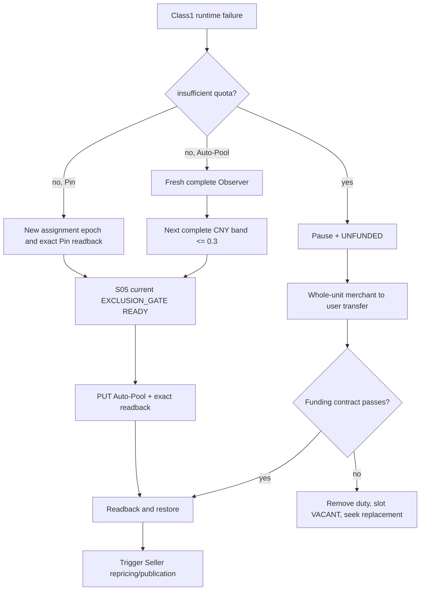

# S06 Provider 路由、失败恢复与流动性：自然语言蓝图

[总纲](../../README.md) | [伪代码](pseudocode.md) | [测试](tests.md) | [S05 Ban](../05-provider-token-ban/logic.md)

## 1. 目标与边界

S06 拥有 Class1 Auto-Pool/Pin route generation、运行失败扩缩、`ROUTE_UNKNOWN`、`AUTO_POOL_RANGE_EXHAUSTED`、`UNFUNDED`、merchant balance repair、Provider duty/slot replacement 和独立 liquidity/callback Token。S05 提供 Token/BanRelation 与最小 `EXCLUSION_GATE`；S04 提供成本事实，S08 接收 Seller repricing。S06 只消费 S05 的 READY/阻断结果，不复制 gate 内部状态。

## 2. 需求

| ID | 规范 |
| --- | --- |
| RTE-001 | route mode 是显式管理事实；Auto-Pool 与 Pin 不自动互切，只有管理员可改变 mode。初始/admin/staged-token route 都进入 S06 同一 owner path。Auto-Pool enable/`max_ratio` PUT 前必须取得 S05 gate READY；Pin 可先配置但进入/恢复 schedulable 前必须取得 gate READY。S06 写 route generation，S04 写匹配 cost/capability generation。 |
| RTE-002 | Auto-Pool 运行失败先暂停 Class1，fresh Observer 以 `target_n+1` 扩到下一完整价带。在 `max_ratio` PUT 前运行一次 S05 gate；PUT 后只做 exact subscription readback 与 gate membership generation fence，不重复全量 scan，之后提交 route/cost 并恢复。 |
| RTE-003 | 非 quota Provider runtime failure 不要求证明具体 Channel；保持 paused，严格扩到下一 CNY 带且不超过 0.3。S05 gate、matching USD cost、route/effective subscription/capability readback通过后恢复，并立即触发 Seller 重定价/发布。 |
| RTE-004 | 稳定且距上次变更均>=30 分钟、成功>=100、无上游错误，且 `cv_n>5%` 或 `tail_jump>3%` 时每轮 `target_n-1`；不得截断同价带。 |
| RTE-005 | 超过 max_n、无非 owned 可调用项或下一完整价带>0.3 时置 `AUTO_POOL_RANGE_EXHAUSTED` 并摘流；每 60 秒 fresh 重评，有合法完整价带才恢复。 |
| RTE-006 | 任一 Auto-Pool mutation（expand/shrink/manual）结果不明仅摘受影响 Class1并置 `ROUTE_UNKNOWN`；GET 后 adopt、同 operation replay 或按第三状态 replan，旧 route 不再视为远端事实；服务端 definitive reject 不当作 unknown/replay。 |
| RTE-007 | Pin 不执行 target_n+1。assignment 失败时暂停、创建 repin generation，选择新非 owned Channel并写 Pin/readback；在恢复 schedulable 前运行一次 S05 gate并确认 assignment 非 owned，随后匹配 S04 cost/capability/model。失败保持 paused。 |
| RTE-008 | `insufficient_quota` 立即摘流并置 `UNFUNDED`，只进入 liquidity controller，绝不 fresh Observer、扩池或调 max_ratio。 |
| RTE-009 | 流动性修复先读取余额计算合格整单位；真实 transfer 前写 immutable transfer intent 并取得 RTE-011/012 callback witness，mutation 后 exact readback。unknown/incomplete 时保持同 intent/amount 对账且 UNFUNDED，不盲重 POST；确认后仍不满足 funding contract 才移除 Provider duty、旧 slot=`VACANT`、请求 funded replacement。 |
| RTE-010 | replacement 在 slot 外完成 BAN_INIT、current S05 gate、Observer range、Enodot cost、能力、funding、route/subscription 与 schedulability readback前不得进入 slot；任一 owned 项未确认 disabled 时 slot 保持 VACANT。 |
| RTE-011 | liquidity/callback Token 与 Provider Token/ingress Key 独立，名称来自 token corpus；只可 Pin 到当前 listed、callable 的 A6-owned small-merchant Channel，无目标则跳过请求。 |
| RTE-012 | 生产 callback 只使用精确输入 `PING 5db98307ce2d442ee568baacf8b0e7076fa657cbe2806ccff9da6386997915e2`；要求 realistic sampled usage 与 high-cache invariant，`prompt_tokens=1, completion_tokens=0, total_tokens=1` 等 probe-shaped usage 不计有效划转。 |
| RTE-013 | Provider shadow timer 始终禁用。仅当路由/成本变化确需新 immutable generation 且无 active/planned generation 可复用时，记录具体理由后单次运行；不等待非必需 observation window。 |
| RTE-014 | Seller 可以并发预计算/应用，但 Seller 完成不是 Provider 激活前置；Provider 恢复后必须有即时 repricing/publication 事件。 |

## 3. 路由恢复子图

## 4. Auto-Pool 边界

扩池按完整价格带而非固定数量；若下一带使包含项超过 `max_n`，视为 exhausted，不能截断。`hard_max_ratio=0.3` 是不可突破的 ceiling。缩池每次只减少一个 target 并重新完整包含边界带，避免抖动。

`ROUTE_UNKNOWN` 期间没有可信旧 route，scheduler 必须继续摘流。GET 只能确定 adopt/replay/replan，不能因为缓存仍显示旧 generation 而恢复。

## 5. 流动性与 callback

whole unit 的单位按 A6 balance transfer 合同显式配置并使用 Decimal/micros。transfer preview 与执行都读回 user/merchant balance。callback 不是通用探针；只有存在合格 small-merchant Channel 时才发唯一固定 PING，并把完整 response usage 与 high-cache witness 绑定 transfer operation。

## 6. Shadow 规则

日常 Pin refresh、liquidity repair、retry、readback、deployment verification 都直接使用窄 controller 和现有 generation，不运行 shadow。例外 one-shot 后必须再次读回 timer disabled。

## 7. 完成条件

- quota 与非-quota 错误在分类入口即互斥，无法走错恢复路径。
- Auto-Pool/Pin 的 unknown、exhausted 和 replacement 都保持保守摘流。
- 每次 Auto-Pool PUT 前最多一个完整 S05 gate；PUT 后不重复 full scan，普通 Seller 改价和请求不调用 gate。
- shadow timer 默认、执行前后和发布后均有 disabled 证据。

上位依据：[原 Prompt §8](../../../sub2api-a6-channel-implementation-prompt.md#8-class1-auto-pool-与-ban) 与 [根 AGENTS](../../../../AGENTS.md)。
