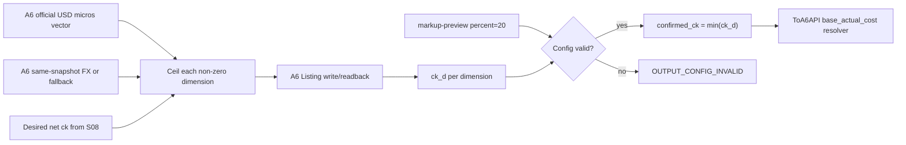

# S07 Listing 价格事实、ck 与 FX：自然语言蓝图

[总纲](../../README.md) | [伪代码](pseudocode.md) | [测试](tests.md) | [S08 定价策略](../08-pricing-policy/logic.md)

## 1. 目标与边界

S07 把 A6 官方 USD 价格、Listing 整数 micros、固定 markup 和 FX 读回转换成版本化 `confirmed_ck` 事实，并为 `ToA6API` 提供独立 base cost resolver。它不选择经营价格分布、不计算 delta、不执行下架恢复。

## 2. 需求

| ID | 规范 |
| --- | --- |
| PRF-001 | A6 `commission=0.2` 固定；`ck` 是商户净 `K_CNY`，公开倍率 `ck_public=ck*1.2`。 |
| PRF-002 | `fx_usd_cny=realtime_ratio_cny/realtime_ratio_usd`；`ck=fx_usd_cny*listing_price_micros[canonical]/official_price_micros[canonical]`。 |
| PRF-003 | Listing 统一 `charge_type=per_token`；canonical 维度按 input、output、cache_read、cache_write 中第一个官方非零价选择。 |
| PRF-004 | 写目标 ck 时每个官方非零维度使用 `ceil(official_micros[d]*ck/fx)`；写后逐维计算 `ck_d`，`confirmed_ck=min(ck_d)`。 |
| PRF-005 | 各维度只允许单个 micros 向上取整造成的误差；超出整数误差包络即价格向量 drift。零官方维度保持协议允许值且不参与 ck。 |
| PRF-006 | 批量 `markup-preview` 按 `channel_id` 唯一映射；缺项、重复、非法值、`percent!=20`、source/billing/official vector/charge type 不一致置 `OUTPUT_CONFIG_INVALID`。 |
| PRF-007 | A6 远端读回是 ck、markup、Listing 状态和官方模型价格的事实源。修复并 current-generation readback 匹配后才允许 owner 清 config hold。 |
| PRF-008 | `ToA6API` 使用独立版本化价格 resolver，以同一 A6 官方 USD vector 计算 `base_actual_cost`；不得全局覆盖普通分组定价。 |
| PRF-009 | A6 暂不可达时保留 `last_confirmed_ck` 和 current model-price generation；写失败只建待重试 operation，不覆盖确认事实。 |
| PRF-010 | FX 首选 A6 marketplace 同一 snapshot 的 CNY/USD 比值；A6 不可用才使用 Frankfurter `latest?from=USD&to=CNY` 的 `rates.CNY`。不做投票，A6 恢复立即切回。 |
| PRF-011 | fallback timeout=3s、cache TTL=30m、active refresh=15m、source date 最大 96h、无 credential；两源均不可用时沿用 last confirmed FX 且禁止新价格写入。 |
| PRF-012 | 每个 model-price/FX/listing-price generation 保存原始整数 vector、source timestamp/hash、rounding policy 和 canonical 维度。 |

逐维读回公式为 `ck_d=fx_usd_cny*listing_price_micros[d]/official_price_micros[d]`。批量 markup 读回保存 `percent/source`，且 `percent != 20` 必须视为配置错误。

## 3. 价格事实子图

## 4. 保守经济口径

`confirmed_ck=min(ck_d)` 防止任一 token dimension 因远端整数价格比目标更低而被忽略。canonical 仅用于 UI 展示和主要公式，不可代替逐维配置验证。S10 结算必须使用 attempt 冻结的同一 vector generation。

## 5. FX 状态

FX 事实包含 `source=A6|FRANKFURTER|LAST_CONFIRMED`、quote date、fetched time、freshness、snapshot ID。两源不可用时使用 `last_confirmed_fx`；它允许现有请求按旧 generation 结算，但 S08 不得创建新的远端 price mutation。

## 6. 完成条件

- 整数 micros round-trip 对所有非零维度可复算，误差包络精确。
- A6/Frankfurter 切换不会投票或混用不同 snapshot。
- 普通 Sub2API group 定价回归不受 `ToA6API` resolver 影响。

上位依据：[原 Prompt §9](../../../sub2api-a6-channel-implementation-prompt.md#9-ck官方价格与-fx)。
