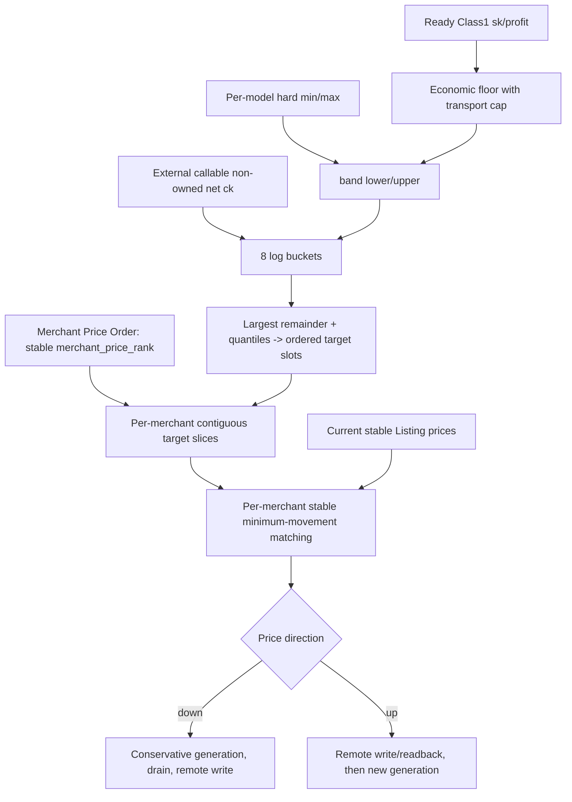

# S08 Listing 定价策略与分布：自然语言蓝图

[总纲](../../README.md) | [伪代码](pseudocode.md) | [测试](tests.md) | [S07 价格事实](../07-price-facts/logic.md)

## 1. 目标与边界

S08 拥有逐模型 hard bounds、Class1 经济 floor、8 个对数桶、市场密度分配、稳定价格匹配和远端改价顺序。它只使用 S07 已确认的价格/FX事实、S04/S05 ready Class1 和 S09 transport profile 能力，不自行读取或解释第二套 A6 价格。

## 2. 需求

| ID | 规范 |
| --- | --- |
| PRC-001 | 默认 `listing_hard_min_ck=0.025`、`listing_hard_max_ck=4.0`，要求 `0<hard_min<=hard_max<=4.0`；逐模型可管理。 |
| PRC-002 | `effective_delta_cap` 是 required transport profiles 的 capability cap 最小值：capable 为 0.5，否则 0；空 required set 是配置错误。 |
| PRC-003 | `class1_floor=min_ready_class1_for_model(sk*(1+profit)/(1+effective_delta_cap))`；ready 必须含原生 schedulable、能力、route/cost 和 current Provider Token instance `BAN_INIT` READY，满并发不改变 ready。 |
| PRC-004 | `raw_lower=max(hard_min,class1_floor)`，无 ready Class1 时只用 hard min；`band_lower=min(raw_lower,hard_max)`、`band_upper=hard_max`。`raw_lower>hard_max` 时固定 max，不生成越界价格，是否下架仍由 eligibility。 |
| PRC-005 | 在 `[band_lower, band_upper]` 建 8 个对数桶；只采样 A6 外部、callable、非 owned Channel，把公开 k 除以 1.2 转净 ck。 |
| PRC-006 | 按外部桶频率以最大余数法生成全站同模型 target ck 集合并升序排列；按 Merchant Price Order（`merchant_price_rank` 升序）及各商户该模型 Listing 数量切分连续 target slots，不同商户维持规定相对价格序，**对任意 `rank_i < rank_j`：`max_ck(Mi) <= min_ck(Mj)` 必须成立（硬约束）**。商户内部是一维绝对移动目标 `Σ|new_ck-current_ck|`：将 current Listings 按 `(current_ck, stable_binding_id)` 升序、target slice 升序后一一 zip 即得到 minimum-movement matching，复杂度 `O(n log n)`；禁止引入 Hungarian/min-cost-flow 等通用 assignment framework。 |
| PRC-007 | **仅完整 market snapshot 中外部样本数确认为 0** 时使用零样本规则：`candidate_targets = existing current_ck 裁剪 hard bounds + new Listing 的 band_lower`，再经 Merchant Price Order 分配。snapshot 不完整/读取失败不得伪装成 zero-sample，也不得据此生成新远端价格 plan；保留 current confirmed plan 等待完整事实。上下界相等退化单点。 |
| PRC-008 | 默认每批最多写 10 个；普通改价每 Listing 至少间隔 5 分钟；按 model/generation 合并由 S14 调度。 |
| PRC-009 | ck 下调先发布 `min(last_confirmed_ck, desired_ck)` 的保守经济 generation，再等待旧 inflight=0，之后才远端写价。 |
| PRC-010 | 普通分布降价 drain 超时取消本轮并恢复 last-confirmed generation；当前价>hard_max 的纠正不可取消，保持 CLOSED 直至写上限并读回。 |
| PRC-011 | ck 上调先远端写/readback，再发布允许降低 delta 的 generation。 |
| PRC-012 | 写结果不明暂停该 Listing 后续调价，GET 后 adopt、同 operation replay 或按远端事实 replan。 |

## 3. 定价子图

## 4. 分布范围与采样

市场目标价格仍以 canonical normalized model 的全站受管、未退役输出 Listing 集合统一计算；
**Merchant Price Order 不改变市场分布目标，只约束目标价格槽向各商户的分配顺序**。商户按稳定
`merchant_price_rank` 获得连续有序价格槽，商户内部再以 stable binding 执行最小价格移动匹配，从而保证
`max_ck(Mi) <= min_ck(Mj)`（`rank_i < rank_j`）的硬相对序——包括零样本路径在内，任何 target 分配结果
都必须满足该不变量。市场整体上涨/下降时排序不变，只有管理员显式调整 rank 才改变。
外部 owned 过滤依赖 S05 authoritative owned_routing_listings，callability 依赖完整 marketplace/circuit facts。
所有 ck 先裁剪 band 后进入桶；样本落桶和分位数使用 Decimal/log 实现，不能让展示 float 决定结果。

稳定匹配的主目标是最小化总价格移动，次序以 stable binding ID 固定，确保相同输入重放得到相同计划。

## 5. 改价与 inflight

降价会提高所需 delta/降低利润空间，因此先发布保守经济 generation 阻止新请求使用过度乐观值，再 drain 旧 attempt。涨价先远端确认，防止本地提前假设更高收入。每个 attempt 永远按其冻结 generation 结算。

## 6. 完成条件

- 所有结果在 `[hard_min, hard_max]`，相同输入 deterministic。
- 普通降价、hard-max 纠正、涨价和 unknown result 四条路径分别测试。
- planner 与 remote applier 分离，远端写只经 S14/S01。

上位依据：[原 Prompt §10](../../../sub2api-a6-channel-implementation-prompt.md#10-listing-定价范围与分布)。
