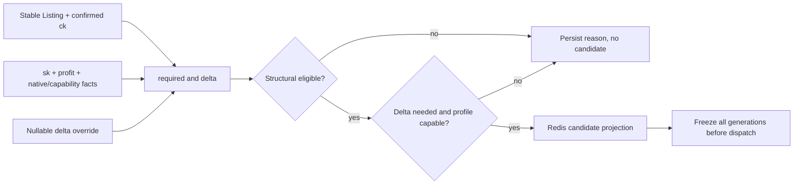

# S09 Eligibility、Delta 策略与 Attempt 快照：自然语言蓝图

[总纲](../../README.md) | [伪代码](pseudocode.md) | [测试](tests.md) | [S10 Usage/Billing](../10-usage-billing/logic.md)

## 1. 目标与边界

S09 是连接输出 Listing 与输入账号的唯一经济硬门。它按稳定 `(listing_binding_id, account_id, normalized_model)`，即经营语义上的 `(Listing, account, model)` / `(listing,account,model)`，计算结构资格、transport 资格和经营 delta，并在派发前冻结完整 generation 快照。transport 失效的最小作用域是 `(account, transport_profile)`。S09 不改 usage、不扣费、不做远端上下架。

## 2. 需求

| ID | 规范 |
| --- | --- |
| ELG-001 | 先由 S02 以 `(local_user_id, requested_model)` 唯一解析 stable listing binding，再按 `(listing_binding_id,account_id,normalized_model)` 计算，不以 remote instance ID 作经济主键。 |
| ELG-002 | `required=sk*(1+profit)`；`delta_auto=max(0,required/ck-1)`；公式不再乘 commission。 |
| ELG-003 | `delta_effective=COALESCE(delta_override,delta_auto)`；override nullable、永久、无需审批、范围 `[0,0.5]`，清空恢复 auto，且不能绕过最终利润不等式。 |
| ELG-004 | structural eligibility 要求 model capable、Sub2 native schedulable、`0<=delta<=0.5` 且 `ck*(1+delta)>=required`。 |
| ELG-005 | attempt eligibility 还要求：不需 delta，或当前 request transport profile 能合法取得并改写最终 usage。 |
| ELG-006 | transport profile 至少区分 Responses/Chat、stream/non-stream 与终态 usage schema；无需调整的请求保持原 usage。 |
| ELG-007 | required transport profiles 从当前启用的 A6 入口 adapter generation 产生；每个 required profile 至少一个 attempt candidate 才能清 `NO_ELIGIBLE`。 |
| ELG-008 | required set 为空或收到未声明 profile 时置 `OUTPUT_CONFIG_INVALID`；当前未声明请求不处罚账号，修复 profile generation 后恢复。 |
| ELG-009 | 数据库存版本化事实/稀疏 eligibility，Redis 投影 candidate、`requires_delta`、transport capability 与完整 generation；满并发不改变结构资格。 |
| ELG-010 | attempt 派发前冻结 output channel、listing、account、route、cost、capability、billing、S08 desired-pricing、S07 confirmed-listing-price、model-price、FX、transport-profile generation 和 `delta_effective`；同时保存 S07 confirmed Listing price generation 的整数 vector/hash，S10/S11 不得回读 current vector 代替。 |
| ELG-011 | 派发前任一 generation 失效必须重选；已派发 attempt 按不可变快照结算，新 generation 只阻止新请求。 |
| ELG-012 | 初选、手动指定、粘性、抢槽重检、failover、retry 和 Replay 每次 attempt 都调用同一硬门，不能使用旧缓存绕过。 |
| ELG-013 | 实际终态证明某 `(account,transport_profile)` 无法提供合法 delta usage 时，只撤销该关系的资格并重算；不扩散到其他 profile 或共享价格。 |
| ELG-014 | 语义澄清（不改公式）：S09 的 structural economic relation 描述正常适用 Delta 时的经营资格；S10 的 `<1000 input usage` 是显式经营例外，它优先于实际 Delta application，但不改变 structural eligibility，不产生 failover、`NO_ELIGIBLE` 或 Listing 下架副作用。 |

## 3. 公式子图

## 4. Generation 一致性

eligibility row 保存所有输入 generation 的组合 hash。Redis 是候选筛选的加速投影；请求路径必须验证投影 generation 与数据库/current fence，但**不得按候选逐个执行 N+1 authoritative generation 查询**。同一 selection round 先对 Redis 排序出的候选集合做一次 bounded batch gate-pointer read，剔除明显 stale 候选；只有真正准备 dispatch 的 candidate 再执行一次 authoritative final fence，并在同一短事务中冻结 economic snapshot。这样保持 send 前 correctness fence，同时把 DB 开销收敛为“一次 batch read + 最终 candidate 一次 fenced read/commit”。

## 5. `NO_ELIGIBLE` 语义

S09 只维护结构/required profile 资格事实并向 S13 发 owner event。瞬时 busy 不会使 eligible 变零。eligible 从零恢复时只清 current source generation 的 `NO_ELIGIBLE`，不碰其他 hold。

`<1000 input usage` 是 S10 的显式经营例外：它只跳过 Delta 应用，不改变本包的结构资格判定，不触发
failover、`NO_ELIGIBLE` 或 Listing 下架。

## 6. Override 管理

预览和提交都用同一 evaluator。override 小于自动值是允许保存的管理事实，但如果 `ck*(1+override)<required`，该关系变为不 eligible；不能为了“尊重 override”跳过硬利润门。

## 7. 完成条件

- 所有 scheduler 分支共享 evaluator 与 pre-send fence。
- 冻结快照能离线重算 delta 和资格，不引用 current mutable 行。
- required profiles、sparse DB 与 Redis projection 在 generation 变更后原子可辨。

上位依据：[原 Prompt §2.3/§11](../../../sub2api-a6-channel-implementation-prompt.md#11-deltaclass2adjustment计费与收益)。
