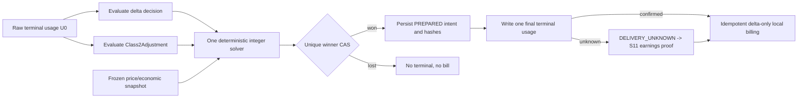

# S10 Usage 合成、Winner 与本地计费：自然语言蓝图

[总纲](../../README.md) | [伪代码](pseudocode.md) | [测试](tests.md) | [收益对账](../11-revenue-replay/logic.md)

## 1. 目标与边界

S10 拥有成功 attempt 的终态 usage 处理：经营 delta 和既有 Class2Adjustment 独立决策、一次合成、唯一 winner CAS、stream 提交边界、billing intent 与本地负余额扣费。A6 earnings 是否确认交付和收入由 S11。

## 2. 需求

| ID | 规范 |
| --- | --- |
| BIL-001 | 经营 delta 是 `(Listing,account,model)` 输出策略，不复用 Class2Adjustment；两者都只读取同一原始 usage `U0`，独立保存 decision。 |
| BIL-002 | `final_usage=compose_once(U0,delta_decision,class2_decision)`，最终收益因子 `(1+delta_applied)*(1+class2_adjustment_rate)`；不得串行拿前一策略改写结果再次决策。 |
| BIL-003 | 每个派发 attempt 有独立 S09 快照；换账号建新快照，失败 attempt 不扣费。 |
| BIL-004 | 发成功终态前 CAS 选唯一 winner，保存原始/最终 usage、两份 decision/hash 和唯一 billing intent；同一 attempt/claim identity 重放若 winner 已存在且身份相同必须 adopt 已有 intent，只有不同 attempt 冲突才是 loser。 |
| BIL-005 | intent 状态为 `PREPARED|TERMINAL_WRITTEN|DELIVERY_UNKNOWN|BILLED|RECONCILED|VOID`。正常路径 `PREPARED -> TERMINAL_WRITTEN -> BILLED -> RECONCILED`；winner/intent 与延迟补漏 `RECONCILE_INTENT` 同事务提交。`PREPARED` 只表示 terminal owner 仍有写权；owner deadline 到期且无确定 write 证据时才可保守转 `DELIVERY_UNKNOWN`。S11 不得直接从 `PREPARED` bill；只可凭同 request_id earnings 从 `DELIVERY_UNKNOWN`（或 crash 后未 bill 的 `TERMINAL_WRITTEN`）补 bill。`TERMINAL_WRITTEN/DELIVERY_UNKNOWN` 可在完整远端 absence 终局后 VOID；late reopen 仍由 S11；`BILLED` 不回退到 delivery 状态。 |
| BIL-006 | 仅 winner 幂等扣负余额：`ActualCost=BalanceCost=ceil_scale8(base_actual_cost*(1+delta_applied))`；Class2Adjustment 不改变本地 cost。 |
| BIL-007 | snapshot、winner claim、billing intent 和 Replay 共享稳定幂等身份；重复 callback/terminal 不能再扣。 |
| BIL-008 | 确定性 solver 基于 attempt 冻结的整数 price vector，从原始 usage 求达到 `ceil(base_merchant_earning*(1+delta_applied)*(1+class2_adjustment_rate))` 的最小合法整数 usage，并保存 target/actual/overshoot。 |
| BIL-009 | solver 保持 endpoint input/output/cache/total 不变量；两项调整都为 0 时返回 usage 逐字节不变。 |
| BIL-010 | 两项策略共用改写前 input usage：优先 `input_tokens`，缺失取 `prompt_tokens`，均含 cached input。`<1000` 两者都跳过，保持 base cost/U0，记录 `input_usage_below_1000` 和 shortfall；`=1000` 生效。 |
| BIL-011 | `requires_delta=true` 且缺 usage/合法 schema 时禁止成功终态，调用 S09 撤销 exact account/profile 资格。stream 是否还能换候选由 request-local `upstream_stream_committed` 决定：S12 synthetic SSE prelude 不计 commit；第一段 upstream-originated SSE event 真正转发后即 committed。未 committed 可按 S12 既有 classifier/S09 gate failover；已 committed 则终止流并原子取得唯一 terminal ownership、持久化 `DELIVERY_UNKNOWN` intent，绝不拼接第二 upstream。该异常 intent 因未合法取得/改写 usage，必须记录 required delta 但 `delta_applied=0`，不得伪造 final usage/solver；只有 S11 authoritative settlement 后续提供可重建 base cost 的 canonical usage 时才可做一次 base-cost billing，否则保持 DELIVERY_UNKNOWN 并进入 visible reconciliation review。 |
| BIL-012 | v0.1.173 Class2Adjustment 标识/API/规则文件保持 `Class2Adjustment/class2_adjustment`、`/api/v1/admin/settings/class2adjustment`、`/etc/sub2api/class2adjustment-rules.json`；旧名只读兼容。 |
| BIL-013 | Class2Adjustment 仅 `account.IsOpenAIOAuth()`，保留现有算法、shadow/apply、berserk、probe passthrough 与观测；不承担 eligibility/delta，且不覆盖原 UsageLog/component/base ActualCost。 |
| BIL-014 | 普通 Class2 流量可单独运行 Class2Adjustment；只有 `a6-channel` 流量可能同时命中经营 delta。 |

## 3. 合成子图

## 4. Stream 提交边界

对 non-stream，完整上游响应可以在任何下游字节前完成验证、winner 与 intent。对 SSE stream，**transport prelude 与 upstream response commit 必须分开**：

- S12 可在 request-local first-byte deadline 到达时发送一次 synthetic SSE no-op prelude；它只负责让下游尽快收到字节/flush，不能被计入 `upstream_stream_committed`。
- upstream error event 在第一次真实 upstream event 转发前先经过 S12 classifier；若现有分类明确允许 candidate failover，则可换下一 candidate，synthetic prelude 不构成阻碍。
- 第一段 upstream-originated SSE event 真正转发给下游前，必须先原子地把请求内 `upstream_stream_committed=true`；从这个瞬间起，当前连接不得再拼接第二 upstream，后续错误走既有 stream/error/terminal 路径。
- `downstream_bytes_written` 不再作为是否可 failover 的判断，因为它会把 synthetic prelude 错当成业务响应；S10/S12 统一只看 `upstream_stream_committed`。
- 缺终态 usage 且 upstream stream 已 committed、当前进程仍存活时，按 BIL-011 持久化 `DELIVERY_UNKNOWN` intent，再交 S11 通过 request_id 查 earnings。

first-byte guard 仅是当前请求的三个轻量内存字段（deadline / prelude_sent / upstream_stream_committed），**不得持久化、不得新增 Saga/controller/table**。进程崩溃会终止当前 HTTP/stream 请求；系统不尝试跨进程续接原连接，也不因 crash 自动创建第二 upstream attempt 来“继续”该请求。S11 Replay 是显式业务重放/对账能力，不是透明 stream-resume 机制。

## 5. Solver 合同

solver 只能调整 endpoint 合法的整数 usage 字段，并求达到目标 earnings 的最小合法解。选择/优先级必须版本化且 deterministic。**solver 的计算复杂度必须只受 endpoint schema 可调整维度数约束，不得随 token 数量或 target earning 的绝对大小线性增长；严禁逐 token `+1 -> recalc` 搜索。** 应按当前 deficit 与各合法维度的 marginal micros 使用整数 `ceil/division` 直接生成有限候选，再在固定上界候选集中按 deterministic field order 选择最小合法解。保存原始/最终 canonical JSON hash、solver version、目标 micros、实际 micros 和 overshoot，供 S11 容差计算。

## 6. 本地账单

`base_actual_cost` 来自 S07 的 `ToA6API` resolver 和 attempt model-price generation。即使 Class2Adjustment 放大远端收益，本地只按 delta 放大；`<1000` skip 时 `delta_applied=0`，本地仍为 base cost。

## 7. 完成条件

- 999/1000、delta only、Class2 only、两者同时、两者为零和缺 usage 全矩阵通过。
- 任意并发终态最多一个 winner、一个 intent、一次负余额。
- 现有 Class2Adjustment 全量回归通过，无配置/API 重命名回归。

上位依据：[原 Prompt §11.1-§11.3](../../../sub2api-a6-channel-implementation-prompt.md#111-经营-delta)。
