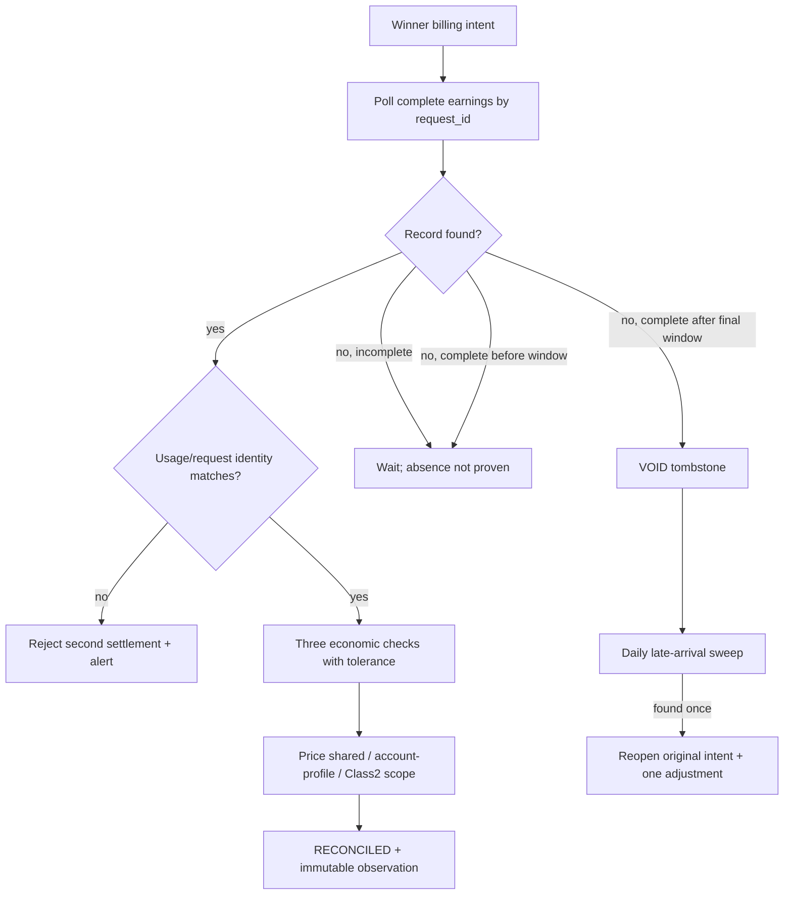

# S11 收益对账、迟到补账与 Replay：自然语言蓝图

[总纲](../../README.md) | [伪代码](pseudocode.md) | [测试](tests.md) | [S10 Billing](../10-usage-billing/logic.md)

## 1. 目标与边界

S11 使用 A6 earnings/settlement 的 `request_id` 作为远端最终事实，对齐 attempt、usage、价格、账单和负余额，推进 intent 的 RECONCILED/VOID/迟到补账，并保证 Replay/重复 callback 不重复结算。S10 拥有 winner 和首次本地账单；S07 拥有价格事实。

## 2. 需求

| ID | 规范 |
| --- | --- |
| REV-001 | 以 A6 earnings `request_id` 唯一对齐 winner attempt、原始/最终 usage、UsageLog、ActualCost、负余额、冻结 price vector、`earned_micros` 和两份 decision。BIL-011 的 `MISSING_REQUIRED_SCHEMA` 异常 intent 允许本地 usage 暂缺：只能从 authoritative joined settlement 补充 canonical usage，禁止猜值。 |
| REV-002 | reconciliation `(a6_credential_id,request_id)` 唯一；重复 earnings/callback/Replay 不重复扣费，usage hash 冲突拒绝二次结算并告警。 |
| REV-003 | 分别核对 `local_actual_cost/local_base_cost ~= 1+delta_applied`、`earned_micros ~= earning_from(final_usage,confirmed_vector)`、`A6_public_quota/supplier_earning ~= 1.2`。 |
| REV-004 | `earning_from` 直接使用同请求 final usage 和冻结整数 vector；本地单位与 A6 micros 只比较比例。先扣除 `max(1 micros,solver overshoot/量化包络)` 再套相对阈值。 |
| REV-005 | DELIVERY_UNKNOWN/中断由同 request_id earnings/settlement 决定继续 Apply 还是等待；只有 earnings 与 settlement 两类 relevant complete snapshot 都能证明 absence 且超过终局窗口才 VOID。 |
| REV-006 | VOID 后迟到 earnings 只能在原 intent 上重开并做一次 adjustment；已 BILLED 后的延迟只记对账异常，不重扣。 |
| REV-007 | earnings 前 10 分钟每 15 秒、之后每 5 分钟查至 24 小时；另做 daily late-arrival sweep。延迟本身只告警。 |
| REV-008 | 共享价格/markup/vector 异常置 `OUTPUT_CONFIG_INVALID`；只在某 account/profile 的 usage 偏差只撤销该关系；Class2Adjustment 偏差不扩散到其他策略。 |
| REV-009 | 15 分钟内 3 个独立 request 持续偏差，或单次相对偏差>5%，才按对应作用域触发修复；整数包络内不计偏差。 |
| REV-010 | Replay 使用原 request/attempt snapshot、winner claim、compositor version 和 billing identity；如果需要新 upstream attempt，仍须经过 S09 current hard gate并保留与原 request 的 lineage。 |
| REV-011 | 完整收益/结算 snapshot 的 completeness 必须保存；不完整读取的“未找到”不能 VOID。 |
| REV-012 | 对账 observation、异常、adjustment 和 tombstone 都是不可变 journal，不能覆盖原始账单或 usage。 |

## 3. 对账子图

## 4. 容差与作用域

solver 的 overshoot 和 S07 单 micros ceil 都是可解释量化，不应触发经营故障。绝对容差精确取 `max(1 micros, solver记录的整数overshoot/量化包络)`，去除该包络后再计算 relative deviation。单 request >5% 可立即进入对应修复；较小持续偏差需要三个独立 request，不能由同 request Replay 重复计数。

## 5. Replay

Replay 首先复用原 terminal/intents 证据完成投递或对账，不重新扣费。只有明确需要新的 upstream attempt 时，创建新 attempt snapshot 并走 S09 当前硬门；最终仍只能归到原 request 的唯一 winner/账单身份，禁止双 winner。

## 6. 完成条件

- earnings 延迟、缺失、不完整分页、冲突和迟到记录分别有确定状态。
- 任意重复与 Replay 顺序下账本总额不变。
- 偏差修复准确落在共享 Listing、exact account/profile 或 Class2Adjustment 观测域。

上位依据：[原 Prompt §11.1/§11.3](../../../sub2api-a6-channel-implementation-prompt.md#113-两套体系的合成)。
