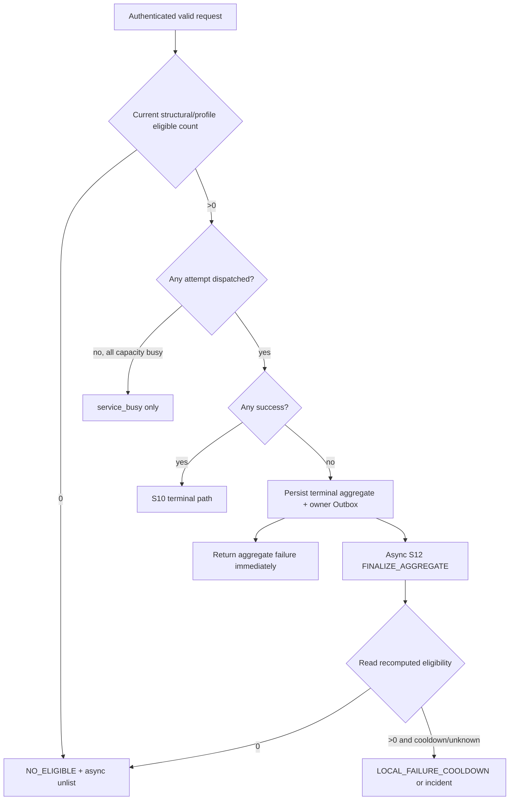

# S12 调度硬门、错误聚合与平台 Incident：自然语言蓝图

[总纲](../../README.md) | [伪代码](pseudocode.md) | [测试](tests.md) | [错误分类合同](../../../../errorlist.md)

## 1. 目标与边界

S12 把 S09 经济硬门接到 Sub2API 原生调度，统一 attempt 级处置、request 聚合三出口、SSE 请求内 first-byte prelude / pre-commit failover 和 platform incident 提升。它不直接写远端路由/Listing，不清 hold；S06/S13 分别消费账号/路由和 Listing 事件。SSE guard 只存在于当前请求内存，不形成新的持久化 owner。

## 2. 需求

| ID | 规范 |
| --- | --- |
| ERR-001 | 初选、手动指定、粘性、抢槽重检、failover、retry、Replay 的每次 attempt 都先过 S09 硬门，之后才复用原生 scheduler。 |
| ERR-002 | 请求前三出口互斥：结构或 required profile eligible=0 -> `NO_ELIGIBLE`/异步下架；eligible>0 且已派发 attempts 全运行失败 -> 聚合处置；eligible>0 但全 busy/排队且零派发 -> `service_busy`，无 hold/下架。 |
| ERR-003 | `USER_SHORT_CIRCUIT` 是输入、入口鉴权、内容策略、client cancel；不处罚账号、不扩池、不下架，并在 scheduler 前短路。 |
| ERR-004 | `A6_ACCOUNT_RECOVERABLE` 只摘对应账号并进入 Token/Pin/config/liquidity 等窄 controller；`insufficient_quota` 必须去 S06 liquidity。 |
| ERR-005 | `UPSTREAM_AUTO_POOL_EXPAND`：Auto-Pool 交 S06 扩下一完整带，Pin 交 S06 repin；不隐式改 route mode。 |
| ERR-006 | `LISTING_COOLDOWN_TRIGGER` 覆盖平台/endpoint/egress/本地依赖/责任不明 timeout/5xx/unknown，以及确有派发且候选全失败的聚合终态。 |
| ERR-007 | 单 attempt 只影响对应账号或 route；分类后的失败 attempt 必须按 `attempt_id` 幂等记录既有窄作用域 owner action，即使随后 failover 到其他账号并成功也不能丢失该失败事实。只有 request aggregator 可以影响 Listing。Class2/3 保留 Sub2API 原生账号状态机。 |
| ERR-008 | 聚合顺序：每个失败 attempt 先按 ERR-007 / `attempt_id` 幂等提交其既有窄作用域 owner action；request aggregator 自己的事务只写 S09 eligibility-recompute Outbox 与一个带不可变 aggregate 摘要的去重 `FINALIZE_AGGREGATE` Outbox，随后**立即结束当前失败请求，不等待异步 eligibility recompute**。S12 的异步 finalizer 在目标 S09 generation 就绪后决定：归零只维护 `NO_ELIGIBLE`；仍>0 且终态含 cooldown/unknown 才加 `LOCAL_FAILURE_COOLDOWN`/incident consideration。不得为了这个异步化新增第二套 request-terminal 状态表，也不得把多个 remote failover attempt 包进一个长事务。 |
| ERR-009 | 明确 Cloudflare/A6 global、endpoint、egress、DB/Redis/Relay/Scheduler 健康故障可直接建相应 scope incident；单次裸错误先只影响当前 Listing。 |
| ERR-010 | 模糊错误仅在同请求至少两个独立 account/route 同 endpoint 同 fingerprint，或 60 秒内第二个独立 Listing 同 fingerprint时提升 Incident。 |
| ERR-011 | fingerprint 至少含 failure_domain、canonical_error_code、endpoint_host/path_class、method、egress_region、relay_generation、credential_scope；Listing/account/channel ID 只作 member。 |
| ERR-012 | Incident Controller 枚举 scope 活动 Listing 发 membership；LOCAL failure hold 仍由 Local Cooldown owner，REMOTE_COOLING member 不伪造本地 hold。 |
| ERR-013 | 健康恢复先 canary owner 清 hold/重置 cooling并取得 generation witness，再每批10个、间隔5-15秒 jitter 恢复；任一失败即停。channel scope 只建一个父 operation。 |
| ERR-014 | SSE first-byte guard 只在确定性 USER/auth/input/policy/model 检查通过并开始首个 upstream attempt 后创建；每请求一次性随机 deadline `500..2000ms`，不因 candidate failover 重置。deadline 到达且尚无 upstream event 时最多发送一次 synthetic SSE no-op prelude（默认 `:\n\n`）并 flush；prelude 不设置 `upstream_stream_committed`。上游 error event 在转发前先走既有 classifier：仅明确归因当前 upstream account/route 且既有错误合同允许 failover 时，可在未 committed 状态下记录该 attempt 的既有窄作用域 action、重新经过 S09 current hard gate / native scheduler 切下一未尝试 candidate，并保持同一 downstream SSE；USER 短路及平台/Listing/本地/责任不明错误仍走既有 handler。第一段 upstream-originated SSE event 一旦转发即 committed，之后绝不拼接第二 upstream。guard 不持久化、不使用 ticker、每请求最多一个 timer 和一个 prelude flush；进程崩溃即请求结束。 |

## 3. 三出口子图

## 4. 分类上下文

同一原始 code 可因上下文不同分类，例如 user ingress `invalid_api_key` 是 USER，managed Provider Token 则 ACCOUNT；valid Listing model 在某 Channel 不可用是 ROUTE，而用户请求不存在模型是 USER。必须先依据 [错误分类合同](../../../../errorlist.md) 的判定顺序，再使用归因证据，不按 HTTP status 单独猜责任。**SSE 是否尝试下一 candidate 不是第二套错误分类**：它只是读取现有 classification/attribution 的一个 request disposition；不复制 errorlist 映射。

## 5. SSE first-byte 与 pre-commit failover

实现只维护 request-local `prelude_deadline / prelude_sent / upstream_stream_committed`。deadline 在确定性用户侧检查通过后一次性采样；candidate 变化不重置，避免每次 failover 再额外等待 0.5-2 秒。prelude 使用 SSE no-op comment 并最多 flush 一次，不启动周期 heartbeat。

当 upstream 返回 error event 且尚未 committed 时，先分类、按 `attempt_id` 幂等记录现有 account/route side effect；只有明确 candidate-local/upstream-attributable 且原错误合同本来允许 failover 的错误才选下一账号。下一账号仍经过 S09 current hard gate、capacity recheck 和原生 scheduler；已经尝试过的 candidate 在该请求内不重复选择。平台/Listing/本地依赖/unknown 不因为“这是 SSE”而多重试。

第一段 upstream-originated SSE event 在写给下游前先设置 `upstream_stream_committed=true`；其后即使尚未出现文本 token，也不允许切其他 upstream，以免混合 response identity / event sequence。synthetic prelude 不属于 upstream event。若 prelude 已发而后续错误又不允许 failover，HTTP/SSE 头已提交，只复用 Sub2API 现有 stream error/close 行为，绝不尝试再写一个普通 HTTP error 响应，也不在本功能内复制第二套 error serializer。进程退出时这些字段自然消失，不做恢复。

## 6. Incident 与 Listing 隔离

Incident 是编排事实，不是新的 hold owner。它关联 members、fingerprint、scope、health witness 和恢复批次。S13 根据 membership 和本地 cooldown owner 处理 LISTED 状态；A6 remote circuit 的 cooling 仍表现为 observed，不伪造 `LOCAL_FAILURE_COOLDOWN`。

## 7. 完成条件

- 三出口在每个请求只能命中一个，纯 busy 永不创建状态事件。
- attempt 与 aggregate side effect 可重放去重；failover 后最终成功也不会丢前序失败 attempt 的窄作用域处置。
- SSE deadline ∈ `[500,2000]ms`、每请求最多一个 prelude；prelude 后 upstream 未 committed 仍可按既有 classifier failover，committed 后零跨 upstream 拼接。
- 模糊错误不足阈值只局部，达到阈值才 scope incident，恢复可 canary 停止。

上位依据：[原 Prompt §12/§12.1](../../../sub2api-a6-channel-implementation-prompt.md#12-调度与错误分类)。
