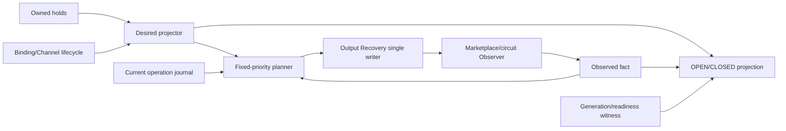

# S13 Listing 状态、下架与恢复：自然语言蓝图

[总纲](../../README.md) | [伪代码](pseudocode.md) | [测试](tests.md) | [架构状态图](../../architecture.md#7-listing-状态与恢复)

## 1. 目标与边界

S13 定义 `holds + desired + observed + plan` 四个正交事实、Listing admission 投影和 Output Recovery
**Listing-scope** 唯一远端上下架/恢复写者（takedown/resubmit/reset）。**Channel-scope** takedown/restore/
maintenance 由 S03 唯一拥有。它不能清除其他控制器的 hold，也不能把 Supplier inventory readback 当 Marketplace
可用性。S13 另提供 `maintenance_visibility_override`，只允许 S05 `BAN_INIT` 使用。

## 2. 需求

| ID | 规范 |
| --- | --- |
| REC-001 | `holds={NO_ELIGIBLE,LOCAL_FAILURE_COOLDOWN,OUTPUT_CONFIG_INVALID,TEXT_CORPUS_INVALID,BINDING_REVIEW,OPERATOR_HOLD}`（`OUTPUT_KEY_ROTATION` 已删除：入口 Key 轮换是父 Channel 级维护）；`desired=LISTED|UNLISTED`；`observed=LISTED|UNLISTED|COOLING|UNKNOWN`；`plan=NONE|ALIGN_UNLISTED|DIRECT_RELIST|COOLING_RESET|VERIFY_UNKNOWN`；`maintenance_visibility_override=NONE|TEMP_VISIBLE_FOR_BAN_INIT`。 |
| REC-002 | 每个 hold 保存 `owner_controller/source_key/source_generation`，只有 owner 可清。owner 分别为 Eligibility、Local Cooldown、Output Config、Text Corpus、Binding、Operator。 |
| REC-003 | binding/父 Channel 非 ACTIVE 或任一 hold 存在时 desired=UNLISTED，否则 LISTED；Desired Projector 只写 desired/Outbox。 |
| REC-004 | admission OPEN 还要求父 Channel admission OPEN 且 `maintenance_state=NONE`、Marketplace 与 circuit snapshot **current+complete**、listing/channel/model 精确 visible+available、circuit 无 cooling/half_open/model_excluded、generation 匹配；否则 CLOSED。不完整 snapshot 的“未发现阻断”不能 OPEN。 |
| REC-005 | local failure hold 显示 COOLING 且等待本地恢复；无 hold+observed UNLISTED 显示 REMOTE_HOLD/DIRECT_RELIST；observed COOLING 显示 REMOTE_COOLING/COOLING_RESET；UNKNOWN 只 GET。 |
| REC-006 | 普通 GET 失败只标 stale 并保留 last fact；仅写结果不明、矛盾枚举或完整快照无法唯一解析才置 UNKNOWN。 |
| REC-007 | Planner 优先级固定：继续 current operation -> VERIFY_UNKNOWN -> ALIGN_UNLISTED -> COOLING_RESET -> DIRECT_RELIST -> ready LISTED/NONE。 |
| REC-008 | Observer 只写 observed；Planner 只选 plan；Output Recovery 是 **Listing-scope** takedown/resubmit/reset 唯一写者，S03 是 **Channel-scope** takedown/restore/maintenance 唯一写者。`scope=channel` 一个父 operation，`scope=model` 才逐 Listing。 |
| REC-009 | Eligibility 只清其 NO_ELIGIBLE；Local Cooldown 退避 15s、120s、10m 封顶，到期只核对 eligible、Key/binding、Sub2 依赖和原生账号健康，不发数据面 Probe。 |
| REC-010 | 普通恢复：resubmit/readback -> Marketplace 精确 visible+available -> circuit 清晰 -> generation match -> OPEN。Supplier readback 只审计 mutation，不是第二可用性门。 |
| REC-011 | cooling epoch 由 circuit scope、Channel、model、state、cooling time、error kind 稳定 hash，同 epoch 只 reset 一次；等待 `max(now+15s,cooling_until+jitter)`。 |
| REC-012 | `COOLING_RESET` 固定 takedown/readback -> async wait -> resubmit/readback -> Marketplace/circuit验证 -> OPEN；中途 observed 变 UNLISTED 仍继续原 operation。 |
| REC-013 | 5 分钟内复发退避120s、再复发10m封顶并告警，保留自动/人工重放；轮询和 timeout 均可配置，不使用阻塞固定 sleep。 |
| REC-014 | generation 替换、hold 变化或 owner witness 过期时，旧 operation 不可 OPEN；必须 replan current desired。 |
| REC-015 | `maintenance_visibility_override` 只允许 S05 `BAN_INIT` 发起；第一次 mutation 前按 `(operation_id,listing)` **持久化 immutable pre-state 一次**并在 replay 复用，不修改 desired，期间 admission 永远 CLOSED。override 存在时普通 Planner/Recovery 不得发第二个 Listing mutation。temporary visibility 只需 Supplier readback，不等待 Marketplace visible；恢复 exact pre-state/readback 未确认前 override 不清、parent BAN_INIT 不 complete。 |

## 3. 正交状态子图

## 4. Hold owner 表

| Hold | 进入 | 自动退出 |
| --- | --- | --- |
| NO_ELIGIBLE | S09 structural/required profile 为零 | 同 generation 每项恢复正数 |
| LOCAL_FAILURE_COOLDOWN | S12 聚合终态 | 退避到期、本地 readiness；incident member 另需 witness |
| OUTPUT_CONFIG_INVALID | S07/S02 Key/price/markup/vector drift | 修复并 current readback |
| TEXT_CORPUS_INVALID | S00 catalog/selection 失败 | 有效重选及相关 remote readback |
| BINDING_REVIEW | S02/S03 ambiguity | 管理员明确选择/退役并 readback |
| OPERATOR_HOLD | S15 人工设置 | 同权限人工清除 |

`OUTPUT_KEY_ROTATION` 已从 hold 集合删除。父 Channel 维护态
`maintenance_state = NONE | KEY_ROTATION | BAN_INIT | ...` 由 S03 拥有；S13 只暴露
`maintenance_visibility_override = NONE | TEMP_VISIBLE_FOR_BAN_INIT`，调用方必须且只能是 S05 BAN_INIT，
不写 `desired`、admission 恒为 CLOSED、完成后恢复 pre-state。

## 5. 完成条件

- 任意四维组合有 deterministic plan/display/admission，不使用单一 status 覆盖事实。
- 所有 Listing-scope 远端写只有 Output Recovery handler；Channel-scope takedown/restore/maintenance 只有 S03。其他包通过命令协调。
- GET 暂时失败、remote cooling、本地 cooldown 和 unknown 清楚区分。

普通恢复的规范链为 `resubmit/readback -> Marketplace精确可见且available -> circuit无阻断 -> generation匹配 -> OPEN`；remote cooling 的规范链为 `takedown/readback -> wait -> resubmit/readback -> Marketplace/circuit验证 -> OPEN`。实现不得调换或缩短链路。

上位依据：[原 Prompt §13](../../../sub2api-a6-channel-implementation-prompt.md#13-listing-状态下架与恢复)。
