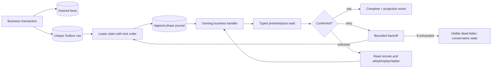

# S14 Outbox、Reconciler 与可观测性：自然语言蓝图

[总纲](../../README.md) | [伪代码](pseudocode.md) | [测试](tests.md) | [S01 Connector](../01-a6-connector/logic.md)

## 1. 目标与边界

S14 提供所有业务控制器共用的事务 Outbox、operation identity、phase journal、lease/锁序、重试/dead-letter、定时补漏、per-credential 共享轮询和可观测性。业务状态和 phase 含义仍由对应工作包拥有。

## 2. 需求

| ID | 规范 |
| --- | --- |
| ASY-001 | 请求/API 路径只 fast-block；**任何 correctness-critical 业务事实变更与其 follow-up Outbox 必须同事务提交/回滚**，commit 后 notification 只是 wake-up hint。Ban、Pin、Auto-Pool、Token、价格、上下架只能由 Reconciler 写远端。 |
| ASY-002 | Outbox 按 resource/generation/kind 唯一；新 generation 提交时旧 pending operation 标 superseded，不执行旧 desired。 |
| ASY-003 | 锁顺序固定 incident -> credential -> Provider Token/output Channel -> Listing，禁止逆序。 |
| ASY-004 | 数据库 lease 默认30秒、每10秒续租且可配置；远端调用前后验证 lease/current generation，失租后停止新写。 |
| ASY-005 | operation 保存不可变 phase journal；接管者先读 journal 与远端事实，从最后 confirmed phase 继续。 |
| ASY-006 | 结果不明调用 S01 GET 后 adopt/replay/replan；replay 复用 operation identity/idempotency key。 |
| ASY-007 | 默认业务 retry 8 轮、指数退避封顶30分钟；**lease claim/worker crash 不增加 retry_round，只有已分类 RETRYABLE outcome 才 +1**。耗尽进 visible dead-letter并保持保守准入；人工重放复用 identity、核对 current desired generation并显式重置 retry_round。 |
| ASY-008 | 事件触发覆盖 attempt、eligible 跨0、binding、Key、route、capability、billing、price 和管理员参数，以及 `BAN_INIT_REQUIRED`（新 Token/新 Listing 初始化）与 `SELF_ROUTE_DETECTED`（运行期自路由）；提交后发布，drift sweep 每5分钟只读补漏。`BAN_INIT_REQUIRED` 事件携带精确字段：`reason ∈ {NEW_PROVIDER_TOKEN, NEW_OWNED_ROUTING_LISTING, SELF_ROUTE_REPAIR}` 与 `ban_membership_generation`，便于识别 stale 事件。eligible 在正数内变化只更新 projection/指标，不创建上下架状态事件。普通 Listing 上下架、价格、route generation 变化不产生 `BAN_INIT_REQUIRED`。 |
| ASY-009 | 默认频率：marketplace/Top-N/A6 FX 60s；platform models 5m且变更后立即重算；circuit active 15s及错误后；Supplier incremental 60s/full 5m；Class2 复用现有刷新；Class3 billing 15m；pricing coalesce 30s。安全边界、成本上涨和 eligible 归零立即处理。 |
| ASY-010 | circuit `limit=1000`，恰好1000 incomplete；所有目录/circuit/inventory poll 按 credential 共享。**failed/incomplete snapshot 只记录 poll attempt/stale，不前移 confirmed snapshot，也不 fan-out 依赖 absence/clear 的业务事件**。 |
| ASY-011 | 默认每 credential 控制面并发2、全局10，RPS可配；429 只延后对应读取并保留 last-confirmed，不生成虚假 down/cooling。 |
| ASY-012 | 去重覆盖 attempt、request terminal、circuit epoch、route/cooldown generation、pricing desired hash；同资源同 generation 最多一个 pending operation。 |
| ASY-013 | 只有 aggregator 可按 `request_id+listing_binding_id` 提交 terminal event；重复 stream/callback 只补证据。Class1 route repair key 为 `account_id+route_generation+failure_fingerprint`。 |
| ASY-014 | metrics/log/read model 展示 queue age、lease、phase、retry、dead-letter、poll completeness、429、generation lag；全部经过 S00 redaction。 |

## 3. 异步控制子图

## 4. Polling 与 fan-out

一个 credential poll 产生带 completeness/hash/watermark 的共享 snapshot，事务提交后按受影响 resource 扇出事件。消费者不能为方便再逐 Listing 请求同一目录。429 或失败只使 snapshot stale，不创建业务 down 事实。

## 5. Operation identity

identity 必须由稳定业务资源、source generation、kind 和规范 fingerprint 构成，不含 retry count/time。人工重放不创建“看起来新”的 operation 来规避历史；若 desired generation 已改变则旧 op superseded，由新 generation 新 identity 负责。

## 6. 完成条件

- worker crash、失租、重复事件、乱序和远端 unknown 均保持单写和可接管。
- scheduler/request goroutine 不等待控制面 HTTP。
- 所有频率、并发、RPS、timeout/backoff 可配置且有默认值/指标。

上位依据：[原 Prompt §14](../../../sub2api-a6-channel-implementation-prompt.md#14-事件频率与-reconciler)。
