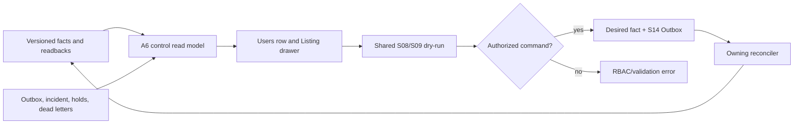

# S15 管理端与控制面 Read Model：自然语言蓝图

[总纲](../../README.md) | [伪代码](pseudocode.md) | [测试](tests.md) | [S14 异步控制](../14-async-control/logic.md)

## 1. 目标与边界

S15 把输入/输出部门的版本化事实、状态 owner、operation 和安全管理动作接入 Sub2API 管理端。UI/API 只修改 desired 管理事实或创建 S14 command，不直接写 A6、observed、历史 readback、账单或其他 controller 的 hold。

## 2. 需求

| ID | 规范 |
| --- | --- |
| ADM-001 | `/admin/users` 增加 `user_type=a6-channel` 精确过滤，普通 user role/filter 行为不变。 |
| ADM-002 | 行内显示稳定 Channel、模型/Listing 与 eligible 汇总、admission/remote 状态、负余额、readback freshness 和入口 Key fingerprint/last4。 |
| ADM-003 | 抽屉按 Listing 显示 confirmed ck/public multiplier、hard bounds、delta 范围、hold/desired/observed/plan；展开显示账号 class/sk/profit/delta、失败原因和所有 generation。 |
| ADM-004 | 输入部门只管理 account、Provider Token/route/Ban/cost/capability/billing；输出部门只管理 Channel/ingress Key/Listing/price/delta/state/revenue。危险动作明确部门和远端资源。 |
| ADM-005 | 支持设置/清空 delta override、account profit override、Class2 cost/multiplier、Class3 declared sk/model override、逐模型 hard min/max；所有数值用十进制字符串校验。 |
| ADM-006 | 公共文本只提供 corpus 项选择、随机重选和来源审计，不提供 free-text；显示 catalog SHA、sheet/row/index、selected value 与 selection generation。`LEGACY_REMOTE` 条目只读显示 `Source: LEGACY_REMOTE / Mutable: No / Activation blocking: No`，不提供“修复 Supplier name”。 |
| ADM-007 | 参数提交前调用与 S09/S08 同实现的 dry-run，预览 structural/profile eligibility、price band 和受影响 Listing 变化。 |
| ADM-008 | 展示并按权限处理 `ROUTE_UNKNOWN`、`AUTO_POOL_RANGE_EXHAUSTED`、orphan Token、dead-letter、platform incident、`BINDING_REVIEW` 和每个 hold 的 owner/source generation。 |
| ADM-009 | 人工重放复用原 operation identity 并核对 current desired generation；管理员不能直接改 observed 或历史 readback。 |
| ADM-010 | Binding review 只允许选择明确 instance、接受远端事实生成新 generation、或退役；operator hold 只能由相应权限设置/清除。 |
| ADM-011 | 通用 A6 控制台只调用 S01 版本化白名单；受管 mutation 转为 owning Outbox command。 |
| ADM-012 | RBAC、审计、CSRF/重认证沿用 Sub2API 管理安全基线；完整 Token/Key/Cookie/session 永不返回前端。 |
| ADM-013 | Merchant Price Order 管理：S15 负责展示、preview 与 admin command intake；**S15 不直接写 `a6_merchant_price_orders` generation**。通过 S14 向 S08 提交 `SET_MERCHANT_PRICE_ORDER` command；只有 S08 owning reconciler 可以校验 rank、写新的 `merchant_price_order_generation` 并触发 pricing replan。 |
| ADM-014 | Merchant Risk Profile 只读展示：`delta_request_ratio`、`average_delta`、`high_delta_ratio`、`delta_adjusted_volume`、earnings anomaly、platform warning、merchant suspension/takedown 与 `risk_score`；实现限定为 SQL/analytics read projection -> UI，**不得新增 RiskController、RiskScheduler、RiskActionPolicy 或任何自动业务状态机**。Risk Profile 变化不能自动改变 Merchant Price Order，也不作为 S08/S09/S10 输入。 |

## 3. 管理端子图

## 4. Read model 一致性

每个列表/抽屉响应包含 `as_of`、DB generation、Redis projection generation、remote readback time/completeness。发生 lag 时显示 stale/lag，不把缺失字段填成健康。大量详情采用批量查询，禁止每行远端读取。

## 5. 命令 API

命令使用明确 verb，例如 `set-delta-override`、`replay-operation`、`select-binding-instance`，请求包含 expected generation 进行 CAS。成功响应表示 desired/Outbox 已提交，不宣称远端已完成；UI 通过 operation/readback 状态跟踪。

## 6. 危险操作

Token rotation、Channel replacement、Key rotation、takedown/retire、route mode 变更、manual replay 和 operator hold 显示作用域、当前/目标 generation、受影响 Listings/accounts 和保守状态。不得提供“直接设 observed LISTED”或“清所有 hold”按钮。

## 7. 完成条件

- 列表/详情可解释为什么某 Listing/账号不可用以及哪个 owner 能处理。
- 所有写按钮都落 desired+Outbox 并有 generation conflict UX。
- UI bundle、API 和日志不泄露 secret，普通 admin 权限不能跨部门危险操作。

上位依据：[原 Prompt §15](../../../sub2api-a6-channel-implementation-prompt.md#15-管理端)。
