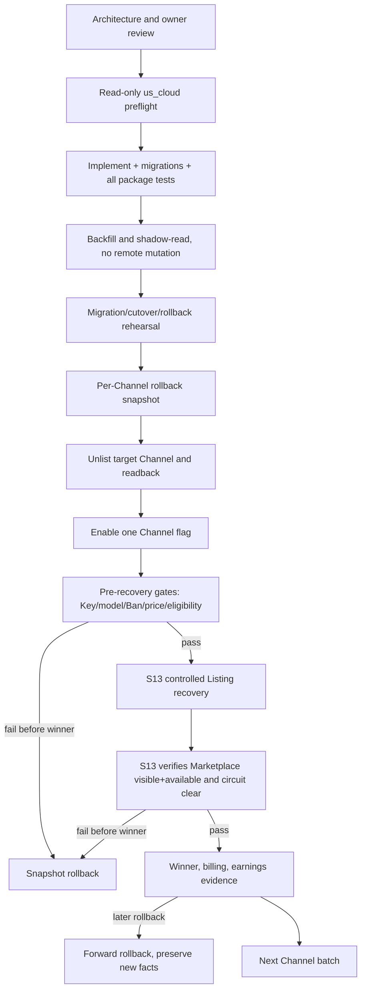

# S16 迁移、`us_cloud` 发布与总验收：自然语言蓝图

[总纲](../../README.md) | [伪代码](pseudocode.md) | [测试](tests.md) | [源 Prompt](../../../sub2api-a6-channel-implementation-prompt.md)

## 1. 目标与边界

S16 把旧 Managed Seller/Provider/OAuth/API Key 事实迁到原生模块，并在 `ssh us_cloud` 上通过实际 Sub2API 拓扑完成默认关闭、逐 Channel 切换、证据采集和回滚。它不重新定义任何业务包合同，也不把归档 Trader 继续扩展成新控制面。**legacy mapping、N:1/1:N 合并拆分、opening adjustment 与历史 alias 兼容只允许存在于 migration command/tooling 和迁移期 readback 中；Channel 完成 cutover 后，永久请求/调度热路径不得保留按 legacy shape 分支的代码。**

## 2. 实施前强制评审

| ID | 规范 |
| --- | --- |
| MIG-001 | 编码前提交并审核：数据模型/约束/Decimal/加密；三层边界；Listing 与 Class1 状态机；两套 Key Saga；A6 写入 unknown/readback/补偿/Replay；旧资源映射；每个 state/hold/operation owner 与自动/失败/人工出口。 |
| MIG-002 | 在 `us_cloud` 先只读确认真实源码根、commit/version、dirty state、migration head、Go/前端 toolchain、蓝绿/service 拓扑、DB/Redis、A6 credential reference 和 Class2Adjustment 基线；不得沿用文档中的旧路径猜测。 |
| MIG-003 | 开工和发布前确认 `a6-trader-provider-pool-shadow.service` 及 timer disabled；日常预检/发布验证不运行 shadow。 |

## 3. 数据迁移需求

| ID | 规范 |
| --- | --- |
| MIG-004 | 按远端 Channel 聚合旧 Managed Seller，结合 binding、完整 inventory、Key fingerprint/last4 和成功入口日志选择唯一 anchor；歧义进 BINDING_REVIEW。 |
| MIG-005 | 一用户一Channel保留 users.id/Key 原地转换；多用户一Channel保留实际入口 anchor 并合并；一用户多Channel保留一 anchor，其余新建用户/唯一Key逐个轮换。 |
| MIG-006 | 盘点 `TPA6API`/`ToA6API` 的 group ID、用户、账号、Key；双实体按 Channel binding 合并后退役旧组，同一实体旧名原地 canonicalize；验证唯一 Key/候选后删除 runtime alias。 |
| MIG-007 | 旧 Listing delta 只对切换时现有 candidate 建 nullable override，标 `legacy_managed_seller`；新账号仅 delta_auto。 |
| MIG-008 | 保存旧公共文本审计原文；只有系统准备执行新远端写入的字段必须取得 S00 corpus selection；远端不可修改的历史 Supplier name 保存为 `LEGACY_REMOTE`，不阻塞 ACTIVE。保存旧余额，移除巨额余额约束/trigger，以 opening adjustment 让新账本从0开始负扣。 |
| MIG-009 | 旧 Provider 迁独立 Class1 Token；OAuth/API Key 经管理员确认成本合同后进入 Class2/Class3，不按名称自动猜类别。 |

## 4. 切换与回滚需求

| ID | 规范 |
| --- | --- |
| MIG-010 | 先 backfill/shadow-read，再按 Channel feature flag 切换。切换前下架；恢复前调用一次 S05 current Exclusion Gate（复用 BanRelation/operation audit）并检查 Key/model/price/eligibility。**Marketplace visible+available 与 circuit clear 由随后 S13 recovery VERIFY 建立，不能在主动 unlist 后、resubmit 前作为 gate。** |
| MIG-011 | 不启 Provider shadow timer、不改无关用户/账号；单 Channel 失败只回滚该 Channel并保留历史事实。 |
| MIG-012 | 每个 Channel 切换前保存本地 user/Key/group、远端 Channel Key、全部 Listing 状态/价格的可验证 rollback snapshot。 |
| MIG-013 | 尚无新流量可按 snapshot 完整恢复旧入口；已有新 winner 后只能 forward rollback：保留新账本/instances/负余额，恢复旧读取/调度路径时仍沿用当前唯一远端 Key，禁止复活非-anchor Key或删除新事实。 |
| MIG-014 | 回滚也必须逐项远端 readback；migration/release 不以进程启动、HTTP 200 或 UI 显示代替业务门。 |

## 5. 交付与总验收需求

| ID | 规范 |
| --- | --- |
| MIG-015 | 实现包含 DB migration、后端服务、请求硬门、异步 controller、管理端和测试；不得用占位实现远端写后读、经济结算或故障恢复。 |
| MIG-016 | 验收覆盖源 Prompt §17 九类：数据/安全；用户/Key；Provider；价格；delta/结算；调度三出口；Listing恢复；Outbox/Incident；迁移/回滚/回归。 |
| MIG-017 | 交付迁移文件、前后端实现、测试结果、A6 写后读证据、delta 收益闭环、回滚步骤和运维参数清单。 |
| MIG-018 | v0.1.173 Class2Adjustment 的 API、规则、算法、shadow/apply、berserk、probe 和普通流量回归是发布阻断门。 |
| MIG-019 | 生产公共文本（含 `LEGACY_REMOTE`）、BanRelation/BAN_INIT、quota liquidity、callback exact PING 和 non-quota next-band 行为必须有对应 `AGENTS.md` 证据。 |
| MIG-020 | Merchant Price Order backfill：迁移时为每个历史商户生成确定性的初始 `merchant_price_rank`（不随机），cutover 前由管理员确认最终顺序；rank 只影响 S08 目标槽分配，不参与 Delta 或风险判定。 |

## 6. 发布子图

## 7. `us_cloud` 原则

蓝图不固化未知远端路径或 unit 名。实施 Agent 必须从 SSH 登录后的只读事实建立 deployment manifest，沿该机现有 Sub2API release/blue-green 机制发布。任何 DB、systemd、symlink、Caddy 或流量变更都必须在变更清单中明确，并按实际拓扑给出回滚。

## 8. 完成条件

- 全部 17 包的 requirement/test/implementation/evidence trace 可查询。
- 至少一个受控 Channel 完成端到端 delta-required winner 与 A6 earnings 闭环，再逐批扩大。
- rollback rehearsal 在无流量和已有 winner 两种分界均通过。
- 发布后 Provider shadow timer 仍 disabled，旧 runtime alias/非-anchor Key 不复活。

上位依据：[原 Prompt §1/§16/§17](../../../sub2api-a6-channel-implementation-prompt.md#16-迁移) 与 [根 AGENTS](../../../../AGENTS.md)。
