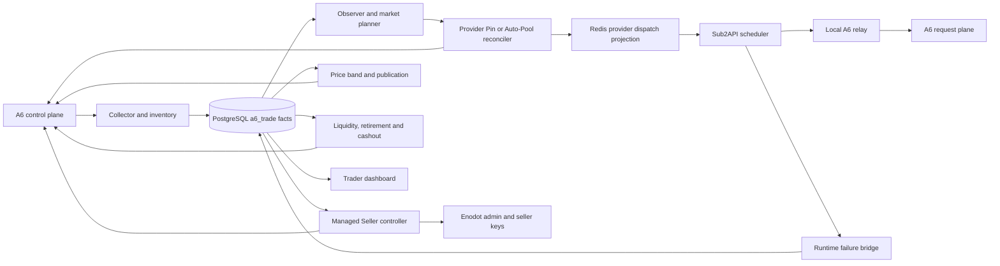

# 旧 A6 Trader 逻辑说明

> 冻结日期：2026-08-11。本文解释整理前的独立 Python Trader，帮助将有效逻辑迁移到 Sub2API
> 原生 A6 Channel 模块。新行为以 `sub2api-a6-channel-implementation-prompt.md` 为准。

## 1. 系统定位

旧 Trader 同时承担四类工作：

1. 批量注册 A6 商户并维护 Cookie、Token、Supplier、Channel 和 Listing。
2. 把部分 A6 账号作为 Provider，通过 Pin 或 Auto-Pool 为 Sub2API 提供上游能力。
3. 把部分 A6 账号作为 Seller，通过 Sub2API Key 向 A6 Marketplace 输出模型能力。
4. 采集市场、收益、用量和资金事实，驱动定价、上下架、故障恢复、补款和提现。

它从账号自动化逐步演化成独立控制面，最终包含 91 个 Python 模块、49 个脚本、68 个迁移、
43 个 service 和 26 个 timer。主要问题不是功能缺少，而是业务状态分散在 Python 控制器、PostgreSQL、
Redis、session 文件、systemd 触发器和 Sub2API 外部补丁中，跨边界修改成本较高。

## 2. 总体架构



### 2.1 事实来源

| 事实 | 旧系统真源 | 本地保存方式 |
| --- | --- | --- |
| A6 用户、Supplier、Channel、Listing、Token | A6 控制面读回 | session 引用、inventory 快照、绑定表 |
| 市场报价、Pin、Auto-Pool | A6 Marketplace | Observer scan、quote、route generation |
| Provider 实际调用与成本 | A6 用户日志及 Sub2API usage | usage event、请求归因、cost generation |
| Seller 对外收入 | A6 earnings | earning event、counterparty classification |
| Sub2API 账号、Key、组和余额 | Enodot Admin/PostgreSQL | binding、readback、内部 adjustment |
| 当前可调度 Provider | PostgreSQL current generation | Redis 只读投影 |
| 运行凭据 | 权限为 0600 的本地文件 | 数据库仅存引用、指纹、last4 和脱敏元数据 |

## 3. 领域模型

### 3.1 商户与职责

每个 A6 商户天然是 Seller。旧控制面另外给商户分配互斥运行职责：

- `Observer`：读取 Marketplace，形成完整市场快照，不承接生产请求。
- `Provider`：使用 A6 Token、Pin 或 Auto-Pool 承接 Sub2API 上游请求。
- `Seller`：通过自己的 A6 Channel 和 Listing 向 Marketplace 输出服务。

职责切换不等于删除商户。商户 ID、session、Supplier inventory 和历史事实继续保留。

### 3.2 Managed Seller

Managed Seller 控制器为每个商户维护：

- 一套 Enodot 用户、Key 和分组绑定。
- 一个或多个 A6 Channel binding。
- 每个模型的 Listing binding。
- 稳定 `managed_uid`、期望配置 fingerprint、远端 instance ID 和动作审计。

控制器先读取完整 inventory，再决定 create、adopt、update、takedown 或 noop。远端写入后重新读取；
超时或响应不明时依靠稳定 UID、请求记录和 inventory 判断采用结果还是继续补偿。

### 3.3 Provider Slot 与 Generation

Provider 不是简单账号列表，而是按模型维护的槽位和不可变 generation：

- pool generation 决定哪些账号占据 active、standby 或 vacant slot。
- route generation 决定 Token 使用 Pin 还是 Auto-Pool，以及对应 Channel 或价格范围。
- cost generation 保存该 route 的成本口径。
- dispatch generation 把当前激活结果投影给 Sub2API。

远端读回、成本、健康、owned-Channel Ban 和本地账号绑定全部一致后，generation 才进入 active。

## 4. 关键运行链路

### 4.1 账号注册与 Supplier 建立

```text
QQ 地址池
-> 请求并关联邮箱验证码
-> A6 注册和登录
-> 创建并 reveal 一个 Token
-> 读取上游模型
-> POST supplier/apply
-> 保存 owner-only session
-> 导入脱敏 merchant metadata
```

注册工作流位于 `batch.py`、`workflow.py`、`mail.py`、`client.py` 和 `storage.py`。随机商户、Channel、
Listing 和 Token 文案后来改为读取工作簿与 Token 语料。Session 文件保存敏感材料，数据库只保存引用和指纹。

### 4.2 Collector 与事实层

`trade_collector.py` 周期读取：

- 用户和 Supplier 资料。
- Channel、Listing、Token 和 Pin inventory。
- 财务余额、收益、结算、提现和用户调用日志。
- Marketplace quote 与 Provider usage。

Collector 使用分页、水位、稳定事件 identity 和 source hash 幂等写入 PostgreSQL。Repository 再把原始事实聚合成
经营指标、健康状态、Provider 成本、Seller 收益和 Dashboard read model。

### 4.3 Observer、Pin 与 Auto-Pool

Observer 按模型读取完整 Marketplace，过滤自有、不可用和价格越界 Channel，生成有版本的市场快照。

Pin 模式选择固定 Channel，记录 assignment epoch、成本和读回。Auto-Pool 模式按价格排序选择 Top-N，并完整纳入
第 N 名所在价格带。旧后期实现增加了 owned-Channel Ban 激活门：

```text
完整读取当前 Token + 模型可见的 Marketplace
-> 合并远端和本地 owned Channel
-> 逐项 disable
-> 读回 user_channel_disabled=true 和 route_status=user_disabled
-> 更新 Auto-Pool
-> 读回 auto_channels 非空且与 owned set 无交集
-> 激活 Provider
```

Provider shadow 只负责产生新计划证据，生产日常修复复用已有 generation。Shadow timer 在旧项目最终合同中保持关闭。

### 4.4 Provider 请求路径

Sub2API 从 Redis 读取当前 Provider dispatch projection。每个账号的 base URL 指向本地 relay：

```text
Sub2API
-> http://127.0.0.1:8767/a6-user/{a6_user_id}/v1/...
-> https://a6.a6api.com/v1/...
```

Relay 只做请求转发、连接池、流式传输和超时控制。URL 中的 A6 User ID 用于归因，控制面代理映射不进入数据面。

### 4.5 Seller 定价与 Publication

Seller Price Band 从市场报价、Provider 成本、利润参数、模型价格和现有 Listing 状态生成逐 Listing 价格计划。
旧算法包含：

- 成本下限和最大价格限制。
- 几何或分段价格带。
- Marketplace 密度采样和稳定分配。
- 价格跳变 cooldown。
- 写入 claim、幂等 action、远端更新和读回。

Model Publication 根据健康 Provider 数量、Seller inventory、控制门和最近成功决定 Listing 上下架。旧实现通过独立
controller 和 systemd 高频触发完成，新设计把这部分并入 `a6-channel` 用户、逐 Listing eligibility 和统一 Output Recovery。

### 4.6 失败分类与恢复

数据面失败通过内部接口或失败 journal 进入 Trader。旧后期分类已经区分：

- 用户请求错误。
- Provider 余额或 Token 配置错误。
- Pin/Auto-Pool 上游路由错误。
- 平台、网络、timeout 和责任不明错误。

账号级错误先摘账号，再触发 liquidity、repin、Auto-Pool 扩价或 replacement。Listing 是否下架由重新计算后的可调度容量
和 publication controller 决定。该分类后来整理成根目录 `errorlist.md`，新实现直接使用根合同。

### 4.7 Provider Liquidity

Provider 的 A6 请求消耗用户余额，Seller earnings 先进入商户可提现余额。Liquidity Controller：

1. 读取用户余额、可提现余额和 Provider 合同。
2. 按 `quota_per_unit` 的整单位预览划转。
3. 先写 intent，再执行一次 mutation，最后读回确认。
4. 仍不满足资金合同时撤销 Provider duty，将旧 slot 投影为 `VACANT`。
5. replacement 通过 Ban、route、cost、模型能力和读回后才进入 slot。

`insufficient_quota` 始终走该链路，不触发 Observer 扩价。

### 4.8 Retirement 与 Cashout

Seller retirement 先停止新流量，再等待在途动作、下架 Listing、处理 Channel 和 Key，最后归档商户。Cashout 子系统
维护提现账户 inventory、风险证据、preview、intent、submit 和异步 reconciliation。资金动作按稳定 identity 去重，
结果不明时先查询状态，不重复提交同额操作。

## 5. 数据库演进

旧数据库使用 `a6_trade` schema，根迁移与 Python package 内嵌迁移逐文件一致。

| 迁移范围 | 主要能力 |
| --- | --- |
| `0001-0004` | 商户、财务、收益、用量、市场、Pin、提现账户和 Supplier inventory |
| `0005-0010` | Managed resources、Enodot binding、Seller 基础角色、权限和 Dashboard 索引 |
| `0011-0021` | 币种、用量分类、市场信号、退休、Channel 健康、Observer 和收益对手方分类 |
| `0022-0031` | 安全归档、Supplier profile、故障责任、增长、Provider Top-N、generation 和一致性 |
| `0032-0041` | 模型 publication、Provider read model、失败修复、成本匹配和 Sub2API dispatch 权限 |
| `0042-0050` | 区域协调、FX、Seller 计划、readiness、内部操作 Key、liquidity 和风险提现 |
| `0051-0061` | Pin 失败、价格 cooldown、提现调度、历史保留、assignment epoch 和价格释放 |
| `0062-0069` | 经济路由、runtime failure、profit、Auto-Pool、Provider membership 和 liquidity Token |

旧控制器没有一张统一 Outbox 表，而是使用多套 intent、audit、claim、failure request、generation 和 reconcile 表。
新模块应按 Prompt 收敛为统一 Outbox、资源 operation 和 owner 明确的状态投影。

## 6. 代码地图

| 领域 | 主要归档模块 |
| --- | --- |
| A6 协议与账号工作流 | `client.py`, `models.py`, `workflow.py`, `batch.py`, `storage.py` |
| Enodot/Sub2API 管理 | `enodot.py`, `enodot_admin.py`, `trade_enodot_*` |
| 事实采集与查询 | `trade_db.py`, `trade_collector.py`, `trade_repository.py` |
| Managed Seller | `trade_managed_listings.py`, `trade_managed_listing_store.py`, `trade_seller_orchestration.py` |
| 定价与上下架 | `trade_seller_price_band.py`, `trade_model_publication.py`, `trade_publication_control.py` |
| Provider 计划与应用 | `trade_provider_pool*.py`, `trade_provider_cost.py`, `trade_provider_binding.py` |
| Pin 与 Auto-Pool | `trade_pin_*.py`, `trade_provider_auto_pool*.py` |
| Dispatch 与 relay | `trade_provider_dispatch.py`, `trade_provider_region.py`, `trade_upstream_relay.py` |
| 故障恢复 | `trade_channel_failure.py`, `trade_provider_failure_repair.py`, `trade_provider_runtime_failure.py` |
| 资金 | `trade_provider_liquidity.py`, `trade_provider_topup.py`, `trade_cashout_*.py` |
| 生命周期 | `trade_seller_retirement.py`, `trade_merchant_recovery.py`, `trade_market_history_retention.py` |
| 管理界面 | `trade_dashboard.py`, `trade_dashboard_management.py`, `data/trade_dashboard.html` |

CLI 中的 15 个 `trade-*` 命令覆盖迁移、导入、采集、Dashboard、角色、Seller 资源、Pin、定价、
补款、增长、上游校验、自动纳管和退休。其余 49 个脚本承担后来新增的 Provider、publication、资金、
区域和应急控制器。

## 7. 进程与触发模型

systemd 大致分为以下串行所有权域：

| 锁或所有权域 | 旧进程 |
| --- | --- |
| `network-scan` | session refresh、merchant recovery |
| `seller-control` | Seller onboard、pricing、publication、retirement、upstream guard |
| `provider-control` | pool apply、failure repair、Auto-Pool、liquidity |
| `provider-dispatch` | PostgreSQL 到 Redis/Valkey 投影 |
| Dashboard/relay | 常驻 WSGI 与 HTTP relay |
| Collector/Observer | 周期事实读取和市场扫描 |

一些 timer 是事件丢失后的补偿触发器，另一些直接承担固定频率控制。随着功能增长，多个 path、timer 和 listener
可能同时唤醒同一资源，依靠 flock、数据库 claim 和 generation 去重。新设计的统一 Outbox 与 Reconciler 正是为了
把这些触发入口收敛为单写者。

## 8. 必须保留的不变量

1. 所有 A6 控制面调用使用 `(a6_user_id, system_access_token)`，凭据加密或外置，日志脱敏。
2. 远端 mutation 先写 intent，结果明确后读回；结果不明先 GET，再采用、重放或重规划。
3. Provider Auto-Pool 激活前完整执行 owned-Channel Ban，远端 disable 和 subscription 都要精确读回。
4. Provider route/cost/health 使用匹配 generation，旧 generation 不覆盖新事实。
5. `insufficient_quota` 属于 liquidity，不属于扩价。
6. Provider shadow 默认关闭，只在确需新 immutable generation 且无可复用计划时单次运行。
7. 瞬时满并发不等于结构性无账号，不触发 Listing 下架。
8. 资金、Key、Pin、上下架和价格写入均按稳定 operation identity 幂等。
9. 原始金额和倍率使用整数或 Decimal；数据库保存原始 A6 单位和换算 generation。
10. 公共文案来自版本化语料，不用职责、ID 或时间拼接名称。

## 9. 迁移到新模块的取舍

| 旧能力 | 新模块处理 |
| --- | --- |
| A6 HTTP client 与协议样本 | 依据活跃 API Reference 重写成 Sub2API Typed Client |
| Session 文件和 Python secret reader | 迁移为 Sub2API 加密 credential 与 secret generation |
| Managed Seller 一套资源控制 | 改为一 `a6-channel` 用户绑定一 Channel、多模型 Listing |
| Seller Key 与 Provider Token 混在同一项目 | 分为输出入口 Key 与输入 Provider route Token 两个部门和两套 Saga |
| Listing 或分组级倍率 | 改为 `(listing, account, model)` eligibility 和 delta |
| 独立 Price Band controller | 迁入逐模型 Listing pricing generation |
| 多套 intent/audit/claim 表 | 收敛为统一 Outbox、operation journal、hold/desired/observed/plan |
| Redis Provider projection | 只投影当前 eligible account 与 delta，PostgreSQL 保持事实源 |
| 独立 WSGI Dashboard | 融入 Sub2API 管理端 `/admin/users` 和 A6 控制台 |
| systemd 脚本网络 | 改为 Sub2API 内部事件、worker、lease 和定时补漏 |
| Trader failure bridge | 合并到每次 attempt 的统一经济与故障硬门 |
| Trader retirement/publication | 合并到 Output Lifecycle 与 Recovery Reconciler |

## 10. 已知历史边界

- 归档代码代表整理时工作树，不代表所有逻辑都已部署到同一生产版本。
- 归档专题设计稿包含不同阶段的参数和未决结论；根目录 Prompt 已完成去重和最终取舍。
- 旧 `client.py` 工作树曾给 Auto-Pool caps 增加 `per_request_price_micros`，A6 抓包未确认该字段；新实现仅按
  per-token Listing 和最终 token usage 计费。
- 旧 `TPA6API`、`ToA6API` alias、Managed Seller 用户和 Key 关系需要按 Prompt 的 Channel 聚合迁移，不直接复制。
- 真实代理、钱包、Cookie、Token 和 HAR 留在本机 `.local/`，归档路径只保存其 schema、代码引用和控制逻辑。

## 11. 归档定位方式

从新 Prompt 追旧实现时，优先使用：

```bash
rg "关键状态或接口" archive/legacy-trader/src archive/legacy-trader/scripts
rg "对应表名" archive/legacy-trader/migrations archive/legacy-trader/src
rg "控制器或状态" archive/legacy-trader/tests
rg "ExecStart|OnUnitActiveSec|OnCalendar" archive/legacy-trader/deploy/systemd
```

旧代码只回答“以前怎样实现”，根目录 Prompt 回答“现在应实现什么”。
